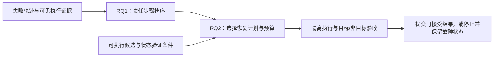

# 保留责任排序的研究方向：历史证据与CCF A核心论文5＋5

核查日期：2026年9月19日。本文按最新要求保留已经做过可行性实验的责任排序，重新收敛两项研究内容及核心文献。它替代上一版将“失败模式识别”升为独立研究内容的方向建议；论文题目仍待确定。

## 1. 建议向导师明确的方向

**主方向确定为：LLM Agent执行失败分析与调试，属于软件工程中的智能体系统质量保障。两项研究内容保留为“责任步骤排序”和“诊断引导的恢复计划选择”。**

第一项研究利用执行轨迹判断哪些步骤应优先检查；第二项研究利用这一排序，在可重放的任务环境中选择恢复计划，并评价预算、恢复收益与不安全尝试之间的关系。事务隔离、撤销和验收承担执行保障，不再另立“通用事务管理”研究主线。

向导师可以直接这样说明：

> 我研究LLM Agent执行失败后的分析与纠正。第一项工作根据局部行为证据和跨步骤结构关系，对责任候选步骤排序；第二项工作研究如何利用这一排序，在有限尝试预算和明确风险约束下选择恢复计划。已有实验分别支持排序有效和恢复组合可行，当前要补清的是：责任排序对恢复到底有多少增量，以及恢复率提高能否在相当风险下保持。

这保留了已有工作，也把第二项工作的未知问题落在可比较的决策效果上。失败模式分类用于交代研究范围和分析结果，不替代责任排序。恢复部分限定在可保存状态、可隔离重放、可验证目标及非目标状态的工具任务；不承诺覆盖所有自然语言错误、不可撤销的外部副作用或全部Agent系统。

## 2. 先按历史证据作取舍

### 2.1 应保留的正向证据

| 既有证据 | 核实的事实 | 对方向的影响 |
|---|---|---|
| Exp112C：责任排序 | 任务组等权MRR由最强公平基线约0.343700提高到A＋B约0.496057；平均相对提升44.3302%，绝对差配对95% CI为[0.132370, 0.171639]。B2单模块也有独立正增益 | 责任排序有可行性依据，应保留为第一项研究内容 |
| Exp121：恢复组合 | 在该次冻结协议中，组合方法恢复14/34任务，最强公平单点基线为7/34；等范围控制已经达到12/34 | 保留恢复组合的可行性证据；不能把全部增益归于依赖身份 |
| Exp122：直接桥接 | 同一候选池、预算B＝2，原始RQ1顺序恢复率32.4%，无RQ1固定顺序23.5%，打乱RQ1顺序14.7% | 原始排序存在下游用途；这些观察差异不能全部追加声称统计显著 |
| Exp122：恢复后验 | 保持相同RQ1第一候选后，改选第二候选使恢复率从32.4%提高到52.9%；同时原Harm由20.6%升到41.2% | 第二项应研究预算与风险约束下的恢复选择，不能只追求最高恢复率 |

来源：[Exp112C正式结果说明](../../实验/实验112C_RQ1时序依赖排序纠正式复跑/README.md)、[Exp121正式结果说明](../../实验/实验121_RQ2原生恢复排序依赖切片/README.md)、[Exp122正式报告](../../实验/实验122_RQ1完整排序到RQ2恢复桥接验证/results/exp122_formal_report.json)。Exp112C是冻结开发划分上的嵌套交叉验证，不能写成全新外部测试胜出。其排序覆盖所加载记录的全部`turns`；Exp122的恢复桥接则只覆盖八个可见锚点，两者的“完整”范围不同。

原Harm记录隔离尝试中出现过的不安全候选，不能直接解释为最终提交状态遭到永久破坏。后续报告采用“不安全尝试率”和“提交后损害率”分别描述，沿用[交接12的最小补充方案](../../交接/交接12_20260902_RQ2最小改动补充实验方案.md)。现有恢复的目标探针检查目标Python文件的`compile()`，同时检查非目标状态和TNR；它支持受控状态故障恢复，不能直接写成自然语义错误已修好或原始软件任务已通过完整测试。

### 2.2 根据历史经验排除的选择

| 候选路线 | 本轮取舍 | 历史依据和理由 |
|---|---|---|
| 失败模式识别＋关键归因，两章重新起步 | 不采用为主线 | 尚无与Exp112C同等的本地证据，且会挤掉已有责任排序成果；模式可用于分层分析 |
| 在线风险报警→责任定位 | 暂不恢复 | 旧实验出现误报漂移和桥接无增益；风险峰值也不是责任标签 |
| 成功参照作为必需输入 | 不设为核心前提 | 同任务成功参照的正信号不等于跨任务可迁移；依赖参照会增加资产和评价混杂 |
| 责任Agent分类作为上游主任务 | 不采用 | 当前目标是步骤排序；既有主体标签、构造标签与桥接边界已有审计 |
| 显式因果传播图或通用因果归责 | 不作当前承诺 | 历史传播支线没有稳定增益；当前结构关系不足以直接证明因果 |
| 独立的通用事务管理、Saga补偿系统 | 不新增为第二研究方向 | 会引入并发、隔离、补偿和外部副作用等新问题，超出当前恢复决策证据 |
| 只在旧小候选池里增加复杂风险模型 | 不优先 | Exp118C/119C说明候选可恢复上限可能先限制收益，排序和门控不能创造不存在的可恢复候选 |
| RQ1排序＋受控恢复计划选择 | 保留并收紧 | Exp112C、121、122均有可用证据；尚缺同风险对照和纯恢复排序基线 |

排除的是当前投入选择，不是宣布这些领域无效。[经验07](../../经验/经验07_20260826_NO-GO分类与资产上限预检.md)区分方法无效、协议无效、资产不足、研究问题错配和组合无增益；[历史失败与降级记录](../../经验/经验01_全部实验失败与降级.md)用于避免重复走已审查过的支线。旧“Exp122阻塞”快照已被后续正式结果更新，不能拿旧文件标题代替当前状态。

## 3. 两项研究内容具体研究什么

| 项目 | 研究内容一：责任步骤排序 | 研究内容二：诊断引导的恢复计划选择 |
|---|---|---|
| 研究问题 | 给定失败轨迹及明确候选范围，如何结合局部行为与跨步骤关系，使标注责任步骤更靠前？ | 给定责任排序、恢复候选和验证条件，如何在有限预算内选择后备计划，并在相当风险下提高恢复收益？ |
| 输入 | 任务说明、实际可观测的步骤记录、工具观测和结构关系；标签只用于训练或离线评价 | 冻结的责任排序、可见状态差分、候选计划、预算及验收规则；测试候选结果在尝试前不可见 |
| 输出 | 候选步骤的责任分数和排序 | 要尝试的恢复计划、顺序及停止决定 |
| 现有方法基础 | 匿名局部证据、pairwise评分、跨步结构特征及OOF融合 | 第一候选先验、恢复侧后验顺序、同目标键前向切片、隔离执行与验收 |
| 核心评价 | MRR、R@1、R@3及实际候选覆盖范围 | 同预算和风险约束下的验证恢复率、不安全尝试率、提交后损害率及成本 |
| 需要证明的增量 | 跨步关系确实帮助排序，且超过相同信息和预算的强基线 | 恢复侧决策优于直接沿用RQ1排序；责任信息又优于完全不使用RQ1的恢复排序 |

“提供完整排序”本身不够构成创新；已有工作已经研究候选筛选、归因和反馈。第一项的候选贡献是**局部证据与跨步关系如何共同改善排序质量**；第二项的候选贡献是**责任信息与恢复侧信息如何互补，以及这种互补能否在相当风险下成立**。这是待外部比较检验的研究主张，不把本地指标提升等同于文献首创。

现有B2的四类边实际是相邻时序、同匿名角色、同结构形状、同非空动作形状。它们是可计算的结构关系，尚未提取消息收发或真实读写依赖。因此当前方法按“跨步骤结构关系”表述；若未来加入实际消息或读写证据，应明确那是新增方法及实验，不能回填到已有结果中。

现有恢复切片按相同目标键连接后续编辑，是可观察状态关系的代理，未覆盖跨文件的真实读写依赖。上述限定及代码位置见[历史实现边界核验](006_责任排序与恢复_历史实现边界核验.md)。

两个内容共享一个失败分析与调试流程，但有各自的评价目标。RQ1的排序效果可以独立成立；RQ2是否需要RQ1，应由对照回答。现有多Agent日志与工具动作流并不天然是同一数据集，端到端实验必须明示步骤到动作锚点的映射及适用范围。

## 4. 核心论文的筛选口径

以下是**两组各五篇、共十篇不重复的核心阅读文献**。每篇均核对正式发表记录、公开数据或可执行场景、非空方法实现。“五篇核心文献”按问题定义、直接方法、表示、数据和约束分工，不把十篇都当作同任务强基线。

等级采用[2026年第七版CCF正式目录](https://www.ccf.org.cn/Academic_Evaluation/By_category/)，并核读[CCF署名正式PDF的镜像版本](https://github.com/LovenSar/CCF_RANK/tree/55ca5eae67c26d518c6a8b71ee5827a053086f20)。该版ICLR为A；本表涉及的ICML、ACL、NeurIPS、KDD、OOPSLA及ICSE也为A。主会之外的Findings、workshop和仅有arXiv版本不计入本轮十篇。

数据门槛包括公开任务样本、轨迹集或可执行评测场景；“使用已有公开数据集”也满足有数据，不要求每篇另造新数据。代码门槛要求实际方法实现，不接受仅有README或空仓库。本轮进行了资产和关键实现核查，没有运行这些论文，故不声称十篇均已在当前机器复现。

## 5. 第一组：责任步骤排序的五篇核心论文

| 论文；正式CCF A载体 | 公开数据与实际代码 | 与责任排序的关系 |
|---|---|---|
| **Who&When**：*Which Agent Causes Task Failures and When? On Automated Failure Attribution of LLM Multi-Agent Systems*；[ICML 2025正式记录](https://proceedings.mlr.press/v267/zhang25cq.html) | [184条标注轨迹](https://github.com/mingyin1/Agents_Failure_Attribution/tree/b2bae5c5b06d681d04ea5e9b63b7a30525c04925/Who%26When)；[推理实现](https://github.com/mingyin1/Agents_Failure_Attribution/blob/b2bae5c5b06d681d04ea5e9b63b7a30525c04925/Automated_FA/inference.py)和同目录评价器 | **问题定义与直接归因对照**：整段、逐步及二分归因；选定步骤标签的含义 |
| **StepFinder**：*StepFinder: A Temporal Semantic Framework for Failure Attribution in Multi-Agent Systems*；[KDD 2026正式DOI](https://doi.org/10.1145/3770855.3817991) | [4,168个训练JSON](https://github.com/taiyu-zhu/StepFinder/tree/48d71c7090adca3667a31b043a78484f407b4a2f/data)，测试使用Who&When；[model.py](https://github.com/taiyu-zhu/StepFinder/blob/48d71c7090adca3667a31b043a78484f407b4a2f/model.py)及训练/评价代码 | **最直接的排序强近邻**：时序特征、Agent交互、步骤评分，已经报告Top-k和MRR@3 |
| **TraceElephant**：*Seeing the Whole Elephant: A Benchmark for Failure Attribution in LLM-based Multi-Agent Systems*；[ACL 2026长文](https://aclanthology.org/2026.acl-long.912/) | [220条失败轨迹数据](https://huggingface.co/datasets/TraceElephant/TraceElephant)；[归因代码及Agent系统](https://github.com/TraceElephant/TraceElephant/tree/0ce8abb2855de9f454f27f6b0795a4b7e6c8d5fc/code) | **观测条件与跨系统评价**：实际输入、输出、工具记录，检验完整上下文是否改善排序 |
| **Graphectory**：*Process-Centric Analysis of Agentic Software Systems*；[OOPSLA 2026正式条目](https://2026.splashcon.org/details/oopsla-2026/74/Process-Centric-Analysis-of-Agentic-Software-Systems)，PACMPL 10(OOPSLA1)，Article 163 | [预构建图和指标](https://github.com/Intelligent-CAT-Lab/Graphectory/tree/70a81ec6398805918e416f4aca651b1e6aa6e083/data)、[原始轨迹](https://zenodo.org/records/17364210)；[构图代码](https://github.com/Intelligent-CAT-Lab/Graphectory/blob/70a81ec6398805918e416f4aca651b1e6aa6e083/graph_construction/buildGraph.py)和图分析器 | **结构表示参照**：给出具体节点、关系及阶段定义，帮助设置表示消融 |
| **AEGIS**：*Aegis: Automated Error Generation and Attribution for Multi-Agent Systems*；[ICLR 2026正式论文](https://openreview.net/pdf?id=zqcYoxXiN3)，[大会目录](https://iclr.cc/Downloads/2026)收录 | [官方训练/验证/测试JSONL](https://huggingface.co/datasets/Fancylalala/AEGIS)；[错误生成、训练与评价实现](https://github.com/kfq20/AEGIS/tree/18fecc5641235a67299cd832632839c9c80244d6) | **受控错误与监督审计方法**：成功执行、受控扰动和结果检查，为鲁棒性/负对照设计提供依据 |

这组由**三篇直接归因工作、一篇结构表示工作、一篇数据方法工作**组成。三点对当前研究最有影响：

1. **StepFinder必须正面比较。** 它已经做步骤评分和排序，不能再把“从Top-1扩成排序”单独作为新意。其公开`main.py`存在按`test_loader`每轮评价并选择模型的实现；迁移为本项目基线时使用独立验证集选模型，最终测试保持隔离。训练生成变体与原题按任务分组，避免题目重叠。[所核代码](https://github.com/taiyu-zhu/StepFinder/blob/48d71c7090adca3667a31b043a78484f407b4a2f/main.py#L254)
2. **标签按各论文准则使用。** Who&When的关键步骤定义和TraceElephant的职责/可恢复性归因不能未经核对直接混合。两者均不提供每一步连续的因果责任真值；排行榜一致性和干预验证分开解释。[Who&When §2](https://arxiv.org/html/2505.00212v1#S2)、[TraceElephant §2及附录](https://aclanthology.org/2026.acl-long.912.pdf)
3. **表示和数据论文不冒充步骤基线。** Graphectory数据没有责任步骤标签；AEGIS公开标签是责任Agent与错误类型，也没有关键责任步骤真值。AEGIS仅用于学习数据构造和审计方法，不将其主体标签投射为步骤真值，不把研究改回责任Agent分类。[AEGIS §3—4](https://arxiv.org/html/2509.14295v3#S3)

已核读Who&When任务定义和基线、StepFinder模型与评价实现、TraceElephant观测与归因协议、Graphectory图定义、AEGIS任务定义及数据生成流程。StepFinder正式状态另以[ACM向Crossref登记的出版元数据](https://api.crossref.org/works/10.1145/3770855.3817991)核对；不是仅凭仓库自称录用。

## 6. 第二组：恢复决策及执行约束的五篇核心论文

| 论文；正式CCF A载体 | 公开数据与实际代码 | 在恢复研究中的职责及边界 |
|---|---|---|
| **SyncMind**：*SyncMind: Measuring Agent Out-of-Sync Recovery in Collaborative Software Engineering*；[ICML 2025正式记录](https://proceedings.mlr.press/v267/guo25l.html) | [SyncBench及300例评测集](https://huggingface.co/datasets/xuehang/SyncBench)；[恢复评测运行器](https://github.com/xhguo7/SyncMind/blob/a48c469fc71a9f4f968c74813c66adf61be85f02/syncmind/framework/OpenHands/evaluation/benchmarks/syncbench/run_infer.py)和验收器 | **恢复问题与资源评价**：Agent失同步后探索、修复或求助；错误来自代码状态更新，定位单位是文件/函数 |
| **STRATUS**：*STRATUS: A Multi-agent System for Autonomous Reliability Engineering of Modern Clouds*；[NeurIPS 2025主会](https://proceedings.neurips.cc/paper_files/paper/2025/hash/47a6e9e2c3019f13ad94a0f259fe4970-Abstract-Conference.html) | [论文任务清单](https://github.com/xlab-uiuc/stratus/blob/4fc9a5b66bebbc5ddf2154c06e97f05db9385183/eval/eval_tasks.yaml)、[AIOpsLab场景](https://github.com/microsoft/AIOpsLab/tree/main/aiopslab/orchestrator/problems)、[ITBench场景](https://github.com/IBM/ITBench-Scenarios/tree/main/sre)；[撤销实现](https://github.com/xlab-uiuc/stratus/blob/4fc9a5b66bebbc5ddf2154c06e97f05db9385183/src/stratus/tools/mitigation/rollback_tool.py) | **受约束试执行与撤销机制**：TNR及其成立前提；处理对象是故障云服务，用作机制参照，不把云故障归因写成Agent责任归因 |
| **Reflexion**：*Reflexion: Language Agents with Verbal Reinforcement Learning*；[NeurIPS 2023主会](https://proceedings.neurips.cc/paper_files/paper/2023/hash/1b44b878bb782e6954cd888628510e90-Abstract-Conference.html) | [HumanEval任务](https://github.com/noahshinn/reflexion/blob/218cf0ef1df84b05ce379dd4a8e47f17766733a0/programming_runs/benchmarks/humaneval-py.jsonl)、仓内HotPotQA数据/ALFWorld配置；[反思记忆实现](https://github.com/noahshinn/reflexion/blob/218cf0ef1df84b05ce379dd4a8e47f17766733a0/alfworld_runs/generate_reflections.py)及试次执行器 | **失败反馈重试对照**：检验责任引导是否超过整段反思后再次尝试；不提供外部状态回滚保证 |
| **LATS**：*Language Agent Tree Search Unifies Reasoning, Acting, and Planning in Language Models*；[ICML 2024正式记录](https://proceedings.mlr.press/v235/zhou24r.html) | [HotPotQA任务](https://github.com/andyz245/LanguageAgentTreeSearch/blob/853d81614607dd27433faf17c7b0a7d660f95d22/hotpot/data/paper_dev.jsonl)，仓内HumanEval及WebShop接口；[树搜索实现](https://github.com/andyz245/LanguageAgentTreeSearch/blob/853d81614607dd27433faf17c7b0a7d660f95d22/hotpot/lats.py) | **候选搜索与预算方法**：反思、价值评价和树搜索；原任务是在线求解，迁移后不能冒称原版LATS已经完成本项目恢复 |
| **AgentSpec**：*AgentSpec: Customizable Runtime Enforcement for Safe and Reliable LLM Agents*；[ICSE 2026 Research正式记录](https://conf.researchr.org/details/icse-2026/icse-2026-research-track/29/AgentSpec-Customizable-Runtime-Enforcement-for-Safe-and-Reliable-LLM-Agents) | [RedCode-Exec数据](https://github.com/AI-secure/RedCode/tree/main/dataset/RedCode-Exec)，另使用SafeAgentBench/FixDrive；[实际执行约束代码](https://github.com/haoyuwang99/AgentSpec/blob/e6fa3902e2cfb9681f454b355691b771f70543f8/src/controlled_agent_excector.py)、[强制执行策略](https://github.com/haoyuwang99/AgentSpec/blob/e6fa3902e2cfb9681f454b355691b771f70543f8/src/enforcement.py)及规则 | **执行约束参照**：触发、谓词检查、停止或纠正；不研究责任排序，也不保证估计出长程副作用 |

这五篇共同支持恢复问题、反馈重试、候选搜索和执行约束；**没有把五个不同系统包装成五个已可直接运行的恢复排序基线**。直接承接现有实验的主比较仍是RQ1-only、恢复-only及二者组合。Reflexion/LATS式方法需要说明怎样适配同一候选与预算；STRATUS和AgentSpec主要用于解释执行条件和机制边界，不要求新建云运维或具身研究方向。

已核读SyncMind §2—3、STRATUS §2—5、Reflexion §3—4及Algorithm 1、LATS方法与预算实验、AgentSpec §2—6。需要保留的细节是：SyncMind的24,332是初提取量，过滤后8,461，再抽300例评测；协作者拥有更新历史和参考信息，成本为设定的假想成本。STRATUS的TNR依赖精确Undo和写者独占。AgentSpec公开了真实机制，但数据需独立准备，示例脚本仍有实验性提前退出，不能宣称一键复现。[SyncMind全文](https://arxiv.org/html/2502.06994v2)、[STRATUS全文](https://proceedings.neurips.cc/paper_files/paper/2025/file/47a6e9e2c3019f13ad94a0f259fe4970-Paper-Conference.pdf)、[AgentSpec全文](https://arxiv.org/html/2503.18666v3)

### 6.1 没有进入十篇的原候选

| 文献 | 本轮核验结论 |
|---|---|
| SDBL，AAAI 2026 | 正式论文成立，但[官方仓库](https://github.com/Wen-qiangLi/SDBL)当前只有31字节README及未来发布承诺；不满足实际代码条件 |
| FLKR，AAAI 2026 | 正式论文成立，但论文给出的[FLRK仓库](https://github.com/gmy2013/FLRK)为空，未取得COFL实体与实现；不计入 |
| AgenTracer，ICLR 2026 | [数据发布包](https://github.com/bingreeky/AgenTracer/releases/tag/data-v1.0.0)和数据生成代码真实存在，但主模型权重及RL训练实现未公开完整；列重要补充，不承诺直接复现其8B基线 |
| ReAgent、Agent Workflow Memory | EMNLP载体未达到本次CCF A门槛；仍可作为相关工作讨论 |
| LDB | [官方记录](https://aclanthology.org/2024.findings-acl.49/)属于Findings，不按ACL主会A类长文计入 |
| MAST | 有正式论文和研究价值，保留作失败范围/模式的背景阅读；不据此把已有责任排序改为新的模式分类主任务 |

逐篇数据文件、代码版本、已读位置和核验限制另保存为[第一组资产核验](008_责任排序核心五篇_公开资产核验.md)与[第二组资产核验](004_恢复决策核心五篇_公开资产核验.md)。

## 7. 用已有真实记录向导师展示两项工作的关系

Exp122的`conan-io__conan-14397`、seed `20260816`可以作为已经发生的局部案例，不必再编造Agent角色或错误故事。这里的位置编号是该实验八个候选锚点的零基编号。

| 展示内容 | 原始记录 |
|---|---|
| RQ1给出的顺序 | `[0,1,2,4,3,6,5,7]` |
| 原始顺序在B＝2下的计划 | 尝试`[0]`、`[1]`；未通过恢复验收 |
| 保留同一首候选后的恢复顺序 | `[0,3,4,5,7,6,2,1]` |
| 恢复后验选择的计划 | 尝试`[0]`、`[3,4]`；第二项通过验收 |
| 风险记录 | 该例两种顺序的`harmful_recovery`均为false |

来源：[Exp122逐条正式输出](../../实验/实验122_RQ1完整排序到RQ2恢复桥接验证/results/exp122_formal_output.json)。第一项成果展示“候选应按什么责任次序检查”；第二项成果展示“在同一预算下选择哪个可执行计划”。该例支持说明功能区别，不单独证明排序位置就是真实原因，也不代表全部任务都无风险。

这里恢复的是实验规定的故障状态。向导师展示原始软件问题是否修复，需要另列原任务验收结果，不能仅凭这一条状态恢复记录声称原始Issue已经解决。

## 8. 接下来只补决定性证据

沿用已有最小补充方案，保留四个主要条件：只用RQ1第一名、按原始RQ1排序、完全不使用RQ1的恢复排序、RQ1先验与恢复后验的组合。所有条件共享同一候选池、起始故障状态、验证器和执行预算。

要回答的三个问题依次是：原始排序的第二、第三候选有没有新增价值；恢复后验能否超过直接责任顺序；保留责任信息能否超过纯恢复排序。风险或预算选择只在训练侧确定，评价侧不能看到候选结果后再选择最优深度。

同一批34项任务的补全定位为内部机制澄清。方法和比较方式固定后，再选择独立且标签适配的数据验证外部效度。TraceElephant可作为直接归因外测候选，但其历史使用情况及与已有数据的重叠仍须先核对；不能因为重新下载就称为未见测试集。论文中的跨任务方法迁移先说明输入和预算如何对齐，不直接横比原论文百分比。

如果组合在风险约束下不能超过RQ1-only或恢复-only，就如实保留较简单的有效方案，收缩第二项贡献；不通过再添加一个模型追求预期结果。责任排序已经成立的内部可行性结论仍保留，恢复独立增量则按实际证据判定。

本轮形成的是文献与方向修订文档，没有新增或重跑实验，也没有修改PPT。
