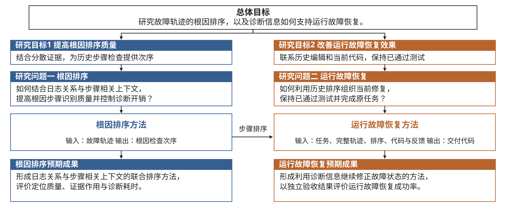

# 智能体运行故障的根因排序与恢复方法

## 摘要

智能体任务失败后，错误线索往往分散在历史操作及其反馈中。排查这些记录不仅需要判断哪些步骤值得优先检查，还需要确定历史判断对当前任务是否仍有修复价值。本论文以执行轨迹中的步骤记录为对象，研究根因排序及其支持的软件运行故障恢复方法。排序研究拟结合步骤内容、执行次序、角色归属和记录结构，探索关联证据与上下文信息的利用方式，形成历史步骤的检查次序。恢复研究从任务未完成时保留的代码与环境出发，将排序对应到历史编辑，结合当前源码和测试反馈组织修复依据，并考察保持已通过目标测试对连续修改的作用。实验计划分别使用带有根因标注的轨迹数据和可执行的软件任务，在共同数据、信息与资源条件下开展基线比较及消融分析，评价排序质量、恢复成功率和计算开销。研究重点在于说明跨步骤证据如何支持根因区分，以及历史诊断怎样帮助后续代码修正。

关键词：智能体、运行故障、根因排序、软件任务恢复

## 1 选题依据与研究现状

### 1.1 研究背景与意义

智能体执行任务时，错误理解、决策或操作可能使执行偏离任务要求，最终产生错误结果或未完成任务。本论文将这类现象称为运行故障，研究如何追查相关步骤，并利用诊断线索继续完成原任务。步骤级诊断为将任务结果追溯到具体历史行为提供了依据。[1]

执行轨迹按发生次序保存一次任务中的推理、动作与环境观察，能够反映结果形成的过程。[2] 轨迹中的一次具体决策或交互活动构成一个步骤，判断该步的作用，需要结合它当时接收的信息、实际操作和后续反馈。[3] 本论文以这些步骤记录为分析对象，保留来源数据的步骤边界和编号，角色标识用于说明记录归属。

故障线索并不总与出错步骤出现在同一位置。一项操作依据的任务要求可能位于轨迹前部，相关工具反馈出现在数步之后，而后续操作又可能继续使用先前形成的错误信息。智能体代码生成研究也表明，任务理解、规划、代码生成与验证之间的信息传递会影响后续执行。[4] 因此，逐条判断记录内容还不足以解释故障过程，需要联系不同步骤中的证据，区分引入错误的行为及其后续表现。

根因排序将历史步骤作为候选，结合步骤内容与关联证据计算分数，给出优先检查次序。其作用是为排查提供线索，使有限的检查资源优先用于可能与故障有关的步骤。排序质量需要通过根因标注评价，排序的实际用途则要在后续恢复中检验。

本论文选择软件任务作为恢复研究场景。此类任务通常保留源码、历史编辑和测试反馈，能够以代码修改及可执行测试观察恢复过程。已有程序修复智能体通过工具获取代码信息，并依据执行反馈继续尝试修复。[5] 在这一基础上，研究排序线索如何对应当前实现、后续补丁如何保持已有测试进展，有助于将历史诊断与任务继续执行联系起来。

### 1.2 国内外研究现状

#### 1.2.1 智能体运行故障诊断与根因排序

Who&When将故障诊断细化到责任主体和根因步骤，建立带有细粒度标注的轨迹数据，并比较整轨迹判断、逐步检查和二分搜索。[1] 其根因步骤界定与任务结果相联系，即纠正该步骤并相应调整后续执行后，能够使原任务成功的最早错误步骤。这项工作为步骤级诊断确定了研究对象，也使不同检查方式能够在共同标注下比较。

TraceElephant进一步关注诊断时能够获得哪些信息。该研究记录步骤的输入、输出和工具交互，比较静态诊断与能够回放候选步骤的动态诊断。[3] 完整执行记录使判断可以回到步骤当时的实际上下文，动态检查则为候选错误提供执行证据。其静态方法主要采用基本信息检索，动态方法需要可回放环境，对不同系统的适配仍与日志及执行接口有关。

StepFinder将步骤内容和角色信息编码后，结合双向时序建模与全局交互生成步骤分数。[6] 该方法在推理阶段结合跨步骤证据直接评分，无需逐次生成诊断文本，为根因排序提供了学习式实现。与这种主要从时序和语义交互中学习联系的方式相比，日志中的记录格式、动作结构及相邻上下文还提供了可直接提取的联系，这些信息是否具有独立的排序价值，需要通过共同数据上的对照检验。

DCFA从全轨迹推断依赖图，再利用局部反事实启发推理修正根因判断。[7] 该设计将结构化关系与局部分析结合起来，用于区分表面偏差和影响任务结果的错误。图结构及干预效果依赖模型推断，局部分析也带来额外推理开销。因此，根因诊断既要考虑证据联系是否有效，也要考虑取得和使用这些联系的成本。

表1-1概括了上述研究的主要贡献与适用边界。

**表1-1 智能体运行故障诊断与根因排序相关研究**

| 工作 | 技术原理 | 优点 | 不足与适用边界 | 文献 |
| --- | --- | --- | --- | --- |
| Who&When | 标注根因步骤，比较整轨迹、逐步和二分判断 | 建立步骤级诊断对象与比较方式 | 检查方式需要在定位质量与调用开销之间取舍 | [1] |
| TraceElephant | 完整轨迹观测，结合静态诊断与动态回放检查 | 将输入、操作和反馈纳入判断，支持执行验证 | 动态诊断依赖可回放环境，系统覆盖与适配仍有限 | [3] |
| StepFinder | 步骤语义、角色信息、时序建模与全局交互评分 | 直接输出步骤分数，减少生成式诊断调用 | 需要标注数据训练，已有评测范围主要为Who&When | [6] |
| DCFA | 依赖图推断与局部反事实启发推理 | 兼顾全局联系与局部错误分析 | 依赖模型构图和推理，局部扩展增加开销 | [7] |

这些研究提供了完整观测、全局交互和动态验证等思路。本论文进一步考察日志中可直接提取的联系能否补充候选区分，并同时评价排序质量与诊断开销。

#### 1.2.2 根因诊断支持的软件运行故障恢复

环境反馈为交互求解提供了调整依据。[8] 跨次尝试积累反思经验，可以影响后续决策。[9] 工具检查则能够为模型修订提供外部证据。[10] 软件任务恢复需要将这些信息落实为当前代码上的修改，并验证原任务是否完成。

Agentless采用定位、补丁生成和验证的分阶段流程，通过分层检索确定修改位置，再利用复现测试、回归测试与投票选择候选补丁。[11] 其流程明确，便于分析每个阶段的作用。测试结果主要用于筛选已经生成的候选，候选均未解决问题时，原流程没有继续依据这些结果生成后续修正的环节。这为研究反馈参与的连续恢复提供了比较对象。

EnAgent通过多样化生成、候选剪枝和工具辅助选择完成仓库级问题求解。[12] 选择阶段结合代码阅读和测试结果理解候选。它的回归测试依据原始代码确定，各候选分别验证，主要解决候选集合中如何保留并选出有效补丁的问题。连续修改中，新通过的任务目标如何成为后续代码更新的约束，属于另一种需要研究的状态管理问题。

SyncMind研究智能体对环境的认识与实际代码状态失步后的恢复，通过环境交互或协作获取缺失信息。[13] 这一研究说明恢复依据需要与当前环境一致。其基准通过历史代码变更构造失步场景，重点评价环境认知更新，与从既有故障轨迹中组织代码修复线索的研究侧重不同。

DoVer把日志中的错误假设转化为消息或计划干预，再从相应位置重执行，依据任务结果和中间进展判断干预作用。[14] 它将诊断与执行验证联系起来，也说明根因判断的用途需要由实际恢复结果检验。该过程要求能够恢复并重放执行状态，主要操作消息与计划，而本论文关注故障发生后保留的代码如何继续修正。

**表1-2 软件任务求解与运行故障恢复相关研究**

| 工作 | 技术原理 | 优点 | 不足与适用边界 | 文献 |
| --- | --- | --- | --- | --- |
| Agentless | 分层定位、候选生成、测试筛选与投票 | 流程清楚，结合复现与回归证据选择补丁 | 验证主要筛选既有候选，缺少据此继续修正的环节 | [11] |
| EnAgent | 多样候选生成、去重与回归剪枝、工具辅助选择 | 结合代码理解和动态验证处理候选差异 | 以独立候选选择为主，未维护连续修改中新通过目标的集合 | [12] |
| SyncMind | 更新失步认知，获取与当前环境一致的信息 | 将环境变化与恢复行为联系起来 | 主要处理协作失步场景，与一般失败轨迹诊断的任务设定不同 | [13] |
| DoVer | 将错误假设转为干预，重执行并比较结果 | 通过实际执行检验诊断与任务进展 | 依赖状态恢复和回放，主要干预消息与计划 | [14] |

代码经过多次编辑后，历史错误可能已被覆盖或部分修正，排序线索因而需要与当前实现和反馈核对。连续修改还需要关注已通过目标是否再次失效。历史线索的当前适用性与测试进展的保持，构成本论文恢复研究的切入点。

### 1.3 研究问题

已有研究通过完整轨迹、学习式评分和执行验证推进故障诊断，工具执行也被用于检查错误假设。[15] 本论文据此聚焦两个相互衔接的问题。

**RQ1：如何利用跨步骤证据改善根因排序？** 在步骤内容之外，执行次序、角色归属和记录结构能够提供不同类型的联系。需要研究这些联系如何与上下文证据共同参与判断，区分引入错误的步骤与后续表现，并控制诊断开销。

**RQ2：如何将根因排序用于软件运行故障恢复？** 需要把历史步骤判断对应到当前代码上的修复线索，利用执行反馈支持后续修正，并研究已通过目标测试的保持方式，评价有限资源下完成原任务的效果。

两个问题通过历史编辑与当前实现的核对衔接。RQ1提供检查次序，RQ2评价这些线索能否帮助生成有效修改。排序指标与恢复指标分别衡量不同环节，其关系由联合过程和对照实验分析。

## 2 研究目标与内容

### 2.1 研究目标

本论文拟形成面向故障轨迹的步骤级根因排序方法，并研究排序支持的软件任务恢复。排序方面，利用步骤内容及关联证据评分，在共同数据上考察定位质量、候选排序与诊断成本。恢复方面，将高排位步骤转化为当前代码的检查线索，结合反馈继续修正，评价诊断信息和状态更新规则对任务完成的作用。

方法有效性以统一条件下的基线比较和作用分析为依据，重点考察证据利用方式及其对后续行为的影响。

### 2.2 主要研究内容

根因排序研究包括执行记录整理、关联证据表示和轨迹内评分。保留原始步骤编号，将可用文本、角色归属和记录结构对应到各步骤，分析相邻操作、同一角色记录以及相似记录格式之间的联系。在此基础上，研究局部联系和全轨迹上下文如何共同支持候选区分，比较不同证据组织方式的作用。

运行故障恢复研究包括历史线索与当前代码的对应、反馈利用及代码状态更新。排序结果用于选择值得检查的历史编辑，当前源码用于核对这些编辑仍产生什么影响，测试反馈用于说明尚未满足的任务要求。恢复过程中记录已通过的目标测试，研究在后续修改中保持这些成果的方式及其对最终恢复的影响。

实验分别检验轨迹内排序、任务恢复及两者的联系。通过整体比较和作用分析，考察关联证据、排序线索与测试进展保持是否有助于完成相应研究目标。

## 3 研究方案与技术路线

### 3.1 总体研究思路

本论文围绕故障轨迹中的根因排序和排序支持的软件任务恢复展开研究，总体框架如图3-1所示。排序部分分析历史步骤及其联系，形成优先检查次序。恢复部分结合这些线索、当前代码和测试反馈，研究如何继续完成原任务。两部分通过历史步骤与当前实现的对应衔接，分别评价诊断质量和恢复效果。

**图3-1 根因排序与运行故障恢复的总体研究框架**

研究以跨步骤证据的利用和诊断线索的实际用途为主线。恢复过程中，完整公共历史提供任务背景，排序帮助确定优先检查哪些步骤，当前源码与反馈用于判断历史线索是否仍有修复价值。具体表示方式和方法组合将在开发阶段比较确定。

### 3.2 跨步骤证据支持的根因排序

根因判断需要同时理解步骤本身和它所处的执行过程。本论文拟从步骤内容出发，结合执行次序、角色归属和记录结构，研究不同步骤中的证据如何共同支持判断。文本表示研究为理解记录内容提供了基础。[16] 在此基础上，重点考察哪些关联信息能够帮助区分引入错误的步骤及其后续表现。

日志联系与上下文分别提供不同角度的信息。前者反映记录之间可直接观察的关系，后者有助于理解某项操作依据了什么、产生了什么影响。关系建模研究为利用不同类型的联系提供了参照。[17] 上下文建模研究则为获取与当前判断有关的信息提供了思路。[18] 本论文将比较这些信息的使用方式，分析其对候选步骤区分和诊断开销的影响。

排序以轨迹中的步骤记录为候选，学习各步骤相对于故障的优先检查次序。[19] 训练目标的选择需与根因标注形式和排序评价相适应。[20] 实验将结合定位结果和具体轨迹，考察关联证据是否带来有效补充，以及这种作用在不同任务和记录形式下的变化。

### 3.3 根因排序支持的软件运行故障恢复

恢复研究面向任务失败后保留的代码和执行环境。历史步骤描述过去的操作，代码则可能已经历后续修改，因此需要判断排序线索在当前状态下仍有什么意义。已有研究通过源码检索获取与修复有关的程序信息。[21] 本论文拟结合历史编辑与当前实现组织修复依据，研究诊断结果如何帮助确定后续检查和修改的重点。

在完整公共历史的基础上，恢复过程利用排序线索、当前源码和执行反馈支持代码修正。代码上下文与工具反馈是大模型程序修复的重要依据。[22] 本论文重点考察这些信息如何配合，以及排序所提供的检查次序能否提高有限资源下的恢复效果。

测试用于判断修改是否满足任务要求，也为后续尝试提供反馈。[23] 连续修改中，解决一部分问题后仍可能破坏已有进展，因此拟研究已通过目标测试的保持方式，并结合回归测试约束代码更新。评价既关注最终任务是否完成，也观察测试状态的变化，以分析诊断线索和进展保持对恢复过程的作用。

## 4 研究难点与拟创新点

### 4.1 研究难点

根因排序的难点在于把跨步骤联系转化为有效的候选区分。内容相似的记录可能分别承担任务要求、操作和反馈等不同作用，形式相同的记录也未必与同一故障有关。需要研究关联信息的使用条件，使其补充步骤语义，并在排序质量与信息处理成本之间取得合理平衡。

恢复研究的难点在于历史线索的当前适用性，以及连续修改中的状态选择。高排位编辑需要结合当前实现判断，测试通过项的保持也需要与解决剩余问题的修改路径协调。研究应追踪线索选择、候选补丁和测试状态的变化，解释这些设计在何种情况下有助于任务恢复。

### 4.2 拟创新点

**跨步骤日志联系与相关上下文的联合利用。** 在步骤语义基础上，引入执行次序、角色归属和记录结构等可直接提取的联系，研究局部关联与全轨迹证据共同参与候选评分的方式。拟改进之处在于证据组织及其使用关系，具体表示和融合方案通过对照实验选定。

**历史诊断与当前代码修正的衔接。** 将根因排序转化为历史编辑检查次序，结合当前源码和反馈组织修复依据，同时研究已通过目标测试对后续代码更新的约束。拟通过联合恢复及作用分析，说明诊断线索与阶段进展如何影响连续修改及最终任务完成。

## 5 实验设计

### 5.1 数据来源与划分

排序研究使用AFTraj和AgenTracer。AFTraj提供故障执行轨迹及根因步骤标注，可用于考察另一种记录形式下的排序表现。[24] AgenTracer包含代码与数学任务轨迹，用于模型学习及任务类别比较。[25] 恢复研究使用SWE-Gym提供的可执行软件任务与环境。[26] 原任务通过独立测试验收的评价方式与仓库级问题求解基准保持对应。[27]

**表5-1 数据来源及用途**

| 数据来源 | 现有材料与计划范围 | 主要用途 |
| --- | --- | --- |
| AgenTracer | 训练验证614条，coding开发363条，coding评价候选127条 | 模型学习，代码与数学任务比较 |
| AFTraj | 开发731条、716个任务组，评价候选163条 | 不同记录形式下的排序评价 |
| SWE-Gym | 计划覆盖5个仓库、20个问题 | 构造共同故障状态，评价任务恢复 |

AgenTracer训练验证部分共614条，其中代码任务320条、数学任务294条。固定划分为训练492条、验证122条，验证与训练约为1:4。代码任务分别为256条和64条，数学任务分别为236条和58条。训练用于参数学习，验证用于配置选择，同一原问题的派生轨迹归入同一集合。

AFTraj与AgenTracer的既有开发材料用于方案选择和行为分析。独立评价从上述候选集合中核对历史使用及原问题重叠后固定清单，实际数量以核定结果为准。两种数据记录形式不同，输入适配保留各自的步骤含义，不通过任意合并记录改变评价单位。

恢复任务计划在5个Python仓库中选取20个问题，保存任务未完成时的代码、公共执行历史、环境及反馈测试，形成各方法共同的恢复起点。问题选择先检查环境和测试可执行性，再固定任务清单。已有开发中使用过的问题保留其用途记录。

### 5.2 运行环境与共同条件

执行环境提供源码浏览、编辑、命令执行及测试接口，相关工具交互设计已有软件智能体研究依据。[28] 开源执行平台也为隔离任务状态和保存过程记录提供了实现参照。[29] 本论文将按仓库保存依赖环境与测试命令，使同一问题的各方法从相同代码状态开始。

1. **硬件与软件环境。** 现有开发设备为Intel Core i5-12600KF处理器、32 GB内存和NVIDIA GeForce RTX 5070显卡，显存12 GB，操作系统为Windows 10。排序实验采用Python与PyTorch，软件任务依据各仓库依赖建立独立环境。正式实验前固定运行版本、批处理方式及并发设置，记录首次加载与已加载条件。
2. **模型与信息条件。** 恢复主比较统一使用deepseek-flash生成后端，各方法具有相同的任务说明、公共历史、源码访问和反馈测试权限。具体模型版本与调用参数在实验开始前登记。独立验收材料与模型可见反馈分开保存。
3. **资源与交付条件。** 初步以30分钟交付作为主比较，同时记录15分钟和60分钟节点，具体资源配置在实验前统一核定。同一轨迹产生各时间节点的交付，提前结束后沿用已选补丁。除时间外，统一模型调用、词元、工具及并发上限，并记录实际消耗。
4. **重复与异常记录。** 每个恢复问题独立重复3次，保留全部运行。预算内未交付成功补丁、工程中断和验收未知分别记录，不能将未运行或未知状态填成失败数值。

### 5.3 基准方法与评价指标

排序基线包括Who&When的All-at-Once、Binary Search及StepFinder。前两种代表生成式步骤诊断，StepFinder代表学习式步骤评分。各方法使用共同轨迹、步骤边界及标签。能够输出完整排序的方法比较MRR和Hit@k，单位置输出方法比较Top-1和耗时，不人为补造其余候选排名。

恢复基线包括Agentless、EnAgent和AOrchestra。AOrchestra通过动态创建子智能体及配置上下文完成任务求解。[30] 三项基线分别代表分阶段候选验证、集成候选选择和动态任务组织。比较时保留各方法的核心流程，统一外部信息、故障起点与资源条件，披露为适配共同任务所作的接口调整。

**表5-2 评价指标与统计方式**

| 评价对象 | 指标 | 统计方式与含义 |
| --- | --- | --- |
| 首位定位 | Top-1 | 逐轨迹报告根因位于首位的正确数/总数，另报任务组等权比例 |
| 候选排序 | MRR、Hit@3、Hit@5 | MRR为倒数排名的任务组等权均值，Hit@k报告进入前k位的正确数/总数及组均值 |
| 诊断开销 | P50、P95耗时，词元和请求次数 | 覆盖文本编码与评分，分别说明加载条件和生成式调用 |
| 恢复效果 | RSR及15/30/60分钟节点结果 | 报告成功数/总数，同题重复先汇总，再对问题等权统计 |
| 恢复开销 | 耗时、词元总量、请求次数 | 覆盖完整方法过程，不仅计算最后一次生成 |
| 过程作用 | 目标通过变化、候选采用与回退 | 分析线索利用、阶段进展保持与最终结果之间的关系 |

分组均值与原始计数分别报告。结果表列方法、数据、指标和差值，比例指标的提升按本方法减对应基线计算，单位为百分点，耗时及词元使用原单位。计数指标使用共同分母，缺少可比结果时说明原因。

### 5.4 对照实验与计划工作量

排序实验比较完整设计、StepFinder及两项功能消融，分别考察局部关联和全局上下文的作用，另设置仅用代码任务训练的条件。每种学习式设置采用3次初始化，在固定划分上训练与选型。消融的具体操作随方法设计确定，保持数据和其他条件一致。

恢复实验除整体方法比较外，拟分析排序线索和测试进展保持的作用。在各方法均能访问完整公共历史、当前源码与反馈的条件下，比较是否使用排序线索以及不同检查次序的恢复表现。另通过测试进展保持的对照，观察连续修改中的进展变化与最终结果。具体对照操作随方法选型确定，保持外部信息与资源条件一致。

**表5-3 计划工作量**

| 实验内容 | 初步设置 | 重复与计划数量 |
| --- | --- | --- |
| 排序主比较与功能消融 | 完整设计、StepFinder、两项消融 | 4种设置×3次初始化，共12次训练 |
| 任务类别作用 | 完整设计仅用代码任务训练 | 1种设置×3次初始化，共3次训练 |
| 恢复整体比较 | 本方法、Agentless、EnAgent、AOrchestra | 20题×4种方法×3次，共240次运行 |
| 恢复功能消融 | 修复依据组织、测试进展保持两项消融 | 20题×2种设置×3次，共120次运行 |
| 编辑次序对照 | 时间倒序选择同量编辑 | 20题×1种设置×3次，共60次运行 |

初步计划包含15次训练和420次恢复运行，生成式排序基线另行推断。该工作量用于安排研究进度，具体消融定义和运行配置在方法选型后固定。现有模型先核对训练数据及配置能否复用，前期可行性测试不直接计为上述计划已经完成。

结果分析采用共同问题上的配对比较，报告重复波动，并选取代表性轨迹解释差异。重点分析排序线索与实际修改的关系，以及测试进展变化对后续恢复的影响。统计检验和区间估计在最终方案中预先确定，案例分析同时保留不同结果的任务。

## 6 研究进度与预期成果

现有排序模型、恢复接口及可行性测试记录用于方案设计，后续进度安排见表6-1。

**表6-1 研究进度安排**

| 阶段 | 时间安排 | 主要工作与交付 |
| --- | --- | --- |
| 方案完善 | 2026年11月 | 根据评议意见完善报告，核定研究问题、文献比较和实验条件 |
| 方法与数据准备 | 2026年11—12月 | 完成输入适配与方法选型，固定数据清单、基线流程及评价配置 |
| 共同评价 | 2027年1—2月 | 开展排序与恢复比较，完成独立评价并整理过程记录 |
| 作用分析与初稿 | 2027年3月 | 完成消融及案例分析，撰写论文初稿 |
| 论文完善与答辩 | 2027年4—5月 | 复核结论与材料，修改论文并准备答辩 |

预期形成根因排序与运行故障恢复方法及其实现，给出共同条件下的实验评价，整理可复核的数据划分、配置和过程记录，完成相应学位论文。

## 参考文献

[1] Shaokun Zhang, Ming Yin, Jieyu Zhang, et al. Which Agent Causes Task Failures and When? On Automated Failure Attribution of LLM Multi-Agent Systems[C]//Proceedings of the 42nd International Conference on Machine Learning (ICML), PMLR 267: 76583–76599, 2025. [原文](https://proceedings.mlr.press/v267/zhang25cq.html)。

[2] Shuyang Liu, Yang Chen, Rahul Krishna, et al. Process-Centric Analysis of Agentic Software Systems[J]. Proceedings of the ACM on Programming Languages, 10(OOPSLA1): 1961–1988, Article 163, 2026. [原文](https://doi.org/10.1145/3798271)。

[3] Mengzhuo Chen, Junjie Wang, Fangwen Mu, et al. Seeing the Whole Elephant: A Benchmark for Failure Attribution in LLM-based Multi-Agent Systems[C]//Proceedings of the 64th Annual Meeting of the Association for Computational Linguistics (Volume 1: Long Papers): 19888–19905, 2026. [论文](https://aclanthology.org/2026.acl-long.912/)。

[4] 董益宏, 姜雪, 钱家如, 等. 基于大语言模型智能体的代码生成综述[J]. 软件学报, 2026, 37(8): 3089–3115. DOI: 10.13328/j.cnki.jos.007593. [论文](https://jos.org.cn/jos/article/abstract/7593)。

[5] Islem Bouzenia, Premkumar Devanbu, Michael Pradel. RepairAgent: An Autonomous, LLM-Based Agent for Program Repair[C]//Proceedings of the IEEE/ACM 47th International Conference on Software Engineering (ICSE): 2188–2200, 2025. [原文](https://doi.org/10.1109/ICSE55347.2025.00157)。

[6] Taiyu Zhu, Yifan Wu, Weilin Jin, et al. StepFinder: A Temporal Semantic Framework for Failure Attribution in Multi-Agent Systems[C]//Proceedings of the 32nd ACM SIGKDD Conference on Knowledge Discovery and Data Mining V.2: 6946–6957, 2026. [原文](https://doi.org/10.1145/3770855.3817991)。

[7] Zehao Wang, Lanjun Wang, Shilong Jin, et al. DCFA: Dual-view Causal-inspired Attribution for Failure Reasoning in LLM-based Multi-agent Systems[C]//Proceedings of the 2026 Conference on Empirical Methods in Natural Language Processing. 2026: 42999–43025. [原文](https://aclanthology.org/2026.emnlp-main.1887/)。

[8] Shunyu Yao, Jeffrey Zhao, Dian Yu, et al. ReAct: Synergizing Reasoning and Acting in Language Models[C]//International Conference on Learning Representations, 2023. [论文](https://openreview.net/pdf?id=WE_vluYUL-X)。

[9] Noah Shinn, Federico Cassano, Ashwin Gopinath, et al. Reflexion: Language Agents with Verbal Reinforcement Learning[C]//Advances in Neural Information Processing Systems 36, 2023. [论文](https://proceedings.neurips.cc/paper_files/paper/2023/hash/1b44b878bb782e6954cd888628510e90-Abstract-Conference.html)。

[10] Zhibin Gou, Zhihong Shao, Yeyun Gong, et al. CRITIC: Large Language Models Can Self-Correct with Tool-Interactive Critiquing[C]//International Conference on Learning Representations, 2024. [论文](https://proceedings.iclr.cc/paper_files/paper/2024/hash/fef126561bbf9d4467dbb8d27334b8fe-Abstract-Conference.html)。

[11] Chunqiu Steven Xia, Yinlin Deng, Soren Dunn, et al. Demystifying LLM-Based Software Engineering Agents[J]. Proceedings of the ACM on Software Engineering, 2(FSE): 801–824, 2025. [原文](https://doi.org/10.1145/3715754)。

[12] Zhao Tian, Pengfei Gao, Junjie Chen, et al. Agent-Based Ensemble Reasoning for Repository-Level Issue Resolution[C]//Proceedings of the IEEE/ACM 48th International Conference on Software Engineering (ICSE): 1406–1418, 2026. [原文](https://doi.org/10.1145/3744916.3787761)。

[13] Xuehang Guo, Xingyao Wang, Yangyi Chen, et al. SyncMind: Measuring Agent Out-of-Sync Recovery in Collaborative Software Engineering[C]//Proceedings of the 42nd International Conference on Machine Learning (ICML), PMLR 267: 20993–21066, 2025. [原文](https://proceedings.mlr.press/v267/guo25l.html)。

[14] Ming Ma, Jue Zhang, Fangkai Yang, et al. DoVer: Intervention-Driven Auto Debugging for LLM Multi-Agent Systems[C]//International Conference on Learning Representations (ICLR), 2026. [原文](https://proceedings.iclr.cc/paper_files/paper/2026/hash/2f5fdce256ff0d7fb774da76e5e63209-Abstract-Conference.html)。

[15] Jiazheng Li, Emine Yilmaz, Bei Chen, Thu Le. Towards Self-Improving Error Diagnosis in Multi-Agent Systems[C]//Findings of the Association for Computational Linguistics: ACL 2026: 2063–2077, 2026. DOI: 10.18653/v1/2026.findings-acl.98. [论文](https://aclanthology.org/2026.findings-acl.98/)。

[16] Yanzhao Zhang, Mingxin Li, Dingkun Long, et al. Qwen3 Embedding: Advancing Text Embedding and Reranking Through Foundation Models[EB/OL]. arXiv:2506.05176, 2025. DOI: 10.48550/arXiv.2506.05176. [论文](https://arxiv.org/abs/2506.05176)。

[17] Michael Schlichtkrull, Thomas N. Kipf, Peter Bloem, et al. Modeling Relational Data with Graph Convolutional Networks[C]//The Semantic Web (ESWC), Lecture Notes in Computer Science: 593–607, 2018. [原文](https://doi.org/10.1007/978-3-319-93417-4_38)。

[18] Ashish Vaswani, Noam Shazeer, Niki Parmar, et al. Attention Is All You Need[C]//Advances in Neural Information Processing Systems 30. 2017. [原文](https://proceedings.neurips.cc/paper_files/paper/2017/hash/3f5ee243547dee91fbd053c1c4a845aa-Abstract.html)。

[19] Tie-Yan Liu. Learning to Rank for Information Retrieval[J]. Foundations and Trends in Information Retrieval, 3(3): 225–331, 2009. [原文](https://doi.org/10.1561/1500000016)。

[20] Sebastian Bruch, Xuanhui Wang, Michael Bendersky, Marc Najork. An Analysis of the Softmax Cross Entropy Loss for Learning-to-Rank with Binary Relevance[C]//Proceedings of the 2019 ACM SIGIR International Conference on Theory of Information Retrieval (ICTIR). 2019: 75–78. DOI: 10.1145/3341981.3344221. [原文](https://research.google/pubs/an-analysis-of-the-softmax-cross-entropy-loss-for-learning-to-rank-with-binary-relevance/)。

[21] Yuntong Zhang, Haifeng Ruan, Zhiyu Fan, Abhik Roychoudhury. AutoCodeRover: Autonomous Program Improvement[C]//Proceedings of the 33rd ACM SIGSOFT International Symposium on Software Testing and Analysis: 1592–1604, 2024. DOI: 10.1145/3650212.3680384. [论文](https://doi.org/10.1145/3650212.3680384)。

[22] 香佳宏, 徐霄阳, 孔繁初, 等. 大模型在软件缺陷检测与修复的应用发展综述[J]. 软件学报, 2025, 36(4): 1489–1529. DOI: 10.13328/j.cnki.jos.007268. [原文](https://www.jos.org.cn/html/2025/4/7268.htm)。

[23] MÜNDLER N, MÜLLER M N, HE J, et al. SWT-Bench: Testing and Validating Real-World Bug-Fixes with Code Agents[C]//Advances in Neural Information Processing Systems 37. 2024: 81857–81887. DOI: 10.52202/079017-2601.

[24] Boxuan Zhang, Jianing Zhu, Zeru Shi, Dongfang Liu, Ruixiang Tang. AgentForesight: Online Auditing for Early Failure Prediction in Multi-Agent Systems[EB/OL]. arXiv:2605.08715, 2026. DOI: 10.48550/arXiv.2605.08715. [论文](https://arxiv.org/abs/2605.08715)。

[25] Guibin Zhang, Junhao Wang, Junjie Chen, et al. AgenTracer: Who Is Inducing Failure in the LLM Agentic Systems?[C]//International Conference on Learning Representations (ICLR), 2026. [原文](https://proceedings.iclr.cc/paper_files/paper/2026/hash/134ed7a477770f227f12450ef0cbb8f4-Abstract-Conference.html)。

[26] Jiayi Pan, Xingyao Wang, Graham Neubig, et al. Training Software Engineering Agents and Verifiers with SWE-Gym[C]//Proceedings of the 42nd International Conference on Machine Learning (ICML), PMLR 267: 47717–47737, 2025. [原文](https://proceedings.mlr.press/v267/pan25g.html)。

[27] Carlos E. Jimenez, John Yang, Alexander Wettig, et al. SWE-bench: Can Language Models Resolve Real-world GitHub Issues?[C]//International Conference on Learning Representations (ICLR), 2024. [原文](https://proceedings.iclr.cc/paper_files/paper/2024/hash/edac78c3e300629acfe6cbe9ca88fb84-Abstract-Conference.html)。

[28] John Yang, Carlos E. Jimenez, Alexander Wettig, et al. SWE-agent: Agent-Computer Interfaces Enable Automated Software Engineering[C]//Advances in Neural Information Processing Systems 37, 2024. [论文](https://proceedings.neurips.cc/paper_files/paper/2024/hash/5a7c947568c1b1328ccc5230172e1e7c-Abstract-Conference.html)。

[29] Xingyao Wang, Boxuan Li, Yufan Song, et al. OpenHands: An Open Platform for AI Software Developers as Generalist Agents[C]//International Conference on Learning Representations (ICLR), 2025. [原文](https://proceedings.iclr.cc/paper_files/paper/2025/hash/a4b6ad6b48850c0c331d1259fc66a69c-Abstract-Conference.html)。

[30] Jianhao Ruan, Zhihao Xu, Yiran Peng, et al. AOrchestra: Automating Sub-Agent Creation for Agentic Orchestration[C]//Proceedings of the 43rd International Conference on Machine Learning (ICML), PMLR 306: 106017–106040, 2026. [原文](https://proceedings.mlr.press/v306/ruan26e.html)。
