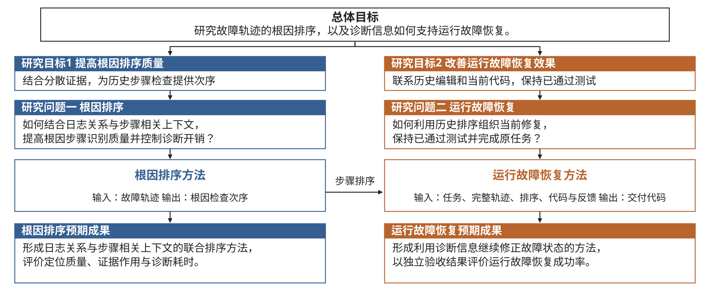

# 智能体运行故障的根因排序与恢复方法

开题报告

杨亚鹏　　指导教师：应时

2026年11月

## 摘要

智能体运行故障的分析往往要回到执行过程。一项错误操作可能在数步之后才显现影响，而最后的异常信息只能说明任务出了问题，未必指出错误从哪里开始。本论文拟研究执行轨迹中的根因排序，并在软件任务中考察排序结果的恢复价值。研究对象是轨迹保存的步骤记录，目的在于确定哪些历史步骤值得优先检查，以及这些判断怎样帮助任务继续执行。

排序部分考虑步骤内容之外的证据。任务要求、操作依据和后续反馈可能分布在不同位置，执行次序、角色归属及记录结构则提供了联系这些记录的线索。拟研究如何将日志联系与相关上下文用于步骤评分，比较不同证据组织方式下的根因识别表现和诊断开销。恢复部分面对的是另一层问题：历史上的错误不一定还存在于当前代码中。某次编辑可能已被覆盖，也可能只得到部分修正。因此，需要沿排序检查历史编辑，再对照当前源码确认线索的适用性。生成模型在保留完整执行历史的条件下利用这些依据修改代码，并根据测试反馈继续尝试。对于已经通过的目标测试，拟研究在后续修改中保留这些进展的方式。

实验将分别评价排序和恢复。排序采用带有根因步骤标注的轨迹数据，恢复采用能够运行和验收的软件任务，各方法从共同故障状态开始，使用相同信息及资源限制。除整体方法比较外，还将考察去除关联证据、改变编辑检查次序及取消测试进展保持后的变化，结合具体修改过程分析差异。预期回答的核心问题是，历史步骤的排序是否提供了有用的修复依据，以及这种作用能否体现为有限资源下更多任务的成功恢复。

关键词：智能体、运行故障、根因排序、软件任务恢复

## 1 研究背景

### 1.1 研究意义

智能体执行任务时，错误理解、决策或操作可能使执行偏离要求，最终产生错误结果或未完成任务。步骤级诊断为将任务结果追溯到具体历史行为提供了依据<a href="#ref-1">[1]</a>。执行轨迹保存推理、动作及环境观察<a href="#ref-2">[2]</a>，判断步骤的作用，需要结合其输入、操作和后续反馈<a href="#ref-3">[3]</a>。故障表现可能晚于错误引入的位置，因而需要联系不同步骤分析错误如何影响后续执行<a href="#ref-4">[4]</a>。软件任务保留源码、历史编辑及测试反馈，适合进一步检验诊断线索对任务恢复的作用<a href="#ref-5">[5]</a>。

### 1.2 国内外研究现状

#### 1.2.1 根因排序

2025年，Who&When将故障诊断细化到责任主体和根因步骤，建立细粒度标注数据，并比较整轨迹判断、逐步检查和二分搜索<a href="#ref-1">[1]</a>。其根因步骤指纠正该步并相应调整后续执行后，能够使原任务成功的最早错误步骤，为步骤级诊断确定了研究对象。

2026年，TraceElephant记录步骤的输入、输出和工具交互，比较静态诊断及动态回放<a href="#ref-3">[3]</a>。完整记录使判断能够回到步骤当时的上下文，回放则为候选错误提供执行证据。动态诊断的应用仍依赖日志接口和可回放环境。

同年，StepFinder结合步骤语义、角色信息、双向时序建模及全局交互生成步骤分数，减少生成式诊断调用<a href="#ref-6">[6]</a>。DCFA则从全轨迹推断依赖图，再利用局部反事实启发推理修正根因判断<a href="#ref-7">[7]</a>。两者分别从学习式交互和结构化推理角度利用跨步骤信息，相关机制见表1-1。

表1-1 根因排序相关研究

| 方法 | 技术原理 | 不足 |

| --- | --- | --- |

| Who&When | 整轨迹判断、逐步检查及二分搜索 | 定位质量和调用开销需要权衡 |

| TraceElephant | 完整轨迹观测及动态回放 | 动态诊断依赖可回放环境 |

| StepFinder | 语义、角色、时序建模及全局交互评分 | 需要标注数据训练，已有评测主要为Who&When |

| DCFA | 依赖图推断及局部反事实启发推理 | 构图和局部扩展增加推理开销 |

已有方法能够通过时序和语义交互学习步骤联系。日志中的执行次序、记录格式和动作结构还提供了可直接提取的信息。本论文拟研究这些联系能否补充候选区分，并同时评价排序质量和诊断开销。

#### 1.2.2 运行故障恢复

2025年，Agentless提出定位、补丁生成和验证的分阶段流程，通过复现测试、回归测试及投票选择候选补丁<a href="#ref-8">[8]</a>。测试主要用于筛选已生成的候选，原流程缺少根据筛选结果继续生成后续修正的环节。

2026年，EnAgent通过多样化生成、候选剪枝和工具辅助选择完成仓库级问题求解<a href="#ref-9">[9]</a>。选择阶段结合代码阅读和测试理解候选，回归测试依据原始代码确定，各候选分别验证。连续修改中新通过的任务目标如何约束后续更新，是本论文拟研究的问题。

2025年，SyncMind研究环境认知失步后的恢复，说明恢复依据需要与当前环境一致<a href="#ref-10">[10]</a>。2026年，DoVer将日志中的错误假设转化为消息或计划干预，再通过重执行检验恢复作用<a href="#ref-11">[11]</a>。这些研究将诊断和实际执行联系起来，其任务设定及适用边界见表1-2。

表1-2 运行故障恢复相关研究

| 方法 | 技术原理 | 不足 |

| --- | --- | --- |

| Agentless | 分层定位、补丁生成、测试筛选及投票 | 缺少依据筛选反馈继续修正的环节 |

| EnAgent | 多样候选生成、回归剪枝及工具辅助选择 | 未维护连续修改中新通过目标的集合 |

| SyncMind | 更新失步认知并获取当前环境信息 | 主要面向协作失步场景 |

| DoVer | 诊断干预、重执行及结果比较 | 依赖状态恢复和回放，主要干预消息及计划 |

代码经过多次编辑后，历史错误可能已被覆盖或部分修正，排序线索需要结合当前实现核对。工具执行辅助诊断的研究也强调以执行证据检查错误假设<a href="#ref-12">[12]</a>。本论文拟进一步研究历史诊断怎样组织当前修复，以及已通过测试的保持如何影响连续修改。

## 2 研究内容

本论文拟形成面向故障轨迹的步骤级根因排序方法，并研究排序支持的软件任务恢复。排序方面，利用步骤内容及关联证据评分，考察定位质量、候选排序和诊断成本。恢复方面，将高排位步骤转化为当前代码的检查线索，结合反馈继续修正，评价诊断信息和状态更新方式对任务完成的作用。

RQ1：如何利用跨步骤证据改善根因排序？ 研究执行次序、角色归属和记录结构如何与上下文共同参与判断，区分引入错误的步骤及其后续表现。

RQ2：如何将根因排序用于软件运行故障恢复？ 研究历史步骤怎样对应当前修复依据，并结合测试反馈保持连续修改中的进展。

两个问题通过历史编辑和当前实现的核对衔接。RQ1提供检查次序，RQ2评价线索能否帮助生成有效修改，排序质量和恢复效果分别通过实验检验。

## 3 研究方案

### 3.1 总体思路

本论文围绕故障轨迹中的根因排序和排序支持的软件任务恢复展开研究，总体框架如图3-1所示。排序部分分析历史步骤及其联系，形成优先检查次序。恢复部分结合这些线索、当前代码和测试反馈，研究如何继续完成原任务。两部分通过历史步骤与当前实现的对应衔接，分别评价诊断质量和恢复效果。

图3-1 总体研究框架

研究以跨步骤证据的利用和诊断线索的实际用途为主线。恢复过程中，完整公共历史提供任务背景，排序帮助确定优先检查哪些步骤，当前源码与反馈用于判断历史线索是否仍有修复价值。具体表示方式和方法组合将在开发阶段比较确定。

### 3.2 根因排序方法

根因判断需要同时理解步骤本身和它所处的执行过程。本论文拟从步骤内容出发，结合执行次序、角色归属和记录结构，研究不同步骤中的证据如何共同支持判断。文本表示研究为理解记录内容提供了基础<a href="#ref-13">[13]</a>。在此基础上，重点考察哪些关联信息能够帮助区分引入错误的步骤及其后续表现。

日志联系与上下文分别提供不同角度的信息。前者反映记录之间可直接观察的关系，后者有助于理解某项操作依据了什么、产生了什么影响。关系建模研究为利用不同类型的联系提供了参照<a href="#ref-14">[14]</a>。上下文建模研究则为获取与当前判断有关的信息提供了思路<a href="#ref-15">[15]</a>。本论文将比较这些信息的使用方式，分析其对候选步骤区分和诊断开销的影响。

排序以轨迹中的步骤记录为候选，学习各步骤相对于故障的优先检查次序<a href="#ref-16">[16]</a>。训练目标的选择需与根因标注形式和排序评价相适应<a href="#ref-17">[17]</a>。实验将结合定位结果和具体轨迹，考察关联证据是否带来有效补充，以及这种作用在不同任务和记录形式下的变化。

### 3.3 运行故障恢复方法

恢复研究面向任务失败后保留的代码和执行环境。历史步骤描述过去的操作，代码则可能已经历后续修改，因此需要判断排序线索在当前状态下仍有什么意义。已有研究通过源码检索获取与修复有关的程序信息<a href="#ref-18">[18]</a>。本论文拟结合历史编辑与当前实现组织修复依据，研究诊断结果如何帮助确定后续检查和修改的重点。

在完整公共历史的基础上，恢复过程利用排序线索、当前源码和执行反馈支持代码修正。代码上下文与工具反馈是大模型程序修复的重要依据<a href="#ref-19">[19]</a>。本论文重点考察这些信息如何配合，以及排序所提供的检查次序能否提高有限资源下的恢复效果。

测试用于判断修改是否满足任务要求，也为后续尝试提供反馈<a href="#ref-20">[20]</a>。连续修改中，解决一部分问题后仍可能破坏已有进展，因此拟研究已通过目标测试的保持方式，并结合回归测试约束代码更新。评价既关注最终任务是否完成，也观察测试状态的变化，以分析诊断线索和进展保持对恢复过程的作用。

## 4 关键问题

### 4.1 研究难点

根因排序的难点在于把跨步骤联系转化为有效的候选区分。内容相似的记录可能分别承担任务要求、操作和反馈等不同作用，形式相同的记录也未必与同一故障有关。需要研究关联信息的使用条件，使其补充步骤语义，并在排序质量与信息处理成本之间取得合理平衡。

恢复研究的难点在于历史线索的当前适用性，以及连续修改中的状态选择。高排位编辑需要结合当前实现判断，测试通过项的保持也需要与解决剩余问题的修改路径协调。研究应追踪线索选择、候选补丁和测试状态的变化，解释这些设计在何种情况下有助于任务恢复。

### 4.2 拟创新点

跨步骤日志联系与相关上下文的联合利用。 在步骤语义基础上，引入执行次序、角色归属和记录结构等可直接提取的联系，研究局部关联与全轨迹证据共同参与候选评分的方式。拟改进之处在于证据组织及其使用关系，具体表示和融合方案通过对照实验选定。

历史诊断与当前代码修正的衔接。 将根因排序转化为历史编辑检查次序，结合当前源码和反馈组织修复依据，同时研究已通过目标测试对后续代码更新的约束。拟通过联合恢复及作用分析，说明诊断线索与阶段进展如何影响连续修改及最终任务完成。

## 5 实验方案

### 5.1 实验数据

排序实验拟使用AFTraj的故障轨迹及根因标注<a href="#ref-21">[21]</a>，以及AgenTracer中的代码和数学任务轨迹<a href="#ref-22">[22]</a>。恢复实验拟使用SWE-Gym的可执行软件任务<a href="#ref-23">[23]</a>，通过独立测试验收原任务是否完成<a href="#ref-24">[24]</a>。

表5-1 数据来源及用途

| 数据来源 | 现有材料与计划范围 | 主要用途 |

| --- | --- | --- |

| AgenTracer | 训练验证614条，coding开发363条，coding评价候选127条 | 模型学习，代码与数学任务比较 |

| AFTraj | 开发731条、716个任务组，评价候选163条 | 不同记录形式下的排序评价 |

| SWE-Gym | 计划覆盖5个仓库、20个问题 | 构造共同故障状态，评价任务恢复 |

训练、验证和评价按原任务划分，避免同源轨迹交叉。表中评价候选需核对历史使用后固定清单，既有开发材料用于方案选择。恢复任务为各方法保留共同的故障代码、公共历史及反馈测试。

### 5.2 对比实验

拟采用表5-2所列基线开展比较。排序方法使用共同轨迹和步骤边界，恢复方法统一故障起点、外部信息、生成后端及资源限制。恢复工具接口和执行组织参考SWE-agent、OpenHands<a href="#ref-25">[25]</a><a href="#ref-26">[26]</a>。AOrchestra采用动态子智能体组织方式<a href="#ref-27">[27]</a>。

表5-2 基线方法

| 研究任务 | 基线方法 | 基本思路 |

| --- | --- | --- |

| 根因排序 | Who&When All-at-Once | 整轨迹判断 |

| 根因排序 | Who&When Binary Search | 二分检查 |

| 根因排序 | StepFinder | 学习式步骤评分 |

| 运行故障恢复 | Agentless | 分阶段生成及验证 |

| 运行故障恢复 | EnAgent | 候选集成及选择 |

| 运行故障恢复 | AOrchestra | 动态子智能体组织 |

表5-3 评价指标

| 指标 | 解释 |

| --- | --- |

| Top-1 | 根因步骤排在首位的比例，报告正确数/总数。 |

| MRR、Hit@3、Hit@5 | MRR为根因步骤倒数排名的平均值。Hit@3、Hit@5表示根因进入前3位、前5位的比例，报告正确数/总数。 |

| P50、P95耗时，token和请求次数 | 诊断耗时的中位数和第95百分位数，以及诊断消耗的token数量和模型请求次数。 |

| RSR及15/30/60分钟节点结果 | 任务恢复成功率，报告成功数/总数，并比较15、30、60分钟时的恢复结果。 |

| 耗时、token总量、请求次数 | 完成恢复过程消耗的时间、token总量及模型请求次数。 |

### 5.3 作用分析

排序实验拟比较完整方法和相应消融，考察关联证据及全轨迹上下文的作用，另分析任务类别对排序表现的影响。恢复实验拟比较是否利用排序线索、不同编辑检查次序及是否保持测试进展。在完整历史、当前源码和反馈均可访问的条件下，检验排序组织修复依据的增量作用。

实验将在共同任务上重复比较，报告原始计数和结果波动。比例指标提升按本方法减去对应基线计算，以百分点表示。结合代表性轨迹分析线索选择、补丁修改及测试变化，解释各项设计对最终恢复的影响。

## 6 研究计划

2026年11月完善文献梳理和研究方案，11月至12月完成数据准备、方法选型和基线适配。2027年1月至2月开展排序及恢复比较，3月完成消融和案例分析并撰写初稿，4月至5月复核结论、完善论文并准备答辩。预期形成相应方法及实现，给出实验评价，整理可复核的数据划分、配置和过程记录。

## 参考文献

[1] Shaokun Zhang, Ming Yin, Jieyu Zhang, et al. Which Agent Causes Task Failures and When? On Automated Failure Attribution of LLM Multi-Agent Systems[C]//Proceedings of the 42nd International Conference on Machine Learning (ICML), PMLR 267: 76583–76599, 2025.

[2] Shuyang Liu, Yang Chen, Rahul Krishna, et al. Process-Centric Analysis of Agentic Software Systems[J]. Proceedings of the ACM on Programming Languages, 10(OOPSLA1): 1961–1988, Article 163, 2026.

[3] Mengzhuo Chen, Junjie Wang, Fangwen Mu, et al. Seeing the Whole Elephant: A Benchmark for Failure Attribution in LLM-based Multi-Agent Systems[C]//Proceedings of the 64th Annual Meeting of the Association for Computational Linguistics (Volume 1: Long Papers): 19888–19905, 2026.

[4] 董益宏, 姜雪, 钱家如, 等. 基于大语言模型智能体的代码生成综述[J]. 软件学报, 2026, 37(8): 3089–3115. DOI: 10.13328/j.cnki.jos.007593.

[5] Islem Bouzenia, Premkumar Devanbu, Michael Pradel. RepairAgent: An Autonomous, LLM-Based Agent for Program Repair[C]//Proceedings of the IEEE/ACM 47th International Conference on Software Engineering (ICSE): 2188–2200, 2025.

[6] Taiyu Zhu, Yifan Wu, Weilin Jin, et al. StepFinder: A Temporal Semantic Framework for Failure Attribution in Multi-Agent Systems[C]//Proceedings of the 32nd ACM SIGKDD Conference on Knowledge Discovery and Data Mining V.2: 6946–6957, 2026.

[7] Zehao Wang, Lanjun Wang, Shilong Jin, et al. DCFA: Dual-view Causal-inspired Attribution for Failure Reasoning in LLM-based Multi-agent Systems[C]//Proceedings of the 2026 Conference on Empirical Methods in Natural Language Processing. 2026: 42999–43025.

[8] Chunqiu Steven Xia, Yinlin Deng, Soren Dunn, et al. Demystifying LLM-Based Software Engineering Agents[J]. Proceedings of the ACM on Software Engineering, 2(FSE): 801–824, 2025.

[9] Zhao Tian, Pengfei Gao, Junjie Chen, et al. Agent-Based Ensemble Reasoning for Repository-Level Issue Resolution[C]//Proceedings of the IEEE/ACM 48th International Conference on Software Engineering (ICSE): 1406–1418, 2026.

[10] Xuehang Guo, Xingyao Wang, Yangyi Chen, et al. SyncMind: Measuring Agent Out-of-Sync Recovery in Collaborative Software Engineering[C]//Proceedings of the 42nd International Conference on Machine Learning (ICML), PMLR 267: 20993–21066, 2025.

[11] Ming Ma, Jue Zhang, Fangkai Yang, et al. DoVer: Intervention-Driven Auto Debugging for LLM Multi-Agent Systems[C]//International Conference on Learning Representations (ICLR), 2026.

[12] Jiazheng Li, Emine Yilmaz, Bei Chen, Thu Le. Towards Self-Improving Error Diagnosis in Multi-Agent Systems[C]//Findings of the Association for Computational Linguistics: ACL 2026: 2063–2077, 2026. DOI: 10.18653/v1/2026.findings-acl.98.

[13] Yanzhao Zhang, Mingxin Li, Dingkun Long, et al. Qwen3 Embedding: Advancing Text Embedding and Reranking Through Foundation Models[EB/OL]. arXiv:2506.05176, 2025. DOI: 10.48550/arXiv.2506.05176.

[14] Michael Schlichtkrull, Thomas N. Kipf, Peter Bloem, et al. Modeling Relational Data with Graph Convolutional Networks[C]//The Semantic Web (ESWC), Lecture Notes in Computer Science: 593–607, 2018.

[15] Ashish Vaswani, Noam Shazeer, Niki Parmar, et al. Attention Is All You Need[C]//Advances in Neural Information Processing Systems 30. 2017.

[16] Tie-Yan Liu. Learning to Rank for Information Retrieval[J]. Foundations and Trends in Information Retrieval, 3(3): 225–331, 2009.

[17] Sebastian Bruch, Xuanhui Wang, Michael Bendersky, Marc Najork. An Analysis of the Softmax Cross Entropy Loss for Learning-to-Rank with Binary Relevance[C]//Proceedings of the 2019 ACM SIGIR International Conference on Theory of Information Retrieval (ICTIR). 2019: 75–78. DOI: 10.1145/3341981.3344221.

[18] Yuntong Zhang, Haifeng Ruan, Zhiyu Fan, Abhik Roychoudhury. AutoCodeRover: Autonomous Program Improvement[C]//Proceedings of the 33rd ACM SIGSOFT International Symposium on Software Testing and Analysis: 1592–1604, 2024. DOI: 10.1145/3650212.3680384.

[19] 香佳宏, 徐霄阳, 孔繁初, 等. 大模型在软件缺陷检测与修复的应用发展综述[J]. 软件学报, 2025, 36(4): 1489–1529. DOI: 10.13328/j.cnki.jos.007268.

[20] MÜNDLER N, MÜLLER M N, HE J, et al. SWT-Bench: Testing and Validating Real-World Bug-Fixes with Code Agents[C]//Advances in Neural Information Processing Systems 37. 2024: 81857–81887. DOI: 10.52202/079017-2601.

[21] Boxuan Zhang, Jianing Zhu, Zeru Shi, Dongfang Liu, Ruixiang Tang. AgentForesight: Online Auditing for Early Failure Prediction in Multi-Agent Systems[EB/OL]. arXiv:2605.08715, 2026. DOI: 10.48550/arXiv.2605.08715.

[22] Guibin Zhang, Junhao Wang, Junjie Chen, et al. AgenTracer: Who Is Inducing Failure in the LLM Agentic Systems?[C]//International Conference on Learning Representations (ICLR), 2026.

[23] Jiayi Pan, Xingyao Wang, Graham Neubig, et al. Training Software Engineering Agents and Verifiers with SWE-Gym[C]//Proceedings of the 42nd International Conference on Machine Learning (ICML), PMLR 267: 47717–47737, 2025.

[24] Carlos E. Jimenez, John Yang, Alexander Wettig, et al. SWE-bench: Can Language Models Resolve Real-world GitHub Issues?[C]//International Conference on Learning Representations (ICLR), 2024.

[25] John Yang, Carlos E. Jimenez, Alexander Wettig, et al. SWE-agent: Agent-Computer Interfaces Enable Automated Software Engineering[C]//Advances in Neural Information Processing Systems 37, 2024.

[26] Xingyao Wang, Boxuan Li, Yufan Song, et al. OpenHands: An Open Platform for AI Software Developers as Generalist Agents[C]//International Conference on Learning Representations (ICLR), 2025.

[27] Jianhao Ruan, Zhihao Xu, Yiran Peng, et al. AOrchestra: Automating Sub-Agent Creation for Agentic Orchestration[C]//Proceedings of the 43rd International Conference on Machine Learning (ICML), PMLR 306: 106017–106040, 2026.
