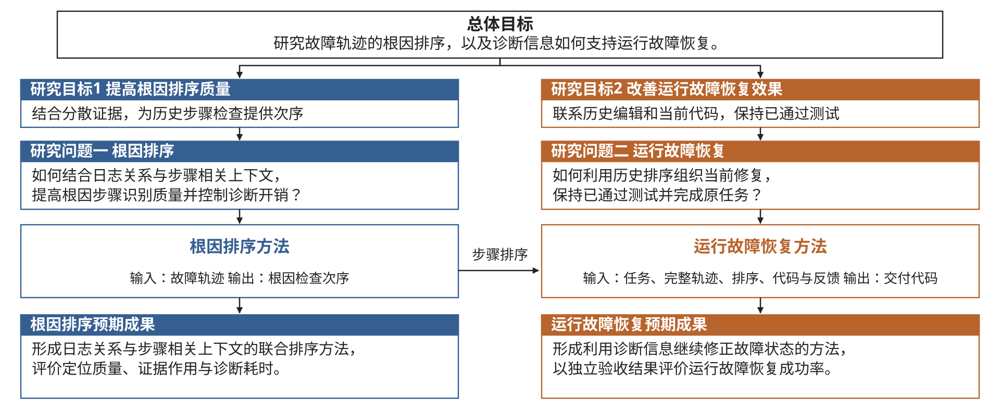

# 智能体运行故障的根因排序与恢复方法

## 摘要

智能体任务失败后，错误线索往往分散在历史操作及其反馈中。排查这些记录不仅需要判断哪些步骤值得优先检查，还需要确定历史判断对当前任务是否仍有修复价值。本论文以执行轨迹中的步骤记录为对象，研究根因排序及其支持的软件运行故障恢复方法。排序研究拟结合步骤内容、执行次序、角色归属和记录结构，探索关联证据与上下文信息的利用方式，形成历史步骤的检查次序。恢复研究从任务未完成时保留的代码与环境出发，将排序对应到历史编辑，结合当前源码和测试反馈组织修复依据，并考察保持已通过目标测试对连续修改的作用。实验计划分别使用带有根因标注的轨迹数据和可执行的软件任务，在共同数据、信息与资源条件下开展基线比较及消融分析，评价排序质量、恢复成功率和计算开销。研究重点在于说明跨步骤证据如何支持根因区分，以及历史诊断怎样帮助后续代码修正。

关键词：智能体、运行故障、根因排序、软件任务恢复

## 1 研究背景

### 1.1 研究意义

智能体执行任务时，错误理解、决策失误或操作偏差可能导致运行故障。步骤级诊断将任务结果追溯到具体历史行为。[1] 执行轨迹记录推理、动作和观察，[2] 判断某一步骤的作用需要结合当时的输入、操作及后续反馈。[3] 故障表现可能晚于错误引入的位置，因此需要联系跨步骤证据分析失败原因。[4] 本论文选择保留源码、历史编辑及测试的软件任务，研究根因排序如何支持后续修复。[5]

### 1.2 国内外研究现状

#### 1.2.1 根因排序

Who&When建立责任主体及根因步骤的细粒度诊断任务，比较整轨迹判断、逐步检查和二分搜索，为步骤级方法提供共同评价依据。[1] TraceElephant记录完整执行信息，并通过动态回放检验候选错误，扩展了诊断可以利用的证据。[3]

StepFinder融合步骤语义、角色信息、双向时序建模和全局交互，直接生成步骤分数，减少生成式诊断调用。[6] DCFA通过依赖图推断和局部反事实启发推理分析失败原因，关注全局联系对局部判断的支持。[7] 相关方法见表1-1。

**表1-1 根因排序相关研究**

| 方法 | 技术原理 | 不足 |
| --- | --- | --- |
| Who&When | 整轨迹判断、逐步检查及二分搜索 | 定位质量和调用开销需要权衡 |
| TraceElephant | 完整轨迹观测及动态回放 | 动态诊断依赖可回放环境 |
| StepFinder | 语义、角色及跨步骤交互评分 | 依赖根因标注训练，评测主要覆盖Who&When |
| DCFA | 依赖图及局部反事实启发推理 | 构图和局部扩展带来额外推理开销 |

已有研究提供了全局交互、结构化联系和执行验证等思路。本论文拟进一步考察日志中可直接提取的联系如何补充步骤语义，并分析其排序价值及处理成本。

#### 1.2.2 运行故障恢复

ReAct利用环境反馈支持交互求解。[8] Reflexion通过反思经验影响后续尝试。[9] CRITIC借助工具证据辅助修订。[10] 在软件任务中，这些思路需要落实为当前代码上的修改，并通过测试检验。

Agentless采用分层定位、补丁生成和测试筛选，流程清晰，但验证主要作用于既有候选。[11] EnAgent结合多样候选生成、回归剪枝和工具辅助选择，重点解决候选集合中的补丁选择问题。[12] SyncMind研究环境认知失步后的恢复，强调恢复依据应符合当前状态。[13] DoVer将错误假设转化为消息或计划干预，再通过重执行检验恢复效果。[14]

**表1-2 运行故障恢复相关研究**

| 方法 | 技术原理 | 不足 |
| --- | --- | --- |
| Agentless | 分层定位、候选生成及测试筛选 | 缺少根据筛选反馈继续生成修正的环节 |
| EnAgent | 多样候选生成、剪枝及工具辅助选择 | 未维护连续修改中新通过目标的集合 |
| SyncMind | 更新环境认知并获取缺失信息 | 主要面向协作失步场景 |
| DoVer | 诊断干预及重执行验证 | 依赖状态恢复和回放机制 |

历史错误可能被后续修改覆盖，诊断线索需要结合当前实现判断。连续修复还可能破坏已通过的目标测试。本论文拟从历史线索的当前适用性和测试进展保持两个方面，研究排序支持恢复的方式。工具执行辅助错误诊断的研究也为这一方向提供了参照。[15]

## 2 研究内容

### 2.1 研究目标

本论文拟研究执行轨迹中的步骤级根因排序，形成利用跨步骤证据的候选评分方法，提高根因步骤的优先检查程度。同时，研究排序线索在软件运行故障恢复中的使用方式，结合当前代码和反馈支持连续修改，评价有限资源下完成原任务的效果。

### 2.2 研究问题

根因排序重点回答：如何利用跨步骤证据改善候选步骤的区分？拟分析步骤内容、执行次序、角色归属和记录结构提供的信息，研究关联证据及上下文的利用方式，兼顾排序质量和诊断开销。

运行故障恢复重点回答：如何将历史排序转化为适用于当前代码的修复依据？拟研究历史编辑和当前实现的对应关系，利用测试反馈支持后续修正，并考察保持已通过目标测试对任务恢复的作用。

两项研究通过步骤检查次序衔接。排序评价关注根因是否位于前列，恢复评价关注原任务是否完成。高排位步骤可能提供重要线索，但其错误也可能已被后续修改覆盖。因此，研究既要考察排序质量，也要检验这些线索在当前状态下的实际用途。

## 3 研究方案

### 3.1 总体思路

总体研究框架如图3-1所示。根因排序从故障轨迹中组织证据，输出步骤检查次序。运行故障恢复结合排序线索、完整公共历史和当前代码，研究如何生成有效修改并保持测试进展。

**图3-1 总体研究框架**

恢复生成器能够访问完整公共历史，排序的作用在于组织检查次序和修复依据。研究将围绕历史步骤、相关编辑和当前实现之间的联系，考察诊断信息怎样影响后续修改。方法有效性分别由排序比较和恢复比较检验。

### 3.2 根因排序方法

拟以轨迹中的步骤记录为候选，结合记录内容及其执行背景进行分析。文本表示研究为提取步骤语义提供基础。[16] 角色标识用于说明记录归属，执行次序和记录结构用于刻画可观察的日志联系。

不同联系可能提供互补证据，也可能引入无关信息。拟参考关系建模研究，分析关联记录怎样参与候选判断。[17] 对于相隔较远的任务要求或故障反馈，研究上下文信息的获取方式，使步骤判断能够利用完整执行过程。[18] 研究重点在于保留步骤本身的信息，同时利用关联记录解释其行为。例如，一次代码编辑是否偏离要求，需要结合前面的任务描述和后面的测试反馈判断。单纯依赖内容相似度容易混合不同作用的记录，因此拟结合日志联系和语义信息组织证据，比较不同信息来源的贡献。具体表示和融合方式通过开发阶段的比较确定。

采用学习排序的思路组织步骤评分，以根因标注作为学习依据。[19] 训练目标结合标签形式及评价要求选择。[20] 通过比较不同证据组合，分析跨步骤联系在何种情况下有助于根因识别。

### 3.3 运行故障恢复方法

恢复从任务失败后保留的代码和环境出发。拟按照排序检查历史步骤，并结合源码检索核对相关编辑在当前实现中的影响。[21] 完整公共历史提供任务背景，排序帮助确定检查重点，当前代码用于判断线索是否仍适用。

代码上下文和工具反馈是程序修复的重要依据。[22] 拟研究如何组织这些材料，支持生成模型继续修正代码。测试既用于检验候选修改，也为后续尝试提供反馈。[23] 恢复过程中关注已通过目标是否再次失效，研究在回归测试约束下保持阶段进展的方式，最终通过独立验收判断原任务是否完成。

历史编辑提供的是过去版本上的变化，当前源码反映后续修改积累的结果。拟先判断高排位步骤涉及哪些代码行为，再核对这些行为是否仍存在、是否已部分修正，据此形成适用于当前状态的修复线索。这一研究关注历史诊断如何转化为可使用的依据，而非将历史错误直接等同于当前缺陷。

连续修改中，某次补丁可能解决部分目标，却在后续尝试中再次失效。拟记录目标测试的通过变化，结合固定回归测试研究代码状态的保留方式，使后续修正能够利用已取得的进展。通过观察线索选择、实际修改和测试变化，分析排序及进展保持各自发挥作用的条件。

## 4 关键问题

### 4.1 研究难点

根因排序的难点在于判断哪些跨步骤联系真正有助于区分候选。形式相近的记录可能承担不同作用，关联信息需要结合步骤内容使用。研究将分析不同证据的有效条件及其计算成本。

恢复研究的难点在于历史线索的当前适用性。代码经过后续修改后，历史判断需要重新核对。同时，保持已有测试进展可能影响后续修改路径，需要分析这种约束对最终恢复的作用。

### 4.2 拟创新点

拟创新之一是跨步骤证据的组织方式。在已有语义和时序建模基础上，研究可直接提取的日志联系及相关上下文如何共同参与候选判断，使分散记录能够为同一步骤提供相互补充的证据。通过消融分析判断改进来自哪些信息，兼顾排序质量和处理成本。

拟创新之二是诊断结果的恢复利用方式。通过历史编辑和当前源码核对，将根因排序转化为当前修复依据，并结合测试进展保持支持连续修改。重点分析诊断线索如何影响修改选择，以及阶段进展的保留是否有助于完成原任务。

## 5 实验方案

### 5.1 实验数据

排序实验拟采用AFTraj和AgenTracer。AFTraj提供故障轨迹及根因步骤标注，用于考察不同记录形式下的排序表现。[24] AgenTracer包含代码和数学任务轨迹，用于模型学习及任务类别比较。[25] 

恢复实验拟采用SWE-Gym中的可执行软件任务。[26] 为各方法设置相同的故障代码、公共历史和反馈测试，以独立测试判断任务是否恢复，评价方式参考SWE-bench。[27]

**表5-1 数据来源及用途**

| 数据来源 | 现有材料与计划范围 | 主要用途 |
| --- | --- | --- |
| AgenTracer | 训练验证614条，coding开发363条，coding评价候选127条 | 模型学习，代码与数学任务比较 |
| AFTraj | 开发731条、716个任务组，评价候选163条 | 不同记录形式下的排序评价 |
| SWE-Gym | 计划覆盖5个仓库、20个问题 | 构造共同故障状态，评价任务恢复 |

训练、验证和评价集合按原任务划分。表中候选数据需核对历史使用及同源重叠后确定评价清单，开发材料用于方案选择。恢复任务拟从共同故障状态开始，保持任务信息和反馈权限一致。

### 5.2 对比实验

排序实验拟比较本方法、StepFinder以及Who&When的All-at-Once、Binary Search。采用首位定位正确率、平均倒数排名和前列命中率评价排序效果，同时记录诊断耗时及调用开销。完整排序方法比较排名指标，单位置输出方法比较首位定位和开销。

恢复实验拟在统一的源码访问、编辑和测试条件下开展，工具接口及执行组织参考SWE-agent和OpenHands。[28][29] 对比方法包括Agentless、EnAgent和AOrchestra，后者通过动态创建子智能体组织任务求解。[30] 各方法采用相同生成后端和资源限制，比较任务恢复成功率、耗时及调用开销，报告成功数/总数。

**表5-2 评价指标及统计方式**

| 评价对象 | 指标 | 统计方式及含义 |
| --- | --- | --- |
| 首位定位 | Top-1 | 逐轨迹报告根因位于首位的正确数/总数，另报任务组等权比例 |
| 候选排序 | MRR、Hit@3、Hit@5 | MRR为倒数排名的任务组等权均值，Hit@k报告进入前k位的正确数/总数及组均值 |
| 诊断开销 | P50、P95耗时，词元和请求次数 | 覆盖文本编码与评分，分别说明加载条件和生成式调用 |
| 恢复效果 | RSR及15/30/60分钟节点结果 | 报告成功数/总数，同题重复先汇总，再对问题等权统计 |
| 恢复开销 | 耗时、词元总量、请求次数 | 覆盖完整方法过程，不仅计算最后一次生成 |
| 过程作用 | 目标通过变化、候选采用与回退 | 分析线索利用、阶段进展保持与最终结果之间的关系 |

### 5.3 作用分析

排序部分拟通过消融实验考察关联证据和上下文信息的作用，并比较不同任务类别上的表现。恢复部分拟比较是否利用排序线索、不同编辑检查次序以及是否保持测试进展，分析各项设计对恢复结果的影响。在完整历史、当前源码和反馈均可访问的条件下，比较加入排序线索前后的恢复结果，以区分检查次序的作用和信息量变化的影响。测试进展保持的对照关注已通过目标再次失败的情况，以及这些变化是否影响最终任务完成。

实验将在共同评价范围内进行重复比较，报告原始计数和结果波动。比例指标的提升按本方法减去对应基线计算，以百分点表示。结合代表性案例，分析排序线索、实际修改和测试变化之间的关系。

## 6 研究计划

2026年11月，完善文献梳理和研究方案，明确研究问题及评价目标。2026年11月至12月，准备实验数据，完成方法选型和基线适配。2027年1月至2月，开展根因排序及运行故障恢复的对比实验。2027年3月，完成消融实验和案例分析，撰写论文初稿。2027年4月至5月，复核研究结论，完善论文并准备答辩。

预期形成步骤级根因排序及软件运行故障恢复方法，完成实验评价，整理可复核的数据划分、配置及过程记录，完成学位论文。

## 参考文献

[1] Shaokun Zhang, Ming Yin, Jieyu Zhang, et al. Which Agent Causes Task Failures and When? On Automated Failure Attribution of LLM Multi-Agent Systems[C]//Proceedings of the 42nd International Conference on Machine Learning (ICML), PMLR 267: 76583–76599, 2025. [原文](https://proceedings.mlr.press/v267/zhang25cq.html)。

[2] Shuyang Liu, Yang Chen, Rahul Krishna, et al. Process-Centric Analysis of Agentic Software Systems[J]. Proceedings of the ACM on Programming Languages, 10(OOPSLA1): 1961–1988, Article 163, 2026. [原文](https://doi.org/10.1145/3798271)。

[3] Mengzhuo Chen, Junjie Wang, Fangwen Mu, et al. Seeing the Whole Elephant: A Benchmark for Failure Attribution in LLM-based Multi-Agent Systems[C]//Proceedings of the 64th Annual Meeting of the Association for Computational Linguistics (Volume 1: Long Papers): 19888–19905, 2026. [论文](https://aclanthology.org/2026.acl-long.912/)。

[4] 董益宏, 姜雪, 钱家如, 等. 基于大语言模型智能体的代码生成综述[J]. 软件学报, 2026, 37(8): 3089–3115. DOI: 10.13328/j.cnki.jos.007593. [论文](https://jos.org.cn/jos/article/abstract/7593)。

[5] Islem Bouzenia, Premkumar Devanbu, Michael Pradel. RepairAgent: An Autonomous, LLM-Based Agent for Program Repair[C]//Proceedings of the IEEE/ACM 47th International Conference on Software Engineering (ICSE): 2188–2200, 2025. [原文](https://doi.org/10.1109/ICSE55347.2025.00157)。

[6] Taiyu Zhu, Yifan Wu, Weilin Jin, et al. StepFinder: A Temporal Semantic Framework for Failure Attribution in Multi-Agent Systems[C]//Proceedings of the 32nd ACM SIGKDD Conference on Knowledge Discovery and Data Mining V.2: 6946–6957, 2026. [原文](https://doi.org/10.1145/3770855.3817991)。

[7] Zehao Wang, Lanjun Wang, Shilong Jin, et al. DCFA: Dual-view Causal-inspired Attribution for Failure Reasoning in LLM-based Multi-agent Systems[C]//Proceedings of the 2026 Conference on Empirical Methods in Natural Language Processing. 2026: 42999–43025. [原文](https://aclanthology.org/2026.emnlp-main.1887/)。

[8] Shunyu Yao, Jeffrey Zhao, Dian Yu, et al. ReAct: Synergizing Reasoning and Acting in Language Models[C]//International Conference on Learning Representations, 2023. [论文](https://openreview.net/pdf?id=WE_vluYUL-X)。

[9] Noah Shinn, Federico Cassano, Ashwin Gopinath, et al. Reflexion: Language Agents with Verbal Reinforcement Learning[C]//Advances in Neural Information Processing Systems 36, 2023. [论文](https://proceedings.neurips.cc/paper_files/paper/2023/hash/1b44b878bb782e6954cd888628510e90-Abstract-Conference.html)。

[10] Zhibin Gou, Zhihong Shao, Yeyun Gong, et al. CRITIC: Large Language Models Can Self-Correct with Tool-Interactive Critiquing[C]//International Conference on Learning Representations, 2024. [论文](https://proceedings.iclr.cc/paper_files/paper/2024/hash/fef126561bbf9d4467dbb8d27334b8fe-Abstract-Conference.html)。

[11] Chunqiu Steven Xia, Yinlin Deng, Soren Dunn, et al. Demystifying LLM-Based Software Engineering Agents[J]. Proceedings of the ACM on Software Engineering, 2(FSE): 801–824, 2025. [原文](https://doi.org/10.1145/3715754)。

[12] Zhao Tian, Pengfei Gao, Junjie Chen, et al. Agent-Based Ensemble Reasoning for Repository-Level Issue Resolution[C]//Proceedings of the IEEE/ACM 48th International Conference on Software Engineering (ICSE): 1406–1418, 2026. [原文](https://doi.org/10.1145/3744916.3787761)。

[13] Xuehang Guo, Xingyao Wang, Yangyi Chen, et al. SyncMind: Measuring Agent Out-of-Sync Recovery in Collaborative Software Engineering[C]//Proceedings of the 42nd International Conference on Machine Learning (ICML), PMLR 267: 20993–21066, 2025. [原文](https://proceedings.mlr.press/v267/guo25l.html)。

[14] Ming Ma, Jue Zhang, Fangkai Yang, et al. DoVer: Intervention-Driven Auto Debugging for LLM Multi-Agent Systems[C]//International Conference on Learning Representations (ICLR), 2026. [原文](https://proceedings.iclr.cc/paper_files/paper/2026/hash/2f5fdce256ff0d7fb774da76e5e63209-Abstract-Conference.html)。

[15] Jiazheng Li, Emine Yilmaz, Bei Chen, Thu Le. Towards Self-Improving Error Diagnosis in Multi-Agent Systems[C]//Findings of the Association for Computational Linguistics: ACL 2026: 2063–2077, 2026. DOI: 10.18653/v1/2026.findings-acl.98. [论文](https://aclanthology.org/2026.findings-acl.98/)。

[16] Yanzhao Zhang, Mingxin Li, Dingkun Long, et al. Qwen3 Embedding: Advancing Text Embedding and Reranking Through Foundation Models[EB/OL]. arXiv:2506.05176, 2025. DOI: 10.48550/arXiv.2506.05176. [论文](https://arxiv.org/abs/2506.05176)。

[17] Michael Schlichtkrull, Thomas N. Kipf, Peter Bloem, et al. Modeling Relational Data with Graph Convolutional Networks[C]//The Semantic Web (ESWC), Lecture Notes in Computer Science: 593–607, 2018. [原文](https://doi.org/10.1007/978-3-319-93417-4_38)。

[18] Ashish Vaswani, Noam Shazeer, Niki Parmar, et al. Attention Is All You Need[C]//Advances in Neural Information Processing Systems 30. 2017. [原文](https://proceedings.neurips.cc/paper_files/paper/2017/hash/3f5ee243547dee91fbd053c1c4a845aa-Abstract.html)。

[19] Tie-Yan Liu. Learning to Rank for Information Retrieval[J]. Foundations and Trends in Information Retrieval, 3(3): 225–331, 2009. [原文](https://doi.org/10.1561/1500000016)。

[20] Sebastian Bruch, Xuanhui Wang, Michael Bendersky, Marc Najork. An Analysis of the Softmax Cross Entropy Loss for Learning-to-Rank with Binary Relevance[C]//Proceedings of the 2019 ACM SIGIR International Conference on Theory of Information Retrieval (ICTIR). 2019: 75–78. DOI: 10.1145/3341981.3344221. [原文](https://research.google/pubs/an-analysis-of-the-softmax-cross-entropy-loss-for-learning-to-rank-with-binary-relevance/)。

[21] Yuntong Zhang, Haifeng Ruan, Zhiyu Fan, Abhik Roychoudhury. AutoCodeRover: Autonomous Program Improvement[C]//Proceedings of the 33rd ACM SIGSOFT International Symposium on Software Testing and Analysis: 1592–1604, 2024. DOI: 10.1145/3650212.3680384. [论文](https://doi.org/10.1145/3650212.3680384)。

[22] 香佳宏, 徐霄阳, 孔繁初, 等. 大模型在软件缺陷检测与修复的应用发展综述[J]. 软件学报, 2025, 36(4): 1489–1529. DOI: 10.13328/j.cnki.jos.007268. [原文](https://www.jos.org.cn/html/2025/4/7268.htm)。

[23] MÜNDLER N, MÜLLER M N, HE J, et al. SWT-Bench: Testing and Validating Real-World Bug-Fixes with Code Agents[C]//Advances in Neural Information Processing Systems 37. 2024: 81857–81887. DOI: 10.52202/079017-2601.

[24] Boxuan Zhang, Jianing Zhu, Zeru Shi, Dongfang Liu, Ruixiang Tang. AgentForesight: Online Auditing for Early Failure Prediction in Multi-Agent Systems[EB/OL]. arXiv:2605.08715, 2026. DOI: 10.48550/arXiv.2605.08715. [论文](https://arxiv.org/abs/2605.08715)。

[25] Guibin Zhang, Junhao Wang, Junjie Chen, et al. AgenTracer: Who Is Inducing Failure in the LLM Agentic Systems?[C]//International Conference on Learning Representations (ICLR), 2026. [原文](https://proceedings.iclr.cc/paper_files/paper/2026/hash/134ed7a477770f227f12450ef0cbb8f4-Abstract-Conference.html)。

[26] Jiayi Pan, Xingyao Wang, Graham Neubig, et al. Training Software Engineering Agents and Verifiers with SWE-Gym[C]//Proceedings of the 42nd International Conference on Machine Learning (ICML), PMLR 267: 47717–47737, 2025. [原文](https://proceedings.mlr.press/v267/pan25g.html)。

[27] Carlos E. Jimenez, John Yang, Alexander Wettig, et al. SWE-bench: Can Language Models Resolve Real-world GitHub Issues?[C]//International Conference on Learning Representations (ICLR), 2024. [原文](https://proceedings.iclr.cc/paper_files/paper/2024/hash/edac78c3e300629acfe6cbe9ca88fb84-Abstract-Conference.html)。

[28] John Yang, Carlos E. Jimenez, Alexander Wettig, et al. SWE-agent: Agent-Computer Interfaces Enable Automated Software Engineering[C]//Advances in Neural Information Processing Systems 37, 2024. [论文](https://proceedings.neurips.cc/paper_files/paper/2024/hash/5a7c947568c1b1328ccc5230172e1e7c-Abstract-Conference.html)。

[29] Xingyao Wang, Boxuan Li, Yufan Song, et al. OpenHands: An Open Platform for AI Software Developers as Generalist Agents[C]//International Conference on Learning Representations (ICLR), 2025. [原文](https://proceedings.iclr.cc/paper_files/paper/2025/hash/a4b6ad6b48850c0c331d1259fc66a69c-Abstract-Conference.html)。

[30] Jianhao Ruan, Zhihao Xu, Yiran Peng, et al. AOrchestra: Automating Sub-Agent Creation for Agentic Orchestration[C]//Proceedings of the 43rd International Conference on Machine Learning (ICML), PMLR 306: 106017–106040, 2026. [原文](https://proceedings.mlr.press/v306/ruan26e.html)。
