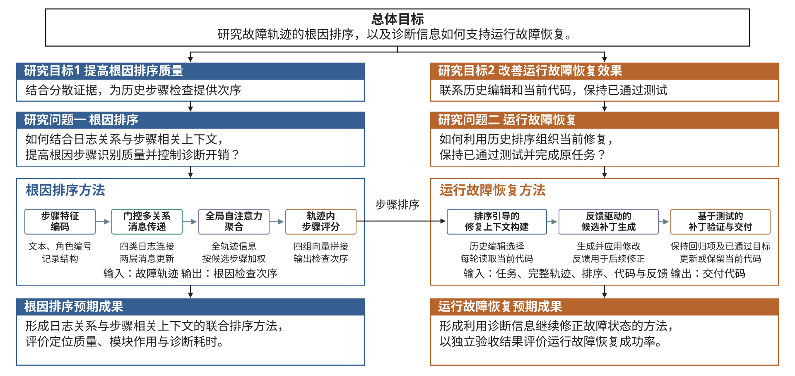
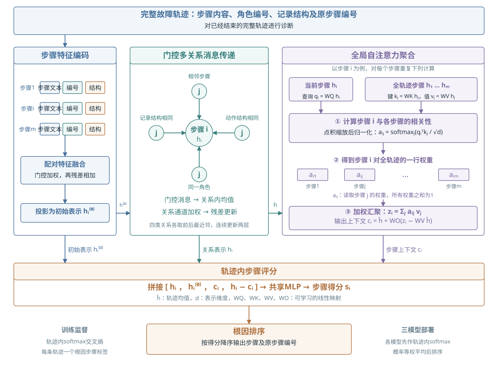
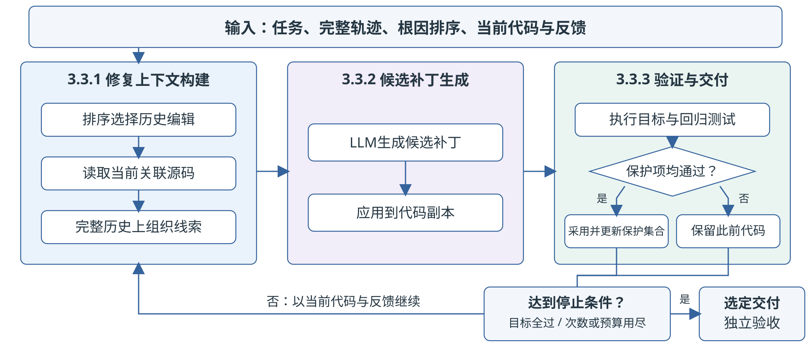

# 逐段溯源与校订核对

正文8678个非空白字符，共86块。按上一版逐段映射更新，重点复核P003、P008、StepFinder介绍及角色特征相关段落。

本轮先改文稿，PPT暂未同步。

## P001 智能体运行故障的根因排序与恢复方法

开题报告 · 2026年10月30日

核查：版本信息、论文组织或研究进度计划，依据本轮要求，不承担已完成效果主张。

论文依据：本文设计。非论文依据：U03。

## P002 1.1 研究背景

本论文研究智能体执行过程中的**运行故障**：错误理解、决策或操作使执行偏离任务要求，最终产生错误结果或未完成任务。[1] 这类故障也可能发生在程序正常结束的执行中，因此需要追查结果形成的过程。

核查：先交代同一任务的执行活动与有序记录，再说明步骤、故障、排序及恢复的用途。过程对象由英文原文支持；中文组织参考两篇自动化学报原文，不将其冒充统一故障步骤定义。

论文依据：whowhen。非论文依据：L06、L07、L08、U01、U03、U08。

## P003 1.1 研究背景

一次执行的推理、动作与环境观察按发生顺序保存，形成**执行轨迹**。[2] 轨迹中的一次具体决策或交互活动作为一个**步骤**，判断该步是否出错需结合当时输入、上下文和反馈。[3] 本文以执行轨迹中的步骤记录为分析对象，角色标识用于表示记录归属。

核查：删除与正文无实质关系的执行工作流引入，直接说明完整轨迹与具体步骤。英文原文仍支持推理、动作及环境观察的时序记录，中文组织参考维持原溯源。 本文范围按步骤级轨迹分析表述，角色标识仅用于记录归属与构图，不引入多智能体协作机制。

论文依据：process、traceelephant。非论文依据：L06、L07、L08、U01、U03、U08、U11。

## P004 1.1 研究背景

**运行故障的原因往往难以仅凭最终结果确定，相关证据分散于执行轨迹的不同步骤，需要结合任务要求、消息交互、工具操作与环境反馈追查历史行为。** 上游偏差可能经后续信息传递形成错误级联，使最终异常表现与引入错误的步骤处于不同位置。[4]

核查：先交代同一任务的执行活动与有序记录，再说明步骤、故障、排序及恢复的用途。过程对象由英文原文支持；中文组织参考两篇自动化学报原文，不将其冒充统一故障步骤定义。 本文范围按步骤级轨迹分析表述，角色标识仅用于记录归属与构图，不引入多智能体协作机制。

论文依据：agents_cn2026。非论文依据：L06、L07、L08、U01、U03、U08、U11。

## P005 1.1 研究背景

本论文以故障轨迹中的历史步骤为**根因候选**，结合步骤内容及关联证据评分，形成优先检查次序，称为**根因排序**。排序将更可能引入故障的步骤置于前列，为根因排查和修正线索选择提供依据。

核查：先交代同一任务的执行活动与有序记录，再说明步骤、故障、排序及恢复的用途。过程对象由英文原文支持；中文组织参考两篇自动化学报原文，不将其冒充统一故障步骤定义。

论文依据：本文设计。非论文依据：L06、L07、L08、U01、U03、U08。

## P006 1.1 研究背景

为检验排序对任务完成的作用，本论文进一步研究软件任务中的**运行故障恢复**。恢复从故障发生后保留的代码与环境出发，利用历史编辑、当前源码和测试反馈继续修改代码。[5] 原任务通过独立验收时，判定为恢复成功。

核查：先交代同一任务的执行活动与有序记录，再说明步骤、故障、排序及恢复的用途。过程对象由英文原文支持；中文组织参考两篇自动化学报原文，不将其冒充统一故障步骤定义。

论文依据：repairagent。非论文依据：L06、L07、L08、U01、U03、U08。

## P007 1.2 国内外研究现状

根因排序需要回答哪些历史步骤应优先检查，运行故障恢复则需要把这些线索用于当前代码的修正。以下按这两个相继环节，分析代表性工作的证据组织、历史线索利用和验证方式。

核查：编号引文对应已有工作的方法或实验事实；随后比较其对象、证据组织及验证范围。未分别检验某设计不等于该工作完全没有上下文、交互或验证。

论文依据：本文设计。非论文依据：U01、L08、U03、U08。

## P008 1.2.1 智能体运行故障诊断与根因排序

- **Who&When（Shaokun Zhang等，2025）**：从故障轨迹中定位相关智能体及根因步骤，比较整轨迹判断、逐步检查和二分搜索。该研究将根因步骤界定为：纠正该步并相应调整后续执行后，能够使原任务成功的最早错误步骤。其评测中，最佳方法的步骤定位准确率为14.2%。[1] 研究建立了步骤级诊断对象，也表明任务结果判断与根因步骤定位之间仍有距离。

核查：按原文第2节说明根因步骤的界定，保留纠正该步并调整后续执行后任务可成功及最早性。摘要的14.2%另句说明为最佳方法的步骤定位准确率。

论文依据：whowhen。非论文依据：U01、L08、U03、U08。

## P009 1.2.1 智能体运行故障诊断与根因排序

- **TraceElephant（Mengzhuo Chen等，2026）**：补全任务输入、中间消息与环境交互，分析各智能体当时可使用的信息。[3] 这说明步骤判断需要完整的可见证据。如何进一步关联分散记录并区分引入错误的行为与后续表现，仍需具体的排序模型。

核查：前半部分按所引论文的方法与结果概述，后半部分是本论文结合既定研究内容提出的比较分析，不把相关工作未研究某项机制直接写成普遍无效。

论文依据：traceelephant。非论文依据：U01、L08、U03、U08。

## P010 1.2.1 智能体运行故障诊断与根因排序

- **StepFinder（Taiyu Zhu等，2026）**：结合步骤语义、角色标识、双向时序网络与全局注意力产生步骤分数。[6] 其交互主要通过时序、语义匹配和角色间联系表达，未分别检验显式决策上下文与后续动作、记录结构等日志联系的增量作用。这些联系为区分语义相近但执行作用不同的候选提供了待检验的信息。

核查：前半部分按所引论文的方法与结果概述，后半部分是本论文结合既定研究内容提出的比较分析，不把相关工作未研究某项机制直接写成普遍无效。

论文依据：stepfinder。非论文依据：U01、L08、U03、U08。

## P011 1.2.1 智能体运行故障诊断与根因排序

- **DCFA（Zehao Wang等，2026）**：构造依赖图，结合局部反事实推理细化根因判断。[7] 该工作说明关联证据有助于分析故障形成过程，同时引入额外结构推理。对于日志中可以直接提取的联系，仍需检验其能否以较低开销补充候选区分。

核查：前半部分按所引论文的方法与结果概述，后半部分是本论文结合既定研究内容提出的比较分析，不把相关工作未研究某项机制直接写成普遍无效。

论文依据：dcfa。非论文依据：U01、L08、U03、U08。

## P012 1.2.1 智能体运行故障诊断与根因排序

这些研究从确定诊断对象发展到补全证据、学习评分和关系推理。排序所形成的历史检查次序还需进入恢复过程，才能检验优先发现的行为是否确实有助于后续修正。

核查：编号引文对应已有工作的方法或实验事实；随后比较其对象、证据组织及验证范围。未分别检验某设计不等于该工作完全没有上下文、交互或验证。

论文依据：本文设计。非论文依据：U01、L08、U03、U08。

## P013 1.2.2 根因排序引导的软件运行故障恢复

交互执行利用环境反馈继续求解[8]，跨次尝试积累反思经验[9]，工具检查为修订提供依据。[10] 软件恢复进一步要求把这些信息转化为当前代码上的修改。

核查：编号引文对应已有工作的方法或实验事实；随后比较其对象、证据组织及验证范围。未分别检验某设计不等于该工作完全没有上下文、交互或验证。

论文依据：react、reflexion、critic。非论文依据：U01、L08、U03、U08。

## P014 1.2.2 根因排序引导的软件运行故障恢复

- **Agentless（Xia等，2025）**：先分层定位修改位置并生成多个候选补丁，再结合复现测试、回归测试与投票选择最终补丁。[11] 其测试结果主要用于筛选已有候选，未反馈到后续补丁生成。当候选均未解决问题时，缺少依据验证结果继续修正的机制。

核查：依据Agentless第3.1—3.3节，先定位并生成多个候选，测试与投票用于筛选。其流程未将测试结果反馈到后续候选生成，本文据此指出已有候选均未解决问题时的迭代修正边界，替换原先属于本论文实验计划的句子。

论文依据：agentless。非论文依据：U01、L08、U03、U08。

## P015 1.2.2 根因排序引导的软件运行故障恢复

- **EnAgent（Tian等，2026）**：生成多条候选轨迹，经回归剪枝、工具检查与投票选择补丁。[12] 其回归筛选保护原有行为，本论文进一步研究恢复中新通过目标的持续保持。

核查：前半部分按所引论文的方法与结果概述，后半部分是本论文结合既定研究内容提出的比较分析，不把相关工作未研究某项机制直接写成普遍无效。

论文依据：enagent。非论文依据：U01、L08、U03、U08。

## P016 1.2.2 根因排序引导的软件运行故障恢复

- **SyncMind（Guo等，2025）**：处理智能体认识与实际代码失步，重新获取当前环境信息后恢复。[13] 这说明历史线索需要与当前代码核对。

核查：前半部分按所引论文的方法与结果概述，后半部分是本论文结合既定研究内容提出的比较分析，不把相关工作未研究某项机制直接写成普遍无效。

论文依据：syncmind。非论文依据：U01、L08、U03、U08。

## P017 1.2.2 根因排序引导的软件运行故障恢复

- **DoVer（Ma等，2026）**：修改消息或计划后重执行，以任务结果检验诊断。[14] 本论文关注代码逐轮修改，检查新补丁是否使此前已通过的目标测试再次失败。

核查：前半部分按所引论文的方法与结果概述，后半部分是本论文结合既定研究内容提出的比较分析，不把相关工作未研究某项机制直接写成普遍无效。

论文依据：dover。非论文依据：U01、L08、U03、U08。

## P018 1.3 研究问题

现有诊断利用时序、全局交互和推理组织证据，但日志中可直接提取的联系能否补充候选区分，仍需检验。工具执行也用于检验错误假设[15]，需要共同评价定位质量与诊断开销。诊断给出历史步骤判断，修复作用于当前代码，还需检验完整轨迹已可用时，显式排序提示及当前源码组织能否改善修改，并保持新通过的目标测试。

核查：由研究现状的具体差异形成研究问题、目标及价值，属于本论文拟研究设计及比较分析，不冒称已完成实验结论。

论文依据：errorprobe。非论文依据：U03、U04、U08。

## P019 1.3 研究问题

前一环节决定优先检查哪些历史行为，后一环节决定这些线索能否帮助完成原任务。本论文据此提出以下两个研究问题。

核查：由研究现状的具体差异形成研究问题、目标及价值，属于本论文拟研究设计及比较分析，不冒称已完成实验结论。

论文依据：本文设计。非论文依据：U03、U04、U08。

## P020 1.3 研究问题

- **RQ1：分散执行证据下的根因排序。** 如何关联执行轨迹不同步骤中的分散证据，区分引入故障的步骤与后续表现，提高根因步骤的识别与排序质量，并控制诊断开销？

核查：由研究现状的具体差异形成研究问题、目标及价值，属于本论文拟研究设计及比较分析，不冒称已完成实验结论。 本文范围按步骤级轨迹分析表述，角色标识仅用于记录归属与构图，不引入多智能体协作机制。

论文依据：本文设计。非论文依据：U03、U04、U08、U11。

## P021 1.3 研究问题

- **RQ2：根因排序引导的软件运行故障恢复。** 如何将历史步骤诊断转化为适用于当前代码的修复依据，并通过反馈利用与代码状态更新，提高有限资源下原任务的恢复成功率？

核查：RQ2与目标将历史诊断、当前程序证据、反馈利用及代码状态更新联系到有限资源恢复成功率，作为拟研究问题及待检验效果。

论文依据：本文设计。非论文依据：U03、U04、U08、U10。

## P022 1.3 研究问题

RQ1输出步骤检查次序，RQ2从中选择历史编辑并核对当前实现，两项研究通过实际进入恢复器的修复线索衔接。由此，研究目标既包括排序本身的有效性，也包括排序在恢复中的实际作用。

核查：RQ2与目标将历史诊断、当前程序证据、反馈利用及代码状态更新联系到有限资源恢复成功率，作为拟研究问题及待检验效果。

论文依据：本文设计。非论文依据：U03、U04、U08、U10。

## P023 2.1 研究目标

总体目标是建立从故障轨迹分析到软件任务继续求解的方法，形成可评价的根因排序与运行故障恢复流程。

核查：RQ2与目标将历史诊断、当前程序证据、反馈利用及代码状态更新联系到有限资源恢复成功率，作为拟研究问题及待检验效果。

论文依据：本文设计。非论文依据：U03、U04、U08、U10。

## P024 2.1 研究目标

- **根因排序目标：** 关联步骤内容、角色编号与记录结构，结合局部关系传播和步骤相关上下文学习步骤分数，输出优先检查次序。通过共同数据上的基线比较及消融，检验排序质量、诊断成本和各类证据的作用。

核查：由研究现状的具体差异形成研究问题、目标及价值，属于本论文拟研究设计及比较分析，不冒称已完成实验结论。

论文依据：本文设计。非论文依据：U03、U04、U08。

## P025 2.1 研究目标

- **运行故障恢复目标：** 将历史排序对应到真实编辑，结合当前实现和执行反馈组织修复依据，提高候选补丁对当前问题的针对性。以累计测试保持规则约束代码更新，研究减少已有成果丢失对连续恢复的作用。通过共同故障状态下的完整比较与模块对照，检验上述机制对最终恢复成功率的影响。

核查：RQ2与目标将历史诊断、当前程序证据、反馈利用及代码状态更新联系到有限资源恢复成功率，作为拟研究问题及待检验效果。

论文依据：本文设计。非论文依据：U03、U04、U08、U10。

## P026 2.2 研究意义

- **方法意义：** 将分散执行记录中的可观测联系与步骤相关上下文共同用于步骤判断，研究不同证据在根因区分中的作用。再将历史判断接入当前代码上的恢复操作，建立从诊断质量到任务结果的验证关系。

核查：由研究现状的具体差异形成研究问题、目标及价值，属于本论文拟研究设计及比较分析，不冒称已完成实验结论。

论文依据：本文设计。非论文依据：U03、U04、U08。

## P027 2.2 研究意义

- **应用意义：** 为出现运行故障的执行提供有次序的历史排查线索，帮助利用已有代码和执行记录继续求解。通过当前实现核对和已通过目标测试的保持，减少失效历史线索及后续修改退化对恢复的影响。

核查：由研究现状的具体差异形成研究问题、目标及价值，属于本论文拟研究设计及比较分析，不冒称已完成实验结论。

论文依据：本文设计。非论文依据：U03、U04、U08。

## P028 2.2 研究意义

实现上述目标，需要先产生有效的步骤检查次序，再将高排位的历史编辑对应到当前代码，使诊断与恢复组成可验证的完整过程。

核查：由研究现状的具体差异形成研究问题、目标及价值，属于本论文拟研究设计及比较分析，不冒称已完成实验结论。

论文依据：本文设计。非论文依据：U03、U04、U08。

## P029 3.1 总体研究框架与数据接口

核查：方法图保留原布局，按本轮核定术语更新可见文字。PPT对应图由原生文本框、形状和连接线组成，整图置于一页。

论文依据：本文设计。非论文依据：F01、U03。

## P030 3.1 总体研究框架与数据接口

**图3-1 根因排序与运行故障恢复的总体研究框架**

核查：图表题名与当前方法和实验章节一致，不承担独立经验结论。

论文依据：本文设计。非论文依据：U03。

## P031 3.1 总体研究框架与数据接口

排序将历史步骤对应到真实编辑，修复依据再通过原步骤编号与**当前实现**核对，使历史诊断服务于当前代码修改。

核查：排序、实际编辑和当前实现核对构成诊断到修复的接口。压缩右侧说明并保留机制含义，具体操作在3.3展开。

论文依据：本文设计。非论文依据：C09、C10、C14、C15、C16、C17、C18、U04、U05、U03、U10。

## P032 3.1 总体研究框架与数据接口

修复依据影响候选补丁的生成条件，测试保持决定下一轮的起始代码。结合各轮输入、代码和测试变化，分析候选修正、进展保持与最终恢复之间的关系。

核查：明确两项外部设计作用于不同位置：修复依据改变候选生成条件，保护规则决定下一轮起始代码。最终恢复与中间状态变化共同分析。

论文依据：本文设计。非论文依据：C10、C11、U03、U04、U10。

## P033 3.2 根因排序模型

核查：方法图保留原布局，按本轮核定术语更新可见文字。PPT对应图由原生文本框、形状和连接线组成，整图置于一页。

论文依据：本文设计。非论文依据：F02、U03。

## P034 3.2 根因排序模型

**图3-2 根因排序模型的计算结构**

核查：图表题名与当前方法和实验章节一致，不承担独立经验结论。

论文依据：本文设计。非论文依据：U03。

## P035 3.2 根因排序模型

同一故障反馈可能与多个历史步骤有关，各步骤需要结合不同证据判断。模型保留本步内容，沿日志关系取得执行背景，再从完整轨迹中补充相关信息，支持区分引入错误的行为与后续表现。

核查：解释同一步骤需结合自身内容、相邻关系和完整轨迹证据的设计理由。该互补作用是待消融检验的研究假设。

论文依据：本文设计。非论文依据：C06、C07、C08、U06。

## P036 3.2 根因排序模型

图中m为步骤数，i、j为步骤编号。hᵢ⁽⁰⁾、hᵢ、cᵢ分别表示初始表示、关系表示和步骤上下文。MLP为多层感知机。

核查：图中符号就地说明，与现有模型中的初始表示、关系表示、上下文及共享评分头对应。

论文依据：本文设计。非论文依据：C06、C07、C08。

## P037 3.2.1 步骤特征编码

步骤文本取自日志中可用的内容、动作及推理记录，由固定的Qwen3-Embedding-0.6B编码器编码。[16] 日志内的任务要求随步骤文本进入模型。角色标识在轨迹内转换为**角色编号**并编码为向量，结构特征记录位置与格式。模型融合上述特征，并对按固定格式识别的同一角色相邻上下文与输出记录融合文本表示，形成保留原步骤编号的初始表示。

核查：固定字段、角色相同上下文配对及编号编码沿当前实现，仅按用户要求统一同一角色用语，不改变输入或算法。 本文范围按步骤级轨迹分析表述，角色标识仅用于记录归属与构图，不引入多智能体协作机制。

论文依据：qwen3embedding。非论文依据：C01、C03、C04、C05、C06、C09、U06、U03、U10、U11。

## P038 3.2.2 门控多关系消息传递

模型按四类关系连接步骤。**相邻步骤**连接前后一步。**同一角色**按日志中的角色标识连接前后最近的步骤。**记录结构相同**按内容、动作及推理字段格式分组，**动作结构相同**按非空动作字段的结构分组。可解析字段按数据类型、数量及嵌套形式划分，普通文本归为同类记录。同组均连接前后最近的步骤。

核查：同一角色按日志角色标识连接前后最近步骤。其他三类关系和结构分组规则沿现有实现，名称与图及讲解同步。 本文范围按步骤级轨迹分析表述，角色标识仅用于记录归属与构图，不引入多智能体协作机制。

论文依据：本文设计。非论文依据：C02、C09、U06、U03、U10、U11。

## P039 3.2.2 门控多关系消息传递

各类关系分别联系执行次序、角色归属与记录格式。门控依据当前步骤及邻居差异调节消息，再融合各类关系，经两层传播形成结合邻接证据的步骤表示。[17]

核查：执行次序、角色归属和记录格式是三种联系来源。门控融合及两层传播依据原代码，作用通过排序质量与成本比较检验。 本文范围按步骤级轨迹分析表述，角色标识仅用于记录归属与构图，不引入多智能体协作机制。

论文依据：rgcn。非论文依据：C07、U06、U03、U10、U11。

## P040 3.2.3 全局自注意力聚合

关系传播沿既定连边汇集信息，任务要求和故障反馈还可能位于远处。该模块以每个待评分步骤为查询，与同一完整轨迹中的各步骤计算相关权重，汇集该步骤需要的证据。查询、用于匹配的键和承载信息的值均由步骤表示转换得到，采用自注意力计算。[18]

核查：自注意力基础由论文支持，当前步骤作查询并读取同一完整轨迹各步骤由实现支撑，参与集合包括当前步骤。

论文依据：attention。非论文依据：C08。

## P041 3.2.3 全局自注意力聚合

模型在轨迹均值背景上加入各步骤的注意力修正，形成与该步骤相关的上下文。相同的全轨迹证据可以参与不同判断，读取权重随待评分步骤变化，从而补充有限层关系传播未覆盖的信息。两类表示随后共同进入评分网络。

核查：均值背景与注意力修正、随待评分步骤变化的读取权重和评分输入由当前实现支撑。其作用解释基于计算结构，不作为已取得效果。

论文依据：本文设计。非论文依据：C06、C08。

## P042 3.2.4 轨迹内步骤评分

共享评分网络读取初始表示、关系表示、步骤上下文，以及关系表示与上下文的差异，使评分同时依据本步内容和关联证据。训练以**数据集中标注的根因步骤**为目标，在同一轨迹内归一化分数，最小化该目标步骤对应的负对数概率。组内评分采用列表级学习思路。[19] 每条轨迹使用一个根因步骤标签时，交叉熵训练与排序目标具有理论联系。[20]

核查：评分输入和轨迹内交叉熵对应代码。列表级学习及单正例下交叉熵与排序的联系分别由两篇引用支撑，不另起新损失名称。

论文依据：learning_to_rank、softmax_rank。非论文依据：C06、C09。

## P043 3.2.4 轨迹内步骤评分

预测时，模型仅依据轨迹记录计算分数，并按降序输出步骤检查次序。评价目标是数据集标注的根因步骤能否位于首位或前几个位置，各数据源保留原有根因标注含义。恢复器再从排序中选择真实编辑，检验历史诊断对当前代码修正的作用。

核查：预测不读取监督标签。数据集标签用于排序评价，恢复器按预测次序筛选实际编辑，两种用途分别说明。

论文依据：本文设计。非论文依据：C09、C10、C12。

## P044 3.3 运行故障恢复方法

核查：方法图保留原布局，按本轮核定术语更新可见文字。PPT对应图由原生文本框、形状和连接线组成，整图置于一页。

论文依据：本文设计。非论文依据：F03、U03。

## P045 3.3 运行故障恢复方法

**图3-3 运行故障恢复流程**

核查：图表题名与当前方法和实验章节一致，不承担独立经验结论。

论文依据：本文设计。非论文依据：U03。

## P046 3.3.1 排序引导的修复上下文构建

本方法在完整公共轨迹上，按根因排序选择实际改变过源码的**历史编辑**，按工具调用去重并提取修改前后差异。首轮使用最高排位编辑，后续依次补充，最多3项。排序将历史检查优先序显式加入生成条件，使有限尝试优先核对与故障有关的代码变化。

核查：完整公共历史仍可用，排序增加显式历史检查次序和真实编辑差异。按前1、2、3项扩展线索，为有限尝试提供优先核对依据。

论文依据：本文设计。非论文依据：C10、C15、C18、U04、U05、U03、U10。

## P047 3.3.1 排序引导的修复上下文构建

历史编辑的作用会随后续修改而变化。每轮对照历史编辑后版本与当前源码，按涉及的函数、属性及当前**测试反馈**中的源码位置，读取当前定义和可能引用它的代码。[21] 历史差异与**当前实现**共同说明代码变化，为生成器判断线索的当前适用性提供依据，减少自行重建版本关系的负担。

核查：将历史差异与当前定义、引用位置及测试反馈共同呈现，帮助生成器判断线索适用性。当前代码读取与信息组织对应既有实现，不新增程序分析或诊断验证模块。

论文依据：autocoderover。非论文依据：C10、C16、C17、U04、U05、U03、U10。

## P048 3.3.2 反馈驱动的候选补丁生成

生成模型结合原任务、完整历史、排序线索、当前源码与此前尝试的反馈提出补丁。执行器在代码副本上应用并测试，将应用错误、测试结果及代码差异交给下一轮。[22] 应用错误反映补丁能否执行，测试结果反映尚未满足的目标，代码差异说明实际保留的修改。这些信息随源码刷新进入生成条件，支持后续候选针对当前状态继续修正。

核查：应用错误、目标测试结果及当前代码差异分别提供补丁可执行性、未满足目标和已保留修改的信息。它们作为后续条件，支持候选修正，没有声称反馈会重新排序或必然生成正确补丁。

论文依据：repair_survey_cn2025。非论文依据：C10、C14、C15、C17、C18、U04、U05、U03、U10。

## P049 3.3.3 基于测试的补丁验证与交付

复现测试可用于筛选候选补丁。[23] 本方法使用预先固定的**目标测试**与**回归测试**，前者检查原任务要求，后者检查需要保留的已有行为。初态已通过的回归项和目标项进入保护集合，后续采用的代码中新通过的目标项继续加入。

核查：SWT-Bench引文只支撑复现测试可用于筛补丁。固定目标、回归测试及累计保护集合属于本方法的现有设计。

论文依据：swtbench。非论文依据：C10、C11、U04、U05。

## P050 3.3.3 基于测试的补丁验证与交付

候选通过全部保护项时更新代码，否则恢复此前状态。在稳定、可执行的测试条件下，被采用代码的目标测试通过集合逐轮不缩小。该规则将既有测试进展作为后续代码更新约束，避免下一轮从丢失已验证目标的代码继续求解。本文据此研究阶段成果保持对候选修正和最终任务完成的作用。

核查：在稳定可执行测试和状态正确恢复下，通过集合不缩小。拒绝破坏保护项的候选使下轮从保留已验证目标的状态继续。该局部性质不被写成最终恢复成功的充分条件。

论文依据：本文设计。非论文依据：C10、C11、U04、U03、U10。

## P051 3.3.3 基于测试的补丁验证与交付

目标全部通过、尝试次数或预算用尽时停止，按预先固定的反馈规则选择交付，再以独立验收判定恢复成功。测试结果缺失或不确定时保存已有代码并停止更新。各轮源码、补丁与测试状态共同记录，用于分析修复线索和代码更新规则如何影响恢复过程。

核查：停止、反馈交付、独立验收及未知结果保护对应代码和拟比较协议，区分内部测试与最终任务验收。

论文依据：本文设计。非论文依据：C10、C11、U03、U04。

## P052 4.1 关键难点

- **难点一：分散证据下的根因排序质量提升。** 故障线索分散于轨迹中的不同步骤，语义相近的记录还可能承担不同执行作用。需要结合步骤内容、日志联系和全轨迹证据，区分引入故障的步骤与后续异常表现，使新增关联信息有效改善候选间的相对评分，同时控制诊断开销。

核查：难点直接聚焦根因排序质量：关联分散证据、区分语义相近而作用不同的候选并控制诊断开销。 本文范围按步骤级轨迹分析表述，角色标识仅用于记录归属与构图，不引入多智能体协作机制。

论文依据：本文设计。非论文依据：C02、C07、C08、U03、U06、U10、U11。

## P053 4.1 关键难点

- **难点二：有限资源下的运行故障恢复效果提升。** 恢复成功取决于修复依据对当前代码的适用性、候选补丁质量及连续修改中的进展保持。需要将历史排序转化为针对当前实现的修改依据，利用执行反馈支持后续候选修正，并处理剩余目标修复与已有成果保持之间的关系，提高完成原任务的概率。

核查：难点直接聚焦有限资源下恢复效果：当前修复依据适用性、候选质量和进展保持之间的关系，目标是原任务最终完成概率。

论文依据：本文设计。非论文依据：C10、C11、C15、C16、C17、C18、U04、U03、U10。

## P054 4.2 拟研究的创新点

- **日志关系与步骤相关上下文的联合排序。** 将执行次序、角色归属及记录结构形成的关系用于邻居信息传播，再为每个步骤从完整轨迹中汇集相关证据。研究局部关联与全局证据在候选区分中的互补作用，以关系传播和全局聚合的模块消融检验排序质量的改进。

核查：联合排序的设计对应局部关系和全局证据的互补，质量改善通过重新训练的模块消融评价。

论文依据：本文设计。非论文依据：C02、C07、C08、U03、U06、U10。

## P055 4.2 拟研究的创新点

- **排序引导的修复依据构建与测试进展保持。** 将历史诊断对应到真实编辑，通过当前源码与反馈核对线索的适用性，组织面向当前修改的修复依据。将已通过目标纳入后续代码更新条件，研究保留阶段成果对连续求解的作用。通过完整轨迹对照、编辑次序对照和模块消融，分别检验输入组织与状态保持对恢复效果的影响。

核查：恢复拟研究设计对应修复依据构建与阶段成果保持，以同信息、编辑次序及模块对照检验其作用，不把通用生成或测试本身另列创新。

论文依据：本文设计。非论文依据：C10、C11、C15、C16、C17、C18、U03、U04、U10。

## P056 5.1 实验数据来源与划分

**表5-1 数据来源与研究样本**

核查：图表题名与当前方法和实验章节一致，不承担独立经验结论。

论文依据：本文设计。非论文依据：U03。

## P057 5.1 实验数据来源与划分

| 数据来源 | 研究样本 | 数据内容 | 实验用途 |
| --- | --- | --- | --- |
| AFTraj | 开发731条（716个任务组），评价候选163条 | 执行轨迹与根因步骤标注 | 检验另一记录形式下的排序表现 |
| AgenTracer | 训练验证614条，coding开发363条，coding评价候选127条 | 代码与数学任务轨迹、根因步骤标注 | 模型训练及代码与数学任务比较 |
| SWE-Gym | 计划20个问题、覆盖5仓库 | 代码库、任务说明、执行环境与测试 | 构造共同故障状态、比较任务恢复 |

核查：表中样本数区分开发、训练验证和评价候选。731/716与363保留历史开发用途，163和coding 127仍是需核对使用及重叠后的候选，20题5仓库为计划。

论文依据：本文设计。非论文依据：C01、C13、D01、D02、D03、D04、D05、U03、U07、U09。

## P058 5.1 实验数据来源与划分

AFTraj提供故障轨迹及根因步骤标注。[24] AgenTracer用于模型学习，并分别分析代码与数学任务的排序表现。[25] AgenTracer的现有适配以消息内容构成步骤文本，AFTraj分开记录内容、动作与推理。两者分别检验任务类别差异和不同记录形式下的排序适用性。SWE-Gym提供可执行仓库问题[26]，用于评价代码修改能否完成原任务。[27]

核查：AgenTracer用于模型学习及代码和数学任务比较，AFTraj补充另一记录形式检验。两者提供两种评价角度，不因名称不同自然成为独立无重叠测试。SWE-Gym另提供可执行恢复环境。

论文依据：agentforesight、agentracer、swegym、swebench。非论文依据：C01、C05、C09、D03、D04、U07、U09。

## P059 5.1 实验数据来源与划分

恢复任务计划覆盖5个Python仓库、20个问题。每题重建故障发生后的代码、环境、历史轨迹和反馈测试，确认原任务尚未完成，形成共同恢复起点。

核查：20题和5个Python仓库为拟研究规模，共同故障状态须重建并确认原任务未完成，不冒称本轮已运行。

论文依据：本文设计。非论文依据：U02、U03。

## P060 5.1 实验数据来源与划分

训练验证数据从AgenTracer公开训练部分筛选6—32步轨迹，代码任务coding取320条、数学任务math取294条，共614条。验证集与训练集按**约1:4**划分：coding为64/256，math为58/236，合计**验证122条、训练492条**。

核查：614=320+294，训练492=256+236，验证122=64+58。约1:4为验证比训练，均来自现有公开筛选清单。

论文依据：本文设计。非论文依据：C01、D01、D04、U03、U07。

## P061 5.1 实验数据来源与划分

训练集用于参数学习，验证集用于配置选择，固定划分并做三次初始化。代码与数学任务分别报告，另以仅代码任务训练检验混合训练的作用。AFTraj 731条、716个任务组及AgenTracer coding 363条继续作为开发材料。评价分别从AFTraj的163条和AgenTracer coding的127条测试候选中，核对历史使用及跨集合原问题重叠后固定清单。同一原问题的派生轨迹归入同一集合。

核查：说明训练、验证、三次初始化、混合训练对照及既有开发材料的职责。按原问题重叠与历史使用固定评价清单，不把重划分后的已曝光材料写成独立评价。

论文依据：本文设计。非论文依据：C01、C13、D01、D02、D04、D05、U03、U07、U09。

## P062 5.1 实验数据来源与划分

执行环境提供仓库浏览、源码编辑与测试接口[28]，隔离保存命令、文件变化与轨迹。[29] 各方法共用deepseek-flash、故障状态、信息许可、反馈测试和资源上限，每题独立重复3次。

核查：两篇论文分别支撑仓库接口与环境隔离的已有基础。deepseek-flash、共同资源与三次重复是本论文比较安排，不是所引论文的实验设置。

论文依据：sweagent、openhands。非论文依据：C14、U03。

## P063 5.1 实验数据来源与划分

30分钟为主比较，同时记录15/60分钟交付结果。

核查：30分钟主比较及15/60分钟节点为本论文前瞻协议。

论文依据：本文设计。非论文依据：U03。

## P064 5.2 整体实验流程与工作量

**表5-2 整体实验流程与计划工作量**

核查：实验设置与工作量在表中集中呈现，正文保留共同统计、过程分析和独立评价。12+3=15次训练，240+120+60=420次恢复。完整轨迹对照复用上下文消融，没有删减次序对照或重复计数。

论文依据：本文设计。非论文依据：U03、U10。

## P065 5.2 整体实验流程与工作量

| 实验环节 | 比较设置 | 重复与计划工作量 |
| --- | --- | --- |
| 排序主实验与消融 | 完整模型、StepFinder、两项排序消融 | 4种设置×3次初始化＝12次训练 |
| 混合训练作用 | 完整模型仅用coding训练 | 1种设置×3次初始化＝3次训练 |
| 恢复整体比较 | 本方法、Agentless、EnAgent、AOrchestra | 20题×4方法×3次＝240次运行 |
| 恢复模块消融 | w/o修复上下文构建（完整轨迹对照）、w/o累计测试保持 | 20题×2设置×3次＝120次运行 |
| 编辑次序对照 | 时间倒序选择同量编辑，其余机制相同 | 20题×1设置×3次＝60次运行 |

核查：实验设置与工作量在表中集中呈现，正文保留共同统计、过程分析和独立评价。12+3=15次训练，240+120+60=420次恢复。完整轨迹对照复用上下文消融，没有删减次序对照或重复计数。

论文依据：本文设计。非论文依据：U03、U10。

## P066 5.2 整体实验流程与工作量

各设置固定数据划分、共同故障起点及资源条件，同题重复先汇总，再对问题等权统计。记录每轮模型输入、选中编辑、代码及测试变化，分析输入组织和状态保持对恢复结果的作用。

核查：实验设置与工作量在表中集中呈现，正文保留共同统计、过程分析和独立评价。12+3=15次训练，240+120+60=420次恢复。完整轨迹对照复用上下文消融，没有删减次序对照或重复计数。

论文依据：本文设计。非论文依据：U03、U10。

## P067 5.2 整体实验流程与工作量

计划共15次训练与420次恢复运行。完整轨迹直接输入对照与上下文构建消融共用同一设置。独立评价采用未参与开发的核定任务清单，所有重复均纳入统计。

核查：实验设置与工作量在表中集中呈现，正文保留共同统计、过程分析和独立评价。12+3=15次训练，240+120+60=420次恢复。完整轨迹对照复用上下文消融，没有删减次序对照或重复计数。

论文依据：本文设计。非论文依据：U03、U10。

## P068 5.3 评价指标与基线方法

**表5-3 主要评价指标**

核查：图表题名与当前方法和实验章节一致，不承担独立经验结论。

论文依据：本文设计。非论文依据：U03。

## P069 5.3 评价指标与基线方法

| 指标 | 计算与含义 |
| --- | --- |
| Top-1 ↑ | 数据集标注的根因步骤位于首位的任务组等权比例 |
| MRR ↑ | 数据集标注根因步骤的倒数排名按任务组等权计算的均值 |
| Hit@3 / Hit@5 ↑ | 数据集标注的根因步骤进入前3/5位的任务组等权比例 |
| 诊断耗时P50 / P95 ↓ | 首次加载及已加载条件下的中位数/95分位数 |
| 运行故障恢复成功率RSR ↑ | 同题3次运行先平均，再对共同问题等权 |
| RSR@15 / 30 / 60min ↑ | 节点前选定交付的独立验收成功率 |
| 资源消耗 ↓ | 输入输出token总量、大模型API请求次数 |

核查：排序指标按标注根因步骤和任务组等权定义。恢复先按同题重复平均再按问题等权，时间节点与资源量统一。

论文依据：本文设计。非论文依据：C10、C12、U03。

## P070 5.3 评价指标与基线方法

耗时覆盖文本编码和评分，注明加载条件、硬件、批处理及轨迹长度。另按根因标注位置和轨迹长度分组分析排序表现。token为模型处理的词元。

核查：耗时覆盖文本编码与评分并注明测量条件。按根因标注位置和长度分组是分析设置，不再借长上下文论文推出嵌入模型结论。

论文依据：本文设计。非论文依据：C05、C09、C12、U03。

## P071 5.3 评价指标与基线方法

**表5-4 运行故障诊断基线及正式发表时间**

核查：图表题名与当前方法和实验章节一致，不承担独立经验结论。

论文依据：本文设计。非论文依据：U03。

## P072 5.3 评价指标与基线方法

| 方法 | 正式发表时间 | 发表载体 | 核心机制 |
| --- | --- | --- | --- |
| All-at-Once | 2025.07 | ICML | 整轨迹一次性诊断 |
| Binary Search | 2025.07 | ICML | 区间判断与二分搜索 |
| StepFinder | 2026.08 | KDD | 时序、角色交互与步骤评分 |
| 本方法 | — | 本论文 | 关系传播与步骤相关上下文 |

核查：基线表保留方法、正式时间、载体和核心机制。Who&When为2025.07，完整指标在表外按输出能力分别报告。

论文依据：whowhen、stepfinder。非论文依据：U03。

## P073 5.3 评价指标与基线方法

诊断统一比较Top-1和耗时，能够输出完整排序的方法另报MRR及Hit@3/5。

核查：统一Top-1与耗时，完整排序方法另报MRR与Hit，避免为单位置输出构造排序。

论文依据：本文设计。非论文依据：C12、U03。

## P074 5.3 评价指标与基线方法

生成式方法同时统计词元和模型请求。各方法共用轨迹、步骤边界、划分及标签，单位置输出不补造完整排名。

核查：共用轨迹、边界、划分、标签及相应成本口径，为拟比较条件。

论文依据：本文设计。非论文依据：C12、U03。

## P075 5.3 评价指标与基线方法

**表5-5 运行故障恢复基线及正式发表时间**

核查：图表题名与当前方法和实验章节一致，不承担独立经验结论。

论文依据：本文设计。非论文依据：U03。

## P076 5.3 评价指标与基线方法

| 方法 | 正式发表时间 | 发表载体 | 核心过程 |
| --- | --- | --- | --- |
| Agentless | 2025.06 | FSE / PACMSE | 定位、生成、复现与回归筛选 |
| EnAgent | 2026.04 | ICSE | 多轨迹、回归剪枝、工具选择与投票 |
| AOrchestra | 2026.07 | ICML | 动态子智能体及上下文配置 |
| 本方法 | — | 本论文 | 诊断输入、反馈修复与测试保持 |

核查：基线方法和发表时间沿已核定论文目录，Agentless 2025.06，EnAgent 2026.04，AOrchestra 2026.07。

论文依据：agentless、enagent、aorchestra。非论文依据：U03。

## P077 5.3 评价指标与基线方法

恢复统一比较15/30/60分钟交付的独立验收成功率、词元与请求次数，以30分钟为主结果。

核查：15/30/60分钟的独立验收成功率来自同次运行的交付节点，30分钟作为预先确定的主结果。

论文依据：本文设计。非论文依据：U03。

## P078 5.3 评价指标与基线方法

各节点来自同次运行，提前停止后沿用当时已选交付。各方法保留完整求解过程，并采用共同故障状态、模型、信息许可、预算和验收。

核查：共同故障状态、模型、信息、预算和验收限制方法间比较条件，提前停止后沿用当时选定交付。

论文依据：本文设计。非论文依据：U03。

## P079 5.3 评价指标与基线方法

AOrchestra按其动态子智能体与上下文配置流程完整实施。[30] 预算内未成功、工程中断及验收未知分别记录，并列出共同可比较的问题数。完整方法比较评价总体效果，完整轨迹输入对照检验证据组织的增量作用，模块消融分析上下文构建与代码更新规则。

核查：引用支撑AOrchestra动态子智能体和上下文配置机制。工程中断、预算未成功与验收未知分开，完整比较、同信息对照和模块消融各回答不同问题。

论文依据：aorchestra。非论文依据：U03、U04。

## P080 5.4 消融实验与作用分析

**表5-6 核心模块消融**

核查：图表题名与当前方法和实验章节一致，不承担独立经验结论。

论文依据：本文设计。非论文依据：U03。

## P081 5.4 消融实验与作用分析

| 研究内容 | 实验设置 | 验证目的 |
| --- | --- | --- |
| 根因排序 | 完整模型 | 评价完整排序方法 |
|  | w/o 门控多关系消息传递 | 分析关系传播模块的作用 |
|  | w/o 全局自注意力聚合 | 分析步骤相关上下文的作用 |
| 运行故障恢复 | 完整恢复方法 | 评价完整恢复方法 |
|  | w/o 排序引导的修复上下文构建 | 分析排序与当前实现共同组织输入的作用 |
|  | w/o 累计测试保持 | 分析连续修改中测试进展保持的作用 |

核查：只针对现有方法模块做w/o消融。上下文消融保留完整轨迹和共同源码访问，累计保持消融保留固定测试验证及交付规则。

论文依据：本文设计。非论文依据：C07、C08、C10、C11、U03。

## P082 5.4 消融实验与作用分析

消融逐项移除对应模块，固定其余输入许可、生成条件与资源设置。排序模型分别重新训练。

核查：其余条件固定，排序消融重新训练，属于前瞻实验协议。

论文依据：本文设计。非论文依据：U03。

## P083 5.4 消融实验与作用分析

移除修复上下文构建时，保留完整公共轨迹、共同源码访问和测试反馈，取消排序派生的编辑提示与关联源码补充。

核查：移除的是排序派生输入组织，保留完整公共历史和共同源码访问及反馈，不把完整轨迹误当作新增基线信息。

论文依据：本文设计。非论文依据：C15、C16、C17、C18、U03。

## P084 5.4 消融实验与作用分析

移除累计测试保持时，沿用固定测试验证与交付规则。各恢复方法从相同故障状态独立运行，并记录输入、补丁与测试变化，分析模块对操作及最终结果的影响。

核查：移除累计保护后仍沿用固定测试验证与交付。记录实际输入及状态分析模块作用，不能仅用流程存在作为有效性结论。

论文依据：本文设计。非论文依据：C10、C11、U03、U04。

## P085 6 研究进度安排

2026年10月完成题目、概念、研究依据和开题方案重构。

核查：版本信息、论文组织或研究进度计划，依据本轮要求，不承担已完成效果主张。

论文依据：本文设计。非论文依据：U03。

## P086 6 研究进度安排

11—12月完成排序与恢复模块、数据清单及评价配置。2027年1—2月开展完整基线比较和独立评价，3月完成消融、结果分析及论文初稿，4—5月修改论文并准备答辩。写作与证据整理随研究同步推进。

核查：版本信息、论文组织或研究进度计划，依据本轮要求，不承担已完成效果主张。

论文依据：本文设计。非论文依据：U03。
