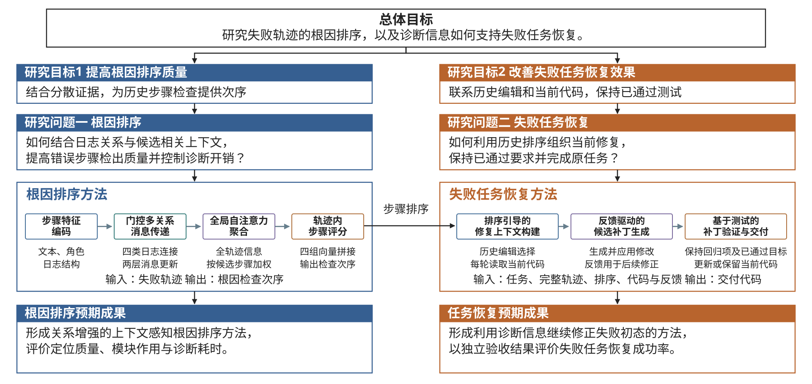
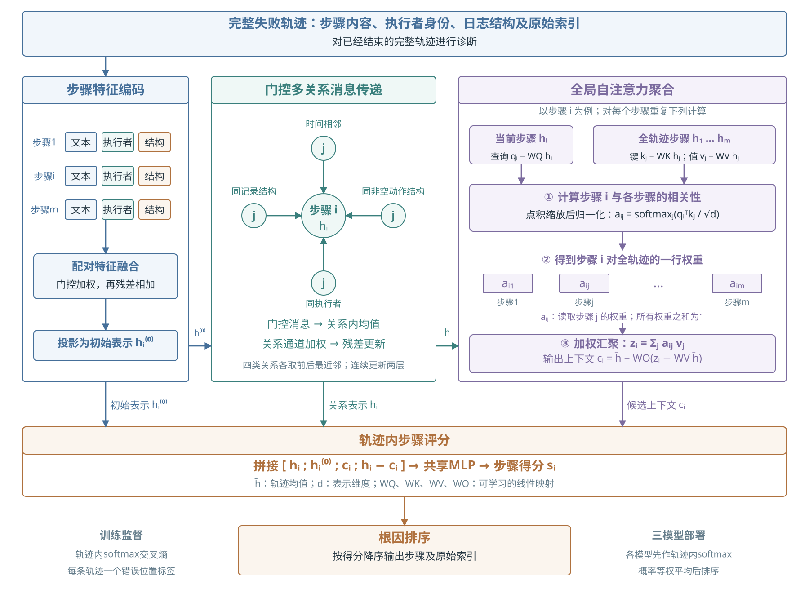
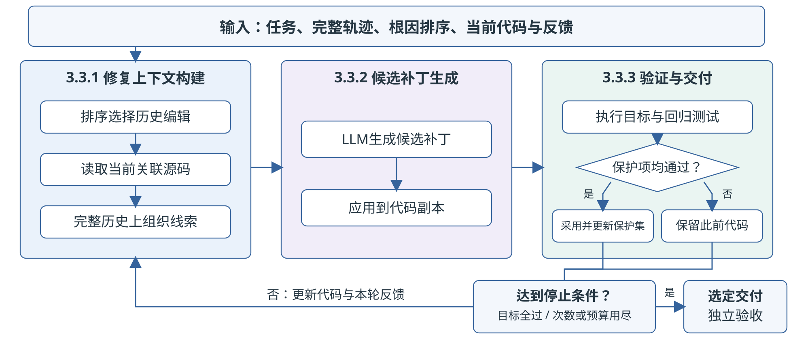

# 逐段溯源与结构复核

当前文稿：开题报告_v0.2.md。共83个段落/图表块，逐块登记。正文8700个非空白字符。

论文事实、比较判断和本文设计分别记录。历史数据与代码沿此前已核来源，本轮对实际存在的源文件重新核对哈希，不运行训练或恢复实验。

## P001 · 智能体运行故障的根因排序与恢复方法 · 第3行

开题报告 · 2026年10月29日

性质：版本信息或研究进度计划。论文：无直接编号事实。项目/中文来源：U01、U02。

本轮日期与拟研究安排，不承担已完成实验的效果主张。

## P002 · 1.1 研究背景 · 第9行

本论文研究智能体执行过程中的**运行故障**：错误理解、决策或操作使执行偏离任务要求，最终产生错误结果或未完成任务。[1] 这类故障也可能发生在程序正常结束的执行中，因此需要追查结果形成的过程。

性质：研究对象、论文依据及本文范围。论文：whowhen。项目/中文来源：L06、L07、L08、U01。

先交代同一任务的执行活动与有序记录，再说明步骤、故障、排序及恢复的用途。过程对象由英文原文支持；中文组织参考两篇自动化学报原文，不将其冒充统一故障步骤定义。

## P003 · 1.1 研究背景 · 第11行

智能体围绕任务作出决策、执行动作并接收反馈，这些活动的组织关系构成**执行工作流**。一次执行的推理、动作与环境观察按发生顺序保存，形成**执行轨迹**。[2] 轨迹中的一次具体决策或交互活动作为一个**步骤**，判断该步是否出错需结合当时输入、上下文和反馈。[3]

性质：研究对象、论文依据及本文范围。论文：process、traceelephant。项目/中文来源：L06、L07、L08、U01。

先交代同一任务的执行活动与有序记录，再说明步骤、故障、排序及恢复的用途。过程对象由英文原文支持；中文组织参考两篇自动化学报原文，不将其冒充统一故障步骤定义。

## P004 · 1.1 研究背景 · 第13行

**任务失败的原因往往难以仅凭最终结果确定，相关证据分散于不同智能体及其执行步骤，需要结合任务要求、消息交互、工具操作与环境反馈追查历史行为。** 上游偏差可能经后续信息传递形成错误级联，使最终异常表现与关键错误步骤处于不同位置。[4]

性质：研究对象、论文依据及本文范围。论文：agents_cn2026。项目/中文来源：L06、L07、L08、U01。

先交代同一任务的执行活动与有序记录，再说明步骤、故障、排序及恢复的用途。过程对象由英文原文支持；中文组织参考两篇自动化学报原文，不将其冒充统一故障步骤定义。

## P005 · 1.1 研究背景 · 第15行

因此，本论文以失败轨迹中的历史步骤为**根因候选**，结合步骤内容及关联证据评分，形成优先检查次序，称为**根因排序**。排序以关键错误的优先检出为目标，将评分较高的步骤置于检查前列，为核查错误和选择修正线索提供依据。

性质：研究对象、论文依据及本文范围。论文：无直接编号事实。项目/中文来源：L06、L07、L08、U01。

先交代同一任务的执行活动与有序记录，再说明步骤、故障、排序及恢复的用途。过程对象由英文原文支持；中文组织参考两篇自动化学报原文，不将其冒充统一故障步骤定义。

## P006 · 1.1 研究背景 · 第17行

为检验排序能否帮助完成任务，本论文进一步研究软件任务的**失败任务恢复**。恢复从失败后留下的代码与环境出发，在完整公共轨迹上突出高排位的真实编辑，补充当前相关源码与测试反馈，再提出和验证修改。[5] 最终是否恢复成功，由预先确定的原任务验收判定。

性质：研究对象、论文依据及本文范围。论文：repairagent。项目/中文来源：L06、L07、L08、U01。

先交代同一任务的执行活动与有序记录，再说明步骤、故障、排序及恢复的用途。过程对象由英文原文支持；中文组织参考两篇自动化学报原文，不将其冒充统一故障步骤定义。

## P007 · 1.2 国内外研究现状 · 第21行

根因排序需要回答哪些历史步骤应优先检查，失败任务恢复则需要把这些线索用于当前代码的修正。以下按这两个相继环节，分析代表性工作的证据组织、历史线索利用和验证方式。

性质：研究环节衔接。论文：无直接编号事实。项目/中文来源：U01、L08。

编号引文对应已有工作的方法或实验事实；随后比较其对象、证据组织及验证范围。未分别检验某设计不等于该工作完全没有上下文、交互或验证。

## P008 · 1.2.1 智能体运行故障诊断与根因排序 · 第25行

- **Who&When（Shaokun Zhang等，2025）**：以失败轨迹定位执行者及关键错误步骤，比较整轨迹判断、逐步检查和二分搜索。其“决定性错误”指纠正该步并相应调整后续执行即可使任务成功的错误，多个错误满足时取最早者；最佳步骤定位准确率为14.2%。[1] 研究建立了步骤级诊断对象，也表明终态失败判断与关键步骤定位之间仍有距离。

性质：论文事实与面向本课题的限定比较。论文：whowhen。项目/中文来源：U01、L08。

编号引文对应已有工作的方法或实验事实；随后比较其对象、证据组织及验证范围。未分别检验某设计不等于该工作完全没有上下文、交互或验证。

## P009 · 1.2.1 智能体运行故障诊断与根因排序 · 第27行

- **TraceElephant（Mengzhuo Chen等，2026）**：补全任务输入、中间消息与环境交互，分析各执行者当时可使用的信息。[3] 这说明步骤判断需要完整的可见证据；取得这些证据之后，如何关联分散记录并区分关键错误与后续表现，仍需具体的排序模型。

性质：论文事实与面向本课题的限定比较。论文：traceelephant。项目/中文来源：U01、L08。

编号引文对应已有工作的方法或实验事实；随后比较其对象、证据组织及验证范围。未分别检验某设计不等于该工作完全没有上下文、交互或验证。

## P010 · 1.2.1 智能体运行故障诊断与根因排序 · 第29行

- **StepFinder（Taiyu Zhu等，2026）**：结合步骤语义、执行者身份、双向时序网络与全局注意力产生步骤分数。[6] 其交互主要由时序、语义匹配和身份偏置表达，未分别检验显式决策上下文与后续动作、记录结构等日志联系的增量作用。这些联系为区分语义相近但执行作用不同的候选提供了待检验的信息。

性质：论文事实与面向本课题的限定比较。论文：stepfinder。项目/中文来源：U01、L08。

编号引文对应已有工作的方法或实验事实；随后比较其对象、证据组织及验证范围。未分别检验某设计不等于该工作完全没有上下文、交互或验证。

## P011 · 1.2.1 智能体运行故障诊断与根因排序 · 第31行

- **DCFA（Zehao Wang等，2026）**：构造依赖图，结合局部反事实推理细化根因判断。[7] 该工作说明关联证据有助于分析故障形成过程，同时引入额外结构推理。对于日志中可以直接提取的联系，仍需检验其能否以较低开销补充候选区分。

性质：论文事实与面向本课题的限定比较。论文：dcfa。项目/中文来源：U01、L08。

编号引文对应已有工作的方法或实验事实；随后比较其对象、证据组织及验证范围。未分别检验某设计不等于该工作完全没有上下文、交互或验证。

## P012 · 1.2.1 智能体运行故障诊断与根因排序 · 第33行

这些研究从确定诊断对象发展到补全证据、学习评分和关系推理。排序所形成的历史检查次序还需进入恢复过程，才能检验优先发现的行为是否确实有助于后续修正。

性质：研究环节衔接。论文：无直接编号事实。项目/中文来源：U01、L08。

编号引文对应已有工作的方法或实验事实；随后比较其对象、证据组织及验证范围。未分别检验某设计不等于该工作完全没有上下文、交互或验证。

## P013 · 1.2.2 根因排序引导的软件失败任务恢复 · 第37行

交互执行利用环境反馈继续求解[8]，跨次尝试积累反思经验[9]，工具检查为修订提供依据。[10] 软件恢复进一步要求把这些信息转化为当前代码上的修改。

性质：论文事实与面向本课题的限定比较。论文：react、reflexion、critic。项目/中文来源：U01、L08。

编号引文对应已有工作的方法或实验事实；随后比较其对象、证据组织及验证范围。未分别检验某设计不等于该工作完全没有上下文、交互或验证。

## P014 · 1.2.2 根因排序引导的软件失败任务恢复 · 第39行

- **Agentless（Xia等，2025）**：按定位、补丁生成、复现与回归筛选组织求解。[11] 其输入围绕当前问题与候选补丁组织，历史步骤排序的作用需要单独检验。

性质：论文事实与面向本课题的限定比较。论文：agentless。项目/中文来源：U01、L08。

编号引文对应已有工作的方法或实验事实；随后比较其对象、证据组织及验证范围。未分别检验某设计不等于该工作完全没有上下文、交互或验证。

## P015 · 1.2.2 根因排序引导的软件失败任务恢复 · 第41行

- **EnAgent（Tian等，2026）**：生成多条候选轨迹，经回归剪枝、工具检查与投票选择补丁。[12] 其回归筛选保护原有行为，本论文进一步研究恢复中新通过目标的持续保持。

性质：论文事实与面向本课题的限定比较。论文：enagent。项目/中文来源：U01、L08。

编号引文对应已有工作的方法或实验事实；随后比较其对象、证据组织及验证范围。未分别检验某设计不等于该工作完全没有上下文、交互或验证。

## P016 · 1.2.2 根因排序引导的软件失败任务恢复 · 第43行

- **SyncMind（Guo等，2025）**：处理执行者认识与实际代码失步，重新获取当前环境信息后恢复。[13] 这说明历史线索需要与当前代码核对。

性质：论文事实与面向本课题的限定比较。论文：syncmind。项目/中文来源：U01、L08。

编号引文对应已有工作的方法或实验事实；随后比较其对象、证据组织及验证范围。未分别检验某设计不等于该工作完全没有上下文、交互或验证。

## P017 · 1.2.2 根因排序引导的软件失败任务恢复 · 第45行

- **DoVer（Ma等，2026）**：修改消息或计划后重执行，以任务结果检验诊断。[14] 本论文关注代码逐轮修改，检查新补丁是否使此前已通过的目标测试再次失败。

性质：论文事实与面向本课题的限定比较。论文：dover。项目/中文来源：U01、L08。

编号引文对应已有工作的方法或实验事实；随后比较其对象、证据组织及验证范围。未分别检验某设计不等于该工作完全没有上下文、交互或验证。

## P018 · 1.3 研究问题 · 第49行

现有诊断利用时序、全局交互和推理组织证据，但日志中可直接提取的联系能否补充候选区分，仍需检验。工具执行也用于检验错误假设[15]，需要共同评价定位质量与诊断开销。诊断给出历史步骤判断，修复作用于当前代码，还需检验完整轨迹已可用时，显式排序提示及当前源码组织能否改善修改，并保持新通过的目标测试。

性质：基于文献比较提出的研究问题、目标或拟设计。论文：errorprobe。项目/中文来源：U01、C02、C08、C10、C11。

由1.2中具体比较及本地方法设计形成；目标、意义和创新均为拟研究作用，须由第五章实验检验，不作为已取得的效果。

## P019 · 1.3 研究问题 · 第51行

前一环节决定优先检查哪些历史行为，后一环节决定这些线索能否帮助完成原任务。本论文据此提出以下两个研究问题。

性质：基于文献比较提出的研究问题、目标或拟设计。论文：无直接编号事实。项目/中文来源：U01、C02、C08、C10、C11。

由1.2中具体比较及本地方法设计形成；目标、意义和创新均为拟研究作用，须由第五章实验检验，不作为已取得的效果。

## P020 · 1.3 研究问题 · 第53行

- **RQ1：分散执行证据下的根因排序。** 如何关联不同智能体和执行步骤中的分散证据，提高关键错误步骤的识别与排序质量，并控制诊断开销？

性质：基于文献比较提出的研究问题、目标或拟设计。论文：whowhen、stepfinder、dcfa、errorprobe。项目/中文来源：U01、C02、C07、C08、C10、C11。

由1.2中具体比较及本地方法设计形成；目标、意义和创新均为拟研究作用，须由第五章实验检验，不作为已取得的效果。

## P021 · 1.3 研究问题 · 第55行

- **RQ2：根因排序引导的软件失败任务恢复。** 如何将历史步骤排序转化为适用于当前代码的修复依据，并在连续修改中保持已通过目标测试所反映的任务进展，提高原任务的最终完成率？

性质：基于文献比较提出的研究问题、目标或拟设计。论文：agentracer、syncmind、enagent、dover。项目/中文来源：U01、C10、C11、C02、C08。

由1.2中具体比较及本地方法设计形成；目标、意义和创新均为拟研究作用，须由第五章实验检验，不作为已取得的效果。

## P022 · 1.3 研究问题 · 第57行

RQ1输出步骤检查次序，RQ2从中选择历史编辑并核对当前实现，两项研究通过实际进入恢复器的修复线索衔接。由此，研究目标既包括排序本身的有效性，也包括排序在恢复中的实际作用。

性质：基于文献比较提出的研究问题、目标或拟设计。论文：无直接编号事实。项目/中文来源：U01、C02、C08、C10、C11。

由1.2中具体比较及本地方法设计形成；目标、意义和创新均为拟研究作用，须由第五章实验检验，不作为已取得的效果。

## P023 · 2.1 研究目标 · 第63行

总体目标是建立从失败轨迹分析到软件任务继续求解的方法，形成可评价的根因排序与失败任务恢复流程。

性质：基于文献比较提出的研究问题、目标或拟设计。论文：无直接编号事实。项目/中文来源：U01、C02、C08、C10、C11。

由1.2中具体比较及本地方法设计形成；目标、意义和创新均为拟研究作用，须由第五章实验检验，不作为已取得的效果。

## P024 · 2.1 研究目标 · 第65行

- **根因排序目标：** 关联步骤内容、执行者与日志结构，结合局部关系传播和候选相关上下文学习步骤分数，输出优先检查次序。通过共同数据上的基线比较及消融，检验排序质量、诊断成本和各类证据的作用。

性质：基于文献比较提出的研究问题、目标或拟设计。论文：无直接编号事实。项目/中文来源：U01、C02、C08、C10、C11。

由1.2中具体比较及本地方法设计形成；目标、意义和创新均为拟研究作用，须由第五章实验检验，不作为已取得的效果。

## P025 · 2.1 研究目标 · 第67行

- **失败任务恢复目标：** 将排序转化为真实历史编辑的选择，结合当前源码与反馈生成补丁，以累计测试保持规则更新代码。通过共同失败初态下的完整方法比较及模块对照，检验最终恢复效果，并核对排序是否真正改变了修复输入。

性质：基于文献比较提出的研究问题、目标或拟设计。论文：无直接编号事实。项目/中文来源：U01、C02、C08、C10、C11。

由1.2中具体比较及本地方法设计形成；目标、意义和创新均为拟研究作用，须由第五章实验检验，不作为已取得的效果。

## P026 · 2.2 研究意义 · 第71行

- **方法意义：** 将分散执行记录中的可观测联系与候选相关上下文共同用于步骤判断，研究不同证据在关键错误区分中的作用；再将历史判断接入当前代码上的恢复操作，建立从诊断质量到任务结果的验证关系。

性质：基于文献比较提出的研究问题、目标或拟设计。论文：无直接编号事实。项目/中文来源：U01、C02、C08、C10、C11。

由1.2中具体比较及本地方法设计形成；目标、意义和创新均为拟研究作用，须由第五章实验检验，不作为已取得的效果。

## P027 · 2.2 研究意义 · 第73行

- **应用意义：** 为失败执行提供有次序的历史排查线索，帮助利用已有代码和执行记录继续求解。通过当前实现核对和已通过目标测试的保持，减少失效历史线索及后续修改退化对恢复的影响。

性质：基于文献比较提出的研究问题、目标或拟设计。论文：无直接编号事实。项目/中文来源：U01、C02、C08、C10、C11。

由1.2中具体比较及本地方法设计形成；目标、意义和创新均为拟研究作用，须由第五章实验检验，不作为已取得的效果。

## P028 · 2.2 研究意义 · 第75行

实现上述目标，需要先产生有效的步骤检查次序，再将高排位的历史编辑对应到当前代码，使诊断与恢复组成可验证的完整过程。

性质：基于文献比较提出的研究问题、目标或拟设计。论文：无直接编号事实。项目/中文来源：U01、C02、C08、C10、C11。

由1.2中具体比较及本地方法设计形成；目标、意义和创新均为拟研究作用，须由第五章实验检验，不作为已取得的效果。

## P029 · 3.1 总体研究框架与数据接口 · 第81行

性质：本文方法设计与已有基础机制。论文：无直接编号事实。项目/中文来源：F01、C06、C08、C10、C11、C01、C03。

总体图的模块与接口来自本文方案及原型，图示不作为独立科学证据。

## P030 · 3.1 总体研究框架与数据接口 · 第83行

**图3-1 根因排序与失败任务恢复的总体研究框架**

性质：本文方法设计与已有基础机制。论文：无直接编号事实。项目/中文来源：F01、C01、C03、C10。

与上一图对象一致，图内机制分别追溯到C01—C11。

## P031 · 3.1 总体研究框架与数据接口 · 第85行

总体过程见图3-1。排序为历史编辑选择提供次序，恢复结合当前代码生成并验证修改，满足测试保持条件才更新代码；停止后选定交付，以独立验收判断原任务是否完成。

性质：本文方法设计与已有基础机制。论文：无直接编号事实。项目/中文来源：C01、C03、C10。

步骤边界、字段、关系传播、上下文读取、评分或恢复操作由所列代码定位支撑；编号引文只支撑相应基础机制。模块末尾说明输出进入后续哪个模块，不插入外部论文介绍。

## P032 · 3.1 总体研究框架与数据接口 · 第87行

排序模型读取失败轨迹中的步骤内容、执行者及日志结构，保持数据源原有的步骤边界、标注位置与输出编号对应。对显式格式能够识别的决策上下文及其后续动作，融合关联记录的表示，保留两个原始步骤；排序结果再用于筛选实际编辑。

性质：本文方法设计与已有基础机制。论文：无直接编号事实。项目/中文来源：C01、C03、C04、C09、C10。

步骤边界、字段、关系传播、上下文读取、评分或恢复操作由所列代码定位支撑；编号引文只支撑相应基础机制。模块末尾说明输出进入后续哪个模块，不插入外部论文介绍。

## P033 · 3.1 总体研究框架与数据接口 · 第89行

排序输出每个原始步骤的分数与编号，恢复器据此选择历史编辑，读取对应文件或函数的当前实现，组织补丁生成输入。排序以标注错误的检出质量和诊断开销评价，恢复以原任务完成率和资源消耗评价；模块消融进一步分析信息选择与代码更新规则的作用。

性质：本文方法设计与已有基础机制。论文：无直接编号事实。项目/中文来源：C01、C03、C10。

步骤边界、字段、关系传播、上下文读取、评分或恢复操作由所列代码定位支撑；编号引文只支撑相应基础机制。模块末尾说明输出进入后续哪个模块，不插入外部论文介绍。

## P034 · 3.2 根因排序模型 · 第93行

性质：本文方法设计与已有基础机制。论文：无直接编号事实。项目/中文来源：F02、C02、C06、C07、C08、C09。

核对配对、四关系、单头全局读取、评分和三模型部署；保留原图布局。

## P035 · 3.2 根因排序模型 · 第95行

**图3-2 根因排序模型的计算结构**

性质：本文方法设计与已有基础机制。论文：无直接编号事实。项目/中文来源：F02、C02、C06、C07、C08。

与计算图保持同一研究对象及名称。

## P036 · 3.2 根因排序模型 · 第97行

图中m为步骤数，i、j为步骤编号；hᵢ⁽⁰⁾、hᵢ、cᵢ分别为初始表示、关系表示和步骤上下文，MLP为输出步骤分数的多层感知机。其余计算量在图内定义。模型依次完成特征编码、关系传播、全局上下文聚合与步骤评分。

性质：本文方法设计与已有基础机制。论文：无直接编号事实。项目/中文来源：C02、C06、C07、C08。

步骤边界、字段、关系传播、上下文读取、评分或恢复操作由所列代码定位支撑；编号引文只支撑相应基础机制。模块末尾说明输出进入后续哪个模块，不插入外部论文介绍。

## P037 · 3.2.1 步骤特征编码 · 第101行

输入包括各步的内容、动作与思考字段、执行者身份，以及位置和字段结构特征。文本采用固定的Qwen3-Embedding-0.6B编码器转换为向量。[16] 轨迹中已记录的任务要求随步骤文本编码，执行者按首次出现次序匿名编号。模型融合文本、身份与结构形成初始步骤表示；训练时用标注错误位置监督评分，预测时从轨迹日志计算步骤分数。

性质：本文方法设计与已有基础机制。论文：qwen3embedding。项目/中文来源：C03、C04、C05。

步骤边界、字段、关系传播、上下文读取、评分或恢复操作由所列代码定位支撑；编号引文只支撑相应基础机制。模块末尾说明输出进入后续哪个模块，不插入外部论文介绍。

## P038 · 3.2.2 门控多关系消息传递 · 第105行

模型以步骤为节点，构造时间相邻、同一执行者、完整记录结构相同、非空动作结构相同四类关系。后两类依据字段形式判定，各类连接前后最近的匹配记录，限制邻居数量。

性质：本文方法设计与已有基础机制。论文：无直接编号事实。项目/中文来源：C02、C07。

步骤边界、字段、关系传播、上下文读取、评分或恢复操作由所列代码定位支撑；编号引文只支撑相应基础机制。模块末尾说明输出进入后续哪个模块，不插入外部论文介绍。

## P039 · 3.2.2 门控多关系消息传递 · 第107行

模型将邻居内容及其与当前步骤的差异变换为消息，通过门控和关系权重汇集，更新步骤表示。两层传播使候选结合相关记录判断自身行为，该模块采用多关系图表示学习的邻居聚合机制。[17]

性质：本文方法设计与已有基础机制。论文：rgcn。项目/中文来源：C02、C07。

步骤边界、字段、关系传播、上下文读取、评分或恢复操作由所列代码定位支撑；编号引文只支撑相应基础机制。模块末尾说明输出进入后续哪个模块，不插入外部论文介绍。

## P040 · 3.2.3 全局自注意力聚合 · 第111行

有限轮关系传播只利用既定邻接覆盖的记录，远处的需求或失败反馈还需全轨迹读取补充。该模块以每个待评分步骤为查询，从同一完整轨迹的步骤表示中计算相关权重，汇集与它相关的信息，形成该候选自己的上下文。不同候选可以读取不同重点。查询、用于匹配的键和承载信息的值均来自同一轨迹，采用自注意力计算。[18]

性质：本文方法设计与已有基础机制。论文：attention。项目/中文来源：C08。

步骤边界、字段、关系传播、上下文读取、评分或恢复操作由所列代码定位支撑；编号引文只支撑相应基础机制。模块末尾说明输出进入后续哪个模块，不插入外部论文介绍。

## P041 · 3.2.3 全局自注意力聚合 · 第113行

当前实现以轨迹均值作为共享背景，再叠加候选相关修正，输出候选上下文。它与关系传播分别承担有限邻域汇集和全轨迹读取，是否互补由消融检验。两类表示随后共同进入评分网络。

性质：本文方法设计与已有基础机制。论文：attention。项目/中文来源：C08。

步骤边界、字段、关系传播、上下文读取、评分或恢复操作由所列代码定位支撑；编号引文只支撑相应基础机制。模块末尾说明输出进入后续哪个模块，不插入外部论文介绍。

## P042 · 3.2.4 轨迹内步骤评分 · 第117行

共享评分网络读取初始表示、关系表示、候选上下文及两者差异，为各步输出分数。训练时，一条轨迹提供一个标注错误位置，模型在同轨迹内归一化分数，最小化标注位置的负对数概率；预测时按分数降序产生检查次序。候选组内评分采用列表级学习思路[19]，单正例条件下的位置交叉熵与排序目标之间具有理论联系。[20]

性质：本文方法设计与已有基础机制。论文：learning_to_rank、softmax_rank、stepfinder。项目/中文来源：C06、C08、C09。

步骤边界、字段、关系传播、上下文读取、评分或恢复操作由所列代码定位支撑；编号引文只支撑相应基础机制。模块末尾说明输出进入后续哪个模块，不插入外部论文介绍。

## P043 · 3.2.4 轨迹内步骤评分 · 第119行

单位置监督没有给出其余步骤的完整责任先后次序，评价检查标注错误能否位于首位或前几个位置。各来源的错误位置含义分别保留，静态评分输出作为根因排查线索。恢复器进一步从高排位步骤中筛选真实编辑，形成面向当前代码的修复输入。

性质：本文方法设计与已有基础机制。论文：无直接编号事实。项目/中文来源：C06、C09。

步骤边界、字段、关系传播、上下文读取、评分或恢复操作由所列代码定位支撑；编号引文只支撑相应基础机制。模块末尾说明输出进入后续哪个模块，不插入外部论文介绍。

## P044 · 3.3 失败任务恢复方法 · 第123行

性质：本文方法设计与已有基础机制。论文：无直接编号事实。项目/中文来源：F03、C10、C11。

恢复图与原型中的生成、应用、测试、代码更新及停止流程对应，不将源码快照扩写为任意外部状态事务。

## P045 · 3.3 失败任务恢复方法 · 第125行

**图3-3 失败任务恢复流程**

性质：本文方法设计与已有基础机制。论文：无直接编号事实。项目/中文来源：F03、C10、C11。

保持既定图题和流程对象。

## P046 · 3.3.1 排序引导的修复上下文构建 · 第129行

生成器接收原始任务、完整公共执行轨迹及测试反馈。本方法在此基础上，按根因排序筛选实际改变过源码的历史操作，按工具调用去重，提取修改前后差异。首轮取最高排位编辑，后续按固定次序补充，最多3项。

性质：本文方法设计与已有基础机制。论文：无直接编号事实。项目/中文来源：C10。

步骤边界、字段、关系传播、上下文读取、评分或恢复操作由所列代码定位支撑；编号引文只支撑相应基础机制。模块末尾说明输出进入后续哪个模块，不插入外部论文介绍。

## P047 · 3.3.1 排序引导的修复上下文构建 · 第131行

每轮重新读取当前代码，记录历史修改后版本与当前版本的差异；再根据编辑涉及的函数、属性及失败栈位置，通过Python语法结构查找当前定义和可能引用它的代码，读取相关函数。按程序实体组织源码是已有修复方法的基础。[21] 本方法把排序选出的编辑及其当前关联代码作为显式修复线索，附加到完整历史。

性质：本文方法设计与已有基础机制。论文：autocoderover。项目/中文来源：C10。

步骤边界、字段、关系传播、上下文读取、评分或恢复操作由所列代码定位支撑；编号引文只支撑相应基础机制。模块末尾说明输出进入后续哪个模块，不插入外部论文介绍。

## P048 · 3.3.2 反馈驱动的候选补丁生成 · 第135行

生成模型利用完整历史、排序提示、当前关联源码和最新反馈，提出候选补丁。执行器将补丁应用到代码副本：应用成功后运行测试，应用失败时保留当前代码并反馈错误。该模块沿用生成—验证式程序修复机制。[22]

性质：本文方法设计与已有基础机制。论文：repair_survey_cn2025。项目/中文来源：C10。

步骤边界、字段、关系传播、上下文读取、评分或恢复操作由所列代码定位支撑；编号引文只支撑相应基础机制。模块末尾说明输出进入后续哪个模块，不插入外部论文介绍。

## P049 · 3.3.3 基于测试的补丁验证与交付 · 第139行

复现原问题的测试可用于筛选候选补丁。[23] 补丁成功修改代码副本后，执行器运行预先固定的**目标测试**及**回归测试**，前者检查原任务要求，后者检查需要保留的已有行为。

性质：本文方法设计与已有基础机制。论文：swtbench。项目/中文来源：C10、C11。

步骤边界、字段、关系传播、上下文读取、评分或恢复操作由所列代码定位支撑；编号引文只支撑相应基础机制。模块末尾说明输出进入后续哪个模块，不插入外部论文介绍。

## P050 · 3.3.3 基于测试的补丁验证与交付 · 第141行

本方法将初态已通过且需要保留的回归项，以及初态和各轮已采用代码中新通过的目标项组成保护集合。候选继续通过全部保护项时才更新代码，否则保留此前状态；被拒候选的新通过项不加入集合。测试保持依赖稳定、可执行的测试，可能拒绝需要暂时破坏已通过行为的中间修改；实验将记录这类拒绝及其任务后果。

性质：本文方法设计与已有基础机制。论文：无直接编号事实。项目/中文来源：C10、C11。

步骤边界、字段、关系传播、上下文读取、评分或恢复操作由所列代码定位支撑；编号引文只支撑相应基础机制。模块末尾说明输出进入后续哪个模块，不插入外部论文介绍。

## P051 · 3.3.3 基于测试的补丁验证与交付 · 第143行

目标全部通过、尝试次数或预算用尽时停止，按预先固定的反馈规则选择交付；与生成过程隔离的独立验收决定是否恢复成功。

性质：本文方法设计与已有基础机制。论文：无直接编号事实。项目/中文来源：C10、C11。

步骤边界、字段、关系传播、上下文读取、评分或恢复操作由所列代码定位支撑；编号引文只支撑相应基础机制。模块末尾说明输出进入后续哪个模块，不插入外部论文介绍。

## P052 · 3.3.3 基于测试的补丁验证与交付 · 第145行

测试结果缺失或不确定时，停止更新并保存已有代码。至此，步骤排序通过编辑选择进入恢复输入，补丁验证再决定能否保留修改；两个环节分别需要解决证据区分和状态变化带来的困难。

性质：本文方法设计与已有基础机制。论文：无直接编号事实。项目/中文来源：C10、C11。

步骤边界、字段、关系传播、上下文读取、评分或恢复操作由所列代码定位支撑；编号引文只支撑相应基础机制。模块末尾说明输出进入后续哪个模块，不插入外部论文介绍。

## P053 · 4.1 关键难点 · 第151行

- **难点一：分散执行证据的关联与关键错误区分。** 同一反馈可能关联多个历史步骤，错误操作与失败表现也可能相隔很远。需要结合日志联系和远处证据，减少无关信息干扰，并控制轨迹增长带来的诊断开销。

性质：基于文献比较提出的研究问题、目标或拟设计。论文：traceelephant、stepfinder、errorprobe。项目/中文来源：C02、C07、C08、C10、C11。

由1.2中具体比较及本地方法设计形成；目标、意义和创新均为拟研究作用，须由第五章实验检验，不作为已取得的效果。

## P054 · 4.1 关键难点 · 第153行

- **难点二：变化代码上的历史线索利用与修复进展保持。** 排序对应历史行为，修改作用于当前实现。需要核对线索是否仍成立，并在解决剩余问题时保留已获得的测试进展；修改又会改变后续输入及测试状态。这两项困难分别对应排序中的证据融合与恢复中的状态更新。

性质：基于文献比较提出的研究问题、目标或拟设计。论文：syncmind、agentracer、agentless、enagent。项目/中文来源：C10、C11、C02、C08。

由1.2中具体比较及本地方法设计形成；目标、意义和创新均为拟研究作用，须由第五章实验检验，不作为已取得的效果。

## P055 · 4.2 拟研究的创新点 · 第157行

- **可观测日志关系与候选相关上下文的联合排序。** 将日志中可直接提取的局部关系与面向不同候选的全轨迹读取结合，研究两类证据在关键错误步骤检出中的互补作用。

性质：基于文献比较提出的研究问题、目标或拟设计。论文：无直接编号事实。项目/中文来源：C02、C08、C10、C11。

由1.2中具体比较及本地方法设计形成；目标、意义和创新均为拟研究作用，须由第五章实验检验，不作为已取得的效果。

## P056 · 4.2 拟研究的创新点 · 第159行

- **完整历史上的排序提示与测试进展保持。** 在完整公共轨迹上补充高排位真实编辑及当前关联源码，并由外部测试规则控制代码更新，将新通过的目标项纳入后续保护。研究这种证据组织与更新规则对任务恢复的作用，以完整轨迹直接输入对照及模块消融分别评价。

性质：基于文献比较提出的研究问题、目标或拟设计。论文：无直接编号事实。项目/中文来源：C02、C08、C10、C11。

由1.2中具体比较及本地方法设计形成；目标、意义和创新均为拟研究作用，须由第五章实验检验，不作为已取得的效果。

## P057 · 5.1 实验数据来源与划分 · 第165行

**表5-1 数据来源与研究样本**

性质：数据来源、历史记录或前瞻实验计划。论文：无直接编号事实。项目/中文来源：D01、D02、D03、D04、D05。

该表区分公开版本规模、开发记录与拟议恢复样本，不混用发布量与本地纳入量。

## P058 · 5.1 实验数据来源与划分 · 第167行

| 数据来源 | 研究样本 | 数据内容 | 实验用途 |
| --- | --- | --- | --- |
| AFTraj | 开发731条、716个任务组；评价候选163条 | 执行轨迹、决定性错误位置 | 根因排序开发与评价 |
| AgenTracer | 训练验证614条；coding开发363条、评价候选127条 | 代码与数学任务轨迹、错误位置 | 参数学习、配置选择与排序评价 |
| SWE-Gym | 计划20个问题、覆盖5仓库 | 代码库、任务说明、执行环境与测试 | 构造共同失败初态、比较任务恢复 |

性质：数据来源、历史记录或前瞻实验计划。论文：无直接编号事实。项目/中文来源：D01、D02、D03、D04、D05。

数据发布量、本地筛选量、开发材料和计划运行量分别陈述。614=320+294、492=256+236、122=64+58沿已核清单；独立评价候选的历史使用仍须在运行前核验。方法与重复次数是计划，不是已完成结果。

## P059 · 5.1 实验数据来源与划分 · 第173行

AFTraj提供执行轨迹与决定性错误标注[24]，AgenTracer提供轨迹及错误位置[25]，用于步骤排序；SWE-Gym提供可执行仓库问题[26]，按代码修改与测试评价原任务完成情况。[27]

性质：数据来源、历史记录或前瞻实验计划。论文：agentforesight、agentracer、swegym、swebench。项目/中文来源：D01、D02、D03、D04、D05。

数据发布量、本地筛选量、开发材料和计划运行量分别陈述。614=320+294、492=256+236、122=64+58沿已核清单；独立评价候选的历史使用仍须在运行前核验。方法与重复次数是计划，不是已完成结果。

## P060 · 5.1 实验数据来源与划分 · 第175行

恢复任务计划覆盖5个Python仓库、20个问题。每题重建失败后的代码、环境、历史轨迹和反馈测试，确认原任务尚未完成，形成共同恢复起点。

性质：数据来源、历史记录或前瞻实验计划。论文：无直接编号事实。项目/中文来源：D01、D02、D03、D04、D05。

数据发布量、本地筛选量、开发材料和计划运行量分别陈述。614=320+294、492=256+236、122=64+58沿已核清单；独立评价候选的历史使用仍须在运行前核验。方法与重复次数是计划，不是已完成结果。

## P061 · 5.1 实验数据来源与划分 · 第177行

训练验证数据从AgenTracer公开训练部分筛选6—32步轨迹，代码任务coding取320条、数学任务math取294条，共614条。验证集与训练集按**约1:4**划分：coding为64/256，math为58/236，合计**验证122条、训练492条**。

性质：数据来源、历史记录或前瞻实验计划。论文：无直接编号事实。项目/中文来源：D01、D02、D03、D04、D05。

数据发布量、本地筛选量、开发材料和计划运行量分别陈述。614=320+294、492=256+236、122=64+58沿已核清单；独立评价候选的历史使用仍须在运行前核验。方法与重复次数是计划，不是已完成结果。

## P062 · 5.1 实验数据来源与划分 · 第179行

固定划分及三次初始化，用训练集学习参数、验证集选择配置。代码与数学任务分别报告，另比较仅用代码任务训练的表现。AFTraj 731条、716个任务组及AgenTracer coding 363条用于开发；独立评价从作者测试记录163/127条中核对历史使用与重叠后固定清单。同一原问题的派生轨迹作为一个任务组，归入同一集合。

性质：数据来源、历史记录或前瞻实验计划。论文：无直接编号事实。项目/中文来源：D01、D02、D03、D04、D05。

数据发布量、本地筛选量、开发材料和计划运行量分别陈述。614=320+294、492=256+236、122=64+58沿已核清单；独立评价候选的历史使用仍须在运行前核验。方法与重复次数是计划，不是已完成结果。

## P063 · 5.1 实验数据来源与划分 · 第181行

执行环境提供仓库浏览、源码编辑与测试接口[28]，隔离保存命令、文件变化与轨迹。[29] 各方法共用deepseek-flash、失败初态、信息许可、反馈测试和资源上限，每题独立重复3次；30分钟为主比较，同时记录15/60分钟交付结果。

性质：数据来源、历史记录或前瞻实验计划。论文：sweagent、openhands。项目/中文来源：D01、D02、D03、D04、D05。

数据发布量、本地筛选量、开发材料和计划运行量分别陈述。614=320+294、492=256+236、122=64+58沿已核清单；独立评价候选的历史使用仍须在运行前核验。方法与重复次数是计划，不是已完成结果。

## P064 · 5.2 整体实验流程与工作量 · 第185行

- **根因排序实验：** 准备数据后，训练完整模型、StepFinder及两项排序消融，各做3次初始化；增加仅代码训练对照。冻结配置后，比较定位与排序质量、耗时及模型请求。

性质：数据来源、历史记录或前瞻实验计划。论文：无直接编号事实。项目/中文来源：C01、C13、D01、D02、D03、D04、D05。

数据发布量、本地筛选量、开发材料和计划运行量分别陈述。614=320+294、492=256+236、122=64+58沿已核清单；独立评价候选的历史使用仍须在运行前核验。方法与重复次数是计划，不是已完成结果。

## P065 · 5.2 整体实验流程与工作量 · 第187行

- **失败任务恢复实验：** 在5.1的共同失败起点上，比较本方法、Agentless、EnAgent与AOrchestra，并开展修复上下文构建、累计测试保持两项模块消融。

性质：数据来源、历史记录或前瞻实验计划。论文：无直接编号事实。项目/中文来源：C01、C13、D01、D02、D03、D04、D05。

数据发布量、本地筛选量、开发材料和计划运行量分别陈述。614=320+294、492=256+236、122=64+58沿已核清单；独立评价候选的历史使用仍须在运行前核验。方法与重复次数是计划，不是已完成结果。

## P066 · 5.2 整体实验流程与工作量 · 第189行

- **完整轨迹与编辑次序对照：** 上下文构建消融保留完整公共轨迹、共同源码访问及测试保持，取消额外编辑提示与关联源码。另按时间倒序选择同量编辑，复用相同源码组织和反馈规则，区分排序次序与附加信息的作用。

性质：数据来源、历史记录或前瞻实验计划。论文：无直接编号事实。项目/中文来源：C01、C13、D01、D02、D03、D04、D05。

数据发布量、本地筛选量、开发材料和计划运行量分别陈述。614=320+294、492=256+236、122=64+58沿已核清单；独立评价候选的历史使用仍须在运行前核验。方法与重复次数是计划，不是已完成结果。

## P067 · 5.2 整体实验流程与工作量 · 第191行

- **汇总与分析：** 同题重复先汇总，再对问题等权统计。保存模型输入、选中编辑、代码状态和测试变化，核对排序是否改变了有效线索；独立评价采用未参与开发的任务。

性质：数据来源、历史记录或前瞻实验计划。论文：无直接编号事实。项目/中文来源：C01、C13、D01、D02、D03、D04、D05。

数据发布量、本地筛选量、开发材料和计划运行量分别陈述。614=320+294、492=256+236、122=64+58沿已核清单；独立评价候选的历史使用仍须在运行前核验。方法与重复次数是计划，不是已完成结果。

## P068 · 5.2 整体实验流程与工作量 · 第193行

**表5-2 整体实验流程与计划工作量**

性质：数据来源、历史记录或前瞻实验计划。论文：无直接编号事实。项目/中文来源：C01、C13、D01、D02、D03、D04、D05。

数据发布量、本地筛选量、开发材料和计划运行量分别陈述。614=320+294、492=256+236、122=64+58沿已核清单；独立评价候选的历史使用仍须在运行前核验。方法与重复次数是计划，不是已完成结果。

## P069 · 5.2 整体实验流程与工作量 · 第195行

| 实验环节 | 比较设置 | 重复与计划工作量 |
| --- | --- | --- |
| 排序主实验与消融 | 完整模型、StepFinder、两项排序消融 | 4种设置×3次初始化＝12次训练 |
| 混合训练作用 | 完整模型仅用coding训练 | 1种设置×3次初始化＝3次训练 |
| 恢复整体比较 | 本方法、Agentless、EnAgent、AOrchestra | 20题×4方法×3次＝240次运行 |
| 恢复模块消融 | w/o修复上下文构建（完整轨迹对照）、w/o累计测试保持 | 20题×2设置×3次＝120次运行 |
| 编辑次序对照 | 时间倒序选择同量编辑，其余机制相同 | 20题×1设置×3次＝60次运行 |

性质：数据来源、历史记录或前瞻实验计划。论文：无直接编号事实。项目/中文来源：C01、C13、D01、D02、D03、D04、D05。

数据发布量、本地筛选量、开发材料和计划运行量分别陈述。614=320+294、492=256+236、122=64+58沿已核清单；独立评价候选的历史使用仍须在运行前核验。方法与重复次数是计划，不是已完成结果。

## P070 · 5.2 整体实验流程与工作量 · 第203行

上述开发计划包括15次训练及420次恢复运行。完整轨迹直接输入对照与上下文构建消融共用同一设置，计入120次模块消融。独立评价另按核定清单执行，三次重复全部纳入统计。

性质：数据来源、历史记录或前瞻实验计划。论文：无直接编号事实。项目/中文来源：C01、C13、D01、D02、D03、D04、D05。

数据发布量、本地筛选量、开发材料和计划运行量分别陈述。614=320+294、492=256+236、122=64+58沿已核清单；独立评价候选的历史使用仍须在运行前核验。方法与重复次数是计划，不是已完成结果。

## P071 · 5.3 评价指标与基线方法 · 第207行

**表5-3 主要评价指标**

性质：数据来源、历史记录或前瞻实验计划。论文：whowhen、stepfinder、swebench。项目/中文来源：C12、U01、C10、C11。

指标表分别评价步骤与最终任务，避免把诊断位置正确等同恢复成功。

## P072 · 5.3 评价指标与基线方法 · 第209行

| 指标 | 计算与含义 |
| --- | --- |
| Top-1 ↑ | 标注错误步骤位于首位的任务组等权比例 |
| MRR ↑ | 标注位置倒数排名的任务组等权均值 |
| Hit@3 / Hit@5 ↑ | 标注错误步骤进入前3/5位的任务组等权比例 |
| 诊断耗时P50 / P95 ↓ | 首次加载及已加载条件下的中位数/95分位数 |
| 失败任务恢复成功率RSR ↑ | 同题3次运行先平均，再对共同问题等权 |
| RSR@15 / 30 / 60min ↑ | 节点前选定交付的独立验收成功率 |
| 资源消耗 ↓ | 输入输出token总量、大模型API请求次数 |

性质：数据来源、历史记录或前瞻实验计划。论文：stepfinder、learning_to_rank、swebench。项目/中文来源：C12、C13、U02、U01、C10、C11。

Top-1和MRR有原文与代码对应；Hit@K是标注位置进入前K。任务组等权、同题三次先平均及时间节点RSR为本文预定口径，表未列实测值。

## P073 · 5.3 评价指标与基线方法 · 第219行

耗时覆盖文本编码和评分，注明加载条件、硬件、批处理及轨迹长度。另按标注错误的位置和轨迹长度分组分析排序表现。 token为模型处理的词元。

性质：数据来源、历史记录或前瞻实验计划。论文：无直接编号事实。项目/中文来源：U01、C10、C11。

数据发布量、本地筛选量、开发材料和计划运行量分别陈述。614=320+294、492=256+236、122=64+58沿已核清单；独立评价候选的历史使用仍须在运行前核验。方法与重复次数是计划，不是已完成结果。

## P074 · 5.3 评价指标与基线方法 · 第221行

**表5-4 失败诊断基线及正式发表时间**

性质：数据来源、历史记录或前瞻实验计划。论文：whowhen、stepfinder。项目/中文来源：U01、C10、C11。

表内时间统一采用正式会议/出版年月口径，逐项身份见09文献遴选核对。

## P075 · 5.3 评价指标与基线方法 · 第223行

| 方法 | 正式发表时间 | 发表载体 | 核心机制 |
| --- | --- | --- | --- |
| All-at-Once | 2025.07 | ICML | 整轨迹一次性诊断 |
| Binary Search | 2025.07 | ICML | 区间判断与二分搜索 |
| StepFinder | 2026.08 | KDD | 时序、角色交互与步骤评分 |
| 本方法 | — | 本论文 | 关系传播与候选相关上下文 |

性质：数据来源、历史记录或前瞻实验计划。论文：whowhen、stepfinder。项目/中文来源：U01、C10、C11。

Who&When官方PMLR会议年月2025.07，修正旧2025.10；StepFinder DOI登记出版2026.08。All-at-Once与Binary Search是同篇论文的方法，不另算两篇引用。

## P076 · 5.3 评价指标与基线方法 · 第230行

诊断统一比较Top-1和耗时，能够输出完整排序的方法另报MRR及Hit@3/5；生成式方法同时统计词元和模型请求。各方法共用轨迹、步骤边界、划分及标签，单位置输出不补造完整排名。

性质：数据来源、历史记录或前瞻实验计划。论文：whowhen、stepfinder。项目/中文来源：C12、U02、U01、C10、C11。

数据发布量、本地筛选量、开发材料和计划运行量分别陈述。614=320+294、492=256+236、122=64+58沿已核清单；独立评价候选的历史使用仍须在运行前核验。方法与重复次数是计划，不是已完成结果。

## P077 · 5.3 评价指标与基线方法 · 第232行

**表5-5 失败任务恢复基线及正式发表时间**

性质：数据来源、历史记录或前瞻实验计划。论文：agentless、enagent、aorchestra。项目/中文来源：U01、C10、C11。

三项恢复基线覆盖固定流程、候选集成与动态协作，均按正式论文身份核对。

## P078 · 5.3 评价指标与基线方法 · 第234行

| 方法 | 正式发表时间 | 发表载体 | 核心过程 |
| --- | --- | --- | --- |
| Agentless | 2025.06 | FSE / PACMSE | 定位、生成、复现与回归筛选 |
| EnAgent | 2026.04 | ICSE | 多轨迹、回归剪枝、工具选择与投票 |
| AOrchestra | 2026.07 | ICML | 动态子智能体及上下文配置 |
| 本方法 | — | 本论文 | 诊断输入、反馈修复与测试保持 |

性质：数据来源、历史记录或前瞻实验计划。论文：agentless、enagent、aorchestra。项目/中文来源：U01、C10、C11。

Agentless 2025.06、EnAgent 2026.04由出版登记支持；AOrchestra 2026.07由PMLR正式会议年月支持，修正旧2026.09；论文默认流程不能被任意删核心。

## P079 · 5.3 评价指标与基线方法 · 第241行

恢复统一比较15/30/60分钟交付的独立验收成功率、词元与请求次数，以30分钟为主结果；各节点来自同次运行，提前停止后沿用当时已选交付。各方法保留完整求解过程，并采用共同失败初态、模型、信息许可、预算和验收；AOrchestra按其动态子智能体与上下文配置流程完整实施。[30] 预算内未成功、工程中断及验收未知分别记录，并列出共同可比较的问题数。完整方法比较评价总体效果，完整轨迹输入对照检验证据组织的增量作用，模块消融分析上下文构建与代码更新规则。

性质：数据来源、历史记录或前瞻实验计划。论文：aorchestra。项目/中文来源：U01、C10、C11。

数据发布量、本地筛选量、开发材料和计划运行量分别陈述。614=320+294、492=256+236、122=64+58沿已核清单；独立评价候选的历史使用仍须在运行前核验。方法与重复次数是计划，不是已完成结果。

## P080 · 5.4 消融实验与作用分析 · 第245行

**表5-6 核心模块消融**

性质：数据来源、历史记录或前瞻实验计划。论文：无直接编号事实。项目/中文来源：C12、U01。

数据发布量、本地筛选量、开发材料和计划运行量分别陈述。614=320+294、492=256+236、122=64+58沿已核清单；独立评价候选的历史使用仍须在运行前核验。方法与重复次数是计划，不是已完成结果。

## P081 · 5.4 消融实验与作用分析 · 第247行

| 研究内容 | 实验设置 | 验证目的 |
| --- | --- | --- |
| 根因排序 | 完整模型 | 评价完整排序方法 |
|  | w/o 门控多关系消息传递 | 分析关系传播模块的作用 |
|  | w/o 全局自注意力聚合 | 分析候选相关上下文的作用 |
| 失败任务恢复 | 完整恢复方法 | 评价完整恢复方法 |
|  | w/o 排序引导的修复上下文构建 | 分析排序与当前实现共同组织输入的作用 |
|  | w/o 累计测试保持 | 分析连续修改中测试进展保持的作用 |

性质：数据来源、历史记录或前瞻实验计划。论文：无直接编号事实。项目/中文来源：C12、U01。

数据发布量、本地筛选量、开发材料和计划运行量分别陈述。614=320+294、492=256+236、122=64+58沿已核清单；独立评价候选的历史使用仍须在运行前核验。方法与重复次数是计划，不是已完成结果。

## P082 · 5.4 消融实验与作用分析 · 第256行

消融逐项移除对应模块，固定其余输入许可、生成条件与资源设置。排序模型分别重新训练；移除修复上下文构建时，保留完整公共轨迹、共同源码访问和测试反馈，取消排序派生的编辑提示与关联源码补充；移除累计测试保持时，沿用固定测试验证与交付规则。各恢复方法从相同失败状态独立运行，并记录输入、补丁与测试变化，分析模块对操作及最终结果的影响。

性质：数据来源、历史记录或前瞻实验计划。论文：无直接编号事实。项目/中文来源：C12、U01。

数据发布量、本地筛选量、开发材料和计划运行量分别陈述。614=320+294、492=256+236、122=64+58沿已核清单；独立评价候选的历史使用仍须在运行前核验。方法与重复次数是计划，不是已完成结果。

## P083 · 6 研究进度安排 · 第260行

2026年10月完成题目、概念、研究依据和开题方案重构；11—12月完成排序与恢复模块、数据清单及评价配置。2027年1—2月开展完整基线比较和独立评价，3月完成消融、结果分析及论文初稿，4—5月修改论文并准备答辩。写作与证据整理随研究同步推进。

性质：版本信息或研究进度计划。论文：无直接编号事实。项目/中文来源：U01、U02。

本轮日期与拟研究安排，不承担已完成实验的效果主张。

## 来源索引

- C01：步骤坐标与公开数据适配。freeze()与labels()：history原步骤号、coordinate_map、同原问题分组及320组上限。路径：`D:\Code\毕设\graduate-thesis-experiments\工作区\1006-exp134-event-relation\实验\实验134_状态动作表示与关系排序\prepare_data.py`。
- C02：四类邻接与记录结构。第107行_h0_vector；第135行_shape_labels；第148行_build_adjacency。路径：`D:\Code\毕设\graduate-thesis-experiments\实验\实验112_RQ1时序交互依赖完整排序\runner.py`。
- C03：显式决策上下文—后续动作配对。第7行is_state；第13—36行representation。路径：`D:\Code\毕设\graduate-thesis-experiments\工作区\1006-exp133-state-action\实验\实验133_状态动作选择性核验\method.py`。
- C04：固定文本与角色编码、配对输入。第26行feature_input；第46行起build；约第61行内容及角色编码。路径：`D:\Code\毕设\graduate-thesis-experiments\工作区\1006-exp134-event-relation\实验\实验134_状态动作表示与关系排序\prepare_features.py`。
- C05：允许字段、匿名角色与实际编码器。第83行anonymous_public_turns；第95行embedding_text；default_assets和FrozenQwenEncoder。路径：`D:\Code\毕设\graduate-thesis-experiments\工作区\1006-exp134-event-relation\实验\实验134_状态动作表示与关系排序\sources\model_adapters.py`。
- C06：配对残差、共享评分头与损失。EventResidual.forward；Ranker；collate；loss。路径：`D:\Code\毕设\graduate-thesis-experiments\实验\实验257_source3与强SF推断发布\sources\original_models.py`。
- C07：关系消息传递计算。RelationLayer.forward。路径：`D:\Code\毕设\graduate-thesis-experiments\实验\实验257_source3与强SF推断发布\sources\owned_exp130_model.py`。
- C08：候选相关全轨迹上下文。ContextRanker.context_readout与forward。路径：`D:\Code\毕设\graduate-thesis-experiments\实验\实验257_source3与强SF推断发布\sources\context_models.py`。
- C09：部署输入与三模型排序。SOURCE_SEEDS；geometry约第200—224行；第374行步骤文本投影。路径：`D:\Code\毕设\graduate-thesis-experiments\实验\实验257_source3与强SF推断发布\release257.py`。
- C10：历史编辑筛选及恢复循环。_source_evidence；_refresh；run；终止后候选选择约第453—490行。路径：`D:\Code\毕设\graduate-thesis-experiments\实验\实验262_已有进展保护真实压力场景\SOURCE\ours_core\ranked_repair248.py`。
- C11：逐项测试保护与未知结果处理。observe；RepairProgressGuard.__init__、consider；restore_exact。路径：`D:\Code\毕设\graduate-thesis-experiments\实验\实验262_已有进展保护真实压力场景\SOURCE\ours_core\progress_guard240.py`。
- C12：排序指标计算。第75行metrics；协议中三次初始化及验证选择。路径：`D:\Code\毕设\graduate-thesis-experiments\工作区\1006-exp134-event-relation\实验\实验134_状态动作表示与关系排序\train.py`。
- C13：历史开发材料的总数约束。source_inputs、af_inputs及mean_by_group。路径：`D:\Code\毕设\graduate-thesis-experiments\工作区\1007-exp153-global-context\实验\实验153_候选条件全轨迹上下文\data153.py`。
- D01：公开筛选清单。full_release_public_counts、eligible_group_counts、selected_counts及614条records。路径：`D:\Code\毕设\graduate-thesis-experiments\工作区\1006-exp134-event-relation\实验\实验134_状态动作表示与关系排序\data\public_split_manifest.json`。
- D02：历史开发成员记录。source_ids与target_cohorts.coding363；AF_training_features及af_schedule。路径：`D:\Code\毕设\graduate-thesis-experiments\工作区\1007-exp153-global-context\实验\实验153_候选条件全轨迹上下文\prepared_inputs.json`。
- D03：作者公开的AFTraj数据卡底稿。Dataset Summary、Schema、Paper Test Split；本轮从作者公开Hugging Face链接读取并保存。路径：`D:\Code\毕设\graduate-thesis-experiments\工作区\1029-逐段溯源与学术表达\sources\aftraj_README_20261029.md`。
- D04：614条清单的本轮只读统计。records、groups、splits、domainSplits及源清单SHA-256。路径：`D:\Code\毕设\graduate-thesis-experiments\工作区\1029-逐段溯源与学术表达\sources\public_split_manifest_audit.json`。
- D05：363及历史AF记录的本轮核对。coding363_ids_count、coding363_unique_ids、afPublicRecordPathExists。路径：`D:\Code\毕设\graduate-thesis-experiments\工作区\1029-逐段溯源与学术表达\sources\historical_development_counts_audit.json`。
- U01：导师要求原文整理。研究内容第1—7项及PPT组织表达要求。路径：`D:\Code\毕设\卓刀泉北路111号 3_导师意见整理.md`。
- U02：修订前既定方案记录。第2—6章，尤其20题/5仓库/4方法/3重复和15/30/60分钟节点。路径：`D:\Code\毕设\graduate-thesis-experiments\工作区\1029-逐段溯源与学术表达\修订前\01_开题报告_重构稿.md`。
- F01：总体框架原图。四个排序模块、三个恢复模块及接口。路径：`D:\Code\毕设\graduate-thesis-experiments\开题\20261029_导师意见全面重构\figures\图3-1_总体研究框架.svg`。
- F02：根因排序计算原图。四关系、配对融合、Q/K/V、均值修正、评分与三模型部署。路径：`D:\Code\毕设\graduate-thesis-experiments\开题\20261029_导师意见全面重构\figures\图3-2_根因排序模型.svg`。
- F03：失败任务恢复流程原图。生成、验证、B与H集合、状态更新及独立验收。路径：`D:\Code\毕设\graduate-thesis-experiments\开题\20261029_导师意见全面重构\figures\图3-3_失败任务恢复流程.svg`。
- L01：中文智能体工作流与错误级联原文。§3.3及动态工作流段，§4.2.1，§8.2。路径：`D:\Code\毕设\graduate-thesis-experiments\工作区\1023-开题学术重写\chinese_ltr\cn06_agents2026.txt`。
- L02：中文程序修复及补丁验证原文。§5.1补丁生成与补丁验证；§6.4反馈修复。路径：`D:\Code\毕设\graduate-thesis-experiments\工作区\1023-开题学术重写\chinese_ltr\cn03_llmrepair2025.txt`。
- L03：中文数据泄露与补丁验证原文。§1.1流程第(5)项，§1.2及数据重叠实证分析。路径：`D:\Code\毕设\graduate-thesis-experiments\工作区\1023-开题学术重写\chinese_ltr\cn04_leakage2024.txt`。
- L04：中文排序学习表达原文。§2.1—2.2：评分函数与点级/对级/列表级排序。路径：`D:\Code\毕设\graduate-thesis-experiments\工作区\1023-开题学术重写\chinese_ltr\cn01_ltr2016.txt`。
- L05：中文图消息传递表达原文。§3.1信息传递式卷积。路径：`D:\Code\毕设\graduate-thesis-experiments\工作区\1026-术语与原理核定\中文图分类综述_原文提取.txt`。
- L06：中文工具交互、工作流与调用轨迹原文。郑逸宁等《自动化学报》2025；§1、§3.2使用规划与工作流段（缓存第1250—1272行）、§5.1反馈与工具调用轨迹；官网DOI 10.16383/j.aas.c240793。路径：`D:\Code\毕设\graduate-thesis-experiments\工作区\1029-题目一致与引用定点修订\sources\AAS2025_工具使用综述_官网正文.txt`。
- L07：中文多步任务与历史结果组织原文。秦龙等《自动化学报》2024，§3总述、§3.1观察/动作/上下文、§3.2总体框架、§3.3模块；DOI 10.16383/j.aas.c240088。路径：`D:\Code\毕设\graduate-thesis-experiments\工作区\1029-题目一致与引用定点修订\sources\AAS2024_AutoPlan_官网正文.txt`。
- L08：本轮中英文原文核对与缓存纠错记录。Process-Centric的ACM官网Introduction及§2；Who&When §2；StepFinder §3；TraceElephant摘要与§1—2。路径：`D:\Code\毕设\graduate-thesis-experiments\工作区\1029-题目一致与引用定点修订\英文原文核对记录.md`。
- U03：本轮页数与衔接要求。用户2026-10-29最新要求及本轮中文原文组织复核。路径：`D:\Code\毕设\graduate-thesis-experiments\工作区\1029-最新版备份与恢复创新复核\中文组织与衔接复核.md`。

## 恢复最终输入来源补充

本轮按最终模型请求链补充C14—C18及U04。3.3、4.2、5.2、5.4的设计由完整公共历史、排序派生输入、当前静态源码组织及外部测试保持共同支撑。代码/请求事实与计划比较分别记录，详细精确位置见10_逐段溯源映射.json及14_恢复机制与创新依据复核.md。

- C14：恢复实际入口与启用开关；第26—34、84—93、119、145—147、221行；绑定冻结排序与完整公共包，启用RELATION上下文并调用最终请求组装。 路径：`D:\Code\毕设\graduate-thesis-experiments\实验\实验262_已有进展保护真实压力场景\SOURCE\environment262.py`。

- C15：完整历史与派生上下文注入；第52—98行；加入AST辅助当前源码及codec.render完整公共历史。 路径：`D:\Code\毕设\graduate-thesis-experiments\实验\实验262_已有进展保护真实压力场景\SOURCE\ours_core\body248.py`。

- C16：静态当前源码关联与函数读取；Index及build第95—211行；从历史改动符号和公开失败锚点取得当前定义、静态可能使用方和完整函数。 路径：`D:\Code\毕设\graduate-thesis-experiments\实验\实验262_已有进展保护真实压力场景\SOURCE\ours_core\relations248.py`。

- C17：当前代码与失败反馈最终呈现；finish_body约第124行；保留完整当前函数，区分历史证据与当前状态。 路径：`D:\Code\毕设\graduate-thesis-experiments\实验\实验262_已有进展保护真实压力场景\SOURCE\ours_core\current_feedback248.py`。

- C18：完整公共历史无损编码；model_pack/render第51—61行、build第87—89行；public_history保留全部messages及顺序，原文精确行池不删除语义字段。 路径：`D:\Code\毕设\graduate-thesis-experiments\实验\实验262_已有进展保护真实压力场景\SOURCE\ours_core\publicpack_v2_224.py`。

- U04：本轮方法与实际请求独立复核；首要更正、六篇核心论文、完整轨迹强对照；记录已结算历史请求的输入结构及机制对照；不读取私有结果或新增请求。 路径：`D:\Code\毕设\graduate-thesis-experiments\开题\v0.2_39页版\14_恢复机制与创新依据复核.md`。

## 恢复创新性学术论证与实现证据分存

14号报告现按研究问题、相关工作、两项机制、创新性判断与验证依据组织。原始源码及请求核查逐字保存在15_恢复机制实现与请求证据.md，并作为U05纳入10号映射；U04更新为学术论证及当前文件哈希。正文的83项映射、30篇正式文献及方法设计保持原样。新增比较主张属于研究判断，恢复增益需要共同实验支持。

## 恢复理论价值核查补充

14号报告进一步围绕第三章三个恢复模块的具体作用重写：区分同信息完整轨迹对照、历史定位与当前可修复性、反馈迭代和固定线索扩展、测试保持与最终成功可达性。U04更新为该理论分析；15号原始实现证据保持逐字不变。正式正文83项映射、30篇论文及PPT内容均保持核定版本。新阅读论文只用于本次理论核查。
