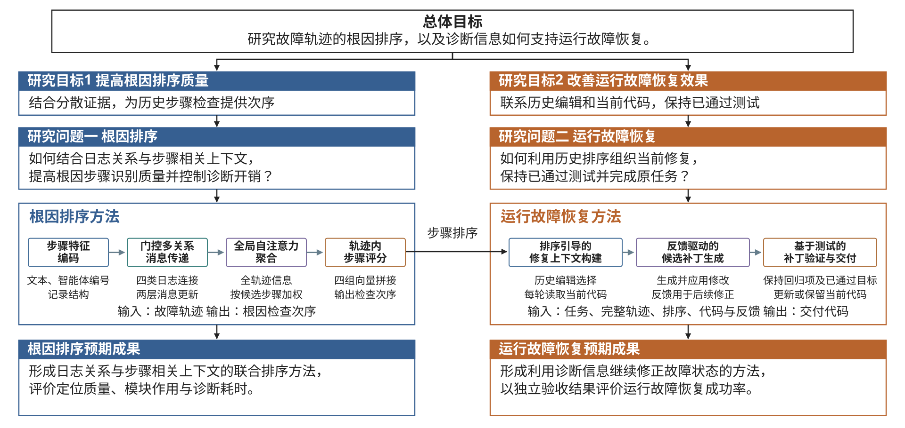
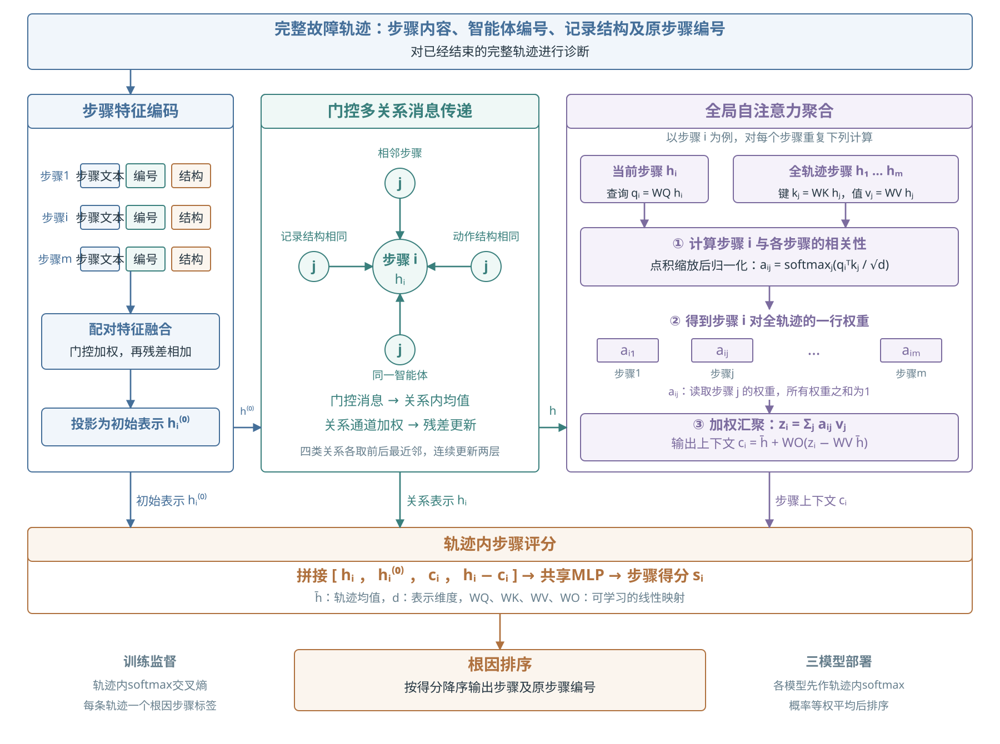
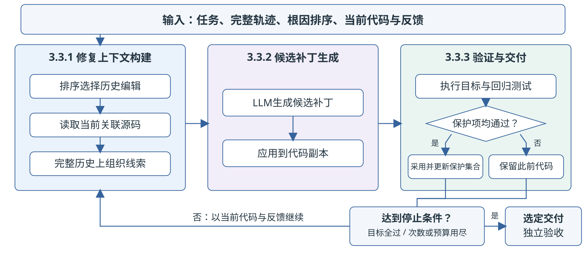

# 逐段溯源与结构复核

本轮完整正文为8717个非空白字符，含71个正文段落。正文连同图、表和题名共89块，逐块记录论文依据、本文设计及实现或数据来源。正式参考文献仍为30篇论文，代码、清单和本地要求仅作为非论文溯源依据。

第三章补强步骤自身记录、日志关系、完整轨迹证据和评分的关系，并说明历史排序如何经真实编辑与当前源码用于恢复。数据说明区分AgenTracer的模型学习及任务类别比较、AFTraj的另一记录形式检验。所有效果均按拟研究目标与实验设计表述。

恢复采用完整公共历史，排序增加编辑线索与当前源码组织。累计保护约束被采用代码的测试通过集合，最终任务完成另由独立验收判断。具体理论条件及此前请求证据保留在上一版的恢复方法复核材料中，本轮不新增算法或实验。

## 非论文依据

- **C01** [步骤坐标与公开数据适配](<D:/Code/毕设/graduate-thesis-experiments/工作区/1006-exp134-event-relation/实验/实验134_状态动作表示与关系排序/prepare_data.py>)。freeze()与labels()：history原步骤号、coordinate_map、同原问题分组及320组上限。支持原编号保留、614来源及492/122划分；不是通用的步骤术语定义。
- **C02** [四类邻接与记录结构](<D:/Code/毕设/graduate-thesis-experiments/实验/实验112_RQ1时序交互依赖完整排序/runner.py>)。第107行_h0_vector；第135行_shape_labels；第148行_build_adjacency。时间相邻、同角色、同完整结构、同非空动作结构；各类连接前后最近匹配记录。
- **C03** [显式决策上下文—后续动作配对](<D:/Code/毕设/graduate-thesis-experiments/工作区/1006-exp133-state-action/实验/实验133_状态动作选择性核验/method.py>)。第7行is_state；第13—36行representation。配对依赖显式上下文脚手架、连续原步骤号及同执行者输出；不是按任意工具请求/返回ID配对。
- **C04** [固定文本与角色编码、配对输入](<D:/Code/毕设/graduate-thesis-experiments/工作区/1006-exp134-event-relation/实验/实验134_状态动作表示与关系排序/prepare_features.py>)。第26行feature_input；第46行起build；约第61行内容及角色编码。内容与角色分别编码；公开结构和配对有效标志形成模型输入。
- **C05** [允许字段、匿名角色与实际编码器](<D:/Code/毕设/graduate-thesis-experiments/工作区/1006-exp134-event-relation/实验/实验134_状态动作表示与关系排序/sources/model_adapters.py>)。第83行anonymous_public_turns；第95行embedding_text；default_assets和FrozenQwenEncoder。步骤内容投影仅取content/action/thought，task不是独立编码输入；实际资产为Qwen3-Embedding-0.6B。
- **C06** [配对残差、共享评分头与损失](<D:/Code/毕设/graduate-thesis-experiments/实验/实验257_source3与强SF推断发布/sources/original_models.py>)。EventResidual.forward；Ranker；collate；loss。保留原节点、配对门控残差、四组表示拼接和单位置交叉熵。
- **C07** [关系消息传递计算](<D:/Code/毕设/graduate-thesis-experiments/实验/实验257_source3与强SF推断发布/sources/owned_exp130_model.py>)。RelationLayer.forward。邻居及差值生成消息，sigmoid门控，关系内均值，关系通道softmax与残差更新。
- **C08** [候选相关全轨迹上下文](<D:/Code/毕设/graduate-thesis-experiments/实验/实验257_source3与强SF推断发布/sources/context_models.py>)。ContextRanker.context_readout与forward。逐步骤查询、同轨迹键值，均值背景及注意力残差修正。
- **C09** [部署输入与三模型排序](<D:/Code/毕设/graduate-thesis-experiments/实验/实验257_source3与强SF推断发布/release257.py>)。SOURCE_SEEDS；geometry约第200—224行；第374行步骤文本投影。原始步骤映射与三次初始化部署；推断仍只投影步骤content/action/thought。
- **C10** [历史编辑筛选及恢复循环](<D:/Code/毕设/graduate-thesis-experiments/实验/实验262_已有进展保护真实压力场景/SOURCE/ours_core/ranked_repair248.py>)。_source_evidence；_refresh；run；终止后候选选择约第453—490行。读取冻结排序，选成功编辑并去重、核对当前源码，生成/应用/验证候选，拒绝后恢复当前合法状态。
- **C11** [逐项测试保护与未知结果处理](<D:/Code/毕设/graduate-thesis-experiments/实验/实验262_已有进展保护真实压力场景/SOURCE/ours_core/progress_guard240.py>)。observe；RepairProgressGuard.__init__、consider；restore_exact。ordinary全部通过且frontier包含于候选goal_pass才更新，初态目标进入frontier，拒绝候选不增加frontier。
- **C12** [排序指标计算](<D:/Code/毕设/graduate-thesis-experiments/工作区/1006-exp134-event-relation/实验/实验134_状态动作表示与关系排序/train.py>)。第75行metrics；协议中三次初始化及验证选择。精确步骤准确率、完整排名倒数均值、前3覆盖的具体计算；Hit@5为同样定义下的拟报告指标。
- **C13** [历史开发材料的总数约束](<D:/Code/毕设/graduate-thesis-experiments/工作区/1007-exp153-global-context/实验/实验153_候选条件全轨迹上下文/data153.py>)。source_inputs、af_inputs及mean_by_group。旧方案中614/492/122及731/716的总数要求、按任务组汇总；本轮只静态读取代码，不执行标签读取函数。
- **D01** [公开筛选清单](<D:/Code/毕设/graduate-thesis-experiments/工作区/1006-exp134-event-relation/实验/实验134_状态动作表示与关系排序/data/public_split_manifest.json>)。full_release_public_counts、eligible_group_counts、selected_counts及614条records。本轮重新统计614条/614组、492训练/122验证以及代码256/64、数学236/58。
- **D02** [历史开发成员记录](<D:/Code/毕设/graduate-thesis-experiments/工作区/1007-exp153-global-context/实验/实验153_候选条件全轨迹上下文/prepared_inputs.json>)。source_ids与target_cohorts.coding363；AF_training_features及af_schedule。363条开发成员的声明与ID；731/716结合C13按历史材料记载，不冒称本轮重新取得AF原始全量清单。
- **D03** [作者公开的AFTraj数据卡底稿](<D:/Code/毕设/graduate-thesis-experiments/工作区/1029-逐段溯源与学术表达/sources/aftraj_README_20261029.md>)。Dataset Summary、Schema、Paper Test Split；本轮从作者公开Hugging Face链接读取并保存。发布版本2276=1162 safe+1114 unsafe，字段与163个test_unsafe；与论文v2的2272条筛选统计区分。
- **D04** [614条清单的本轮只读统计](<D:/Code/毕设/graduate-thesis-experiments/工作区/1029-逐段溯源与学术表达/sources/public_split_manifest_audit.json>)。records、groups、splits、domainSplits及源清单SHA-256。算术与记录数核对，不是新训练结果，也不读取新测试标签。
- **D05** [363及历史AF记录的本轮核对](<D:/Code/毕设/graduate-thesis-experiments/工作区/1029-逐段溯源与学术表达/sources/historical_development_counts_audit.json>)。coding363_ids_count、coding363_unique_ids、afPublicRecordPathExists。363个成员ID已重新计数；旧AF原始清单路径本轮不存在，因此对731/716仅保留历史记载身份。
- **U01** [导师要求原文整理](<D:/Code/毕设/卓刀泉北路111号 3_导师意见整理.md>)。研究内容第1—7项及PPT组织表达要求。需求依据：已定题目、文献不足支撑RQ、工作流与步骤、排序价值、输入输出、研究体量与实验逻辑。
- **U02** [修订前既定方案记录](<D:/Code/毕设/graduate-thesis-experiments/工作区/1029-逐段溯源与学术表达/修订前/01_开题报告_重构稿.md>)。第2—6章，尤其20题/5仓库/4方法/3重复和15/30/60分钟节点。只用于追踪作者方案参数的来历，不当作外部科学证据，也不证明这些规模最优或已经执行。
- **F01** [本轮图3-1原生图文对应源稿](figures/图3-1_总体研究框架.svg)。四个排序模块、三个恢复模块及接口。图形为本文方案的图示；内容由C01—C11核对。
- **F02** [本轮图3-2原生图文对应源稿](figures/图3-2_根因排序模型.svg)。四关系、配对融合、Q/K/V、均值修正、评分与三模型部署。各计算对应C02—C09，未借图形声称新因果定理。
- **F03** [本轮图3-3原生图文对应源稿](figures/图3-3_运行故障恢复流程.svg)。生成、验证、B与H集合、状态更新及独立验收。流程对应C10—C11与本文验收方案。
- **L06** [中文工具交互、工作流与调用轨迹原文](<D:/Code/毕设/graduate-thesis-experiments/工作区/1029-题目一致与引用定点修订/sources/AAS2025_工具使用综述_官网正文.txt>)。郑逸宁等《自动化学报》2025；§1、§3.2使用规划与工作流段（缓存第1250—1272行）、§5.1反馈与工具调用轨迹；官网DOI 10.16383/j.aas.c240793。实际读全文相关章节；参考具体交互—前后反馈联系—历史记录的中文组织，不把它当作故障步骤定义。
- **L07** [中文多步任务与历史结果组织原文](<D:/Code/毕设/graduate-thesis-experiments/工作区/1029-题目一致与引用定点修订/sources/AAS2024_AutoPlan_官网正文.txt>)。秦龙等《自动化学报》2024，§3总述、§3.1观察/动作/上下文、§3.2总体框架、§3.3模块；DOI 10.16383/j.aas.c240088。参考整体任务—执行活动—属性与联系的中文层次；全文没有“轨迹”一词，不充作轨迹或故障步骤的定义来源。
- **L08** [本轮中英文原文核对与缓存纠错记录](<D:/Code/毕设/graduate-thesis-experiments/工作区/1029-题目一致与引用定点修订/英文原文核对记录.md>)。Process-Centric的ACM官网Introduction及§2；Who&When §2；StepFinder §3；TraceElephant摘要与§1—2。来源直接指向原论文。旧process.txt误配为另一篇论文，已排除；不以本记录循环证明定义。
- **U03** [本轮学术术语、方法说明与图文组织要求](AGENTS.md)。2026年10月30日本轮要求。限定术语、已实现模块、数据职责、框架合页及15次训练和420次恢复的拟研究安排。
- **C14** [恢复实际入口与启用开关](<D:/Code/毕设/graduate-thesis-experiments/实验/实验262_已有进展保护真实压力场景/SOURCE/environment262.py>)。第26—34、84—93、119、145—147、221行。绑定冻结排序与完整公共包，启用RELATION上下文并调用最终请求组装。
- **C15** [完整历史与派生上下文注入](<D:/Code/毕设/graduate-thesis-experiments/实验/实验262_已有进展保护真实压力场景/SOURCE/ours_core/body248.py>)。第52—98行。加入AST辅助当前源码及codec.render完整公共历史。
- **C16** [静态当前源码关联与函数读取](<D:/Code/毕设/graduate-thesis-experiments/实验/实验262_已有进展保护真实压力场景/SOURCE/ours_core/relations248.py>)。Index及build第95—211行。从历史改动符号和公开失败锚点取得当前定义、静态可能使用方和完整函数。
- **C17** [当前代码与失败反馈最终呈现](<D:/Code/毕设/graduate-thesis-experiments/实验/实验262_已有进展保护真实压力场景/SOURCE/ours_core/current_feedback248.py>)。finish_body约第124行。保留完整当前函数，区分历史证据与当前状态。
- **C18** [完整公共历史无损编码](<D:/Code/毕设/graduate-thesis-experiments/实验/实验262_已有进展保护真实压力场景/SOURCE/ours_core/publicpack_v2_224.py>)。model_pack/render第51—61行、build第87—89行。public_history保留全部messages及顺序，原文精确行池不删除语义字段。
- **U04** [第三章恢复方法的设计依据与理论作用](../02_39页版_v0.2/14_恢复机制与创新依据复核.md)。第1—6节；候选概率分析、集合保持正反条件模型及实际恢复循环。区分证据获取、条件生成、搜索状态及测试保持；核查恢复成功率改进的成立条件。
- **U05** [恢复机制实现与历史实际请求证据](../02_39页版_v0.2/15_恢复机制实现与请求证据.md)。实际入口、完整历史与当前函数呈现、目标集合接受规则。保留原始工程核查，支持最终输入结构与状态更新机制事实。
- **U06** [步骤输入与四类关系的源码核查](<D:/Code/毕设/graduate-thesis-experiments/工作区/1029-学术术语与模块论证修订/术语与关系核查.md>)。输入、结构分组、配对及四关系核查。支持智能体标识转编号、格式分组及动作非空条件。
- **U07** [两个排序数据集的用途及历史使用核查](<D:/Code/毕设/graduate-thesis-experiments/工作区/1029-学术术语与模块论证修订/两数据集用途与论证核查.md>)。数据来源、筛选、任务类别与记录形式差异。支持模型学习、任务类别比较与另一记录形式下排序检验的分工。
- **U08** [完整文稿独立五轮审核](<D:/Code/毕设/graduate-thesis-experiments/工作区/1029-学术术语与模块论证修订/全文五轮审核_独立意见.md>)。全文术语、输入、模块作用、理论边界及引文。支持本轮全文修订及改写范围核对。
- **U09** [数据与恢复论证终核](<D:/Code/毕设/graduate-thesis-experiments/工作区/1029-学术术语与模块论证修订/数据与恢复论证_终核.md>)。127 coding候选、反馈条件、测试保持与独立评价。支持当前数据职责及恢复机制的实际作用边界。

## 逐段记录

### P001 智能体运行故障的根因排序与恢复方法

开题报告 · 2026年10月30日

性质：研究设计、数据记录或前瞻协议。论文依据：无独立论文事实引用。非论文依据：U03。

核查：版本信息、论文组织或研究进度计划，依据本轮要求，不承担已完成效果主张。

### P002 1.1 研究背景

本论文研究智能体执行过程中的**运行故障**：错误理解、决策或操作使执行偏离任务要求，最终产生错误结果或未完成任务。[1] 这类故障也可能发生在程序正常结束的执行中，因此需要追查结果形成的过程。

性质：论文事实与本文比较分析。论文依据：whowhen。非论文依据：L06、L07、L08、U01、U03、U08。

核查：先交代同一任务的执行活动与有序记录，再说明步骤、故障、排序及恢复的用途。过程对象由英文原文支持；中文组织参考两篇自动化学报原文，不将其冒充统一故障步骤定义。

### P003 1.1 研究背景

智能体围绕任务作出决策、执行动作并接收反馈，这些活动的组织关系构成**执行工作流**。一次执行的推理、动作与环境观察按发生顺序保存，形成**执行轨迹**。[2] 轨迹中的一次具体决策或交互活动作为一个**步骤**，判断该步是否出错需结合当时输入、上下文和反馈。[3]

性质：论文事实与本文比较分析。论文依据：process、traceelephant。非论文依据：L06、L07、L08、U01、U03、U08。

核查：先交代同一任务的执行活动与有序记录，再说明步骤、故障、排序及恢复的用途。过程对象由英文原文支持；中文组织参考两篇自动化学报原文，不将其冒充统一故障步骤定义。

### P004 1.1 研究背景

**运行故障的原因往往难以仅凭最终结果确定，相关证据分散于不同智能体及其执行步骤，需要结合任务要求、消息交互、工具操作与环境反馈追查历史行为。** 上游偏差可能经后续信息传递形成错误级联，使最终异常表现与引入错误的步骤处于不同位置。[4]

性质：论文事实与本文比较分析。论文依据：agents_cn2026。非论文依据：L06、L07、L08、U01、U03、U08。

核查：先交代同一任务的执行活动与有序记录，再说明步骤、故障、排序及恢复的用途。过程对象由英文原文支持；中文组织参考两篇自动化学报原文，不将其冒充统一故障步骤定义。

### P005 1.1 研究背景

本论文以故障轨迹中的历史步骤为**根因候选**，结合步骤内容及关联证据评分，形成优先检查次序，称为**根因排序**。排序将更可能引入故障的步骤置于前列，为根因排查和修正线索选择提供依据。

性质：研究设计、数据记录或前瞻协议。论文依据：无独立论文事实引用。非论文依据：L06、L07、L08、U01、U03、U08。

核查：先交代同一任务的执行活动与有序记录，再说明步骤、故障、排序及恢复的用途。过程对象由英文原文支持；中文组织参考两篇自动化学报原文，不将其冒充统一故障步骤定义。

### P006 1.1 研究背景

为检验排序对任务完成的作用，本论文进一步研究软件任务中的**运行故障恢复**。恢复从故障发生后保留的代码与环境出发，利用历史编辑、当前源码和测试反馈继续修改代码。[5] 原任务通过独立验收时，判定为恢复成功。

性质：论文事实与本文比较分析。论文依据：repairagent。非论文依据：L06、L07、L08、U01、U03、U08。

核查：先交代同一任务的执行活动与有序记录，再说明步骤、故障、排序及恢复的用途。过程对象由英文原文支持；中文组织参考两篇自动化学报原文，不将其冒充统一故障步骤定义。

### P007 1.2 国内外研究现状

根因排序需要回答哪些历史步骤应优先检查，运行故障恢复则需要把这些线索用于当前代码的修正。以下按这两个相继环节，分析代表性工作的证据组织、历史线索利用和验证方式。

性质：研究设计、数据记录或前瞻协议。论文依据：无独立论文事实引用。非论文依据：U01、L08、U03、U08。

核查：编号引文对应已有工作的方法或实验事实；随后比较其对象、证据组织及验证范围。未分别检验某设计不等于该工作完全没有上下文、交互或验证。

### P008 1.2.1 智能体运行故障诊断与根因排序

- **Who&When（Shaokun Zhang等，2025）**：从故障轨迹中定位相关智能体及根因步骤，比较整轨迹判断、逐步检查和二分搜索。数据标签指向纠正该步并相应调整后续执行即可使任务成功的最早错误步骤，最佳步骤定位准确率为14.2%。[1] 研究建立了步骤级诊断对象，也表明任务结果判断与根因步骤定位之间仍有距离。

性质：论文事实与本文比较分析。论文依据：whowhen。非论文依据：U01、L08、U03、U08。

核查：前半部分按所引论文的方法与结果概述，后半部分是本论文结合既定研究内容提出的比较分析，不把相关工作未研究某项机制直接写成普遍无效。

### P009 1.2.1 智能体运行故障诊断与根因排序

- **TraceElephant（Mengzhuo Chen等，2026）**：补全任务输入、中间消息与环境交互，分析各智能体当时可使用的信息。[3] 这说明步骤判断需要完整的可见证据。如何进一步关联分散记录并区分引入错误的行为与后续表现，仍需具体的排序模型。

性质：论文事实与本文比较分析。论文依据：traceelephant。非论文依据：U01、L08、U03、U08。

核查：前半部分按所引论文的方法与结果概述，后半部分是本论文结合既定研究内容提出的比较分析，不把相关工作未研究某项机制直接写成普遍无效。

### P010 1.2.1 智能体运行故障诊断与根因排序

- **StepFinder（Taiyu Zhu等，2026）**：结合步骤语义、智能体编号、双向时序网络与全局注意力产生步骤分数。[6] 其交互主要通过时序、语义匹配和智能体间联系表达，未分别检验显式决策上下文与后续动作、记录结构等日志联系的增量作用。这些联系为区分语义相近但执行作用不同的候选提供了待检验的信息。

性质：论文事实与本文比较分析。论文依据：stepfinder。非论文依据：U01、L08、U03、U08。

核查：前半部分按所引论文的方法与结果概述，后半部分是本论文结合既定研究内容提出的比较分析，不把相关工作未研究某项机制直接写成普遍无效。

### P011 1.2.1 智能体运行故障诊断与根因排序

- **DCFA（Zehao Wang等，2026）**：构造依赖图，结合局部反事实推理细化根因判断。[7] 该工作说明关联证据有助于分析故障形成过程，同时引入额外结构推理。对于日志中可以直接提取的联系，仍需检验其能否以较低开销补充候选区分。

性质：论文事实与本文比较分析。论文依据：dcfa。非论文依据：U01、L08、U03、U08。

核查：前半部分按所引论文的方法与结果概述，后半部分是本论文结合既定研究内容提出的比较分析，不把相关工作未研究某项机制直接写成普遍无效。

### P012 1.2.1 智能体运行故障诊断与根因排序

这些研究从确定诊断对象发展到补全证据、学习评分和关系推理。排序所形成的历史检查次序还需进入恢复过程，才能检验优先发现的行为是否确实有助于后续修正。

性质：研究设计、数据记录或前瞻协议。论文依据：无独立论文事实引用。非论文依据：U01、L08、U03、U08。

核查：编号引文对应已有工作的方法或实验事实；随后比较其对象、证据组织及验证范围。未分别检验某设计不等于该工作完全没有上下文、交互或验证。

### P013 1.2.2 根因排序引导的软件运行故障恢复

交互执行利用环境反馈继续求解[8]，跨次尝试积累反思经验[9]，工具检查为修订提供依据。[10] 软件恢复进一步要求把这些信息转化为当前代码上的修改。

性质：论文事实与本文比较分析。论文依据：react、reflexion、critic。非论文依据：U01、L08、U03、U08。

核查：编号引文对应已有工作的方法或实验事实；随后比较其对象、证据组织及验证范围。未分别检验某设计不等于该工作完全没有上下文、交互或验证。

### P014 1.2.2 根因排序引导的软件运行故障恢复

- **Agentless（Xia等，2025）**：按定位、补丁生成、复现与回归筛选组织求解。[11] 其输入围绕当前问题与候选补丁组织，历史步骤排序的作用需要单独检验。

性质：论文事实与本文比较分析。论文依据：agentless。非论文依据：U01、L08、U03、U08。

核查：前半部分按所引论文的方法与结果概述，后半部分是本论文结合既定研究内容提出的比较分析，不把相关工作未研究某项机制直接写成普遍无效。

### P015 1.2.2 根因排序引导的软件运行故障恢复

- **EnAgent（Tian等，2026）**：生成多条候选轨迹，经回归剪枝、工具检查与投票选择补丁。[12] 其回归筛选保护原有行为，本论文进一步研究恢复中新通过目标的持续保持。

性质：论文事实与本文比较分析。论文依据：enagent。非论文依据：U01、L08、U03、U08。

核查：前半部分按所引论文的方法与结果概述，后半部分是本论文结合既定研究内容提出的比较分析，不把相关工作未研究某项机制直接写成普遍无效。

### P016 1.2.2 根因排序引导的软件运行故障恢复

- **SyncMind（Guo等，2025）**：处理智能体认识与实际代码失步，重新获取当前环境信息后恢复。[13] 这说明历史线索需要与当前代码核对。

性质：论文事实与本文比较分析。论文依据：syncmind。非论文依据：U01、L08、U03、U08。

核查：前半部分按所引论文的方法与结果概述，后半部分是本论文结合既定研究内容提出的比较分析，不把相关工作未研究某项机制直接写成普遍无效。

### P017 1.2.2 根因排序引导的软件运行故障恢复

- **DoVer（Ma等，2026）**：修改消息或计划后重执行，以任务结果检验诊断。[14] 本论文关注代码逐轮修改，检查新补丁是否使此前已通过的目标测试再次失败。

性质：论文事实与本文比较分析。论文依据：dover。非论文依据：U01、L08、U03、U08。

核查：前半部分按所引论文的方法与结果概述，后半部分是本论文结合既定研究内容提出的比较分析，不把相关工作未研究某项机制直接写成普遍无效。

### P018 1.3 研究问题

现有诊断利用时序、全局交互和推理组织证据，但日志中可直接提取的联系能否补充候选区分，仍需检验。工具执行也用于检验错误假设[15]，需要共同评价定位质量与诊断开销。诊断给出历史步骤判断，修复作用于当前代码，还需检验完整轨迹已可用时，显式排序提示及当前源码组织能否改善修改，并保持新通过的目标测试。

性质：论文事实与本文比较分析。论文依据：errorprobe。非论文依据：U03、U04、U08。

核查：由研究现状的具体差异形成研究问题、目标及价值，属于本论文拟研究设计及比较分析，不冒称已完成实验结论。

### P019 1.3 研究问题

前一环节决定优先检查哪些历史行为，后一环节决定这些线索能否帮助完成原任务。本论文据此提出以下两个研究问题。

性质：研究设计、数据记录或前瞻协议。论文依据：无独立论文事实引用。非论文依据：U03、U04、U08。

核查：由研究现状的具体差异形成研究问题、目标及价值，属于本论文拟研究设计及比较分析，不冒称已完成实验结论。

### P020 1.3 研究问题

- **RQ1：分散执行证据下的根因排序。** 如何关联不同智能体和执行步骤中的分散证据，提高根因步骤的识别与排序质量，并控制诊断开销？

性质：研究设计、数据记录或前瞻协议。论文依据：无独立论文事实引用。非论文依据：U03、U04、U08。

核查：由研究现状的具体差异形成研究问题、目标及价值，属于本论文拟研究设计及比较分析，不冒称已完成实验结论。

### P021 1.3 研究问题

- **RQ2：根因排序引导的软件运行故障恢复。** 如何将历史步骤排序转化为适用于当前代码的修复依据，并在连续修改中保持已通过目标测试所反映的任务进展，提高原任务的最终完成率？

性质：研究设计、数据记录或前瞻协议。论文依据：无独立论文事实引用。非论文依据：U03、U04、U08。

核查：由研究现状的具体差异形成研究问题、目标及价值，属于本论文拟研究设计及比较分析，不冒称已完成实验结论。

### P022 1.3 研究问题

RQ1输出步骤检查次序，RQ2从中选择历史编辑并核对当前实现，两项研究通过实际进入恢复器的修复线索衔接。由此，研究目标既包括排序本身的有效性，也包括排序在恢复中的实际作用。

性质：研究设计、数据记录或前瞻协议。论文依据：无独立论文事实引用。非论文依据：U03、U04、U08。

核查：由研究现状的具体差异形成研究问题、目标及价值，属于本论文拟研究设计及比较分析，不冒称已完成实验结论。

### P023 2.1 研究目标

总体目标是建立从故障轨迹分析到软件任务继续求解的方法，形成可评价的根因排序与运行故障恢复流程。

性质：研究设计、数据记录或前瞻协议。论文依据：无独立论文事实引用。非论文依据：U03、U04、U08。

核查：由研究现状的具体差异形成研究问题、目标及价值，属于本论文拟研究设计及比较分析，不冒称已完成实验结论。

### P024 2.1 研究目标

- **根因排序目标：** 关联步骤内容、智能体编号与记录结构，结合局部关系传播和步骤相关上下文学习步骤分数，输出优先检查次序。通过共同数据上的基线比较及消融，检验排序质量、诊断成本和各类证据的作用。

性质：研究设计、数据记录或前瞻协议。论文依据：无独立论文事实引用。非论文依据：U03、U04、U08。

核查：由研究现状的具体差异形成研究问题、目标及价值，属于本论文拟研究设计及比较分析，不冒称已完成实验结论。

### P025 2.1 研究目标

- **运行故障恢复目标：** 将排序转化为真实历史编辑的选择，结合当前源码与反馈生成补丁，以累计测试保持规则更新代码。通过共同故障状态下的完整方法比较及模块对照，检验最终恢复效果，并核对排序是否真正改变了修复输入。

性质：研究设计、数据记录或前瞻协议。论文依据：无独立论文事实引用。非论文依据：U03、U04、U08。

核查：由研究现状的具体差异形成研究问题、目标及价值，属于本论文拟研究设计及比较分析，不冒称已完成实验结论。

### P026 2.2 研究意义

- **方法意义：** 将分散执行记录中的可观测联系与步骤相关上下文共同用于步骤判断，研究不同证据在根因区分中的作用。再将历史判断接入当前代码上的恢复操作，建立从诊断质量到任务结果的验证关系。

性质：研究设计、数据记录或前瞻协议。论文依据：无独立论文事实引用。非论文依据：U03、U04、U08。

核查：由研究现状的具体差异形成研究问题、目标及价值，属于本论文拟研究设计及比较分析，不冒称已完成实验结论。

### P027 2.2 研究意义

- **应用意义：** 为出现运行故障的执行提供有次序的历史排查线索，帮助利用已有代码和执行记录继续求解。通过当前实现核对和已通过目标测试的保持，减少失效历史线索及后续修改退化对恢复的影响。

性质：研究设计、数据记录或前瞻协议。论文依据：无独立论文事实引用。非论文依据：U03、U04、U08。

核查：由研究现状的具体差异形成研究问题、目标及价值，属于本论文拟研究设计及比较分析，不冒称已完成实验结论。

### P028 2.2 研究意义

实现上述目标，需要先产生有效的步骤检查次序，再将高排位的历史编辑对应到当前代码，使诊断与恢复组成可验证的完整过程。

性质：研究设计、数据记录或前瞻协议。论文依据：无独立论文事实引用。非论文依据：U03、U04、U08。

核查：由研究现状的具体差异形成研究问题、目标及价值，属于本论文拟研究设计及比较分析，不冒称已完成实验结论。

### P029 3.1 总体研究框架与数据接口

性质：本文方法及实现依据。论文依据：无独立论文事实引用。非论文依据：F01、U03。

核查：方法图保留原布局，按本轮核定术语更新可见文字。PPT对应图由原生文本框、形状和连接线组成，整图置于一页。

### P030 3.1 总体研究框架与数据接口

**图3-1 根因排序与运行故障恢复的总体研究框架**

性质：本文方法及实现依据。论文依据：无独立论文事实引用。非论文依据：U03。

核查：图表题名与当前方法和实验章节一致，不承担独立经验结论。

### P031 3.1 总体研究框架与数据接口

排序分析历史步骤，修复作用于当前代码。两者通过实际发生的编辑关联，核对原步骤编号与当前实现，使历史诊断成为可追溯的修复依据。

性质：本文方法及实现依据。论文依据：无独立论文事实引用。非论文依据：C09、C10、C14、C15、C16、C17、C18、U04、U05。

核查：排序与恢复的输入对象不同。按实际编辑和原步骤编号衔接历史判断与当前代码，不声称排序分数本身决定补丁。

### P032 3.1 总体研究框架与数据接口

分别评价根因排序与最终恢复结果，并结合每轮输入、代码和测试变化，分析高排位线索及测试保持规则在持续修改中的作用。

性质：本文方法及实现依据。论文依据：无独立论文事实引用。非论文依据：C10、C11、U03、U04。

核查：这是本论文拟采用的作用分析安排。根因排序、最终恢复以及每轮输入和状态分别记录，不把集合保持直接写成恢复成功率的理论保证。

### P033 3.2 根因排序模型

性质：本文方法及实现依据。论文依据：无独立论文事实引用。非论文依据：F02、U03。

核查：方法图保留原布局，按本轮核定术语更新可见文字。PPT对应图由原生文本框、形状和连接线组成，整图置于一页。

### P034 3.2 根因排序模型

**图3-2 根因排序模型的计算结构**

性质：本文方法及实现依据。论文依据：无独立论文事实引用。非论文依据：U03。

核查：图表题名与当前方法和实验章节一致，不承担独立经验结论。

### P035 3.2 根因排序模型

同一故障反馈可能与多个历史步骤有关，各步骤需要结合不同证据判断。模型保留本步内容，沿日志关系取得执行背景，再从完整轨迹中补充相关信息，支持区分引入错误的行为与后续表现。

性质：本文方法及实现依据。论文依据：无独立论文事实引用。非论文依据：C06、C07、C08、U06。

核查：解释同一步骤需结合自身内容、相邻关系和完整轨迹证据的设计理由。该互补作用是待消融检验的研究假设。

### P036 3.2 根因排序模型

图中m为步骤数，i、j为步骤编号。hᵢ⁽⁰⁾、hᵢ、cᵢ分别表示初始表示、关系表示和步骤上下文。MLP为多层感知机。

性质：本文方法及实现依据。论文依据：无独立论文事实引用。非论文依据：C06、C07、C08。

核查：图中符号就地说明，与现有模型中的初始表示、关系表示、上下文及共享评分头对应。

### P037 3.2.1 步骤特征编码

步骤文本取自日志中可用的内容、动作及推理记录，由固定的Qwen3-Embedding-0.6B编码器编码。[16] 日志内的任务要求随步骤文本进入模型。智能体标识在轨迹内转换为**智能体编号**并编码为向量，结构特征记录位置与格式。模型融合上述特征，并对按固定格式识别的同一智能体相邻上下文与输出记录融合文本表示，形成保留原步骤编号的初始表示。

性质：本文方法及实现依据。论文依据：qwen3embedding。非论文依据：C01、C03、C04、C05、C06、C09、U06。

核查：步骤文本来自实际可用字段。标识在轨迹内转为编号后编码。原任务已在日志中的部分随步骤文本进入，固定格式识别的同一智能体相邻上下文与输出融合表示，保留两个原编号。

### P038 3.2.2 门控多关系消息传递

模型按四类关系连接步骤。**相邻步骤**连接前后一步。**同一智能体**连接该智能体前后最近的步骤。**记录结构相同**按内容、动作及推理字段格式分组，**动作结构相同**按非空动作字段的结构分组。可解析字段按数据类型、数量及嵌套形式划分，普通文本归为同类记录。同组均连接前后最近的步骤。

性质：本文方法及实现依据。论文依据：无独立论文事实引用。非论文依据：C02、C09、U06。

核查：四类关系按执行顺序、智能体归属及记录格式构建。结构依据类型、元素数量和嵌套形式，普通文本归同类，动作非空才参与动作结构分组。结构相同不等于操作语义相同。

### P039 3.2.2 门控多关系消息传递

各类关系分别联系执行次序、智能体归属与记录格式。门控依据当前步骤及邻居差异调节消息，再融合各类关系，经两层传播形成结合邻接证据的步骤表示。[17]

性质：本文方法及实现依据。论文依据：rgcn。非论文依据：C07、U06。

核查：门控、关系通道融合及两层残差更新对应现有实现。R-GCN引文支持关系建模基础，具体门控和构图由本地源码支撑。

### P040 3.2.3 全局自注意力聚合

关系传播沿既定连边汇集信息，任务要求和故障反馈还可能位于远处。该模块以每个待评分步骤为查询，与同一完整轨迹中的各步骤计算相关权重，汇集该步骤需要的证据。查询、用于匹配的键和承载信息的值均由步骤表示转换得到，采用自注意力计算。[18]

性质：本文方法及实现依据。论文依据：attention。非论文依据：C08。

核查：自注意力基础由论文支持，当前步骤作查询并读取同一完整轨迹各步骤由实现支撑，参与集合包括当前步骤。

### P041 3.2.3 全局自注意力聚合

模型在轨迹均值背景上加入各步骤的注意力修正，形成与该步骤相关的上下文。相同的全轨迹证据可以参与不同判断，读取权重随待评分步骤变化，从而补充有限层关系传播未覆盖的信息。两类表示随后共同进入评分网络。

性质：本文方法及实现依据。论文依据：无独立论文事实引用。非论文依据：C06、C08。

核查：均值背景与注意力修正、随待评分步骤变化的读取权重和评分输入由当前实现支撑。其作用解释基于计算结构，不作为已取得效果。

### P042 3.2.4 轨迹内步骤评分

共享评分网络读取初始表示、关系表示、步骤上下文，以及关系表示与上下文的差异，使评分同时依据本步内容和关联证据。训练以**数据集中标注的根因步骤**为目标，在同一轨迹内归一化分数，最小化该目标步骤对应的负对数概率。组内评分采用列表级学习思路。[19] 每条轨迹使用一个根因步骤标签时，交叉熵训练与排序目标具有理论联系。[20]

性质：本文方法及实现依据。论文依据：learning_to_rank、softmax_rank。非论文依据：C06、C09。

核查：评分输入和轨迹内交叉熵对应代码。列表级学习及单正例下交叉熵与排序的联系分别由两篇引用支撑，不另起新损失名称。

### P043 3.2.4 轨迹内步骤评分

预测时，模型仅依据轨迹记录计算分数，并按降序输出步骤检查次序。评价目标是数据集标注的根因步骤能否位于首位或前几个位置，各数据源保留原有根因标注含义。恢复器再从排序中选择真实编辑，检验历史诊断对当前代码修正的作用。

性质：本文方法及实现依据。论文依据：无独立论文事实引用。非论文依据：C09、C10、C12。

核查：预测不读取监督标签。数据集标签用于排序评价，恢复器按预测次序筛选实际编辑，两种用途分别说明。

### P044 3.3 运行故障恢复方法

性质：本文方法及实现依据。论文依据：无独立论文事实引用。非论文依据：F03、U03。

核查：方法图保留原布局，按本轮核定术语更新可见文字。PPT对应图由原生文本框、形状和连接线组成，整图置于一页。

### P045 3.3 运行故障恢复方法

**图3-3 运行故障恢复流程**

性质：本文方法及实现依据。论文依据：无独立论文事实引用。非论文依据：U03。

核查：图表题名与当前方法和实验章节一致，不承担独立经验结论。

### P046 3.3.1 排序引导的修复上下文构建

本方法在完整公共轨迹上，按根因排序选择实际改变过源码的历史编辑，按工具调用去重，提取修改前后差异。首轮使用最高排位编辑，后续依次补充，最多3项，使有限尝试优先围绕诊断线索展开。

性质：本文方法及实现依据。论文依据：无独立论文事实引用。非论文依据：C10、C15、C18、U04、U05。

核查：完整公共历史本来已进入生成器。增量是按预测排序筛选真实编辑、按工具调用去重并组织差异，依次使用最多三项，不声称压缩历史或实现反馈自适应重排序。

### P047 3.3.1 排序引导的修复上下文构建

每轮对照历史编辑后版本和当前源码，按编辑涉及的函数、属性及当前测试反馈中的源码位置，读取当前定义和可能引用它的代码。[21] 这些材料同时说明历史改动和当前实现，为生成器判断当前修改提供依据。

性质：本文方法及实现依据。论文依据：autocoderover。非论文依据：C10、C16、C17、U04、U05。

核查：引用支持利用程序实体组织源码的已有基础。历史差异、当前定义、可能引用代码及测试源码位置来自实际恢复请求链，是否提升恢复需同信息对照。

### P048 3.3.2 反馈驱动的候选补丁生成

生成模型结合原任务、完整历史、排序线索、当前源码与此前尝试的反馈提出补丁。执行器在代码副本上应用并测试，将应用错误、测试结果及当前代码差异交给下一轮。[22] 下一轮以当前代码和这些反馈为生成条件，继续针对尚未满足的任务要求提出补丁。

性质：本文方法及实现依据。论文依据：repair_survey_cn2025。非论文依据：C10、C14、C15、C17、C18、U04、U05。

核查：生成器实际接收任务、完整历史、排序线索、当前源码和先前反馈，执行器应用并运行测试。反馈作为下轮条件，不据此承诺生成器必然修正范围。

### P049 3.3.3 基于测试的补丁验证与交付

复现测试可用于筛选候选补丁。[23] 本方法使用预先固定的**目标测试**与**回归测试**，前者检查原任务要求，后者检查需要保留的已有行为。初态已通过的回归项和目标项进入保护集合，后续采用的代码中新通过的目标项继续加入。

性质：本文方法及实现依据。论文依据：swtbench。非论文依据：C10、C11、U04、U05。

核查：SWT-Bench引文只支撑复现测试可用于筛补丁。固定目标、回归测试及累计保护集合属于本方法的现有设计。

### P050 3.3.3 基于测试的补丁验证与交付

候选通过全部保护项时更新代码，否则恢复此前状态。该规则将已经取得的测试进展转为后续修改条件，使被采用代码的目标测试通过集合逐轮不缩小。保护依赖稳定、可执行的测试，其作用由已通过目标的保持情况和最终任务验收共同评价。

性质：本文方法及实现依据。论文依据：无独立论文事实引用。非论文依据：C10、C11、U04。

核查：接受规则可保证被采用状态的目标通过集合逐轮不缩小，条件是稳定可执行测试和正确回滚。它允许无新增进展，不推出最终成功率必然提高。

### P051 3.3.3 基于测试的补丁验证与交付

目标全部通过、尝试次数或预算用尽时停止，按预先固定的反馈规则选择交付，再以独立验收判定恢复成功。测试结果缺失或不确定时保存已有代码并停止更新。各轮源码、补丁与测试状态共同记录，用于分析修复线索和代码更新规则如何影响恢复过程。

性质：本文方法及实现依据。论文依据：无独立论文事实引用。非论文依据：C10、C11、U03、U04。

核查：停止、反馈交付、独立验收及未知结果保护对应代码和拟比较协议，区分内部测试与最终任务验收。

### P052 4.1 关键难点

- **难点一：分散证据的关联与根因步骤区分。** 故障反馈可能晚于引入错误的步骤，同一反馈也可能涉及多个历史行为。需要结合执行次序、智能体及记录结构联系，并从全轨迹中取得与不同步骤相关的证据，在控制诊断开销的同时区分根因与后续表现。

性质：研究设计、数据记录或前瞻协议。论文依据：无独立论文事实引用。非论文依据：C02、C07、C08、U03、U06。

核查：难点对应分散证据、错误级联与不同步骤需要不同上下文。关系传播与全轨迹聚合是拟采用处理方式，其作用由比较和消融检验。

### P053 4.1 关键难点

- **难点二：历史诊断与当前代码修正的衔接。** 历史排序反映已发生的行为，补丁作用于持续变化的代码。需要结合当前实现判断历史编辑的修复价值，并在继续解决剩余问题时保持已有测试进展。代码更新还会改变后续输入和修复条件，需要共同分析局部进展与最终任务完成之间的关系。

性质：研究设计、数据记录或前瞻协议。论文依据：无独立论文事实引用。非论文依据：C10、C11、C15、C16、C17、C18、U04。

核查：难点对应历史诊断到当前修复的状态差异及连续修改的进展保持。局部进展与最终完成的关系需共同分析。

### P054 4.2 拟研究的创新点

- **日志关系与步骤相关上下文的联合排序。** 将执行次序、智能体归属及记录结构形成的关系用于邻居信息传播，再为每个步骤从完整轨迹中汇集相关证据。研究两类信息在根因步骤识别中的互补作用，以关系传播和全局聚合的模块消融评价。

性质：研究设计、数据记录或前瞻协议。论文依据：无独立论文事实引用。非论文依据：C02、C07、C08、U03、U06。

核查：创新点限定为日志关系和步骤相关上下文的联合排序设计，比较二者互补作用，不宣称提出图学习或自注意力基础算法。

### P055 4.2 拟研究的创新点

- **排序引导的修复依据构建与测试进展保持。** 将历史步骤排序映射为真实编辑，结合版本差异、当前函数和测试反馈组织修复输入，并将已通过目标纳入后续代码更新条件。研究诊断线索如何支持当前修改，以及进展保持如何影响连续恢复，通过完整轨迹对照、编辑次序对照和模块消融检验。

性质：研究设计、数据记录或前瞻协议。论文依据：无独立论文事实引用。非论文依据：C10、C11、C15、C16、C17、C18、U03、U04。

核查：创新点限定为历史排序到当前修复依据的组织及累计测试保持，以完整轨迹、编辑次序和模块对照检验增量，不将通用生成、AST或测试独立作为创新。

### P056 5.1 实验数据来源与划分

**表5-1 数据来源与研究样本**

性质：研究设计、数据记录或前瞻协议。论文依据：无独立论文事实引用。非论文依据：U03。

核查：图表题名与当前方法和实验章节一致，不承担独立经验结论。

### P057 5.1 实验数据来源与划分

| 数据来源 | 研究样本 | 数据内容 | 实验用途 |
| --- | --- | --- | --- |
| AFTraj | 开发731条（716个任务组），评价候选163条 | 执行轨迹与根因步骤标注 | 检验另一记录形式下的排序表现 |
| AgenTracer | 训练验证614条，coding开发363条，coding评价候选127条 | 代码与数学任务轨迹、根因步骤标注 | 模型训练及代码与数学任务比较 |
| SWE-Gym | 计划20个问题、覆盖5仓库 | 代码库、任务说明、执行环境与测试 | 构造共同故障状态、比较任务恢复 |

性质：研究设计、数据记录或前瞻协议。论文依据：无独立论文事实引用。非论文依据：C01、C13、D01、D02、D03、D04、D05、U03、U07、U09。

核查：表中样本数区分开发、训练验证和评价候选。731/716与363保留历史开发用途，163和coding 127仍是需核对使用及重叠后的候选，20题5仓库为计划。

### P058 5.1 实验数据来源与划分

AFTraj提供故障轨迹及根因步骤标注。[24] AgenTracer用于模型学习，并分别分析代码与数学任务的排序表现。[25] AgenTracer的现有适配以消息内容构成步骤文本，AFTraj分开记录内容、动作与推理。两者分别检验任务类别差异和不同记录形式下的排序适用性。SWE-Gym提供可执行仓库问题[26]，用于评价代码修改能否完成原任务。[27]

性质：研究设计、数据记录或前瞻协议。论文依据：agentforesight、agentracer、swegym、swebench。非论文依据：C01、C05、C09、D03、D04、U07、U09。

核查：AgenTracer用于模型学习及代码和数学任务比较，AFTraj补充另一记录形式检验。两者提供两种评价角度，不因名称不同自然成为独立无重叠测试。SWE-Gym另提供可执行恢复环境。

### P059 5.1 实验数据来源与划分

恢复任务计划覆盖5个Python仓库、20个问题。每题重建故障发生后的代码、环境、历史轨迹和反馈测试，确认原任务尚未完成，形成共同恢复起点。

性质：研究设计、数据记录或前瞻协议。论文依据：无独立论文事实引用。非论文依据：U02、U03。

核查：20题和5个Python仓库为拟研究规模，共同故障状态须重建并确认原任务未完成，不冒称本轮已运行。

### P060 5.1 实验数据来源与划分

训练验证数据从AgenTracer公开训练部分筛选6—32步轨迹，代码任务coding取320条、数学任务math取294条，共614条。验证集与训练集按**约1:4**划分：coding为64/256，math为58/236，合计**验证122条、训练492条**。

性质：研究设计、数据记录或前瞻协议。论文依据：无独立论文事实引用。非论文依据：C01、D01、D04、U03、U07。

核查：614=320+294，训练492=256+236，验证122=64+58。约1:4为验证比训练，均来自现有公开筛选清单。

### P061 5.1 实验数据来源与划分

训练集用于参数学习，验证集用于配置选择，固定划分并做三次初始化。代码与数学任务分别报告，另以仅代码任务训练检验混合训练的作用。AFTraj 731条、716个任务组及AgenTracer coding 363条继续作为开发材料。评价分别从AFTraj的163条和AgenTracer coding的127条测试候选中，核对历史使用及跨集合原问题重叠后固定清单。同一原问题的派生轨迹归入同一集合。

性质：研究设计、数据记录或前瞻协议。论文依据：无独立论文事实引用。非论文依据：C01、C13、D01、D02、D04、D05、U03、U07、U09。

核查：说明训练、验证、三次初始化、混合训练对照及既有开发材料的职责。按原问题重叠与历史使用固定评价清单，不把重划分后的已曝光材料写成独立评价。

### P062 5.1 实验数据来源与划分

执行环境提供仓库浏览、源码编辑与测试接口[28]，隔离保存命令、文件变化与轨迹。[29] 各方法共用deepseek-flash、故障状态、信息许可、反馈测试和资源上限，每题独立重复3次。

性质：研究设计、数据记录或前瞻协议。论文依据：sweagent、openhands。非论文依据：C14、U03。

核查：两篇论文分别支撑仓库接口与环境隔离的已有基础。deepseek-flash、共同资源与三次重复是本论文比较安排，不是所引论文的实验设置。

### P063 5.1 实验数据来源与划分

30分钟为主比较，同时记录15/60分钟交付结果。

性质：研究设计、数据记录或前瞻协议。论文依据：无独立论文事实引用。非论文依据：U03。

核查：30分钟主比较及15/60分钟节点为本论文前瞻协议。

### P064 5.2 整体实验流程与工作量

- **根因排序实验：** 准备数据后，训练完整模型、StepFinder及两项排序消融，各做3次初始化。增加仅代码训练对照。冻结配置后，比较定位与排序质量、耗时及模型请求。

性质：研究设计、数据记录或前瞻协议。论文依据：无独立论文事实引用。非论文依据：C12、U03。

核查：训练完整模型、StepFinder、两项消融及仅代码对照，各三次初始化。冻结配置后评价排序与成本，本轮未新增训练。

### P065 5.2 整体实验流程与工作量

- **运行故障恢复实验：** 在5.1的共同恢复起点上，比较本方法、Agentless、EnAgent与AOrchestra，并开展修复上下文构建、累计测试保持两项模块消融。

性质：研究设计、数据记录或前瞻协议。论文依据：无独立论文事实引用。非论文依据：C10、C11、U03。

核查：恢复完整比较及两项模块消融属于拟研究安排，共用5.1故障起点。

### P066 5.2 整体实验流程与工作量

- **完整轨迹与编辑次序对照：** 上下文构建消融保留完整公共轨迹、共同源码访问及测试保持，取消额外编辑提示与关联源码。另按时间倒序选择同量编辑，复用相同源码组织和反馈规则，区分排序次序与附加信息的作用。

性质：研究设计、数据记录或前瞻协议。论文依据：无独立论文事实引用。非论文依据：C10、C15、C16、C17、C18、U03、U04。

核查：完整公共历史、共同源码访问和测试反馈在对照中保留。上下文消融去掉附加编辑线索与源码组织，时间倒序对照保持同量编辑和其他机制，以区分信息组织和排序次序。

### P067 5.2 整体实验流程与工作量

- **汇总与分析：** 同题重复先汇总，再对问题等权统计。保存模型输入、选中编辑、代码状态和测试变化，核对排序是否改变了有效线索。独立评价采用未参与开发的任务。

性质：研究设计、数据记录或前瞻协议。论文依据：无独立论文事实引用。非论文依据：U03、U04。

核查：问题等权、三次重复、实际输入及状态记录和未参与开发的独立评价属于前瞻协议。

### P068 5.2 整体实验流程与工作量

**表5-2 整体实验流程与计划工作量**

性质：研究设计、数据记录或前瞻协议。论文依据：无独立论文事实引用。非论文依据：U03。

核查：图表题名与当前方法和实验章节一致，不承担独立经验结论。

### P069 5.2 整体实验流程与工作量

| 实验环节 | 比较设置 | 重复与计划工作量 |
| --- | --- | --- |
| 排序主实验与消融 | 完整模型、StepFinder、两项排序消融 | 4种设置×3次初始化＝12次训练 |
| 混合训练作用 | 完整模型仅用coding训练 | 1种设置×3次初始化＝3次训练 |
| 恢复整体比较 | 本方法、Agentless、EnAgent、AOrchestra | 20题×4方法×3次＝240次运行 |
| 恢复模块消融 | w/o修复上下文构建（完整轨迹对照）、w/o累计测试保持 | 20题×2设置×3次＝120次运行 |
| 编辑次序对照 | 时间倒序选择同量编辑，其余机制相同 | 20题×1设置×3次＝60次运行 |

性质：研究设计、数据记录或前瞻协议。论文依据：无独立论文事实引用。非论文依据：U03。

核查：4种排序设置×3次=12，加仅代码3次，共15。20题×4方法×3次=240，模块120，次序60，共420。完整轨迹对照与上下文消融共用，不重复计数。

### P070 5.2 整体实验流程与工作量

上述开发计划包括15次训练及420次恢复运行。完整轨迹直接输入对照与上下文构建消融共用同一设置，计入120次模块消融。独立评价另按核定清单执行，三次重复全部纳入统计。

性质：研究设计、数据记录或前瞻协议。论文依据：无独立论文事实引用。非论文依据：U03。

核查：汇总15次训练与420次恢复的计划，独立评价另按核定清单。没有将计划写成实验结果。

### P071 5.3 评价指标与基线方法

**表5-3 主要评价指标**

性质：研究设计、数据记录或前瞻协议。论文依据：无独立论文事实引用。非论文依据：U03。

核查：图表题名与当前方法和实验章节一致，不承担独立经验结论。

### P072 5.3 评价指标与基线方法

| 指标 | 计算与含义 |
| --- | --- |
| Top-1 ↑ | 数据集标注的根因步骤位于首位的任务组等权比例 |
| MRR ↑ | 数据集标注根因步骤的倒数排名按任务组等权计算的均值 |
| Hit@3 / Hit@5 ↑ | 数据集标注的根因步骤进入前3/5位的任务组等权比例 |
| 诊断耗时P50 / P95 ↓ | 首次加载及已加载条件下的中位数/95分位数 |
| 运行故障恢复成功率RSR ↑ | 同题3次运行先平均，再对共同问题等权 |
| RSR@15 / 30 / 60min ↑ | 节点前选定交付的独立验收成功率 |
| 资源消耗 ↓ | 输入输出token总量、大模型API请求次数 |

性质：研究设计、数据记录或前瞻协议。论文依据：无独立论文事实引用。非论文依据：C10、C12、U03。

核查：排序指标按标注根因步骤和任务组等权定义。恢复先按同题重复平均再按问题等权，时间节点与资源量统一。

### P073 5.3 评价指标与基线方法

耗时覆盖文本编码和评分，注明加载条件、硬件、批处理及轨迹长度。另按根因标注位置和轨迹长度分组分析排序表现。token为模型处理的词元。

性质：研究设计、数据记录或前瞻协议。论文依据：无独立论文事实引用。非论文依据：C05、C09、C12、U03。

核查：耗时覆盖文本编码与评分并注明测量条件。按根因标注位置和长度分组是分析设置，不再借长上下文论文推出嵌入模型结论。

### P074 5.3 评价指标与基线方法

**表5-4 运行故障诊断基线及正式发表时间**

性质：研究设计、数据记录或前瞻协议。论文依据：无独立论文事实引用。非论文依据：U03。

核查：图表题名与当前方法和实验章节一致，不承担独立经验结论。

### P075 5.3 评价指标与基线方法

| 方法 | 正式发表时间 | 发表载体 | 核心机制 |
| --- | --- | --- | --- |
| All-at-Once | 2025.07 | ICML | 整轨迹一次性诊断 |
| Binary Search | 2025.07 | ICML | 区间判断与二分搜索 |
| StepFinder | 2026.08 | KDD | 时序、角色交互与步骤评分 |
| 本方法 | — | 本论文 | 关系传播与步骤相关上下文 |

性质：研究设计、数据记录或前瞻协议。论文依据：whowhen、stepfinder。非论文依据：U03。

核查：基线表保留方法、正式时间、载体和核心机制。Who&When为2025.07，完整指标在表外按输出能力分别报告。

### P076 5.3 评价指标与基线方法

诊断统一比较Top-1和耗时，能够输出完整排序的方法另报MRR及Hit@3/5。

性质：研究设计、数据记录或前瞻协议。论文依据：无独立论文事实引用。非论文依据：C12、U03。

核查：统一Top-1与耗时，完整排序方法另报MRR与Hit，避免为单位置输出构造排序。

### P077 5.3 评价指标与基线方法

生成式方法同时统计词元和模型请求。各方法共用轨迹、步骤边界、划分及标签，单位置输出不补造完整排名。

性质：研究设计、数据记录或前瞻协议。论文依据：无独立论文事实引用。非论文依据：C12、U03。

核查：共用轨迹、边界、划分、标签及相应成本口径，为拟比较条件。

### P078 5.3 评价指标与基线方法

**表5-5 运行故障恢复基线及正式发表时间**

性质：研究设计、数据记录或前瞻协议。论文依据：无独立论文事实引用。非论文依据：U03。

核查：图表题名与当前方法和实验章节一致，不承担独立经验结论。

### P079 5.3 评价指标与基线方法

| 方法 | 正式发表时间 | 发表载体 | 核心过程 |
| --- | --- | --- | --- |
| Agentless | 2025.06 | FSE / PACMSE | 定位、生成、复现与回归筛选 |
| EnAgent | 2026.04 | ICSE | 多轨迹、回归剪枝、工具选择与投票 |
| AOrchestra | 2026.07 | ICML | 动态子智能体及上下文配置 |
| 本方法 | — | 本论文 | 诊断输入、反馈修复与测试保持 |

性质：研究设计、数据记录或前瞻协议。论文依据：agentless、enagent、aorchestra。非论文依据：U03。

核查：基线方法和发表时间沿已核定论文目录，Agentless 2025.06，EnAgent 2026.04，AOrchestra 2026.07。

### P080 5.3 评价指标与基线方法

恢复统一比较15/30/60分钟交付的独立验收成功率、词元与请求次数，以30分钟为主结果。

性质：研究设计、数据记录或前瞻协议。论文依据：无独立论文事实引用。非论文依据：U03。

核查：15/30/60分钟的独立验收成功率来自同次运行的交付节点，30分钟作为预先确定的主结果。

### P081 5.3 评价指标与基线方法

各节点来自同次运行，提前停止后沿用当时已选交付。各方法保留完整求解过程，并采用共同故障状态、模型、信息许可、预算和验收。

性质：研究设计、数据记录或前瞻协议。论文依据：无独立论文事实引用。非论文依据：U03。

核查：共同故障状态、模型、信息、预算和验收限制方法间比较条件，提前停止后沿用当时选定交付。

### P082 5.3 评价指标与基线方法

AOrchestra按其动态子智能体与上下文配置流程完整实施。[30] 预算内未成功、工程中断及验收未知分别记录，并列出共同可比较的问题数。完整方法比较评价总体效果，完整轨迹输入对照检验证据组织的增量作用，模块消融分析上下文构建与代码更新规则。

性质：研究设计、数据记录或前瞻协议。论文依据：aorchestra。非论文依据：U03、U04。

核查：引用支撑AOrchestra动态子智能体和上下文配置机制。工程中断、预算未成功与验收未知分开，完整比较、同信息对照和模块消融各回答不同问题。

### P083 5.4 消融实验与作用分析

**表5-6 核心模块消融**

性质：研究设计、数据记录或前瞻协议。论文依据：无独立论文事实引用。非论文依据：U03。

核查：图表题名与当前方法和实验章节一致，不承担独立经验结论。

### P084 5.4 消融实验与作用分析

| 研究内容 | 实验设置 | 验证目的 |
| --- | --- | --- |
| 根因排序 | 完整模型 | 评价完整排序方法 |
|  | w/o 门控多关系消息传递 | 分析关系传播模块的作用 |
|  | w/o 全局自注意力聚合 | 分析步骤相关上下文的作用 |
| 运行故障恢复 | 完整恢复方法 | 评价完整恢复方法 |
|  | w/o 排序引导的修复上下文构建 | 分析排序与当前实现共同组织输入的作用 |
|  | w/o 累计测试保持 | 分析连续修改中测试进展保持的作用 |

性质：研究设计、数据记录或前瞻协议。论文依据：无独立论文事实引用。非论文依据：C07、C08、C10、C11、U03。

核查：只针对现有方法模块做w/o消融。上下文消融保留完整轨迹和共同源码访问，累计保持消融保留固定测试验证及交付规则。

### P085 5.4 消融实验与作用分析

消融逐项移除对应模块，固定其余输入许可、生成条件与资源设置。排序模型分别重新训练。

性质：研究设计、数据记录或前瞻协议。论文依据：无独立论文事实引用。非论文依据：U03。

核查：其余条件固定，排序消融重新训练，属于前瞻实验协议。

### P086 5.4 消融实验与作用分析

移除修复上下文构建时，保留完整公共轨迹、共同源码访问和测试反馈，取消排序派生的编辑提示与关联源码补充。

性质：研究设计、数据记录或前瞻协议。论文依据：无独立论文事实引用。非论文依据：C15、C16、C17、C18、U03。

核查：移除的是排序派生输入组织，保留完整公共历史和共同源码访问及反馈，不把完整轨迹误当作新增基线信息。

### P087 5.4 消融实验与作用分析

移除累计测试保持时，沿用固定测试验证与交付规则。各恢复方法从相同故障状态独立运行，并记录输入、补丁与测试变化，分析模块对操作及最终结果的影响。

性质：研究设计、数据记录或前瞻协议。论文依据：无独立论文事实引用。非论文依据：C10、C11、U03、U04。

核查：移除累计保护后仍沿用固定测试验证与交付。记录实际输入及状态分析模块作用，不能仅用流程存在作为有效性结论。

### P088 6 研究进度安排

2026年10月完成题目、概念、研究依据和开题方案重构。

性质：研究设计、数据记录或前瞻协议。论文依据：无独立论文事实引用。非论文依据：U03。

核查：版本信息、论文组织或研究进度计划，依据本轮要求，不承担已完成效果主张。

### P089 6 研究进度安排

11—12月完成排序与恢复模块、数据清单及评价配置。2027年1—2月开展完整基线比较和独立评价，3月完成消融、结果分析及论文初稿，4—5月修改论文并准备答辩。写作与证据整理随研究同步推进。

性质：研究设计、数据记录或前瞻协议。论文依据：无独立论文事实引用。非论文依据：U03。

核查：版本信息、论文组织或研究进度计划，依据本轮要求，不承担已完成效果主张。
