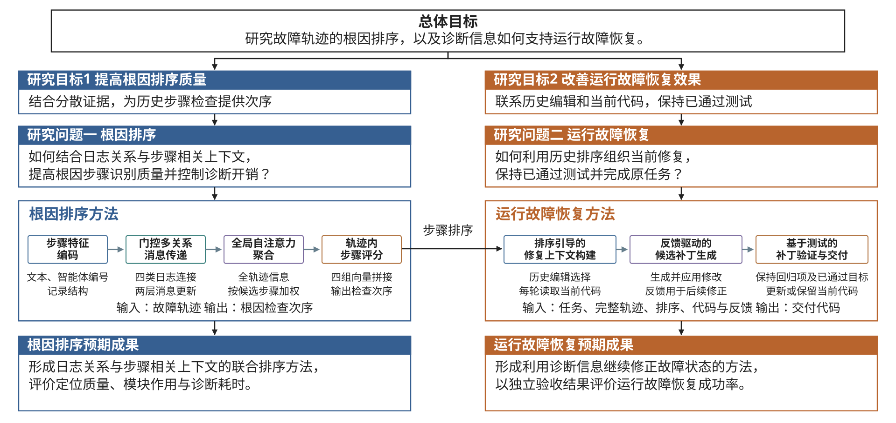
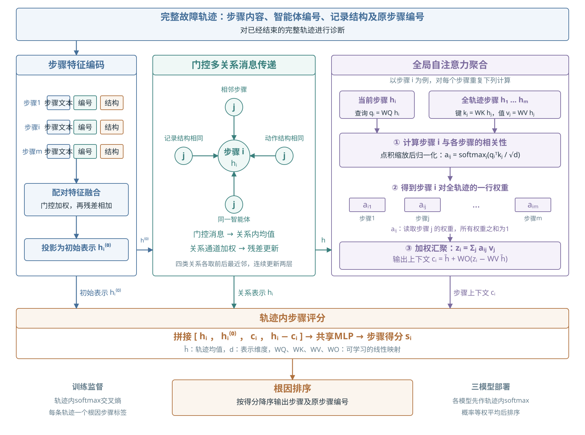
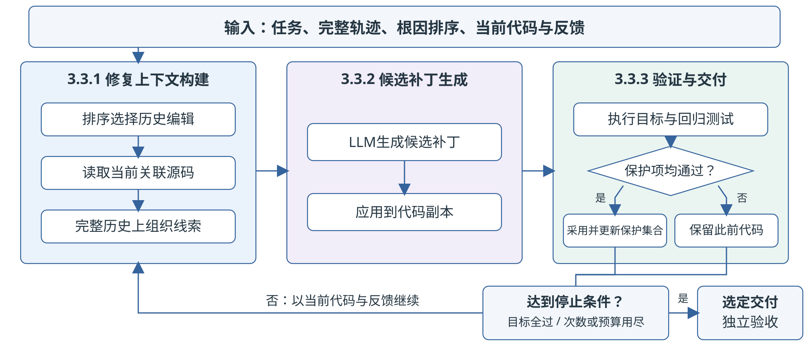

# 智能体运行故障的根因排序与恢复方法

开题报告 · 2026年10月30日

## 1 选题依据与研究现状

### 1.1 研究背景

本论文研究智能体执行过程中的**运行故障**：错误理解、决策或操作使执行偏离任务要求，最终产生错误结果或未完成任务。[1] 这类故障也可能发生在程序正常结束的执行中，因此需要追查结果形成的过程。

智能体围绕任务作出决策、执行动作并接收反馈，这些活动的组织关系构成**执行工作流**。一次执行的推理、动作与环境观察按发生顺序保存，形成**执行轨迹**。[2] 轨迹中的一次具体决策或交互活动作为一个**步骤**，判断该步是否出错需结合当时输入、上下文和反馈。[3]

**运行故障的原因往往难以仅凭最终结果确定，相关证据分散于不同智能体及其执行步骤，需要结合任务要求、消息交互、工具操作与环境反馈追查历史行为。** 上游偏差可能经后续信息传递形成错误级联，使最终异常表现与引入错误的步骤处于不同位置。[4]

本论文以故障轨迹中的历史步骤为**根因候选**，结合步骤内容及关联证据评分，形成优先检查次序，称为**根因排序**。排序将更可能引入故障的步骤置于前列，为根因排查和修正线索选择提供依据。

为检验排序对任务完成的作用，本论文进一步研究软件任务中的**运行故障恢复**。恢复从故障发生后保留的代码与环境出发，利用历史编辑、当前源码和测试反馈继续修改代码。[5] 原任务通过独立验收时，判定为恢复成功。

### 1.2 国内外研究现状

根因排序需要回答哪些历史步骤应优先检查，运行故障恢复则需要把这些线索用于当前代码的修正。以下按这两个相继环节，分析代表性工作的证据组织、历史线索利用和验证方式。

#### 1.2.1 智能体运行故障诊断与根因排序

- **Who&When（Shaokun Zhang等，2025）**：从故障轨迹中定位相关智能体及根因步骤，比较整轨迹判断、逐步检查和二分搜索。数据标签指向纠正该步并相应调整后续执行即可使任务成功的最早错误步骤，最佳步骤定位准确率为14.2%。[1] 研究建立了步骤级诊断对象，也表明任务结果判断与根因步骤定位之间仍有距离。

- **TraceElephant（Mengzhuo Chen等，2026）**：补全任务输入、中间消息与环境交互，分析各智能体当时可使用的信息。[3] 这说明步骤判断需要完整的可见证据。如何进一步关联分散记录并区分引入错误的行为与后续表现，仍需具体的排序模型。

- **StepFinder（Taiyu Zhu等，2026）**：结合步骤语义、智能体编号、双向时序网络与全局注意力产生步骤分数。[6] 其交互主要通过时序、语义匹配和智能体间联系表达，未分别检验显式决策上下文与后续动作、记录结构等日志联系的增量作用。这些联系为区分语义相近但执行作用不同的候选提供了待检验的信息。

- **DCFA（Zehao Wang等，2026）**：构造依赖图，结合局部反事实推理细化根因判断。[7] 该工作说明关联证据有助于分析故障形成过程，同时引入额外结构推理。对于日志中可以直接提取的联系，仍需检验其能否以较低开销补充候选区分。

这些研究从确定诊断对象发展到补全证据、学习评分和关系推理。排序所形成的历史检查次序还需进入恢复过程，才能检验优先发现的行为是否确实有助于后续修正。

#### 1.2.2 根因排序引导的软件运行故障恢复

交互执行利用环境反馈继续求解[8]，跨次尝试积累反思经验[9]，工具检查为修订提供依据。[10] 软件恢复进一步要求把这些信息转化为当前代码上的修改。

- **Agentless（Xia等，2025）**：按定位、补丁生成、复现与回归筛选组织求解。[11] 其输入围绕当前问题与候选补丁组织，历史步骤排序的作用需要单独检验。

- **EnAgent（Tian等，2026）**：生成多条候选轨迹，经回归剪枝、工具检查与投票选择补丁。[12] 其回归筛选保护原有行为，本论文进一步研究恢复中新通过目标的持续保持。

- **SyncMind（Guo等，2025）**：处理智能体认识与实际代码失步，重新获取当前环境信息后恢复。[13] 这说明历史线索需要与当前代码核对。

- **DoVer（Ma等，2026）**：修改消息或计划后重执行，以任务结果检验诊断。[14] 本论文关注代码逐轮修改，检查新补丁是否使此前已通过的目标测试再次失败。

### 1.3 研究问题

现有诊断利用时序、全局交互和推理组织证据，但日志中可直接提取的联系能否补充候选区分，仍需检验。工具执行也用于检验错误假设[15]，需要共同评价定位质量与诊断开销。诊断给出历史步骤判断，修复作用于当前代码，还需检验完整轨迹已可用时，显式排序提示及当前源码组织能否改善修改，并保持新通过的目标测试。

前一环节决定优先检查哪些历史行为，后一环节决定这些线索能否帮助完成原任务。本论文据此提出以下两个研究问题。

- **RQ1：分散执行证据下的根因排序。** 如何关联不同智能体和执行步骤中的分散证据，提高根因步骤的识别与排序质量，并控制诊断开销？

- **RQ2：根因排序引导的软件运行故障恢复。** 如何将历史步骤排序转化为适用于当前代码的修复依据，并在连续修改中保持已通过目标测试所反映的任务进展，提高原任务的最终完成率？

RQ1输出步骤检查次序，RQ2从中选择历史编辑并核对当前实现，两项研究通过实际进入恢复器的修复线索衔接。由此，研究目标既包括排序本身的有效性，也包括排序在恢复中的实际作用。

## 2 研究目标与意义

### 2.1 研究目标

总体目标是建立从故障轨迹分析到软件任务继续求解的方法，形成可评价的根因排序与运行故障恢复流程。

- **根因排序目标：** 关联步骤内容、智能体编号与记录结构，结合局部关系传播和步骤相关上下文学习步骤分数，输出优先检查次序。通过共同数据上的基线比较及消融，检验排序质量、诊断成本和各类证据的作用。

- **运行故障恢复目标：** 将排序转化为真实历史编辑的选择，结合当前源码与反馈生成补丁，以累计测试保持规则更新代码。通过共同故障状态下的完整方法比较及模块对照，检验最终恢复效果，并核对排序是否真正改变了修复输入。

### 2.2 研究意义

- **方法意义：** 将分散执行记录中的可观测联系与步骤相关上下文共同用于步骤判断，研究不同证据在根因区分中的作用。再将历史判断接入当前代码上的恢复操作，建立从诊断质量到任务结果的验证关系。

- **应用意义：** 为出现运行故障的执行提供有次序的历史排查线索，帮助利用已有代码和执行记录继续求解。通过当前实现核对和已通过目标测试的保持，减少失效历史线索及后续修改退化对恢复的影响。

实现上述目标，需要先产生有效的步骤检查次序，再将高排位的历史编辑对应到当前代码，使诊断与恢复组成可验证的完整过程。

## 3 研究方法与技术路线

### 3.1 总体研究框架与数据接口

**图3-1 根因排序与运行故障恢复的总体研究框架**

排序分析历史步骤，修复作用于当前代码。两者通过实际发生的编辑关联，核对原步骤编号与当前实现，使历史诊断成为可追溯的修复依据。

分别评价根因排序与最终恢复结果，并结合每轮输入、代码和测试变化，分析高排位线索及测试保持规则在持续修改中的作用。

### 3.2 根因排序模型

**图3-2 根因排序模型的计算结构**

同一故障反馈可能与多个历史步骤有关，各步骤需要结合不同证据判断。模型保留本步内容，沿日志关系取得执行背景，再从完整轨迹中补充相关信息，支持区分引入错误的行为与后续表现。

图中m为步骤数，i、j为步骤编号。hᵢ⁽⁰⁾、hᵢ、cᵢ分别表示初始表示、关系表示和步骤上下文。MLP为多层感知机。

#### 3.2.1 步骤特征编码

步骤文本取自日志中可用的内容、动作及推理记录，由固定的Qwen3-Embedding-0.6B编码器编码。[16] 日志内的任务要求随步骤文本进入模型。智能体标识在轨迹内转换为**智能体编号**并编码为向量，结构特征记录位置与格式。模型融合上述特征，并对按固定格式识别的同一智能体相邻上下文与输出记录融合文本表示，形成保留原步骤编号的初始表示。

#### 3.2.2 门控多关系消息传递

模型按四类关系连接步骤。**相邻步骤**连接前后一步。**同一智能体**连接该智能体前后最近的步骤。**记录结构相同**按内容、动作及推理字段格式分组，**动作结构相同**按非空动作字段的结构分组。可解析字段按数据类型、数量及嵌套形式划分，普通文本归为同类记录。同组均连接前后最近的步骤。

各类关系分别联系执行次序、智能体归属与记录格式。门控依据当前步骤及邻居差异调节消息，再融合各类关系，经两层传播形成结合邻接证据的步骤表示。[17]

#### 3.2.3 全局自注意力聚合

关系传播沿既定连边汇集信息，任务要求和故障反馈还可能位于远处。该模块以每个待评分步骤为查询，与同一完整轨迹中的各步骤计算相关权重，汇集该步骤需要的证据。查询、用于匹配的键和承载信息的值均由步骤表示转换得到，采用自注意力计算。[18]

模型在轨迹均值背景上加入各步骤的注意力修正，形成与该步骤相关的上下文。相同的全轨迹证据可以参与不同判断，读取权重随待评分步骤变化，从而补充有限层关系传播未覆盖的信息。两类表示随后共同进入评分网络。

#### 3.2.4 轨迹内步骤评分

共享评分网络读取初始表示、关系表示、步骤上下文，以及关系表示与上下文的差异，使评分同时依据本步内容和关联证据。训练以**数据集中标注的根因步骤**为目标，在同一轨迹内归一化分数，最小化该目标步骤对应的负对数概率。组内评分采用列表级学习思路。[19] 每条轨迹使用一个根因步骤标签时，交叉熵训练与排序目标具有理论联系。[20]

预测时，模型仅依据轨迹记录计算分数，并按降序输出步骤检查次序。评价目标是数据集标注的根因步骤能否位于首位或前几个位置，各数据源保留原有根因标注含义。恢复器再从排序中选择真实编辑，检验历史诊断对当前代码修正的作用。

### 3.3 运行故障恢复方法

**图3-3 运行故障恢复流程**

#### 3.3.1 排序引导的修复上下文构建

本方法在完整公共轨迹上，按根因排序选择实际改变过源码的历史编辑，按工具调用去重，提取修改前后差异。首轮使用最高排位编辑，后续依次补充，最多3项，使有限尝试优先围绕诊断线索展开。

每轮对照历史编辑后版本和当前源码，按编辑涉及的函数、属性及当前测试反馈中的源码位置，读取当前定义和可能引用它的代码。[21] 这些材料同时说明历史改动和当前实现，为生成器判断当前修改提供依据。

#### 3.3.2 反馈驱动的候选补丁生成

生成模型结合原任务、完整历史、排序线索、当前源码与此前尝试的反馈提出补丁。执行器在代码副本上应用并测试，将应用错误、测试结果及当前代码差异交给下一轮。[22] 下一轮以当前代码和这些反馈为生成条件，继续针对尚未满足的任务要求提出补丁。

#### 3.3.3 基于测试的补丁验证与交付

复现测试可用于筛选候选补丁。[23] 本方法使用预先固定的**目标测试**与**回归测试**，前者检查原任务要求，后者检查需要保留的已有行为。初态已通过的回归项和目标项进入保护集合，后续采用的代码中新通过的目标项继续加入。

候选通过全部保护项时更新代码，否则恢复此前状态。该规则将已经取得的测试进展转为后续修改条件，使被采用代码的目标测试通过集合逐轮不缩小。保护依赖稳定、可执行的测试，其作用由已通过目标的保持情况和最终任务验收共同评价。

目标全部通过、尝试次数或预算用尽时停止，按预先固定的反馈规则选择交付，再以独立验收判定恢复成功。测试结果缺失或不确定时保存已有代码并停止更新。各轮源码、补丁与测试状态共同记录，用于分析修复线索和代码更新规则如何影响恢复过程。

## 4 研究难点与拟创新点

### 4.1 关键难点

- **难点一：分散证据的关联与根因步骤区分。** 故障反馈可能晚于引入错误的步骤，同一反馈也可能涉及多个历史行为。需要结合执行次序、智能体及记录结构联系，并从全轨迹中取得与不同步骤相关的证据，在控制诊断开销的同时区分根因与后续表现。

- **难点二：历史诊断与当前代码修正的衔接。** 历史排序反映已发生的行为，补丁作用于持续变化的代码。需要结合当前实现判断历史编辑的修复价值，并在继续解决剩余问题时保持已有测试进展。代码更新还会改变后续输入和修复条件，需要共同分析局部进展与最终任务完成之间的关系。

### 4.2 拟研究的创新点

- **日志关系与步骤相关上下文的联合排序。** 将执行次序、智能体归属及记录结构形成的关系用于邻居信息传播，再为每个步骤从完整轨迹中汇集相关证据。研究两类信息在根因步骤识别中的互补作用，以关系传播和全局聚合的模块消融评价。

- **排序引导的修复依据构建与测试进展保持。** 将历史步骤排序映射为真实编辑，结合版本差异、当前函数和测试反馈组织修复输入，并将已通过目标纳入后续代码更新条件。研究诊断线索如何支持当前修改，以及进展保持如何影响连续恢复，通过完整轨迹对照、编辑次序对照和模块消融检验。

## 5 实验设计与数据安排

### 5.1 实验数据来源与划分

**表5-1 数据来源与研究样本**

| 数据来源 | 研究样本 | 数据内容 | 实验用途 |
| --- | --- | --- | --- |
| AFTraj | 开发731条（716个任务组），评价候选163条 | 执行轨迹与根因步骤标注 | 检验另一记录形式下的排序表现 |
| AgenTracer | 训练验证614条，coding开发363条，coding评价候选127条 | 代码与数学任务轨迹、根因步骤标注 | 模型训练及代码与数学任务比较 |
| SWE-Gym | 计划20个问题、覆盖5仓库 | 代码库、任务说明、执行环境与测试 | 构造共同故障状态、比较任务恢复 |

AFTraj提供故障轨迹及根因步骤标注。[24] AgenTracer用于模型学习，并分别分析代码与数学任务的排序表现。[25] AgenTracer的现有适配以消息内容构成步骤文本，AFTraj分开记录内容、动作与推理。两者分别检验任务类别差异和不同记录形式下的排序适用性。SWE-Gym提供可执行仓库问题[26]，用于评价代码修改能否完成原任务。[27]

恢复任务计划覆盖5个Python仓库、20个问题。每题重建故障发生后的代码、环境、历史轨迹和反馈测试，确认原任务尚未完成，形成共同恢复起点。

训练验证数据从AgenTracer公开训练部分筛选6—32步轨迹，代码任务coding取320条、数学任务math取294条，共614条。验证集与训练集按**约1:4**划分：coding为64/256，math为58/236，合计**验证122条、训练492条**。

训练集用于参数学习，验证集用于配置选择，固定划分并做三次初始化。代码与数学任务分别报告，另以仅代码任务训练检验混合训练的作用。AFTraj 731条、716个任务组及AgenTracer coding 363条继续作为开发材料。评价分别从AFTraj的163条和AgenTracer coding的127条测试候选中，核对历史使用及跨集合原问题重叠后固定清单。同一原问题的派生轨迹归入同一集合。

执行环境提供仓库浏览、源码编辑与测试接口[28]，隔离保存命令、文件变化与轨迹。[29] 各方法共用deepseek-flash、故障状态、信息许可、反馈测试和资源上限，每题独立重复3次。

30分钟为主比较，同时记录15/60分钟交付结果。

### 5.2 整体实验流程与工作量

- **根因排序实验：** 准备数据后，训练完整模型、StepFinder及两项排序消融，各做3次初始化。增加仅代码训练对照。冻结配置后，比较定位与排序质量、耗时及模型请求。

- **运行故障恢复实验：** 在5.1的共同恢复起点上，比较本方法、Agentless、EnAgent与AOrchestra，并开展修复上下文构建、累计测试保持两项模块消融。

- **完整轨迹与编辑次序对照：** 上下文构建消融保留完整公共轨迹、共同源码访问及测试保持，取消额外编辑提示与关联源码。另按时间倒序选择同量编辑，复用相同源码组织和反馈规则，区分排序次序与附加信息的作用。

- **汇总与分析：** 同题重复先汇总，再对问题等权统计。保存模型输入、选中编辑、代码状态和测试变化，核对排序是否改变了有效线索。独立评价采用未参与开发的任务。

**表5-2 整体实验流程与计划工作量**

| 实验环节 | 比较设置 | 重复与计划工作量 |
| --- | --- | --- |
| 排序主实验与消融 | 完整模型、StepFinder、两项排序消融 | 4种设置×3次初始化＝12次训练 |
| 混合训练作用 | 完整模型仅用coding训练 | 1种设置×3次初始化＝3次训练 |
| 恢复整体比较 | 本方法、Agentless、EnAgent、AOrchestra | 20题×4方法×3次＝240次运行 |
| 恢复模块消融 | w/o修复上下文构建（完整轨迹对照）、w/o累计测试保持 | 20题×2设置×3次＝120次运行 |
| 编辑次序对照 | 时间倒序选择同量编辑，其余机制相同 | 20题×1设置×3次＝60次运行 |

上述开发计划包括15次训练及420次恢复运行。完整轨迹直接输入对照与上下文构建消融共用同一设置，计入120次模块消融。独立评价另按核定清单执行，三次重复全部纳入统计。

### 5.3 评价指标与基线方法

**表5-3 主要评价指标**

| 指标 | 计算与含义 |
| --- | --- |
| Top-1 ↑ | 数据集标注的根因步骤位于首位的任务组等权比例 |
| MRR ↑ | 数据集标注根因步骤的倒数排名按任务组等权计算的均值 |
| Hit@3 / Hit@5 ↑ | 数据集标注的根因步骤进入前3/5位的任务组等权比例 |
| 诊断耗时P50 / P95 ↓ | 首次加载及已加载条件下的中位数/95分位数 |
| 运行故障恢复成功率RSR ↑ | 同题3次运行先平均，再对共同问题等权 |
| RSR@15 / 30 / 60min ↑ | 节点前选定交付的独立验收成功率 |
| 资源消耗 ↓ | 输入输出token总量、大模型API请求次数 |

耗时覆盖文本编码和评分，注明加载条件、硬件、批处理及轨迹长度。另按根因标注位置和轨迹长度分组分析排序表现。token为模型处理的词元。

**表5-4 运行故障诊断基线及正式发表时间**

| 方法 | 正式发表时间 | 发表载体 | 核心机制 |
| --- | --- | --- | --- |
| All-at-Once | 2025.07 | ICML | 整轨迹一次性诊断 |
| Binary Search | 2025.07 | ICML | 区间判断与二分搜索 |
| StepFinder | 2026.08 | KDD | 时序、角色交互与步骤评分 |
| 本方法 | — | 本论文 | 关系传播与步骤相关上下文 |

诊断统一比较Top-1和耗时，能够输出完整排序的方法另报MRR及Hit@3/5。

生成式方法同时统计词元和模型请求。各方法共用轨迹、步骤边界、划分及标签，单位置输出不补造完整排名。

**表5-5 运行故障恢复基线及正式发表时间**

| 方法 | 正式发表时间 | 发表载体 | 核心过程 |
| --- | --- | --- | --- |
| Agentless | 2025.06 | FSE / PACMSE | 定位、生成、复现与回归筛选 |
| EnAgent | 2026.04 | ICSE | 多轨迹、回归剪枝、工具选择与投票 |
| AOrchestra | 2026.07 | ICML | 动态子智能体及上下文配置 |
| 本方法 | — | 本论文 | 诊断输入、反馈修复与测试保持 |

恢复统一比较15/30/60分钟交付的独立验收成功率、词元与请求次数，以30分钟为主结果。

各节点来自同次运行，提前停止后沿用当时已选交付。各方法保留完整求解过程，并采用共同故障状态、模型、信息许可、预算和验收。

AOrchestra按其动态子智能体与上下文配置流程完整实施。[30] 预算内未成功、工程中断及验收未知分别记录，并列出共同可比较的问题数。完整方法比较评价总体效果，完整轨迹输入对照检验证据组织的增量作用，模块消融分析上下文构建与代码更新规则。

### 5.4 消融实验与作用分析

**表5-6 核心模块消融**

| 研究内容 | 实验设置 | 验证目的 |
| --- | --- | --- |
| 根因排序 | 完整模型 | 评价完整排序方法 |
|  | w/o 门控多关系消息传递 | 分析关系传播模块的作用 |
|  | w/o 全局自注意力聚合 | 分析步骤相关上下文的作用 |
| 运行故障恢复 | 完整恢复方法 | 评价完整恢复方法 |
|  | w/o 排序引导的修复上下文构建 | 分析排序与当前实现共同组织输入的作用 |
|  | w/o 累计测试保持 | 分析连续修改中测试进展保持的作用 |

消融逐项移除对应模块，固定其余输入许可、生成条件与资源设置。排序模型分别重新训练。

移除修复上下文构建时，保留完整公共轨迹、共同源码访问和测试反馈，取消排序派生的编辑提示与关联源码补充。

移除累计测试保持时，沿用固定测试验证与交付规则。各恢复方法从相同故障状态独立运行，并记录输入、补丁与测试变化，分析模块对操作及最终结果的影响。

## 6 研究进度安排

2026年10月完成题目、概念、研究依据和开题方案重构。

11—12月完成排序与恢复模块、数据清单及评价配置。2027年1—2月开展完整基线比较和独立评价，3月完成消融、结果分析及论文初稿，4—5月修改论文并准备答辩。写作与证据整理随研究同步推进。

## 参考文献

[1] Shaokun Zhang, Ming Yin, Jieyu Zhang, et al. Which Agent Causes Task Failures and When? On Automated Failure Attribution of LLM Multi-Agent Systems[C]//Proceedings of the 42nd International Conference on Machine Learning (ICML), PMLR 267: 76583–76599, 2025. [原文](https://proceedings.mlr.press/v267/zhang25cq.html)。

[2] Shuyang Liu, Yang Chen, Rahul Krishna, et al. Process-Centric Analysis of Agentic Software Systems[J]. Proceedings of the ACM on Programming Languages, 10(OOPSLA1): 1961–1988, Article 163, 2026. [原文](https://doi.org/10.1145/3798271)。

[3] Mengzhuo Chen, Junjie Wang, Fangwen Mu, et al. Seeing the Whole Elephant: A Benchmark for Failure Attribution in LLM-based Multi-Agent Systems[C]//Proceedings of the 64th Annual Meeting of the Association for Computational Linguistics (Volume 1: Long Papers): 19888–19905, 2026. [论文](https://aclanthology.org/2026.acl-long.912/)。

[4] 董益宏, 姜雪, 钱家如, 等. 基于大语言模型智能体的代码生成综述[J]. 软件学报, 2026, 37(8): 3089–3115. DOI: 10.13328/j.cnki.jos.007593. [论文](https://jos.org.cn/jos/article/abstract/7593)。

[5] Islem Bouzenia, Premkumar Devanbu, Michael Pradel. RepairAgent: An Autonomous, LLM-Based Agent for Program Repair[C]//Proceedings of the IEEE/ACM 47th International Conference on Software Engineering (ICSE): 2188–2200, 2025. [原文](https://doi.org/10.1109/ICSE55347.2025.00157)。

[6] Taiyu Zhu, Yifan Wu, Weilin Jin, et al. StepFinder: A Temporal Semantic Framework for Failure Attribution in Multi-Agent Systems[C]//Proceedings of the 32nd ACM SIGKDD Conference on Knowledge Discovery and Data Mining V.2: 6946–6957, 2026. [原文](https://doi.org/10.1145/3770855.3817991)。

[7] Zehao Wang, Lanjun Wang, Shilong Jin, et al. DCFA: Dual-view Causal-inspired Attribution for Failure Reasoning in LLM-based Multi-agent Systems[C]//Proceedings of the 2026 Conference on Empirical Methods in Natural Language Processing. 2026: 42999–43025. [原文](https://aclanthology.org/2026.emnlp-main.1887/)。

[8] Shunyu Yao, Jeffrey Zhao, Dian Yu, et al. ReAct: Synergizing Reasoning and Acting in Language Models[C]//International Conference on Learning Representations, 2023. [论文](https://openreview.net/pdf?id=WE_vluYUL-X)。

[9] Noah Shinn, Federico Cassano, Ashwin Gopinath, et al. Reflexion: Language Agents with Verbal Reinforcement Learning[C]//Advances in Neural Information Processing Systems 36, 2023. [论文](https://proceedings.neurips.cc/paper_files/paper/2023/hash/1b44b878bb782e6954cd888628510e90-Abstract-Conference.html)。

[10] Zhibin Gou, Zhihong Shao, Yeyun Gong, et al. CRITIC: Large Language Models Can Self-Correct with Tool-Interactive Critiquing[C]//International Conference on Learning Representations, 2024. [论文](https://proceedings.iclr.cc/paper_files/paper/2024/hash/fef126561bbf9d4467dbb8d27334b8fe-Abstract-Conference.html)。

[11] Chunqiu Steven Xia, Yinlin Deng, Soren Dunn, et al. Demystifying LLM-Based Software Engineering Agents[J]. Proceedings of the ACM on Software Engineering, 2(FSE): 801–824, 2025. [原文](https://doi.org/10.1145/3715754)。

[12] Zhao Tian, Pengfei Gao, Junjie Chen, et al. Agent-Based Ensemble Reasoning for Repository-Level Issue Resolution[C]//Proceedings of the IEEE/ACM 48th International Conference on Software Engineering (ICSE): 1406–1418, 2026. [原文](https://doi.org/10.1145/3744916.3787761)。

[13] Xuehang Guo, Xingyao Wang, Yangyi Chen, et al. SyncMind: Measuring Agent Out-of-Sync Recovery in Collaborative Software Engineering[C]//Proceedings of the 42nd International Conference on Machine Learning (ICML), PMLR 267: 20993–21066, 2025. [原文](https://proceedings.mlr.press/v267/guo25l.html)。

[14] Ming Ma, Jue Zhang, Fangkai Yang, et al. DoVer: Intervention-Driven Auto Debugging for LLM Multi-Agent Systems[C]//International Conference on Learning Representations (ICLR), 2026. [原文](https://proceedings.iclr.cc/paper_files/paper/2026/hash/2f5fdce256ff0d7fb774da76e5e63209-Abstract-Conference.html)。

[15] Jiazheng Li, Emine Yilmaz, Bei Chen, Thu Le. Towards Self-Improving Error Diagnosis in Multi-Agent Systems[C]//Findings of the Association for Computational Linguistics: ACL 2026: 2063–2077, 2026. DOI: 10.18653/v1/2026.findings-acl.98. [论文](https://aclanthology.org/2026.findings-acl.98/)。

[16] Yanzhao Zhang, Mingxin Li, Dingkun Long, et al. Qwen3 Embedding: Advancing Text Embedding and Reranking Through Foundation Models[EB/OL]. arXiv:2506.05176, 2025. DOI: 10.48550/arXiv.2506.05176. [论文](https://arxiv.org/abs/2506.05176)。

[17] Michael Schlichtkrull, Thomas N. Kipf, Peter Bloem, et al. Modeling Relational Data with Graph Convolutional Networks[C]//The Semantic Web (ESWC), Lecture Notes in Computer Science: 593–607, 2018. [原文](https://doi.org/10.1007/978-3-319-93417-4_38)。

[18] Ashish Vaswani, Noam Shazeer, Niki Parmar, et al. Attention Is All You Need[C]//Advances in Neural Information Processing Systems 30. 2017. [原文](https://proceedings.neurips.cc/paper_files/paper/2017/hash/3f5ee243547dee91fbd053c1c4a845aa-Abstract.html)。

[19] Tie-Yan Liu. Learning to Rank for Information Retrieval[J]. Foundations and Trends in Information Retrieval, 3(3): 225–331, 2009. [原文](https://doi.org/10.1561/1500000016)。

[20] Sebastian Bruch, Xuanhui Wang, Michael Bendersky, Marc Najork. An Analysis of the Softmax Cross Entropy Loss for Learning-to-Rank with Binary Relevance[C]//Proceedings of the 2019 ACM SIGIR International Conference on Theory of Information Retrieval (ICTIR). 2019: 75–78. DOI: 10.1145/3341981.3344221. [原文](https://research.google/pubs/an-analysis-of-the-softmax-cross-entropy-loss-for-learning-to-rank-with-binary-relevance/)。

[21] Yuntong Zhang, Haifeng Ruan, Zhiyu Fan, Abhik Roychoudhury. AutoCodeRover: Autonomous Program Improvement[C]//Proceedings of the 33rd ACM SIGSOFT International Symposium on Software Testing and Analysis: 1592–1604, 2024. DOI: 10.1145/3650212.3680384. [论文](https://doi.org/10.1145/3650212.3680384)。

[22] 香佳宏, 徐霄阳, 孔繁初, 等. 大模型在软件缺陷检测与修复的应用发展综述[J]. 软件学报, 2025, 36(4): 1489–1529. DOI: 10.13328/j.cnki.jos.007268. [原文](https://www.jos.org.cn/html/2025/4/7268.htm)。

[23] MÜNDLER N, MÜLLER M N, HE J, et al. SWT-Bench: Testing and Validating Real-World Bug-Fixes with Code Agents[C]//Advances in Neural Information Processing Systems 37. 2024: 81857–81887. DOI: 10.52202/079017-2601.

[24] Boxuan Zhang, Jianing Zhu, Zeru Shi, Dongfang Liu, Ruixiang Tang. AgentForesight: Online Auditing for Early Failure Prediction in Multi-Agent Systems[EB/OL]. arXiv:2605.08715, 2026. DOI: 10.48550/arXiv.2605.08715. [论文](https://arxiv.org/abs/2605.08715)。

[25] Guibin Zhang, Junhao Wang, Junjie Chen, et al. AgenTracer: Who Is Inducing Failure in the LLM Agentic Systems?[C]//International Conference on Learning Representations (ICLR), 2026. [原文](https://proceedings.iclr.cc/paper_files/paper/2026/hash/134ed7a477770f227f12450ef0cbb8f4-Abstract-Conference.html)。

[26] Jiayi Pan, Xingyao Wang, Graham Neubig, et al. Training Software Engineering Agents and Verifiers with SWE-Gym[C]//Proceedings of the 42nd International Conference on Machine Learning (ICML), PMLR 267: 47717–47737, 2025. [原文](https://proceedings.mlr.press/v267/pan25g.html)。

[27] Carlos E. Jimenez, John Yang, Alexander Wettig, et al. SWE-bench: Can Language Models Resolve Real-world GitHub Issues?[C]//International Conference on Learning Representations (ICLR), 2024. [原文](https://proceedings.iclr.cc/paper_files/paper/2024/hash/edac78c3e300629acfe6cbe9ca88fb84-Abstract-Conference.html)。

[28] John Yang, Carlos E. Jimenez, Alexander Wettig, et al. SWE-agent: Agent-Computer Interfaces Enable Automated Software Engineering[C]//Advances in Neural Information Processing Systems 37, 2024. [论文](https://proceedings.neurips.cc/paper_files/paper/2024/hash/5a7c947568c1b1328ccc5230172e1e7c-Abstract-Conference.html)。

[29] Xingyao Wang, Boxuan Li, Yufan Song, et al. OpenHands: An Open Platform for AI Software Developers as Generalist Agents[C]//International Conference on Learning Representations (ICLR), 2025. [原文](https://proceedings.iclr.cc/paper_files/paper/2025/hash/a4b6ad6b48850c0c331d1259fc66a69c-Abstract-Conference.html)。

[30] Jianhao Ruan, Zhihao Xu, Yiran Peng, et al. AOrchestra: Automating Sub-Agent Creation for Agentic Orchestration[C]//Proceedings of the 43rd International Conference on Machine Learning (ICML), PMLR 306: 106017–106040, 2026. [原文](https://proceedings.mlr.press/v306/ruan26e.html)。
