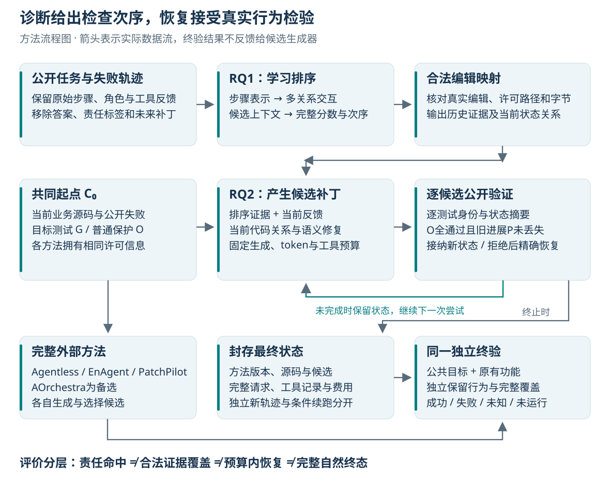
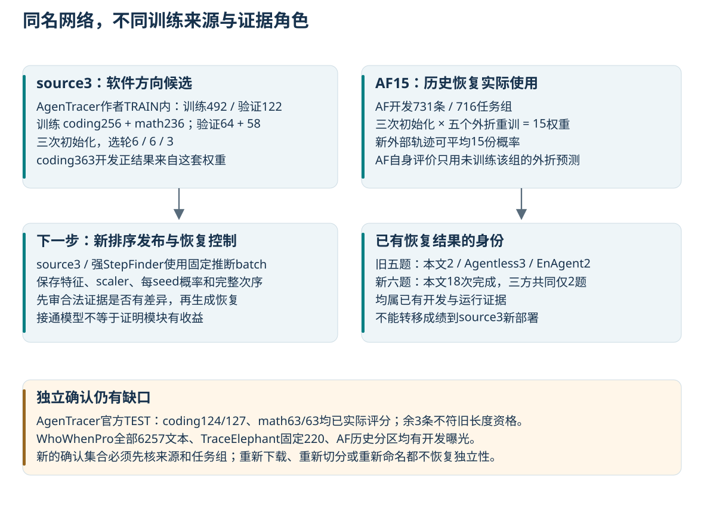

# 正式论文框架与两层基线

建议题目：**基于学习排序的智能体失败诊断与软件任务恢复方法研究**。

当前最值得保留的是软件coding范围的责任排序及其向真实恢复的连接。已有证据不足以把整套系统写成超过强基线，也不足以把关系上下文、状态动作残差或集合保护分别写成已验证的创新。正式框架应允许这些假设被证伪，并保留完整强对手和负结果。

## 一、研究对象与两个问题

RQ1研究事后失败轨迹中的责任步骤排序。输入是允许读取的完整公开轨迹，输出是原始步骤坐标上的分数、完整次序和可检查的上下文。主应用范围为软件相关coding日志；math和agentic保留为域外边界。完整轨迹中的未来观察可以用于事后归因，但不能把这种设置称为在线预警。

RQ2研究从失败代码状态到可验收状态的恢复过程。排序只是证据选择的一种依据，恢复动作可以是模型生成语义补丁，也可以是具有合法前提的受控撤销。当前真实系统主要是语义补丁恢复，因此不再把“选择性回滚”作为整篇题目的唯一定义。恢复效果与诊断准确率分别测量。

整体系统比较回答“方法是否有竞争力”，内部模块控制回答“是什么产生效果”。二者不可互相替代。不同诊断器接同一恢复器不构成多个完整外部系统。

## 二、具体方法选择

**诊断主候选：source3 AB_GLOBAL。** 使用现有三个独立初始化模型，训练来源为AgenTracer作者TRAIN中的coding256+math236，验证为coding64+math58；不是纯coding492。输入为固定语义嵌入、匿名角色和23维公开结构，采用状态动作有效配对残差、两层四关系交互及候选相关上下文，按轨迹内softmax交叉熵训练并输出完整排序。该方法属于监督式列表学习排序，不声称发明新损失。

**已有恢复排序：AF15。** 它是同网络的另一套训练条件，来自AF731条/716组，三次初始化各五外折重训。现有五题与六题恢复实际读取这套权重的输出。本次已核权重、输入、排序和实际请求的证据链。source3被提名为新部署不自动获得已有恢复成绩。

**恢复主流程：当前反馈绑定的语义补丁恢复。** 先从排序中提取合法编辑证据，再附历史变更、当前源码及其版本关系。当前公开失败的业务位置和API调用名称引导代码关系检索；补丁在独立状态中执行公开验证；普通保护通过且已通过目标身份集合不缩小时接纳，否则精确回退。独立保留测试只用于最终验收。

Exp249的实际参数是最多3次生成、最多前三条合法编辑。Exp247曾单独扩展完整合法池，但没有与248/249当前反馈版本合并。下一轮先以当前3次部署检验排序替换；扩大池和尝试数须另列所有方法等预算的新条件。

## 三、RQ1三主一备

| 地位 | 方法 | 正式出处 | 必须保留 | 当前资格与用途 |
|---|---|---|---|---|
| 主1 | StepFinder | KDD 2026，[3] | 完整语义、时序、角色交互、差分/位置与联合损失 | 已有有效非零；新软件比较用验证选择的Exp158 ALG50三模型，保持原网络和固定batch |
| 主2 | All-at-Once | ICML 2025，[1] | 完整公开轨迹，一次责任判断，无任务答案 | 历史AF120为77；主终点Top1，不伪造完整MRR |
| 主3 | Binary Search | ICML 2025，[1] | 区间判断、递归与真实终止，全部调用计入 | 历史AF120为51；原始步号及解析失败明确 |
| 备选候选 | Step-by-Step | ICML 2025，[1] | 逐前缀检查、首次肯定停止、原始步骤映射 | 作者核心公开且连通，但本地未运行、没有完整非零；合格备选仍缺 |

这是三个主算法、两篇论文，Step-by-Step备选候选也来自Who & When。若论文制度要求三篇不同来源，当前配置不能冒充满足，需要另补方法资格。SDBL作者核心源码当前缺失，从当前名额中移除；本地69/120仅保留为论文重建参考。也不以未公开权重的AgenTracer、需要新增重放能力的FAMAS或假实现补名额。

Step-by-Step的作者函数 `Lib/utils.py:111` 逐前缀判断、首次Yes停止，`inference.py:203` 有实际调用，固定提交与AA/BS相同。历史Exp124明确记为资源缺口未运行、调用0。原提示会拼接任务答案，原评分还使用字符串包含匹配；正式无答案、严格步号条件必须明确删除答案字段并做准确的原始编号映射。这些是新适配工作，不是已经完成的非零复现。

StepFinder有独立原损失和预处理，不为让本文更好而修改。Exp158允许两套论文预设以相同验证规则选择，三source seed都选择ALG，轮次23/14/20。其50轮/10轮早停比本文40/8更大，是加强对手的设置，不称训练算力完全相等。padded batch最大长度参与位置偏置，因此批次身份也是推断参数。

## 四、完整恢复三主一备

| 地位 | 方法 | 正式出处 | 必须保留 | 当前运行资格 |
|---|---|---|---|---|
| 主1 | Agentless | FSE 2025，[9] | 定位、补丁、复现、回归筛选、归一化投票 | 已有完整非零；旧4补丁/4复现与后续40/40分别报告 |
| 主2 | EnAgent | ICSE 2026，[10] | 多轨迹生成、剪枝、工具辅助选择、投票 | 已有完整非零；N2/C24/S30与N3/C200/S30是不同内部条件 |
| 主3 | PatchPilot | ICML 2025，[11] | 复现、定位、规划、验证、细化、重新定位和选择 | 尚无合格非零；多次工程/容量中断不能填0 |
| 备选 | AOrchestra | ICML 2026，[12] | 主调度、动态子任务、任务/上下文分配和完整子代理 | 正式文献及公开核心已核，本地非零仍缺 |

EnAgent已满足至少一项2026正式方法的设计与非零条件。第三项只是明确选定，尚未具备完整有效运行资格。切换依据是核心、输入、环境及资源适用性，不能依据本文会不会输。PatchPilot与AOrchestra都未过时，实际外部比较继续报告两项。

作者参数与本地部署分开。Agentless作者示例4×10补丁及40复现；EnAgent论文选择30轮，而作者README和源码默认值另有变化，固定版本需记录。小规模部署仍可保留算法阶段，但其结果不能冒称论文默认复现。内部参数不变的继续执行，才可与原固定资源端点组成同一条轨迹的两个观测。

## 五、数据体系与确认缺口

当前source3训练/验证可以完整追溯，coding363/170提供已曝光开发正信号，math155与agentic1467提供机制和域外边界。AF用于历史开发、分组外折和历史恢复控制。AF自身只能用真正未见该组的外折预测评价，不能平均15个已部分见过该记录的模型后称为折外。

AgenTracer官方TEST的coding124/127、math63/63已逐组找到历史实际评分回执，不只是预留覆盖；余3条不在原长度范围。WhoWhenPro全部6257text、TraceElephant固定220以及AF旧分区也已经曝光。当前没有已核定的现成新确认池。新来源或未来自行收集的自然软件轨迹，需要先确定许可、源任务去重、归因单位及标注流程；这是后续研究缺口，本次四小时不自动新增Gold读取或大规模下载。

软件恢复来源为SWE-Gym与固定OpenHands公开轨迹。当前23个issue是本地来源池，21是计划槽，18是当前合格槽；五题旧完整比较、六题新重复、两题三方共同完成分别报告。不能把不同状态或重复当成新issue，也不能把来源成功轨迹的未来补丁交给失败C₀的恢复器。

## 六、整体评价与模块证据

主指标同时报告固定资源内交付和内部参数不变的自然终态。每题固定30分钟等上限以内未交付有效修复，记预算内未成功，并保留超时、模型负例或工程中断原因；自然终态未观测则保留未知/截断。所有方法必须从同C₀、同公共输入、同后端、同工具许可与同验收出发。成本包括全部失败候选、编码/排序及原生执行，缓存是否计入分栏说明。

排序控制至少包含强StepFinder替换和不读诊断分数的当前反馈恢复，逆序/随机作为辅助。实验123中无RQ1恢复后验23/34高于责任全序14/34，说明“需要诊断”本身应接受检验。若只有共同小池的不同排序，预算遍历全部候选后打平不能说明方法失败，也不能支持恢复率优势；应看首次成功成本和较小预算端点。

关系控制要区分关系组织与增加文本量。保护控制比较O-only、通过数量不下降及通过身份不丢失。当前SET尚无独有事件，状态动作A模块在六题输入上的配对也全为空；这些必须在机制机会表中显示，不能靠架构图上的模块存在证明贡献。

## 七、扩展接口与研究取舍

| 接口 | 当前输出契约 | 可独立扩展的方向 |
|---|---|---|
| 轨迹投影 | 许可字段、原始步号、角色映射、来源摘要 | 更完整工具观察、不同日志框架、真正在线前缀 |
| 诊断器 | 每seed分数、集成概率、完整次序 | 新关系、内容模型、可恢复性辅助目标；另立训练与确认 |
| 编辑映射 | 合法候选、旧/新/当前字节与拒绝理由 | 结构编辑单元、精确执行依赖；不补造候选 |
| 恢复器 | 补丁、工具动作、当前反馈和完整预算 | 语义修改、受控撤销、必要时扩大候选；同预算比较 |
| 验证与准入 | 逐测试身份、当前状态摘要、接受/拒绝 | 软保护、允许暂时退步等策略，必须有新可检验条件 |
| 保存与继续 | 完整消息、阶段、候选、原时钟、费用与发送状态 | 改善原子保存、无需重复已付请求的精确继续 |

优先投入能改变科学判断的工作：实际排序干预、自然进展分歧、完整共同配对和独立数据资格。停止继续依赖弱或恒0对手、反复换同一开发集名字、只增加预检文件、在同一失败题上不断加采样后覆盖旧结果。这些是对证据和资源使用的调整，不是依据一次模型失败否定整个方向。

本框架的实施细节由后续四小时计划约束；完整六章文本在V1中展开。若新实验仍无明显增益，保留真实负结果并缩小性能主张，不能仅通过报告措辞把缺口写成已完成。
