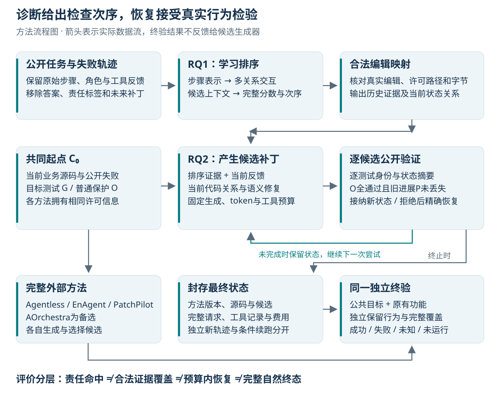
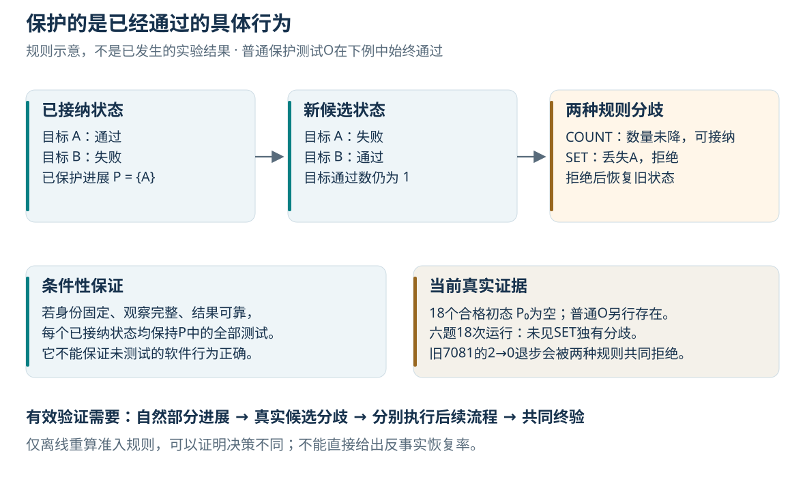
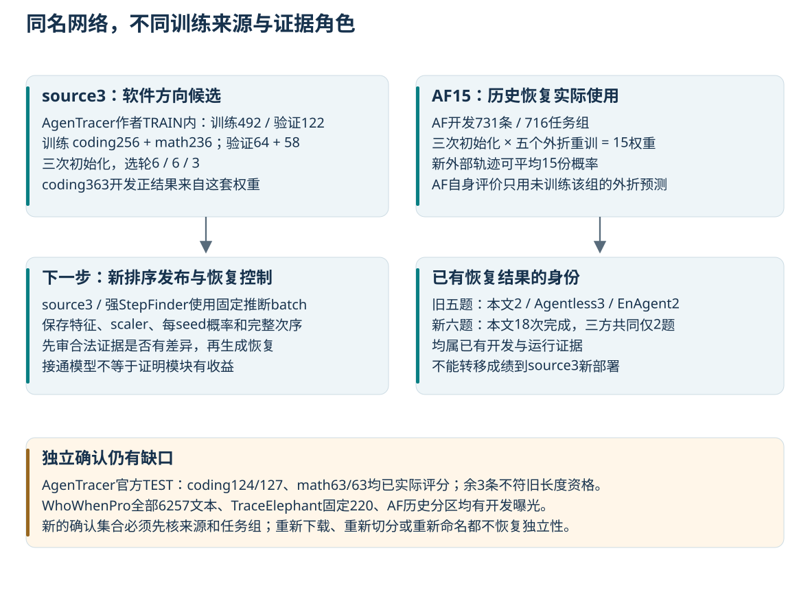

# 六章报告的逐章与图表解释

这份说明帮助理解V1的论证结构。它解释术语、图表和选择理由，不增加正文之外的实验成绩。正式稿保留连续学术叙述，答辩时可用本说明组织口头解释。

## 1. 题目为什么改为学习排序与软件任务恢复

“学习排序”指训练模型对一组候选决定先后，而不仅是给每步单独贴一个标签。在这里，一组候选是一条失败轨迹中的全部步骤，模型给每步分数，同一轨迹内归一化，再按分数排列。训练要求责任步骤尽量排在前面。多关系图和候选上下文是这个评分模型的具体实现，不必把所有模块名字都塞进题目。

“软件任务恢复”对应当前实际动作：模型会根据现有代码和失败反馈生成新补丁。早期方法主要撤销旧编辑，现在已经不仅是回滚，所以保留旧题目的“选择性回滚”会让读者误解实现。受控撤销仍可保留在恢复动作集合中。

这个题目说明研究方法和应用对象，不承诺已经超过所有方法，也不把模块名当作新颖性。若最终排序并没有帮助恢复，两者之间的联系就需要收缩，不能因为题目里写了就一定认为成立。

## 2. 第一章：从背景到真正需要研究的缺口

第一章先解释软件智能体为什么留下长轨迹：模型不只是输出代码，还会查看、编辑和运行工具。这使任务失败和失败位置成为不同问题。最后测试告诉我们某个行为不对，却不自动告诉我们是哪次决策导致。

综述按方法解决的问题组织：完整日志阅读、训练型诊断、图与结构信息、执行与假设验证，以及完整软件恢复。这样可以看出本文选择了哪种信息和计算条件。不能把一个需要多次真实重放的方法与只读日志模型直接按准确率比较，却不计重放成本。

回滚、补偿、保留经验和保护进展已有直接先行研究。DART依赖明确的控制流和读写契约，SagaLLM有补偿语义，经典选择性撤销要求应用提供逆操作、冲突判断和重排。本文当前只是启发式关系和测试观察，所以不能借用这些论文的名称就声称拥有同样保证。

研究缺口最终落在“历史责任步骤如何变成当前状态里有用的恢复证据”。这比泛泛说现有方法都不考虑关系、都不会保护进展准确，也更容易被实验检验。

## 3. 第二章：三个层次不能混在一起

**责任排序正确**：人工或注错标签所在步骤排得靠前。**编辑证据可用**：那个步骤确实有合法历史编辑，而且仍能对当前状态提供信息。**任务恢复成功**：实际修改后通过共同验收。这三件事可能相关，但不是同一件事。

例如，诊断器正确指出早期一次错误思考，但该步没有文件编辑，不能直接撤销。反过来，诊断没有命中唯一标注步，模型也可能通过修改另一个相关函数把任务修好。这样的成功不能倒推出责任诊断正确。

softmax把一条轨迹中各步骤分数转成总和为1的数值。交叉熵让标注步骤获得更高概率。这里的“概率”是模型在候选集合中的相对输出，不是“该步骤在真实世界里有多少概率是唯一因果根因”。

Top1只看第一名，MRR看正确步骤排名的倒数，Top-k看前k名是否包含它。若方法只输出一个步骤，就没有原生完整排序；人为补齐次序后可以评价新的恢复策略，但不能把它写成原方法的MRR。

## 4. 图3-1：每一条箭头到底传什么

公开轨迹先进入信息投影，保留原始编号但移除答案和责任标签。排序器输出分数与次序，编辑映射器再判断哪些步骤包含真实编辑。被过滤的步骤不应消失在诊断成绩中；诊断全序和合法编辑序需要同时保存。

恢复器看到的是当前失败仓库C₀、公开目标和普通保护测试，以及排序选出的历史线索。历史片段和当前片段必须分别标明。过去某次编辑后的代码，不一定还存在于当前文件中；对错版本做字符串替换会失败，也可能误改。

补丁先在候选状态里运行公开测试，验证器返回逐测试结果。准入规则决定接纳哪个状态。最终独立测试在循环外执行，结果不能回到模型的下一次修改中，否则它就失去独立终验作用。

完整外部方法从同样的C₀和许可信息开始，但保留自己的定位、生成、选择和验证流程。StepFinder接入本文恢复器只是更换排序的内部控制，不能当作第三套完整系统。

## 5. 第三章：模型为什么分source3和AF15

二者使用同一种网络，但训练数据和模型文件不同。source3有三个权重，来自AgenTracer的code+math训练，coding363上的186命中来自这一套。AF15来自AF开发集的三次初始化和五外折训练，当前恢复实际读取它的排序。

如果把source3的186/363和AF15的六题成功写在一起，却说“同一个最终模型同时取得”，就省略了最重要的训练条件差异。新的四小时实验先把source3真正部署到当前公开轨迹，保存每个模型的概率和完整次序，再看恢复。接通不等于收益，收益仍要比较。

AF的折外预测，简称OOF，是让每条评价记录只由没有训练过它所属任务组的模型打分。AF15全部平均适合新的外部任务；拿它平均后再评价AF本身，会有12份模型已经见过该记录，所以不是OOF。

StepFinder的位置偏置使用整个填充批次的最大长度。因此，某条任务与哪些其他任务一起推断可能影响分数。这不是本轮偷偷改作者方法的理由，而是必须记录批次身份、重新在同批次比较的理由。

状态—动作残差只有找到合法公开配对才参与。当前六题所有配对为空，代码在这种条件下保持输入不变。架构里写了这个模块，不说明六题恢复证明了它有效。

这里的“状态”指模型调用前的决策上下文记录，“动作”指紧接的同角色思考或输出记录；它们按明确分栏标记、相邻原始编号和角色一致性建立联系。恢复侧的C₀则是实际仓库状态，两处“状态”的对象不同。某种日志框架没有把调用前上下文与后续动作分开记录，就可能无法形成这类配对；不能为了让模块工作而人工补造。

## 6. 图3-2：为什么保护身份不同于保护数量

G是想要修好的目标测试，O是原来就通过的普通测试，P是恢复过程中已经通过、后续要求维持的G成员。P可能为空，但O仍然存在。

假设A和B都是要修的目标，目前A通过、B失败。新补丁使A失败、B通过，总通过数仍然是1。只保护数量的规则可能接纳，保护身份的规则会拒绝，因为它丢失了已经确认的A。这个例子只说明两个规则不相同，不是声称实验已经出现了这种候选。

现有18个合格初态中目标都失败，多目标任务又常在第一次修改后全部通过。在这种情形下，两个规则会作出相同决定。旧moto7081曾从2个通过退到0个通过，确实表明进展会丢失，但数量保护和身份保护都会拒绝，仍然不能证明身份保护更强。

规则保证的范围只有那些被完整观察、身份稳定的测试。它不能保证所有程序语义，也可能阻断需要先暂时破坏再重建的路径。因此论文既要报告保护了什么，也要报告代价和反例。

## 7. 第四章：拟创新不等于已验证创新

报告把每个拟贡献都写成“对象、已有依据、成立条件”。这不是回避结论，而是防止把模块存在、接口通过或小试成功当成创新证据。

coding的开发正差说明当前模型有继续研究价值，但重复关系控制追平、math位置规则追平、agentic负迁移说明不能把全部正差都归于语义依赖或全局上下文。早期一些完整消融已经做完而没有稳定增量，不只是“以后再补消融”。

还要看实际输入是否提供了不同关系。现有十条公开软件诊断轨迹都只有一个匿名角色，所以“同角色的前后一步”就是“时间上的前后一步”。两个通道虽然可以学出不同的变换，却没有提供两套不同的连接信息。这个事实要求保留同容量、重复关系等控制，不能按架构里画了几个通道来计算几项独立创新。

恢复侧还存在更直接的历史反证：在34个受控任务上，无RQ1恢复后验23/34，高于责任全序14/34。这不是当前语义恢复的最终判决，因为两者方法和任务不同；但它要求加入充分利用当前公开反馈的无诊断控制，检验诊断信号是否真的值得加入。

如果新实验只比逆序和随机好，仍不能说明需要复杂诊断器。若相对强StepFinder好，但相对无诊断反馈恢复无益，应说明排序模型选择和是否需要诊断是两个不同问题。

## 8. 图5-1与数据表：为什么test不一定是确认集

训练集用于拟合参数，验证/开发集用于选择模型、提示或规则，确认集用于在这些选择结束后检验既定主张。只要反复根据某批结果改方法，这批数据就参与了开发，即使目录仍叫test。

AgenTracer官方coding/math测试大部分已经在旧实验中使用；WhoWhenPro6257文本、TraceElephant220及AF旧分区也都已有曝光。更换下载地址、重新分割或重新命名不会恢复独立性。报告据此把“独立确认集”明确保留为缺口，没有用新的名字填上一个看似完整的表格。

来源池23个issue、计划21、合格18、实际六题、三方共同两题是不同数字。23表示当前本地来源范围，不是整个SWE-Gym；18表示当前环境/测试资格，不表示独立确认；18次本文成功来自六题三次重复，不是18个不同问题。

## 9. 结果表：怎样读五题和六题

先区分诊断侧的百分比与百分点。coding363的186次命中为51.24%，强StepFinder的148次为40.77%，两者差 **10.47个百分点**，不能含混地写成“提高10%”。同一个任务由两种方法共同评价，配对关系如下：

| 同一coding开发任务 | StepFinder命中 | StepFinder未命中 |
|---|---:|---:|
| 本文命中 | 127 | 59 |
| 本文未命中 | 21 | 156 |

净差来自59题对21题，并不是两批彼此无关的186题和148题。实验158原记录在其三项预设比较中使用Holm多重比较校正，即控制同时作多个显著性判断增加的误报机会；该coding比较校正后p约0.0000759，但仍属于已曝光开发集合。小p值不能消除反复开发带来的选择影响，也不能把诊断成绩变成恢复收益。同一记录中的AF716主要Top1比较校正后p约0.292，未得到相同支持；不能只取其较好看的辅助指标代替主终点。以上数值引用[实验158原结果](D:/Code/毕设/graduate-thesis-experiments/工作区/1007-exp158-author-preset-baseline/实验/实验158_StepFinder论文双预设强对照/compact_summary.json)，本次没有重新运行检验或模型。

旧五题自然终态为本文2、Agentless3、EnAgent2。本文相对Agentless没有独占成功；相对EnAgent在5406独占，EnAgent在6387独占。说“本文有独占成功”必须说明对谁，不能扩大成胜过所有方法。

30分钟端点为2、3、0，是在固定资源内有没有交付有效修复；EnAgent后来完成并不改写旧30分钟结果。自然终态也不是无限资源理论表现，它保留原内部参数，若被资金或全局截止截断，仍然没有观测到终态。

新六题本文三次共18条都成功，但外部方法没有全部完成，三方首条共同只有两题且打平。没有完成的结果不能填0，因此不能把18/18与对手的部分完成直接排序。

本文观测成本较低，但旧五题成功数也少于Agentless；与EnAgent成功数量相同而任务集合不同。因此这张表不证明同等效果下更省钱。后续要比较完整任务集合的效果—成本关系，并计入编码、排序、失败候选和工程费用。

## 10. 四小时结果应该怎样改写V2

V2首先改事实：实际用了哪套权重、哪些控制完成、哪些任务未运行、花费多少、有没有自然进展事件。然后改判断：哪条主张得到支持、哪条被削弱，哪些限制仍在。不能把一次新成功包装成总体突破，也不能把一次正常失败直接当作理论否定。

若source3与强SF过滤后次序相同，应该写“当前任务缺少可识别排序机会”；若SET未出现分歧，写“尚未观察独有作用”；若第三基线仍缺，继续列为未取得运行资格。真实零增益可以帮助调整开题，但不会自动变成已完成的性能贡献。

V1代表本次审阅结束时的判断，V2代表四小时实际验证后的判断。两版与实验原记录都保留，方便看到结论为何改变，而不是只留下最后一种说法。
