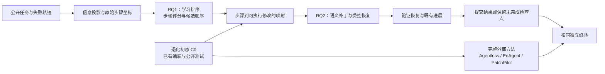

# 文献综述、研究范围与两层基线定稿建议

核验日期：2026年10月12日。本文为独立文献子审计，使用原论文、正式出版页、作者代码与本地已有结果的来源记录。文献覆盖不受会议等级或数量限制；正式主基线仍按项目要求审查正式发表、作者核心实现、本机有效非零与共同协议资格。选定用于研究设计不等于已取得全部运行资格。

## 一、已有研究已解决什么，仍留下什么

智能体的最终成功或失败不能充分说明其执行过程。MAST将多智能体失败分为系统设计、协作失配和验证等类别；Who&When把责任主体与决定性步骤定义为可评价的归因任务。这使“知道任务失败”和“知道应检查哪一步”成为两个问题。TraceElephant进一步说明输入、工具反馈和配置缺失会改变归因判断。因此，本文不能把只含输出的日志当作完整状态，也不能把没有日志证据的关系补成事实。[MAST正式论文](https://papers.nips.cc/paper_files/paper/2025/hash/b1041e52d3be19f0a9bc491657488e4a-Abstract-Datasets_and_Benchmarks_Track.html)、[Who&When正式论文](https://proceedings.mlr.press/v267/zhang25cq.html)、[TraceElephant正式论文](https://aclanthology.org/2026.acl-long.912/)。

诊断方法已有三条不同路径。第一条直接组织大模型的阅读过程：All-at-Once一次分析全日志，Binary Search反复缩小当前区间，SDBL则先按错误模式划范围再定位。它们的差别在于证据组织与搜索策略，并不天然输出完整步骤排序。第二条以训练后的专用模型替代逐次长文本生成。StepFinder将语义编码与时序、角色交互分开，输出逐步骤分数；AgenTracer和Aegis利用受控错误轨迹训练归因能力。第三条引入更多结构或执行证据：FAMAS从多次真实重放的差异构建覆盖谱，DoVer通过真实干预检验假设。三类方法使用的信息与计算资源不同，应分层比较，不能只按同一个“准确率”排行。[SDBL](https://ojs.aaai.org/index.php/AAAI/article/view/40594)、[StepFinder](https://arxiv.org/html/2606.03467v1)、[AgenTracer](https://openreview.net/pdf?id=l05DseqvuD)、[Aegis](https://iclr.cc/virtual/2026/poster/10006419)、[FAMAS源码](https://github.com/geyu00/FAMAS)、[DoVer作者项目](https://aka.ms/DoVer)。

2026年的前沿研究已经明显超出“给每一步打异常分”。FALAT把不依赖轨迹中间推理的任务预期、类型化依赖和候选复核结合；AIG将图作为可回查原文的导航接口；DeFA区分一般事件依赖与真正用于解释失败传播的边。DeFA的同候选集合消融还提示，结构可能通过改变裁决而起作用，而不只是扩大候选数。反过来，这些论文也要求谨慎：大模型生成的边仍可能错误，文字中的反事实修正并未真的运行环境。当前项目的时间、同角色和形状关系可以称多关系特征，但不能自动称语义传播边或已证明因果关系。[FALAT](https://arxiv.org/html/2606.00765v1)、[AIG](https://arxiv.org/html/2608.24361v1)、[DeFA](https://arxiv.org/html/2610.01256v1)。

AgentRx和VerifyMAS强调对约束或错误假设进行证据验证，MASPrism研究只用语言模型预填充阶段信号作排序，最新LiteTrajEval则把证据选择与单次调用的固定预算联系起来。这些工作使本研究必须同时回答：图关系是否提供了额外信息、是否只是增加表示容量、有限预算下是否值得使用。当前应保留内容去除、关系置换、同容量结构及等预算无图控制，而不是只增加一个新模块然后比较总分。[AgentRx](https://arxiv.org/html/2602.02475)、[VerifyMAS](https://arxiv.org/html/2605.17467)、[MASPrism](https://arxiv.org/html/2605.07509v1)、[LiteTrajEval](https://arxiv.org/html/2610.03315)。

诊断有用并不保证干预有用。DoVer发现多个不同干预可能各自挽救同一失败，说明“匹配唯一人工责任步骤”和“找到有效恢复动作”不是同一目标。干预研究还显示，准确的失败预测可能因扰乱原本可成功的过程而降低整体效果。经典回滚恢复研究要求保留状态和撤销状态之间的一致性；在软件智能体中，这转化为对依赖、已有编辑和验证结果的管理。但测试只能约束其覆盖的行为，不能保证所有功能保持。[DoVer](https://aka.ms/DoVer)、[Accurate Failure Prediction…](https://arxiv.org/abs/2602.03338)、[回滚恢复综述](https://www.cs.utexas.edu/~lorenzo/corsi/cs380d/papers/survey.pdf)。

整体软件修复已有非常强的完整方法。Agentless以固定定位、修复、验证流程构成低复杂度对手；EnAgent通过生成、剪枝、工具辅助选择和投票扩大有效搜索；PatchPilot已经研究半正确补丁的迭代细化以及停滞后的重新定位；AOrchestra通过动态子任务和上下文分配组织完整求解。因此，“加反思”“多候选”“测试保护”或“保留部分编辑”均不足以单独构成本研究的新颖性。Graphectory、LivePlan及FailFast-RestartSmart也分别覆盖过程图监测、按需纠偏和编辑保留重启。本文应把差异限定在具体恢复接口、受限预算中的责任排序作用和保护已有可验证进展的机制，并用完整外部系统比较检验，而不是声称这些通用思想首创。[Agentless](https://lingming.cs.illinois.edu/publications/fse2025.pdf)、[EnAgent正式记录](https://conf.researchr.org/details/icse-2026/icse-2026-research-track/233/Agent-Based-Ensemble-Reasoning-for-Repository-Level-Issue-Resolution)、[PatchPilot](https://proceedings.mlr.press/v267/li25cf.html)、[AOrchestra](https://proceedings.mlr.press/v306/ruan26e.html)、[Graphectory](https://doi.org/10.1145/3798271)、[LivePlan](https://arxiv.org/html/2608.06701)、[FailFast-RestartSmart](https://arxiv.org/html/2608.03222v1)。

回滚领域还存在更直接的近邻，必须纳入问题定位。GA-Rollback已于EMNLP 2025正式发表，WebRollback为EACL 2026正式短论文；它们虽不满足项目既有CCF A主基线要求，却不能因此从综述中消失。2026年9月的RIR同时决定何时回退、回到哪里和保留什么知识；AgentRewind联合恢复上下文与受控环境，再将上一尝试的恢复记忆注入恢复后的上下文；DART进一步要求局部恢复不破坏已提交的下游工作；Sherlock把验证、投机执行和选择性回滚放入同一成本问题。本文的差异必须落实为软件任务中的实际排序—补丁生成—验证提交接口，以及效果、费用和回归损害的配对证据。“回滚后保留经验”“依赖安全”或“保持进展”这些一般思想已不足以单独构成新颖性。[GA-Rollback](https://aclanthology.org/2025.emnlp-main.892/)、[WebRollback](https://aclanthology.org/2026.eacl-short.12/)、[RIR](https://arxiv.org/html/2609.18304v3)、[AgentRewind](https://arxiv.org/html/2608.14380)、[DART](https://arxiv.org/html/2605.23311)、[Sherlock](https://arxiv.org/html/2511.00330)。

这些近邻也帮助限定理论解释。RIR只在共享记忆更新空间、相同可见信息、恢复机会与预算记账下证明较大策略类的最优值不低于受限策略类，不保证具体近似选择器一定更好。DART的恢复合法性依赖明确的控制流、接口读写集合和副作用规则；本项目的启发式日志关系与测试结果尚不能继承这种证明。严谨的开题应提出可检验机制和适用前提，并把未建立的保证保留为研究问题。

对软件恢复的定位，还需补入四个直接来源。SyncMind [46]已经将协作代码版本失配、定位、测试恢复和资源约束统一评价；其问题与失败轨迹责任步骤排序不同，但“定位后恢复软件任务”本身已有明确研究。SagaLLM [47]已基于依赖图寻找受影响操作集合，再补偿和重规划；不能把依赖补偿或独立验证单列为首次。BacktrackAgent [48]在GUI环境内用生成、校验、判断与反思实现回退闭环，不能因领域不同而遗漏这一恢复思想。更早的选择性撤销 [49]已经在可逆原语、冲突与语义保持重排的前提下保留不冲突的后续操作；本项目的任意补丁与不完备日志没有自动满足这些前提。四篇的标准书目与稳定编号见《参考文献_编号表》。[SyncMind](https://proceedings.mlr.press/v267/guo25l.html)、[SagaLLM](https://www.vldb.org/pvldb/vol18/p4874-chang.pdf)、[BacktrackAgent](https://aclanthology.org/2025.emnlp-main.212/)、[选择性撤销](https://doi.org/10.1145/143457.143527)。

## 二、明确的研究范围与题目

结合主审已经核实的当前恢复实现，建议正式题目为：

**基于学习排序的智能体失败诊断与软件任务恢复方法研究**

列表式学习排序以对象列表作为训练实例，Cao等的ListNet工作[50]给出了基于列表概率分布的学习框架。当前AB_GLOBAL把每条轨迹的全部候选步骤作为一组，计算组内softmax，并以单一责任步骤标签计算交叉熵，推理时按得分排序。本文采用这种监督的列表式排序视角；当前单标签目标不同于ListNet将相关性判断转换成概率分布的目标，不声称逐项复现ListNet或提出新损失。多关系图是当前评分器的一种实现：节点表示轨迹步骤，多种可观察关系参与表示学习。恢复流程仍须以实际读取排序产物的证据证明RQ1被使用。[ListNet作者原文](https://www.microsoft.com/en-us/research/wp-content/uploads/2016/02/tr-2007-40.pdf)、[多关系图的基础来源](https://doi.org/10.1007/978-3-319-93417-4_38)。

该命名修正已由当前实现决定：Exp248/249已经使用大模型语义补丁恢复，不能继续以“选择性回滚”概括全部方法，也无需等待后续4小时才承认这一事实。回滚可保留为一个受控动作或内部对照。报告正文应明确，RQ1主范围采用软件coding失败日志的事后责任步骤排序；AF是历史开发和运行控制，跨域结论另列。除非另做前缀协议，不称在线故障检测；除非完成真实干预，不把图分数称因果责任概率。

## 三、RQ1：三项主对照与尚缺的合格备选

主对照保留 **StepFinder、All-at-Once、Binary Search**；**当前合格备选尚缺**。这是三种主算法、来自两篇正式论文，StepFinder为2026正式方法。Who&When的 **Step-by-Step（SBS）** 仅列待核候选，与AA/BS同论文；SDBL缺作者核心源码，从当前3+1有效名额移除，仅保留相关工作和明确标注的重建参考。

| 位置 | 方法与所回答问题 | 核心必须保留 | 当前本地证据 | 公平适配及资格边界 |
|---|---|---|---|---|
| 主1 | StepFinder：本文关系建模是否优于强时序语义模型 | 真实编码、BiLSTM、角色注意力/门控、差分、位置偏置、联合损失 | 本地已有非零；Exp136原版本coding363为140/363，后续强SF_REF为148/363，版本分别保留，正式比较不能选弱140替代148 | 同源任务组训练、同编码预算、独立validation选轮；不得沿用作者test选轮并叫确认 |
| 主2 | All-at-Once：结构排序是否值得替代完整语义一次判断 | 完整公共轨迹、原始角色/步骤映射、单次责任输出 | AF历史固定120已有77/120 | 同Flash、无任务答案、固定输出上限；单输出只算Top1/成本 |
| 主3 | Binary Search：顺序结构搜索与全局阅读的差别 | 当前区间日志、上下半区递归、终止到单步 | AF同批历史51/120 | 保留每轮判断；解析失败不能静默挑有利半区；多次调用计总成本 |
| 待核候选，不占备选名额 | Step-by-Step：逐前缀判断的价值与成本 | 累计前缀、逐步判别、首次Yes输出并停止；全No/异常分支保留 | 作者核心与MIT已核；Exp124为NOT_RUN_RESOURCE_GAP、0调用；未核到本机完整非零 | 去除提示中的ground_truth；原步骤ID严格相等评价，不能沿用字符串包含评分；一次完整非零小试前仍不合格 |

历史120题数字用于证明方法已有实际输出和非零表现，不是当前统一版本的最终排名。不同AF权重、同训练条件StepFinder和早期cache之间不能替换成绩。RQ1主终点为源任务组等权严格步骤Top1；原生输出真正排序的方法另报MRR、Top-k覆盖。给单步方法人为追加本文回退次序后得到的MRR不再是原生诊断排名。

SBS作者固定源码版本为b2bae5c5b06d681d04ea5e9b63b7a30525c04925：[核心utils.py第111–185行](https://github.com/mingyin1/Agents_Failure_Attribution/blob/b2bae5c5b06d681d04ea5e9b63b7a30525c04925/Automated_FA/Lib/utils.py#L111-L185)、[入口inference.py第203–210行](https://github.com/mingyin1/Agents_Failure_Attribution/blob/b2bae5c5b06d681d04ea5e9b63b7a30525c04925/Automated_FA/inference.py#L203-L210)。现有Exp124索引记录step_by_step_calls=0；Exp128四项实际是AA、BS、EASD重建、StepFinder，没有SBS。原SBS提示使用ground_truth，原evaluate.py使用字符串包含匹配步骤，两处必须分别进行无答案公共输入适配与严格原步号评价适配，不能冒称原版评分复现。细节见RQ1备选资格核验_SBS与SDBL.json。

后续四小时可把一项已曝光历史开发任务的完整SBS资格小试列为低优先级可选，前提是不挤占核心排序—恢复配对且资源允许。任务选择不依赖方法胜负，完整流程、费用/调用上限和异常处理预先固定；失败或未完整结束仍保留缺口，不能刷题留成功。该建议不等于已运行，也不等于取得新确认集。

若主方法的某个运行版本不满足输入完整性或独立划分，该版本仍保留为历史证据；不得用恒0或未知条件替换强对手。AgenTracer当前不发布8B权重、FAMAS需要真实重放，因此都不是现成的快速替代名额。

## 四、整体：两项已有完整非零证据与待核候选

整体3+1是目标，当前已核完整非零Flash证据的有效方法为 **Agentless、EnAgent**。**PatchPilot**是第三主候选、**AOrchestra**是备选候选，均未取得当前有效名额；不能在开题中写“已完成三个强基线的有效共同比较”。EnAgent正式ICSE 2026论文满足至少一项2026正式方法的设计要求，其非零Flash配置必须保留。

| 位置 | 对照问题 | 完整核心与关键参数来源 | 当前资格及切换条件 |
|---|---|---|---|
| 主1 Agentless | 分阶段求解与本文诊断/保护恢复，哪种在同资源下更有效 | 定位、候选patch、复现测试、回归筛选、投票；作者示例4×10=40patch、40复现样本 | 已有非零完整五题；小预算4/4/4是明确适配，不称论文默认 |
| 主2 EnAgent | 多轨迹集成搜索是否比本文定向恢复更可靠 | coder生成、去重/回归剪枝、工具辅助selector、投票；论文selector30轮 | Flash已有非零完整五题；N2/C24/S30与N3/C200/S30分别报告，不能把变化当纯外部时间效应 |
| 待核第三主候选 PatchPilot | 对半正确补丁的进展细化与本文保护恢复有何不同 | 复现、定位、计划/生成、验证、细化/重新定位；Nmax12、batch4、计划至多3步 | 当前工程/容量删失不算有效强基线；一次完整小试通过且非零后才取得第三主名额 |
| 待核备选候选 AOrchestra | 动态子任务与上下文调度是否能更好处理失败状态 | 主调度器仅delegate/finish，动态子agent工具/任务/上下文；示例子agent50步、主10次尝试 | 已核ICML2026正式和作者核心；无本地非零资格。只有PP未通过、AOrchestra先通过同协议小试才切换 |

切换不得依据“本文输给谁”。切换条件是事前公开的完整核心、环境和信息适用性、资源可承载与非零运行资格。若PatchPilot和AOrchestra都未取得资格，正式设计仍明确，实际比较报告必须写“第三主基线尚缺”，不能以诊断器接本文恢复器补足。

共同协议至少包括同一退化初态C0、同一任务描述和公开日志、同一可见工具与测试权限、同一后端版本、固定内部参数、相同外部资源上限和独立最终验收。每个方法使用自己的候选，不能交叉借用补丁或终验反馈。作者源码示例、论文参数、本地资源部署分别列三栏；内部参数改变后的自然终态与旧版本不是同一次实验的“无预算续跑”。

## 五、问题—方法—数据—评测对应

| 研究层次 | 本文输出 | 外部/内部对照 | 数据与分区 | 主要判断 |
|---|---|---|---|---|
| RQ1 责任步骤诊断 | 原始步骤坐标上的分数、排序和可见关系上下文 | 三项主对照，合格备选尚缺，SBS仅待核；内容去除、关系置换、同容量等内部控制 | 主范围AgenTracer软件coding；拟选部署source3训练coding256+math236、验证64+58；AF为历史开发/运行控制；独立确认集资格仍空缺 | 严格步骤Top1及配对差、真正MRR、候选覆盖、成本；域与角色条件分层 |
| 整体系统效果 | 最终代码状态、保留进展、完整执行轨迹 | Agentless/EnAgent/PatchPilot；AOrchestra备选 | SWE-Gym与OpenHands成功轨迹派生的合格自然退化状态；按issue分组 | 固定预算内恢复、完整运行自然终态、保护测试、费用/token/时间、有效共同配对 |
| RQ2 恢复机制 | 诊断排序到语义补丁、可选受控撤销，再到验证提交 | 同一恢复器换排序、无保护、保留保护而去关系；均属内部控制 | 与整体同一C0和验收条件 | RQ1是否改变真实动作，保护是否防止回退，独占成功是否完整配对且可解释 |
| 未来扩展 | 可替换诊断器、关系构造、候选生成与验证策略 | DeFA/AIG式证据阅读、可执行干预或更多完整系统 | 独立资格后的新源任务/新软件基准 | 仅扩展接口，不提前承诺性能或在看结果后换主协议 |

数据的正式角色详见《数据集清单与许可划分》。需要纠正旧报告把AF的180条保留分区说成未曝光，以及遗漏已经用于Exp134的AgenTracer扩展包。AgenTracer官方TEST在Exp134前已有coding79/math23曝光，Exp135另评coding45/math40，累计coding124/127与math63/63；余3条coding又不在既定2–64步资格范围，因此不能把作者TEST当作现成的新确认空位。这些事实影响训练来源和确认独立性的解释。

早期交叉审阅还核定了两项完整曝光：WhoWhenPro同版本text6257条/2599组已在E32场景C全部用于开发，后续E34/E81/E83/E90/E100继续消费；TraceElephant固定220条、174个task_id组中，217条/172组已评价，另2条用于标签筛查、1条用于适配，E124已确认没有全新run。因此二者只能作为已有开发与辅助跨框架/观测性研究资产，不能再写成现成的新确认池。新版本或全新来源是否有独立池仍未核定；版本名、模态名或重新划分本身都不证明独立性。依据：early/实验01-130_独立探索综述.md的E32场景C及数据清单审计。

## 六、4小时方案应验证的最小主张

最后实验的优先级应由会改变开题判断的问题决定：

1. 现有“一题差距”是否确实出自同一C0、输入、测试和预算；独占成功是否来自完整配对。先零调用重算历史证据，再决定新增实验。
2. 本文保护已有进展的机制是否真实触发，并在同一任务下防止已通过行为退化；否则只能保留为设计而非已验证贡献。
3. 相同效果是否对应更低累计token、调用、成本或更早可验收提交；须计所有失败候选和诊断开销，不能只算最终成功调用。
4. 固定重复规则下，优势或失败是否重现。完整独立运行、从已结算前缀续跑和复用同一响应分别统计。
5. 第三整体基线能否完整运行并非零。资格验证失败意味着名额缺口，不意味着本文胜出。

4小时不适合重新训练大型归因模型、迁移所有新数据或搭建多个新平台。优先修清共同协议、做少量完整且固定规则的重复和机制对照；保留全部负结果。若最终仍无稳定优势，风险版报告成立的贡献应是限定范围内的诊断与恢复设计、真实控制比较、适用条件和失败边界，不写成已经超越强基线。

DeepSeek价格和随机性依据另见《DeepSeek价格与概率性官方核验.json》。截至本次核验，Flash默认启用thinking，temperature在该模式无效，官方Chat请求schema没有seed字段；因此预先设置客户端seed或temperature=0都不能代替概率性验证。

