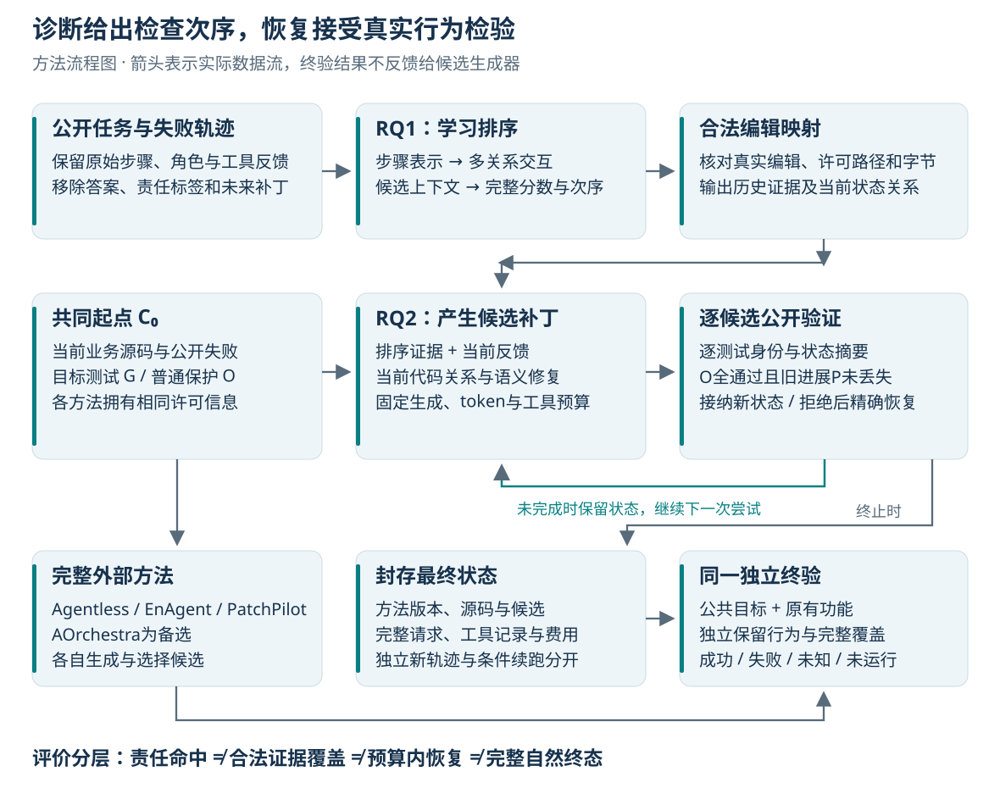
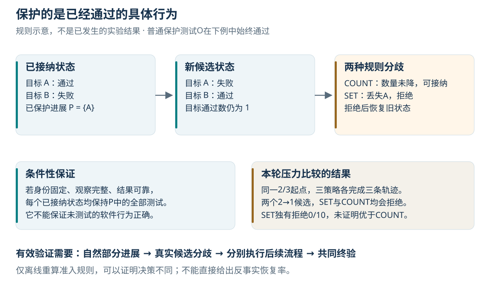
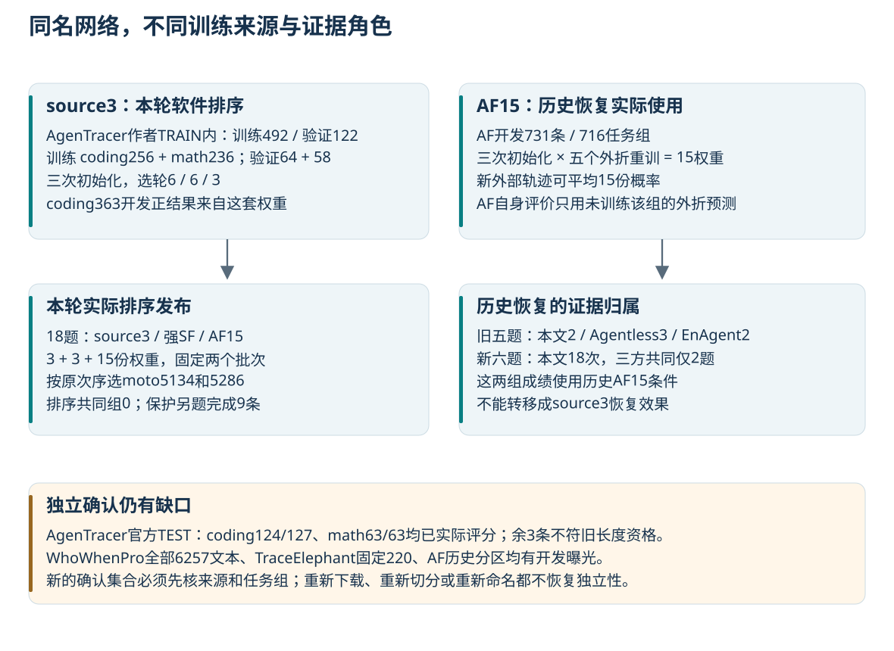
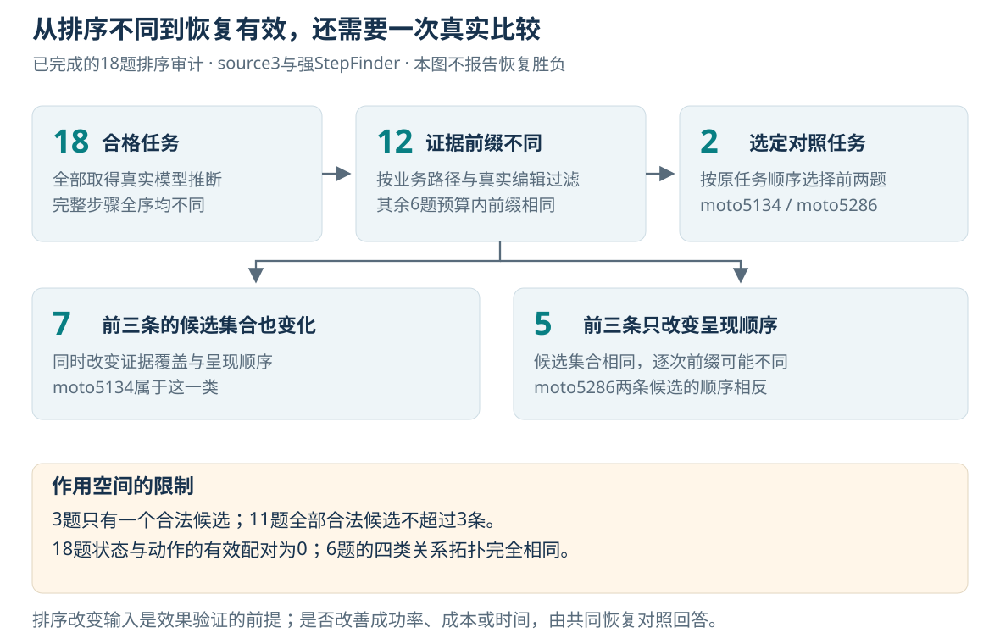
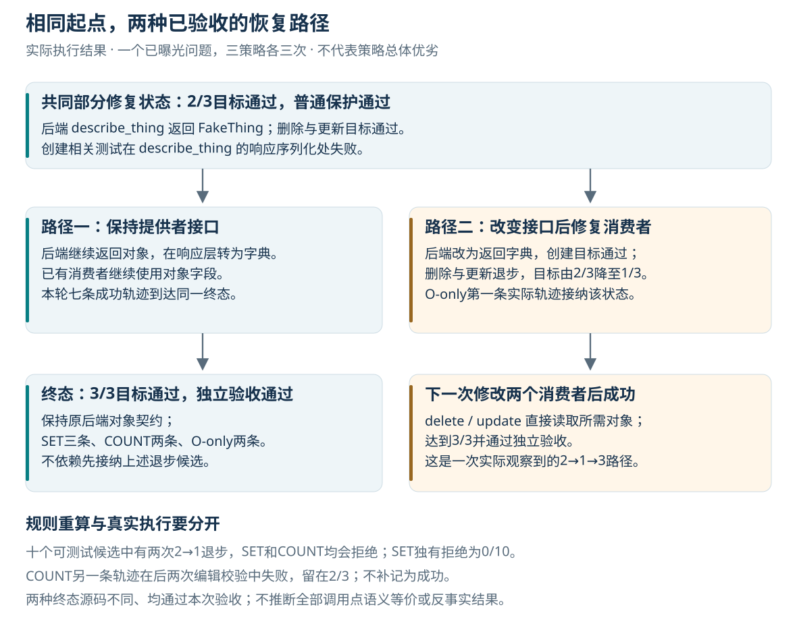

# 基于学习排序的智能体失败诊断与软件任务恢复方法研究

开题报告 V2｜2026年10月12日实验后修订

本研究围绕软件智能体的责任排序及失败后的任务恢复展开。已有软件诊断开发结果支持继续研究；新增18题排序发布和一个真实部分修复状态上的九次完整比较，进一步明确了部署条件与恢复路径。当前仍未证明排序带来独立恢复收益、集合保护优于计数保护，或完整系统超过强外部方法。本稿据此修订研究问题、贡献成立条件、实验安排和失败分析，保留原六章结构。V1、历史结果与本轮原始记录分别保存，术语和图表解释另附。

## 第一章 研究背景与国内外研究现状

### 1.1 研究背景

大语言模型智能体通过读取任务、选择工具、接收反馈和调整行动完成连续任务。软件智能体的工具通常包括代码检索、文件编辑、程序执行与测试。其输出不只是一个文本答案，而是经过多次操作后形成的仓库状态。仓库级软件任务因此需要同时评价问题是否解决以及已有功能是否保持，单次工具返回成功或模型声明完成都不足以表示任务成功。[31,35]

这种工作方式使失败分析具有过程性。智能体可能先误解任务，再在错误假设上修改代码，也可能已经完成部分修复，却在后续编辑中破坏先前成果。最终测试能够暴露未满足的行为，但通常不能直接指出哪一步决策值得优先检查。执行轨迹保存了任务说明、参与角色、模型可见内容、工具动作及其结果，为过程诊断提供了依据。[1,4,32]

本文将失败诊断与任务恢复视为相互连接、需要分别评价的两个问题。失败诊断根据已经发生的轨迹，对值得检查的步骤给出优先次序；任务恢复则从实际失败状态出发，利用这些线索产生修改，并通过执行检查是否恢复目标行为。高诊断准确率并不自动带来高恢复率：责任步骤可能没有可撤销的编辑，正确撤销也可能同时丢失有用修改，而生成式恢复还受到模型能力、当前源码、工具接口和预算影响。现有干预研究已经指出，能够预测失败并不等于能够有效避免失败。[24,27]

软件任务适合研究这一联系，因为代码状态可以保存，修改可以比较，测试可以提供具有身份的行为观察。但是，可执行测试只覆盖部分需求，软件仓库还具有版本、依赖、运行环境和动态调用等复杂性。本文的目标是在这些明确边界内，研究诊断排序如何影响恢复行动，以及恢复过程中能否保持已经验证的进展，而不是把日志分数直接解释为普遍有效的因果结论。

### 1.2 失败诊断研究现状

Who & When将多智能体失败归因明确为责任主体和关键错误步骤的识别问题，并研究一次读取全部日志、逐步检查以及二分搜索等方法。[1] 其中，All-at-Once使用完整轨迹进行一次判断，Binary Search通过多次判断缩小候选区间。这类方法直接利用大模型的文本理解能力，实施门槛较低，但长轨迹输入、重复调用和输出解析会增加成本；其原生输出通常是单个步骤，不能直接与完整排序模型比较所有排序指标。

Scope Delineation Before Localization先依据错误知识划定可疑范围，再结合完整轨迹定位。[2] 这一方向说明，诊断效果不仅取决于模型规模，还取决于证据如何组织。不过，范围构造依赖的权限信息和错误模式必须在任务中实际可见，不能根据角色名称补造权限。当前作者仓库尚缺核心实现，因此正式发表资格与本地复现资格需要分别说明。

StepFinder采用专用的时序语义模型，结合步骤语义、序列关系与角色交互输出逐步骤分数。[3] AgenTracer和Aegis通过生成与标注失败过程扩充监督数据，支持训练可专门用于归因的模型。[5,6] 这条路线具有推断成本较低、能够输出完整次序的特点，但需要严格区分训练、模型选择与最终评价数据。错误注入形成的标签、人工判断的责任标签以及自然运行中的失败原因并不完全等价，模型也可能利用位置或角色分布等捷径。

结构化诊断进一步尝试从扁平日志中组织依赖和传播线索。FALAT使用类型化依赖与候选复核，Adaptive Influence Graphs把图用作可回查原文的导航结构，DeFA区分一般事件依赖和与失败传播有关的关系。[13–15] 这些工作为关系建模提供了具体方向，也提高了证据要求：相邻步骤或同一角色不必具有因果联系，大模型生成的关系也可能出错。仅将若干关系输入图网络，不能宣称已经恢复真实因果图。

另一类工作通过执行或验证补充日志推断。FAMAS从多次真实执行的覆盖差异构建诊断信号，DoVer通过干预检验可疑错误，AgentRx和VerifyMAS强调约束与假设验证。[7,20,21,24] 这些方法使用额外执行资源，不能在隐藏其重放成本的情况下与只读日志排序直接比较。TraceElephant还表明，日志中是否包含输入、工具结果与配置会影响归因，提醒研究者先明确观察边界，再比较方法。[4]

现有研究形成了从语义阅读、专用评分到结构组织和执行验证的连续谱。本文选择学习排序作为主要技术范式：对同一轨迹中的候选步骤共同评分，再根据分数形成检查次序。多关系表示和候选相关上下文是具体实现，而不是用新的名称替代已有范式。其研究价值需要通过强时序模型、完整日志方法以及同容量控制的共同评价体现。

### 1.3 软件恢复与过程纠正研究现状

Agentless以定位、补丁生成、复现测试、回归筛选和投票形成分阶段软件修复流程，说明复杂的自主调度并非获得有效修复的唯一途径。[9] EnAgent通过多条生成轨迹、候选剪枝、工具辅助选择和投票提高仓库级问题解决能力。[10] PatchPilot围绕复现、定位、规划、验证和迭代细化展开，已经涉及半正确补丁的利用与停滞后的重新定位。[11] AOrchestra通过动态创建子任务和分配上下文组织求解。[12] 这些都是需要完整保留核心阶段的外部系统，不能用其简化到失效的部署来证明本文优势。

针对执行过程本身，Graphectory研究过程图分析，LivePlan关注在线监测和按需纠偏，Fail-Fast, Restart-Smart研究失败预警后的重启与编辑保留。[8,25,26] Reflexion等工作也早已使用执行反馈形成后续决策记忆。[36] 因此，增加反思、多生成几个候选、运行测试或保留部分编辑，均不足以单独构成本文的新颖性。

回滚研究提供了更直接的参照。传统回滚恢复讨论检查点、日志和恢复状态的一致性。[34] GA-Rollback和WebRollback已将回退动作用于智能体执行。[44,45] Rollback-Induced Reflection同时选择何时回退、回到何处以及保留哪些经验；AgentRewind联合恢复上下文与受控环境，并将上一尝试的恢复记忆注入恢复后的上下文；DART要求局部恢复满足控制流、依赖及副作用条件，避免破坏已提交的下游工作。[39,40,43] 这些近邻意味着，“依赖安全”或“保护进展”本身已不是尚无人研究的概念。

软件状态恢复还包括协作信息失配和操作补偿。SyncMind研究智能体没有及时获得协作者更新时的恢复，SagaLLM根据依赖组织最小受影响操作的补偿与重做，BacktrackAgent在图形界面中结合验证、判断和反思修订动作。[46–48] 更早的选择性撤销研究已经讨论保留后续操作及处理冲突，其性质依赖应用提供的逆操作、冲突判断和重排规则。[49] 本文的启发式关系与反向差异尚不具备这些完整语义接口，因此不能直接继承其保证。

相关理论也有明确前提。例如，扩大允许选择的恢复策略集合，只能说明理想最优值不会降低，不能保证具体近似策略的表现。基于显式有限状态机、读写契约和副作用规则的恢复合法性，也不能直接外推到启发式日志图和有限测试。本文将这些工作作为方法设计与边界分析的依据，不继承尚未满足前提的理论保证。

### 1.4 研究问题的具体位置

现有工作留下的可研究问题在于诊断和实际恢复之间的接口。日志诊断给出历史步骤，而软件恢复面对的是已被多次修改的当前代码。如何把历史步骤映射为仍然有用的编辑证据，如何把当前测试现象与代码关系相连，以及如何判断新候选可以替换已接受状态，都需要具体实现与实证验证。

本文据此聚焦两个问题。第一，在软件相关失败轨迹中，可观察的步骤关系与候选相关上下文能否在相同监督和信息条件下改善责任步骤排序。第二，将排序用作恢复证据的呈现顺序后，是否能在相同预算下提高真实恢复效率，并减少对已验证行为的损害。整体方法还必须与完整的软件修复系统比较，不能仅凭内部模块对照宣称具有竞争力。

当前实现已经使用模型生成语义补丁，并通过测试决定状态准入，因此题目采用“软件任务恢复”，不再以“选择性回滚”概括全部方法。受控撤销仍可作为一种恢复动作与内部对照。主研究范围限定于软件相关轨迹和仓库问题，其他任务域用于考察边界；未经前缀协议验证的完整轨迹诊断不称在线检测。

## 第二章 研究目标、理论基础与研究意义

### 2.1 研究目标与问题分解

本研究拟建立一套从失败轨迹到可执行恢复的系统方法，使诊断结果能够被实际恢复过程使用，并以可复核实验判断其收益与局限。第一个研究问题记为RQ1，即研究问题一：步骤关系和候选相关上下文能否改善软件失败轨迹中的责任排序。第二个研究问题记为RQ2，即研究问题二：排序引导和可验证进展保护能否改善软件任务恢复。整体恢复比较用于检验完整系统的实际价值，RQ2中的模块控制则解释效果来自何处，二者共同构成恢复侧评价。

| 研究问题 | 输入与输出 | 主要比较 | 可支持结论的证据 |
|---|---|---|---|
| RQ1责任排序 | 公开失败轨迹→原始步骤坐标上的分数与次序 | StepFinder、All-at-Once、Binary Search；结构和内容控制 | 同任务组划分、同信息条件下的严格步骤命中与配对差 |
| 整体恢复效果 | 同一失败仓库状态→最终代码与执行记录 | Agentless、EnAgent、PatchPilot；AOrchestra备选 | 相同任务、信息、模型与资源下的完整共同配对 |
| RQ2机制作用 | 相同恢复器中的排序、上下文与准入策略 | 替换排序、等预算证据、集合/计数/普通测试保护 | 真正改变行动的排序差异、进展丢失事件及其对终态的影响 |

研究不预设所有域都会获益，也不预设所有模块必然叠加提升。若真实对照未显示增益，仍需要给出可复现的负结果与适用条件，但不能把这种分析写成已经完成性能突破。

### 2.2 失败归因与学习排序

将一条失败轨迹表示为τ=(x₁,…,x_T)，其中每个x_t包含可见文本、角色、动作及反馈。责任标签y标记数据定义的关键错误步骤。它是监督目标，不等同于对环境中唯一原因的证明。不同数据集若分别标注最早关键错误、最终决定性错误或注入位置，应分开评价，不能直接混合为同一标签。

同一原始问题可能产生多条轨迹或多个注错版本，本文将这些记录归为同一任务组。数据划分时整组分配，统计时先在组内汇总，避免几乎相同的问题同时进入训练与评价，或因重复记录较多而获得额外权重。

排序器为每步计算分数s_t，并在同一轨迹内转为概率p_t=exp(s_t)/Σ_j exp(s_j)。训练使用责任步骤的负对数概率，即L(τ)=−log p_y。该目标对同一候选列表共同归一化，属于列表式学习排序的一种实现。[50] 本文研究输入表示、关系交互和上下文构造，不声称提出新的通用排序损失。

步骤准确率考察排名第一是否为标注步骤；平均倒数排名（Mean Reciprocal Rank，MRR）考察正确步骤名次的倒数；Top-k覆盖考察正确步骤是否进入前k个候选。三者关注不同用途。仅输出单个步骤的方法采用其原生Top1和调用成本；如果人为追加一个回退次序，该次序应视为新的恢复策略，不能冒称原方法的完整排序。

### 2.3 关系表示与候选相关上下文

多关系图以轨迹步骤为节点，以可从公开记录确认的关系为边。当前实现包括时间相邻、同角色相邻出现、相同完整事件形状以及相同非空动作形状的相邻出现。关系消息通过不同变换与门控汇入节点，再由节点相关权重组合。多关系建模的基础在于不同边类型可以携带不同含义，但是否有用仍须由关系置换、重复关系和同容量控制判断。[33]

同一段上下文对不同候选的意义可能不同。例如，后续测试失败对一次修改相关接口的动作具有较强提示，对一次无关文件读取的提示可能较弱。因此，候选相关上下文让每个步骤按自身表示从同轨迹其他步骤读取信息，而不是让所有候选共享一个不变的平均向量。它使用完整轨迹，适用于事后诊断；若未来扩展到在线场景，则必须重新限制只能读取当前时刻之前的信息。

关系边和注意力权重是模型计算中组织信息的方式。即使移除某类关系后性能下降，也只能首先说明它在相应训练与数据条件下有预测价值；进一步的因果解释需要可控干预与替代解释排除。当前实验尚未证明全局候选上下文优于全部静态和局部控制，因此该部分在开题中作为待检验机制提出。

### 2.4 软件状态、恢复动作与保护条件

恢复过程以当前失败仓库状态C₀为起点。公开目标测试集合G刻画要恢复的行为；普通保护测试集合O刻画初态中已经通过、后续应保持的行为。另有独立保留测试用于最终验收，其内容和结果不返回候选生成器。候选通过公开测试只是继续或提交的依据，最终成功仍需符合统一验收条件。

这里的公开是指协议允许提供测试身份与执行反馈，不表示所有测试正文可以任意读取。当前环境按共同规则遮罩部分目标和保留测试源码，模型只接收事前允许的公开输出。各方法采用同一边界，不能通过后续错误输出之外的私有源码获得额外答案。

设P_t是截至第t次接纳后已通过并要求保留的目标测试身份集合。候选C′可被接纳的条件为：O全部通过，且P_t中的每个测试在C′上仍通过。接纳后P_(t+1)=P_t∪Pass_G(C′)。候选被拒时，恢复到接纳前的精确源码快照。这个规则不要求每次都产生新进展，但禁止用新通过的其他测试抵消已通过测试的退步。

在测试身份稳定、观察完整且结果可靠的前提下，P_t随已接纳状态单调不减。这是规则自身的条件性性质，不是全部程序行为正确的证明。测试可能不充分，严格保护也可能妨碍需要暂时退步的修复路径。论文将同时观察最终恢复、候选拒绝、保护损害与执行代价，而非仅展示规则形式。

### 2.5 研究意义与预期产出

理论层面的意义是明确区分三个对象：日志中的责任步骤、可以执行的恢复动作和最终任务行为。通过这一分解，可以避免用更高诊断分数替代恢复收益，也可以检验关系表示、证据次序和状态保护各自发挥作用的条件。

实践层面的意义是形成可替换、可继续运行的恢复接口。诊断器输出带原始坐标的分数与证据，编辑映射器校验历史字节与当前状态，候选生成器产生修改，验证器返回逐测试观察，状态管理器决定接纳和保存。这些接口使未来可以替换诊断模型、关系构造或生成后端，同时保留共同输入、成本和验收记录。预期产出包括方法实现、数据和曝光清单、完整比较、失败分析与可复核报告；性能提升是否成立由实验决定。

## 第三章 研究内容与方法

### 3.1 总体技术路线

系统先将原始日志投影为模型允许看到的公开内容，保留原始步骤编号，再生成逐步骤表示和关系。RQ1排序器输出完整候选次序。恢复侧从这个次序中识别具有真实编辑证据、字节完整且路径允许的步骤，将其映射到当前代码。候选生成器结合历史修改、当前源码、当前公开失败反馈和代码关系产生补丁；补丁在独立状态中执行验证，由保护规则决定是否接纳。结束时封存最终状态，再执行独立终验。

图3-1中的独立终验位于候选生成循环之外。诊断标签用于训练和离线评价，不能随运行任务的公开轨迹一并交给恢复器。完整外部方法从相同初态和许可信息出发，使用各自的生成与选择过程，最终接受同一验收。

### 3.2 轨迹表示与责任排序器

每个步骤的公开content、action和thought字段按固定格式编码。现有实现使用Qwen3-Embedding-0.6B的固定版本，取末端标记表示的前128维作为内容特征；角色按轨迹内首次出现顺序匿名化，编码取32维；另提取23维公开结构特征，形成183维输入。匿名化用于减少特定角色名称的捷径，但不能消除角色顺序与责任位置之间的数据偏差。

内容和角色向量分别进行L2归一化，即缩放到欧氏长度为1；结构特征只使用训练侧统计量标准化，再截断到预先设定范围。

映射前的状态—动作残差模块利用一种明确的日志配对：“状态”是带过去经验、工具状态、当前计划等明确分栏的调用前决策上下文，“动作”是紧接的同一角色思考或输出记录。只有原始步骤编号相邻、角色相同且格式标记符合条件时才建立配对；这是观察到的日志结构线索，不是已证明的因果依赖。残差模块将配对内容计算出的修正量加回原输入，并由有效标记控制。无法确认配对时严格保持原表示。本轮18题软件日志均无此类有效配对，配对残差因而保持恒等。这限制了该模块在这批恢复输入上的作用空间。配对处理后，将特征映射到96维，经两层多关系消息交互形成步骤表示。

候选相关上下文采用同轨迹注意力，为每个候选获得不同的全局证据汇总。评分头联合当前表示、初始表示、候选上下文及其差异，产生一个分数。现有GLOBAL模型共337457个可训练参数，静态参考模型300593个，StepFinder参考实现277633个。参数量差异提示，需要同容量对照才能区分结构设计与额外容量的影响。

训练使用带权重衰减的AdamW优化器，初始学习率0.001，批量16个完整任务组，梯度范数截断1。现有本文模型权重衰减0.0001，隐藏层dropout为0.15，即训练时随机屏蔽15%的相应活动，以减少过拟合；最多40轮、验证集连续8轮未改善停止。模型选择先比较验证Top1，再比较MRR，仍相同取最早轮。来自同一源问题的多条记录先在组内取平均损失，再使任务组等权，避免一个问题因重复轨迹较多而获得更高权重。完整数值参数与代码版本另附，后续如修改训练数据范围或规则，作为新条件报告。

当前需要分清两套同名结构的权重。软件诊断开发正结果来自三份source3模型，它们在AgenTracer作者训练集中的492条记录上训练，以122条选轮，包含coding与math两域；三次初始化分别选择第6、6、3轮。恢复系统历史上实际使用的是AF15，来自AFTraj-2K数据集（下文简称AF）。它将源任务组分为五份，每次保留一份作外侧评价，用其余四份在内部选轮后重训；三次初始化共得到15份权重。两套模型结构相同，但训练来源和用途不同，不能互换成绩。历史恢复结果属于AF15条件，本轮source3部署及其下游结果需要单独报告。

本轮已经完成source3在18个合格软件任务上的新推断，并通过实际HTTP请求核定它进入了恢复器。三份模型的逐步骤softmax概率等权平均，不按目标集表现挑选单个初始化。强StepFinder采用原验证规则选择的ALG50条件，三份权重选轮为23、14、20；它保留原始内容特征及作者网络内部处理，本文则沿用独立归一化和各checkpoint自己的结构标准化参数。两者的输入处理差异属于方法定义，不能为形式上的一致而改写对手。

推断按原任务顺序组成16题和2题两个批次，填充长度分别为36和20。StepFinder的位置偏置依赖批次填充长度，因此批次成员、顺序及填充规则也属于部署版本。AF15在相同新批次重新推断，保留为历史模型和迁移参照。新的模型接入可以被验证，却不自动表明恢复收益已经成立。

### 3.3 从历史步骤到当前编辑证据

排序器输出的是历史步骤，恢复器必须先判断它是否提供合法编辑线索。无编辑的读取、旧字节缺失、路径越界或无法对应当前任务的步骤不能直接成为可执行撤销。系统保留完整步骤排序，同时另外输出合法编辑候选及其映射理由，以区分诊断层准确性和动作层可用性。

对每个合法候选，恢复输入包含历史前后差异、当前文件内容及二者的版本关系。历史旧文本不作为当前替换锚点。当前源码和反馈通过文件摘要绑定；摘要是由文件内容计算的标识，用于核对所引用的字节版本。模型需要根据当前状态产生补丁。该设计来自已有失败：部分尝试反复引用当前已不存在的旧片段，另一些尝试修改的应用程序接口（Application Programming Interface，API）与公开失败所涉及的接口不一致。把当前状态明确呈现给模型是通用接口修正，但其效果仍需在同版本、同预算对照中检验。

编辑单元还必须避免跨越不相关结构。最近本地实验显示，一个唯一匹配的49行片段可以从函数体中部开始，跨过多个函数定义；若模型只返回其中一个函数，就会删除其他定义并留下无效结构。唯一字节匹配不能代替编辑语义正确性。后续拟让候选片段遵守函数、类或完整语法单元边界，并在执行测试前检查语法和实际改动；这种改进应独立记录，不能将此前负例改写为成功。

### 3.4 当前反馈与代码关系上下文

恢复关系侧从当前源码提取可观察的函数、类、属性写入、属性读取、调用及导入线索，以当前失败位置和候选涉及符号为起点寻找可能的提供者与消费者。能够精确匹配的属性联系与只凭名称推测的引用分开记录。动态分派、反射和别名可能使静态联系不完整，解析失败也必须保留，不能无声当作没有依赖。

模型读取的上下文由排序选中的历史线索、当前反馈所指位置以及关系相关代码共同组成。为区分增加信息量和组织信息的效果，实验需要设置相同token预算的无关系上下文、非相邻关系控制及去关系配置。token是模型分词器处理的基本文本单元，不等同于一个汉字或一个英文词。后续恢复中每增加一次生成，同时会增加采样机会、反馈和可能的新状态，因此“第二次成功”不能直接归因于增加了一个关系或一条证据。

现有版本必须分别说明：早期配置最多使用前三条合法编辑；实验247曾单独扩展到全部合法编辑；随后实验248加入当前反馈绑定，实验249实际沿用其最多3次生成和前三条合法编辑参数。方法名中的“完整”表示创新模块和流程保留，不表示已经遍历全部编辑。新主控制先沿用当前3次部署，可在公开目标与普通保护全部已知通过时停止；完整池与当前反馈的合并属于另一个需要单列的新版本。试验使用相同调用及输出预算的控制，检查证据次序是否改变首次可验收提交的位置，而不是依靠额外尝试数量形成表面增益。

### 3.5 候选验证与进展保护

每次候选先应用到独立副本，记录修改前后摘要和实际差异，再运行约定公开观察。未收集测试、进程中断或结果未知不能转写为失败或通过。普通保护全部通过且既有进展身份集合未丢失时，候选可以成为下一次尝试的当前状态；否则恢复到之前快照。最终选择在已接纳候选中按照预先规定的目标失败数量、改动规模和尝试顺序确定。

图3-2给出机制的逻辑差异：如果已有目标A通过，候选使A失败而使B通过，总通过数可以不变，计数规则仍可能接纳，而身份集合规则会拒绝。该图是规则解释，不是已发生的实验结果。原18个合格C₀的目标初始均失败；多项测试也经常同时从全部失败转为全部通过，因此这些原始运行未提供集合规则独有收益的自然事件。本轮另从历史真实轨迹中恢复两项目标已通过的部分状态，单独检验有既有进展时的策略行为。

本轮已经比较三种明确策略：只要求普通保护通过（O-only）；额外要求目标通过数量不减少（COUNT）；额外要求每个既有通过目标继续通过（SET）。三者采用相同任务、部分修复初态、排序器、生成后端和预算，各完成三条新轨迹。对于同一已观测候选的规则重算，只能说明准入决策是否不同；其后是否成功仍需实际执行。第六章报告全部九条终态，并区分规则作用、生成变异和补丁校验的影响。

### 3.6 运行记录与可继续执行

每条运行保存方法版本、任务与重复编号、当前源码、完整模型消息、工具观察、候选与投票、内部剩余步数、累计时间和资源。付费请求保存发送前意图、真实响应和费用回执；已结算响应可精确复用，发送状态未知的请求不自动重发。继续执行保留原始开始时间，不能把已使用预算归零。

这些记录既支持工程恢复，也服务于研究解释。一次完整新轨迹、从已结算前缀继续的条件运行和复用同一响应的重新验收是不同观察，不能都计作独立重复。框架预留排序器、关系提取器、候选生成器和验证器的替换接口，但每次主比较使用明确版本，避免在看到逐题结果后不断更换配置。

## 第四章 关键问题与拟创新点

### 4.1 关键问题：监督标签与恢复目标是否一致

责任标注提供了明确的训练目标，却不保证对应唯一有效修复点。一个失败可能通过修改不同位置而恢复，同一责任位置也可能因缺少编辑字节而不能直接执行。本文因此同时保留原始步骤排序、合法编辑次序和最终恢复结果三个层次，分别测量责任命中、预算内可用证据覆盖及实际修复，避免把一个层次的改善替代另一个层次的证据。

已有实验说明这一问题并非形式区分。在固定撤销候选池的12题比较中，本文、随机顺序和All-at-Once均恢复11题；部分任务只有一个合法候选，较大预算又覆盖了全部候选。此时排序可能仍改变尝试次序，却很难改变最终恢复率。本轮进一步在18个合格任务上审计新排序：完整步骤次序全部不同，过滤后只有12题的前三条合法证据仍不同，其中7题改变候选集合，5题仅改变呈现次序。仍有3题只有一个合法候选，11题的完整候选池不超过3条。这些结果确认了部分任务存在干预机会，也说明不能把步骤排序不同直接当作恢复输入不同。

早期34个受控任务还提供了更直接的反证：责任全序恢复14题，完全不读取RQ1的恢复后验恢复23题，强制保留责任第一名再使用后验只恢复22题。这说明恢复选择可以从当前状态与动作效果中获得比责任名次更直接的信息。该固定候选后验不能直接充当当前语义生成器的成绩，但后续必须设置不读取诊断分数、充分使用当前公开反馈的强控制，不能只与逆序或随机顺序比较。

### 4.2 关键问题：如何排除位置、容量与数据曝光的替代解释

编码、关系交互和全局上下文都可能改善预测，但增加参数、轨迹长度差异或责任位置先验也能形成表面正差。已有math开发集合中，简单位置规则与GLOBAL模型同为109/155；coding上的一种重复时间关系控制也达到相同186/363。这些结果要求保留无内容、位置规则、重复关系、关系置换和同容量等控制，不能只比较最弱的内部参考。

本轮完整18条软件输入进一步确认了关系信息重合。全部轨迹只有一个匿名角色；时间相邻与同角色相邻的邻接在18题上完全一致，两种形状关系的邻接也在18题上完全一致。其中6题的四条关系拓扑全部相同，其余12题实际只有两种不同拓扑。不同通道仍有独立变换与门控，邻接相同不等于模型计算相同；但这批材料不能支持四类独立结构信息分别产生增益的主张。后续需要与相同邻接上的等容量多通道控制比较，区分结构信息、额外容量与语义表示的作用。

数据独立性同样是关键问题。训练集没有出现某个任务，不代表该任务没有参与后续方法选择。当前coding363和coding170已用于多轮结构及参数探索，AgenTracer官方coding/math测试集也在既往实验中大面积使用。它们可用于研发和稳健性分析，但不能重新称为当前最终方法的全新确认集。正式确认需要先完成任务组级曝光审计，再确定独立来源；如果无法满足，就必须保留开发研究的结论范围。

注错数据还可能包含与生成方式有关的文字线索。既有审计在coding363中的218题发现`attacked_solution.py`等显式标记，其首次出现均早于责任标签位置，因此它不是直接读取即可命中的单一答案；但这也不能证明模型没有利用相关分布。后续需要以事前规定的标记遮罩和位置控制考察这种影响，并说明向不含这些注错痕迹的真实软件日志迁移时的限制。

### 4.3 关键问题：恢复状态和进展保护的可识别性

原18个合格初态中，已通过目标集合P₀均为空，普通保护测试O仍存在。前期本文的18条完成轨迹中，多目标任务均由首个接纳候选直接达到全部通过，没有集合规则拒绝而计数规则会接纳的候选。这些成功因此不能证明按身份保护进展的独有收益。

本轮从moto7081的真实历史部分修复状态开始，在当前环境重新确认三个目标中的两个通过。三种保护策略各完成三条新轨迹，共产生十个可原生验证候选。其中两个在普通保护仍通过时使目标通过数由2降至1：SET和COUNT都会拒绝，O-only会接纳。实际O-only轨迹曾接纳这一退步，随后修复消费者并成功。它说明严格非退步约束会排除某些实际可恢复的中间状态，但不能证明若换用其他策略，后续生成仍完全相同。

集合与计数真正分歧的条件是丢失某个旧通过目标，同时补好其他目标且总数量不下降。本轮十个候选中，这类“SET拒绝、COUNT接纳”事件为零。因此，本轮已取得目标保留约束与普通保护的行为证据，仍没有集合相对计数的独有收益证据。SET和O-only均为3/3成功，COUNT为2/3；样本只来自一个已曝光问题，且首次候选在执行保护前已出现生成差异，不能将这一成功数差异归因于保护策略。

研究重点由“是否实现了保护规则”进一步转向“保护了什么状态、排除了哪条路径、失败由哪个环节造成”。需要分别记录已接纳状态、正在测试的候选和被拒绝状态的源码身份，分析候选生成、编辑校验、准入决策及后续恢复之间的关系。

### 4.4 拟研究的贡献及其成立条件

第一，研究面向软件失败轨迹的关系与候选上下文排序方法。贡献对象是公开步骤表示、关系组合与候选上下文的具体设计及其在强对照下的效果，而不是一般意义上的图网络或交叉熵损失。成立条件是在独立任务组与相匹配训练条件下具有稳定正差，并通过控制实验排除位置与额外容量的主要解释。当前coding开发正结果为继续研究提供依据，跨域负结果和机制控制不足同时保留。

第二，研究将责任排序转换为当前软件状态可用证据的恢复接口。该接口显式区分历史编辑和当前代码，把当前公开反馈、可观察代码关系、合法编辑边界及候选次序结合。成立条件是排序或关系真正改变了恢复过程，并在相同生成与工具预算下改善恢复或成本。当前只能确认端到端接入和部分可行性，不能把后续单题修好直接写成普遍增益。

第三，研究按测试身份保持已验证进展的候选准入策略及其适用边界。依赖一致性、补偿和保留进展已有大量先行研究，本文不主张这些通用思想首创。可能形成的贡献是，在生成式软件修复中给出具体、可执行的状态准入规则，记录其真实触发，并比较其收益、额外代价及可能阻断的路径。若无区分事件或无效果，应将其作为受检验的设计与负结果，而非独立性能贡献。

| 拟贡献 | 当前证据 | 仍需补足 |
|---|---|---|
| 软件责任排序 | coding开发集合相对匹配强参考有正差；多次初始化与划分已有结果 | 独立确认、全局上下文的特有收益、同容量与位置控制 |
| 排序到当前恢复的接口 | 新软件权重已完成18题推断并进入实际请求；12题预算内证据不同 | 完整共同配对、动作与终态差异、端到端成本 |
| 可验证进展保护 | 一个真实部分状态上完成九条轨迹；两次目标退步；存在退步后成功路径 | 集合相对计数的自然区分事件、独立问题及路径代价 |
| 完整系统比较 | 两个外部方法已有非零完整结果 | 第三个合格外部方法、完整共同重复及独立任务 |

### 4.5 风险与备选研究路径

若诊断在软件域保持正差而下游没有增益，首先检查排序过滤后是否等价、候选是否饱和及生成是否真正读取证据；不能直接增加尝试次数后把成功归因于排序。若关系模块未优于等量上下文，则保留简单表示作为有效对照，讨论结构为何未产生预期收益。本轮保护规则确已触发，但集合相对计数没有独有分歧，因而暂将其作为有条件的执行约束；后续是否提升为独立性能贡献取决于自然事件和共同结果。

若第三整体基线在当前资源中无法取得完整非零资格，报告应明确实际只有两个有效外部系统。备选AOrchestra也需经过同样资格核验，不能仅因PatchPilot困难就自动获得名额。若本地小模型连续产生格式或语义失败，这只限定该部署；后端更换须形成独立条件，不能将不同模型的结果拼接。

本轮补充验证加强了模型部署、部分状态恢复和失败机制的论述，没有改变整体超过强基线尚未成立的判断。研究主线保留软件责任排序与排序到当前恢复的接口，进展保护暂作为可检验的执行约束。新的方法假设需独立验证，不能用离线源码推演或一条成功路径补足性能贡献。

## 第五章 数据来源与实验设计

### 5.1 数据来源、版本与角色

本文将数据来源、作者原始分区和本项目实际用途分别登记。原始规模不等于可训练或可执行规模；官方测试集也不自动等于本项目未使用集合。下表列出主数据与相关扩展来源，详细版本摘要、许可和历史用途见数据附件。

图5-1强调source3和AF15使用不同训练数据。source3本轮已有18题新推断及实际恢复请求；历史AF15的恢复成功仍不能转移成source3的效果，新的下游成绩需要使用本轮共同分母。

| 数据来源 | 核定规模或当前子集 | 本研究用途与边界 |
|---|---|---|
| AgenTracer data-v1.0.0 | 共3998条；agentic训练1500/测试600，coding1141/127，math567/63 | 软件coding为RQ1主范围；当前source3训练492、验证122来自作者TRAIN，含code+math；coding363/170均属开发证据 |
| AFTraj-2K（本文简称AF） | 2276条：safe1162、unsafe1114；本项目公开开发731条/716任务组 | 历史多域诊断开发及AF15恢复控制；固定120和180/168分区已曝光，不称新确认 |
| Who & When | 固定版本184个记录，含126个自动生成与58个人工构建记录 | 早期归因参考及方法复现；作者标签定义与输入许可单独记录 |
| Who & When Pro | 当前公开总10784条，其中文本6257；论文与旧版本规模不同 | 全6257文本已用于早期开发，没有同版本现成新确认空位 |
| TraceElephant | 380次执行，220条标注失败，覆盖3个框架 | 固定220全部有历史曝光；可做观测性与标签边界辅助分析，不能当新确认 |
| Aegis | 9533条的公开扩展来源 | 后续候选；本轮不下载或新增标签评价 |
| SWE-Gym及OpenHands轨迹 | SWE-Gym训练问题2438；固定OpenHands成功轨迹来源491条 | 软件恢复状态的来源；当前本地来源23个issue、计划21、合格18，不等于整个benchmark |
| SWE-bench | 标准集2294，Lite300及开发23，Verified500 | 后续来源候选，需先排除历史问题曝光；本轮未完成其新环境与共同实验 |
| SyncBench / SyncMind | 原始24332、过滤8461，论文评价300（Caller/Callee各150） | 软件协作失配恢复的相关来源；只列后续候选，不当作已取得独立资格的数据或完整修复算法 |

source3的492条训练由coding256和math236构成，122条验证由coding64和math58构成。两部分在记录和源任务组上均无交叉。coding363来自作者训练分片中的项目留出集合，后续已经用于多轮结构和参数探索。早期结果保留各自的原始协议与选择记录，但当前应承认该集合的开发属性。

对官方TEST的历史审计发现，早期清单中的coding79和math23均可与实际评分回执对应，分别来自实验132的多阶段评价及实验134的64题确认；随后实验135又评价不重叠的coding45与math40。实际已评分合计coding124/127和math63/63，不只是预留名单；剩余3条coding因公开长度不在原2–64步范围而被排除。因此，当前没有可直接宣称为新确认集的官方coding/math空位。agentic测试域也不能替代软件主确认，更不能掩盖该域已有负迁移结果。

AF15在AF自身的评价必须使用折外预测（out-of-fold prediction，OOF），即每条记录只由未将该任务组用于拟合的外折模型产生评价分数。15份模型全部平均适合新的外部轨迹推断，却不能在AF上称为OOF，因为每条AF记录参与了其中12份模型的训练。对这一区别的处理直接影响数据独立性。

其他归因数据也不能因规模较大而自动视为新数据。Who & When Pro的6257条文本、2599个任务组已进入早期场景C开发；TraceElephant固定220条已有217条评价、2条标签筛查和1条适配记录。新确认需要另行核定新来源或确实未曝光的任务组，不能把这些原版本重新分区后恢复其独立性。

数据输入只保留方法事前允许的公开字段，答案、责任标签、注错元数据及独立验收信息不进入恢复请求。当前检查可以证明若干记录ID和规范化任务文本不相同，但不能据此排除语义近重复或模型预训练污染。许可不明确的数据不重新分发，发布清单和处理脚本时保留来源与访问边界。

软件来源也需要相同审计。SWE-bench Verified中的django10880、10999和11265已在早期实验使用，不能因为转用Verified名称就重新视为独立任务。未来从这些来源选择新问题时，应排除项目历史使用的问题及其同源组，再核仓库版本、可执行环境与统一验收资格。

### 5.2 RQ1基线及统一条件

RQ1选用StepFinder、All-at-Once和Binary Search三种主算法，Step-by-Step作为待资格验证的备选候选。前者为KDD 2026正式方法，其余提示策略同出ICML 2025的Who & When，因此不能写成多个独立研究团队或三篇主文献。SDBL虽已在AAAI 2026正式发表，但当前作者仓库缺核心源码，退出当前基线名额；已有本地论文重建结果保留为相关参考。

| 方法 | 保留的核心 | 当前证据与正式使用条件 |
|---|---|---|
| StepFinder | 语义编码、时序网络、角色交互、差分和位置偏置、联合损失 | 已有非零结果；与本文匹配源训练和验证，保留强参考，不用弱版本替代 |
| All-at-Once | 完整公开轨迹一次判断责任步骤 | 历史AF120命中77；无答案提示、原始角色和步骤映射一致 |
| Binary Search | 对当前区间反复判断并递归到单步 | 历史AF120命中51；记录所有调用、解析与终止规则 |
| Step-by-Step（备选候选） | 逐前缀判断，首次肯定后停止 | 本轮2题完整检查4和5个前缀，九次均明确否定、无步骤输出；有效非零资格仍缺 |

训练型方法采用相同任务组划分、文本编码与模型选择人口，各自保留原方法核心损失和事前设定的参数搜索范围。提示型方法统一生成后端和公开信息，其多轮调用全部计费。历史120题数字用于说明已有实际输出，不与新版本、新数据的分数直接组成排名。

Step-by-Step的原始提示包含任务答案，作者评分也不是严格的整数步号相等。本轮去除答案，保留累计前缀和首次肯定停止，在固定历史AF清单的首两个合法任务上完整运行，未按标签挑题。九次响应均为非空明确否定，没有输出责任步骤；未读取责任标签，Top1和MRR均未计算。该结果证明这两次流程已运行完毕，却没有取得有效非零定位资格，不能用恒无输出配置证明本文优势。三主一备仍是选型设计，合格备选尚缺。

主要终点为按源任务组等权的严格步骤Top1。原生排序模型另报MRR与Top-k覆盖。使用问题级配对差与置信区间，若预先同时检验多个主比较则采用明确的多重比较校正。结构控制和域外分析与主要假设分开报告。任务中的多个轨迹、多个角色或生成重复不当作彼此独立的问题。

### 5.3 完整恢复基线及共同协议

完整恢复主基线选定Agentless、EnAgent和PatchPilot，备选AOrchestra，分别覆盖分阶段修复、多轨迹集成、反馈细化与动态协作。发表、公开核心、本地完整执行、有效非零和共同条件是不同资格，逐项核验。EnAgent为ICSE 2026正式方法，满足至少保留一项2026正式强方法的设计要求。

当前Agentless与EnAgent已有非零完整Flash结果。PatchPilot的旧候选槽位问题在本轮得到机械修复，但其完整测试集合收集仍未通过资格；备选AOrchestra也受当前Windows运行守卫问题影响，未进入完整付费小试。两者都没有取得本地完整非零资格。因此，本稿给出三主一备的明确设计，同时保留第三个实际有效外部名额尚缺的事实。将StepFinder接入本文恢复器属于内部排序控制，不占完整外部方法名额。

共同协议包括同一问题与初态C₀、相同任务描述和公开失败轨迹、相同业务源码及工具许可、同一生成后端与参数、相同外部资源上限和最终验收。方法使用自己的候选，不读取另一方法的补丁或独立终验反馈。对手的论文设置、作者源码示例及本地适配分别记录。

Agentless的作者示例使用4组细定位、每组10个补丁及40个复现样本；历史有限预算部署使用4补丁和4复现样本，阶段仍完整，但不能称论文默认数量。EnAgent历史部署为2条生成轨迹、每条24步、选择最多30轮；后续完整参数组为3条轨迹、每条200步、选择30轮。内部参数改变意味着新的实验条件，不能把两者差异解释为只延长外部时间。PatchPilot保留复现、定位、规划、验证、细化和重新定位，并以最多12样本、批量4的明确条件核验。

模型生成只使用现有DeepSeek Flash或已有本地模型。正式比较不混合两个后端的成绩。DeepSeek官方接口没有确认随机种子seed字段可保证可复现，思考模式下温度设置也不构成确定性保证，因而必须保存实际请求并进行事先规定的完整重复。当前六题协议实际关闭了思考模式，不能把官方默认模式当作其运行条件。本轮每个重复内三种保护策略的首请求完全相同，前两组却各产生两种不同编辑方案；候选差异出现在保护规则执行之前。实际seed字段和temperature=0没有固定输出，不能将这九条新轨迹进一步假定为已证明独立同分布的抽样。

### 5.4 评价端点、缺失结果与统计单位

固定预算评价在每题30分钟、128次调用、131072输出token等明确上限内观察是否交付通过验收的状态。超时或工程中断导致未交付时，计入预算内未成功，同时保留具体原因。另一端点在方法内部参数不变的条件下观察自然终态；财务、未知费用或全局窗口截断只能标记为未观测完成，不能写成方法自然失败。

每个任务槽区分成功、正常失败、预算截断、工程未知和未运行。主表同时报告计划任务数、具备资格任务数和实际完整共同配对数。比较完整运行成功率时只使用明确共同分母，并展示缺失分布；如按固定预算交付评价，也保留截断原因。不得把未知和未运行填为零后进行自然终态排名。

主要恢复指标为统一验收成功率，同时报告公共目标恢复、普通保护、独立保留行为、首次可验收提交时间、输入输出token、调用、原生执行及完整成本。诊断编码和推断开销单独列出，并同时给出是否包含缓存的端到端口径。所有失败候选和工程调用都计入物理成本，不只计算最后一次成功生成。

概率性验证以问题为独立单位，每种方法每题事先规定三条完整新轨迹，报告全部结果及问题级平均。三个重复不能把六个issue变成18个独立issue。若预算不足，保留同一预设顺序中的未完成槽，不追成功追加初始化，也不根据前几题胜负换题。

### 5.5 模块实验与机制机会

排序实验先计算全步骤、合法编辑和预算内证据前缀三个层次的差异。本轮已完成18题的三个层次审计，图5-2给出差异收缩过程。若两个排序在过滤后相同，或合法池只有一个候选，该任务不能识别排序的干预效果。主排序与强StepFinder使用同一恢复器和资源；另设不读诊断分数、以当前公开失败和代码关系取证的强无诊断控制，检验当前反馈是否已经足够。反向次序和固定随机次序作为辅助控制。这种条件选择只支持机制开发分析，不能冒充总体恢复率。

图5-2中，18题都取得新模型推断，12题保留前三条合法证据差异；按原顺序选中的两个问题具有不同作用条件。moto5134的source3前三编辑编号为24、26、16，StepFinder为26、24、20，第三次尝试会改变覆盖集合；moto5286只有13、14两条合法编辑，两种模型仅交换顺序，第三次生成也不会增加第三条历史编辑。该选择不使用恢复胜负，但只构成有干预机会的条件性开发小集。

关系实验控制呈现文本量、当前失败反馈和生成次数。进展保护实验优先查看自然多目标任务是否出现部分进展，记录每个候选的逐目标向量及规则分歧。对相同候选离线重算保护规则可以验证实现和机会，但没有重新执行后续分支时不估计其反事实成功率。

前期固定五题中的moto6387适合解释证据范围与额外尝试的混杂：旧前三次失败，完整合法池版本精确复用旧前缀后第四次成功。新的配对验证必须让控制也获得相同生成机会，并分别记录证据、反馈和状态变化。mypy15155与moto5516的当前反馈修正同理，只能作为已曝光开发题的机制验证。

### 5.6 本轮四小时验证协议

本轮验证从北京时间2026年10月12日19:29:05开始，至23:29:05截止，准备、接口核验和实际运行共同计入四小时。旧窗口与旧结果持续保留。本轮没有重新训练排序器、下载新模型或新增责任标签，而是验证已有软件权重的部署及其与恢复过程的连接。

排序发布使用原计划中的18个合格任务，source3、强StepFinder与AF15采用固定批次。恢复控制按原顺序选择前两个具有至少两条合法编辑且前三证据前缀不同的任务，即moto5134与moto5286。每题设置source3、强StepFinder和无诊断三种条件，各计划三条完整新轨迹；按完整组推进，并随重复轮换条件顺序。无诊断条件保留当前反馈、合法源码读取、代码关系与SET保护，历史编辑按原时间顺序取证，不读责任分数或排序计划。

保护压力场景从moto7081历史真实部分修复状态开始。当前环境重新验证后，两项既有目标通过，另一项失败，普通保护通过；P₀按当前实际通过的测试身份确定。SET、COUNT与仅普通保护三种策略各计划三条轨迹，排序统一source3，其余恢复参数保持一致。该状态已经曝光，结果单列为压力验证，不并入原18题初态的总体恢复率。

第三整体基线先核PatchPilot完整流程的运行资格，未通过后转向AOrchestra。原始源码、阶段和内部参数保留，完整运行资格与实际非零分别判断。准备阶段的测试收集、导入及工具执行用于发现运行障碍，不计为完整算法修复结果。

此外，诊断备选SBS使用另一个历史AF集合中的固定首两个合法样本检查完整逐前缀流程；它们不增加软件任务数。

本轮启动余额为2.87元，旧费用未知请求的完整预留0.533734元保持不变。最初将1.00元分配给排序及保护控制，1.25元分配给第三基线；两条第三路线未取得资格且模型费用为零后，在下一未启动组之前将本轮2.25元总上限重新分配给共同控制，已产生费用继续累计。原首组的截断单列，新的资源条件不回写旧结果。每次请求仍需覆盖完整峰值预留，余额不足不删输入、不降低方法内部参数，也不新增充值。所有实验在截止前停止，23:29:27完成窗口关闭及费用核对。已经结束的四小时是执行窗口，不表示所有计划槽均取得完整结果。

## 第六章 研究基础与进度安排

### 6.1 已有研究基础

项目已完成多轮诊断和恢复探索，形成原始请求、模型权重、数据划分、候选修改、逐测试结果、费用回执和继续执行记录。本次独立审阅覆盖实验01至256的现存目录、重要分支和归档；编号缺失、未运行和被暂停项目单列，不把编号数量当作独立科学实验次数。早期138个目录、实验131的73个阶段条目以及后续整体比较已分别建立索引。

诊断侧，早期在弱参考上出现的约10%差异不能作为胜过强基线的证据。在共同731条记录、716任务组上，强语义StepFinder适配的任务组MRR为0.8458，旧匿名结构A+B为0.4961，差区间完全为负。该比较同时包含表示差异，支持补足语义并保留强参考，不能解释为某个网络结构单独胜出。早期加入语义与关系后曾改善旧表示，但后续完整六条件、三次初始化比较没有确认当时新增分配与比较模块的独立增量。

现有source3模型在已曝光coding363上命中186/363，匹配参考148/363，构成新的模型条件下开发正差。多次初始化和不同划分中coding方向大体为正，但预设的双组稳定性门有一组未达到5个百分点；agentic迁移则多次弱于StepFinder。这些结果支持软件范围的进一步验证，不支持跨域普适优势。

当前AF15研究发布已核对152个文件引用和摘要，训练拆分在任务组层面无交叉，六题发布分数与原来源概率一致。固定五题中11个实际生成请求也与排序证据链匹配。这证明恢复确实读取了所声明的历史排序，不证明该排序是成功原因。本轮18题的状态与动作配对标记均为空，相应残差模块保持恒等；关系邻接重合也已经逐题登记。因此，已有软件恢复成功不能作为这些具体结构机制分别有效的证据。

### 6.2 已有整体结果与解释

固定五题的完整自然终态为本文2/5、Agentless3/5、EnAgent2/5；固定30分钟交付分别为2/5、3/5、0/5。共同问题及最终成功状态如下。

| 任务 | 本文 | Agentless | EnAgent |
|---|---:|---:|---:|
| moto5406 | 成功 | 成功 | 失败 |
| moto6387 | 失败 | 成功 | 成功 |
| moto5980 | 成功 | 成功 | 成功 |
| mypy15155 | 失败 | 失败 | 失败 |
| moto5516 | 失败 | 失败 | 失败 |

本文相对Agentless没有独占成功，后者在moto6387独占一题；相对EnAgent，双方各有一题独占。599份复制证据已与清单摘要重新核对，结果与原始方法输出和终验一致。该比较仍是已有曝光任务、小样本和资源适配下的描述性结果，不能证明普遍优越。

这组材料的进一步限制是，本文旧运行是在结果已有后核共同条件并纳入比较；排序与编码使用已有缓存，未包含在下面的生成费用中；不同方法的最终测试调用存在分开执行与合并执行的组织差异。因此，现有核对支持共同任务上结果的描述，不能替代下一轮同一执行入口、完整端到端成本与事前确定方法条件的比较。

固定五题的本文11次结算响应费用上界合计0.08259416元，Agentless80次为0.61191626元，EnAgent含续跑410次为2.95378092元；额外Agentless工程分支13次费用0.14682732元另列，EnAgent还保留了错位分支的真实物理费用。本文旧结果文件中的费用零值是汇总字段缺失，不能当作免费。本文成本较低而成功数也较少，不能从这张表直接得出同等效果下更省钱。

后来moto6387通过扩展合法证据与增加第四次尝试得到一次开发成功，mypy15155和moto5516通过当前反馈绑定各两次生成得到成功。这些版本和预算不同，三项成功不能与旧结果拼成新的5/5。

后续六题采用每题三次运行。本文18条全部成功，但Agentless仅首条两题完成、EnAgent仅首条四题完成；三方首条完整共同配对只有两题，均成功，三方都完成三次重复的题数为零。其他槽包含未运行、磁盘中断和费用未知，因此不能据本文18次完成推断其超过外部方法。

### 6.3 四小时补充验证的实际结果

本轮完成排序部署和一个部分修复状态上的完整保护比较。排序恢复的共同终态及第三整体基线仍未取得，分别保留工程未知和未运行状态。

| 项目 | 实际结果 | 解释范围 |
|---|---|---|
| 18题排序发布 | 21份权重、42个前向批次，保存378份模型与任务输出；12题前三合法证据不同 | 新排序已进入恢复请求；未读取新标签，不代表准确率或恢复率提高 |
| 排序恢复对照 | 原2题×3条件×3重复共18个计划槽；5条付费轨迹、6次结算请求，完整共同自然终态组0 | 候选和失败前缀真实存在，原生测试均未取得已知结果，不能排名 |
| 进展保护比较 | 1个已曝光问题，3策略×3重复共9个已知自然端点；8条成功均通过一次独立验收 | 取得3个完整观测比较组，其中2组全部策略成功；不增加独立问题数 |
| 第三整体基线 | PatchPilot与AOrchestra均未取得完整原生资格，模型请求0 | 实际有效第三名额仍缺，不能计作算法零分 |
| SBS诊断备选 | 2题全部4与5个前缀均明确否定，没有步骤输出 | 流程完成但有效非零资格未获得，Top1与MRR未计算 |

新排序等权集成的独立复核最大误差小于1.2×10⁻¹⁶。AF15在18题上的完整次序与旧公开保存预测全部相同，最大概率差小于1.1×10⁻⁷。322个步骤文本均未超过8192分词上限，公开文本、步骤和角色映射与既有编码精确匹配，因此复用原编码。本次CPU发布总时间16.641秒，模型加载与前向合计约0.563秒；前期文本编码不包含在这个计时内，不能据此声称完整端到端推断只需该时间。

排序对照中的moto5134产生五条付费轨迹。首次source3响应格式解析失败，强StepFinder响应可解析但搜索片段不能唯一匹配；第二次重复的三个条件均生成并应用合法候选。三个候选的完整Python抽象语法树（AST，即忽略注释等表面差异后的代码结构）相同，均引入哨兵对象区分“不存在的键”和“值为null的键”，并调整exists判断。历史证据不同尚未使这三个候选的可执行结构分化。不过，其原生测试接口在一次机械修订后仍失败，没有取得测试结论，不能因此称三者同样成功或同样失败。moto5286的完整首请求峰值预留超过当时可用控制预算，整组保持未运行。

保护比较从重新验证的2/3目标通过状态出发。每种策略保留三次预定新轨迹，所有已知终态如下。

| 策略 | 重复1 | 重复2 | 重复3 | 预算内及自然终态成功 |
|---|---|---|---|---|
| SET身份集合保护 | 成功 | 成功 | 成功 | 3/3 |
| COUNT数量保护 | 成功 | 正常失败 | 成功 | 2/3 |
| O-only普通保护 | 成功 | 成功 | 成功 | 3/3 |

八次成功全部通过一次独立验收，且在各自包含准备、等待和终验的原30分钟内完成。COUNT第二次重复留在原来的2/3目标通过状态：首候选被拒，后两次补丁在应用前被校验器拒绝，没有运行相应候选测试。九条轨迹形成三个完整观测组，但只有一个已曝光问题，因此不进行面向问题总体的显著性判断。

十二次模型生成产生十个可原生检查候选，其中两次普通保护通过、目标却由2/3退至1/3。按同候选规则重算，SET和COUNT均会拒绝，O-only均会接纳；实际O-only第一条轨迹接纳其中一个，随后修复至3/3并通过终验。十个候选中，SET拒绝而COUNT接纳为0/10，未显示身份集合相对计数的独有作用。

图6-1区分实际执行和同候选规则重算。八次成功包含两种终态源码：七条保持后端返回对象，只在响应层序列化；一条O-only轨迹改为后端返回字典，再修复两个依赖对象字段的消费者。两个相关文件的AST不同，两种终态都通过本次验收；这不等于全部调用点上的语义等价。

同一重复内三个策略的完整首请求逐字一致，但前两组各出现两种补丁，第三组补丁相同、响应文字仍不同。此时准入规则尚未执行，故首候选差异不能归因于保护策略，3/3与2/3的差异也不能直接解释为SET提高恢复率。

本轮27次新请求全部结算，依据实际usage核算的费用上界合计0.45924094元，其中排序对照0.21202918元、保护比较0.24134996元、SBS为0.00586180元。第三整体基线模型费用为零。旧未知请求完整预留0.533734元未释放或重发；关闭时余额查询为2.41元，余额差额不作为逐请求账单证据。首组source3与StepFinder的输入缓存命中率分别约0.20%和86.59%，因此不同实际费用不能直接用作方法成本优势。

### 6.4 失败分析与下一版方法假设

失败应按发生环节解释。缺少共同配对或候选差异属于研究设计问题；完整生成后没有可用修改属于该部署下的模型与候选处理结果；测试未启动属于执行接口问题；费用和时间截止属于资源删失。这些情况的处置不同，不能统一归为算法无效。

排序对照的原生中断有明确接口原因：同一个全局目录变量同时承载运行输出边界和身份辅助脚本的位置。首次修订修复了前一种用途，后一种随后仍指向错误路径并产生文件不存在异常。已结算响应和合法候选均保留。后续应先分离这两种路径职责、验证完整原生入口，再重新登记新的共同实验；继续生成更多补丁不能补足本轮缺失的测试结论。

保护比较的COUNT负例进一步揭示了候选处理问题。后两条响应均正常以stop结束且为完整合法JSON，每条包含一个old与new完全相同的恒等编辑，当前校验器因此拒绝整份补丁；每条另一个编辑并非恒等。模型理由还将此前已拒绝的字典候选描述成当前已接纳版本，虽然请求已提供当前源码、拒绝标记，第三次请求也包含上次校验错误。失败不能归于输出截断或反馈缺失，更具体的问题是模型如何辨认当前状态及校验器如何处理局部无改动。

对这两条响应仅作内存中的源码重建发现：所有搜索片段均唯一匹配真实当前版本，忽略恒等编辑后，其余修改得到的完整业务源码与本轮另一条已验收成功的终态逐字一致。因此，整份补丁拒绝是这两次已有修复内容没有被应用的直接障碍。该检查没有改变解析器、物化新候选或执行新测试，COUNT的实际成绩仍为2/3。它支持下一版检验“先核对路径与匹配，再记录并忽略恒等编辑”，不能补记两次成功或把COUNT改成3/3。

临时退步路径则给出另一条具体线索。原后端describe_thing返回FakeThing对象，删除与更新函数依赖它的字段。一个候选把返回值改为字典，恢复了序列化目标，却使这两个消费者退步；O-only接受该状态后，在下一次生成中修复消费者并完成任务。七条其他成功轨迹保持原对象契约，在响应层调用to_dict完成序列化。这说明提供者与消费者关系应落实为候选引起的接口变化和受影响调用者检查，而不只是增加关系说明文本。

据此保留以下尚未实施的研究假设，并在未来新版本中分别验证。

| 方法假设 | 针对的实际问题 | 所需验证 |
|---|---|---|
| 明确当前已接纳状态、候选和拒绝反馈的源码身份，并提供逐编辑校验错误 | 生成理由混淆已拒绝版本；恒等编辑使整补丁被拒 | 与现行输入和校验规则同预算比较，检查有效编辑应用率及完整终态 |
| 保留当前已验证状态，同时在独立分支探索可撤销的临时退步 | 本轮存在2→1→3的成功路径；严格保护可能阻断该中间状态 | 不增加总生成与工具预算，比较实际分支、进展损害与恢复成本 |
| 对接口变更检查相关消费者是否一并修复 | 返回对象改为字典，破坏依赖对象字段的调用者 | 与相同文本量的现行关系上下文比较，记录契约变更与遗漏调用点 |

这些假设与分支搜索、事务恢复及依赖安全已有研究相接，不能仅以提出设计作为创新完成。[11,34,39,43,47] 下一步应先验证可执行性和实际差异，再决定是否保留为正式贡献；本轮报告不将其写成已实现的新方法。

第三基线方面，PatchPilot四条规划之一缺少格式标记，旧解析器只形成三组候选，后续却读取四个槽。本轮保留失败槽及跨轮对应关系，在115.25秒机械修复后通过该项检查；完整测试收集仍受标记和文件句柄识别问题阻断。AOrchestra修正资格脚本的元数据访问错误后，生成pytest又遇到Windows设备路径问题。两者均未进行本轮完整模型小试，不能作为算法失败对照。

历史本地模型负例也保留：完整上下文PatchPilot由65K扩至131K后，同一轨迹的下一请求仍需要154010输入token；本文另有两条完整新轨迹和一条条件续跑失败，涉及跨越多个函数的编辑和无改动补丁。它们分别限定容量、接口和模型条件，不能拼接为一个统一方法的重复结果。

本次审阅还在核对归档和依赖后清理了已退出主线的派生缓存及两个暂停的冗余工作树，D盘实测可用空间增加约3.28GB。配置、结果、必要权重、已付响应、未知费用和仍有恢复价值的材料均保留。该清理改善了执行条件，不改变此前因磁盘中断的科学结果。

### 6.5 进度安排与阶段产物

独立审阅、V1、四小时小试和本次V2修订已经完成。后续工作按实际依赖安排如下。

| 阶段 | 主要工作 | 完成标志 |
|---|---|---|
| 执行接口与方法小试 | 先修复排序对照的完整原生入口，再分别验证状态表达、恒等编辑处理、分支和接口检查 | 完整执行资格；统一预算下真实共同终态，不回写本轮成绩 |
| 方法与数据整理 | 核定独立任务组、标签定义与许可，确定主训练和评价条件 | 可复用清单、可运行模型、明确主终点与比较人群 |
| 正式比较 | 在可承载资源下补齐完整系统、固定重复和机制控制 | 同任务共同配对、问题级统计和全部负结果 |
| 论文与复现 | 整理方法、理论条件、实验及失败案例，复核图表与出处 | 完整论文、复现入口、版本和材料目录 |

后续阶段的具体日程需结合学校提交日期与可用资源安排，不以虚构日期替代现实约束。每阶段保留原版材料，方法修订产生新版本和新结果，旧分母、失败及未完成记录持续可查。

### 6.6 当前结论与后续研究边界

当前可以确认，软件方向source3排序已完成18题推断并实际进入恢复请求，部分任务具有改变证据次序或覆盖集合的机会；在一个已曝光的真实部分修复状态上，当前恢复器可完成八条经独立验收的成功轨迹，且观察到两种不同修复路径。已有软件诊断开发正差继续为研究提供依据。

当前仍不能确认排序提高恢复率、集合保护相对计数具有独有收益，或完整方法超过强整体基线。排序控制没有完整共同自然终态组，九条保护轨迹只涉及一个问题，第三个有效整体基线和独立诊断确认数据仍有缺口。这些限制决定了目前贡献应表述为待检验的方法设计、部署证据和具体失败机制，不能表述为已完成普遍性能提升。

后续优先取得可执行的共同排序比较，再在同一预算内检验状态表达、编辑校验和接口关系的改进；独立数据及第三基线资格同时补齐。若完整比较仍无增益，则收缩对应性能主张，保留负结果和适用条件。研究问题由真实运行回答，实施完成和窗口结束均不代替效果证明。

## 参考文献

[1] Shaokun Zhang; Ming Yin; Jieyu Zhang; Jiale Liu; Zhiguang Han; Jingyang Zhang; Beibin Li; Chi Wang; Huazheng Wang; Yiran Chen; Qingyun Wu. Which Agent Causes Task Failures and When? On Automated Failure Attribution of LLM Multi-Agent Systems[C]. Proceedings of the 42nd International Conference on Machine Learning. Proceedings of Machine Learning Research, 2025, 267: 76583–76599. [正式发表记录/来源](https://proceedings.mlr.press/v267/zhang25cq.html).

[2] Kai Sun; Wenqiang Li; Bo Dong; Yuxin Lin; Jingyao Zhang; Bin Shi. Scope Delineation Before Localization: A Two-Stage Framework for Enhancing Failure Attribution in Multi-Agent Systems[C]. Proceedings of the AAAI Conference on Artificial Intelligence, 2026, 40(39): 33108–33116. DOI: [10.1609/aaai.v40i39.40594](https://doi.org/10.1609/aaai.v40i39.40594). [正式发表记录/来源](https://ojs.aaai.org/index.php/AAAI/article/view/40594).

[3] Taiyu Zhu; Yifan Wu; Weilin Jin; Ying Li; Gang Huang. StepFinder: A Temporal Semantic Framework for Failure Attribution in Multi-Agent Systems[C]. Proceedings of the 32nd ACM SIGKDD Conference on Knowledge Discovery and Data Mining V.2. ACM, 2026: 6946–6957. DOI: [10.1145/3770855.3817991](https://doi.org/10.1145/3770855.3817991). [正式发表记录/来源](https://doi.org/10.1145/3770855.3817991).

[4] Mengzhuo Chen; Junjie Wang; Fangwen Mu; Yawen Wang; Zhe Liu; Huanxiang Feng; Qing Wang. Seeing the Whole Elephant: A Benchmark for Failure Attribution in LLM-based Multi-Agent Systems[C]. Proceedings of the 2026 Annual Meeting of the Association for Computational Linguistics, Volume 1: Long Papers. Association for Computational Linguistics, 2026: 19888–19905. DOI: [10.18653/v1/2026.acl-long.912](https://doi.org/10.18653/v1/2026.acl-long.912). [正式发表记录/来源](https://aclanthology.org/2026.acl-long.912/).

[5] Fanqi Kong; Ruijie Zhang; Huaxiao Yin; Guibin Zhang; Xiaofei Zhang; Ziang Chen; Zhaowei Zhang; Xiaoyuan Zhang; Song-Chun Zhu; Xue Feng. Aegis: Automated Error Generation and Attribution for Multi-Agent Systems[C]. International Conference on Learning Representations, 2026. [正式发表记录/来源](https://iclr.cc/virtual/2026/poster/10006419).

[6] Guibin Zhang; Junhao Wang; Junjie Chen; Wangchunshu Zhou; Kun Wang; Shuicheng Yan. AgenTracer: Who Is Inducing Failure in the LLM Agentic Systems?[C]. International Conference on Learning Representations, 2026. [正式发表记录/来源](https://openreview.net/forum?id=l05DseqvuD).

[7] Yu Ge; Linna Xie; Zhong Li; Yu Pei; Tian Zhang. Spectrum-Based Failure Attribution for Multi-agent Systems[J]. Proceedings of the ACM on Software Engineering, 2026, 3(FSE): 1888–1909. DOI: [10.1145/3797113](https://doi.org/10.1145/3797113). [正式发表记录/来源](https://doi.org/10.1145/3797113).

[8] Shuyang Liu; Yang Chen; Rahul Krishna; Saurabh Sinha; Jatin Ganhotra; Reyhaneh Jabbarvand. Process-Centric Analysis of Agentic Software Systems[J]. Proceedings of the ACM on Programming Languages, 2026, 10(OOPSLA1): 1961–1988. DOI: [10.1145/3798271](https://doi.org/10.1145/3798271). [正式发表记录/来源](https://doi.org/10.1145/3798271).

[9] Chunqiu Steven Xia; Yinlin Deng; Soren Dunn; Lingming Zhang. Demystifying LLM-Based Software Engineering Agents[J]. Proceedings of the ACM on Software Engineering, 2025, 2(FSE): 801–824. DOI: [10.1145/3715754](https://doi.org/10.1145/3715754). [正式发表记录/来源](https://doi.org/10.1145/3715754).

[10] Zhao Tian; Pengfei Gao; Junjie Chen; Chao Peng. Agent-Based Ensemble Reasoning for Repository-Level Issue Resolution[C]. Proceedings of the 2026 IEEE/ACM 48th International Conference on Software Engineering. ACM, 2026: 1406–1418. DOI: [10.1145/3744916.3787761](https://doi.org/10.1145/3744916.3787761). [正式发表记录/来源](https://conf.researchr.org/details/icse-2026/icse-2026-research-track/233/Agent-Based-Ensemble-Reasoning-for-Repository-Level-Issue-Resolution).

[11] Hongwei Li; Yuheng Tang; Shiqi Wang; Wenbo Guo. PatchPilot: A Cost-Efficient Software Engineering Agent with Early Attempts on Formal Verification[C]. Proceedings of the 42nd International Conference on Machine Learning. Proceedings of Machine Learning Research, 2025, 267: 35922–35941. [正式发表记录/来源](https://proceedings.mlr.press/v267/li25cf.html).

[12] Jianhao Ruan; Zhihao Xu; Yiran Peng; Fashen Ren; Zhaoyang Yu; Xinbing Liang; Jinyu Xiang; Yongru Chen; Bang Liu; Chenglin Wu; Yuyu Luo; Jiayi Zhang. AOrchestra: Automating Sub-Agent Creation for Agentic Orchestration[C]. Proceedings of the 43rd International Conference on Machine Learning. Proceedings of Machine Learning Research, 2026, 306: 106017–106040. [正式发表记录/来源](https://proceedings.mlr.press/v306/ruan26e.html).

[13] Bo Deng; Xinlei Zheng; Yi Wei; Kang Zhou; Chongyang Tao; Renzhao Liang; Xuanren Chen; Lifan Guo; Chi Zhang. DeFA: Dependency-Guided Failure Attribution for LLM Agents[EB/OL]. arXiv:2610.01256, 2026. [2026-10-12]. [原始预印本](https://arxiv.org/abs/2610.01256).

[14] Yarden Bakish; Amir Dudai; Roy Ganz; Oren Nuriel; Elad Ben Avraham; Mor Shpigel Nacson; Ron Litman. Adaptive Influence Graphs for Failure Attribution in Multi-Agent Systems[EB/OL]. arXiv:2608.24361, 2026. [2026-10-12]. [原始预印本](https://arxiv.org/abs/2608.24361).

[15] Md Nakhla Rafi; Md Ahasanuzzaman; Dong Jae Kim; Zhijie Wang; Tse-Hsun Chen. FALAT: Tracing Failures in LLM Agent Trajectories via Dependency-Guided Search[EB/OL]. arXiv:2606.00765, 2026. [2026-10-12]. [原始预印本](https://arxiv.org/abs/2606.00765).

[16] Alva West; Yixuan Weng; Minjun Zhu; Zhen Lin; Zhiyuan Ning; Yue Zhang. Abduct, Act, Predict: Scaffolding Causal Inference for Automated Failure Attribution in Multi-Agent Systems[EB/OL]. arXiv:2509.10401, 2025. [2026-10-12]. [原始预印本](https://arxiv.org/abs/2509.10401).

[17] Zehao Wang; Lanjun Wang; Shilong Jin; Junjie Chen; Yanghua Xiao. DCFA: Dual-view Causal-inspired Attribution for Failure Reasoning in LLM-based Multi-agent Systems[EB/OL]. arXiv:2609.04749, 2026. [2026-10-12]. [原始预印本](https://arxiv.org/abs/2609.04749).

[18] Yang Liu; Hongjiang Feng; Junsong Pu; Zhuangbin Chen. MASPrism: Lightweight Failure Attribution for Multi-Agent Systems Using Prefill-Stage Signals[EB/OL]. arXiv:2605.07509, 2026. [2026-10-12]. [原始预印本](https://arxiv.org/abs/2605.07509).

[19] Yawen Wang; Wenjie Wu; Junjie Wang; Qing Wang. From Flat Logs to Causal Graphs: Hierarchical Failure Attribution for LLM-based Multi-Agent Systems[EB/OL]. arXiv:2602.23701, 2026. [2026-10-12]. [原始预印本](https://arxiv.org/abs/2602.23701).

[20] Shraddha Barke; Arnav Goyal; Alind Khare; Avaljot Singh; Suman Nath; Chetan Bansal. AgentRx: Diagnosing AI Agent Failures from Execution Trajectories[EB/OL]. arXiv:2602.02475, 2026. [2026-10-12]. [原始预印本](https://arxiv.org/abs/2602.02475).

[21] Hezhe Qiao; Hanghang Tong; Ee-Peng Lim; Bing Liu; Guansong Pang. VerifyMAS: Hypothesis Verification for Failure Attribution in LLM Multi-Agent Systems[EB/OL]. arXiv:2605.17467, 2026. [2026-10-12]. [原始预印本](https://arxiv.org/abs/2605.17467).

[22] Linh-An Phan; MingXue Wang; Guangyu Wu; Feng Pan; Zhaoyu Pang; Yanbin Zhang. Lightweight, Rubric-Guided Trajectory Evaluation for Production AI Agents[EB/OL]. arXiv:2610.03315, 2026. [2026-10-12]. [原始预印本](https://arxiv.org/abs/2610.03315).

[23] Jiayi Zhang; Zexin Wang; Degang Sun; Changhua Pei; Fei Sun; Gaogang Xie; Jingjing Li. Detect Before You Attribute: Cascade Failure Attribution for Multi-Agent Systems[EB/OL]. arXiv:2608.29646, 2026. [2026-10-12]. [原始预印本](https://arxiv.org/abs/2608.29646).

[24] Ming Ma; Jue Zhang; Fangkai Yang; Yu Kang; Qingwei Lin; Saravan Rajmohan; Dongmei Zhang. DoVer: Intervention-Driven Auto Debugging for LLM Multi-Agent Systems[C]. International Conference on Learning Representations, 2026. [正式发表记录/来源](https://openreview.net/forum?id=mrEK16Jy6h).

[25] Chenyu Wang; Yunbo Lyu; Junda He; Zhou Yang; Chenxing Zhong; Yaniv Harel; David Lo. Fail-Fast, Restart-Smart: Early Failure Prediction and Restart for SWE Agentic Tasks[EB/OL]. arXiv:2608.03222, 2026. [2026-10-12]. [原始预印本](https://arxiv.org/abs/2608.03222).

[26] Shuyang Liu; Saman Dehghan; Ji Young Kim; Jatin Ganhotra; Martin Hirzel; Reyhaneh Jabbarvand. Online Monitoring and Corrective Steering of Programming Agents[EB/OL]. arXiv:2608.06701, 2026. [2026-10-12]. [原始预印本](https://arxiv.org/abs/2608.06701).

[27] Rakshith Vasudev; Melisa Russak; Dan Bikel; Waseem Alshikh. Accurate Failure Prediction in Agents Does Not Imply Effective Failure Prevention[EB/OL]. arXiv:2602.03338, 2026. [2026-10-12]. [原始预印本](https://arxiv.org/abs/2602.03338).

[28] Boxuan Zhang; Jianing Zhu; Zeru Shi; Dongfang Liu; Ruixiang Tang. AgentForesight: Online Auditing for Early Failure Prediction in Multi-Agent Systems[EB/OL]. arXiv:2605.08715, 2026. [2026-10-12]. [原始预印本](https://arxiv.org/abs/2605.08715).

[29] Jiale Liu; Huajun Xi; Shaokun Zhang; Yifan Zeng; Tianwei Yue; Chi Wang; Jian Kang; Qingyun Wu; Huazheng Wang. Who&When Pro: Can LLMs Really Attribute Failures in AI Agents?[EB/OL]. arXiv:2607.09996, 2026. [2026-10-12]. [原始预印本](https://whowhenpro.github.io/).

[30] Jiayi Pan; Xingyao Wang; Graham Neubig; Navdeep Jaitly; Heng Ji; Alane Suhr; Yizhe Zhang. Training Software Engineering Agents and Verifiers with SWE-Gym[C]. Proceedings of the 42nd International Conference on Machine Learning. Proceedings of Machine Learning Research, 2025, 267: 47717–47737. [正式发表记录/来源](https://proceedings.mlr.press/v267/pan25g.html).

[31] Carlos E. Jimenez; John Yang; Alexander Wettig; Shunyu Yao; Kexin Pei; Ofir Press; Karthik Narasimhan. SWE-bench: Can Language Models Resolve Real-world GitHub Issues?[C]. International Conference on Learning Representations, 2024. [正式发表记录/来源](https://www.swebench.com/original.html).

[32] Mert Cemri; Melissa Z Pan; Shuyi Yang; Lakshya A Agrawal; Bhavya Chopra; Rishabh Tiwari; Kurt Keutzer; Aditya Parameswaran; Dan Klein; Kannan Ramchandran; Matei A Zaharia; Joseph E Gonzalez; Ion Stoica. Why Do Multi-Agent LLM Systems Fail?[C]. Advances in Neural Information Processing Systems, 2025. Datasets and Benchmarks Track. DOI: [10.52202/085713-4082](https://doi.org/10.52202/085713-4082). [正式发表记录/来源](https://papers.nips.cc/paper_files/paper/2025/hash/b1041e52d3be19f0a9bc491657488e4a-Abstract-Datasets_and_Benchmarks_Track.html).

[33] Michael Schlichtkrull; Thomas N. Kipf; Peter Bloem; Rianne van den Berg; Ivan Titov; Max Welling. Modeling Relational Data with Graph Convolutional Networks[C]. The Semantic Web: ESWC 2018. Lecture Notes in Computer Science. Springer International Publishing, 2018: 593–607. DOI: [10.1007/978-3-319-93417-4_38](https://doi.org/10.1007/978-3-319-93417-4_38). [正式发表记录/来源](https://doi.org/10.1007/978-3-319-93417-4_38).

[34] E. N. (Mootaz) Elnozahy; Lorenzo Alvisi; Yi-Min Wang; David B. Johnson. A survey of rollback-recovery protocols in message-passing systems[J]. ACM Computing Surveys, 2002, 34(3): 375–408. DOI: [10.1145/568522.568525](https://doi.org/10.1145/568522.568525). [正式发表记录/来源](https://doi.org/10.1145/568522.568525).

[35] John Yang; Carlos E. Jimenez; Alexander Wettig; Kilian Lieret; Shunyu Yao; Karthik Narasimhan; Ofir Press. SWE-agent: Agent-Computer Interfaces Enable Automated Software Engineering[C]. Advances in Neural Information Processing Systems, 2024. DOI: [10.52202/079017-1601](https://doi.org/10.52202/079017-1601). [正式发表记录/来源](https://proceedings.neurips.cc/paper_files/paper/2024/hash/5a7c947568c1b1328ccc5230172e1e7c-Abstract-Conference.html).

[36] Noah Shinn; Federico Cassano; Ashwin Gopinath; Karthik Narasimhan; Shunyu Yao. Reflexion: Language Agents with Verbal Reinforcement Learning[C]. Advances in Neural Information Processing Systems, 2023. DOI: [10.52202/075280-0377](https://doi.org/10.52202/075280-0377). [正式发表记录/来源](https://proceedings.neurips.cc/paper_files/paper/2023/hash/1b44b878bb782e6954cd888628510e90-Abstract-Conference.html).

[37] Darshan Deshpande; Varun Gangal; Hersh Mehta; Jitin Krishnan; Anand Kannappan; Rebecca Qian. TRAIL: Trace Reasoning and Agentic Issue Localization[EB/OL]. arXiv:2505.08638, 2025. [2026-10-12]. [原始预印本](https://arxiv.org/abs/2505.08638).

[38] Shubham Gandhi; Jason Tsay; Jatin Ganhotra; Kiran Kate; Yara Rizk. When Agents go Astray: Course-Correcting SWE Agents with PRMs[EB/OL]. arXiv:2509.02360, 2025. [2026-10-12]. [原始预印本](https://arxiv.org/abs/2509.02360).

[39] Yi Yu; Liuyi Yao; Yaliang Li; Enshu Wang; Libing Wu. Rollback the World, Keep the Reflection: Rollback-Induced Reflection for Long-Horizon LLM Agents[EB/OL]. arXiv:2609.18304，初版2026-09-16，本次读v3（2026-09-22）, 2026. [2026-10-12]. [原始预印本](https://arxiv.org/abs/2609.18304).

[40] Yu Zhuang; Kefei Chen; Yitong Duan; Shuxin Zheng; Jian Li; Xu-Yao Zhang. AgentRewind: Recoverable Execution for Long-Horizon LLM Agents[EB/OL]. arXiv:2608.14380, 2026. [2026-10-12]. [原始预印本](https://arxiv.org/abs/2608.14380).

[41] Yeonju Ro; Haoran Qiu; Íñigo Goiri; Rodrigo Fonseca; Ricardo Bianchini; Aditya Akella; Zhangyang Wang; Mattan Erez; Esha Choukse. Sherlock: Reliable and Efficient Agentic Workflow Execution[EB/OL]. arXiv:2511.00330, 2025. [2026-10-12]. [原始预印本](https://arxiv.org/abs/2511.00330).

[42] Longkun Hao; Hongyu Lin; Hao Li; Zhuowen Liu; Zhichao Yang; Haojie Hao; Dongshuo Huang; Haitao Yang; Hongyu Ge; Ming jie Xie; Yanjun Wu; Zi Hao Yin; Yan Bai; Yihang Lou. Speculative Rollback Correction for Quality-Diverse Web Agent Imitation[EB/OL]. arXiv:2606.12485, 2026. [2026-10-12]. [原始预印本](https://arxiv.org/abs/2606.12485).

[43] Ke Yang; Panpan Li; Zonghan Wu; Kejin Xu; Huaxi Huang; Xiaoshui Huang. DART: Semantic Recoverability for Structured Tool Agents[EB/OL]. arXiv:2605.23311, 2026. [2026-10-12]. [原始预印本](https://arxiv.org/abs/2605.23311).

[44] Xingzuo Li; Kehai Chen; Yunfei Long; Xuefeng Bai; Yong Xu; Min Zhang. Generator-Assistant Stepwise Rollback Framework for Large Language Model Agent[C]. Proceedings of the 2025 Conference on Empirical Methods in Natural Language Processing. Association for Computational Linguistics, 2025: 17683–17700. DOI: [10.18653/v1/2025.emnlp-main.892](https://doi.org/10.18653/v1/2025.emnlp-main.892). [正式发表记录/来源](https://aclanthology.org/2025.emnlp-main.892/).

[45] Zhisong Zhang; Tianqing Fang; Kaixin Ma; Wenhao Yu; Hongming Zhang; Haitao Mi; Dong Yu. WebRollback: Enhancing Web Agents with Explicit Rollback Mechanisms[C]. Proceedings of the 2026 Conference of the European Chapter of the Association for Computational Linguistics, Volume 2: Short Papers. Association for Computational Linguistics, 2026: 187–197. DOI: [10.18653/v1/2026.eacl-short.12](https://doi.org/10.18653/v1/2026.eacl-short.12). [正式发表记录/来源](https://aclanthology.org/2026.eacl-short.12/).

[46] Xuehang Guo; Xingyao Wang; Yangyi Chen; Sha Li; Chi Han; Manling Li; Heng Ji. SyncMind: Measuring Agent Out-of-Sync Recovery in Collaborative Software Engineering[C]. Proceedings of the 42nd International Conference on Machine Learning. Proceedings of Machine Learning Research, 2025, 267: 20993–21066. [正式发表记录/来源](https://proceedings.mlr.press/v267/guo25l.html).

[47] Edward Y. Chang; Longling Geng. SagaLLM: Context Management, Validation, and Transaction Guarantees for Multi-Agent LLM Planning[J]. Proceedings of the VLDB Endowment, 2025, 18(12): 4874–4886. DOI: [10.14778/3750601.3750611](https://doi.org/10.14778/3750601.3750611). [正式发表记录/来源](https://doi.org/10.14778/3750601.3750611).

[48] Qinzhuo Wu; Pengzhi Gao; Wei Liu; Jian Luan. BacktrackAgent: Enhancing GUI Agent with Error Detection and Backtracking Mechanism[C]. Proceedings of the 2025 Conference on Empirical Methods in Natural Language Processing. Association for Computational Linguistics, 2025: 4250–4272. DOI: [10.18653/v1/2025.emnlp-main.212](https://doi.org/10.18653/v1/2025.emnlp-main.212). [正式发表记录/来源](https://aclanthology.org/2025.emnlp-main.212/).

[49] Atul Prakash; Michael J. Knister. Undoing actions in collaborative work[C]. Proceedings of the 1992 ACM Conference on Computer-Supported Cooperative Work. ACM, 1992: 273–280. DOI: [10.1145/143457.143527](https://doi.org/10.1145/143457.143527). [正式发表记录/来源](https://doi.org/10.1145/143457.143527).

[50] Zhe Cao; Tao Qin; Tie-Yan Liu; Ming-Feng Tsai; Hang Li. Learning to Rank: From Pairwise Approach to Listwise Approach[C]. Proceedings of the 24th International Conference on Machine Learning. ACM, 2007: 129–136. DOI: [10.1145/1273496.1273513](https://doi.org/10.1145/1273496.1273513). [作者技术报告原文](https://www.microsoft.com/en-us/research/wp-content/uploads/2016/02/tr-2007-40.pdf).

方法资格说明：文献[1]同时包含AA、BS和SBS，不能计算成三篇独立论文。AA与BS保留为主对照；SBS本轮已去除答案并完整检查两个历史任务的九个前缀，均明确否定且未输出步骤，非零资格仍未获得，不计算Top1或MRR。文献[2]的SDBL因缺作者核心源码退出当前基线名额，仅作相关工作与重建参考。当前合格RQ1备选尚缺。
