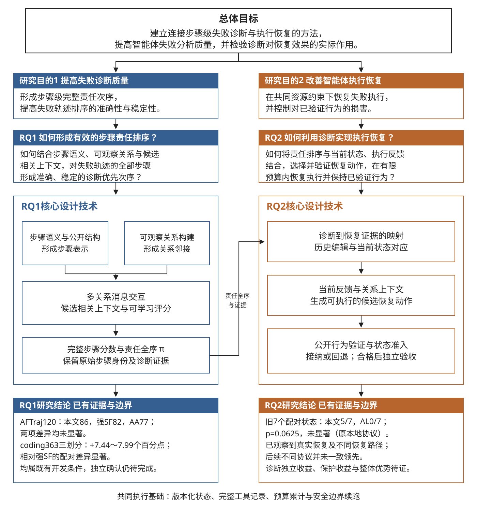
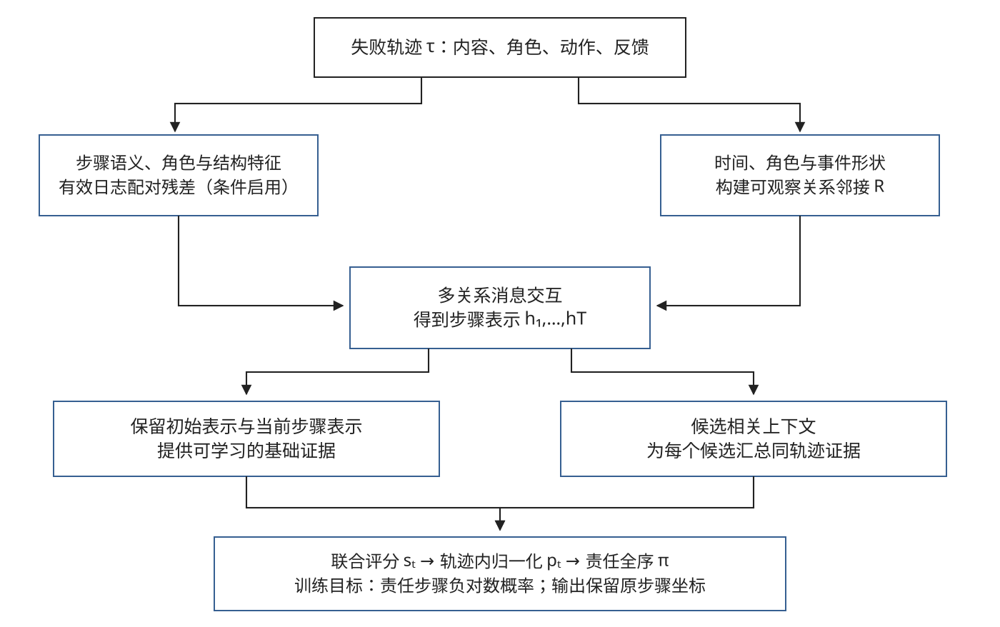
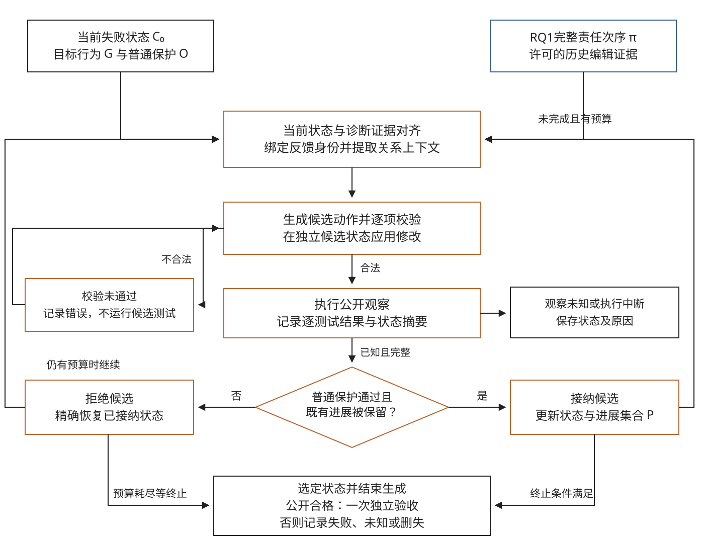

# 基于学习排序的智能体失败诊断与执行恢复方法研究

开题报告 V3

## 第一章 研究背景与国内外研究现状

### 1.1 研究背景

大语言模型智能体通过推理、工具调用和环境交互完成任务。一次执行通常包含多个相互依赖的步骤：智能体读取信息、形成判断、执行动作，再根据观察调整后续行为。与一次性生成答案不同，执行动作还可能改变环境，使早期错误持续影响后续状态和决策。[1]

智能体失败研究因此需要回答两个相互联系的问题。一是从已经发生的执行轨迹中判断哪些步骤更值得检查；二是在当前失败状态下采取什么行动，才能恢复任务并避免损害已有进展。最终结果错误不自动说明责任步骤，诊断命中责任标签也不自动意味着恢复有效。历史步骤可能没有可执行的撤销动作，当前状态可能已不同于历史版本，恢复过程本身还可能产生新的错误。[2,3,4]

本文以智能体的失败诊断与执行恢复为研究对象，以学习排序组织步骤级诊断证据，并研究这些证据如何进入后续恢复过程。软件智能体是当前主要的可执行验证场景：仓库状态可以记录，编辑动作可以追溯，具名测试可以观察行为变化。选择这一场景是为了检验诊断与恢复的联系，不将研究问题改写为一般的软件缺陷定位，也不把该场景的结果直接外推至所有智能体环境。[5,6]

### 1.2 智能体失败诊断研究

早期方法主要直接分析完整执行轨迹。Who & When提出责任主体与错误步骤的归因问题，提供完整日志一次判断、逐前缀检查和二分搜索等方法。[2] 这些方法适合作为不同证据组织与搜索方式的对照，但完整轨迹阅读可能产生较高输入成本，原生单步骤输出也不等于完整责任排序。SDBL先划定可疑范围再定位，说明缩小搜索空间可能有价值，同时需要核实范围构造所需的信息和作者核心实现。[7]

训练式方法尝试用专门的模型降低诊断成本。StepFinder通过时序语义和角色交互形成逐步骤评分，是本文需要正面对照的强学习方法。[8] Aegis和AgenTracer通过生成、注入及标注失败过程扩充监督数据，为训练归因器提供基础。[9,10] 这类数据中的注入位置、关键错误和自然责任步骤并不完全等价，因此应按各自标注定义评价，不能仅因都包含“失败”就混为同一种真值。

结构化诊断利用步骤之间的依赖或行为联系。DeFA、Adaptive Influence Graphs和FALAT分别探索失败传播信息、图导航和类型化关系；AgentScope进一步使用行为抽象与神经不变量组织轨迹。[11,12,13,14] 这些工作说明，利用关系并非无人研究的方向。本文需要检验具体关系表示在相同信息和容量条件下的增量，不能以画出多种边或使用图网络本身作为创新结论。

另一些方法引入额外执行或继续搜证。FAMAS根据多次重放形成谱信息，DoVer通过干预检验可疑解释，ErrorProbe结合异常检测、追踪与工具验证，Continual Search研究长轨迹中的持续证据搜索。[15,3,16,17] 这些方法的观察和成本条件不同于只读单条日志的排序模型；若用于比较，必须公开额外执行信息和全部成本，不能删掉重放核心后仍沿用原方法名称。

诊断评价本身也在发展。TraceElephant强调完整工具观察及最早不可恢复错误，Who & When Pro检验更大范围任务中的归因能力，多视角评价工作则指出同一失败可能存在不同合理解释。[18,19,20] 因而，严格步骤命中衡量的是对明确标注协议的符合程度，不是对唯一真实因果根因的普遍证明。

### 1.3 智能体纠错与执行恢复研究

Reflexion、CRITIC和Self-Refine已分别研究执行反馈记忆、工具交互式纠错和自反馈。[21,22,23] 无外部反馈的推理自纠错研究也显示，反复要求模型修改不必然提高正确性。[24] 本文因此明确区分模型自己的解释、工具公开观察和独立验收，不能把“增加一次反思”直接当成有效恢复机制。

状态层恢复关注环境、上下文和记忆之间的一致性。Rollback-Induced Reflection同时决定何时恢复、恢复到哪里以及保留什么信息，AgentRewind联合恢复智能体与环境状态，GA-Rollback与WebRollback研究回退动作。[25,26,27,28] DART讨论具有显式控制与副作用约束时的可恢复性；SagaLLM及其更早的Sagas基础从补偿与事务组织角度处理长过程失败。[29,30,31] 这些性质依赖明确的状态、动作和补偿语义，不能直接移植到启发式日志关系与有限测试。

最新研究进一步约束了诊断与恢复之间的贡献空间。DARC利用开发阶段诊断缩小恢复干预库，其同预算控制提醒研究者区分诊断选择与额外搜索的收益；Scout与Traverse研究隐藏失败、过程恢复以及候选运行选择。[32,33] 因而，“先诊断再恢复”不是足够的新颖性表述。本文需要证明逐实例责任排序改变了可执行证据或行动，并在共同预算下改善恢复，而不是只增加输入文本、尝试次数或验证机会。

在当前软件验证场景中，Agentless提供分阶段定位、生成与选择的强固定流程；EnAgent通过多轨迹生成和工具辅助选择形成集成；PatchPilot利用验证反馈细化半正确候选并在停滞后重新定位；SGAgent通过定位、关系检索和语义建议引导修复。[34,35,36,37] 它们覆盖了本文可能的主要替代解释，是整体实验对手。AOrchestra的动态编排、SyncMind的协作失配恢复和BacktrackAgent的界面回退则用于界定研究边界，当前不同时扩展为新的主实验任务。[38,39,40]

### 1.4 本文研究空间与范围

本文保留两个相连的研究方向。第一，研究步骤语义、可观察关系和候选相关上下文如何共同形成责任排序，并用强对照检查其准确性、稳定性与局限。第二，研究历史责任排序如何转换为当前执行状态下的恢复证据，结合公开反馈选择候选动作，并根据行为观察管理接纳、回退和继续执行。

本文暂不研究从头改进基础大模型、通用多智能体编排、拜占庭共识、分布式训练容错或所有任务域的在线预警。运行时检查点与容错工作可支持执行系统设计，但不能替代语义错误诊断与恢复效果评价。[41,42,43] 完整轨迹诊断仍属于事后诊断；真正在线设置需要重新限制可见前缀，不能直接继承完整日志结果。

正式评价承接已有有效结果，使用AFTraj、AgenTracer公开发布包中的coding轨迹，以及SWE-Gym配套智能体轨迹构成的恢复来源。不同来源分别承担通用失败诊断、coding补充验证和可执行恢复，不再将历史查阅过的全部数据集列为正式实验计划。完整文献纳排、两层基线及数据版本另附独立文档。

## 第二章 研究目标、理论基础与研究意义

### 2.1 总体目标与两个研究目的

本研究的总体目标是建立连接步骤级失败诊断与执行恢复的方法，提高智能体失败分析质量，并检验诊断对恢复效果的实际作用。

研究目的一是形成步骤级完整责任次序，提高失败轨迹排序的准确性与稳定性，为执行恢复提供可检查的优先线索。研究目的二是在共同资源约束下恢复智能体的失败执行，并控制恢复动作对已有验证行为的损害。两个目的分别通过诊断评价和真实执行评价检验，不以其中一个的分数替代另一个的效果。

### 2.2 两个研究问题与总体框架

RQ1：如何结合步骤语义、可观察关系与候选相关上下文，对失败轨迹的全部步骤形成准确、稳定的诊断优先次序？

RQ2：如何将责任排序与当前状态、执行反馈相结合，选择并验证恢复动作，在有限预算内恢复执行并保持已验证行为？

图2-1给出一个总体目标、两个研究目的、两个研究问题及其对应的核心技术和当前结论。整体系统比较服务于RQ2的效果评价，内部机制控制解释效果来源，不另增一个与两项问题并列的研究问题。

图2-1 智能体失败诊断与执行恢复的总体研究框架

### 2.3 责任排序与监督目标

将一条轨迹表示为τ=(x₁,…,x_T)，每个步骤包含协议允许的内容、角色、动作及观察。责任标签y表示该数据定义的关键错误步骤。模型为步骤计算分数sₜ，再在同一轨迹内归一化为pₜ=exp(sₜ)/Σⱼexp(sⱼ)，训练损失为L(τ)=−log pᵧ。这个目标对整个候选列表共同归一化，属于列表式学习排序；本文不声称提出新的通用排序损失。[44]

同一源问题可能具有多条轨迹或不同注错版本，划分和统计均以源任务组为单位。Top1衡量排名第一是否命中标签，MRR衡量正确步骤名次的倒数，Top-k衡量前k名覆盖。只输出一个步骤的方法采用其原生严格Top1与调用成本，不为计算MRR补造其本来没有的全序。

### 2.4 状态恢复与条件性行为保护

恢复从当前失败状态C₀开始。G表示本轮需要恢复的公开目标行为，O表示普通保护行为；独立保留行为只用于最终验收。当前软件场景中，这些行为通过固定身份的测试观察，但框架中的对象是可验证行为，不是“所有非目标文件必须字节不变”。

设Pₜ为已接纳状态中通过、后续要求保留的目标身份集合。SET策略要求候选满足O全部通过且Pₜ⊆Pass_G(C′)，接纳后令Pₜ₊₁=Pₜ∪Pass_G(C′)。在身份稳定、观察完整且结果可靠的条件下，已接纳状态不会丢失Pₜ中的行为。这是有限观察下的条件性性质，不是全部程序正确性或最优恢复保证。

COUNT只要求目标通过数量不减少，O-only只要求普通保护通过。三者可能对真实候选作出不同决定。严格保护也可能排除需要暂时退步的恢复路径，因此需要同时观察被拒候选、后续终态、行为损害与成本，而不是仅展示准入公式。

### 2.5 研究意义

本文将责任步骤、可用行动证据与任务终态分开建模，使诊断的预测价值与恢复的干预价值可以分别检验。这有助于回答复杂诊断模型是否值得加入恢复过程，以及关系信息和状态保护在何种条件下发挥作用。

实践上，本文保留轨迹投影、排序、证据映射、候选生成、行为验证和状态管理的可替换接口，并保存完整运行记录。后续可以在相同评价基础上扩展RQ1或RQ2模块，不必推翻全部执行流程；每次扩展仍需形成可追溯的新方法版本。

## 第三章 研究内容与方法

### 3.1 步骤表示与细粒度责任排序

排序器首先保留原始步骤坐标，移除答案、责任标签和未来恢复信息，对公开文本、匿名角色及结构特征编码。现有实现使用固定语义编码，结合角色和23维公开结构形成步骤输入。不同原数据字段先经过明确投影，再进入共同模型接口，不能用注错元数据补充答案线索。

模型使用时间相邻、同角色相邻以及两种事件形状关系组织步骤交互。只有日志格式、角色和相邻编号确实支持状态与动作配对时，才启用对应残差；否则保持输入不变。随后通过多关系消息交互和候选相关上下文，为每个步骤汇总不同的诊断证据，联合产生完整分数与次序，如图3-1所示。

图3-1 步骤级责任排序模型的数据流

候选相关上下文使同一观察对不同步骤具有不同作用，而不是向所有候选添加同一个平均向量。关系边和注意力均是模型组织信息的手段，不直接等于因果依赖。当前18条软件轨迹中状态动作有效配对为零，时间与同角色关系重合，两种形状关系也重合；这些限制要求保留重复关系、同容量、无内容与位置控制。

现有AFTraj权重采用三次初始化与五个外折形成15份模型。AFTraj自身评价只使用未训练对应任务组的折外预测；新的外部轨迹才可平均全部15份模型。AgenTracer的coding条件使用另一套源任务训练与验证划分，不能把两套权重的成绩互换。本文按同一方法在不同数据条件下分别训练和评价，而非宣称所有结果来自一个不变的模型文件。

### 3.2 责任步骤到当前恢复证据的映射

完整责任排序中的读取、思考或错误观察不一定对应可执行修改。证据映射器因此另行识别具有完整历史编辑、许可路径和可靠状态对应关系的步骤，输出合法编辑次序及拒绝理由。诊断全序与动作证据次序同时保存，避免用过滤后的候选命中替代原始责任命中。

历史片段与当前状态明确区分。恢复器接收历史变化、当前源码和当前公开反馈，并以内容摘要核对其身份；旧文本不自动成为当前替换锚点。当前代码关系用于查找可能受影响的提供者与消费者，精确的属性联系与仅凭名称推测的联系分别记录。

证据数量、输入范围和生成次数是实验参数，不是方法永远只能使用三条证据。现有部署最多三次生成、使用前三条合法编辑，其结果按原参数保留；后续可扩展证据选择或恢复行动，但需要设置相同资源的控制，不能只给本文增加尝试机会。

### 3.3 诊断引导的执行恢复

恢复器结合排序线索、当前失败反馈和关系上下文生成候选动作。当前主要动作是语义补丁，早期研究也包含受控撤销；二者是不同方法版本。图3-2展示当前生成式恢复的验证与状态管理过程，不能用“选择性回滚”概括所有现有实现。

图3-2 诊断引导的智能体执行恢复与状态管理流程

候选首先通过路径、片段及语法等应用前检查，然后在独立候选状态中执行公开观察。结果未知不转写为失败或通过。准入规则决定是否接纳；拒绝后恢复到此前已接纳状态。方法结束后选定最终候选，满足公开提交条件时再执行一次独立验收，其结果不进入后续生成；未满足条件的轨迹保留失败、未知或删失原因。

当前方法保留SET作为明确可执行的行为约束，并以COUNT、O-only比较其作用。是否将其提升为独立性能贡献取决于自然分歧事件和真实后续轨迹。保留最佳已接纳状态并探索可回退分支，是有具体失败依据的后续扩展，不写成本轮已经实现的能力。

### 3.4 可继续执行与模块扩展

运行记录保存模型完整消息、当前状态、工具观察、候选、测试结果、内部步数、原开始时间及累计资源。已结算响应按原记录复用，发送状态未知的请求不自动重发，继续执行不重置已经使用的时间和费用。独立新轨迹、条件续跑及同响应重新验收分别计数。

扩展边界保持在接口上：RQ1模块必须输出原步骤坐标的分数、全序和证据；RQ2模块必须声明读取的状态与反馈、提出的动作及验证结果。新增关系、候选上下文、动作选择或状态管理策略可替换相应模块，但不能隐式改变基线输入、测试许可或结果分母。具体运行接口与比较关系见配套《整体实验框架与待验证事项》。

## 第四章 关键问题与拟创新点

### 4.1 责任排序是否具有真实干预价值

责任标签正确与恢复动作有效是不同层次。先前固定候选池中，本文、随机顺序和完整日志方法都曾达到11/12，说明候选池饱和时，排序差异未必改变最终成功率。本轮18题完整次序虽均有差异，但合法前三证据只在12题不同，其中7题改变集合、5题仅改变次序；3题只有一个合法候选，11题的完整池不超过3条。

因此，RQ2同时比较强StepFinder替换和不使用学习诊断排序的同恢复器控制。后者仍可使用合法历史编辑、当前反馈和代码关系，不等于“没有任何历史信息”。只有排序确实改变证据或动作，并在共同预算下改善终态、成本或时间，才能支持诊断的恢复价值。

### 4.2 如何区分关系信息、模型容量与位置捷径

当前coding开发结果为关系与上下文排序提供了继续研究依据，但重复时间关系曾达到相同命中数，math上的位置规则也曾追平模型。额外参数、位置分布和输入文本量均可能构成替代解释。本文不将正差全部归因于多关系语义。

机制评价包括同容量、无内容、位置规则、重复关系、关系置换及静态或局部上下文。对软件单角色轨迹，图通道数不等于独立关系种类数；训练数据和日志表示改变时，应先记录关系重合和有效配对机会，再解释模块增量。

### 4.3 如何保持进展而不阻断有效恢复路径

已有目标通过数量未下降，不保证原来通过的具体目标仍通过；这构成SET与COUNT的逻辑差异。不过，当前十个实际可测试候选中没有SET拒绝而COUNT接纳的事件。两个目标由2/3退至1/3的候选上，两种规则都会拒绝，不能据此证明集合优于计数。

一条O-only轨迹实际接受上述退步，随后修复受影响消费者并成功。这说明暂时退步可能属于有效路径，但不能推断换一种策略后仍会生成同样的后续动作。状态保护的价值需要结合可恢复分支、行为损害与资源代价检验，不能预设越严格越好。

### 4.4 拟研究的贡献与成立条件

第一项拟贡献是面向智能体失败轨迹的步骤级责任排序方法，研究公开语义、可观察关系与候选相关上下文的组合。其成立条件是在相匹配训练与评价条件下相对强对照保持稳定增益，并排除位置和容量等主要替代解释。现有AFTraj点优势与coding三划分显著正差属于具体开发证据，独立泛化仍需后续确认。

第二项拟贡献是责任排序与当前执行恢复之间的接口及恢复控制方法。它区分历史责任证据、当前状态和可执行动作，并以行为验证管理恢复过程。其成立条件是完成真实共同配对，观察到诊断或相关机制引起的行动差异及恢复收益。状态保护作为其中的执行约束接受检验，不单独宣称已经带来性能提升。

本文不主张首次使用图、反思、反馈、检查点或回滚。已有先行研究已经覆盖这些概念；贡献必须落在具体输入、技术组合、适用条件及实证效果上。[36,25,29,32,14]

## 第五章 数据来源与实验设计

### 5.1 正式数据集及其分工

正式数据体系只保留三套，均承接已有实验，不另起一批没有结果基础的候选。AFTraj是RQ1原主数据，AgenTracer的coding轨迹提供已验证的补充比较，SWE-Gym配套智能体轨迹提供可执行恢复状态。120题、coding363和7个配对状态是相应来源中的项目子集，不是额外三个数据集。

表5-1 正式使用的数据来源及研究用途

| 数据来源 | 研究用途 | 既有有效结果对应的子集 | 使用边界 |
|---|---|---|---|
| AFTraj-2K | RQ1主评价，保留跨任务域的原对照 | 固定120题；完整开发集合731条、716任务组 | 120题采用既有分层选择；折外预测与开发曝光分别说明 |
| AgenTracer data-v1.0.0公开轨迹包 | RQ1 coding补充验证与划分稳健性 | 同一coding363评价；614源池的A/B/C训练验证划分 | coding363不是包名；三划分不增加数据集数量，均保留开发属性 |
| SWE-Gym及其固定OpenHands配套轨迹构成的恢复来源 | RQ2与整体实验 | 既有7个配对状态及后续不同协议状态；当前本地23个issue来源 | 上游问题和轨迹按issue联接，算一套恢复来源；控制重建与自然退化分层报告 |

AFTraj固定120题包含120个不同任务组，来自五个领域与标签来源层，每层24题；按领域合计coding24、math48、agentic48。它不等于完整开发集，也不是新采集的确认集。当前AF模型的本域成绩采用三次初始化的折外集成，不能在本域把全部15个已部分训练过该组的模型平均后称为折外。

coding363来自AgenTracer作者训练发布包中的本地留出部分。当前源模型的训练为coding256与math236共492条，验证为coding64与math58共122条；三种划分结果按各自原协议报告。发布包包含多种原始问题来源，但原问题名、轨迹发布包名和项目子集名属于不同层级，不应混用。现有评价已参与方法开发，不重新称为盲测。

恢复数据通过SWE-Gym问题、仓库版本与固定OpenHands轨迹联接。问题集和轨迹包不是两套独立验证人群。已有7状态包含由公开编辑重建后重新观察到的退化，以及公开原始轨迹的自然退化；正式实验保留来源类型，不将全部状态冒称原智能体自然失败。

其他曾查阅的数据与benchmark留在相关工作或历史附录，不再写入正式数据主表。新独立确认所需的任务组曝光审计、环境资格和样本量仍须完成；如果已选来源中没有合格未曝光任务组，就保留开发结论范围，不能通过改名或重新划分恢复独立性。

### 5.2 RQ1三项主基线与唯一备选

RQ1确定StepFinder、All-at-Once和Binary Search三个主算法，预登记Step-by-Step为唯一备选。三个提示策略同出Who & When，因此三个主算法对应两篇研究论文，不虚写成三个独立研究团队。文献综述不限论文层次，正式基线仍按既有要求核正式CCF A、作者核心和可执行资格。

表5-2 RQ1基线方案

| 位置 | 方法 | 对照作用 | 当前状态与使用条件 |
|---|---|---|---|
| 主基线1 | StepFinder，KDD 2026 | 强时序语义学习对照，检验本文排序增量 | 已有有效结果；保留增强论文参数与同源分组选择 |
| 主基线2 | All-at-Once，ICML 2025 | 完整日志一次判断，控制大模型阅读能力 | 已有120题非零结果；去除答案，采用严格原步骤匹配 |
| 主基线3 | Binary Search，ICML 2025 | 递归区间搜索，比较证据组织及调用代价 | 已有非零结果；保留原分治和停止逻辑 |
| 唯一备选 | Step-by-Step，ICML 2025 | 逐前缀检查，提供增量诊断对照 | 完整核心可执行，但当前两题无步骤输出；满足预登记资格条件后才启用 |

SBS的现有两题全部九个前缀均明确回答No，未得到非零定位资格。其“备选方案已确定”不表示“现在可以进入有效比较”。下一部分需事前确定资格样本和统一配置，完整报告全部结果；没有严格非零命中就不启用，不补跑直到成功，也不拿无输出配置衬托本文。备选仅在主方法不再适用或无法完整实施时替换一个名额，不因本文输给对手而替换。

### 5.3 整体实验三项主基线与唯一备选

整体实验确定Agentless、EnAgent、PatchPilot三项主基线，SGAgent为唯一备选。它们分别检验固定流程、多轨迹搜索、反馈细化，以及语义建议到修复的转换。EnAgent与SGAgent具有2026年正式发表身份，满足保留新近强方法的设计要求。[34,35,36,37]

表5-3 整体实验基线方案

| 位置 | 方法 | 对照作用 | 当前状态与启用规则 |
|---|---|---|---|
| 主基线1 | Agentless，FSE 2025 | 判断复杂诊断与恢复控制是否优于强固定流程 | 已有完整非零部署，保留其胜过本文的结果 |
| 主基线2 | EnAgent，ICSE 2026 | 判断诊断定向行动是否优于多轨迹搜索与集成选择 | 已有完整非零部署，生成、选择、剪枝与投票完整保留 |
| 主基线3 | PatchPilot，ICML 2025 | 判断反馈细化与半正确候选利用是否已覆盖本文机制 | 原生资格尚未闭合；需先完成完整小试，不填算法零分 |
| 唯一备选 | SGAgent，TOSEM 2026 | 直接比较定位、关系检索和语义建议引导修复 | 旧完整链资格未通过；仅在自身达标后替换PatchPilot |

SGAgent优先于AOrchestra占备用名额，是因为前者更直接对应诊断到干预的接口；当前不把动态编排作为主要研究变量。AOrchestra保留文献和历史实施记录，不再另列为第二备选。SGAgent目前的工程成熟度并不更高，其选择依据是研究相关性，不是成本或效果已经占优。

PatchPilot若在适用输入下经过有界机械修复仍不能取得完整资格，或事前固定的小试未取得有效非零，则转向SGAgent。SGAgent必须独立通过相同准入要求；两者都不合格时，第三个有效比较位仍未完成。选择方案不能替代运行证据，也不允许逐题从两方法中挑更有利的结果。

### 5.4 研究问题与比较关系

表5-4 研究问题、方法、数据与评价的对应关系

| 比较 | 对应问题 | 本文与对照 | 数据与主要观察 |
|---|---|---|---|
| 责任排序主比较 | RQ1 | 本文对StepFinder、AA、BS | AFTraj固定评价及coding363；严格Top1、配对差、原生排序指标 |
| 表示与排序机制 | RQ1 | 内容、位置、关系、上下文及同容量控制 | 同一数据和划分；稳定性、关系重合与独立增量 |
| 完整系统比较 | RQ2整体效果 | 本文对Agentless、EnAgent、PatchPilot；SGAgent条件替换 | 同一恢复状态和许可；预算内交付、自然终态与总成本 |
| 诊断到恢复的作用 | RQ2机制 | 同恢复器替换本文排序、强SF及无学习排序控制 | 同恢复来源；证据差异、行动差异、首次成功代价与终态 |
| 反馈、关系与状态管理 | RQ2机制 | 等信息关系控制、O-only、COUNT、SET及独立新模块 | 自然机制机会与预先标明的压力状态；行为损失、准入分歧和后续结果 |

整体外部方法保留各自的完整生成、工具调用与选择流程，不共享另一方法的补丁。诊断器接入本文恢复器只算机制控制，不占整体外部基线名额。后续新增模块只增加相应控制条件，不改变RQ1和RQ2之间的基础关系。

### 5.5 共同协议、端点与待验证事项

共同协议明确同一问题与初态、公开信息、模型后端、工具许可、方法内部参数、外部资源和验收条件。作者默认、本地资源适配及新版本分别记录；不能为了形式一致删掉对手的核心阶段。原30分钟固定预算成绩保留，另记录内部参数不变时的自然终态。资金、上下文或进程保护造成的截断不改成自然算法失败。

统计以源任务组或issue为单位，多条轨迹先在组内汇总，再进行配对比较和区间估计。完整共同配对数与计划槽数分开；正常失败、工程未知、删失、未运行分别报告。若同时检验多个主要比较，使用事前确定的多重比较处理。重复次数和采样规则先于结果确定，不追成功追加运行。

下一部分首先核已选数据的划分和曝光身份，并补齐备用及第三整体方法的资格；然后检验排序输入是否真正改变可执行证据、原生观察是否完整，再推进统一共同小试。关系增量、身份保护的自然分歧，以及允许暂时退步的新策略均需各自的完整验证。当前实现的调用和候选上限只是已记录的部署条件，未来可修改，但必须形成新的共同协议，不追改旧结果。

## 第六章 研究基础与进度安排

### 6.1 RQ1既有正结果

本研究的可行性首先建立在用户已完成的AFTraj和coding实验上。AFTraj固定120题中，本文三次初始化折外集成命中86题，增强StepFinder为82题，All-at-Once为77题。两项比较均为正向点差，但未达到原统计条件下的显著性。

表6-1 AFTraj固定120题的既有结果

| 方法 | 严格命中 | 命中率 | 与本文比较的统计解释 |
|---|---:|---:|---|
| 本文 | 86/120 | 71.67% | 三次初始化折外集成 |
| 增强StepFinder | 82/120 | 68.33% | 本文高3.33个百分点；原配对p=0.5235，未显著 |
| All-at-Once | 77/120 | 64.17% | 本文高7.50个百分点；原配对p=0.1877，未显著 |

coding363的三个任务组划分均相对增强StepFinder取得显著正差，见表6-2。这三项不能与另一训练条件下的186比148混为同一实验，也不能把三种划分当作三个新数据集。

表6-2 coding363三种划分的既有强对照结果

| 划分 | 本文命中 | 增强StepFinder命中 | 绝对提升 | 原Holm校正p值 |
|---|---:|---:|---:|---:|
| A | 179/363 | 150/363 | 7.99个百分点 | 0.000793 |
| B | 184/363 | 156/363 | 7.71个百分点 | 0.002031 |
| C | 186/363 | 159/363 | 7.44个百分点 | 0.001460 |

这些结果支持保留当前排序方向。它们已经参与方法开发，统计显著不能消除开发曝光，也不能证明任一结构模块单独产生全部增量。当前完整AF716组的本文与强SF亦有正向点差；其不同指标和分母不与120题表混算。原结果、划分与数据来源在配套证据索引中逐项对应。

### 6.2 既有整体比较及其适用条件

早期七个已知配对状态中，单根恢复版本成功5/7，Agentless为0/7；五个不一致对的双侧精确p值为0.0625，属于正向点差而未显著。七题的三方法初始源码摘要一致，不能因后来其他任务出现负结果而删去这组观察。

这组实验的Agentless使用本地Qwen2.5-Coder-7B量化模型，采用原3补丁与2复现部署；本文单根版本进行排序引导的闭包恢复，本身没有生成补丁调用。各流程保留原360秒及工具上限。状态来自公开编辑重建退化和公开原始轨迹自然退化，并非七个全部未经处理的原始自然失败。Agentless在该配置未取得非零，因而该结果支持早期探索，不能单独充当“胜过有效强基线”的证据。

后期固定五题采用不同任务、Flash后端、恢复器和预算，三方自然终态分别为本文2/5、Agentless3/5、EnAgent2/5。其任务与前述七题没有重合。该五题比较是已有曝光任务上的描述性结果：本文旧结果在结果后核对共同条件纳入，排序和编码使用缓存，终验还存在分开与合并执行的组织差异。两组结果不存在相互覆盖关系，也均不能替代前瞻统一协议；后者仍限制当前部署的优势主张。

表6-3 不同整体实验的分母与结论范围

| 实验条件 | 保存结果 | 能支持的判断 |
|---|---|---|
| 早期本地模型七配对状态 | 本文5/7，Agentless0/7；p=0.0625 | 协议内正向开发观察；非显著，不能独立证明胜过有效强基线 |
| 后期Flash固定五题 | 本文2/5，Agentless3/5，EnAgent2/5 | 在该条件下没有整体优势，强对手结果保留 |
| 后期六题三重复 | 本文18条完成；三方首条共同完成仅2题 | 本文可行性与外部未完成状态分开，不据不同完成子集排名 |
| SGAgent历史部署 | 完整链资格未通过，胜负NA | 工程资格缺口，不记算法零分 |

### 6.3 最近补充验证与具体失败机制

最近18题排序发布确认了软件方向权重实际进入恢复请求，并发现12题的合法前三证据存在差异。排序恢复控制仍没有完整共同自然终态组；三个已应用候选的代码AST相同而测试结论未知，只能说明这些候选没有形成可执行结构差异，不能推断普遍无用或同样成功。

另一个已曝光的部分修复状态上，SET、COUNT与O-only各运行三条轨迹，成功数分别为3、2、3。八条成功均通过独立验收；十个可测试候选中有两个2/3退至1/3的事件，但SET与COUNT均会拒绝，独有分歧为0/10。相同首请求在准入前已经产生不同补丁，因此不能把终态数量差直接归因于保护策略。

COUNT唯一失败的后两条完整JSON包含恒等编辑，导致整份补丁被当前规则拒绝。只在内存中去除恒等项后，剩余编辑重建的源码与另一已验收成功终态逐字一致。这为逐编辑校验提供了具体改进依据，但没有新增执行或补记成功。另一条O-only路径先改变提供者返回契约，再修复两个消费者，实际完成2→1→3恢复，提示关系机制应关注接口变化，而非仅增加关系文本。

### 6.4 后续验证安排

表6-4 下一部分必须完成的验证与决策用途

| 验证事项 | 所缺证据 | 通过后支持的决定 | 未通过时的处理 |
|---|---|---|---|
| 三套数据的划分与曝光资格 | 原样本到任务组、训练和评价的完整对应 | 确定可用评价范围与独立确认名单 | 保留开发研究边界，不换名冒充新集 |
| SBS备用准入 | 固定样本、统一配置下的完整非零严格定位 | 按预登记条件替换一个不适用主基线 | 不启用，不使用无输出配置制造优势 |
| 第三整体方法准入 | PatchPilot或SGAgent完整原生与非零小试 | 补足第三项有效共同对照 | 保留缺口与原结果，另行修订方案 |
| 诊断到恢复控制 | 同状态、同资源的完整共同终态 | 判断排序是否改变行动并改善效果 | 缩小诊断的恢复收益主张 |
| 关系与状态机制 | 等信息控制、真实准入分歧及后续路径 | 决定保留哪些模块作为贡献 | 保留简单有效设计与负结果 |

研究流程保留可续跑状态和后续模块接口，但不把所有扩展预先限定为固定数量。每个新增模块先形成明确假设、信息合同与控制条件，再判断是否值得扩大实验。具体时间和资源由获准执行窗口决定，不将本次文档修订当作新实验已经完成。

### 6.5 当前结论

已有结果支持继续研究智能体失败轨迹的责任排序：AFTraj120具有正向点差，coding363三划分相对强学习对照显著领先；已有执行恢复也提供了正向局部观察和具体机制案例。本文据此保留诊断与恢复两项研究问题，以及三套具有真实实验基础的数据来源。

当前仍未证明完整方法普遍超过强基线、诊断排序带来独立恢复收益，或身份集合保护具有数量保护没有的收益。正式研究将保留不同协议下的正负结果，通过明确基线、共同数据和真实执行检验上述主张。扩大研究结论需要新的有效证据。

## 参考文献

[1] Yao, Shunyu; Zhao, Jeffrey; Yu, Dian; Du, Nan; Shafran, Izhak; Narasimhan, Karthik; Cao, Yuan. ReAct: Synergizing Reasoning and Acting in Language Models. ICLR2023；作者comments明确camera-ready. [原始来源](https://arxiv.org/abs/2210.03629).

[2] Shaokun Zhang; Ming Yin; Jieyu Zhang; Jiale Liu; Zhiguang Han; Jingyang Zhang; Beibin Li; Chi Wang; Huazheng Wang; Yiran Chen; Qingyun Wu. Which Agent Causes Task Failures and When? On Automated Failure Attribution of LLM Multi-Agent Systems. ICML 2025, PMLR 267:76583–76599. [原始来源](https://proceedings.mlr.press/v267/zhang25cq.html).

[3] Ma, Ming; Zhang, Jue; Yang, Fangkai; Kang, Yu; Lin, Qingwei; Rajmohan, Saravan; Zhang, Dongmei. DoVer: Intervention-Driven Auto Debugging for LLM Multi-Agent Systems. ICLR 2026. [原始来源](https://openreview.net/forum?id=mrEK16Jy6h).

[4] Vasudev, Rakshith; Russak, Melisa; Bikel, Dan; Alshikh, Waseem. Accurate Failure Prediction in Agents Does Not Imply Effective Failure Prevention. arXiv:2602.03338. [原始来源](https://arxiv.org/html/2602.03338v1).

[5] Carlos E. Jimenez; John Yang; Alexander Wettig; Shunyu Yao; Kexin Pei; Ofir Press; Karthik Narasimhan. SWE-bench: Can Language Models Resolve Real-world GitHub Issues?. ICLR 2024. [原始来源](https://www.swebench.com/original.html).

[6] John Yang; Carlos E. Jimenez; Alexander Wettig; Kilian Lieret; Shunyu Yao; Karthik Narasimhan; Ofir Press. SWE-agent: Agent-Computer Interfaces Enable Automated Software Engineering. NeurIPS 2024, Main Conference. [原始来源](https://proceedings.neurips.cc/paper_files/paper/2024/hash/5a7c947568c1b1328ccc5230172e1e7c-Abstract-Conference.html).

[7] Kai Sun; Wenqiang Li; Bo Dong; Yuxin Lin; Jingyao Zhang; Bin Shi. Scope Delineation Before Localization: A Two-Stage Framework for Enhancing Failure Attribution in Multi-Agent Systems. AAAI 2026, 40(39):33108–33116. [原始来源](https://ojs.aaai.org/index.php/AAAI/article/view/40594).

[8] Taiyu Zhu; Yifan Wu; Weilin Jin; Ying Li; Gang Huang. StepFinder: A Temporal Semantic Framework for Failure Attribution in Multi-Agent Systems. Proceedings of the 32nd ACM SIGKDD Conference on Knowledge Discovery and Data Mining V.2, 6946-6957. [原始来源](https://doi.org/10.1145/3770855.3817991).

[9] Fanqi Kong; Ruijie Zhang; Huaxiao Yin; Guibin Zhang; Xiaofei Zhang; Ziang Chen; Zhaowei Zhang; Xiaoyuan Zhang; Song-Chun Zhu; Xue Feng. Aegis: Automated Error Generation and Attribution for Multi-Agent Systems. ICLR 2026. [原始来源](https://iclr.cc/virtual/2026/poster/10006419).

[10] Guibin Zhang; Junhao Wang; Junjie Chen; Wangchunshu Zhou; Kun Wang; Shuicheng Yan. AgenTracer: Who Is Inducing Failure in the LLM Agentic Systems?. ICLR 2026. [原始来源](https://openreview.net/forum?id=l05DseqvuD).

[11] Deng, Bo; Zheng, Xinlei; Wei, Yi; Zhou, Kang; Tao, Chongyang; Liang, Renzhao; Chen, Xuanren; Guo, Lifan; Zhang, Chi. DeFA: Dependency-Guided Failure Attribution for LLM Agents. arXiv:2610.01256. [原始来源](https://arxiv.org/html/2610.01256v1).

[12] Bakish, Yarden; Dudai, Amir; Ganz, Roy; Nuriel, Oren; Avraham, Elad Ben; Nacson, Mor Shpigel; Litman, Ron. Adaptive Influence Graphs for Failure Attribution in Multi-Agent Systems. arXiv:2608.24361. [原始来源](https://arxiv.org/html/2608.24361v1).

[13] Rafi, Md Nakhla; Ahasanuzzaman, Md; Kim, Dong Jae; Wang, Zhijie; Chen, Tse-Hsun. FALAT: Tracing Failures in LLM Agent Trajectories via Dependency-Guided Search. arXiv:2606.00765. [原始来源](https://arxiv.org/html/2606.00765v1).

[14] Bi, Jiayi; Gao, Yanjie; Xie, Yuanmin; Li, Liqun; Xu, Tianyin; Yang, Fan; Yang, Mao. Diagnosing with Insights: Structured Analysis of Agent Failures via Behavioral Abstractions. 预印本；搜索到匿名在审稿，但未核到正式录用及专属完整核心代码. [原始来源](https://arxiv.org/abs/2609.02371).

[15] Yu Ge; Linna Xie; Zhong Li; Yu Pei; Tian Zhang. Spectrum-Based Failure Attribution for Multi-agent Systems. Proceedings of the ACM on Software Engineering 3(FSE), 1888-1909. [原始来源](https://doi.org/10.1145/3797113).

[16] Raj, Harsh; Lee, David; Mahmoud, Anas; Wang, Renxiong; Dumitru, Razvan-Gabriel; Wang, Chenguang; Zhao, Tong; He, Yunzhong; Yi, Darvin; Gupta, Vipul. Root-Cause Attribution Is a Search Problem: Continual Search for Long-Horizon Agent Failures. 预印本；未核到正式出版、完整源码和本机资格. [原始来源](https://arxiv.org/abs/2609.13463).

[17] Jiazheng Li; Emine Yilmaz; Bei Chen; Thu Le. Towards Self-Improving Error Diagnosis in Multi-Agent Systems. Findings of the Association for Computational Linguistics: ACL 2026, 2063–2077. [原始来源](https://aclanthology.org/2026.findings-acl.98/).

[18] Mengzhuo Chen; Junjie Wang; Fangwen Mu; Yawen Wang; Zhe Liu; Huanxiang Feng; Qing Wang. Seeing the Whole Elephant: A Benchmark for Failure Attribution in LLM-based Multi-Agent Systems. ACL 2026, Volume 1: Long Papers, 19888–19905. [原始来源](https://aclanthology.org/2026.acl-long.912/).

[19] Liu, Jiale; Xi, Huajun; Zhang, Shaokun; Zeng, Yifan; Yue, Tianwei; Wang, Chi; Kang, Jian; Wu, Qingyun; Wang, Huazheng. Who&When Pro: Can LLMs Really Attribute Failures in AI Agents?. arXiv:2607.09996. [原始来源](https://whowhenpro.github.io/).

[20] In, Yeonjun; Tanjim, Mehrab; Subramanian, Jayakumar; Kim, Sungchul; Bhattacharya, Uttaran; Kim, Wonjoong; Park, Sangwu; Sarkhel, Somdeb; Park, Chanyoung. Rethinking Failure Attribution in Multi-Agent Systems: A Multi-Perspective Benchmark and Evaluation. 预印本，作者注明Under review. [原始来源](https://arxiv.org/abs/2603.25001).

[21] Noah Shinn; Federico Cassano; Ashwin Gopinath; Karthik Narasimhan; Shunyu Yao. Reflexion: Language Agents with Verbal Reinforcement Learning. NeurIPS 2023, Main Conference. [原始来源](https://proceedings.neurips.cc/paper_files/paper/2023/hash/1b44b878bb782e6954cd888628510e90-Abstract-Conference.html).

[22] Gou, Zhibin; Shao, Zhihong; Gong, Yeyun; Shen, Yelong; Yang, Yujiu; Duan, Nan; Chen, Weizhu. CRITIC: Large Language Models Can Self-Correct with Tool-Interactive Critiquing. ICLR2024；作者comments核到；本次OpenReview页受验证限制. [原始来源](https://arxiv.org/abs/2305.11738).

[23] Madaan, Aman; Tandon, Niket; Gupta, Prakhar; Hallinan, Skyler; Gao, Luyu; Wiegreffe, Sarah; Alon, Uri; Dziri, Nouha; Prabhumoye, Shrimai; Yang, Yiming; Gupta, Shashank; Majumder, Bodhisattwa Prasad; Hermann, Katherine; Welleck, Sean; Yazdanbakhsh, Amir; Clark, Peter. Self-Refine: Iterative Refinement with Self-Feedback. Advances in Neural Information Processing Systems 36, 2023. [原始来源](https://proceedings.neurips.cc/paper_files/paper/2023/hash/91edff07232fb1b55a505a9e9f6c0ff3-Abstract-Conference.html).

[24] Jie Huang; Xinyun Chen; Swaroop Mishra; Huaixiu Steven Zheng; Adams Yu; Xinying Song; Denny Zhou. Large Language Models Cannot Self-Correct Reasoning Yet. ICLR2024，正式出版页已核. [原始来源](https://proceedings.iclr.cc/paper_files/paper/2024/hash/8b4add8b0aa8749d80a34ca5d941c355-Abstract-Conference.html).

[25] Yu, Yi; Yao, Liuyi; Li, Yaliang; Wang, Enshu; Wu, Libing. Rollback the World, Keep the Reflection: Rollback-Induced Reflection for Long-Horizon LLM Agents. arXiv:2609.18304，初版2026-09-16，本次读v3（2026-09-22）. [原始来源](https://arxiv.org/html/2609.18304v3).

[26] Zhuang, Yu; Chen, Kefei; Duan, Yitong; Zheng, Shuxin; Li, Jian; Zhang, Xu-Yao. AgentRewind: Recoverable Execution for Long-Horizon LLM Agents. arXiv:2608.14380. [原始来源](https://arxiv.org/html/2608.14380).

[27] Xingzuo Li; Kehai Chen; Yunfei Long; Xuefeng Bai; Yong Xu; Min Zhang. Generator-Assistant Stepwise Rollback Framework for Large Language Model Agent. EMNLP 2025, 17683–17700. [原始来源](https://aclanthology.org/2025.emnlp-main.892/).

[28] Zhisong Zhang; Tianqing Fang; Kaixin Ma; Wenhao Yu; Hongming Zhang; Haitao Mi; Dong Yu. WebRollback: Enhancing Web Agents with Explicit Rollback Mechanisms. EACL 2026, Volume 2: Short Papers, 187–197. [原始来源](https://aclanthology.org/2026.eacl-short.12/).

[29] Yang, Ke; Li, Panpan; Wu, Zonghan; Xu, Kejin; Huang, Huaxi; Huang, Xiaoshui. DART: Semantic Recoverability for Structured Tool Agents. arXiv:2605.23311. [原始来源](https://arxiv.org/html/2605.23311).

[30] Edward Y. Chang; Longling Geng. SagaLLM: Context Management, Validation, and Transaction Guarantees for Multi-Agent LLM Planning. Proceedings of the VLDB Endowment, 18(12):4874–4886, 2025. [原始来源](https://doi.org/10.14778/3750601.3750611).

[31] Hector Garcia-Molina; Kenneth Salem. Sagas. Proceedings of the 1987 ACM SIGMOD International Conference on Management of Data, 249–259. [原始来源](https://doi.org/10.1145/38713.38742).

[32] Wang, Pan; Hu, Yihao; Wang, Hang; Lv, Zirui; Zhang, Xin; Li, Jianshe; Yang, Jiang-Ming; Wu, Wei; Tong, Yongqi. Diagnosis Before Recovery: Turning Agent Failures into Selective Self-Correction. 预印本；未核到正式出版与完整作者代码. [原始来源](https://arxiv.org/abs/2608.11772).

[33] Rahman, Salman; Kim, Yubin; Parmar, Mihir; Heydari, A. Ali; Liu, Genglin; Lee, Simon A.; Zhang, Weizhi; Hosseini, Arian; Metwally, Ahmed A.; Yang, Yuzhe; Mirzasoleiman, Baharan; Liu, Xin; Izmailov, Pavel; Gabriel, Saadia; Malhotra, Mark; Patel, Shwetak; McDuff, Daniel; Palangi, Hamid. Locating Hidden Failures Makes Long-Horizon Agents More Reliable. 预印本；未取得本机完整非零资格. [原始来源](https://arxiv.org/abs/2609.17930).

[34] Chunqiu Steven Xia; Yinlin Deng; Soren Dunn; Lingming Zhang. Demystifying LLM-Based Software Engineering Agents. Proceedings of the ACM on Software Engineering 2(FSE), 801-824. [原始来源](https://doi.org/10.1145/3715754).

[35] Zhao Tian; Pengfei Gao; Junjie Chen; Chao Peng. Agent-Based Ensemble Reasoning for Repository-Level Issue Resolution. Proceedings of the 2026 IEEE/ACM 48th International Conference on Software Engineering, 1406-1418. [原始来源](https://conf.researchr.org/details/icse-2026/icse-2026-research-track/233/Agent-Based-Ensemble-Reasoning-for-Repository-Level-Issue-Resolution).

[36] Hongwei Li; Yuheng Tang; Shiqi Wang; Wenbo Guo. PatchPilot: A Cost-Efficient Software Engineering Agent with Early Attempts on Formal Verification. ICML 2025, PMLR 267:35922–35941. [原始来源](https://proceedings.mlr.press/v267/li25cf.html).

[37] Quanjun Zhang; Chengyu Gao; Yu Han; Ye Shang; Chunrong Fang; Zhenyu Chen; Liang Xiao. SGAgent: Suggestion-Guided LLM-Based Multi-Agent Framework for Repository-Level Software Repair. ACM Transactions on Software Engineering and Methodology, published online 2026-05-26. [原始来源](https://doi.org/10.1145/3818617).

[38] Jianhao Ruan; Zhihao Xu; Yiran Peng; Fashen Ren; Zhaoyang Yu; Xinbing Liang; Jinyu Xiang; Yongru Chen; Bang Liu; Chenglin Wu; Yuyu Luo; Jiayi Zhang. AOrchestra: Automating Sub-Agent Creation for Agentic Orchestration. ICML 2026, PMLR 306:106017–106040. [原始来源](https://proceedings.mlr.press/v306/ruan26e.html).

[39] Xuehang Guo; Xingyao Wang; Yangyi Chen; Sha Li; Chi Han; Manling Li; Heng Ji. SyncMind: Measuring Agent Out-of-Sync Recovery in Collaborative Software Engineering. ICML 2025, PMLR 267:20993–21066. [原始来源](https://proceedings.mlr.press/v267/guo25l.html).

[40] Qinzhuo Wu; Pengzhi Gao; Wei Liu; Jian Luan. BacktrackAgent: Enhancing GUI Agent with Error Detection and Backtracking Mechanism. EMNLP 2025, 4250–4272. [原始来源](https://aclanthology.org/2025.emnlp-main.212/).

[41] Wu, Tianyuan; Chang, Chaokun; Cao, Lunxi; Gao, Wei; Wang, Wei. Crab: A Semantics-Aware Checkpoint/Restore Runtime for Agent Sandboxes. 预印本；本轮读取作者元数据，未核完整实现. [原始来源](https://arxiv.org/abs/2604.28138).

[42] Zhou, Jiecheng; Hu, Qinghao; Sun, Peng; Zhang, Xingcheng; Zhang, Weiming. Belayer: Efficient Fault Tolerance for LLM Agentic RL Training. 预印本；本轮摘要级核验. [原始来源](https://arxiv.org/abs/2608.14635).

[43] Zheng, Lifan; Chen, Jiawei; Yin, Qinghong; Zhang, Jingyuan; Zeng, Xinyi; Tian, Yu. Rethinking the Reliability of Multi-agent System: A Perspective from Byzantine Fault Tolerance. 预印本；本轮摘要级核验. [原始来源](https://arxiv.org/abs/2511.10400).

[44] Zhe Cao; Tao Qin; Tie-Yan Liu; Ming-Feng Tsai; Hang Li. Learning to Rank: From Pairwise Approach to Listwise Approach. Proceedings of the 24th International Conference on Machine Learning, 2007:129–136. [原始来源](https://doi.org/10.1145/1273496.1273513).
