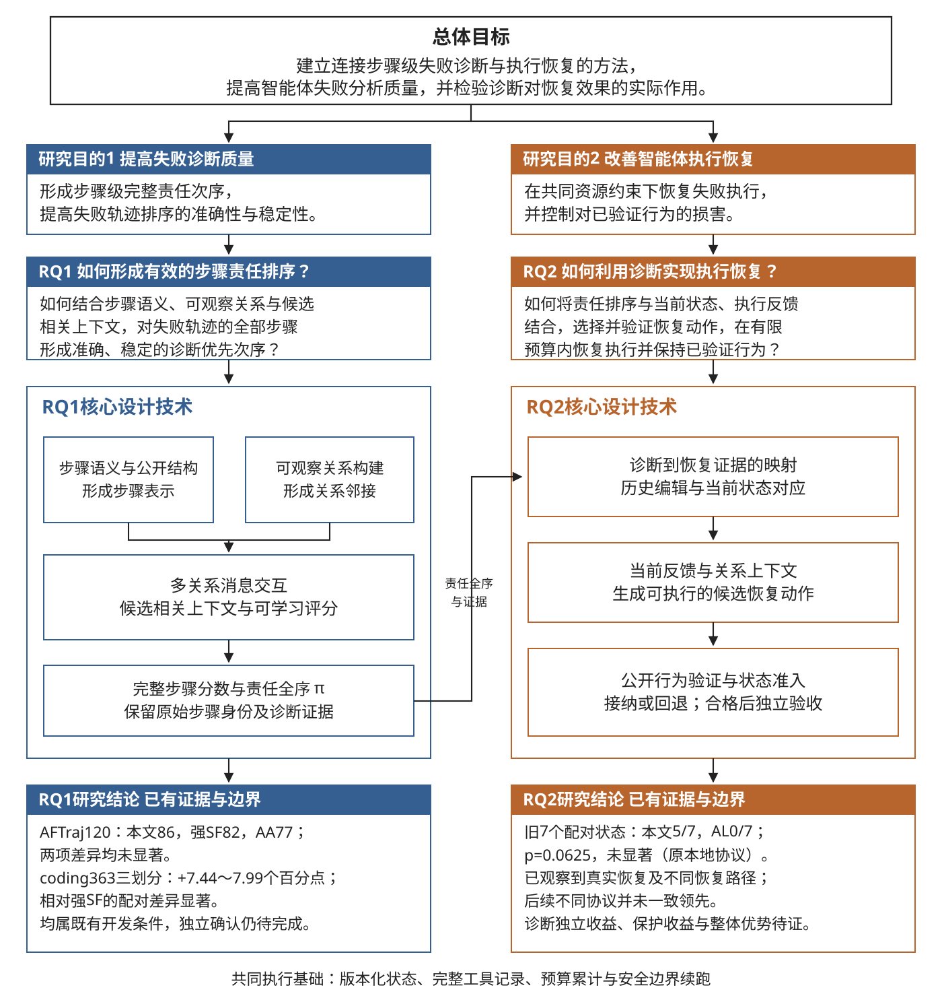

# 总体研究框图与阅读说明

本图以智能体失败诊断与执行恢复为主线，保留一个总体目标、两个研究目的、两个研究问题，并分别对应核心技术和目前的研究结论。软件仓库是恢复验证场景，不另设成与智能体无关的第二个主题。

图2-1 智能体失败诊断与执行恢复的总体研究框架

## 1 怎样读这张图

从最上方总体目标出发，左列研究如何判断失败轨迹中的责任次序，右列研究如何利用这种诊断恢复实际执行。蓝色表示RQ1，橙色表示RQ2；颜色只区分研究内容，不代表效果强弱。

左列并列组织步骤表示与可观察关系，再通过交互、候选上下文及可学习评分形成完整责任次序。输出通过中间箭头进入右列的证据映射，右列再结合当前状态和反馈产生恢复动作，实际验证后接纳或回退。共享执行基础保存状态、工具记录与已用预算，支持中断后继续。

最下方是当前已有结论和边界。AFTraj120与coding363三划分的真实正差保留；旧七状态的点优势也保留，但不把未显著、不同部署或开发曝光改成已证明整体领先。图中的“待证”明确交给后续实验，不在图上预先写成提升成功率。

## 2 与所给示例相比改了什么

结构采用同样清楚的左右双列和少量连接，不使用装饰图标或大面积卡片。关键技术表述按当前真实实现修正：固定非图分数改为可学习步骤表示与评分；单一选择性回滚改为诊断引导的恢复动作与状态管理；保持非目标文件字节不变改为保护经过观察的行为。

原示例的结论是目标式表述，本图改为实际结果与待验证项。这样既承接已有正结果，也不会让读者把开题计划误认为已完成的性能证明。

## 3 图表规范

主报告按章编号，表题置于表上，图题置于图下，正文按编号引用。表格全部为黑白三线表：顶线、表头下线和底线，无竖线、无彩色表头、无斑马底色。Markdown保存可编辑内容；配套HTML和PDF明确执行同一排版规则，避免不同Markdown软件的默认表格样式改变三线表。

框图只用蓝、橙两种配色和黑色正文。技术图中并行证据分开，接纳/拒绝和继续/终止采用明确分支，箭头表示真实产物或状态流，不为美观把所有模块串成单线。

## 4 参考的学术图组织

已查看[PatchPilot正式论文](https://proceedings.mlr.press/v267/li25cf.html)图1和[RIR原文](https://arxiv.org/abs/2609.18304)图1，参考其输入输出、过程分区、条件分支和反馈回路的表达。附加相关原图包括DARC图1、AgentScope图2及ErrorProbe图2，详见文献说明。这里借鉴的是学术图的组织方式，本图按本研究重新绘制，不复制对方的未实现模块或经验结论。

独立框图提供可编辑SVG、PNG预览和PDF，均与主报告的图2-1一致。它不替代方法细节；步骤排序与恢复状态流程分别见主报告图3-1和图3-2。
