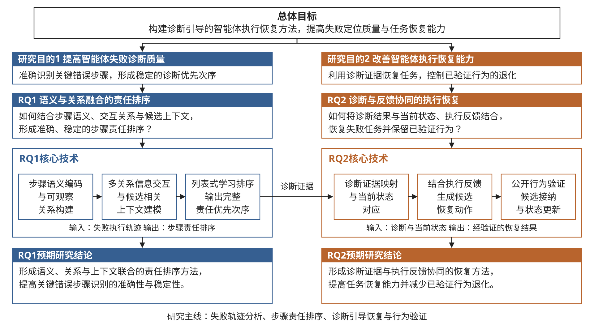
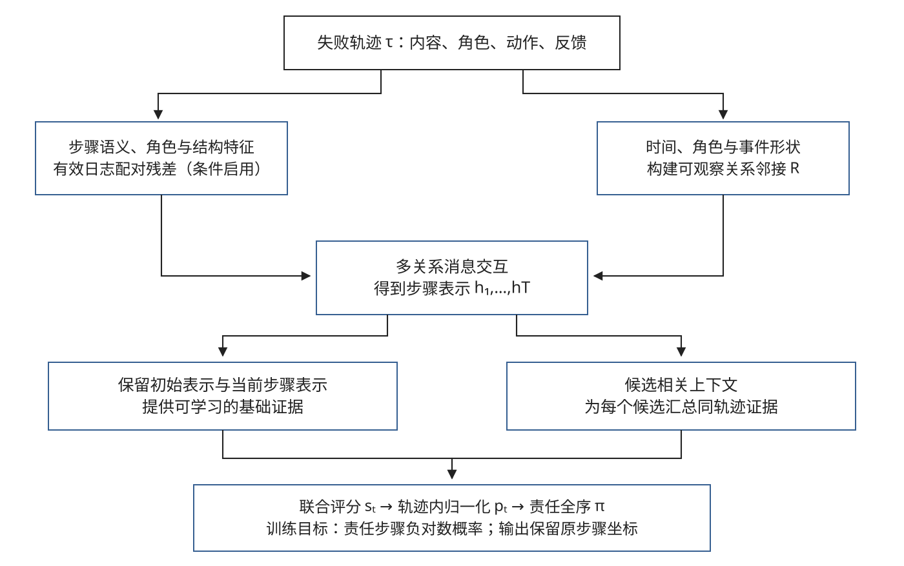
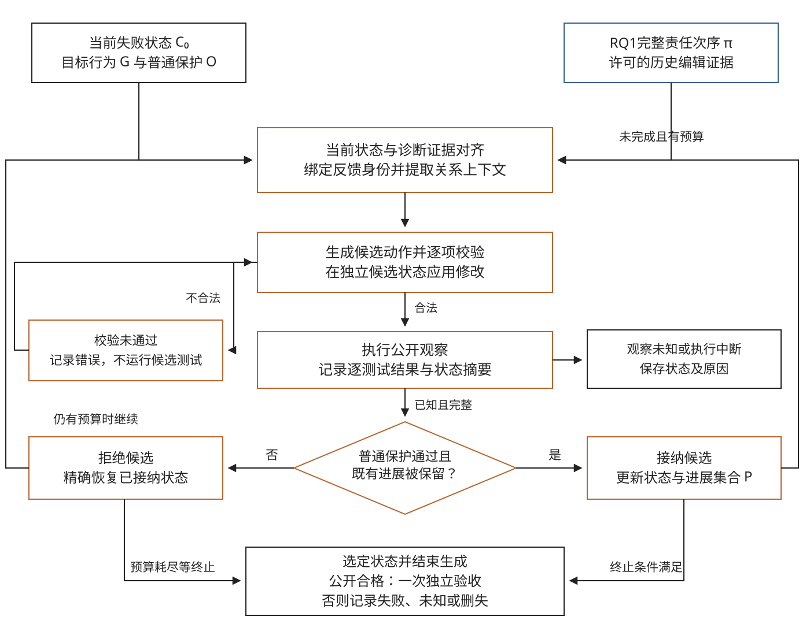

# 基于学习排序的智能体失败诊断与执行恢复方法研究

开题报告

## 第一章 研究背景与国内外研究现状

### 1.1 大语言模型的发展及其任务能力

大语言模型的发展为自然语言理解、知识表达和复杂任务求解提供了新的技术基础。Vaswani等于2017年提出Transformer，以注意力机制组织序列中的信息交互，在序列建模中减少了对循环和卷积结构的依赖，为并行计算与上下文信息建模提供了有效架构。[1] 2020年，Brown等通过GPT-3研究大规模语言模型的少样本学习能力，表明同一预训练模型可以根据文本中的任务描述和示例完成不同语言任务，而不必针对每项任务分别更新参数。[2] 这使自然语言不仅成为模型的处理对象，也逐渐成为指定任务和调整模型行为的接口。

在模型能力向实际应用转化的过程中，指令遵循与推理组织是两个重要环节。Ouyang等于2022年提出InstructGPT，通过示范数据监督学习与人类偏好反馈，使语言模型的输出更符合用户意图；该研究同时指出，扩大模型规模并不自动意味着更好地遵循用户要求。[3] 同年，Wei等研究思维链提示，通过在示例中呈现中间推理步骤，改善模型对算术、常识和符号推理问题的处理。[4] 前者关注模型应当怎样响应用户，后者关注复杂问题如何在生成过程中被逐步求解，二者为语言模型承担连续任务提供了能力基础。

上述进展仍主要围绕给定上下文中的生成与推理。实际任务往往还需要访问新的信息、使用专业工具，并根据执行结果改变后续决策。Schick等于2023年提出Toolformer，使模型学习工具调用的时机、接口和参数，并将工具返回结果用于后续生成。[5] Yao等同年提出ReAct，将推理、动作和环境观察交错组织，使模型能够一边执行，一边获取信息和调整计划。[6] 语言模型由此开始作为交互系统中的决策组件，其研究对象也从单次回答扩展到由多次判断和行动组成的任务过程。

### 1.2 大语言模型智能体的形成与协作机制

大语言模型智能体通常以语言模型承担推理或决策，通过工具和行动接口作用于环境，并利用记忆与反馈维持任务过程。Wang等在2024年的智能体综述中，将已有研究组织为智能体构建、应用与评价三个方面，并以角色设定、记忆、规划和行动等要素讨论系统设计。[7] 从这一结构看，智能体的表现不仅取决于模型本身，还受到观察内容、工具能力和控制流程的影响；同一个语言模型在不同交互结构中，可能形成不同的任务行为。

推理与行动的联合组织为智能体研究提供了重要起点。Yao等（2023）在ReAct中指出，单独进行语言推理难以及时获取外部证据，而单独生成动作又缺少对高层目标和执行进度的持续分析；该方法因此使推理指导信息获取，并用环境观察支持后续判断。[6] Schick等（2023）的Toolformer则把工具使用进一步落实为可以学习的调用决策，使计算、检索等外部能力能够补充模型内部知识。[5] 这两项研究分别从交互组织和工具学习出发，说明完成复杂任务需要在模型推理与环境反馈之间建立持续联系。

随着任务复杂性增加，智能体设计进一步涉及跨步骤的信息保存和多角色协作。Sumers等于2024年提出CoALA认知架构，从记忆、动作空间和决策过程三个方面统一描述语言智能体，区分内部推理、检索等操作与外部环境动作，并将规划和执行组织为重复的决策循环。[8] 该框架使不同系统中的“记住什么”“如何选择行动”和“何时改变环境”等问题能够在共同概念下讨论，也说明执行轨迹不仅包含模型输出，还反映信息如何被保留、调用和转化为行动。

在协作机制方面，Wu等（2024）提出AutoGen，通过可对话智能体与可编程会话组合语言模型、工具和人工输入，支持不同职责之间的任务交接。[9] Hong等（2024）提出MetaGPT，将标准作业程序和软件开发角色分工融入多智能体协作，通过需求、设计和实现等结构化中间产物组织任务。[10] 这些工作为分解复杂任务提供了可实施的组织形式；与此同时，一个智能体的输出可能成为其他智能体继续执行的依据，系统行为因而需要在角色、消息和步骤之间共同分析。

国内研究也从更广的交互系统视角讨论大模型的作用。王文晟等于2025年综述基于大模型的具身智能系统，分别从感知理解、需求级至动作级控制、系统架构和数据来源等方面梳理相关进展，强调大模型与环境感知、规划和控制的联系。[11] 该研究所讨论的物理环境具有自身的感知和动作约束，但其问题组织表明，大模型的应用价值需要通过具体的交互结构和执行能力体现，而不能仅由模型生成内容的流畅程度判断。

### 1.3 跨领域应用及其共同的可靠性挑战

智能体研究的价值已经在多个领域获得具体应用支撑。Boiko等于2023年提出Coscientist，将互联网和仪器文档检索、代码执行与实验自动化相结合，在化学研究中完成实验规划和设备操作等任务。[12] Bran等于2024年提出ChemCrow，通过连接化学知识与专业工具，支持模型处理涉及分子、反应和化学计算的任务。[13] 这些研究将语言模型与专业知识、工具及实验反馈联系起来，说明智能体能够参与的不只是结果说明，还包括产生结果的研究过程。

在网页应用方面，Zhou等（2024）提出WebArena，构建电子商务、论坛、协作开发和内容管理等可交互环境，使智能体根据较高层次的自然语言需求完成搜索、导航和内容操作。[14] 该研究依据任务完成后的功能状态评价结果，而不是要求执行轨迹与某一参考动作序列完全相同，从而容纳不同的有效求解路径。[14] 网页任务由此把语言理解、信息获取和实际状态修改结合起来，执行是否成功需要通过环境中的结果进行判断。

Xie等于2024年提出OSWorld，将研究范围扩展到真实计算机中的文档、表格、演示文稿、图像处理和跨应用工作流，并提供执行结果评价。[15] 该研究的分析显示，智能体即使能够给出合理的高层思路，仍可能在界面目标定位、控件操作和应用行为理解上发生错误。[15] 因而，高层计划与底层执行之间存在需要解决的衔接问题，任务可靠性同时依赖对目标的理解和对当前环境的准确操作。

软件工程则提供了信息检索、推理与执行反馈紧密结合的应用场景。Jimenez等（2024）提出SWE-bench，使用真实仓库中的问题及修复任务，要求模型结合问题描述、项目代码和运行条件完成修改。[16] Yang等（2024）进一步提出SWE-agent，研究面向智能体的计算机接口，使模型能够通过搜索、阅读、编辑和测试逐步处理仓库任务。[17] 这些工作表明，软件智能体的能力不能仅以孤立代码片段的生成质量衡量，还需要考察它能否理解已有项目、处理跨文件关系并根据执行反馈完成修改。

从跨领域评价看，Liu等（2024）提出AgentBench，在操作系统、数据库、知识图谱、游戏与网页等交互环境中评估智能体的推理和决策能力，并将长程推理、决策及指令遵循不足归纳为重要失败原因。[18] Wang等（2024）的综述也把应用与评价纳入智能体研究的整体框架，表明这一方向已形成面向不同任务环境的系统研究，而非局限于个别演示。[7] 上述工作在科学、网页、桌面与软件任务中的共同要求，是使系统依据环境反馈持续推进目标，并在出现偏差时采取适当行动。

进一步的失败分析说明，增加模型或角色并不能消除执行过程中的不可靠性。Cemri等于2025年提出MAST，通过分析多种多智能体框架中的轨迹，将失败模式归纳为系统设计、智能体间失配和任务验证等类别。[19] 这些类别涉及任务分解、信息协同、行动偏离和验证不足，说明失败可能来自多个环节之间的组合，而不仅是某一次语言生成不正确。随着执行步骤和协作关系增加，理解失败如何形成、哪些步骤值得优先检查，因而成为改进系统可靠性的重要基础。

### 1.4 面向责任排序的失败诊断研究

失败诊断的直接目的，是从已发生的执行过程中确定需要重点分析和干预的位置。Zhang等于2025年提出Who&When，将多智能体失败归因表述为识别责任智能体及决定性错误步骤的问题，并构建相应的执行轨迹与标注。[20] 与只报告任务成功与否的评价相比，该工作把研究对象推进到失败过程内部：最终结果提供失败信号，轨迹中的判断、动作和交互则提供解释失败的依据。作者比较了完整日志一次判断、逐前缀检查和二分搜索等方法，表明不同的证据组织方式会影响诊断过程。[20]

2026年的研究进一步发展了范围选择与学习式定位。Sun等提出SDBL，先确定可能包含错误的范围，再在范围信息辅助下定位责任步骤，使诊断过程由直接判断细化为候选约束与局部识别。[21] Zhu等提出StepFinder，将轨迹转化为步骤级语义序列，结合时序建模与角色交互形成逐步骤分数，以专门的学习模型承担归因任务。[22] 这两条路线分别关注如何减少不相关证据，以及如何从轨迹结构中学习责任线索，为将失败诊断组织为排序问题提供了直接研究基础。

监督信息的构造也受到关注。Kong等（2026）提出Aegis，通过在成功执行中生成错误并检验失败结果，构建用于归因学习的数据；Zhang等（2026）提出AgenTracer，围绕故障诱发与责任标注发展专门的归因模型。[23,24] 这些研究缓解了细粒度诊断依赖人工标注的问题，但生成错误的位置、首先出现的局部错误和最终决定失败的责任步骤具有不同语义，需要结合具体任务定义理解监督目标。Chen等（2026）提出TraceElephant，进一步强调工具返回、环境信息和系统配置等完整观察对失败归因的重要性。[25]

结构化与可执行分析则为诊断提供了不同于单次文本判断的证据。Ge等（2026）提出FAMAS，通过多次重放构造行为谱，将步骤行为与执行结果联系起来进行归因。[26] Li等（2026）提出ErrorProbe，先识别异常，再沿症状追踪可疑原因，并通过工具执行验证诊断假设。[27] 同年的AgentScope预印本中，Bi等利用行为抽象和神经不变量组织轨迹分析，使诊断能够围绕结构化表示和行为性质展开。[28] 这些方法分别依赖重放、工具验证和行为约束，其共同意义在于增加诊断依据，同时也使信息获取与分析成本成为需要考虑的问题。

诊断目标并非总能被单一标签完整表达。In等在2026年的多视角归因预印本中指出，复杂多智能体轨迹可能具有多个合理责任解释，并据此讨论标注与评价方式。[29] 这一观察与TraceElephant对决定性错误和完整观察的强调共同提示，步骤命中应当按照明确的责任定义解释，而不能直接视为发现了唯一因果根源。[25] 因此，本文将步骤级责任排序用于组织诊断优先级，既研究哪些线索能提高排序质量，也进一步考察这些线索能否为恢复提供可操作的信息。

### 1.5 反馈纠错与执行状态恢复研究

#### 1.5.1 从自反馈到外部验证

利用反馈改进生成结果，是执行恢复的重要基础。Madaan等于2023年提出Self-Refine，使同一语言模型交替生成反馈与修订结果，在不额外训练独立修订器的情况下进行迭代精炼。[30] Shinn等同年提出Reflexion，将执行反馈转化为语言反思并保存在记忆中，使后续尝试能够利用先前经验。[31] 前者主要研究当前输出如何被改进，后者进一步关注不同尝试之间的信息传递，两项工作都使任务求解由一次生成扩展为利用反馈持续调整的过程。

外部证据是否参与纠错，是后续研究中的重要区别。Gou等于2024年提出CRITIC，通过搜索引擎、代码解释器等工具检验模型输出，再依据检验所得信息进行修正。[32] Huang等（2024）则研究缺少外部反馈的内生推理自纠错，指出要求模型反复修改自身答案并不稳定地产生改进。[33] 这两项研究从不同角度表明，纠错效果需要结合反馈来源和任务条件理解；模型生成的反思、工具返回的观察与独立的结果验证，具有不同的证据作用。

#### 1.5.2 从状态恢复到智能体可恢复执行

当任务动作已经改变环境时，恢复还必须处理已有状态。早在1987年，Garcia-Molina和Salem提出Sagas，将长事务组织为可分别提交的子事务，并以相应补偿操作处理执行失败。[34] Elnozahy等（2002）系统综述消息传递系统中的回滚恢复协议，讨论检查点、日志和一致恢复等问题。[35] 这些研究建立了恢复状态及其依赖关系的基础认识，也说明恢复的成立依赖具体的操作和状态模型，而不只是再次执行同一任务。

在大语言模型系统中，Chang和Geng于2025年提出SagaLLM，将上下文管理、验证和事务补偿用于多智能体规划，讨论长过程执行中的状态与一致性问题。[36] 2026年的相关预印本进一步细化了智能体恢复：Yang等提出DART，研究具有明确动作契约和副作用约束时的语义可恢复性；Zhuang等提出AgentRewind，同步恢复上下文和受控环境，并将先前尝试形成的恢复记忆用于继续执行；Yu等提出Rollback-Induced Reflection，联合考虑何时回退、回到何处以及保留哪些信息。[37,38,39]

这些研究使恢复对象由语言输出扩展到上下文、环境和先前执行形成的有效信息。不同恢复方式的适用条件也有所区别：补偿依赖可定义的补偿动作，检查点恢复依赖可控制的状态，局部恢复则需要判断所保留部分与被修改部分之间的关系。[34,36,37] 因而，进展保留不能只理解为减少重复工作，还需要研究恢复动作是否破坏了此前已经建立的行为，以及必要的暂时调整如何与最终任务完成相协调。

#### 1.5.3 软件环境中的迭代修复方法

在软件智能体研究中，恢复通常体现为依据问题定位和测试反馈持续修正代码。Xia等于2025年发表的Agentless采用分层定位、补丁生成与验证选择流程，研究结构化工作流对仓库级问题求解的作用。[40] Li等同年提出PatchPilot，在问题复现、定位、生成和验证环节之间引入候选细化，使系统能够利用已有补丁及其反馈继续修复。[41] 两项工作分别从流程组织和反馈利用出发，提供了完整恢复系统的比较基础。

2026年，Tian等提出EnAgent，通过多轨迹推理和工具辅助选择汇集不同候选的求解能力。[42] Zhang等提出SGAgent，将可疑位置与代码关系结合，形成修复建议后指导补丁生成。[43] 这些研究进一步说明，定位信息需要经由候选生成、执行验证与选择过程才能影响最终结果。因此，研究步骤诊断对恢复的作用，需要与完整软件求解流程比较，并结合固定恢复器的控制实验分析具体信息来源的贡献。

### 1.6 诊断与恢复的联系及研究问题

诊断结果如何参与后续行动，是连接上述两类研究的关键。Guo等于2025年提出SyncMind，研究协作软件环境中智能体认知与实际代码状态不同步时的恢复，说明问题定位需要与重新理解当前环境相结合。[44] 2026年，Ma等提出DoVer，通过对可疑执行环节实施干预来检验故障解释；Li等的ErrorProbe同样强调用可执行证据确认诊断假设。[45,27] 这些研究把诊断从轨迹上的文字说明进一步联系到行为验证，但其分析对象和干预条件仍各有侧重。

Wang等在2026年的DARC预印本中提出依据开发阶段的任务族失败分析约束恢复干预，再选择适合部署的策略，表明诊断信息可以影响恢复方法的选择。[46] 与此同时，Vasudev等在2026年的失败预测与预防预印本中指出，能够预测失败并不必然意味着后续干预有效。[47] 这提示研究者需要进一步解释诊断与恢复之间的作用过程：被识别的历史问题是否仍影响当前状态，诊断线索是否改变了可执行行动，以及改变之后是否有利于任务继续完成。

由此，本文将研究重点放在步骤级责任排序及其引导的执行恢复。对于诊断，需要结合步骤语义、可观察关系与候选相关上下文，研究如何形成有用的优先检查次序。对于恢复，需要把历史责任线索转换为当前状态下的行动依据，并结合执行反馈选择和验证恢复动作。前者回答如何分析失败轨迹，后者回答如何使用分析结果；状态管理与已有进展保护作为恢复过程中的组成机制共同研究。

这一问题设置承接了已有失败归因、反馈纠错和状态恢复研究。Who&When与StepFinder为步骤级诊断提供了任务和方法基础，DoVer与DARC展示了诊断参与干预的不同方式，SagaLLM与可恢复执行研究则强调状态和依赖关系的作用。[20,22,45,46,36] 本文拟在此基础上研究这些环节之间的具体联系，而不以使用图结构、反思或回滚等已有概念本身作为创新依据。

### 1.7 本研究的价值与验证场景

从方法研究看，责任排序与执行恢复的联合研究有助于区分诊断的预测价值和后续行动的干预价值。排序能够指出值得优先检查的步骤，但恢复仍需要根据当前环境确定可执行动作；把二者联系起来，可以进一步解释诊断能力在何种条件下能够转化为任务完成能力。对已有进展的管理则使恢复研究同时关注获得新的有效行为和维持已建立行为，为理解局部修正、继续探索与状态保持之间的关系提供具体对象。

从应用研究看，软件智能体提供了适合观察这些联系的执行条件。Jimenez等（2024）和Yang等（2024）的工作表明，仓库任务包含可追踪的代码修改和工具交互，测试能够对特定程序行为提供执行反馈。[16,17] 本文据此以软件任务作为主要验证场景，研究如何利用失败轨迹及当前状态开展诊断和恢复。研究对象仍是智能体的失败分析与执行干预，软件场景中的结论将结合其可观察状态和反馈条件解释，并为其他具有相似执行条件的智能体环境提供可进一步检验的研究依据。

## 第二章 研究目标与问题定义

### 2.1 研究目标

本研究面向大语言模型智能体在多步骤任务中出现的执行失败，拟构建以步骤级责任排序为诊断基础、以环境反馈为验证依据的执行恢复方法。总体目标是提高失败轨迹中关键错误步骤的识别质量，并使诊断结果能够支持后续恢复决策，从而改善智能体在复杂任务中的可靠执行能力。

围绕这一目标，研究工作分为相互衔接的两个部分。第一部分研究失败诊断，通过联合建模步骤语义、交互关系和上下文信息，形成对完整执行轨迹的责任排序。排序结果既用于判断最值得检查的步骤，也用于组织后续恢复过程需要的历史证据。第二部分研究执行恢复，将责任排序与当前环境状态、工具反馈相结合，生成并验证恢复动作，在推进任务目标的同时约束对已有正确行为的损害。

两部分工作的关系体现为诊断信息向恢复决策的传递。诊断模块回答“哪些步骤应优先检查”，恢复模块回答“在当前状态下应如何修正并继续执行”。已有自动失败归因研究将责任主体和错误步骤作为预测对象，而干预式调试研究进一步通过执行变化检验错误解释的作用。[20,45] 本研究据此分别评价诊断质量与恢复效果，并通过控制实验考察二者之间的联系。

### 2.2 研究问题

**RQ1：如何融合步骤语义、交互关系与候选上下文，提高失败轨迹的责任排序质量？**

执行轨迹由多次推理、工具调用和环境观察组成。Zhu等于2026年提出的StepFinder通过时序语义建模与角色感知交互实现逐步骤评分，表明专门的轨迹表示能够用于细粒度失败定位。[22] 在此基础上，本研究拟进一步考察不同可观察关系如何参与信息传播，以及同一段上下文对不同候选步骤是否具有不同的诊断价值。研究重点是形成对全部步骤的相对优先次序，并分析其准确性、稳定性及适用范围。

**RQ2：如何结合责任排序、当前状态与执行反馈，实现任务恢复并保持已验证行为？**

已有研究分别利用反思记忆、工具反馈和回退机制改善智能体行为，近年的研究还直接探索了诊断与选择性纠错之间的联系。[31,32,48,46] 本研究拟将RQ1得到的责任排序转换为与当前状态相匹配的恢复证据，结合环境反馈选择修复动作，并通过行为验证决定是否接纳候选状态。评价将同时关注任务是否恢复、恢复需要的资源以及过程中是否损害已验证行为。

### 2.3 研究对象与基本概念

本研究中的智能体，是以大语言模型承担推理或决策功能，并通过工具与外部环境持续交互的任务执行系统。研究对象可以是一名智能体的连续执行，也可以是多名智能体协作形成的统一轨迹。ReAct将推理与行动交替组织，提供了观察智能体执行过程的典型形式；Who & When则进一步将失败轨迹中的责任主体与关键步骤作为自动分析对象。[6,20]

为明确后续方法与评价之间的关系，表2-1给出本研究采用的主要概念。对于不同数据来源，具体错误标签遵循原始标注定义，模型输出统一对应原始轨迹中的步骤位置。

表2-1 主要研究概念及其作用

| 概念 | 含义 | 在本研究中的作用 |
|---|---|---|
| 执行轨迹 | 智能体围绕同一任务产生的有序步骤记录，包括动作、观察及相关角色信息 | 失败诊断的输入 |
| 责任步骤 | 按数据标注标准确定、与任务失败具有关键联系的步骤 | 诊断模型的监督目标与评价对象 |
| 责任排序 | 对全部步骤的诊断优先程度进行排序 | 组织待检查步骤及恢复证据 |
| 当前执行状态 | 恢复开始时的环境状态，以及已经获得的公开观察 | 判断历史证据是否仍适用的依据 |
| 恢复动作 | 针对当前失败提出的修正、受控撤销或继续执行操作 | 改变任务执行状态的干预手段 |
| 已验证行为 | 在当前已接纳状态中，通过指定验证条件的具体行为 | 评价恢复过程中的行为保留情况 |

责任排序是一种面向诊断任务的预测结果，其含义取决于所使用的轨迹信息和标注标准。对于需要通过重新执行才能判断的因果作用，本研究将在恢复实验中另行分析。类似地区分“预测到错误”和“有效改变执行”，有助于建立清楚的评价层次：前者衡量诊断模型是否提供了可靠线索，后者衡量使用这些线索是否改善了真实任务执行。[45,47]

### 2.4 理论基础与方法依据

学习排序为本研究提供了统一组织诊断候选的建模方式。Cao等于2007年提出列表式学习排序，将同一查询下的候选列表作为学习单位，通过联合考虑候选之间的相对关系优化排序。[49] 本研究拟将这一思想用于同一失败轨迹中的步骤比较：模型为各步骤计算责任分数，通过轨迹内联合训练提升标注责任步骤的排序位置，并在推断阶段输出完整次序。

关系表示学习为处理异质步骤联系提供了方法基础。Schlichtkrull等提出的关系图卷积网络通过区分关系类型进行信息聚合，支持多关系数据的表示学习。[50] 本研究拟根据轨迹中实际可观察的时序、角色及动作关联构建关系结构，使模型能够在保留步骤语义的同时聚合相关证据。关系结构在这里承担组织信息的作用，其对失败诊断的贡献将通过消融实验加以检验。

恢复控制则以反馈和状态变化为中心。Shinn等于2023年提出Reflexion，将执行反馈转化为可供后续决策使用的语言记忆；Gou等于2024年提出CRITIC，通过工具交互获得纠错依据。[31,32] 在更早的长事务研究中，Garcia-Molina和Salem于1987年提出Sagas，使用补偿操作处理长过程中的局部失败；这一研究说明了显式组织操作与恢复关系的重要性。[34] 本研究结合智能体执行环境的特点，采用候选状态验证与接纳机制管理恢复过程，具体效果以可观察行为和任务终态为依据。

## 第三章 研究内容与技术路线

### 3.1 总体技术路线

本研究拟形成由失败轨迹诊断到当前状态恢复的完整技术路线，如图3-1所示。输入包括任务描述、失败执行轨迹和可获取的环境信息；输出包括步骤责任次序、经过验证的恢复结果及对应执行记录。技术路线由责任排序与执行恢复两部分组成，两者通过具有明确步骤来源的诊断证据连接。

图3-1 智能体失败诊断与执行恢复的总体研究框架

首先，对不同来源的执行记录进行统一表示，在保留原始步骤位置的基础上提取语义和结构信息。随后，利用多关系信息交互和候选相关上下文计算各步骤的责任分数，形成诊断优先次序。恢复阶段根据该次序选择与当前状态有关的证据，结合失败反馈生成候选动作，并通过环境执行结果检验其效果。最后，依据任务完成情况和行为保护条件确定候选状态的接纳、回退及终止。

总体框架中的两个研究问题保持独立的评价目标。RQ1关注责任排序能否改善错误步骤识别；RQ2关注这些诊断信息能否在实际恢复中发挥作用。完整方法的外部比较与内部机制分析均围绕上述两项问题展开。

### 3.2 融合语义与关系的步骤表示

本研究拟将失败轨迹中的每个步骤表示为语义内容、角色信息与公开结构特征的组合。语义内容用于刻画该步骤的意图、动作及获得的反馈，角色信息用于区分协作主体，结构特征用于表示步骤在执行过程中的相对位置和事件属性。为保持不同来源之间的可比性，数据预处理将统一步骤边界，并保留模型输入与原始记录之间的对应关系。

在步骤语义编码的基础上，拟构建能够反映执行组织方式的关系结构。基础关系包括时间上相邻的步骤以及同一角色的连续行为；对于具有明确动作与观察配对信息的轨迹，再引入相应事件关联。不同关系分别聚合信息，随后与步骤自身表示融合。通过这种方式，模型能够同时利用局部语义变化和跨步骤联系，而不必将全部关系压缩为单一的时间序列。

关系构建将遵循可观察信息约束。若某类轨迹没有提供可靠的角色或事件对应关系，则使用该来源实际具备的关系信息。实验将进一步比较关系类型、关系重合程度及其对排序的影响，以识别哪些结构信息具有稳定的诊断价值。该设计以多关系表示学习为基础，具体面向智能体轨迹的结构选择与融合方式属于本研究拟解决的问题。[50]

### 3.3 候选相关上下文与责任排序

失败诊断需要结合轨迹整体理解局部步骤。一个步骤是否应优先检查，既取决于其自身内容，也取决于前后的观察与其他步骤对它的依赖。本研究拟为每个候选步骤分别构建上下文表示，使模型针对不同候选选择不同的相关证据。例如，对于一条错误工具调用，后续的异常观察可能具有较高诊断价值；对于错误任务分解，则需要结合其影响的后续行为理解问题。

候选相关上下文通过可学习的信息聚合机制形成，并与多关系交互后的步骤表示共同用于责任评分。模型输出保留所有步骤的分数与原始位置，以便根据不同任务需求选择首个候选或前若干候选。图3-2展示了责任排序模块的主要数据流。

图3-2 融合步骤语义、关系信息与候选上下文的责任排序方法

训练时，以完整轨迹作为候选列表，利用标注责任步骤指导分数学习。列表式目标使不同步骤在同一轨迹内共同参与比较，与本研究输出完整诊断次序的目的相一致。[49] 模型选择将结合排序质量和推断开销，评价中同时观察首次命中、前若干候选覆盖以及正确步骤的平均排序位置。

该模块的研究重点是语义、关系和上下文的互补作用。为分析性能变化的来源，拟设置仅语义表示、仅结构特征、固定上下文以及不同关系组合等控制条件，并保持训练数据和模型规模尽可能一致。通过对轨迹长度、任务领域和角色组织形式的分层分析，进一步研究方法在不同执行结构中的适用性。

### 3.4 诊断证据与当前状态的对应

诊断输出描述历史执行中的可疑步骤，恢复动作则作用于当前环境。两者之间需要建立明确的对应关系。举例而言，较早的错误编辑可能已被后续编辑部分覆盖，而某次错误判断也可能没有直接可撤销的操作。因此，本研究拟在诊断模块与恢复模块之间设置证据映射过程，将责任排序转换为当前可用的历史行为、相关对象和失败线索。

证据映射首先识别候选步骤中的动作对象及其可用信息，再检查这些信息与当前状态的关系。在软件验证场景中，该过程对应于将历史编辑、当前代码片段和测试反馈进行对照，辨别可修正的位置及可能受影响的相关组件。对于不能直接应用的历史片段，仍可保留其解释作用，并由生成模块基于当前内容提出新修复。

这一过程拟保留两类输出：一类是原始轨迹上的完整责任排序，用于评价诊断质量；另一类是满足当前状态要求的恢复证据，用于指导行动。通过分别保存和评价这两类结果，可以分析排序差异在何种条件下转化为证据差异，以及证据差异是否进一步影响实际恢复路径。

### 3.5 反馈驱动的候选恢复

恢复模块拟综合使用任务目标、当前状态、优先诊断证据及最新环境反馈生成候选动作。每轮恢复首先明确尚未满足的任务要求，再针对可能的错误来源提出修改，并在独立候选状态中检查动作的适用性与执行结果。工具反馈将用于判断候选是否推进任务，以及是否需要补充信息或调整修复方向。

在软件任务中，候选动作主要体现为对当前代码的修正。动作执行前检查目标位置和编辑内容是否有效，执行后利用公开测试观察目标行为与相关行为的变化。对于已经具有明确可撤销语义的操作，可将受控撤销作为一种动作类型纳入框架。具体动作范围由实验环境决定，避免将仅在特定环境成立的操作条件直接推广到所有智能体任务。

恢复流程与状态管理的关系如图3-3所示。候选动作通过应用检查与公开验证后，进入状态接纳判断；不满足接纳条件时，返回此前已接纳状态，并利用反馈继续搜索。达到任务完成条件或规定的资源上限时，结束候选生成，并对选定结果进行独立评价。

图3-3 诊断引导的候选恢复、行为验证与状态更新流程

### 3.6 已验证行为的保护与状态更新

本研究拟在恢复过程中显式记录已经通过验证的具体行为，避免只根据通过数量判断是否取得进展。若候选状态解决了部分目标，却破坏了此前已通过的另一项目标，仅观察总数量可能无法揭示这种替换。因此，状态管理将同时记录行为身份和验证结果，以支持更细粒度的接纳判断。

基本接纳条件包括普通保护行为保持通过，以及先前要求保留的目标行为继续通过。候选满足条件后，更新已接纳状态和已验证行为集合；否则保留当前状态，并记录候选被拒绝的原因。这里的保护范围由验证条件确定，研究将考察这一约束在减少行为退化和提高恢复成功率之间的关系。

对于可能需要暂时退步才能完成的修复过程，进一步研究可恢复分支与最佳状态保留机制。该扩展将允许系统在保留可返回状态的条件下进行受控探索，并通过真实执行比较保守接纳与分支探索的差异。研究将重点分析恢复质量、行为损害和额外资源之间的权衡，而不预设约束越严格效果越好。

### 3.7 方法的模块化实现

拟实现的系统包括轨迹表示、责任排序、证据映射、候选生成、行为验证和状态管理模块。各模块通过明确输入输出连接：排序模块保留原始步骤位置，证据映射模块保留历史信息与当前状态的关系，恢复模块保留动作和验证结果。这样的组织方式便于在相同实验条件下替换单个模块，分析其对最终效果的影响。

系统还将保存必要的模型输入、工具观察、候选状态与资源使用记录，以支持运行中断后的继续执行和实验复查。后续研究可以在既有接口上扩展关系表示、证据选择或状态探索策略，并增加相应对照实验，无需改变诊断与恢复两项研究问题之间的基本关系。

## 第四章 拟解决的关键问题与预期创新

### 4.1 复杂执行轨迹中的诊断信息组织

本研究首先需要解决如何在较长、异质的执行记录中组织对责任判断有用的信息。StepFinder已经研究了时序语义与角色交互，依赖引导的诊断研究也尝试利用跨步骤联系缩小分析范围。[22,51,52] 因此，本研究的技术重点是关系信息与候选上下文如何配合，使模型能够针对具体步骤汇总相关证据，并在不同轨迹结构下保持有效性。

拟采用的解决思路是在统一语义表示上引入可观察关系，再通过候选相关上下文完成责任评分。评价将分别控制位置特征、输入内容、参数规模与关系结构，考察性能提升是否来自预期的信息组织机制。这一问题对应RQ1，也构成后续恢复过程获得可靠诊断线索的基础。

### 4.2 历史诊断与当前恢复动作之间的衔接

第二个关键问题是如何使历史轨迹中的责任判断能够服务于当前状态下的行动。Ma等的DoVer通过干预检验失败解释，Wang等2026年的诊断恢复研究进一步探索按诊断结果选择纠错策略。[45,46] 这些工作表明，诊断与恢复的联系需要在具体行动层面进行研究。

本研究拟通过证据映射明确历史步骤、当前对象及可执行动作之间的关系。实验将固定恢复器，分别接入本文责任排序、强诊断基线和不采用学习排序的证据组织方式，比较由此产生的证据选择、动作与任务终态。该设计旨在回答诊断排序在何种条件下具有实际使用价值，并区分排序作用与增加生成次数带来的收益。

### 4.3 恢复推进与行为保留之间的协调

第三个关键问题是恢复过程中如何同时推进任务并控制已有行为的退化。反馈纠错方法能够根据验证结果继续修改，状态回退研究则为恢复到可用执行位置提供了机制基础。[41,53,48] 在此基础上，本研究拟进一步观察具体行为身份的变化，并将其纳入候选状态的接纳与回退决策。

拟设置按通过数量保护、按具体行为保护以及仅保护普通行为的比较条件，考察不同规则的实际决策差异。对于恢复路径中出现的暂时退步，结合可恢复分支分析最终收益与资源代价。通过这种方式，明确状态保护在不同失败类型与恢复阶段中的作用范围。

### 4.4 预期创新点

第一项预期创新是面向智能体失败轨迹的语义、关系与候选上下文联合排序方法。该方法拟将轨迹中的可观察交互联系纳入步骤表示，并针对候选步骤构建差异化上下文，形成完整责任次序。预期在强时序语义学习方法的基础上，提高关键步骤识别的准确性与稳定性，并明确不同信息来源的贡献。

第二项预期创新是面向当前执行状态的诊断引导恢复方法。该方法拟建立责任排序与可执行恢复证据之间的对应，结合环境反馈进行候选生成和验证，并通过状态管理减少对已有正确行为的损害。预期形成可分析的诊断到行动过程，阐明责任排序、反馈利用与行为保护对恢复效果的作用。

以上创新围绕具体问题、方法和评价展开。责任排序方法的有效性将通过跨任务与不同划分的对照检验，恢复方法的有效性将通过共同任务上的完整运行和机制实验检验。预期成果既包括方法本身，也包括对其适用条件的解释。

## 第五章 数据来源与实验设计

### 5.1 总体实验思路

实验按照“诊断质量评价、完整恢复效果评价、作用机制分析”的顺序展开。首先，在具有步骤标注的失败轨迹上检验RQ1；随后，在可执行环境中检验RQ2；最后，通过保持其他条件一致的控制实验，分析诊断信息、关系上下文和状态管理的作用。诊断与恢复分别使用适合其评价目标的数据，同时保留二者在完整系统中的连接。

数据体系由AFTraj、AgenTracer中的coding轨迹以及SWE-Gym配套执行轨迹组成。前两类数据用于责任步骤诊断，后一类数据用于真实执行恢复。Who & When和AgenTracer提供了失败轨迹与归因研究的基础，SWE-Gym则提供可执行软件任务及相关智能体轨迹。[20,24,54] 软件任务具有明确的代码状态和可执行验证条件，适合观察恢复动作的结果，因此作为本研究当前的主要恢复评价场景。[16,17]

### 5.2 数据集及划分原则

表5-1列出三类数据的用途。AFTraj承担主要诊断评价，保留不同任务类型的失败轨迹；AgenTracer coding用于补充分析软件相关轨迹上的排序表现；SWE-Gym及其配套OpenHands轨迹共同构成恢复数据来源。

表5-1 数据来源与研究用途

| 数据来源 | 数据特点 | 本研究中的用途 |
|---|---|---|
| AFTraj | 包含不同任务类型的失败轨迹及责任步骤标注 | RQ1主要评价，分析跨任务类型的诊断表现 |
| AgenTracer coding | 包含具有错误标注的代码任务执行轨迹 | RQ1补充评价，分析软件相关语义与数据划分稳健性 |
| SWE-Gym及配套OpenHands轨迹 | 真实软件问题、仓库环境、测试条件和智能体执行记录 | RQ2完整恢复评价及作用机制分析 |

训练、验证与评价按照原始任务分组。同一任务产生的不同轨迹、不同错误版本及其派生样本保留在同一划分中，以避免相近样本同时进入训练与评价。模型配置依据训练和验证数据确定，评价数据用于报告确定配置下的结果。对于已用于方法开发的样本，将明确其开发用途，并在数据允许时使用独立任务组进行补充确认。

AFTraj的本域评价采用分组划分，使待评价任务不参与相应模型的训练。AgenTracer coding沿用已经开展前期研究的数据来源，并在固定评价任务下比较不同训练与验证划分。恢复数据则依据原始问题连接仓库状态与执行轨迹，分别记录自然失败与受控构造状态，用于分析方法在真实失败和特定机制条件下的表现。

### 5.3 责任排序的比较方法

RQ1选择StepFinder、All-at-Once和Binary Search作为三项主要比较方法，以Step-by-Step作为备选。Zhang等于2025年研究了完整日志判断、逐步检查与二分搜索三种归因方式，分别代表不同的证据组织策略；Zhu等于2026年提出StepFinder，代表利用专门时序语义模型进行高效归因的路线。[20,22]

表5-2 责任排序的比较方法

| 类别 | 方法与发表年份 | 主要特点 | 比较目的 |
|---|---|---|---|
| 主基线 | StepFinder，2026 | 时序语义建模、角色感知交互与步骤评分 | 检验联合关系与候选上下文建模的增量 |
| 主基线 | All-at-Once，2025 | 根据完整执行日志一次给出归因结果 | 比较专门排序模型与大模型整体阅读 |
| 主基线 | Binary Search，2025 | 在日志区间中递归缩小可疑范围 | 比较不同搜索组织方式的效果与代价 |
| 备选 | Step-by-Step，2025 | 随执行前缀逐步检查错误 | 补充逐步诊断对照 |

三种提示式策略来自同一项归因研究，将作为不同算法策略比较。主要评价指标为责任步骤首次命中率；对于原生输出完整排序的方法，进一步报告前若干候选覆盖率和平均倒数排名。各方法保留原有核心流程，并使用一致的可见轨迹信息。备选方法在确认适用输入与完整运行能力后使用，替换规则在正式比较前确定。

### 5.4 完整恢复系统的比较方法

RQ2选择Agentless、EnAgent和PatchPilot作为主要外部基线，以SGAgent作为备选。Xia等于2025年发表的Agentless采用结构化的定位、修复和验证流程；Li等于2025年提出PatchPilot，在预定工作流中加入验证反馈与候选细化；Tian等于2026年提出EnAgent，利用多轨迹推理和结果选择完成仓库级问题求解；Zhang等于2026年提出SGAgent，通过修复建议组织多智能体软件修复。[40,41,42,43]

表5-3 完整恢复系统的比较方法

| 类别 | 方法 | 主要比较角度 |
|---|---|---|
| 主基线 | Agentless | 诊断引导恢复与结构化固定流程的差异 |
| 主基线 | EnAgent | 定向恢复与多轨迹搜索、集成选择的差异 |
| 主基线 | PatchPilot | 诊断证据与验证反馈细化的互补作用 |
| 备选 | SGAgent | 步骤责任证据与建议引导修复的差异 |

外部基线按照其完整方法实施，保留必要的定位、生成、验证与选择环节。各方法在相同任务初态、可用信息、模型条件和资源限制下比较。正式实验前将完成各方法在共同环境中的实现与先导评价，确认其适用性，并确定备选方法的使用条件。

除完整系统比较外，还将固定本文恢复器并替换诊断模块。通过接入StepFinder排序和不采用学习排序的证据组织方式，考察责任排序对恢复过程的独立影响。该实验属于内部机制分析，与完整外部系统比较分别报告。

### 5.5 评价指标与控制实验

责任排序评价关注定位准确性、候选覆盖及推断效率。首次命中率衡量首个诊断候选是否符合标注，前若干候选覆盖率衡量有限检查范围内能否找到责任步骤，平均倒数排名反映正确步骤在排序中的位置。对不同轨迹长度、任务类型及角色组织形式进行分层分析，研究模型表现的稳定性。

执行恢复评价关注任务完成率、行为退化与资源消耗。任务完成率依据独立验收结果计算；行为退化记录此前已通过的具体行为是否受到破坏；资源消耗包括模型调用、执行验证和总运行时间。对同一任务上的不同方法进行配对比较，并报告结果的不确定性，避免将个别任务的偶然变化视为普遍规律。

表5-4 研究问题、控制因素与主要观察

| 研究问题 | 比较或控制因素 | 主要观察 |
|---|---|---|
| RQ1：责任排序质量 | 本文与三项诊断主基线 | 首次命中、候选覆盖、排序位置及推断效率 |
| RQ1：信息来源的作用 | 语义、位置、关系、上下文及模型规模 | 各信息来源的增量与不同数据条件下的稳定性 |
| RQ2：完整恢复效果 | 本文与三项完整外部方法 | 任务完成、行为退化与资源消耗 |
| RQ2：诊断的作用 | 固定恢复器并替换诊断排序 | 证据选择、实际动作和最终结果的变化 |
| RQ2：恢复控制的作用 | 关系上下文、反馈使用、行为保护及分支策略 | 候选接纳差异、后续恢复路径及保护代价 |

机制实验将采用预先确定的共同任务集合。候选证据相同、可恢复空间较小等任务仍纳入整体评价，并作为解释结果的分层因素。对于特定机制在自然数据中出现较少的情况，可补充明确构造的压力场景；其结果主要用于检验机制行为，分别于自然任务上的总体效果报告。

### 5.6 实验有效性与结果解释

实验有效性主要受数据独立性、方法实施差异和执行随机性影响。数据方面，通过源任务分组和开发用途标记控制样本重叠。方法方面，明确模型输入、工具范围、内部参数与外部资源条件，并保留各基线的关键环节。执行方面，在事先确定的重复规则下报告全部结果，分析不同运行之间的变化。

独立验收仅用于评价最终交付结果，其反馈不用于继续生成候选。正常任务失败、环境执行异常和未完成运行分别说明，以保证评价指标具有清楚的含义。最终结论将结合完整系统表现、内部控制实验和代表性恢复轨迹共同形成，说明方法在何种条件下有效，以及仍然存在的限制。

## 第六章 研究基础、进度安排与预期成果

### 6.1 前期研究基础

前期工作已围绕失败轨迹整理、步骤责任排序和可执行恢复建立实验基础。在AFTraj与AgenTracer coding数据上，已完成责任排序模型的初步训练和对照分析，观察到相对于已有方法的改进现象，为继续研究语义、关系与上下文的联合建模提供了依据。不同数据与划分上的表现仍需通过系统实验进一步分析。

在执行恢复方面，已完成诊断证据接入、候选动作生成、公开验证及状态记录的初步实现，并积累了成功恢复和未能恢复的实例。已有探索表明，诊断信息能够进入恢复流程，但其对完整任务效果的贡献仍需通过统一条件下的比较确定。不同阶段的初步结果也提示，诊断质量、候选动作和恢复控制需要联合研究。

上述工作为本课题提供了可继续推进的数据与实现条件。后续研究将以完整方法和共同任务评价为主线，完善当前尚缺少的外部比较与机制分析，形成能够支持论文结论的系统性证据。

### 6.2 研究进度安排

研究计划围绕方法设计、实验评价和论文形成依次推进。各阶段按照明确的研究产出衔接，具体日历安排结合学校开题与论文提交节点确定。

表6-1 研究阶段与主要工作

| 阶段 | 主要工作 | 阶段成果 |
|---|---|---|
| 第一阶段：研究方案完善 | 持续梳理相关文献，明确问题定义、数据分工与比较方法 | 完整研究方案、数据划分与评价设计 |
| 第二阶段：责任排序研究 | 完成语义、关系与候选上下文建模，开展主比较和消融分析 | 责任排序方法及RQ1实验结果 |
| 第三阶段：执行恢复研究 | 完成证据映射、反馈恢复与状态管理，开展完整系统比较 | 执行恢复方法及RQ2整体结果 |
| 第四阶段：机制与稳健性分析 | 分析诊断作用、行为保护、失败类型和资源影响 | 机制解释、适用条件与局限分析 |
| 第五阶段：论文整理 | 综合方法与实验，完善图表、论证和论文写作 | 学位论文、研究原型及答辩材料 |

不同阶段允许根据研究发现对局部方法作出调整，但总体保持责任排序与执行恢复两条主线。新增模块将对应明确研究假设和控制实验，以确保技术扩展能够服务于核心问题。

### 6.3 预期研究成果

在失败诊断方面，预期形成一种融合步骤语义、交互关系与候选相关上下文的责任排序方法。通过对执行轨迹的结构化建模，提升关键错误步骤的识别准确性和排序稳定性，并分析不同关系与上下文信息的实际作用，为智能体失败分析提供具有明确步骤对应的诊断依据。

在执行恢复方面，预期形成一种诊断证据与环境反馈协同的恢复方法。通过将历史责任排序与当前状态对齐，组织候选动作生成、行为验证和状态更新，提高有限资源条件下的任务恢复能力，减少恢复过程对已验证行为的损害，并阐明诊断信息转化为有效行动的条件。

在实验与实现方面，预期形成覆盖诊断评价、完整恢复比较和机制分析的实验体系，以及支持模块替换和继续执行的研究原型。最终成果将以学位论文系统阐述问题背景、方法设计与实验证据，为后续智能体可靠性研究提供可复查的研究基础。

## 参考文献

[1] Ashish Vaswani, Noam Shazeer, Niki Parmar, et al. Attention Is All You Need. Advances in Neural Information Processing Systems 30, 2017. [原文](https://proceedings.neurips.cc/paper_files/paper/2017/hash/3f5ee243547dee91fbd053c1c4a845aa-Abstract.html).

[2] Tom B. Brown, Benjamin Mann, Nick Ryder, et al. Language Models are Few-Shot Learners. Advances in Neural Information Processing Systems 33, 2020. [原文](https://proceedings.neurips.cc/paper_files/paper/2020/hash/1457c0d6bfcb4967418bfb8ac142f64a-Abstract.html).

[3] Long Ouyang, Jeff Wu, Xu Jiang, et al. Training language models to follow instructions with human feedback. Advances in Neural Information Processing Systems 35, 2022. [原文](https://proceedings.neurips.cc/paper/2022/hash/b1efde53be364a73914f58805a001731-Abstract.html).

[4] Jason Wei, Xuezhi Wang, Dale Schuurmans, et al. Chain-of-Thought Prompting Elicits Reasoning in Large Language Models. Advances in Neural Information Processing Systems 35, 2022. [原文](https://proceedings.neurips.cc/paper/2022/hash/9d5609613524ecf4f15af0f7b31abca4-Abstract.html).

[5] Timo Schick, Jane Dwivedi-Yu, Roberto Dessì, et al. Toolformer: Language Models Can Teach Themselves to Use Tools. Advances in Neural Information Processing Systems 36, 2023. [原文](https://proceedings.neurips.cc/paper/2023/hash/d842425e4bf79ba039352da0f658a906-Abstract-Conference.html).

[6] Shunyu Yao, Jeffrey Zhao, Dian Yu, et al. ReAct: Synergizing Reasoning and Acting in Language Models. International Conference on Learning Representations (ICLR), 2023. [原文](https://arxiv.org/abs/2210.03629).

[7] Lei Wang, Chen Ma, Xueyang Feng, et al. A survey on large language model based autonomous agents. Frontiers of Computer Science 18(6), 186345, 2024. [原文](https://doi.org/10.1007/s11704-024-40231-1).

[8] Theodore R. Sumers, Shunyu Yao, Karthik Narasimhan, et al. Cognitive Architectures for Language Agents. Transactions on Machine Learning Research, 2024. [原文](https://openreview.net/forum?id=1i6ZCvflQJ).

[9] Qingyun Wu, Gagan Bansal, Jieyu Zhang, et al. AutoGen: Enabling Next-Gen LLM Applications via Multi-Agent Conversations. Conference on Language Modeling (COLM 2024). [原文](https://www.microsoft.com/en-us/research/publication/autogen-enabling-next-gen-llm-applications-via-multi-agent-conversation-framework/).

[10] Sirui Hong, Mingchen Zhuge, Jonathan Chen, et al. MetaGPT: Meta Programming for A Multi-Agent Collaborative Framework. International Conference on Learning Representations (ICLR 2024). [原文](https://proceedings.iclr.cc/paper_files/paper/2024/hash/6507b115562bb0a305f1958ccc87355a-Abstract-Conference.html).

[11] 王文晟, 谭宁, 黄凯, 等. 基于大模型的具身智能系统综述. 自动化学报 51(1):1–19, 2025. [原文](https://doi.org/10.16383/j.aas.c240542).

[12] Daniil A. Boiko, Robert MacKnight, Ben Kline, et al. Autonomous chemical research with large language models. Nature 624:570-578, 2023. [原文](https://doi.org/10.1038/s41586-023-06792-0).

[13] Andres M. Bran, Sam Cox, Oliver Schilter, et al. Augmenting large language models with chemistry tools. Nature Machine Intelligence 6:525-535, 2024. [原文](https://doi.org/10.1038/s42256-024-00832-8).

[14] Shuyan Zhou, Frank F. Xu, Hao Zhu, et al. WebArena: A Realistic Web Environment for Building Autonomous Agents. International Conference on Learning Representations (ICLR 2024). [原文](https://proceedings.iclr.cc/paper_files/paper/2024/hash/4410c0711e9154a7a2d26f9b3816d1ef-Abstract-Conference.html).

[15] Tianbao Xie, Danyang Zhang, Jixuan Chen, et al. OSWorld: Benchmarking Multimodal Agents for Open-Ended Tasks in Real Computer Environments. Advances in Neural Information Processing Systems 37, Datasets and Benchmarks Track, 2024. [原文](https://proceedings.neurips.cc/paper_files/paper/2024/hash/5d413e48f84dc61244b6be550f1cd8f5-Abstract-Datasets_and_Benchmarks_Track.html).

[16] Carlos E. Jimenez, John Yang, Alexander Wettig, et al. SWE-bench: Can Language Models Resolve Real-world GitHub Issues? International Conference on Learning Representations (ICLR), 2024. [原文](https://www.swebench.com/original.html).

[17] John Yang, Carlos E. Jimenez, Alexander Wettig, et al. SWE-agent: Agent-Computer Interfaces Enable Automated Software Engineering. Advances in Neural Information Processing Systems, 2024. [原文](https://proceedings.neurips.cc/paper_files/paper/2024/hash/5a7c947568c1b1328ccc5230172e1e7c-Abstract-Conference.html).

[18] Xiao Liu, Hao Yu, Hanchen Zhang, et al. AgentBench: Evaluating LLMs as Agents. International Conference on Learning Representations (ICLR 2024). [原文](https://proceedings.iclr.cc/paper_files/paper/2024/hash/e9df36b21ff4ee211a8b71ee8b7e9f57-Abstract-Conference.html).

[19] Mert Cemri, Melissa Z Pan, Shuyi Yang, et al. Why Do Multi-Agent LLM Systems Fail? Advances in Neural Information Processing Systems, Datasets and Benchmarks Track, 2025. [原文](https://papers.nips.cc/paper_files/paper/2025/hash/b1041e52d3be19f0a9bc491657488e4a-Abstract-Datasets_and_Benchmarks_Track.html).

[20] Shaokun Zhang, Ming Yin, Jieyu Zhang, et al. Which Agent Causes Task Failures and When? On Automated Failure Attribution of LLM Multi-Agent Systems. Proceedings of the 42nd International Conference on Machine Learning (ICML), PMLR 267: 76583–76599, 2025. [原文](https://proceedings.mlr.press/v267/zhang25cq.html).

[21] Kai Sun, Wenqiang Li, Bo Dong, et al. Scope Delineation Before Localization: A Two-Stage Framework for Enhancing Failure Attribution in Multi-Agent Systems. Proceedings of the AAAI Conference on Artificial Intelligence, 40(39): 33108–33116, 2026. [原文](https://ojs.aaai.org/index.php/AAAI/article/view/40594).

[22] Taiyu Zhu, Yifan Wu, Weilin Jin, et al. StepFinder: A Temporal Semantic Framework for Failure Attribution in Multi-Agent Systems. Proceedings of the 32nd ACM SIGKDD Conference on Knowledge Discovery and Data Mining V.2: 6946–6957, 2026. [原文](https://doi.org/10.1145/3770855.3817991).

[23] Fanqi Kong, Ruijie Zhang, Huaxiao Yin, et al. Aegis: Automated Error Generation and Attribution for Multi-Agent Systems. International Conference on Learning Representations (ICLR), 2026. [原文](https://iclr.cc/virtual/2026/poster/10006419).

[24] Guibin Zhang, Junhao Wang, Junjie Chen, et al. AgenTracer: Who Is Inducing Failure in the LLM Agentic Systems? International Conference on Learning Representations (ICLR), 2026. [原文](https://openreview.net/forum?id=l05DseqvuD).

[25] Mengzhuo Chen, Junjie Wang, Fangwen Mu, et al. Seeing the Whole Elephant: A Benchmark for Failure Attribution in LLM-based Multi-Agent Systems. Proceedings of the 64th Annual Meeting of the Association for Computational Linguistics (Volume 1: Long Papers): 19888–19905, 2026. [原文](https://aclanthology.org/2026.acl-long.912/).

[26] Yu Ge, Linna Xie, Zhong Li, et al. Spectrum-Based Failure Attribution for Multi-agent Systems. Proceedings of the ACM on Software Engineering, 3(FSE): 1888–1909, 2026. [原文](https://doi.org/10.1145/3797113).

[27] Jiazheng Li, Emine Yilmaz, Bei Chen, et al. Towards Self-Improving Error Diagnosis in Multi-Agent Systems. Findings of the Association for Computational Linguistics: ACL, pp. 2063–2077, 2026. [原文](https://aclanthology.org/2026.findings-acl.98/).

[28] Jiayi Bi, Yanjie Gao, Yuanmin Xie, et al. Diagnosing with Insights: Structured Analysis of Agent Failures via Behavioral Abstractions. arXiv preprint arXiv:2609.02371, 2026. [原文](https://arxiv.org/abs/2609.02371).

[29] Yeonjun In, Mehrab Tanjim, Jayakumar Subramanian, et al. Rethinking Failure Attribution in Multi-Agent Systems: A Multi-Perspective Benchmark and Evaluation. arXiv preprint arXiv:2603.25001, 2026. [原文](https://arxiv.org/abs/2603.25001).

[30] Aman Madaan, Niket Tandon, Prakhar Gupta, et al. Self-Refine: Iterative Refinement with Self-Feedback. Advances in Neural Information Processing Systems, 36, 2023. [原文](https://proceedings.neurips.cc/paper_files/paper/2023/hash/91edff07232fb1b55a505a9e9f6c0ff3-Abstract-Conference.html).

[31] Noah Shinn, Federico Cassano, Ashwin Gopinath, et al. Reflexion: Language Agents with Verbal Reinforcement Learning. Advances in Neural Information Processing Systems, 2023. [原文](https://proceedings.neurips.cc/paper_files/paper/2023/hash/1b44b878bb782e6954cd888628510e90-Abstract-Conference.html).

[32] Zhibin Gou, Zhihong Shao, Yeyun Gong, et al. CRITIC: Large Language Models Can Self-Correct with Tool-Interactive Critiquing. International Conference on Learning Representations (ICLR), 2024. [原文](https://openreview.net/forum?id=Sx038qxjek).

[33] Jie Huang, Xinyun Chen, Swaroop Mishra, et al. Large Language Models Cannot Self-Correct Reasoning Yet. International Conference on Learning Representations (ICLR), 2024. [原文](https://proceedings.iclr.cc/paper_files/paper/2024/hash/8b4add8b0aa8749d80a34ca5d941c355-Abstract-Conference.html).

[34] Hector Garcia-Molina, Kenneth Salem. Sagas. Proceedings of the ACM SIGMOD International Conference on Management of Data: 249–259, 1987. [原文](https://doi.org/10.1145/38713.38742).

[35] E. N. (Mootaz) Elnozahy, Lorenzo Alvisi, Yi-Min Wang, et al. A survey of rollback-recovery protocols in message-passing systems. ACM Computing Surveys, 34(3): 375–408, 2002. [原文](https://doi.org/10.1145/568522.568525).

[36] Edward Y. Chang, Longling Geng. SagaLLM: Context Management, Validation, and Transaction Guarantees for Multi-Agent LLM Planning. Proceedings of the VLDB Endowment, 18(12): 4874–4886, 2025. [原文](https://doi.org/10.14778/3750601.3750611).

[37] Ke Yang, Panpan Li, Zonghan Wu, et al. DART: Semantic Recoverability for Structured Tool Agents. arXiv preprint arXiv:2605.23311, 2026. [原文](https://arxiv.org/abs/2605.23311).

[38] Yu Zhuang, Kefei Chen, Yitong Duan, et al. AgentRewind: Recoverable Execution for Long-Horizon LLM Agents. arXiv preprint arXiv:2608.14380, 2026. [原文](https://arxiv.org/abs/2608.14380).

[39] Yi Yu, Liuyi Yao, Yaliang Li, et al. Rollback the World, Keep the Reflection: Rollback-Induced Reflection for Long-Horizon LLM Agents. arXiv preprint arXiv:2609.18304, 2026. [原文](https://arxiv.org/abs/2609.18304).

[40] Chunqiu Steven Xia, Yinlin Deng, Soren Dunn, et al. Demystifying LLM-Based Software Engineering Agents. Proceedings of the ACM on Software Engineering, 2(FSE): 801–824, 2025. [原文](https://doi.org/10.1145/3715754).

[41] Hongwei Li, Yuheng Tang, Shiqi Wang, et al. PatchPilot: A Cost-Efficient Software Engineering Agent with Early Attempts on Formal Verification. Proceedings of the 42nd International Conference on Machine Learning (ICML), PMLR 267: 35922–35941, 2025. [原文](https://proceedings.mlr.press/v267/li25cf.html).

[42] Zhao Tian, Pengfei Gao, Junjie Chen, et al. Agent-Based Ensemble Reasoning for Repository-Level Issue Resolution. Proceedings of the IEEE/ACM 48th International Conference on Software Engineering (ICSE): 1406–1418, 2026. [原文](https://conf.researchr.org/details/icse-2026/icse-2026-research-track/233/Agent-Based-Ensemble-Reasoning-for-Repository-Level-Issue-Resolution).

[43] Quanjun Zhang, Chengyu Gao, Yu Han, et al. SGAgent: Suggestion-Guided LLM-Based Multi-Agent Framework for Repository-Level Software Repair. ACM Transactions on Software Engineering and Methodology, online publication, 2026. [原文](https://doi.org/10.1145/3818617).

[44] Xuehang Guo, Xingyao Wang, Yangyi Chen, et al. SyncMind: Measuring Agent Out-of-Sync Recovery in Collaborative Software Engineering. Proceedings of the 42nd International Conference on Machine Learning (ICML), PMLR 267: 20993–21066, 2025. [原文](https://proceedings.mlr.press/v267/guo25l.html).

[45] Ming Ma, Jue Zhang, Fangkai Yang, et al. DoVer: Intervention-Driven Auto Debugging for LLM Multi-Agent Systems. International Conference on Learning Representations (ICLR), 2026. [原文](https://openreview.net/forum?id=mrEK16Jy6h).

[46] Pan Wang, Yihao Hu, Hang Wang, et al. Diagnosis Before Recovery: Turning Agent Failures into Selective Self-Correction. arXiv preprint arXiv:2608.11772, 2026. [原文](https://arxiv.org/abs/2608.11772).

[47] Rakshith Vasudev, Melisa Russak, Dan Bikel, et al. Accurate Failure Prediction in Agents Does Not Imply Effective Failure Prevention. arXiv preprint arXiv:2602.03338, 2026. [原文](https://arxiv.org/abs/2602.03338).

[48] Zhisong Zhang, Tianqing Fang, Kaixin Ma, et al. WebRollback: Enhancing Web Agents with Explicit Rollback Mechanisms. Proceedings of the Conference of the European Chapter of the Association for Computational Linguistics (Volume 2: Short Papers): 187–197, 2026. [原文](https://aclanthology.org/2026.eacl-short.12/).

[49] Zhe Cao, Tao Qin, Tie-Yan Liu, et al. Learning to Rank: From Pairwise Approach to Listwise Approach. Proceedings of the 24th International Conference on Machine Learning (ICML): 129–136, 2007. [原文](https://doi.org/10.1145/1273496.1273513).

[50] Michael Schlichtkrull, Thomas N. Kipf, Peter Bloem, et al. Modeling Relational Data with Graph Convolutional Networks. The Semantic Web (ESWC), Lecture Notes in Computer Science: 593–607, 2018. [原文](https://doi.org/10.1007/978-3-319-93417-4_38).

[51] Bo Deng, Xinlei Zheng, Yi Wei, et al. DeFA: Dependency-Guided Failure Attribution for LLM Agents. arXiv preprint arXiv:2610.01256, 2026. [原文](https://arxiv.org/abs/2610.01256).

[52] Md Nakhla Rafi, Md Ahasanuzzaman, Dong Jae Kim, et al. FALAT: Tracing Failures in LLM Agent Trajectories via Dependency-Guided Search. arXiv preprint arXiv:2606.00765, 2026. [原文](https://arxiv.org/abs/2606.00765).

[53] Xingzuo Li, Kehai Chen, Yunfei Long, et al. Generator-Assistant Stepwise Rollback Framework for Large Language Model Agent. Proceedings of the Conference on Empirical Methods in Natural Language Processing (EMNLP): 17683–17700, 2025. [原文](https://aclanthology.org/2025.emnlp-main.892/).

[54] Jiayi Pan, Xingyao Wang, Graham Neubig, et al. Training Software Engineering Agents and Verifiers with SWE-Gym. Proceedings of the 42nd International Conference on Machine Learning (ICML), PMLR 267: 47717–47737, 2025. [原文](https://proceedings.mlr.press/v267/pan25g.html).
