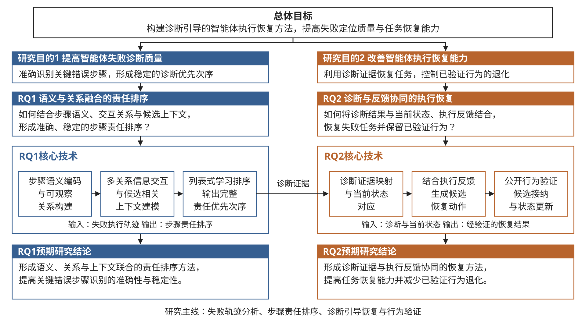

# 总体研究框架与预期成果

本研究以提高智能体失败诊断质量、检验诊断对执行恢复的作用为总体目标。技术路线由责任步骤排序和诊断引导恢复两部分组成，以可执行的软件仓库任务评价二者之间的联系。

图3-1 智能体失败诊断与执行恢复的总体研究框架

## 1 横向总体框架

图3-1采用横向宽幅布局。顶部为总体目标，下方左右两列分别对应失败诊断与执行恢复，每列依次说明研究目的、研究问题、核心技术和预期研究结论。左列研究如何形成责任步骤的优先次序，右列研究如何据此选择恢复行动并管理执行状态；两部分通过诊断证据的信息流连接。

RQ1从执行轨迹出发，结合步骤语义与可观察关系，通过关系交互、候选相关上下文和学习评分形成完整责任排序。其验证包括学习式与提示式基线比较，以及关系、上下文和模型容量等控制实验。

RQ2将责任排序映射为当前状态下可使用的恢复证据，再结合公开反馈生成候选动作。候选经过行为验证后被接纳或拒绝，系统保存相应状态并决定继续恢复或终止。完整外部系统比较评价恢复效果，内部控制分析诊断、关系、反馈和保护策略的作用。

## 2 研究问题与核心技术

表6-1 两项研究问题的技术与评价关系

| 研究问题 | 核心技术 | 主要输出 | 评价依据 |
|---|---|---|---|
| RQ1：责任步骤排序 | 多关系步骤表示、候选相关上下文、列表式学习排序 | 原始步骤坐标上的分数与完整次序 | 排序准确性、稳定性及诊断成本 |
| RQ2：诊断引导的执行恢复 | 历史证据与当前状态映射、反馈驱动动作生成、行为保护与回退 | 最终执行状态与完整恢复过程 | 恢复效果、进展保持、代价及机制差异 |

责任排序为恢复提供可检查的优先线索。恢复过程同时受到当前状态、动作可执行性和验证反馈的影响，因此诊断质量与恢复效果分别评价。图中的连接表示方法间的信息流，也对应后续需要检验的研究假设。

## 3 预期研究成果

表6-2 预期成果及其研究内容

| 成果 | 主要内容 | 预期用途 |
|---|---|---|
| 责任步骤排序方法 | 步骤语义、关系与候选上下文的联合建模 | 为失败分析提供准确、稳定且可回查的诊断线索 |
| 诊断引导恢复方法 | 从历史责任证据到当前行动的映射，以及基于行为观察的状态管理 | 研究诊断如何参与实际恢复并影响执行结果 |
| 分层实验评价 | 诊断主比较、完整系统比较、模块控制与适用条件分析 | 区分整体效果与具体机制贡献 |
| 研究实现与学位论文 | 方法实现、数据划分说明、实验设置和失败案例分析 | 支撑研究复现与后续模块扩展 |

预期成果强调方法、验证与认识三个层面。除评价性能外，还将总结诊断无法转化为有效行动、关系信息不足以及严格保护妨碍继续探索等情形，形成对方法适用范围的系统分析。

## 4 与配套方案的关系

总体框图用于呈现研究结构。模型与恢复流程的具体步骤见[开题报告](01_开题报告_V5_六章完整稿.md)；对照方法见[基线方案](03_失败诊断与执行恢复的基线方案.md)；样本组织与信息隔离见[数据方案](04_数据来源与划分方案.md)；评价指标、阶段安排和扩展方向见[整体实验框架](05_整体实验设计与研究计划.md)。
