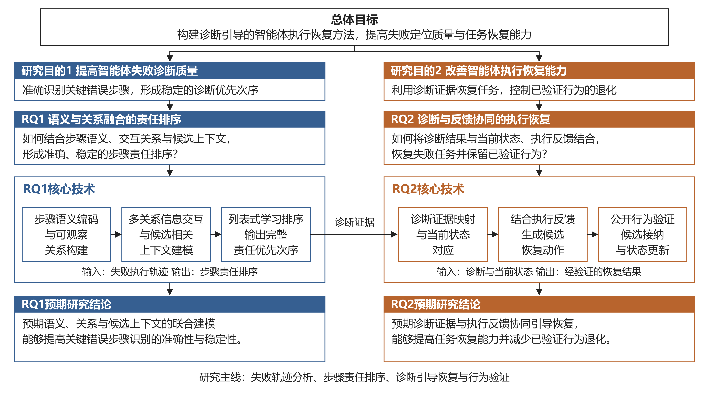
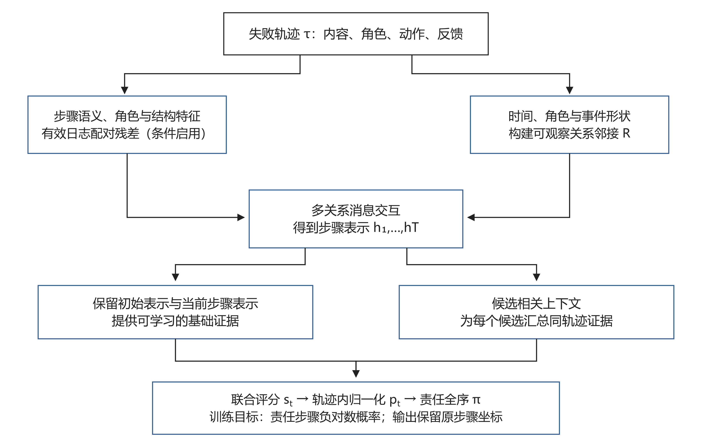
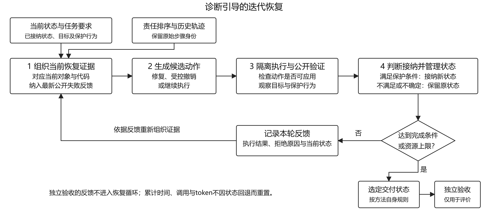
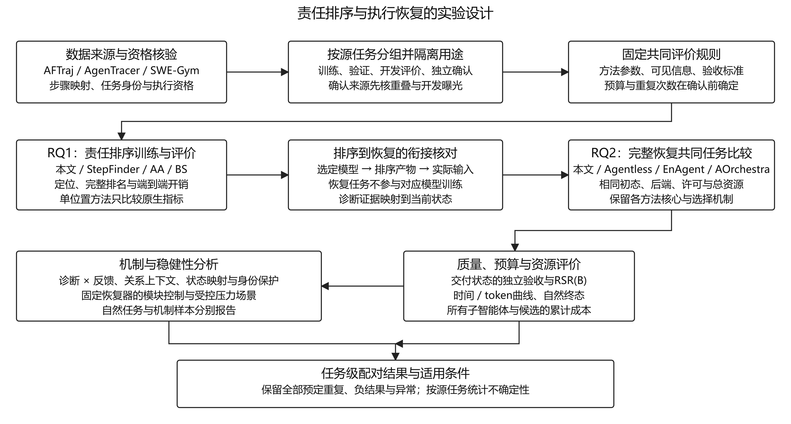

# 基于学习排序的智能体失败诊断与执行恢复方法研究

开题报告

## 第一章 研究背景与国内外研究现状

### 1.1 研究背景

随着大语言模型在语言理解、指令遵循和多步推理方面的能力提升，其应用逐步由文本生成与问答扩展到需要规划和执行的复杂任务。自然语言不仅用于表达用户需求，也成为组织任务推理和调用外部能力的重要方式，使模型能够在获取信息、执行动作和接收反馈的过程中持续推进任务。[1,2,3] 在此基础上，如何将模型的推理能力转化为实际环境中的任务完成能力，成为大语言模型应用研究的重要问题。

基于大语言模型的智能体通过连接模型、工具与环境，为解决这一问题提供了系统化途径。智能体根据任务目标选择行动，利用工具获取信息或改变环境，并根据执行结果调整后续决策；多智能体系统则进一步通过角色分工与信息交互组织复杂任务。[3,4,5] 相较于单次输出，智能体的任务过程包含连续的判断、动作与状态变化，模型能力需要通过这些环节的协调才能发挥作用。

智能体研究已覆盖科学实验、网页操作、计算机使用和软件工程等多种场景。在科学研究中，模型可以与专业工具及实验设备连接；在网页和桌面环境中，系统需要将自然语言需求转化为实际操作；在软件任务中，系统需要理解项目、修改代码并利用执行反馈检验结果。[6,7,8,9] 这些应用具有不同的环境和行动形式，但都要求智能体在多步交互中维持目标、利用反馈并完成任务，因而对执行过程的可靠性提出了共同要求。

然而，具备推理、工具使用或协作能力，并不意味着智能体能够稳定完成复杂任务。已有实证研究发现，多智能体执行中的失败涉及任务分解、信息协调、行动偏离和验证不足等多个环节，错误还可能通过后续交互传播，使最终失败难以仅由某一次输出解释。[10,11] 当轨迹包含较多步骤和角色时，局部异常与任务失败之间的联系更加复杂，需要结合执行内容及步骤之间的关系进行分析。

任务评价能够说明一次执行是否成功，却不能直接确定应当检查和改进哪个环节。细粒度失败归因研究因此开始关注责任智能体和关键错误步骤，利用执行轨迹为系统改进提供依据。[12] 进一步地，定位到可疑步骤之后，仍需确定当前环境中可以采取什么行动，并通过执行检验修正是否有效；失败解释与任务恢复由此构成相互联系的研究过程。[13]

对于已经改变环境的任务，恢复还涉及已有状态与执行进展。重新尝试可能修正原有问题，也可能重复已经完成的工作或影响先前建立的有效行为；恢复方式需要与上下文、环境状态及操作依赖相协调。[14,15] 因此，智能体可靠性研究不仅需要提高失败诊断质量，还需要研究诊断如何参与后续行动，以及恢复过程中如何兼顾任务推进与已有进展。

基于上述背景，本文围绕智能体的步骤级失败诊断与执行恢复开展研究：通过学习排序组织失败轨迹中的责任线索，再结合当前状态和执行反馈指导恢复，并利用可执行验证分析恢复效果。研究以智能体可靠性为出发点，以软件任务作为主要验证场景，考察诊断、行动与状态管理之间的联系。

### 1.2 国内外研究现状

#### 1.2.1 智能体构建与执行可靠性

Yao等于2023年提出ReAct，将推理、动作与环境观察交替组织，使语言模型能够依据外部反馈调整后续行动。[3] Wu等于2024年提出AutoGen，通过可编程会话连接具有不同职责的智能体；Hong等同年提出MetaGPT，以角色分工和结构化中间产物组织协作。[4,5] 这些工作推动了语言模型由单次生成向持续执行及协同求解的发展。

随着执行结构的发展，系统可靠性也成为专门的研究对象。Cemri等于2025年提出多智能体失败分类体系MAST，通过执行轨迹分析，将失败归纳为系统设计、智能体间失配和任务验证等类别。[10] 该研究从过程层面揭示了多环节失效，为进一步研究责任定位和纠错提供了依据。由此，智能体研究开始同时关注系统如何完成任务，以及失败发生后如何理解和改进执行过程。[10,12]

#### 1.2.2 失败归因与责任步骤排序

Zhang等于2025年提出Who&When，将自动失败归因具体化为责任智能体与决定性错误步骤的识别，并比较完整日志一次判断、二分搜索和逐前缀检查等定位方式。[12] 该工作建立了细粒度归因的评价对象，也表明任务结果评价与具体责任定位需要分别研究。

Sun等于2026年提出SDBL，先约束可疑范围，再进行责任位置识别。[16] 北京大学的Zhu等同年提出StepFinder，结合步骤语义、时序与角色交互学习责任分数，将部分诊断计算由生成式推理转移到专门的学习模型。[11] 两类方法分别从搜索范围和轨迹表示改善定位，为研究步骤排序的准确性与成本提供了直接参照。

监督与观测条件也影响归因研究的设置。Kong等于2026年提出Aegis，Zhang等同年提出AgenTracer，分别利用错误生成或故障诱发构造归因学习数据；Chen等同年提出TraceElephant，强调工具返回、环境信息和系统配置等完整观察对责任判断的作用。[17,18,19] 这些研究表明，诊断模型需要在明确的责任定义与信息条件下评价。本文据此关注步骤语义与可观察关系的联合表示，并将排序输出用于组织后续检查的优先次序。

#### 1.2.3 反馈纠错与可恢复执行

Madaan等于2023年提出Self-Refine，使语言模型交替生成反馈与修订结果；Shinn等同年提出Reflexion，将执行反馈转化为语言反思并用于后续尝试。[20,21] Gou等于2024年提出CRITIC，通过外部工具验证输出，再依据反馈进行修改。[22] 与此同时，Huang等于2024年研究缺少外部反馈时的推理自纠错，指出反复要求模型修改答案并不能稳定带来改善。[23] 这些工作说明，纠错方式需要结合反馈来源与任务条件理解。

当动作已经改变环境时，恢复还需要处理上下文与执行状态。Chang和Geng于2025年提出SagaLLM，将上下文管理、验证与事务补偿用于多智能体规划。[14] Zhuang等于2026年在AgentRewind预印本中研究上下文与受控环境的同步恢复，并保留恢复记忆；Yu等同年在Rollback-Induced Reflection预印本中联合考虑回退位置与反思保留。[15,24] 相关研究使恢复对象由输出修订扩展到状态、依赖和失败经验，但其适用条件仍取决于具体环境的控制与验证能力。

#### 1.2.4 诊断引导恢复与软件任务求解

软件任务为研究执行反馈与持续修复提供了具体场景。Xia等于2025年发表Agentless，通过分层定位、补丁生成与验证选择完成仓库级问题求解；Li等同年提出PatchPilot，依据验证反馈继续细化修复。[25,26] 天津大学与字节跳动的Tian等于2026年提出EnAgent，通过候选生成、剪枝与工具辅助选择组织集成求解；Ruan等同年提出AOrchestra，通过按需创建子智能体组织复杂任务执行。[27,28] 这些工作为比较完整执行流程的效果提供了方法基础。

诊断与行动之间的联系也受到直接研究。Guo等于2025年提出SyncMind，研究智能体认知与实际代码状态不同步时的恢复。[29] Ma等于2026年提出DoVer，通过实际干预与重新执行检验故障解释；Wang等同年在DARC预印本中利用开发阶段的任务族失败分析约束恢复策略，并在测试前冻结策略。[13,30] 这些方法已经研究诊断参与纠错，但任务族层面的策略选择、单条轨迹的步骤排序，以及变化状态中的局部修复具有不同的输入和决策对象。

Vasudev等于2026年在失败预测与预防预印本中进一步指出，较高的失败预测能力并不自动带来有效干预，执行中途的纠偏也可能破坏原本能够成功的过程。[31] 因此，本文将分别评价责任排序与实际恢复，并在固定恢复器中比较不同诊断输入，分析诊断是否改变动作选择及最终结果。

### 1.3 现有问题与研究意义

现有研究已为智能体构建、失败归因、反馈纠错和状态恢复建立了方法基础，但这些环节之间仍有需要结合实际执行验证的问题。步骤排序方法可以给出值得优先检查的位置，恢复方法可以利用反馈修改行为，状态管理可以约束已有执行的改变；本文关注的是这些能力如何形成有效配合，而不以采用排序、关系表示或回退接口本身作为创新。

首先，责任步骤的识别需要同时理解局部内容和执行关系。已有学习式方法已利用时序与角色信息，观测研究则说明可用证据会影响归因判断。[11,19] 在此基础上，本文拟研究多关系表示与候选相关上下文如何参与步骤评分，在相同信息、监督与模型容量条件下，分析其对定位准确性、排序稳定性和诊断成本的作用。这一研究有助于明确不同轨迹信息对于失败分析的实际价值。

其次，历史责任位置与当前恢复动作之间需要建立对应关系。诊断记录的是已经发生的执行，而恢复作用于经过多步变化后的当前环境；认知失配恢复和可执行干预研究分别说明了重新理解状态与检验修正效果的重要性。[29,13] 本文拟将责任线索映射到当前可检查对象，并结合公开执行反馈生成与验证恢复候选，进一步分析诊断质量在何种条件下能够转化为任务恢复收益。

最后，恢复过程需要协调获得新进展与保持已有行为。上下文恢复、补偿和反思保留提供了不同的支持方式，但具体行为在修改后是否仍然成立，需要根据实际执行判断。[14,15,24] 本文拟记录已验证行为的身份与结果，通过候选接纳、拒绝和回退管理状态，并研究严格保护与受控探索之间的关系。预期由此形成对恢复效果、行为退化与执行代价的联合分析。

软件任务中的代码修改、工具记录和可执行测试，使上述联系能够在明确的状态与反馈条件下观察。[32,9,33] 本文以此作为主要验证场景，通过诊断比较、完整系统比较和模块控制，分别考察失败定位、任务恢复及具体机制贡献。研究预期形成责任排序与诊断引导恢复方法，并总结其有效条件，为具有相似执行与验证条件的智能体任务提供可进一步检验的研究依据。

## 第二章 研究目标与问题定义

### 2.1 研究目标

本研究面向大语言模型智能体在多步骤任务中出现的执行失败，拟构建以步骤级责任排序为诊断基础、以环境反馈为验证依据的执行恢复方法。总体目标是提高失败轨迹中关键错误步骤的识别质量，并使诊断结果能够支持后续恢复决策，从而改善智能体在复杂任务中的可靠执行能力。

围绕这一目标，研究工作分为相互衔接的两个部分。第一部分研究失败诊断，通过联合建模步骤语义、交互关系和上下文信息，形成对完整执行轨迹的责任排序。排序结果既用于判断最值得检查的步骤，也用于组织后续恢复过程需要的历史证据。第二部分研究执行恢复，将责任排序与当前环境状态、工具反馈相结合，生成并验证恢复动作，在推进任务目标的同时约束对已有正确行为的损害。

两部分工作的关系体现为诊断信息向恢复决策的传递。诊断模块回答“哪些步骤应优先检查”，恢复模块回答“在当前状态下应如何修正并继续执行”。已有自动失败归因研究将责任主体和错误步骤作为预测对象，而干预式调试研究进一步通过执行变化检验错误解释的作用。[12,13] 本研究据此分别评价诊断质量与恢复效果，并通过控制实验考察二者之间的联系。

### 2.2 研究问题

**RQ1：如何融合步骤语义、交互关系与候选上下文，提高失败轨迹的责任排序质量？**

执行轨迹由多次推理、工具调用和环境观察组成。Zhu等于2026年提出的StepFinder通过时序语义建模与角色感知交互实现逐步骤评分，表明专门的轨迹表示能够用于细粒度失败定位。[11] 在此基础上，本研究拟进一步考察不同可观察关系如何参与信息传播，以及同一段上下文对不同候选步骤是否具有不同的诊断价值。研究重点是形成对全部步骤的相对优先次序，并分析其准确性、稳定性、端到端推断开销及适用范围。

**RQ2：如何结合责任排序、当前状态与执行反馈，实现任务恢复并保持已验证行为？**

已有研究分别利用反思记忆、工具反馈和回退机制改善智能体行为，近年的研究还直接探索了诊断与选择性纠错之间的联系。[21,22,34,30] 本研究拟将RQ1得到的责任排序转换为与当前状态相匹配的恢复证据，结合环境反馈选择修复动作，并通过行为验证决定是否接纳候选状态。评价将同时关注任务是否恢复、恢复需要的资源以及过程中是否损害已验证行为。

### 2.3 研究对象与基本概念

本研究中的智能体，是以大语言模型承担推理或决策功能，并通过工具与外部环境持续交互的任务执行系统。研究对象可以是一名智能体的连续执行，也可以是多名智能体协作形成的统一轨迹。ReAct将推理与行动交替组织，提供了观察智能体执行过程的典型形式；Who & When则进一步将失败轨迹中的责任主体与关键步骤作为自动分析对象。[3,12]

**执行轨迹与责任步骤。** 执行轨迹是同一任务产生的有序步骤记录，包括推理、动作、观察及相关角色信息。责任步骤是依据数据标注标准确定、与任务失败具有关键联系的步骤，用作诊断模型的监督目标。不同来源沿用各自的原始错误定义，模型输入和输出均保留与原始步骤位置的对应关系。

**责任排序与恢复证据。** 责任排序给出全部步骤的诊断优先次序，用于确定应先检查哪些历史行为。恢复证据在此基础上进一步结合当前对象、代码内容和公开反馈，说明哪些历史信息仍能支持当前行动。两者分别用于诊断评价和恢复决策。

**当前状态与恢复动作。** 当前执行状态包括已接纳的环境内容及已经获得的公开观察。恢复动作是针对该状态提出的修正、受控撤销或继续执行操作，其可用范围由具体环境决定。

**已验证行为与交付状态。** 已验证行为是当前已接纳状态中通过指定验证条件的具体行为，记录其身份和结果。交付状态是方法在终止或预算截止时按自身规则选定、可实际提交的结果，用于独立验收。

责任排序是一种面向诊断任务的预测结果，其含义取决于可见信息和标注标准；需要通过重新执行判断的因果作用，则在恢复实验中另行分析。区分责任预测与有效干预，有助于分别衡量诊断线索的可靠性，以及使用这些线索能否改善真实任务执行。[13,31]

### 2.4 理论基础与方法依据

学习排序为本研究提供了统一组织诊断候选的建模方式。Cao等于2007年提出列表式学习排序，将同一查询下的候选列表作为学习单位，通过联合考虑候选之间的相对关系优化排序。[35] 本研究拟将这一思想用于同一失败轨迹中的步骤比较：模型为各步骤计算责任分数，通过轨迹内联合训练提升标注责任步骤的排序位置，并在推断阶段输出完整次序。

关系表示学习为处理异质步骤联系提供了方法基础。Schlichtkrull等提出的关系图卷积网络通过区分关系类型进行信息聚合，支持多关系数据的表示学习。[36] 本研究拟根据轨迹中实际可观察的时序、角色及动作关联构建关系结构，使模型能够在保留步骤语义的同时聚合相关证据。关系结构在这里承担组织信息的作用，其对失败诊断的贡献将通过消融实验加以检验。

恢复控制则以反馈和状态变化为中心。Shinn等于2023年提出Reflexion，将执行反馈转化为可供后续决策使用的语言记忆；Gou等于2024年提出CRITIC，通过工具交互获得纠错依据。[21,22] 在更早的长事务研究中，Garcia-Molina和Salem于1987年提出Sagas，使用补偿操作处理长过程中的局部失败；这一研究说明了显式组织操作与恢复关系的重要性。[37] 本研究结合智能体执行环境的特点，采用候选状态验证与接纳机制管理恢复过程，具体效果以可观察行为和任务终态为依据。

## 第三章 研究内容与技术路线

### 3.1 总体技术路线

本研究拟形成由失败轨迹诊断到当前状态恢复的完整技术路线，如图3-1所示。输入包括任务描述、失败执行轨迹和可获取的环境信息；输出包括步骤责任次序、经过验证的恢复结果及对应执行记录。技术路线由责任排序与执行恢复两部分组成，两者通过具有明确步骤来源的诊断证据连接。

图3-1 智能体失败诊断与执行恢复的总体研究框架

首先，对不同来源的执行记录进行统一表示，在保留原始步骤位置的基础上提取语义和结构信息。随后，利用多关系信息交互和候选相关上下文计算各步骤的责任分数，形成诊断优先次序。恢复阶段根据该次序选择与当前状态有关的证据，结合失败反馈生成候选动作，并通过环境执行结果检验其效果。最后，依据任务完成情况和行为保护条件确定候选状态的接纳、回退及终止。

总体框架中的两个研究问题保持独立的评价目标。RQ1关注责任排序能否改善错误步骤识别；RQ2关注这些诊断信息能否在实际恢复中发挥作用。完整方法的外部比较与内部机制分析均围绕上述两项问题展开。

### 3.2 责任步骤排序模型

#### 3.2.1 步骤语义与多关系表示

本研究拟将失败轨迹中的每个步骤表示为语义内容、角色信息与公开结构特征的组合。语义内容用于刻画该步骤的意图、动作及获得的反馈，角色信息用于区分协作主体，结构特征用于表示步骤在执行过程中的相对位置和事件属性。为保持不同来源之间的可比性，数据预处理将统一步骤边界，并保留模型输入与原始记录之间的对应关系。

在步骤语义编码的基础上，拟构建能够反映执行组织方式的关系结构。基础关系包括时间上相邻的步骤以及同一角色的连续行为；对于具有明确动作与观察配对信息的轨迹，再引入相应事件关联。不同关系分别聚合信息，随后与步骤自身表示融合。通过这种方式，模型能够同时利用局部语义变化和跨步骤联系，而不必将全部关系压缩为单一的时间序列。

关系构建将遵循可观察信息约束。若某类轨迹没有提供可靠的角色或事件对应关系，则使用该来源实际具备的关系信息。实验将进一步比较关系类型、关系重合程度及其对排序的影响，以识别哪些结构信息具有稳定的诊断价值。该设计以多关系表示学习为基础，具体面向智能体轨迹的结构选择与融合方式属于本研究拟解决的问题。[36]

#### 3.2.2 候选相关上下文与学习排序

失败诊断需要结合轨迹整体理解局部步骤。一个步骤是否应优先检查，既取决于其自身内容，也取决于前后的观察与其他步骤对它的依赖。本研究拟为每个候选步骤分别构建上下文表示，使模型针对不同候选选择不同的相关证据。例如，对于一条错误工具调用，后续的异常观察可能具有较高诊断价值；对于错误任务分解，则需要结合其影响的后续行为理解问题。

候选相关上下文通过可学习的信息聚合机制形成，并与多关系交互后的步骤表示共同用于责任评分。模型输出保留所有步骤的分数与原始位置，以便根据不同任务需求选择首个候选或前若干候选。图3-2展示了责任排序模块的主要数据流。

图3-2 融合步骤语义、关系信息与候选上下文的责任排序方法

训练时，以完整轨迹作为候选列表，利用标注责任步骤指导分数学习。列表式目标使不同步骤在同一轨迹内共同参与比较，与本研究输出完整诊断次序的目的相一致。[35] 模型选择将结合排序质量和推断开销，评价中同时观察首次命中、前若干候选覆盖以及正确步骤的平均排序位置。

该模块的研究重点是语义、关系和上下文的互补作用。为分析性能变化的来源，拟设置仅语义表示、仅结构特征、固定上下文以及不同关系组合等控制条件，并保持训练数据和模型规模尽可能一致。通过对轨迹长度、任务领域和角色组织形式的分层分析，进一步研究方法在不同执行结构中的适用性。

### 3.3 诊断证据与当前状态的对应

诊断输出描述历史执行中的可疑步骤，恢复动作则作用于当前环境。两者之间需要建立明确的对应关系。举例而言，较早的错误编辑可能已被后续编辑部分覆盖，而某次错误判断也可能没有直接可撤销的操作。因此，本研究拟在诊断模块与恢复模块之间设置证据映射过程，将责任排序转换为当前可用的历史行为、相关对象和失败线索。

证据映射首先识别候选步骤中的动作对象及其可用信息，再检查这些信息与当前状态的关系。在软件验证场景中，该过程对应于将历史编辑、当前代码片段和测试反馈进行对照，辨别可修正的位置及可能受影响的相关组件。对于不能直接应用的历史片段，仍可保留其解释作用，并由生成模块基于当前内容提出新修复。

这一过程拟保留两类输出：一类是原始轨迹上的完整责任排序，用于评价诊断质量；另一类是满足当前状态要求的恢复证据，用于指导行动。通过分别保存和评价这两类结果，可以分析排序差异在何种条件下转化为证据差异，以及证据差异是否进一步影响实际恢复路径。

### 3.4 反馈驱动的迭代恢复

恢复模块拟以当前已接纳状态为起点，综合任务要求、责任排序、映射后的历史证据和最新公开反馈，逐轮生成、验证并更新恢复结果。每轮首先明确尚未满足的目标行为，再检查优先诊断步骤与当前代码、动作对象和失败现象的对应关系，形成供生成模块使用的证据。上一轮验证产生的错误位置、失败原因和候选拒绝原因将参与下一轮决策，使恢复过程能够根据实际执行变化调整方向。

候选动作在独立副本中执行。在软件任务中，动作主要是基于当前代码提出修复；具有明确撤销语义的历史操作也可作为受控撤销候选。动作应用前检查编辑对象、格式和适用位置，应用后运行允许访问的公开验证，观察目标行为和已保护行为的变化。不能应用、执行异常或验证结果不确定的候选，保留相应原因，作为后续判断的公开反馈，不据此宣称任务已恢复。

候选状态的验证与接纳分开进行。验证提供行为结果，状态管理依据第三章3.5节的保护条件决定是否接纳。接纳后，以新状态及其已验证行为集合继续恢复；拒绝后，保留此前状态，并使用该候选的反馈调整下一轮证据和动作。后续候选仍由生成模块结合当前状态提出，避免将恢复过程限定为预先枚举的固定补丁集合。

图3-3按一次恢复循环展示主要流程：组织证据、生成候选、公开验证、接纳判断、更新或保留状态，再判断是否终止。任务达到公开完成条件，或调用、token、时间等资源达到预定上限时，结束候选生成，输出按方法规则选定的可交付状态。独立验收随后评价交付结果，其反馈不返回候选生成过程。

图3-3 诊断证据、公开反馈与状态更新共同驱动的迭代恢复流程

该设计使责任排序在每轮恢复中具有明确用途：影响历史证据的检查顺序与组织方式，再由当前状态和验证反馈决定其行动价值。实验将固定生成器和验证条件，分别控制排序、证据映射及反馈组织，考察诊断信息是否改变恢复路径，以及这些变化能否提高有限资源内的任务完成率。

### 3.5 已验证行为的保护与状态更新

本研究拟在恢复过程中显式记录已经通过验证的具体行为，避免只根据通过数量判断是否取得进展。若候选状态解决了部分目标，却破坏了此前已通过的另一项目标，仅观察总数量可能无法揭示这种替换。因此，状态管理将同时记录行为身份和验证结果，以支持更细粒度的接纳判断。

基本接纳条件包括普通保护行为保持通过，以及先前要求保留的目标行为继续通过。候选满足条件后，更新已接纳状态和已验证行为集合；否则保留当前状态，并记录候选被拒绝的原因。这里的保护范围由验证条件确定，研究将考察这一约束在减少行为退化和提高恢复成功率之间的关系。

对于可能需要暂时退步才能完成的修复过程，拟在完成基本方法评价后，进一步研究可恢复分支与最佳状态保留机制。该扩展将允许系统在保留可返回状态的条件下进行受控探索，并通过真实执行比较保守接纳与分支探索的差异。研究将重点分析恢复质量、行为损害和额外资源之间的权衡，而不预设约束越严格效果越好。

### 3.6 方法的模块化实现

拟实现的系统包括轨迹表示、责任排序、证据映射、候选生成、行为验证和状态管理模块。各模块通过明确输入输出连接：排序模块保留原始步骤位置，证据映射模块保留历史信息与当前状态的关系，恢复模块保留动作和验证结果。这样的组织方式便于在相同实验条件下替换单个模块，分析其对最终效果的影响。

系统还将保存必要的模型输入、工具观察、候选状态与资源使用记录，以支持运行中断后的继续执行和实验复查。后续研究可以在既有接口上扩展关系表示、证据选择或状态探索策略，并增加相应对照实验，无需改变诊断与恢复两项研究问题之间的基本关系。

## 第四章 拟解决的关键问题与预期创新

### 4.1 复杂执行轨迹中的诊断信息组织

本研究首先需要解决如何在较长、异质的执行记录中组织对责任判断有用的信息。StepFinder已经研究了时序语义与角色交互，依赖引导的诊断研究也尝试利用跨步骤联系缩小分析范围。[11,38,39] 因此，本研究的技术重点是关系信息与候选上下文如何配合，使模型能够针对具体步骤汇总相关证据，并在不同轨迹结构下保持有效性。

拟采用的解决思路是在统一语义表示上引入可观察关系，再通过候选相关上下文完成责任评分。评价将分别控制位置特征、输入内容、参数规模与关系结构，考察性能提升是否来自预期的信息组织机制。这一问题对应RQ1，也构成后续恢复过程获得可靠诊断线索的基础。

### 4.2 历史诊断与当前恢复动作之间的衔接

第二个关键问题是如何使历史轨迹中的责任判断能够服务于当前状态下的行动。Ma等的DoVer通过干预检验失败解释，Wang等2026年的诊断恢复研究进一步探索按诊断结果选择纠错策略。[13,30] 这些工作表明，诊断与恢复的联系需要在具体行动层面进行研究。

本研究拟通过证据映射明确历史步骤、当前对象及可执行动作之间的关系。实验将固定恢复器，分别接入本文责任排序、强诊断基线和不采用学习排序的证据组织方式，比较由此产生的证据选择、动作与任务终态。该设计旨在回答诊断排序在何种条件下具有实际使用价值，并区分排序作用与增加生成次数带来的收益。

### 4.3 恢复推进与行为保留之间的协调

第三个关键问题是恢复过程中如何同时推进任务并控制已有行为的退化。反馈纠错方法能够根据验证结果继续修改，状态回退研究则为恢复到可用执行位置提供了机制基础。[26,40,34] 在此基础上，本研究拟进一步观察具体行为身份的变化，并将其纳入候选状态的接纳与回退决策。

拟设置按通过数量保护、按具体行为保护以及仅保护普通行为的比较条件，考察不同规则的实际决策差异。对于恢复路径中出现的暂时退步，结合可恢复分支分析最终收益与资源代价。通过这种方式，明确状态保护在不同失败类型与恢复阶段中的作用范围。

### 4.4 预期创新点

第一项预期创新是面向智能体失败轨迹的语义、关系与候选上下文联合排序方法。该方法拟将轨迹中的可观察交互联系纳入步骤表示，并针对候选步骤构建差异化上下文，形成完整责任次序。预期在强时序语义学习方法的基础上，提高关键步骤识别的准确性与稳定性，并明确不同信息来源的贡献。

第二项预期创新是面向当前执行状态的诊断引导恢复方法。该方法拟建立责任排序与可执行恢复证据之间的对应，结合环境反馈进行候选生成和验证，并通过状态管理减少对已有正确行为的损害。预期形成可分析的诊断到行动过程，阐明责任排序、反馈利用与行为保护对恢复效果的作用。

以上创新围绕具体问题、方法和评价展开。责任排序方法的有效性将通过跨任务与不同划分的对照检验，恢复方法的有效性将通过共同任务上的完整运行和机制实验检验。预期成果既包括方法本身，也包括对其适用条件的解释。

## 第五章 数据来源与实验设计

### 5.1 数据构造与训练、验证和确认划分

实验围绕责任排序质量、完整恢复效果及诊断到行动的作用机制展开。数据体系采用AFTraj、AgenTracer coding和SWE-Gym配套执行轨迹：前两类提供责任步骤标注，后一类提供能够重新执行并检验修复结果的软件任务。[12,18,33] 表5-1区分原始发布规模与本研究已经整理的样本，避免将整个数据集规模视为实际实验分母。

表5-1 数据来源、规模与当前研究样本

| 数据来源 | 原始发布规模 | 当前已整理样本 | 实验用途 |
|---|---|---|---|
| AFTraj | 2,276条轨迹，其中正常1,162条、失败1,114条，覆盖数学、编码及智能体任务[41] | 731条失败轨迹，对应716个源任务组；另有120条、120个不同源任务组的开发子集 | 责任步骤排序、任务类型与轨迹结构分析 |
| AgenTracer coding | 本研究采用的扩展发布版中，coding官方训练部分1,141条、测试部分127条[42] | 614条训练与验证来源池，包括coding 320条、math 294条；固定coding评价集363条 | 软件相关轨迹上的排序评价及训练划分稳健性 |
| SWE-Gym及配套OpenHands轨迹 | SWE-Gym含2,438个Python软件问题[33] | 已整理23个不同issue的恢复来源池 | 当前可执行恢复研究的开发与资格核验 |

AFTraj开发子集在五个任务类型与标注来源组合中各取24条，按领域为coding 24条、math 48条、agentic 48条，用于流程调试和细节分析；这些样本已参与方法开发，不单独作为新的独立确认集。AgenTracer的614条来源池和363条固定评价轨迹均来自所采用版本的官方训练部分，并按源任务组去重隔离，不能将363条评价集称为官方测试集。不同发布版本的数据规模分别注明，本研究使用扩展发布版，不把论文中的另一版本规模替代为实际实验数量。

所有划分以原始任务为单位。同一问题产生的多条轨迹、错误变体及派生样本放入同一任务组。数据清洗仅处理步骤边界、可读格式和原始位置映射；真实错误标签遵循来源定义。排除条件依据缺失轨迹、标注无法映射或执行环境不可用等资格因素确定，并保留数量及原因，不按方法运行后的胜负筛选样本。

表5-2 训练、验证、开发评价与独立确认设计

| 数据与阶段 | 训练与模型选择 | 评价安排 | 独立性及规模说明 |
|---|---|---|---|
| AFTraj开发评价 | 716个源任务组采用五折分组划分；每个外层训练部分再划分内部训练与验证组，采用三次预定初始化 | 每条轨迹仅由未训练该任务组的模型产生外层预测，汇总731条结果 | 调参依据内部验证；已经用于研究选择的外层结果属于开发评价 |
| AFTraj独立确认 | 固定模型结构、训练流程和输入定义后，不再依据确认集调参 | 官方测试部分含163条失败轨迹，作为候选确认来源 | 先审查源任务重叠与历史曝光，最终报告实际合格数量，163条不预先等同于独立任务组数 |
| AgenTracer开发评价 | 三个分组划分A、B、C，每个划分训练492条、验证122条；训练含coding 256条、math 236条，验证含coding 64条、math 58条 | 在同一363条coding评价集上比较三个训练划分，每个划分采用三次预定初始化 | 训练、验证和固定评价组相互隔离；固定评价集已参与开发 |
| AgenTracer独立确认 | 采用开发阶段确定的训练与选择规则 | 官方coding测试部分127条作为候选确认来源 | 完成任务身份和曝光审查后冻结实际数量；不依据确认结果重新选择模型 |
| 恢复开发与确认 | 23个已整理issue用于接口核验、恢复机制开发和预算校准 | 从同一来源中选择未参与开发的issue，逐题核验失败状态、反馈和独立验收条件，再固定共同任务集 | 确认任务数以实际通过资格核验的issue数为准；自然失败与受控构造状态分别报告 |

恢复样本由任务描述、初始代码状态、可见失败轨迹、公开反馈和独立验收条件共同构成。先核对issue、仓库版本及轨迹之间的对应关系，再确定恢复起点。自然失败样本保留智能体实际执行形成的错误状态；受控构造样本用于制造特定的状态变化或保护冲突，单列为机制分析。23个issue表示当前来源池，既有21题计划、18题排序发布范围等过程数量，均不替代最终通过资格核验的共同评价数量。

### 5.2 实验流程与共同运行条件

实验依次完成数据资格核验、责任排序训练与评价、排序到恢复输入的衔接、完整恢复比较、预算分析和机制检验。图5-1展示数据与运行结果之间的关系。开发数据用于确定方法细节、运行参数和资源上限；确认阶段采用事先固定的规则，报告所有纳入任务的结果。

图5-1 数据划分、排序评价、完整恢复比较与机制分析的实验流程

责任排序实验先固定任务分组和输入处理，再分别训练本文与StepFinder模型；提示式诊断方法使用相同的可见原始轨迹。模型选择只读取相应验证结果，随后在确定的评价组上产生步骤预测、有效输出情况和资源记录。完整排序的步骤身份映射保持一致，以免截断、位置偏移或清洗差异被误认为排序能力差异。

恢复实验首先固定任务初态、可见信息、工具许可、公开验证范围和验收标准，再分别运行本文、Agentless、EnAgent与AOrchestra。各方法保留自身的定位、生成、验证和选择机制，内部候选数量与迭代规则在实验前确定。外部方法可以形成不同候选与执行路径；共同条件约束其信息和总资源，不强制共用本文生成的候选补丁。

表5-3 完整恢复实验的共同条件

| 条件 | 统一设置 | 记录与核对内容 |
|---|---|---|
| 任务起点 | 同一任务描述、仓库版本与失败状态 | 初态、原始轨迹与允许访问的公开观察 |
| 模型与工具 | 使用共同生成后端；本地诊断模型另行记录 | 生成参数、模型版本、上下文限制及工具权限 |
| 验证 | 同一公开验证许可与最终独立验收标准 | 每次公开检查、最终交付结果及验收结果 |
| 算法部署 | 保留各方法核心阶段，固定内部参数 | 候选规模、迭代次数、选择规则及与论文配置的差异 |
| 资源 | 共同时间与token上限，统一计量边界 | 所有子智能体、候选生成和验证环节的累计使用量 |
| 重复 | 每个issue按预先确定的规则运行三条独立完整轨迹 | 全部重复的终态、预算内结果、异常和删失原因 |

生成后端采用当前实验环境允许的deepseek-flash，专门诊断模型在现有本地环境中运行。更换后端属于单独的稳健性条件，应对所有适用方法采用共同配置；不把更换模型后的结果直接归因于算法改进。独立完整重复从相同初态重新运行，内部候选、投票和已有响应的复用均不计为新增重复，也不将客户端随机种子视为服务端确定性保证。

本文恢复系统还需逐项核对“选定排序模型及训练清单—排序产物—恢复器读取—实际生成请求”之间的联系。恢复任务的源任务组不得参与相应诊断模型训练；恢复器实际使用的排序须来自该评价模型。衔接核对不完整时，仅报告联合流程可行性，不据此认定RQ1对最终恢复具有独立贡献。

### 5.3 比较方法与实验分工

责任排序采用StepFinder、All-at-Once与Binary Search作为比较方法。StepFinder以时序语义、角色交互和步骤评分组织诊断；后两者来自Who & When研究，分别通过一次阅读完整日志和递归缩小日志区间确定责任步骤。[11,12] 三者提供专门学习模型、整体阅读与区间搜索的不同参照。

表5-4 责任排序比较方法及评价范围

| 方法 | 原有诊断机制 | 可直接比较的输出与指标 |
|---|---|---|
| 本文责任排序 | 步骤语义、多关系交互、候选相关上下文与列表式训练 | 完整步骤次序；Top-1、Top-3、Top-5、MRR及效率 |
| StepFinder | 时序语义表示、角色感知交互与步骤评分 | 依据原始步骤分数形成次序，采用共同排序指标及效率口径 |
| All-at-Once | 一次阅读完整轨迹，输出责任判断 | 原生责任位置；Top-1、有效输出率及调用开销 |
| Binary Search | 在轨迹区间中递归判断并缩小范围 | 原生责任位置；Top-1、有效输出率及搜索开销 |

All-at-Once与Binary Search原生输出单个责任位置，不用补齐任意尾部步骤的方式构造完整排序。若另行设计多候选提示扩展，应作为明确的改动版本报告。本文与StepFinder的完整MRR由统一预测结果重新计算，与论文中截断排名指标分别说明。

完整恢复采用Agentless、EnAgent和AOrchestra作为外部比较方法。[25,27,28] Agentless提供结构化的定位、修复和验证流程；EnAgent利用多轨迹推理、候选筛选及集成选择；AOrchestra按需组织子智能体、工具和任务上下文。比较目标是完整方法在共同失败状态上的任务恢复质量、收敛过程与资源代价。

表5-5 完整系统比较与内部控制的分工

| 实验 | 方法或条件 | 回答的问题 |
|---|---|---|
| 完整恢复比较 | 本文完整方法、Agentless、EnAgent、AOrchestra | 诊断引导恢复与固定流程、多轨迹集成、动态任务组织的整体差异 |
| 诊断模块控制 | 固定本文恢复器，分别使用本文排序、StepFinder排序和无诊断条件 | 责任排序是否改变证据、动作与恢复结果 |
| 反馈与证据控制 | 固定生成器、验证与资源，改变反馈组织、上下文选择及状态映射 | 诊断信息如何转化为有效恢复行动 |
| 状态保护控制 | 固定候选执行接口，改变行为保护规则 | 保护对象与接纳条件对退化、进展及成本的作用 |

外部比较纳入已核验正式发表、核心可实施且在当前环境具有有效运行表现的方法，包含2026年正式发表的方法。各基线实施时检查论文、作者源码与本机执行之间的对应关系，说明受资源限制的部署参数。强对手优于本文的结果同样保留；若某方法不满足共同任务资格，应报告具体原因，不将未运行或工程未知填为零。固定恢复器的诊断替换属于模块控制，不能替代完整外部方法比较。

### 5.4 评价指标、资源预算与效率分析

RQ1首先比较Top-1，即首个责任候选与标注步骤一致的比例。原生输出完整排序的方法进一步报告Top-3、Top-5与平均倒数排名MRR；若来源提供多个可接受责任步骤，则沿用该来源的标注规则，并以最先命中的有效责任步骤计算排名。无效位置、无法解析的判断和未输出分别记录，整体Top-1保留全部合格轨迹作为分母，同时报告有效输出率，避免只在成功解析的子集上比较。

诊断效率按从原始轨迹输入到责任位置或完整排序输出的端到端过程计量，包含语义编码、结构构建和评分，不只统计最后一层预测时间。分别报告首次运行与模型已加载后的推断耗时、中位数与95分位耗时、峰值内存或显存、模型调用数和token。训练及离线数据准备成本单独列示，并分析其在重复诊断场景中的摊销条件，不将预计算编码排除后与大模型完整阅读开销直接比较。

RQ2的核心指标是**预算内恢复成功率RSR(B)**：在资源上限B内，方法选定的一个可交付状态通过独立验收的任务比例。验收依据任务目标行为与要求保留的行为共同确定。曾生成但未被方法选中的正确候选，不直接计为交付成功；独立验收也不用于事后挑选候选。每个预算节点评价该节点按方法规则可交付的状态，用于绘制成功率随资源变化的曲线。

表5-6 评价指标与计量对象

| 评价对象 | 指标 | 计量范围及解释 |
|---|---|---|
| 责任定位 | Top-1、Top-3、Top-5、MRR、有效输出率 | 单位置方法报告共同Top-1；完整排序方法补充候选覆盖与排名 |
| 诊断效率 | 总推断时间、P50/P95、峰值内存、调用与token | 包含编码和结构处理；首次运行与已加载运行分别报告 |
| 恢复质量 | 预算内RSR、自然终态成功率 | 依据方法选定的交付结果；自然终态采用相同内部参数 |
| 恢复成本 | 总时间、输入与输出token、模型调用、验证次数、实际费用 | 累计全部候选、选择过程和子智能体的使用量 |
| 成功成本 | 每次成功所分摊的总资源 | 全部已观测完整运行的成本之和除以成功数，包含失败运行；零成功时标为不可计算 |
| 行为保护 | 已接纳状态退化率、受损行为身份与数量 | 观察已经被接纳的状态是否破坏先前通过的行为 |
| 恢复过程 | 有效及重复候选、拒绝原因、证据与动作变化 | 用于解释资源利用和机制作用；被拒绝候选的损害单列 |

时间分析以30分钟为主要预算节点，并在相同内部参数下考察15分钟和60分钟节点。token分析设置低、中、高三个水平，其数值依据开发任务的实际调用需求在确认实验前确定；输入和输出token合并计量，包含所有子智能体。研究一个资源维度时固定其他资源上限，分别绘制时间预算与token预算曲线，避免将同时改变多项限制后的差异解释为单一因素作用。

完整运行还报告保持内部参数不变、取消外部科研时间截断后的自然终态。若采用更大候选数或更多迭代，其结果作为另一部署条件，不能视为纯粹延长外部预算。保留状态后继续执行沿用原有累计时间与资源；费用未知、资金不足或进程保护导致的停止标明删失，不称为自然算法失败，也不覆盖先前预算内未完成的记录。

预算评价的候选快照在执行期间保存，独立验收在相应运行结束后进行，反馈不进入后续模型请求。端到端时间包含实际工具执行、验证和恢复控制；共享资源排队造成的等待与算法运行耗时分别列示，并报告交付所需的总历时。成本统计既列全部任务，也列成功任务的条件分布，避免只展示成功样本的平均时间。

预期优势作为实验假设提出：多关系与候选上下文可能改善长轨迹和跨步骤错误传播的定位；专门排序模型可能在重复诊断中降低推断成本；诊断引导的定向恢复可能在较紧预算下减少无效搜索；按行为身份保护可能降低已有正确行为的替换性损害。各假设分别用质量、成本、分层与机制数据检验，不能由单题通过或自然终态相同直接推得。

### 5.5 消融实验与诊断到行动的机制分析

消融实验围绕具体信息来源和决策机制展开。RQ1改变模型结构时，使用相同源任务划分、语义输入、训练与选择流程，控制表示维度、参数规模及训练资源，重新训练对应条件。仅在推断时遮蔽或置换信息的实验另称为敏感性分析，以免将输入扰动与真实模型消融混为一谈。

表5-7 责任排序的消融与敏感性实验

| 控制因素 | 比较条件 | 主要观察 |
|---|---|---|
| 多关系交互 | 完整模型与去除关系传播的语义评分模型 | 关系信息对定位、排名及不同轨迹结构的增量 |
| 候选相关上下文 | 候选相关聚合与统一全局上下文；补充去除上下文条件 | 差异化上下文是否提高候选区分能力 |
| 关系类型 | 分别去除时序、同角色或可观察事件关系并重新训练 | 各关系的贡献、重合及来源依赖 |
| 信息与模型规模 | 语义、位置和结构特征控制，并保持可比表示容量 | 收益是否来自特定信息，而非仅增加容量 |
| 结构敏感性 | 对训练后固定模型置换关系端点，保留关系数量与类型 | 模型是否依赖正确关系对应，而非仅依赖结构统计 |

列表式训练采用与责任步骤标注一致的目标。单个正例条件下，归一化列表式目标与相应softmax交叉熵具有等价形式，不将二者更名后作为独立损失消融。若研究多标注责任或不同监督定义，应另外说明标签及目标的实际改变。

RQ2固定本文生成器、动作校验、公开验证和总体资源，在同一任务初态上替换单个机制。本文排序、StepFinder排序与无诊断条件构成诊断来源控制；进一步置换责任顺序，保持证据条数、字段和输入token上限，观察责任优先次序本身的作用。所有条件使用同一合法动作处理规则，避免解析或位置处理差异代替机制差异。

表5-8 执行恢复的控制实验

| 控制因素 | 比较条件 | 主要观察 |
|---|---|---|
| 诊断来源与顺序 | 本文排序、StepFinder排序、无诊断；补充责任次序置换 | 选中证据、修改对象、首次有效进展、RSR及总资源 |
| 诊断与反馈协同 | 有无诊断 × 有无显式结构化反馈包，形成四个条件 | 诊断与最新失败反馈是否具有互补作用 |
| 恢复上下文 | 关系相关上下文与相同输入预算的时间邻域上下文 | 跨步骤关联是否比单纯邻近信息更有价值 |
| 历史与当前状态映射 | 当前状态对齐的证据与仅使用历史片段的证据 | 过时信息、不可应用动作和方向偏移情况 |
| 行为保护 | 普通行为保护、按目标通过数量保护、按目标身份集合保护 | 接纳差异、已接纳状态退化、任务推进及验证成本 |

诊断与反馈的四条件实验中，“无显式结构化反馈包”仅移除专门整理后的反馈输入，仍保留工具执行必需的原生观察、公开验证和接纳条件。由此研究反馈组织的增量，而不将关闭验证器造成的失败解释为诊断贡献。证据条数和输入预算统一，必要时补充相同证据预算的对照，以区分信息质量与增加输入量的作用。

行为保护实验使用共同的行为身份映射与完整验收条件。按数量保护判断已通过目标的数量是否减少；按身份集合保护要求先前通过的具体目标继续通过。机制样本专门考察“通过数量相同但行为被替换”、历史对象已改变、局部修复需暂时退步等情形，记录规则是否产生不同接纳以及后续路径。此类受控压力场景用于解释机制，不与自然失败任务混合计算总体恢复优势。

机制分析还将记录从责任步骤到恢复证据、动作、公开反馈和接纳结果的对应。即使最终成功率相同，也比较首次有效进展所需资源、无效候选及最终选择过程；若不同排序产生相同证据或动作，保留该现象并说明作用边界。候选损害被状态管理拒绝与实际交付退化分别分析，避免将成功阻止的风险计为最终损害。

### 5.6 稳健性、有效性与后续扩展

统计以源任务或issue为单位。责任排序先汇总同一任务组内的轨迹，再进行配对比较；恢复实验先保留每个issue的全部预定重复，再汇总任务级表现。对主要差异采用源任务分组的配对bootstrap，报告95%置信区间，不将重复运行数量当作独立问题数量。工程中断、未运行、预算内未完成和正常终态失败保留不同状态，共同计划分母、完整配对分母及实际成功数量分别列示。

分层因素在开发阶段依据任务属性确定，包括轨迹长度、可观察关系密度、失败反馈的具体程度、任务类型与初始保护行为规模。报告整体表现和各预定分层的质量、成本及不确定性；分层边界不根据确认结果挑选。较短轨迹、证据差异较小或恢复空间有限的任务仍保留，用于解释方法在哪些条件下作用较弱。

有效性控制还包括确认数据的源任务隔离、模型输入的信息许可、基线核心实施、统一动作接口、预算计量和独立验收隔离。对仅有开发样本、单个问题或部分完整配对的结果，明确其证据范围。前期观察可用于提出假设和修正实现，最终优势需由固定配置下的共同任务比较支持。

后续扩展沿第三章定义的接口展开：关系构建可增加可靠的动作依赖，证据映射可处理更多当前对象变化，证据选择可研究在固定输入预算下的筛选策略，状态管理可增加可恢复分支或允许暂时退步的探索规则。每项扩展说明新增输入、改变的决策和预期作用，并作为单独变体设置对照。基本方法先检验诊断、反馈与身份保护的作用，再根据实际机制事件研究分支与软保护，不将尚未实现的扩展计入当前成果。

实验结果计划采用三类主要图表组织：责任排序质量与端到端开销的比较表，恢复成功率随时间或token变化的曲线，以及消融条件和行为接纳差异的统计表。代表性轨迹用于解释证据到动作的过程，与总体结果相互支持。研究结论据此同时说明效果、资源代价和适用条件。

## 第六章 研究基础、进度安排与预期成果

### 6.1 前期研究基础

前期工作已围绕失败轨迹整理、步骤责任排序和可执行恢复建立实验基础。在AFTraj与AgenTracer coding数据上，已完成责任排序模型的初步训练和对照分析，观察到相对于已有方法的改进现象，为继续研究语义、关系与上下文的联合建模提供了依据。不同数据与划分上的表现仍需通过系统实验进一步分析。

在执行恢复方面，已实现诊断证据接入、候选动作生成、公开验证和状态记录，并完成包含本文排序、StepFinder排序及无学习排序条件的先导比较。已完成的轨迹均达到成功终态并通过独立验收，说明诊断与恢复的比较流程已经能够实际执行。该比较仅涉及一个已参与方法开发的问题，尚未显示不同排序条件的任务完成率差异，后续将扩大共同任务范围，并进一步考察证据选择、实际动作和恢复代价。

完整外部对照方面，Agentless与EnAgent的已有结果继续保留，AOrchestra新增完整方法小试并通过独立验收，为三项外部方法的共同比较提供了运行基础。部分先导结果来自保留原状态后的继续执行，其成功终态与原规定时间内未完成的记录分别保留。先导运行反映方法可执行性，完整系统的总体效果与稳定性仍需多任务评价。

前期状态管理研究还观察到候选修复造成暂时退步、后续修改重新恢复任务的过程。现有案例尚不足以确定按具体行为保护相对于按通过数量保护的独立收益。候选动作的格式处理也被识别为影响恢复执行的因素，后续将完善通用动作校验，在统一实现条件下分析状态保护策略。相关改进尚需实际执行验证。

上述工作为本课题提供了可继续推进的数据与实现条件。后续研究将以统一条件下的完整方法比较为主线，完成最终排序模型与恢复输入的衔接核对，结合机制实验形成对诊断价值、恢复效果与行为保护适用范围的系统性认识。

### 6.2 研究进度安排

研究计划围绕方法设计、实验评价和论文形成依次推进。具体日历结合学校开题、阶段检查和论文提交节点确定，阶段工作按以下产出衔接。

1. **研究方案与数据准备。** 完善问题定义、相关文献和数据构造，核查任务分组、开发曝光与确认来源，形成明确的数据划分、基线设置和预算评价规则。
2. **责任排序方法与评价。** 完成步骤语义、多关系交互和候选相关上下文建模，开展分组训练、强基线比较、结构消融及端到端效率分析，确定用于恢复的排序模型与产物。
3. **完整执行恢复研究。** 完成诊断证据映射、反馈驱动恢复与身份保护接口，核验动作处理和独立验收隔离，在共同任务上进行完整方法比较及预算曲线分析。
4. **机制与稳健性分析。** 完成诊断来源、反馈组织、上下文和保护规则控制，分析自然失败、受控场景与预定任务分层，依据实际证据评价适用条件及必要扩展。
5. **论文与成果整理。** 综合方法、数据和实验结果，完善图表及论证，形成学位论文、研究原型、复查材料与答辩内容。

不同阶段可依据研究发现调整局部方法，但保持责任排序与执行恢复两条主线。确认阶段采用固定配置；新增机制作为单独变体评价，保留原结果及其证据范围。

### 6.3 预期研究成果

在失败诊断方面，预期形成一种融合步骤语义、交互关系与候选相关上下文的责任排序方法。通过对执行轨迹的结构化建模，提升关键错误步骤的识别准确性和排序稳定性，并分析不同关系与上下文信息的实际作用，为智能体失败分析提供具有明确步骤对应的诊断依据。

在执行恢复方面，预期形成一种诊断证据与环境反馈协同的恢复方法。通过将历史责任排序与当前状态对齐，组织候选动作生成、行为验证和状态更新，提高有限资源条件下的任务恢复能力，减少恢复过程对已验证行为的损害，并阐明诊断信息转化为有效行动的条件。

在实验与实现方面，预期形成覆盖诊断评价、完整恢复比较和机制分析的实验体系，以及支持模块替换和继续执行的研究原型。最终成果将以学位论文系统阐述问题背景、方法设计与实验证据，为后续智能体可靠性研究提供可复查的研究基础。

## 参考文献

[1] Long Ouyang, Jeff Wu, Xu Jiang, et al. Training language models to follow instructions with human feedback. Advances in Neural Information Processing Systems 35, 2022. [原文](https://proceedings.neurips.cc/paper/2022/hash/b1efde53be364a73914f58805a001731-Abstract.html).

[2] Jason Wei, Xuezhi Wang, Dale Schuurmans, et al. Chain-of-Thought Prompting Elicits Reasoning in Large Language Models. Advances in Neural Information Processing Systems 35, 2022. [原文](https://proceedings.neurips.cc/paper/2022/hash/9d5609613524ecf4f15af0f7b31abca4-Abstract.html).

[3] Shunyu Yao, Jeffrey Zhao, Dian Yu, et al. ReAct: Synergizing Reasoning and Acting in Language Models. International Conference on Learning Representations (ICLR), 2023. [原文](https://arxiv.org/abs/2210.03629).

[4] Qingyun Wu, Gagan Bansal, Jieyu Zhang, et al. AutoGen: Enabling Next-Gen LLM Applications via Multi-Agent Conversations. Conference on Language Modeling (COLM 2024). [原文](https://www.microsoft.com/en-us/research/publication/autogen-enabling-next-gen-llm-applications-via-multi-agent-conversation-framework/).

[5] Sirui Hong, Mingchen Zhuge, Jonathan Chen, et al. MetaGPT: Meta Programming for A Multi-Agent Collaborative Framework. International Conference on Learning Representations (ICLR 2024). [原文](https://proceedings.iclr.cc/paper_files/paper/2024/hash/6507b115562bb0a305f1958ccc87355a-Abstract-Conference.html).

[6] Daniil A. Boiko, Robert MacKnight, Ben Kline, et al. Autonomous chemical research with large language models. Nature 624:570-578, 2023. [原文](https://doi.org/10.1038/s41586-023-06792-0).

[7] Shuyan Zhou, Frank F. Xu, Hao Zhu, et al. WebArena: A Realistic Web Environment for Building Autonomous Agents. International Conference on Learning Representations (ICLR 2024). [原文](https://proceedings.iclr.cc/paper_files/paper/2024/hash/4410c0711e9154a7a2d26f9b3816d1ef-Abstract-Conference.html).

[8] Tianbao Xie, Danyang Zhang, Jixuan Chen, et al. OSWorld: Benchmarking Multimodal Agents for Open-Ended Tasks in Real Computer Environments. Advances in Neural Information Processing Systems 37, Datasets and Benchmarks Track, 2024. [原文](https://proceedings.neurips.cc/paper_files/paper/2024/hash/5d413e48f84dc61244b6be550f1cd8f5-Abstract-Datasets_and_Benchmarks_Track.html).

[9] John Yang, Carlos E. Jimenez, Alexander Wettig, et al. SWE-agent: Agent-Computer Interfaces Enable Automated Software Engineering. Advances in Neural Information Processing Systems, 2024. [原文](https://proceedings.neurips.cc/paper_files/paper/2024/hash/5a7c947568c1b1328ccc5230172e1e7c-Abstract-Conference.html).

[10] Mert Cemri, Melissa Z Pan, Shuyi Yang, et al. Why Do Multi-Agent LLM Systems Fail? Advances in Neural Information Processing Systems, Datasets and Benchmarks Track, 2025. [原文](https://papers.nips.cc/paper_files/paper/2025/hash/b1041e52d3be19f0a9bc491657488e4a-Abstract-Datasets_and_Benchmarks_Track.html).

[11] Taiyu Zhu, Yifan Wu, Weilin Jin, et al. StepFinder: A Temporal Semantic Framework for Failure Attribution in Multi-Agent Systems. Proceedings of the 32nd ACM SIGKDD Conference on Knowledge Discovery and Data Mining V.2: 6946–6957, 2026. [原文](https://doi.org/10.1145/3770855.3817991).

[12] Shaokun Zhang, Ming Yin, Jieyu Zhang, et al. Which Agent Causes Task Failures and When? On Automated Failure Attribution of LLM Multi-Agent Systems. Proceedings of the 42nd International Conference on Machine Learning (ICML), PMLR 267: 76583–76599, 2025. [原文](https://proceedings.mlr.press/v267/zhang25cq.html).

[13] Ming Ma, Jue Zhang, Fangkai Yang, et al. DoVer: Intervention-Driven Auto Debugging for LLM Multi-Agent Systems. International Conference on Learning Representations (ICLR), 2026. [原文](https://openreview.net/forum?id=mrEK16Jy6h).

[14] Edward Y. Chang, Longling Geng. SagaLLM: Context Management, Validation, and Transaction Guarantees for Multi-Agent LLM Planning. Proceedings of the VLDB Endowment, 18(12): 4874–4886, 2025. [原文](https://doi.org/10.14778/3750601.3750611).

[15] Yu Zhuang, Kefei Chen, Yitong Duan, et al. AgentRewind: Recoverable Execution for Long-Horizon LLM Agents. arXiv preprint arXiv:2608.14380, 2026. [原文](https://arxiv.org/abs/2608.14380).

[16] Kai Sun, Wenqiang Li, Bo Dong, et al. Scope Delineation Before Localization: A Two-Stage Framework for Enhancing Failure Attribution in Multi-Agent Systems. Proceedings of the AAAI Conference on Artificial Intelligence, 40(39): 33108–33116, 2026. [原文](https://ojs.aaai.org/index.php/AAAI/article/view/40594).

[17] Fanqi Kong, Ruijie Zhang, Huaxiao Yin, et al. Aegis: Automated Error Generation and Attribution for Multi-Agent Systems. International Conference on Learning Representations (ICLR), 2026. [原文](https://iclr.cc/virtual/2026/poster/10006419).

[18] Guibin Zhang, Junhao Wang, Junjie Chen, et al. AgenTracer: Who Is Inducing Failure in the LLM Agentic Systems? International Conference on Learning Representations (ICLR), 2026. [原文](https://openreview.net/forum?id=l05DseqvuD).

[19] Mengzhuo Chen, Junjie Wang, Fangwen Mu, et al. Seeing the Whole Elephant: A Benchmark for Failure Attribution in LLM-based Multi-Agent Systems. Proceedings of the 64th Annual Meeting of the Association for Computational Linguistics (Volume 1: Long Papers): 19888–19905, 2026. [原文](https://aclanthology.org/2026.acl-long.912/).

[20] Aman Madaan, Niket Tandon, Prakhar Gupta, et al. Self-Refine: Iterative Refinement with Self-Feedback. Advances in Neural Information Processing Systems, 36, 2023. [原文](https://proceedings.neurips.cc/paper_files/paper/2023/hash/91edff07232fb1b55a505a9e9f6c0ff3-Abstract-Conference.html).

[21] Noah Shinn, Federico Cassano, Ashwin Gopinath, et al. Reflexion: Language Agents with Verbal Reinforcement Learning. Advances in Neural Information Processing Systems, 2023. [原文](https://proceedings.neurips.cc/paper_files/paper/2023/hash/1b44b878bb782e6954cd888628510e90-Abstract-Conference.html).

[22] Zhibin Gou, Zhihong Shao, Yeyun Gong, et al. CRITIC: Large Language Models Can Self-Correct with Tool-Interactive Critiquing. International Conference on Learning Representations (ICLR), 2024. [原文](https://openreview.net/forum?id=Sx038qxjek).

[23] Jie Huang, Xinyun Chen, Swaroop Mishra, et al. Large Language Models Cannot Self-Correct Reasoning Yet. International Conference on Learning Representations (ICLR), 2024. [原文](https://proceedings.iclr.cc/paper_files/paper/2024/hash/8b4add8b0aa8749d80a34ca5d941c355-Abstract-Conference.html).

[24] Yi Yu, Liuyi Yao, Yaliang Li, et al. Rollback the World, Keep the Reflection: Rollback-Induced Reflection for Long-Horizon LLM Agents. arXiv preprint arXiv:2609.18304, 2026. [原文](https://arxiv.org/abs/2609.18304).

[25] Chunqiu Steven Xia, Yinlin Deng, Soren Dunn, et al. Demystifying LLM-Based Software Engineering Agents. Proceedings of the ACM on Software Engineering, 2(FSE): 801–824, 2025. [原文](https://doi.org/10.1145/3715754).

[26] Hongwei Li, Yuheng Tang, Shiqi Wang, et al. PatchPilot: A Cost-Efficient Software Engineering Agent with Early Attempts on Formal Verification. Proceedings of the 42nd International Conference on Machine Learning (ICML), PMLR 267: 35922–35941, 2025. [原文](https://proceedings.mlr.press/v267/li25cf.html).

[27] Zhao Tian, Pengfei Gao, Junjie Chen, et al. Agent-Based Ensemble Reasoning for Repository-Level Issue Resolution. Proceedings of the IEEE/ACM 48th International Conference on Software Engineering (ICSE): 1406–1418, 2026. [原文](https://conf.researchr.org/details/icse-2026/icse-2026-research-track/233/Agent-Based-Ensemble-Reasoning-for-Repository-Level-Issue-Resolution).

[28] Jianhao Ruan, Zhihao Xu, Yiran Peng, et al. AOrchestra: Automating Sub-Agent Creation for Agentic Orchestration. Proceedings of the 43rd International Conference on Machine Learning (ICML), PMLR 306: 106017–106040, 2026. [原文](https://proceedings.mlr.press/v306/ruan26e.html).

[29] Xuehang Guo, Xingyao Wang, Yangyi Chen, et al. SyncMind: Measuring Agent Out-of-Sync Recovery in Collaborative Software Engineering. Proceedings of the 42nd International Conference on Machine Learning (ICML), PMLR 267: 20993–21066, 2025. [原文](https://proceedings.mlr.press/v267/guo25l.html).

[30] Pan Wang, Yihao Hu, Hang Wang, et al. Diagnosis Before Recovery: Turning Agent Failures into Selective Self-Correction. arXiv preprint arXiv:2608.11772, 2026. [原文](https://arxiv.org/abs/2608.11772).

[31] Rakshith Vasudev, Melisa Russak, Dan Bikel, et al. The Intervention Paradox: Accurate Failure Prediction in Agents Does Not Imply Effective Failure Prevention. arXiv preprint arXiv:2602.03338, 2026. [原文](https://arxiv.org/abs/2602.03338).

[32] Carlos E. Jimenez, John Yang, Alexander Wettig, et al. SWE-bench: Can Language Models Resolve Real-world GitHub Issues? International Conference on Learning Representations (ICLR), 2024. [原文](https://www.swebench.com/original.html).

[33] Jiayi Pan, Xingyao Wang, Graham Neubig, et al. Training Software Engineering Agents and Verifiers with SWE-Gym. Proceedings of the 42nd International Conference on Machine Learning (ICML), PMLR 267: 47717–47737, 2025. [原文](https://proceedings.mlr.press/v267/pan25g.html).

[34] Zhisong Zhang, Tianqing Fang, Kaixin Ma, et al. WebRollback: Enhancing Web Agents with Explicit Rollback Mechanisms. Proceedings of the Conference of the European Chapter of the Association for Computational Linguistics (Volume 2: Short Papers): 187–197, 2026. [原文](https://aclanthology.org/2026.eacl-short.12/).

[35] Zhe Cao, Tao Qin, Tie-Yan Liu, et al. Learning to Rank: From Pairwise Approach to Listwise Approach. Proceedings of the 24th International Conference on Machine Learning (ICML): 129–136, 2007. [原文](https://doi.org/10.1145/1273496.1273513).

[36] Michael Schlichtkrull, Thomas N. Kipf, Peter Bloem, et al. Modeling Relational Data with Graph Convolutional Networks. The Semantic Web (ESWC), Lecture Notes in Computer Science: 593–607, 2018. [原文](https://doi.org/10.1007/978-3-319-93417-4_38).

[37] Hector Garcia-Molina, Kenneth Salem. Sagas. Proceedings of the ACM SIGMOD International Conference on Management of Data: 249–259, 1987. [原文](https://doi.org/10.1145/38713.38742).

[38] Bo Deng, Xinlei Zheng, Yi Wei, et al. DeFA: Dependency-Guided Failure Attribution for LLM Agents. arXiv preprint arXiv:2610.01256, 2026. [原文](https://arxiv.org/abs/2610.01256).

[39] Md Nakhla Rafi, Md Ahasanuzzaman, Dong Jae Kim, et al. FALAT: Tracing Failures in LLM Agent Trajectories via Dependency-Guided Search. arXiv preprint arXiv:2606.00765, 2026. [原文](https://arxiv.org/abs/2606.00765).

[40] Xingzuo Li, Kehai Chen, Yunfei Long, et al. Generator-Assistant Stepwise Rollback Framework for Large Language Model Agent. Proceedings of the Conference on Empirical Methods in Natural Language Processing (EMNLP): 17683–17700, 2025. [原文](https://aclanthology.org/2025.emnlp-main.892/).

[41] ZBox008003. AFTraj dataset card. Hugging Face, 数据集说明，2026年10月13日访问. [数据说明](https://huggingface.co/datasets/ZBox008003/AFTraj/blob/main/README.md).

[42] AgenTracer authors. AgenTracer expanded dataset release, data-v1.0.0. GitHub, 数据发布说明，2026年10月13日访问. [发布说明](https://github.com/bingreeky/AgenTracer/releases/tag/data-v1.0.0).
