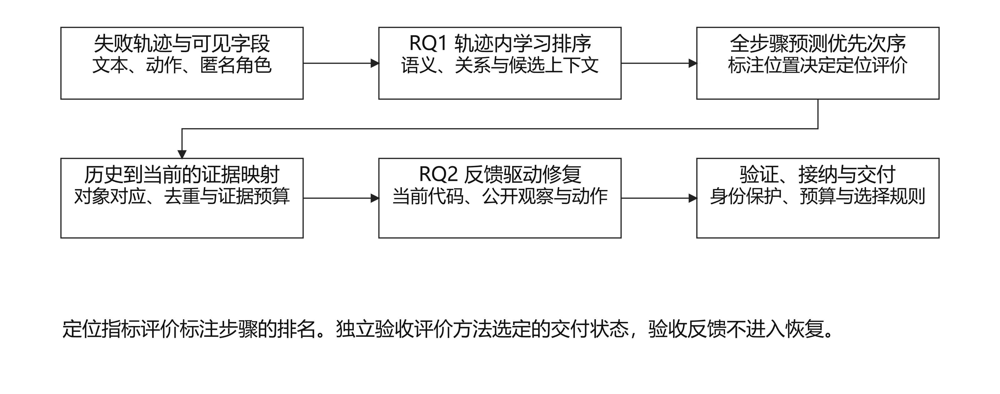
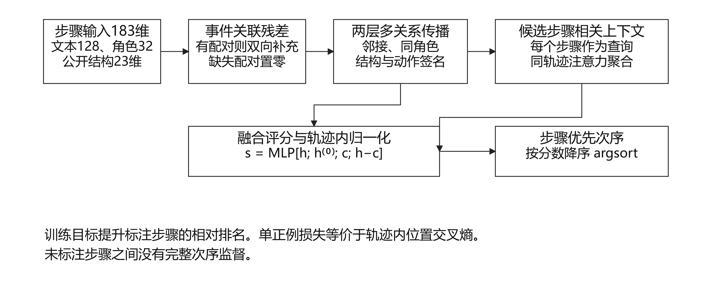
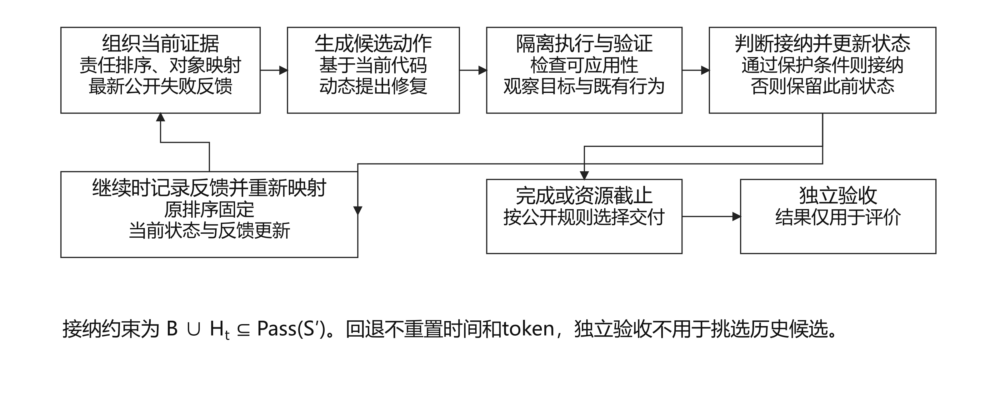
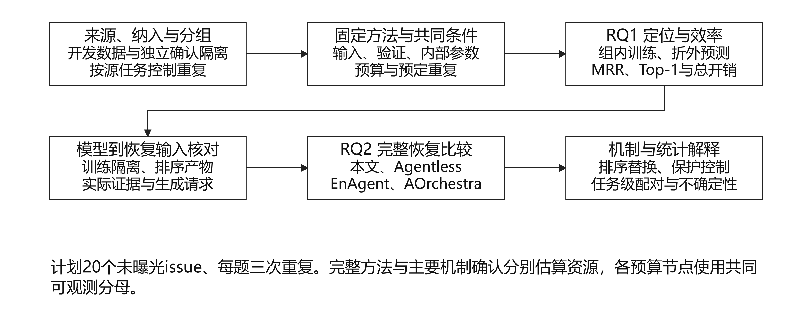

# 基于学习排序的智能体失败定位与任务恢复方法

开题报告

## 第一章 研究背景与国内外研究现状

### 1.1 研究背景

随着大语言模型在语言理解、指令遵循和多步推理方面的能力提升，其应用逐步由文本生成与问答扩展到需要规划和执行的复杂任务。自然语言不仅用于表达用户需求，也成为组织任务推理和调用外部能力的重要方式，使模型能够在获取信息、执行动作和接收反馈的过程中持续推进任务。[1,2,3] 在此基础上，如何将模型的推理能力转化为实际环境中的任务完成能力，成为大语言模型应用研究的重要问题。

基于大语言模型的智能体通过连接模型、工具与环境，为解决这一问题提供了系统化途径。智能体根据任务目标选择行动，利用工具获取信息或改变环境，并根据执行结果调整后续决策；多智能体系统则进一步通过角色分工与信息交互组织复杂任务。[3,4,5] 相较于单次输出，智能体的任务过程包含连续的判断、动作与状态变化，系统需要在连续决策中保持目标一致，并正确利用状态变化与反馈。

智能体研究已覆盖科学实验、网页操作、计算机使用和软件工程等多种场景。在科学研究中，模型可以与专业工具及实验设备连接；在网页和桌面环境中，系统需要将自然语言需求转化为实际操作；在软件任务中，系统需要理解项目、修改代码并利用执行反馈检验结果。[6,7,8,9] 这些应用具有不同的环境和行动形式，但都要求智能体在多步交互中维持目标、利用反馈并完成任务，因而对执行过程的可靠性提出了共同要求。

然而，具备推理、工具使用或协作能力，并不意味着智能体能够稳定完成复杂任务。已有实证研究发现，多智能体执行中的失败涉及任务分解、信息协调、行动偏离和验证不足等多个环节，错误还可能通过后续交互传播，使最终失败难以仅由某一次输出解释。[10,11] 当轨迹包含较多步骤和角色时，局部异常与任务失败之间的联系更加复杂，需要结合执行内容及步骤之间的关系进行分析。

任务评价能够说明一次执行是否成功，却不能直接确定应当检查和改进哪个环节。细粒度失败归因研究因此开始关注责任智能体和关键错误步骤，利用执行轨迹为系统改进提供依据。[12] 进一步地，定位到可疑步骤之后，仍需确定当前环境中可以采取什么行动，并通过执行检验修正是否有效；失败解释与任务恢复由此构成相互联系的研究过程。[13]

对于已经改变环境的任务，恢复还涉及已有状态与执行进展。重新尝试可能修正原有问题，也可能重复已经完成的工作或影响先前建立的有效行为；恢复方式需要与上下文、环境状态及操作依赖相协调，并检验此前通过验证的行为是否仍然成立。[14,15] 因此，智能体可靠性研究不仅需要提高失败诊断质量，还需要研究诊断如何参与后续行动，以及恢复过程中如何兼顾任务推进与已有进展。

基于上述背景，本文围绕智能体的步骤级失败定位与任务恢复开展研究：通过学习排序组织失败轨迹中的责任线索，再结合当前状态和执行反馈指导恢复，并利用可执行验证分析恢复效果。研究以智能体可靠性为出发点，以软件任务作为主要验证场景，考察诊断、行动与状态管理之间的联系。

### 1.2 国内外研究现状

#### 1.2.1 智能体构建与执行可靠性

Yao等于2023年提出ReAct，将推理、动作与环境观察交替组织，使语言模型能够依据外部反馈调整后续行动。[3] Wu等于2024年提出AutoGen，通过可编程会话连接具有不同职责的智能体；Hong等同年提出MetaGPT，以角色分工和结构化中间产物组织协作。[4,5] 这些工作推动了语言模型由单次生成向持续执行及协同求解的发展。

随着执行结构的发展，系统可靠性也成为专门的研究对象。Cemri等于2025年提出多智能体失败分类体系MAST，通过执行轨迹分析，将失败归纳为系统设计、智能体间失配和任务验证等类别。[10] 该研究从过程层面揭示了多环节失效，为进一步研究责任定位和纠错提供了依据。相关研究进一步关注失败发生后的过程分析与系统改进。[10,12]

#### 1.2.2 失败归因与责任步骤排序

Zhang等于2025年提出Who&When，将自动失败归因具体化为责任智能体与决定性错误步骤的识别，并比较完整日志一次判断、二分搜索和逐前缀检查等定位方式。[12] 该工作建立了细粒度归因的评价对象，也表明任务结果评价与具体责任定位需要分别研究。

Sun等于2026年提出SDBL，先约束可疑范围，再进行责任位置识别。[16] Zhu等同年提出StepFinder，结合步骤语义、时序与角色交互学习责任分数，将部分诊断计算由生成式推理转移到专门的学习模型。[11] 两类方法分别从搜索范围和轨迹表示改善定位，为研究步骤排序的准确性与成本提供了直接参照。

依赖关系也被用于组织归因证据。Rafi等于2026年在FALAT预印本中研究依赖引导的轨迹搜索，Deng等同年在DeFA预印本中探索依赖信息对归因的作用。[17,18] 因此，引入步骤关系本身不足以构成方法贡献；需要在共同输入与监督下，检验具体关系传播和候选上下文是否提高标注步骤的定位质量，并考察其额外开销。

监督与观测条件也影响归因研究的设置。Kong等于2026年提出Aegis，Zhang等同年提出AgenTracer，分别利用错误生成或故障诱发构造归因学习数据；Chen等同年提出TraceElephant，强调工具返回、环境信息和系统配置等完整观察对责任判断的作用。[19,20,21] 这些研究表明，诊断模型需要在明确的责任定义与信息条件下评价。本文据此关注步骤语义与可观察关系的联合表示，并将排序输出用于组织后续检查的优先次序。

#### 1.2.3 反馈纠错与可恢复执行

Madaan等于2023年提出Self-Refine，使语言模型交替生成反馈与修订结果；Shinn等同年提出Reflexion，将执行反馈转化为语言反思并用于后续尝试。[22,23] Gou等于2024年提出CRITIC，通过外部工具验证输出，再依据反馈进行修改。[24] 与此同时，Huang等于2024年研究缺少外部反馈时的推理自纠错，指出反复要求模型修改答案并不能稳定带来改善。[25] 这些工作说明，纠错方式需要结合反馈来源与任务条件理解。

当动作已经改变环境时，恢复还需要处理上下文与执行状态。Chang和Geng于2025年提出SagaLLM，将上下文管理、验证与事务补偿用于多智能体规划。[14] Zhuang等于2026年在AgentRewind预印本中研究上下文与受控环境的同步恢复，并保留恢复记忆；Yu等同年在Rollback-Induced Reflection预印本中联合考虑回退位置与反思保留。[15,26] 相关研究使恢复对象由输出修订扩展到状态、依赖和失败经验，但其适用条件仍取决于具体环境的控制与验证能力。

#### 1.2.4 诊断引导恢复与软件任务求解

软件任务为研究执行反馈与持续修复提供了具体场景。Xia等于2025年发表Agentless，通过分层定位、补丁生成与验证选择完成仓库级问题求解；Li等同年提出PatchPilot，依据验证反馈继续细化修复。[27,28] Tian等于2026年提出EnAgent，通过候选生成、剪枝与工具辅助选择组织集成求解；Ruan等同年提出AOrchestra，通过按需创建子智能体组织复杂任务执行。[29,30] 这些工作为比较完整执行流程的效果提供了方法基础。

诊断与行动之间的联系也受到直接研究。Guo等于2025年提出SyncMind，研究智能体认知与实际代码状态不同步时的恢复。[31] Ma等于2026年提出DoVer，通过实际干预与重新执行检验故障解释；Wang等同年在DARC预印本中利用开发阶段的任务族失败分析约束恢复策略，并在测试前冻结策略。[13,32] 这些方法已经研究诊断参与纠错，但任务族层面的策略选择、单条轨迹的步骤排序，以及变化状态中的局部修复具有不同的输入和决策对象。

Vasudev等于2026年在失败预测与预防预印本中进一步指出，较高的失败预测能力并不自动带来有效干预，执行中途的纠偏也可能破坏原本能够成功的过程。[33] 因此，本文将分别评价责任排序与实际恢复，并在固定恢复器中比较不同诊断输入，分析诊断是否改变动作选择及最终结果。

### 1.3 现有问题与研究意义

现有研究已为智能体构建、失败归因、反馈纠错和状态恢复建立了方法基础，但这些环节之间仍有需要结合实际执行验证的问题。步骤排序方法可以给出值得优先检查的位置，恢复方法可以利用反馈修改行为，状态管理可以约束已有执行的改变；本文关注关系与上下文是否增加有效定位信息，以及有限预算下的排序证据能否改善当前状态的修复。

首先，责任步骤的识别需要同时理解局部内容和执行关系。已有学习式方法已利用时序与角色信息，观测研究则说明可用证据会影响归因判断。[11,21] 在此基础上，本文拟研究多关系表示与候选相关上下文如何参与步骤评分，在相同信息、监督与模型容量条件下，分析其对定位准确性、排序稳定性和诊断成本的作用。这一研究有助于明确不同轨迹信息对于失败分析的实际价值。

其次，历史责任位置与当前恢复动作之间需要建立对应关系。诊断记录的是已经发生的执行，而恢复作用于经过多步变化后的当前环境；认知失配恢复和可执行干预研究分别说明了重新理解状态与检验修正效果的重要性。[31,13] 本文拟将责任线索映射到当前可检查对象，并结合公开执行反馈生成与验证恢复候选，进一步分析诊断质量在何种条件下能够转化为任务恢复收益。

最后，恢复过程需要协调获得新进展与保持已有行为。上下文恢复、补偿和反思保留提供了不同的支持方式，但具体行为在修改后是否仍然成立，需要根据实际执行判断。[14,15,26] 本文拟记录已验证行为的身份与结果，通过候选接纳、拒绝和回退管理状态，并研究严格保护与受控探索之间的关系。实验同时测量任务恢复、行为退化及执行代价，以确定保护条件的收益与限制。

软件任务中的代码修改、工具记录和可执行测试，使上述联系能够在明确的状态与反馈条件下观察。[34,9,35] 本文以此作为主要验证场景，通过诊断比较、完整系统比较和模块控制，分别考察失败定位、任务恢复及具体机制贡献。研究预期形成责任排序与诊断引导恢复方法，并总结其有效条件，说明方法在具有可追踪动作、可恢复状态和可执行验证条件的任务中的适用范围。

## 第二章 研究目标与问题定义

### 2.1 研究目标

本课题面向大语言模型智能体在多步骤执行中的失败，研究基于学习排序的步骤定位及其对任务恢复的支持。失败定位以执行轨迹为输入，预测标注责任步骤应当处于的检查位置；任务恢复从失败执行形成的当前状态出发，通过修正、验证和状态更新重新推进原任务。软件任务作为主要恢复验证场景，用于观察动作、代码状态与任务结果之间的变化。

第一项目标是构建轨迹内的步骤排序模型。模型联合利用步骤语义、可观察关系和候选步骤相关上下文，在可变长度的步骤集合中计算诊断优先级分数，提升标注责任步骤的排名。评价关注定位质量、跨初始化变化及端到端推断开销，不将输出全列表等同于获得全列表的真实责任监督。

第二项目标是建立排序到恢复动作的证据接口。恢复器依据优先次序选择历史证据，将其映射到当前对象，结合公开反馈生成修复，并利用行为验证控制状态接纳。评价既比较完整方法的任务恢复效果，也在固定恢复器中替换排序，检验定位信息能否通过证据与动作变化产生恢复收益。

### 2.2 研究问题

**RQ1：如何联合步骤语义、可观察关系与候选相关上下文，提高标注责任步骤在失败轨迹内的排名？**

一条轨迹构成一个排序组，轨迹中的执行步骤构成候选项，数据来源标注的关键步骤提供监督。模型在组内对候选共同评分并归一化训练，推断时按分数降序输出全步骤预测优先次序。相较于StepFinder的时序语义与角色交互建模[11]，本课题检验多关系传播和以候选步骤为查询的上下文聚合，在相同输入、标签、训练划分及资源下是否改善MRR、Top-1和Top-k，并分析推断开销。

**RQ2：责任排序能否通过有限预算下的证据选择，提高失败任务的恢复效果并控制已有行为退化？**

历史错误位置不必等于当前可编辑位置。恢复器先将高优先级步骤映射到当前对象，再把证据与最新公开反馈用于动作生成；动作经过公开验证后，依据已验证行为的保护条件决定是否接纳。完整系统比较衡量方法的实际效用，固定恢复器的排序替换、顺序置换与无诊断对照则用于识别排序的增量。主要观察是预算内恢复成功率、资源消耗和行为退化，而不是只看定位指标是否提高。[13,33]

### 2.3 研究对象与基本概念

研究对象是由大语言模型决策、通过工具与环境交互形成的执行过程。轨迹可以来自单智能体，也可以来自具有多个独立行为主体的系统；多智能体特指具有各自任务上下文或状态、并通过信息交换或协调共同求解的多个智能体。一个程序含有排序、生成、验证等模块，或一次API会话包含system、user、assistant和tool消息，均不能单独证明该程序采用多智能体协作。[3,4]

**执行轨迹与责任步骤。** 轨迹是同一任务产生的有序步骤记录，包含可用的文本、动作、观察和行为来源字段。责任步骤是来源标注标准确定的关键位置，作为预测目标。它不等同于已经通过反事实干预确认的唯一根因；未标注位置也不等同于已证实没有责任。不同来源的责任定义分别说明，未经兼容性核查不混合作为同一种监督。

**匿名角色。** 对每条轨迹，把原始角色标识按首次出现顺序映射为role_0、role_1等。同一角色的步骤保持相同编号，不同角色保持区分。例如同一轨迹中的Planner、Coder、Reviewer可映射为role_0、role_1、role_2，但另一条轨迹的role_0可以对应其他职责。匿名化保留行为来源和同角色联系，去除角色名称字段中的职业语义；它既不删除协作关系，也不保证正文中所有身份线索均被去除。

**步骤排序与恢复证据。** 步骤排序是轨迹内的预测检查次序，其分数仅用于同一轨迹的相对比较。恢复证据进一步说明历史步骤涉及的对象、当前内容和公开失败现象，用于指导动作生成。排序本身不直接给出可执行补丁。

**状态、行为与交付。** 当前状态是已经接纳的环境内容及公开观察；候选状态是隔离应用新动作后形成、尚待接纳的状态。已验证行为指指定验证范围内已经通过的具体行为，以稳定身份记录。交付状态是方法在终止或预算节点按自身规则选择、能够实际提交的结果，用于独立验收。

现有责任排序实现能够读取匿名角色并构建同角色关系；当前用于软件恢复的公开输入只包含一个匿名执行角色，恢复核心由一个修复生成器迭代调用工具和验证器，尚不构成规划、编码、审查智能体之间的独立协作。因此题目采用“智能体”，不限定为“多智能体”。多角色来源用于分析模型的角色适应性，当前恢复结论以软件执行环境为边界。

### 2.4 理论基础与方法依据

学习排序以同一查询条件下的候选集合为学习和决策单位，学习用于确定相对优先次序的评分函数。Cao等提出的ListNet使用列表概率分布构造学习目标，为联合比较候选提供了基础。[36] 本课题借鉴轨迹内归一化的建模方式：轨迹定义候选组，步骤定义排序项，标注步骤定义监督目标，排序结果用于分配有限的检查和证据预算。

采用学习排序描述本任务，并不意味着分类方法不能产生排序。单标注条件下，本文的轨迹内softmax损失与可变候选数的位置分类交叉熵等价；逐点分类分数也可用于排序。方法的拟研究增量在于步骤表示、关系传播、候选上下文及排序的行动用途，不在于重新命名现有损失。模型输出全步骤次序，但单个关键步骤标注并未监督所有非标注步骤之间的相对次序。

多关系表示学习为组织异质步骤联系提供基础。关系图卷积等方法通过区分关系类型聚合邻居信息[37]，适合把时间邻接、同角色及结构相似等可观察联系纳入表示。本课题采用与当前实现相符的关系消息传播，并检验关系是否提供超出时间与位置的增量。关系边表示观测关联，不直接表示已经识别的因果依赖。

任务恢复借鉴反馈纠错与状态管理思想。Reflexion和CRITIC分别利用语言记忆与工具反馈支持后续修改[23,24]；Sagas则为长过程中显式记录操作与补偿关系提供了经典参照。[38] 本文以隔离验证、候选接纳和行为身份保护实现当前软件任务中的状态控制，其保障范围由实际验证条件限定，不作任意环境下的事务或全局正确性保证。

## 第三章 研究内容与技术路线

### 3.1 总体技术路线与排序任务定义

技术路线由离线失败定位与诊断引导恢复两部分组成。首先对完整失败轨迹编码，依据步骤关系和候选相关上下文预测优先次序；随后将优先步骤映射为当前状态可用的证据，驱动候选生成、公开验证和状态更新。图3-1展示两项研究问题的输入、方法及评价联系。

图3-1 基于学习排序的失败定位与任务恢复总体技术路线

设第q条样本为$D_q=(T_q,Y_q)$，其中$T_q=(x_{q1},\ldots,x_{qm_q})$为具有$m_q$个步骤的轨迹，$Y_q$为来源标注的责任步骤索引集合。轨迹及其可见字段构成排序条件，步骤构成候选项，监督约束标注位置的相对优先级。这里的查询组由一次任务执行确定，不要求显式使用检索系统中的独立查询文本。当前排序编码输入为步骤的内容、动作、思考及匿名角色等公开字段，未单独拼接的任务描述或反馈不在公式中假定为额外输入。恢复生成器另行读取任务要求与当前公开反馈。

模型计算$s_{qi}=f_\theta(T_q,i)$，并输出$\pi_q=\operatorname{argsort}_i(-s_{qi})$。步骤边界和原始索引映射在预处理时固定，同分按原始步骤索引处理，补齐位置不参加训练与排序。诊断使用完整已发生轨迹，允许读取候选之后已经观察到的步骤；因此本课题研究执行后的定位，不将其称作提前预测失败。

### 3.2 语义、多关系与候选上下文联合排序

#### 3.2.1 步骤表示与关系传播

步骤表示由冻结的文本编码、匿名角色编码及公开结构特征组成。文本编码处理步骤内容、动作与思考，角色编码标识行为来源，结构特征表示相对位置、事件类型和可观察格式。当前实现分别采用128维文本表示、32维角色表示与23维结构描述，经训练组统计量规范化后投影到96维隐空间；数值作为可复核的实现起点，确认实验前固定，不根据测试结果调整。具有明确状态与后续动作配对的记录，使用双向事件残差补充关联信息；缺失配对时对应残差置零。

关系集合包括时序相邻、同匿名角色、相同完整结构签名及相同非空动作结构。每类关系连接当前位置前后最近的匹配步骤，使用有类型的邻居表，不以责任标签构造边。结构签名描述公开字段的组织形式，不等同于语义相同或因果依赖；缺少某类字段时保留空邻居集合。图3-2给出从步骤表示到排序输出的数据流。

图3-2 语义、多关系传播、候选相关上下文与组内排序目标

令$h_i^{(0)}$为初始表示，$N_r(i)$为关系r下的邻居集合。关系层先依据发送节点及其与接收节点的差值形成门控消息，再对不同关系加权融合：

$$
m_{ir}^{(l)}=\frac{1}{\max(1,|N_r(i)|)}\sum_{j\in N_r(i)}\sigma\!\left(g_r([h_i^{(l)};h_j^{(l)}-h_i^{(l)}])\right)\odot\phi_r([h_j^{(l)};h_j^{(l)}-h_i^{(l)}]),
\tag{3-1}
$$

$$
\beta_{ir}^{(l)}=\operatorname{softmax}_{r}(W_\beta h_i^{(l)}),\qquad
h_i^{(l+1)}=\operatorname{LN}\!\left(h_i^{(l)}+\operatorname{Dropout}\left(\sum_r\beta_{ir}^{(l)}m_{ir}^{(l)}\right)\right).
\tag{3-2}
$$

其中分号表示拼接，$\sigma$为sigmoid门控，$\phi_r$为关系消息变换，$\odot$表示逐维乘积，LN为层归一化。当前实现采用两层传播；空邻居产生零消息，节点自身信息通过残差保留。关系权重由当前节点表示计算，使不同步骤能够利用不同的关系通道。

同角色关系的效用取决于角色分布。单角色轨迹中，它可能与时序相邻关系完全重合，不能据此声称利用了角色协作。实验报告关系边重合率，并对单角色与多角色轨迹分别分析。该设计同时检验关系类型是否增加有效证据，以及冗余通道是否只增加计算量。

#### 3.2.2 候选相关上下文、监督与推断

候选相关上下文中的“候选”指待排序步骤。设关系传播后表示为$h_i$，同轨迹均值为$\bar h$。模型以每个候选的表示作为查询，在同一轨迹全部有效步骤上进行注意力聚合，包含候选自身，不访问其他轨迹：

$$
\alpha_{ij}=\operatorname{softmax}_{j\in T_q}\!\left(\frac{(W_Qh_i)^\top W_Kh_j}{\sqrt d}\right),\quad
z_i=\sum_j\alpha_{ij}W_Vh_j,\quad
c_i=\bar h+W_O(z_i-W_V\bar h).
\tag{3-3}
$$

$$
s_{qi}=\operatorname{MLP}([h_i;h_i^{(0)};c_i;h_i-c_i]).
\tag{3-4}
$$

该读出使同一段历史对不同候选具有不同权重，并保留全轨迹均值作为基准。模型由关系增强表示、初始步骤表示和候选上下文共同产生一个标量分数。全轨迹注意力对步骤数具有二次时间及存储开销，长轨迹实验须报告耗时、峰值显存及是否截断，不能仅以评分头较小推断整体高效。

在单个标注责任步骤$i_q^*$的来源上，采用轨迹内归一化与交叉熵：

$$
p_{qi}=\frac{\exp(s_{qi})}{\sum_{j=1}^{m_q}\exp(s_{qj})},\qquad
\mathcal L=-\frac1N\sum_{q=1}^{N}\log p_{q i_q^*}.
\tag{3-5}
$$

式（3-5）与该轨迹内的位置分类交叉熵等价。它把标注步骤与同轨迹其他步骤共同比较，但不提供非标注步骤之间的完整真实次序，亦不构成新的损失函数。若后续数据来源允许多个责任位置，应先明确“多个步骤均需关注”或“命中任一即可”的标注语义，再分别选择归一化多正例目标或集合似然；当前主实验不混用这两种监督。

推断按原始分数降序排列，归一化权重仅用于训练和轨迹内比较，不解释为跨任务校准的因果责任概率。全步骤列表使恢复器能够在不同证据预算下选取前若干项，而定位质量仍由标注位置的Top-1、Top-k和MRR衡量。不同初始化的指标标准差用于描述训练结果变化，排序一致性与正确性分别分析。

### 3.3 从历史排序到当前恢复证据

责任排序描述过去的执行，恢复动作作用于当前环境。历史错误编辑可能已被覆盖，工具调用也可能无法直接撤销，因此需要将步骤位置转换为当前可检查对象。证据项保留原始步骤索引、历史动作及对象、当前内容、关联上下文与映射状态，区分对象仍存在、对象已变化和无法可靠对应三种情况。对象变化时重新读取当前内容，不将旧行号或旧文本直接当作可应用编辑。

设当前已接纳状态为$S_t$，公开反馈为$F_t$，历史排序为$\pi$，映射函数为M，则证据与动作接口为：

$$
E_t=\operatorname{Select}_{K_t,C_E}\{M(x_{\pi(j)},S_t,F_t):j=1,\ldots,m\},\qquad
a_t\sim G(Q,S_t,F_t,E_t).
\tag{3-6}
$$

Q为任务要求，$K_t$限制证据条数，$C_E$限制证据token。选择器按排序扫描可映射项，将相同动作或对象的重复证据合并并保留来源；无法形成可靠编辑依据的项可以保留为解释线索，但不自动触发撤销。确认前固定扫描、合并、截断及解释性证据的计数规则。证据不足时使用实际可用条数，并注明是否启用共同的当前源码回退输入。超长片段按事先确定的与标签无关的规则组织，任何截断均记录位置与数量。

基本设置在初始失败轨迹上计算一次排序，恢复过程中更新对象映射与公开反馈，不默认每轮重新训练或评分。当前实现具有逐轮增加优先证据的基础；正式比较将用共同的$K_t$规则与token上限控制可见信息，分别保存完整排序、实际证据和生成请求。若研究新动作后重新排序，须另外定义轨迹更新、触发条件与累计诊断成本，作为独立变体评价。

排序对恢复的作用发生在有限证据预算下：改变优先项可能改变生成器先看到的对象和失败线索，从而改变动作。若状态映射、去重后不同排序得到相同证据，其作用会被接口吸收。实验直接记录这一中间结果，并结合动作变化与最终恢复评价，避免只根据排序指标推断行动收益。

### 3.4 公开反馈驱动的迭代任务恢复

恢复从当前已接纳状态开始，每轮明确尚未满足的任务要求，组织优先诊断证据与最新公开反馈，并提出一个候选动作。在软件任务中，动作以修改当前代码为主；仅对具有明确撤销语义的历史操作采用受控撤销。生成器可读取许可范围内的代码和公开测试信息，不能接收其他方法的修复或独立验收结论。

候选在独立副本中应用。统一动作接口检查编辑格式、对象和唯一匹配位置，随后运行公开验证，观察目标行为与已有回归行为。无法解析、不能应用、执行异常或验证不确定分别保留原因；这些反馈可用于下一轮，但不能作为通过结果。格式校验与对象处理对所有内部机制条件保持一致，避免工程差异代替方法差异。

公开验证给出观察，状态管理决定接纳。候选满足保护条件则更新当前状态，否则恢复此前状态，并保留失败与拒绝反馈。下一轮重新对齐证据和当前内容，结合最新结果生成动作。候选由生成器逐轮提出，不限定为预先枚举的固定补丁集合。流程如图3-3所示。

图3-3 诊断证据、公开反馈与行为保护共同驱动的任务恢复流程

达到公开完成条件、内部迭代上限或外部资源预算时停止生成。方法依据事先固定的规则选择一个可交付状态，独立验收仅评价该状态，不参与后续动作与历史候选选择。预算截止时仍在处理中的候选不视为已经交付；回退或续跑不重置累计时间、调用和token。

### 3.5 行为身份保护与候选接纳

行为保护以稳定测试身份为依据。令B为初始状态中已通过的既有回归测试对应行为，$\mathcal G$为公开可验证的目标行为集合，$H_t$为截至第t轮已经接纳且要求保留的目标行为，$\operatorname{Pass}(S)$为在规定验证中已确认通过的行为身份集合。初始集合取$H_0=\mathcal G\cap\operatorname{Pass}(S_0)$，B与$H_0$由恢复开始前的共同公开验证确定。候选接纳的基本规则为：

$$
\operatorname{Accept}(S'\mid S_t)=\mathbf1[B\cup H_t\subseteq\operatorname{Pass}(S')],\qquad
H_{t+1}=H_t\cup(\mathcal G\cap\operatorname{Pass}(S'))
\tag{3-7}
$$

其中集合更新仅在候选被接纳时执行；拒绝时保持$S_t$和$H_t$。测试身份来自固定验证定义，候选不得编辑或删除测试以改变保护对象。不确定或缺失的结果不计为通过。规则只保障指定公开验证范围内的保持性，不能推断所有输入上的程序行为均正确。

基本方法允许通过保护条件但未新增通过目标的中性候选，以保留多步修复的可能性；完全相同的状态按内容身份去重，重复失败反馈也不会重置内部迭代计数。公开全目标通过时交付当前状态，否则按公开失败目标数量、改动规模和固定先后规则选择可交付的已接纳状态，始终不以独立验收挑选历史最好候选。最终部署的迭代数、去重及选择规则在开发评价后固定。

对照设置分别只保护B、在保护B的基础上要求目标通过数量不减少，以及按式（3-7）保护具体目标身份。按数量保护可能允许“原目标失效、另一目标通过”的替换；身份保护则可能阻止需要暂时退步的路径。实验同时观察独立验收退化、被拒绝候选、验证成本和恢复结果，不以规则本身强制为零的公开退化率单独证明优势。

### 3.6 模块接口与实现范围

系统包括轨迹编码、步骤排序、证据映射、候选生成、公开验证和状态管理。排序接口输出步骤索引、分数与次序；映射接口输出对象对应、证据内容及来源；生成与验证接口记录动作、执行结果与资源；状态接口保存接纳原因、行为集合及交付选择。这些接口支持固定其他条件后替换单个机制。

实现将分别标明已有原型与拟完善机制。当前已具有语义关系排序、候选相关上下文、排序接入、反馈修复和状态记录；共同token证据预算、统一行为身份及重复候选处理仍需按正式设计核对完善。当前角色信息用于轨迹表示，恢复过程中的生成、工具和验证分工不表述为多智能体创新。

可恢复分支、允许暂时退步的软保护和新动作后的重新诊断作为后续扩展。每项扩展明确新增决策及资源条件，单独与基本方法比较。先完成两项研究问题的主要评价，再依据实际失败事件确定是否扩展，避免在缺少共同确认结果时不断增加方法分支。

## 第四章 拟解决的关键问题与预期创新

### 4.1 关系与上下文的有效信息增量

时序、角色和事件关系已经用于失败归因，专门学习模型也已经能够生成步骤分数。[11,18,17] 本课题的关键问题是：在保留语义信息后，多关系消息与候选相关上下文是否仍能提供有效定位证据。仅增加图层或注意力模块，不能自动构成有价值的增量。

拟检验的假设是，关系传播帮助候选获得跨步骤信息，候选相关聚合进一步区分这些信息对不同位置的作用，从而提高标注步骤的排名。检验采用共同输入和训练划分，设置去关系、统一全局上下文、逐类关系移除及容量匹配条件，比较MRR、Top-1和推断成本。单角色关系退化与长轨迹注意力开销属于该假设的适用边界。

### 4.2 历史定位结果向当前行动的传递

步骤分数描述历史轨迹，恢复动作需要修改当前对象；排序改善可能在对象变化、证据去重或上下文覆盖后不再影响生成。已有干预调试与诊断恢复研究表明，诊断价值需要在行动层面检验。[13,32] 本课题拟解决有限输入预算下，如何保留可定位来源并形成当前可用证据。

拟检验的假设是，固定生成器与证据预算后，责任排序通过改变被选证据，使首次有效进展更早出现，或使相同总资源下更多任务恢复。控制条件包括本文排序、StepFinder排序、无诊断和顺序置换；逐层观察证据、对象、动作及终态差异。若排序未改变实际输入，或改变输入仍未改善恢复，应如实限定其行动价值。

### 4.3 进展保持与探索空间的协调

恢复动作可能修正一个目标并破坏另一个目标，通过总数量相同也可能掩盖行为替换。反馈纠错与回退方法提供了修复和返回状态的基础[28,39,40]，本课题进一步考察记录具体行为身份对候选接纳的影响。

拟检验的假设是，身份保护能够减少已接纳状态中的替换性损害，但可能增加验证代价或阻止暂时退步的有效路径。实验比较保护范围相同的数量与身份规则，使用自然任务评价总体恢复，使用受控场景解释规则差异，同时报告独立退化与被拒绝路径。分支探索仅在确有此类限制且基本方法评价完成后研究。

### 4.4 预期方法贡献与验证边界

第一项预期贡献是面向失败步骤定位的语义、多关系和候选上下文联合评分方法。其研究价值通过共同监督下的定位与效率增量判断，不将交叉熵、图传播或注意力本身作为新算法。若关系冗余或计算代价抵消质量收益，结论应明确相应条件。

第二项预期贡献是基于排序证据与行为身份约束的任务恢复方法。该方法保留历史位置到当前对象、证据、动作和验证结果的对应，使排序的作用能够在固定恢复器中被分析，并通过完整外部方法比较衡量实际效用。预期贡献需要共同任务、主要预算指标和机制事件共同支持，不由单次开发成功推定。

两项贡献分别对应“定位信息是否更有效”和“这些信息能否改善恢复”。当前方法与实验基础支持继续验证这两项问题；最终创新性和有效性以正式比较结果为依据，不预设所有数据来源、预算与失败类型上均占优。

## 第五章 数据来源与实验设计

### 5.1 数据构造与训练、验证和确认划分

实验围绕责任排序质量、完整恢复效果及诊断到行动的作用机制展开。数据体系采用AFTraj、AgenTracer coding和SWE-Gym配套执行轨迹：前两类提供责任步骤标注，后一类提供能够重新执行并检验修复结果的软件任务。[12,20,35] 表5-1区分原始发布规模与本研究已经整理的样本，避免将整个数据集规模视为实际实验分母。

表5-1 数据来源、规模与当前研究样本

| 数据来源 | 原始发布规模 | 当前已整理样本 | 实验用途 |
|---|---|---|---|
| AFTraj | 2,276条轨迹，其中正常1,162条、失败1,114条，覆盖数学、编码及智能体任务[41] | 731条失败轨迹，对应716个源任务组；其中120条、120个不同源任务组构成开发子集 | 责任步骤排序、任务类型与轨迹结构分析 |
| AgenTracer coding | 本研究采用的扩展发布版中，coding官方训练部分1,141条、测试部分127条[42] | 614条训练与验证来源池，包括coding 320条、math 294条；固定coding评价集363条 | 软件相关轨迹上的排序评价及训练划分稳健性 |
| SWE-Gym及配套OpenHands轨迹 | SWE-Gym含2,438个Python软件问题[35] | 已整理23个不同issue的恢复来源池 | 当前可执行恢复研究的开发与纳入标准核查 |

AFTraj开发子集在五个任务类型与标注来源组合中各取24条，按领域为coding 24条、math 48条、agentic 48条，用于流程调试和细节分析；这些样本已参与方法开发，不单独作为新的独立确认集。AgenTracer的614条来源池和363条固定评价轨迹均来自所采用版本的官方训练部分，并按源任务组去重隔离，不能将363条评价集称为官方测试集。不同发布版本的数据规模分别注明，本研究使用扩展发布版，不把论文中的另一版本规模替代为实际实验数量。

所有划分以原始任务为单位。同一问题产生的多条轨迹、错误变体及派生样本放入同一任务组。数据清洗仅处理步骤边界、可读格式和原始位置映射；真实错误标签遵循来源定义。排除条件依据缺失轨迹、标注无法映射或执行环境不可用等资格因素确定，并保留数量及原因，不按方法运行后的胜负筛选样本。

表5-2 训练、验证、开发评价与独立确认设计

| 数据与阶段 | 训练与模型选择 | 评价安排 | 独立性及规模说明 |
|---|---|---|---|
| AFTraj开发评价 | 716个源任务组采用五折分组划分；每个外层训练部分再划分内部训练与验证组，采用三次预定初始化 | 每条轨迹仅由未训练该任务组的模型产生外层预测，汇总731条结果 | 调参依据内部验证；已经用于研究选择的外层结果属于开发评价 |
| AFTraj独立确认 | 固定模型结构、训练流程和输入定义后，不再依据确认集调参 | 官方测试部分含163条失败轨迹，作为候选确认来源 | 先审查源任务重叠与历史曝光，最终报告实际合格数量，163条不预先等同于独立任务组数 |
| AgenTracer开发评价 | 三个分组划分A、B、C，每个划分训练492条、验证122条；训练含coding 256条、math 236条，验证含coding 64条、math 58条 | 在同一363条coding评价集上比较三个训练划分，每个划分采用三次预定初始化 | 训练、验证和固定评价组相互隔离；固定评价集已参与开发 |
| AgenTracer独立确认 | 采用开发阶段确定的训练与选择规则 | 官方coding测试部分127条作为候选确认来源 | 完成任务身份和曝光审查后冻结实际数量；不依据确认结果重新选择模型 |
| 恢复开发与确认 | 23个已整理issue用于接口核验、恢复机制开发和预算校准 | 从同一来源中选择未参与开发的issue，逐题核验失败状态、反馈和独立验收条件，再固定共同任务集 | 确认任务数以实际通过纳入标准核查的issue数为准；自然失败与受控构造状态分别报告 |

恢复样本由任务描述、初始代码状态、可见失败轨迹、公开反馈和独立验收条件共同构成。先核对issue、仓库版本及轨迹之间的对应关系，再确定恢复起点。自然失败样本保留智能体实际执行形成的错误状态；受控构造样本用于制造特定的状态变化或保护冲突，单列为机制分析。恢复确认实验计划新增20个未参与方法开发的合格issue，目标覆盖至少3个仓库。候选按同来源的预定顺序核验，纳入标准为可恢复初态、可用公开反馈、可执行独立验收及任务身份无重叠，不依据各方法胜负选择。实际合格数不足时报告纳入流程、原因和结论范围，不以重复运行替代新增issue。

### 5.2 实验流程与共同运行条件

实验依次完成样本纳入与划分、责任排序训练与评价、排序到恢复输入的衔接、完整恢复比较、预算分析和机制检验。图5-1展示数据与运行结果之间的关系。开发数据用于确定方法细节、运行参数和资源上限；确认阶段采用事先固定的规则，报告所有纳入任务的结果。

图5-1 数据划分、排序评价、完整恢复比较与机制分析的实验流程

责任排序实验先固定任务分组和输入处理，再分别训练本文与StepFinder模型；提示式诊断方法使用相同的可见原始轨迹。模型选择只读取相应验证结果，随后在确定的评价组上产生步骤预测、有效输出情况和资源记录。完整排序的步骤身份映射保持一致，以免截断、位置偏移或清洗差异被误认为排序能力差异。

训练采用冻结编码器与可学习排序器。初始配置为两层关系传播、96维隐表示、0.15的dropout；优化器采用AdamW，学习率在$10^{-4},3\times10^{-4},10^{-3}$中由内部验证选择，最大80轮，验证MRR连续10轮未改善时停止。语义编码、标准化统计及模型选择均限定于对应训练与验证流程；StepFinder采用作者提供的有效设置，并给予相同的模型选择信息和可比训练资源。长轨迹按长度组批，必要时降低batch而不删除标注附近步骤。编码器输入上限及实际截断比例一并披露。

主要分析以完整排序方法的MRR为定位主指标，Top-1与Top-3、Top-5为关键补充。模型容量、批处理和硬件条件写入实验设置；结构消融采用相同配置选择规则，不额外扩大其中一个条件的调参范围。初始化变化报告各次指标及其标准差。模型超参数是拟采用的实验配置，不作为已经完成训练的事实。

恢复实验首先固定任务初态、可见信息、工具许可、公开验证范围和验收标准，再分别运行本文、Agentless、EnAgent与AOrchestra。各方法保留自身的定位、生成、验证和选择机制，内部候选数量与迭代规则在实验前确定。外部方法可以形成不同候选与执行路径；共同条件约束其信息和总资源，不强制共用本文生成的候选补丁。各方法均读取相同的失败仓库状态和任务说明；需要日志的部分通过共同公开输入提供。对从任务初态求解的方法，明确说明改为从失败中间状态启动的适配，核查其定位、生成、验证和选择环节仍可完整执行。该实验评价共同恢复任务中的部署表现，不冒称复现各论文原基准分数。

表5-3 完整恢复实验的共同条件

| 条件 | 统一设置 | 记录与核对内容 |
|---|---|---|
| 任务起点 | 同一任务描述、仓库版本与失败状态 | 初态、原始轨迹与允许访问的公开观察 |
| 模型与工具 | 使用共同生成后端；本地诊断模型另行记录 | 生成参数、模型版本、上下文限制及工具权限 |
| 验证 | 同一公开验证许可与最终独立验收标准 | 每次公开检查、最终交付结果及验收结果 |
| 算法部署 | 保留各方法核心阶段，固定内部参数 | 候选规模、迭代次数、选择规则及与论文配置的差异 |
| 资源 | 共同时间与token上限，统一计量边界 | 所有子智能体、候选生成和验证环节的累计使用量 |
| 重复 | 每个issue按预先确定的规则运行三条独立完整轨迹 | 全部重复的终态、预算内结果、异常和删失原因 |

生成后端采用当前实验环境允许的deepseek-flash，专门诊断模型在现有本地环境中运行。更换后端属于单独的稳健性条件，应对所有适用方法采用共同配置；不把更换模型后的结果直接归因于算法改进。独立完整重复从相同初态重新运行，内部候选、投票和已有响应的复用均不计为新增重复，也不将客户端随机种子视为服务端确定性保证。

本文恢复系统还需逐项核对“选定排序模型及训练清单—排序产物—恢复器读取—实际生成请求”之间的联系。恢复任务的源任务组不得参与相应诊断模型训练；恢复器实际使用的排序须来自该评价模型。衔接核对不完整时，仅报告联合流程可行性，不据此认定RQ1对最终恢复具有独立贡献。

### 5.3 比较方法与实验分工

责任排序采用StepFinder、All-at-Once与Binary Search作为比较方法。StepFinder以时序语义、角色交互和步骤评分组织诊断；后两者来自Who & When研究，分别通过一次阅读完整日志和递归缩小日志区间确定责任步骤。[11,12] 三者提供专门学习模型、整体阅读与区间搜索的不同参照。

表5-4 责任排序比较方法及评价范围

| 方法 | 原有诊断机制 | 可直接比较的输出与指标 |
|---|---|---|
| 本文责任排序 | 步骤语义、多关系交互、候选相关上下文与列表式训练 | 完整步骤次序；Top-1、Top-3、Top-5、MRR及效率 |
| StepFinder | 时序语义表示、角色感知交互与步骤评分 | 依据原始步骤分数形成次序，采用共同排序指标及效率口径 |
| All-at-Once | 一次阅读完整轨迹，输出责任判断 | 原生责任位置；Top-1、有效输出率及调用开销 |
| Binary Search | 在轨迹区间中递归判断并缩小范围 | 原生责任位置；Top-1、有效输出率及搜索开销 |

All-at-Once与Binary Search原生输出单个责任位置，不用补齐任意尾部步骤的方式构造完整排序。若另行设计多候选提示扩展，应作为明确的改动版本报告。本文与StepFinder的完整MRR由统一预测结果重新计算，与论文中截断排名指标分别说明。

完整恢复采用Agentless、EnAgent和AOrchestra作为外部比较方法。[27,29,30] Agentless提供结构化的定位、修复和验证流程；EnAgent利用多轨迹推理、候选筛选及集成选择；AOrchestra按需组织子智能体、工具和任务上下文。比较目标是完整方法在共同失败状态上的任务恢复质量、收敛过程与资源代价。

表5-5 完整系统比较与内部控制的分工

| 实验 | 方法或条件 | 回答的问题 |
|---|---|---|
| 完整恢复比较 | 本文完整方法、Agentless、EnAgent、AOrchestra | 诊断引导恢复与固定流程、多轨迹集成、动态任务组织的整体差异 |
| 诊断模块控制 | 固定本文恢复器，分别使用本文排序、StepFinder排序和固定时间次序；无诊断条件单列 | 责任排序是否改变证据、动作与恢复结果 |
| 反馈与证据控制 | 固定生成器、验证与资源，改变反馈组织、上下文选择及状态映射 | 诊断信息如何转化为有效恢复行动 |
| 状态保护控制 | 固定候选执行接口，改变行为保护规则 | 保护对象与接纳条件对退化、进展及成本的作用 |

外部比较选用正式发表、具有公开核心实现且适用于共同恢复任务的方法，包含2026年正式发表的方法。开发小试用于核对接口和完整可执行性，确认任务的纳入不以任何方法是否成功为条件。各基线实施时检查论文、作者源码与本机执行之间的对应关系，说明受资源限制的部署参数。强对手优于本文的结果同样保留；若某方法不满足共同任务资格，应报告具体原因，不将未运行或工程未知填为零。固定恢复器的诊断替换属于模块控制，不能替代完整外部方法比较。

### 5.4 评价指标、资源预算与效率分析

责任排序采用任务组宏平均。对轨迹q，令$r_q=\min_{i\in Y_q}\operatorname{rank}_{\pi_q}(i)$；无效输出令$r_q=\infty$。对包含多条派生轨迹的源任务组g，先在组内求均值，再在G个任务组间平均：

$$
\operatorname{Hit@k}=\frac1G\sum_{g=1}^{G}\frac1{|D_g|}\sum_{q\in D_g}\mathbf1[r_q\leq\min(k,m_q)],\qquad
\operatorname{MRR}=\frac1G\sum_{g=1}^{G}\frac1{|D_g|}\sum_{q\in D_g}\frac1{r_q}.
\tag{5-1}
$$

Top-1即Hit@1。若来源允许多个可接受位置，Hit@k仅表示至少命中一个，不称为覆盖全部责任步骤；需要完整覆盖时另定义Recall@k。单位置方法只报告共同Top-1及有效输出率，不补造全排序。轨迹微平均作为补充，与任务组宏平均分别列示。

诊断效率从原始轨迹输入到预测输出计量，包含文本编码、结构构建和评分。相同硬件下分别报告首次加载运行及模型已加载后的耗时、中位数、95分位数和峰值内存或显存；专门模型与提示式方法还记录调用和输入输出token。单独列训练、离线准备与重复使用时的摊销条件。对长轨迹说明全局注意力的二次开销、编码截断及批处理条件，不仅比较缓存后的评分头。

恢复实验包含J个issue，每题预定R=3次独立完整运行。令$S_{jr}(B)$为方法在预算B处依据固定公开选择规则可交付的状态，$A(S)$为独立验收是否同时满足任务目标与要求保留行为，则：

$$
\operatorname{RSR}(B)=\frac1J\sum_{j=1}^{J}\frac1R\sum_{r=1}^{R}\mathbf1[A(S_{jr}(B))=1].
\tag{5-2}
$$

预定重复估计单次部署的随机表现，不采用三次中最好一次替代该指标。预算节点的可观测性按该节点判断，不要求随后达到自然终态。令共同issue集合$J_B$包含各比较方法均有R次可判定预算结果的issue，配对RSR以式（5-2）中的J替换为$|J_B|$计算，另报$|J_B|/J_{plan}$及缺失原因。到达预算且未交付是可判定的不成功，不因后续自然终态删失而剔除。预算内已经执行但未交付合格结果计为预算内不成功；未运行和不明工程状态不伪造为已执行失败。计划总体成功下界以$J_{plan}\times R$为分母，只计已知成功，并明确为下界而不是已执行失败率；未完成比例另报。

表5-6 主要评价指标与统计对象

| 评价对象 | 指标 | 计量与解释 |
|---|---|---|
| 失败定位 | 任务组MRR、Top-1、Hit@3、Hit@5、有效输出率 | MRR为排序主指标；单位置方法仅比较Top-1与有效率 |
| 诊断效率 | 端到端耗时P50/P95、峰值内存、调用与token | 包含编码与结构处理，区分首次加载与已加载运行 |
| 任务恢复 | 30分钟RSR、其他预算节点RSR、自然终态成功率 | 对方法当时选定的一个交付状态进行独立验收 |
| 累计资源 | 总历时、运行耗时、输入与输出token、调用、验证次数、费用 | 包含失败候选、筛选、选择与全部子智能体 |
| 成功成本 | 全部完整可观测运行成本之和除以成功次数 | 失败运行成本计入；零成功时不可估计，删失单列 |
| 行为退化 | 接纳转移退化率、发生过退化的运行率、最终交付退化率 | 指定验证范围内按行为身份判断；分母为空时不适用 |
| 作用机制 | 证据变化、动作变化、首次有效进展、重复及拒绝候选 | 解释排序是否参与决策，以及保护的作用与代价 |

以30分钟RSR作为恢复主指标，同一内部参数下考察15分钟和60分钟节点。token预算拟采用20k、40k、80k三个共同水平，指所有输入与输出token的累计量；先在开发任务上核对是否能完整实施必要阶段，再于确认前一次性确定，不能根据确认胜负调整。改变一个资源维度时固定其他上限，分别报告时间与token曲线。

预算快照在执行期间保存，独立验收在运行结束后实施，结果不返回模型。曲线在每个节点评价当时按方法规则选定的状态，不以隐藏验收选择历史最佳候选，也不预设成功率随预算严格单调。使用公开最优状态保留的算法需说明其选择规则。保持内部参数的自然终态另行报告；增加候选数或迭代数属于另一部署配置，不能解释为仅延长外部预算。

恢复计时从接收共同任务及失败状态开始，包含所需本地轨迹编码、初始排序、证据映射、候选生成、工具执行、公开验证及选择环节；提示式诊断的调用与token同样计入。缓存和常驻模型仅按预先规定的部署条件使用，冷启动与已有诊断产物条件可另报，但不替代端到端主结果。共享资源排队与算法运行耗时分别列示，同时报告用户等待的总历时。按成功次数分摊的成本为$C_{\rm succ}=\sum_{j,r}C_{jr}/\sum_{j,r}\mathbf1[A(S_{jr})=1]$，求和仅覆盖完整可观测运行，并包含其中的失败；该成本分别对应预算节点和自然终态，各自使用同一终点的成本与成功定义。费用未知或中断的实际已知资源与删失比例另报。续跑沿用原累计资源，不重置预算成绩。

跨保护策略使用共同评价集合：初始回归行为B，以及上一已接纳状态中通过的公开目标身份。它不因算法实际保护范围较小而缩小；算法接纳约束集合另行记录。最终行为保持按各方法共享的固定独立验收定义判断。接纳转移退化率定义为丢失至少一项受保护身份的已接纳转移数，除以具有非空保护集合的已接纳转移数。另报运行级和最终交付退化比例，避免频繁接纳与少量接纳的方法仅按一个转移率比较。严格身份保护在同一确定性公开验证下可能按规则使退化率为零，因此独立验收中的行为保持、保护拒绝率、验证成本及被阻止的路径同样必要。被拒绝候选的受损行为不计为交付退化。

预设质量与效率假设分别检验：长轨迹或跨步骤联系可能使关系与候选上下文更有价值，紧预算可能使优先证据选择更重要，具有既有正确行为的状态可能使身份保护更有价值。这些均是待验证条件；自然终态成功相同、单题修复通过或规则直接限定的公开指标，不能单独支持总体优势。

### 5.5 消融实验与诊断到行动的机制分析

消融实验围绕具体信息来源和决策机制展开。为控制工作量，主要确认比较限定为完整系统、本文与StepFinder定位、固定恢复器的排序替换及顺序置换；其余结构、反馈与保护实验先在开发或机制样本上完成，再预先选择少量必要条件进行确认，不把所有因素做全因子组合。RQ1改变模型结构时，使用相同源任务划分、语义输入、训练与选择流程，控制表示维度、参数规模及训练资源，重新训练对应条件。仅在推断时遮蔽或置换信息的实验另称为敏感性分析，以免将输入扰动与真实模型消融混为一谈。

表5-7 责任排序的消融与敏感性实验

| 控制因素 | 比较条件 | 主要观察 |
|---|---|---|
| 多关系交互 | 完整模型与去除关系传播的语义评分模型 | 关系信息对定位、排名及不同轨迹结构的增量 |
| 候选相关上下文 | 候选相关聚合与统一全局上下文；补充去除上下文条件 | 差异化上下文是否提高候选区分能力 |
| 关系类型 | 分别移除时序、同角色、完整结构签名或非空动作结构关系并重新训练；事件配对残差另设关闭条件 | 各关系的贡献、重合及来源依赖 |
| 信息与模型规模 | 语义、位置和结构特征控制，并保持可比表示容量 | 收益是否来自特定信息，而非仅增加容量 |
| 结构与角色敏感性 | 对固定模型置换关系端点；在首次出现规范化之后，一致置换匿名编号并重算角色编码，保持同角色邻接不变 | 模型是否依赖正确关系对应，及是否受匿名编号顺序影响 |

列表式训练采用与责任步骤标注一致的目标。单个正例条件下，归一化列表式目标与相应softmax交叉熵具有等价形式，不将二者更名后作为独立损失消融。若研究多标注责任或不同监督定义，应另外说明标签及目标的实际改变。

RQ2固定本文生成器、动作校验、公开验证和总体资源，在同一任务初态上替换单个机制。本文排序与StepFinder排序构成学习式定位来源控制；无学习排序条件按固定时间次序提供相同映射规则下的证据，无诊断条件则移除历史归因证据但保留当前代码、任务和原生公开反馈，二者分别报告；进一步置换责任顺序，保持证据条数、字段和输入token上限，观察责任优先次序本身的作用。所有条件使用同一合法动作处理规则，避免解析或位置处理差异代替机制差异。

表5-8 执行恢复的控制实验

| 控制因素 | 比较条件 | 主要观察 |
|---|---|---|
| 诊断来源与顺序 | 本文排序、StepFinder排序、时间次序；另设无诊断与责任次序置换 | 选中证据、修改对象、首次有效进展、RSR及总资源 |
| 诊断与反馈协同 | 有无诊断 × 有无显式结构化反馈包，形成四个条件 | 诊断与最新失败反馈是否具有互补作用 |
| 恢复上下文 | 关系相关上下文与相同输入预算的时间邻域上下文 | 跨步骤关联是否比单纯邻近信息更有价值 |
| 历史与当前状态映射 | 当前状态对齐的证据与仅使用历史片段的证据 | 过时信息、不可应用动作和方向偏移情况 |
| 行为保护 | 既有回归行为保护、按目标通过数量保护、按目标身份集合保护 | 接纳差异、已接纳状态退化、任务推进及验证成本 |

诊断与反馈的四条件实验中，“无显式结构化反馈包”仅移除专门整理后的反馈输入，仍保留工具执行必需的原生观察、公开验证和接纳条件。由此研究反馈组织的增量，而不将关闭验证器造成的失败解释为诊断贡献。不同排序与时间次序条件采用相同证据条数上限、映射规则和token上限，并报告实际条数与token。无诊断条件的历史归因证据为零，保留共同任务、当前代码与原生反馈，用于衡量整个证据接口的增量；排序优先次序的作用由具有相同历史证据许可的替换和置换对照识别，不以无意义文本强行补齐输入。

行为保护实验使用共同的行为身份映射与完整验收条件。按数量保护判断已通过目标的数量是否减少；按身份集合保护要求先前通过的具体目标继续通过。机制样本专门考察“通过数量相同但行为被替换”、历史对象已改变、局部修复需暂时退步等情形，记录规则是否产生不同接纳以及后续路径。此类受控压力场景用于解释机制，不与自然失败任务混合计算总体恢复优势。

机制分析还将记录从责任步骤到恢复证据、动作、公开反馈和接纳结果的对应。即使最终成功率相同，也比较首次有效进展所需资源、无效候选及最终选择过程；若不同排序产生相同证据或动作，保留该现象并说明作用边界。候选损害被状态管理拒绝与实际交付退化分别分析，避免将成功阻止的风险计为最终损害。

### 5.6 稳健性、有效性与后续扩展

统计以源任务或issue为单位。责任排序先汇总同一任务组内的轨迹，再进行配对比较；恢复实验先保留每个issue的全部预定重复，再汇总任务级表现。对主要差异采用源任务分组的配对bootstrap，报告95%置信区间，不将重复运行数量当作独立问题数量。issue较少时同时列逐题结果与配对差异，避免用不稳定区间支持广泛推广。工程中断、未运行、预算内未完成和正常终态失败保留不同状态，共同计划分母、完整配对分母及实际成功数量分别列示。

主要分层仅预设轨迹长度和初始保护行为规模，以控制小样本中的空单元；边界依据开发数据确定。任务类型、角色数、关系重合和反馈具体程度作描述性分析。报告整体表现及主要分层的质量、成本和不确定性，边界不根据确认结果挑选。较短轨迹、证据差异较小或恢复空间有限的任务仍保留，用于解释方法在哪些条件下作用较弱。

有效性控制还包括确认数据的源任务隔离、模型输入的信息许可、基线核心实施、统一动作接口、预算计量和独立验收隔离。对仅有开发样本、单个问题或部分完整配对的结果，明确其证据范围。前期观察可用于提出假设和修正实现，最终优势需由固定配置下的共同任务比较支持。

完整方法的20个issue、4个方法、3次重复共计划240条恢复运行，30分钟节点的串行累计预算上限为120小时；增加至60分钟节点时为240小时。这部分仅含完整系统比较。固定恢复器的StepFinder排序和顺序置换两个主要确认条件另需120条运行、30分钟节点最多60小时；与完整比较配置相同的本文条件直接复用。时间次序和无诊断等其余条件先在开发或机制任务上完成，新增确认条件另列资源。15、30、60分钟快照若来自同一预定运行，按最大节点计费，不当作新增独立重复。token节点仅在算法不依据剩余预算改变规划时复用运行前缀，否则按独立部署计量；并行执行需隔离状态并计入排队。先以开发任务测得调用量和费用分布，估计总资源，再按预定批次推进，不因额度不足删去强对手或把缺失结果填成失败。若资源不足以完成全部确认，应报告完成覆盖和限制，扩展实验后置。

后续扩展沿第三章定义的接口展开：关系构建可增加可靠的动作依赖，证据映射可处理更多当前对象变化，证据选择可研究在固定输入预算下的筛选策略，状态管理可增加可恢复分支或允许暂时退步的探索规则。每项扩展说明新增输入、改变的决策和预期作用，并作为单独变体设置对照。基本方法先检验诊断、反馈与身份保护的作用，再根据实际机制事件研究分支与软保护，不将尚未实现的扩展计入当前成果。

实验结果计划采用三类主要图表组织：责任排序质量与端到端开销的比较表，恢复成功率随时间或token变化的曲线，以及消融条件和行为接纳差异的统计表。代表性轨迹用于解释证据到动作的过程，与总体结果相互支持。研究结论据此同时说明效果、资源代价和适用条件。

## 第六章 研究基础、进度安排与预期成果

### 6.1 前期研究基础

前期已建立失败轨迹整理、步骤位置映射和分组评价流程，并完成语义、多关系与候选相关上下文模型的原型训练。在已用于开发的AFTraj固定120个任务组上，现有本文配置Top-1为86/120，强StepFinder对照为82/120，相差3.33个百分点。这一结果提供继续研究的开发依据，不等同于未曝光确认集上的优势；最终结论仍需统一模型与分组设置的独立评价。

AgenTracer coding已具有614条训练验证来源池、363条固定开发评价轨迹及三个分组划分，可用于检验训练选择变化。正式确认前仍需审查官方测试来源与现有开发记录的任务重叠，固定模型选择规则，不将已经反复分析的363条样本重新称为盲测。

恢复原型已实现排序接入、当前代码与反馈组织、候选生成、公开验证和状态记录。最新排序替换先导完成五条轨迹，但仅涉及同一个已曝光issue；已完成条件的自然终态均通过独立验收，尚未显示排序之间的任务完成率差异。因此目前支持联合流程可执行，尚不支持排序的独立恢复收益。

Agentless和EnAgent已有完整运行基础，AOrchestra已完成原方法核心保留的完整先导并通过独立验收，为三项外部方法的共同评价提供实施条件。原预算内未交付与保留状态后的自然成功分别记录，不能用续跑终态覆盖预算内结果。各方法多任务、共同参数与同信息条件下的比较仍需完成。

状态管理开发中已经观察到临时退步及相关接口变化，现有案例尚不足以确认身份保护相对数量保护的独立收益。动作格式与行为身份处理仍需统一核对。下一阶段优先完善排序模型到实际恢复输入的对应、共同证据预算及验证身份，再实施固定共同任务上的完整比较。

### 6.2 研究进度安排

计划以开题通过所在周为起点，按20周组织工作，并与学校阶段检查及提交节点衔接。以下安排为研究进度，不替代尚未通知的校历日期。

1. **第1—3周：方案与数据完善。** 完成术语、监督和指标定义，审查任务分组与开发曝光，形成确认候选清单和方法实施条件，核定运行资源。
2. **第4—8周：失败步骤排序。** 完成模型训练、强对照、主要消融和端到端效率分析，固定模型与预处理，输出可追踪的排序产物。
3. **第9—13周：完整任务恢复。** 完成当前对象映射、证据预算、行为保护和交付选择的统一实现，在共同任务上开展完整方法及主要预算节点比较。
4. **第14—17周：机制与稳健性。** 补齐固定恢复器的排序控制、必要保护实验和分层分析，报告全部预定重复、负结果、不确定性及适用条件。扩展机制仅在主要比较完成后安排。
5. **第18—20周：论文与答辩材料。** 综合方法、数据和实验，完善图表、论证与复查材料，完成学位论文和答辩稿。

各阶段可以交叉开展资料整理和实现核验；确认阶段使用固定配置，方法调整另列变体，保留原有结果。若资源或环境限制影响覆盖，优先报告两项研究问题的主要比较，不用增加研究分支替代未完成的核心评价。

### 6.3 预期研究成果

预期形成一种基于轨迹内学习排序的智能体失败步骤定位方法，明确语义、可观察关系与候选上下文对标注位置排名的作用，报告定位质量、训练变化及端到端计算代价。

预期形成一种由排序证据、当前反馈与行为身份约束共同支持的任务恢复方法，建立历史步骤、当前对象、生成动作与验证结果的对应，通过完整方法比较和固定恢复器控制评价其效用及限制。

成果包括学位论文、研究原型、数据分组与评价说明，以及可复查的实验记录。结论分别说明步骤定位和任务恢复的证据范围，不把软件场景中的结果直接推广为任意智能体系统的因果诊断或全面容错能力。

## 参考文献

[1] Long Ouyang, Jeff Wu, Xu Jiang, et al. Training language models to follow instructions with human feedback. Advances in Neural Information Processing Systems 35, 2022. [原文](https://proceedings.neurips.cc/paper/2022/hash/b1efde53be364a73914f58805a001731-Abstract.html).

[2] Jason Wei, Xuezhi Wang, Dale Schuurmans, et al. Chain-of-Thought Prompting Elicits Reasoning in Large Language Models. Advances in Neural Information Processing Systems 35, 2022. [原文](https://proceedings.neurips.cc/paper/2022/hash/9d5609613524ecf4f15af0f7b31abca4-Abstract.html).

[3] Shunyu Yao, Jeffrey Zhao, Dian Yu, et al. ReAct: Synergizing Reasoning and Acting in Language Models. International Conference on Learning Representations (ICLR), 2023. [原文](https://arxiv.org/abs/2210.03629).

[4] Qingyun Wu, Gagan Bansal, Jieyu Zhang, et al. AutoGen: Enabling Next-Gen LLM Applications via Multi-Agent Conversations. Conference on Language Modeling (COLM 2024). [原文](https://www.microsoft.com/en-us/research/publication/autogen-enabling-next-gen-llm-applications-via-multi-agent-conversation-framework/).

[5] Sirui Hong, Mingchen Zhuge, Jonathan Chen, et al. MetaGPT: Meta Programming for A Multi-Agent Collaborative Framework. International Conference on Learning Representations (ICLR 2024). [原文](https://proceedings.iclr.cc/paper_files/paper/2024/hash/6507b115562bb0a305f1958ccc87355a-Abstract-Conference.html).

[6] Daniil A. Boiko, Robert MacKnight, Ben Kline, et al. Autonomous chemical research with large language models. Nature 624:570-578, 2023. [原文](https://doi.org/10.1038/s41586-023-06792-0).

[7] Shuyan Zhou, Frank F. Xu, Hao Zhu, et al. WebArena: A Realistic Web Environment for Building Autonomous Agents. International Conference on Learning Representations (ICLR 2024). [原文](https://proceedings.iclr.cc/paper_files/paper/2024/hash/4410c0711e9154a7a2d26f9b3816d1ef-Abstract-Conference.html).

[8] Tianbao Xie, Danyang Zhang, Jixuan Chen, et al. OSWorld: Benchmarking Multimodal Agents for Open-Ended Tasks in Real Computer Environments. Advances in Neural Information Processing Systems 37, Datasets and Benchmarks Track, 2024. [原文](https://proceedings.neurips.cc/paper_files/paper/2024/hash/5d413e48f84dc61244b6be550f1cd8f5-Abstract-Datasets_and_Benchmarks_Track.html).

[9] John Yang, Carlos E. Jimenez, Alexander Wettig, et al. SWE-agent: Agent-Computer Interfaces Enable Automated Software Engineering. Advances in Neural Information Processing Systems, 2024. [原文](https://proceedings.neurips.cc/paper_files/paper/2024/hash/5a7c947568c1b1328ccc5230172e1e7c-Abstract-Conference.html).

[10] Mert Cemri, Melissa Z Pan, Shuyi Yang, et al. Why Do Multi-Agent LLM Systems Fail? Advances in Neural Information Processing Systems, Datasets and Benchmarks Track, 2025. [原文](https://papers.nips.cc/paper_files/paper/2025/hash/b1041e52d3be19f0a9bc491657488e4a-Abstract-Datasets_and_Benchmarks_Track.html).

[11] Taiyu Zhu, Yifan Wu, Weilin Jin, et al. StepFinder: A Temporal Semantic Framework for Failure Attribution in Multi-Agent Systems. Proceedings of the 32nd ACM SIGKDD Conference on Knowledge Discovery and Data Mining V.2: 6946–6957, 2026. [原文](https://doi.org/10.1145/3770855.3817991).

[12] Shaokun Zhang, Ming Yin, Jieyu Zhang, et al. Which Agent Causes Task Failures and When? On Automated Failure Attribution of LLM Multi-Agent Systems. Proceedings of the 42nd International Conference on Machine Learning (ICML), PMLR 267: 76583–76599, 2025. [原文](https://proceedings.mlr.press/v267/zhang25cq.html).

[13] Ming Ma, Jue Zhang, Fangkai Yang, et al. DoVer: Intervention-Driven Auto Debugging for LLM Multi-Agent Systems. International Conference on Learning Representations (ICLR), 2026. [原文](https://openreview.net/forum?id=mrEK16Jy6h).

[14] Edward Y. Chang, Longling Geng. SagaLLM: Context Management, Validation, and Transaction Guarantees for Multi-Agent LLM Planning. Proceedings of the VLDB Endowment, 18(12): 4874–4886, 2025. [原文](https://doi.org/10.14778/3750601.3750611).

[15] Yu Zhuang, Kefei Chen, Yitong Duan, et al. AgentRewind: Recoverable Execution for Long-Horizon LLM Agents. arXiv preprint arXiv:2608.14380, 2026. [原文](https://arxiv.org/abs/2608.14380).

[16] Kai Sun, Wenqiang Li, Bo Dong, et al. Scope Delineation Before Localization: A Two-Stage Framework for Enhancing Failure Attribution in Multi-Agent Systems. Proceedings of the AAAI Conference on Artificial Intelligence, 40(39): 33108–33116, 2026. [原文](https://ojs.aaai.org/index.php/AAAI/article/view/40594).

[17] Md Nakhla Rafi, Md Ahasanuzzaman, Dong Jae Kim, et al. FALAT: Tracing Failures in LLM Agent Trajectories via Dependency-Guided Search. arXiv preprint arXiv:2606.00765, 2026. [原文](https://arxiv.org/abs/2606.00765).

[18] Bo Deng, Xinlei Zheng, Yi Wei, et al. DeFA: Dependency-Guided Failure Attribution for LLM Agents. arXiv preprint arXiv:2610.01256, 2026. [原文](https://arxiv.org/abs/2610.01256).

[19] Fanqi Kong, Ruijie Zhang, Huaxiao Yin, et al. Aegis: Automated Error Generation and Attribution for Multi-Agent Systems. International Conference on Learning Representations (ICLR), 2026. [原文](https://iclr.cc/virtual/2026/poster/10006419).

[20] Guibin Zhang, Junhao Wang, Junjie Chen, et al. AgenTracer: Who Is Inducing Failure in the LLM Agentic Systems? International Conference on Learning Representations (ICLR), 2026. [原文](https://openreview.net/forum?id=l05DseqvuD).

[21] Mengzhuo Chen, Junjie Wang, Fangwen Mu, et al. Seeing the Whole Elephant: A Benchmark for Failure Attribution in LLM-based Multi-Agent Systems. Proceedings of the 64th Annual Meeting of the Association for Computational Linguistics (Volume 1: Long Papers): 19888–19905, 2026. [原文](https://aclanthology.org/2026.acl-long.912/).

[22] Aman Madaan, Niket Tandon, Prakhar Gupta, et al. Self-Refine: Iterative Refinement with Self-Feedback. Advances in Neural Information Processing Systems, 36, 2023. [原文](https://proceedings.neurips.cc/paper_files/paper/2023/hash/91edff07232fb1b55a505a9e9f6c0ff3-Abstract-Conference.html).

[23] Noah Shinn, Federico Cassano, Ashwin Gopinath, et al. Reflexion: Language Agents with Verbal Reinforcement Learning. Advances in Neural Information Processing Systems, 2023. [原文](https://proceedings.neurips.cc/paper_files/paper/2023/hash/1b44b878bb782e6954cd888628510e90-Abstract-Conference.html).

[24] Zhibin Gou, Zhihong Shao, Yeyun Gong, et al. CRITIC: Large Language Models Can Self-Correct with Tool-Interactive Critiquing. International Conference on Learning Representations (ICLR), 2024. [原文](https://openreview.net/forum?id=Sx038qxjek).

[25] Jie Huang, Xinyun Chen, Swaroop Mishra, et al. Large Language Models Cannot Self-Correct Reasoning Yet. International Conference on Learning Representations (ICLR), 2024. [原文](https://proceedings.iclr.cc/paper_files/paper/2024/hash/8b4add8b0aa8749d80a34ca5d941c355-Abstract-Conference.html).

[26] Yi Yu, Liuyi Yao, Yaliang Li, et al. Rollback the World, Keep the Reflection: Rollback-Induced Reflection for Long-Horizon LLM Agents. arXiv preprint arXiv:2609.18304, 2026. [原文](https://arxiv.org/abs/2609.18304).

[27] Chunqiu Steven Xia, Yinlin Deng, Soren Dunn, et al. Demystifying LLM-Based Software Engineering Agents. Proceedings of the ACM on Software Engineering, 2(FSE): 801–824, 2025. [原文](https://doi.org/10.1145/3715754).

[28] Hongwei Li, Yuheng Tang, Shiqi Wang, et al. PatchPilot: A Cost-Efficient Software Engineering Agent with Early Attempts on Formal Verification. Proceedings of the 42nd International Conference on Machine Learning (ICML), PMLR 267: 35922–35941, 2025. [原文](https://proceedings.mlr.press/v267/li25cf.html).

[29] Zhao Tian, Pengfei Gao, Junjie Chen, et al. Agent-Based Ensemble Reasoning for Repository-Level Issue Resolution. Proceedings of the IEEE/ACM 48th International Conference on Software Engineering (ICSE): 1406–1418, 2026. [原文](https://conf.researchr.org/details/icse-2026/icse-2026-research-track/233/Agent-Based-Ensemble-Reasoning-for-Repository-Level-Issue-Resolution).

[30] Jianhao Ruan, Zhihao Xu, Yiran Peng, et al. AOrchestra: Automating Sub-Agent Creation for Agentic Orchestration. Proceedings of the 43rd International Conference on Machine Learning (ICML), PMLR 306: 106017–106040, 2026. [原文](https://proceedings.mlr.press/v306/ruan26e.html).

[31] Xuehang Guo, Xingyao Wang, Yangyi Chen, et al. SyncMind: Measuring Agent Out-of-Sync Recovery in Collaborative Software Engineering. Proceedings of the 42nd International Conference on Machine Learning (ICML), PMLR 267: 20993–21066, 2025. [原文](https://proceedings.mlr.press/v267/guo25l.html).

[32] Pan Wang, Yihao Hu, Hang Wang, et al. Diagnosis Before Recovery: Turning Agent Failures into Selective Self-Correction. arXiv preprint arXiv:2608.11772, 2026. [原文](https://arxiv.org/abs/2608.11772).

[33] Rakshith Vasudev, Melisa Russak, Dan Bikel, et al. The Intervention Paradox: Accurate Failure Prediction in Agents Does Not Imply Effective Failure Prevention. arXiv preprint arXiv:2602.03338, 2026. [原文](https://arxiv.org/abs/2602.03338).

[34] Carlos E. Jimenez, John Yang, Alexander Wettig, et al. SWE-bench: Can Language Models Resolve Real-world GitHub Issues? International Conference on Learning Representations (ICLR), 2024. [原文](https://www.swebench.com/original.html).

[35] Jiayi Pan, Xingyao Wang, Graham Neubig, et al. Training Software Engineering Agents and Verifiers with SWE-Gym. Proceedings of the 42nd International Conference on Machine Learning (ICML), PMLR 267: 47717–47737, 2025. [原文](https://proceedings.mlr.press/v267/pan25g.html).

[36] Zhe Cao, Tao Qin, Tie-Yan Liu, et al. Learning to Rank: From Pairwise Approach to Listwise Approach. Proceedings of the 24th International Conference on Machine Learning (ICML): 129–136, 2007. [原文](https://doi.org/10.1145/1273496.1273513).

[37] Michael Schlichtkrull, Thomas N. Kipf, Peter Bloem, et al. Modeling Relational Data with Graph Convolutional Networks. The Semantic Web (ESWC), Lecture Notes in Computer Science: 593–607, 2018. [原文](https://doi.org/10.1007/978-3-319-93417-4_38).

[38] Hector Garcia-Molina, Kenneth Salem. Sagas. Proceedings of the ACM SIGMOD International Conference on Management of Data: 249–259, 1987. [原文](https://doi.org/10.1145/38713.38742).

[39] Xingzuo Li, Kehai Chen, Yunfei Long, et al. Generator-Assistant Stepwise Rollback Framework for Large Language Model Agent. Proceedings of the Conference on Empirical Methods in Natural Language Processing (EMNLP): 17683–17700, 2025. [原文](https://aclanthology.org/2025.emnlp-main.892/).

[40] Zhisong Zhang, Tianqing Fang, Kaixin Ma, et al. WebRollback: Enhancing Web Agents with Explicit Rollback Mechanisms. Proceedings of the Conference of the European Chapter of the Association for Computational Linguistics (Volume 2: Short Papers): 187–197, 2026. [原文](https://aclanthology.org/2026.eacl-short.12/).

[41] ZBox008003. AFTraj dataset card. Hugging Face, 数据集说明，2026年10月13日访问. [数据说明](https://huggingface.co/datasets/ZBox008003/AFTraj/blob/main/README.md).

[42] AgenTracer authors. AgenTracer expanded dataset release, data-v1.0.0. GitHub, 数据发布说明，2026年10月13日访问. [发布说明](https://github.com/bingreeky/AgenTracer/releases/tag/data-v1.0.0).
