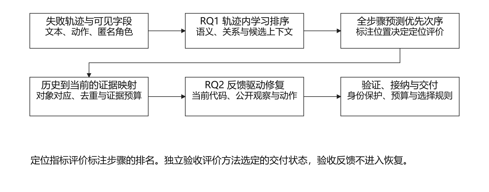
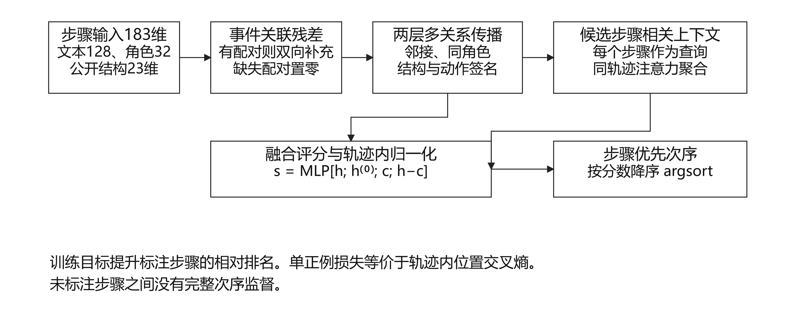
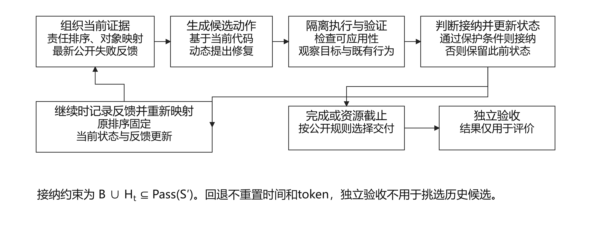
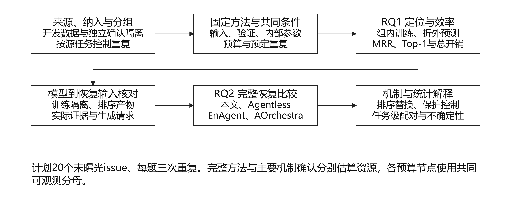

# V7逐段审查记录

定位采用“章节＋段首”；P编号为原稿按空行分段的零基索引，仅辅助对照。标题行随所属章节整体保留；正文、列表、图位、图注及表格均逐项覆盖，表格按整体评价。保留不代表所引文献或实现事实已外部核验。参考文献单独按条目覆盖。

| 章节 | 定位 | 建议 | 原因与修订方向 |
|---|---|---|---|
| 题目 | P0 # 基于学习排序的智能体失败诊断与执行恢复方法研究 | 改写 | 首选“基于学习排序的智能体失败定位与任务恢复方法”；删除末尾“研究”，不要无证据强化成因果归因。 |
| 题目 | P1 开题报告 | 保留 | 文种标识明确。 |
| 1.1 研究背景 | P4 随着大语言模型在语言理解、指令遵循和多步推理方面的能力提升，其应用逐步由文本生成与问… | 合并 | 与下一段适度合并；“自然语言成为组织任务推理的重要方式”过泛，直接引出模型—工具—环境的闭环。 |
| 1.1 研究背景 | P5 基于大语言模型的智能体通过连接模型、工具与环境，为解决这一问题提供了系统化途径。智能… | 保留 | 智能体与多智能体的概念区分必要；“协调才能发挥作用”可改为对连续决策一致性的要求。 |
| 1.1 研究背景 | P6 智能体研究已覆盖科学实验、网页操作、计算机使用和软件工程等多种场景。在科学研究中，模… | 改写 | 跨领域例子略多，压缩科学/网页/桌面例子，保留软件场景为何便于可执行验证。 |
| 1.1 研究背景 | P7 然而，具备推理、工具使用或协作能力，并不意味着智能体能够稳定完成复杂任务。已有实证研… | 保留 | 清楚说明传播和多步骤难点；不得据此把相关交互关系称为因果链。 |
| 1.1 研究背景 | P8 任务评价能够说明一次执行是否成功，却不能直接确定应当检查和改进哪个环节。细粒度失败归… | 保留 | 任务评价、错误定位、干预验证的过渡合理，是问题动机核心。 |
| 1.1 研究背景 | P9 对于已经改变环境的任务，恢复还涉及已有状态与执行进展。重新尝试可能修正原有问题，也可… | 保留 | 保留已有进展约束；“影响有效行为”改为“使此前通过验证的行为失效”。 |
| 1.1 研究背景 | P10 基于上述背景，本文围绕智能体的步骤级失败诊断与执行恢复开展研究：通过学习排序组织失败… | 改写 | 明确学习排序产出步骤优先次序，恢复产出候选状态；避免笼统“联系”。 |
| 1.2.1 智能体构建与执行可靠性 | P13 Yao等于2023年提出ReAct，将推理、动作与环境观察交替组织，使语言模型能够依… | 保留 | 典型系统脉络足够；按机制组织而非重复“某年提出”。 |
| 1.2.1 智能体构建与执行可靠性 | P14 随着执行结构的发展，系统可靠性也成为专门的研究对象。Cemri等于2025年提出多智… | 改写 | “由此，智能体研究开始”过强，改为“相关研究进一步关注”，避免用个别工作断言领域转向。 |
| 1.2.2 失败归因与责任步骤排序 | P16 Zhang等于2025年提出Who&When，将自动失败归因具体化为责任智能体与决定… | 保留 | 标注对象和定位策略介绍切题；统一Who&When写法。 |
| 1.2.2 失败归因与责任步骤排序 | P17 Sun等于2026年提出SDBL，先约束可疑范围，再进行责任位置识别。[16] 北京… | 改写 | 删除单独机构归属，突出StepFinder的评分监督与本文预期区别；出版/方法准确性须原文核对。 |
| 1.2.2 失败归因与责任步骤排序 | P18 监督与观测条件也影响归因研究的设置。Kong等于2026年提出Aegis，Zhang… | 补充 | 说明不同责任标注是否兼容，错误诱发位置与真实任务失败原因不能自动等同。 |
| 1.2.3 反馈纠错与可恢复执行 | P20 Madaan等于2023年提出Self-Refine，使语言模型交替生成反馈与修订结… | 保留 | 自反馈与工具反馈区分专业；注意原文论断适用任务范围，不泛化所有自纠错。 |
| 1.2.3 反馈纠错与可恢复执行 | P21 当动作已经改变环境时，恢复还需要处理上下文与执行状态。Chang和Geng于2025… | 保留 | 恢复对象扩展至环境与上下文，限定控制能力恰当；不要由此声称本文具有事务保证。 |
| 1.2.4 诊断引导恢复与软件任务求解 | P23 软件任务为研究执行反馈与持续修复提供了具体场景。Xia等于2025年发表Agentl… | 改写 | 压缩作者机构，按定位—验证—集成—编排机制比较，说明将其适配失败状态的必要性。 |
| 1.2.4 诊断引导恢复与软件任务求解 | P24 诊断与行动之间的联系也受到直接研究。Guo等于2025年提出SyncMind，研究智… | 补充 | 三类输入/决策对象有区分；再说明本文拟检验的是固定证据预算下的轨迹内排序增量。 |
| 1.2.4 诊断引导恢复与软件任务求解 | P25 Vasudev等于2026年在失败预测与预防预印本中进一步指出，较高的失败预测能力并… | 保留 | 预测质量不自动转为恢复收益是全篇关键逻辑，应保留。 |
| 1.3 现有问题与研究意义 | P27 现有研究已为智能体构建、失败归因、反馈纠错和状态恢复建立了方法基础，但这些环节之间仍… | 改写 | 删“而不以……作为创新”的答辩式自辩，正面说明要检验的信息融合与证据使用机制。 |
| 1.3 现有问题与研究意义 | P28 首先，责任步骤的识别需要同时理解局部内容和执行关系。已有学习式方法已利用时序与角色信… | 补充 | “排序稳定性”必须定义；若无独立评价计划，删掉该承诺。 |
| 1.3 现有问题与研究意义 | P29 其次，历史责任位置与当前恢复动作之间需要建立对应关系。诊断记录的是已经发生的执行，而… | 保留 | 历史责任与当前状态错位说明具体；补一个简短代码位置变化例子即可。 |
| 1.3 现有问题与研究意义 | P30 最后，恢复过程需要协调获得新进展与保持已有行为。上下文恢复、补偿和反思保留提供了不同… | 改写 | 将“身份与结果”具体化为可重复识别的行为/测试标识及验证结果；受控探索降为拓展。 |
| 1.3 现有问题与研究意义 | P31 软件任务中的代码修改、工具记录和可执行测试，使上述联系能够在明确的状态与反馈条件下观… | 合并 | 可与本节开头收束合并，避免重复总体技术路线；限制外推到具备相似验证条件的任务。 |
| 2.1 研究目标 | P34 本研究面向大语言模型智能体在多步骤任务中出现的执行失败，拟构建以步骤级责任排序为诊断… | 改写 | 目标改为“提高标注责任步骤的定位与排序质量”，避免将标注预测等同真实关键错误识别。 |
| 2.1 研究目标 | P35 围绕这一目标，研究工作分为相互衔接的两个部分。第一部分研究失败诊断，通过联合建模步骤… | 保留 | 两部分分工清楚；“已有正确行为”改为“已通过指定验证的行为”。 |
| 2.1 研究目标 | P36 两部分工作的关系体现为诊断信息向恢复决策的传递。诊断模块回答“哪些步骤应优先检查”，… | 合并 | 保留两个问题的简短解释，与2.2衔接；去掉重复相关工作介绍。 |
| 2.2 研究问题 | P38 **RQ1：如何融合步骤语义、交互关系与候选上下文，提高失败轨迹的责任排序质量？** | 改写 | RQ1加入“同一轨迹内”“标注责任步骤”，明确比较单位和监督边界。 |
| 2.2 研究问题 | P39 执行轨迹由多次推理、工具调用和环境观察组成。Zhu等于2026年提出的StepFin… | 改写 | 替换为总报告2.2建议段，加入查询—候选—标签映射；StepFinder介绍移1.2。 |
| 2.2 研究问题 | P40 **RQ2：如何结合责任排序、当前状态与执行反馈，实现任务恢复并保持已验证行为？** | 改写 | RQ2强调固定恢复器和证据预算下的排序作用，避免同时堆叠所有机制。 |
| 2.2 研究问题 | P41 已有研究分别利用反思记忆、工具反馈和回退机制改善智能体行为，近年的研究还直接探索了诊… | 改写 | 替换为总报告2.2建议段，直接说明证据选择、动作、验收三个评价层次。 |
| 2.3 研究对象与基本概念 | P43 本研究中的智能体，是以大语言模型承担推理或决策功能，并通过工具与外部环境持续交互的任… | 补充 | 单/多智能体作为研究范围可保留，但必须由数据与实现支持；日志role不自动等于独立智能体。 |
| 2.3 研究对象与基本概念 | P44 **执行轨迹与责任步骤。** 执行轨迹是同一任务产生的有序步骤记录，包括推理、动作、… | 补充 | 定义轨迹T、候选步骤x、标注集合Y及原始索引映射；说明来源标签含义不必一致。 |
| 2.3 研究对象与基本概念 | P45 **责任排序与恢复证据。** 责任排序给出全部步骤的诊断优先次序，用于确定应先检查哪… | 补充 | 责任分数仅是组内优先级；恢复证据给出字段和预算，不能只下概念定义。 |
| 2.3 研究对象与基本概念 | P46 **当前状态与恢复动作。** 当前执行状态包括已接纳的环境内容及已经获得的公开观察。… | 补充 | 当前状态需包含可控环境、上下文/反馈范围；哪些状态可回退由实现核对。 |
| 2.3 研究对象与基本概念 | P47 **已验证行为与交付状态。** 已验证行为是当前已接纳状态中通过指定验证条件的具体行… | 改写 | “已验证”限定为指定验证条件；交付状态说明为预算节点按预定规则选择的一份结果。 |
| 2.3 研究对象与基本概念 | P48 责任排序是一种面向诊断任务的预测结果，其含义取决于可见信息和标注标准；需要通过重新执… | 改写 | “因果作用在恢复实验中另行分析”改成“干预效果”；一般恢复实验不能识别单步因果责任。 |
| 2.4 理论基础与方法依据 | P50 学习排序为本研究提供了统一组织诊断候选的建模方式。Cao等于2007年提出列表式学习… | 补充 | 简述pointwise/pairwise/listwise差别与选listwise原因，承认单正例CE等价，不把损失名称当创新。 |
| 2.4 理论基础与方法依据 | P51 关系表示学习为处理异质步骤联系提供了方法基础。Schlichtkrull等提出的关系… | 保留 | 多关系聚合依据合理；图的边是可观察关联，避免称依赖因果关系。 |
| 2.4 理论基础与方法依据 | P52 恢复控制则以反馈和状态变化为中心。Shinn等于2023年提出Reflexion，将… | 改写 | Sagas可作状态恢复启发，不作为本文具备事务语义/保证的理论证明；压缩文献复述。 |
| 3.1 总体技术路线 | P55 本研究拟形成由失败轨迹诊断到当前状态恢复的完整技术路线，如图3-1所示。输入包括任务… | 补充 | 总体输入输出清楚，补诊断是离线完整轨迹还是在线前缀；输出未必恢复成功。 |
| 3.1 总体技术路线 | P56  | 补充 | 本轮只审查Markdown图位与文字，未检视像素；图应包含训练监督和推断/恢复信息流，不把隐藏验收回流。 |
| 3.1 总体技术路线 | P57 图3-1 智能体失败诊断与执行恢复的总体研究框架 | 改写 | 随最终题目统一失败定位/任务恢复术语。 |
| 3.1 总体技术路线 | P58 首先，对不同来源的执行记录进行统一表示，在保留原始步骤位置的基础上提取语义和结构信息… | 改写 | 用步骤评分→预算内证据→当前状态候选→接纳规则串联，减少无具体条件的流程动词。 |
| 3.1 总体技术路线 | P59 总体框架中的两个研究问题保持独立的评价目标。RQ1关注责任排序能否改善错误步骤识别；… | 保留 | 诊断与恢复独立评价目标重要；“独立”指指标分开，不否认模块依赖。 |
| 3.2.1 步骤语义与多关系表示 | P62 本研究拟将失败轨迹中的每个步骤表示为语义内容、角色信息与公开结构特征的组合。语义内容… | 补充 | 给步骤输入字段、编码器、位置编码及角色缺失处理；原始步骤标签与统一边界如何映射必须明确。 |
| 3.2.1 步骤语义与多关系表示 | P63 在步骤语义编码的基础上，拟构建能够反映执行组织方式的关系结构。基础关系包括时间上相邻… | 补充 | 加入关系聚合公式、边方向、邻域、自环和归一化；动作—观察配对以真实字段为准。 |
| 3.2.1 步骤语义与多关系表示 | P64 关系构建将遵循可观察信息约束。若某类轨迹没有提供可靠的角色或事件对应关系，则使用该来… | 保留 | 可观察约束正确；缺失关系不能补造，需报告每来源关系可用率。 |
| 3.2.2 候选相关上下文与学习排序 | P66 失败诊断需要结合轨迹整体理解局部步骤。一个步骤是否应优先检查，既取决于其自身内容，也… | 补充 | 候选明确为步骤；全轨迹离线诊断可读后续观察，不能据此声称在线提前预测。 |
| 3.2.2 候选相关上下文与学习排序 | P67 候选相关上下文通过可学习的信息聚合机制形成，并与多关系交互后的步骤表示共同用于责任评… | 补充 | 加入候选查询注意力/真实聚合公式、候选上下文范围、评分函数；不凭图替代定义。 |
| 3.2.2 候选相关上下文与学习排序 | P68  | 补充 | 图应对应真实实现，标注候选i与各步骤上下文的关系；本轮未检视图像。 |
| 3.2.2 候选相关上下文与学习排序 | P69 图3-2 融合步骤语义、关系信息与候选上下文的责任排序方法 | 保留 | 图注信息明确，与实际结构核对后使用。 |
| 3.2.2 候选相关上下文与学习排序 | P70 训练时，以完整轨迹作为候选列表，利用标注责任步骤指导分数学习。列表式目标使不同步骤在… | 改写 | 加入softmax列表损失、单/多正例定义、mask及argsort；非标注项间次序并非有监督真值。 |
| 3.2.2 候选相关上下文与学习排序 | P71 该模块的研究重点是语义、关系和上下文的互补作用。为分析性能变化的来源，拟设置仅语义表… | 保留 | 结构控制必要；“规模尽可能一致”改为具体参数量/训练预算报告，避免隐含完全等量承诺。 |
| 3.3 诊断证据与当前状态的对应 | P73 诊断输出描述历史执行中的可疑步骤，恢复动作则作用于当前环境。两者之间需要建立明确的对… | 保留 | 错误编辑可能被覆盖的例子准确，是连接两条主线的关键段。 |
| 3.3 诊断证据与当前状态的对应 | P74 证据映射首先识别候选步骤中的动作对象及其可用信息，再检查这些信息与当前状态的关系。在… | 改写 | 替换为总报告3.3映射定义；补状态对齐字段、映射失败处理，历史解释不得直接转成自动撤销。 |
| 3.3 诊断证据与当前状态的对应 | P75 这一过程拟保留两类输出：一类是原始轨迹上的完整责任排序，用于评价诊断质量；另一类是满… | 补充 | 两类输出区分保留；加入Select(K,C)及去重/跳过/截断规则，确保排序真能改变证据。 |
| 3.4 反馈驱动的迭代恢复 | P77 恢复模块拟以当前已接纳状态为起点，综合任务要求、责任排序、映射后的历史证据和最新公开… | 补充 | 说明每轮是否重新评分，还是固定排序逐轮映射；“明确尚未满足目标”只能使用公开可见目标。 |
| 3.4 反馈驱动的迭代恢复 | P78 候选动作在独立副本中执行。在软件任务中，动作主要是基于当前代码提出修复；具有明确撤销… | 保留 | 隔离候选执行与动作校验合理；独立副本是否覆盖依赖、上下文与环境副作用待实现核对。 |
| 3.4 反馈驱动的迭代恢复 | P79 候选状态的验证与接纳分开进行。验证提供行为结果，状态管理依据第三章3.5节的保护条件… | 补充 | 接纳条件需形式化，特别是无新增通过行为的中性候选是否可接纳及循环停止规则。 |
| 3.4 反馈驱动的迭代恢复 | P80 图3-3按一次恢复循环展示主要流程：组织证据、生成候选、公开验证、接纳判断、更新或保… | 补充 | 定义预算耗尽时在途动作及交付状态选择；公开完成不等于独立验收完成。 |
| 3.4 反馈驱动的迭代恢复 | P81  | 补充 | 流程图应区分已接纳状态和候选状态，隐藏验收为只出不回流节点；本轮未检视图像。 |
| 3.4 反馈驱动的迭代恢复 | P82 图3-3 诊断证据、公开反馈与状态更新共同驱动的迭代恢复流程 | 保留 | 图注明确，可随题目微调。 |
| 3.4 反馈驱动的迭代恢复 | P83 该设计使责任排序在每轮恢复中具有明确用途：影响历史证据的检查顺序与组织方式，再由当前… | 保留 | 解释排序作用于证据而非直接决定动作，逻辑正确；应配合3.3固定预算接口。 |
| 3.5 已验证行为的保护与状态更新 | P85 本研究拟在恢复过程中显式记录已经通过验证的具体行为，避免只根据通过数量判断是否取得进… | 保留 | “数量不变但身份替换”的动机具体，避免升级为普遍必然优势。 |
| 3.5 已验证行为的保护与状态更新 | P86 基本接纳条件包括普通保护行为保持通过，以及先前要求保留的目标行为继续通过。候选满足条… | 补充 | 用B∪H_t⊆Pass(S′)定义严格保护；明确未知结果、身份稳定性、是否可修改测试与中性接纳。 |
| 3.5 已验证行为的保护与状态更新 | P87 对于可能需要暂时退步才能完成的修复过程，拟在完成基本方法评价后，进一步研究可恢复分支… | 改写 | 保留为后续扩展而非基本创新承诺；分支需另定义状态选择和资源计量，当前不必扩张。 |
| 3.6 方法的模块化实现 | P89 拟实现的系统包括轨迹表示、责任排序、证据映射、候选生成、行为验证和状态管理模块。各模… | 保留 | 模块输入输出有用，可用一张简短接口表替代抽象说明；不要写未实现模块为既有事实。 |
| 3.6 方法的模块化实现 | P90 系统还将保存必要的模型输入、工具观察、候选状态与资源使用记录，以支持运行中断后的继续… | 合并 | 日志复查和续跑属实现保障，可与第五章记录条件合并，避免挤占方法空间。 |
| 4.1 复杂执行轨迹中的诊断信息组织 | P93 本研究首先需要解决如何在较长、异质的执行记录中组织对责任判断有用的信息。StepFi… | 改写 | 把依赖引导相关工作提前到1.2，章节此处集中提出信息融合挑战，不重复文献列表。 |
| 4.1 复杂执行轨迹中的诊断信息组织 | P94 拟采用的解决思路是在统一语义表示上引入可观察关系，再通过候选相关上下文完成责任评分。… | 补充 | 明确创新候选是“关系传播与候选条件聚合的联合增量”，给与统一上下文的对照假设。 |
| 4.2 历史诊断与当前恢复动作之间的衔接 | P96 第二个关键问题是如何使历史轨迹中的责任判断能够服务于当前状态下的行动。Ma等的DoV… | 合并 | 与4.2下一段合并；已有诊断干预工作不是本文机制新颖性的直接证明。 |
| 4.2 历史诊断与当前恢复动作之间的衔接 | P97 本研究拟通过证据映射明确历史步骤、当前对象及可执行动作之间的关系。实验将固定恢复器，… | 补充 | 加入同预算乱序、相同候选集合不同次序的控制；无诊断与无学习排序不可混用。 |
| 4.3 恢复推进与行为保留之间的协调 | P99 第三个关键问题是恢复过程中如何同时推进任务并控制已有行为的退化。反馈纠错方法能够根据… | 改写 | 强调稳定行为身份与接纳条件的具体区别，不把普通回退包装成新方法。 |
| 4.3 恢复推进与行为保留之间的协调 | P100 拟设置按通过数量保护、按具体行为保护以及仅保护普通行为的比较条件，考察不同规则的实际… | 改写 | 三种保护条件应共享回归验证；暂时退步分析属拓展，与3.5一致。 |
| 4.4 预期创新点 | P102 第一项预期创新是面向智能体失败轨迹的语义、关系与候选上下文联合排序方法。该方法拟将轨… | 改写 | 改成可检验预期：相同输入/容量下联合表示是否优于强基线和单模块；不预先宣称提升。 |
| 4.4 预期创新点 | P103 第二项预期创新是面向当前执行状态的诊断引导恢复方法。该方法拟建立责任排序与可执行恢复… | 改写 | 指出当前状态对齐和预算证据接口的增量，以及由固定恢复器控制验证；避免整体流水线即创新。 |
| 4.4 预期创新点 | P104 以上创新围绕具体问题、方法和评价展开。责任排序方法的有效性将通过跨任务与不同划分的对… | 合并 | 可作为4.4最后两句，无需单列反复强调公平评价。 |
| 5.1 数据构造与训练、验证和确认划分 | P107 实验围绕责任排序质量、完整恢复效果及诊断到行动的作用机制展开。数据体系采用AFTra… | 保留 | 数据用途明确；AFTraj与Who&When的来源关系需数据引用支持，不只引论文名。 |
| 5.1 数据构造与训练、验证和确认划分 | P108 表5-1 数据来源、规模与当前研究样本 | 保留 | 表题清晰。 |
| 5.1 数据构造与训练、验证和确认划分 | P109 ／ 数据来源 ／ 原始发布规模 ／ 当前已整理样本 ／ 实验用途 ／ | 补充 | 表5-1整体保留；区分轨迹数、源任务数、是否开发曝光；731与120集合关系要直接注明。 |
| 5.1 数据构造与训练、验证和确认划分 | P110 AFTraj开发子集在五个任务类型与标注来源组合中各取24条，按领域为coding … | 改写 | 版本与非官方测试集说明重要；保留一次，把详细来源换算与采样清单移附录。 |
| 5.1 数据构造与训练、验证和确认划分 | P111 所有划分以原始任务为单位。同一问题产生的多条轨迹、错误变体及派生样本放入同一任务组。… | 保留 | 源任务分组和资格排除合理；补跨数据源相同任务去重规则。 |
| 5.1 数据构造与训练、验证和确认划分 | P112 表5-2 训练、验证、开发评价与独立确认设计 | 保留 | 表题可简化为数据划分与评价安排。 |
| 5.1 数据构造与训练、验证和确认划分 | P113 ／ 数据与阶段 ／ 训练与模型选择 ／ 评价安排 ／ 独立性及规模说明 ／ | 补充 | 表5-2整体合理；AgenTracer固定评价已用于开发须保留。恢复确认目标issue数与未曝光招募规则仍缺。 |
| 5.1 数据构造与训练、验证和确认划分 | P114 恢复样本由任务描述、初始代码状态、可见失败轨迹、公开反馈和独立验收条件共同构成。先核… | 改写 | 保留样本构成与自然/受控区分；删除21题、18题等过程历史数字，转实验记录。 |
| 5.2 实验流程与共同运行条件 | P116 实验依次完成数据资格核验、责任排序训练与评价、排序到恢复输入的衔接、完整恢复比较、预… | 保留 | 开发选择、确认冻结与全量报告逻辑清楚。 |
| 5.2 实验流程与共同运行条件 | P117  | 补充 | 图应显示开发到冻结再确认，明确源任务隔离与信息许可；本轮未检视像素。 |
| 5.2 实验流程与共同运行条件 | P118 图5-1 数据划分、排序评价、完整恢复比较与机制分析的实验流程 | 保留 | 图注信息充分。 |
| 5.2 实验流程与共同运行条件 | P119 责任排序实验先固定任务分组和输入处理，再分别训练本文与StepFinder模型；提示… | 补充 | 若编码截断导致标签不可见，应预定处理并报告；不能仅在标签保留的子集上算主要结果。 |
| 5.2 实验流程与共同运行条件 | P120 恢复实验首先固定任务初态、可见信息、工具许可、公开验证范围和验收标准，再分别运行本文… | 补充 | 外部方法适配失败中间仓库的方式与原始轨迹可见接口需说明；相同后端不自动代表公平。 |
| 5.2 实验流程与共同运行条件 | P121 表5-3 完整恢复实验的共同条件 | 保留 | 表题明确。 |
| 5.2 实验流程与共同运行条件 | P122 ／ 条件 ／ 统一设置 ／ 记录与核对内容 ／ | 补充 | 表5-3整体保留；三重复如何汇总写入指标，补版本、并发/硬件和预算耗尽规则。 |
| 5.2 实验流程与共同运行条件 | P123 生成后端采用当前实验环境允许的deepseek-flash，专门诊断模型在现有本地环… | 改写 | 后端标识及版本冻结保留；“当前环境允许”是行政语气，改为实际选用理由与配置。 |
| 5.2 实验流程与共同运行条件 | P124 本文恢复系统还需逐项核对“选定排序模型及训练清单—排序产物—恢复器读取—实际生成请求… | 改写 | 改成学术协议：“记录模型版本、训练任务集合与实际证据来源，检查跨阶段泄漏”；流水账箭头可移复查材料。 |
| 5.3 比较方法与实验分工 | P126 责任排序采用StepFinder、All-at-Once与Binary Search… | 保留 | 基线类别互补清楚，需原文核对其原生输出和信息条件。 |
| 5.3 比较方法与实验分工 | P127 表5-4 责任排序比较方法及评价范围 | 保留 | 表题明确。 |
| 5.3 比较方法与实验分工 | P128 ／ 方法 ／ 原有诊断机制 ／ 可直接比较的输出与指标 ／ | 保留 | 表5-4尊重单位置与完整排序输出差异，切勿人为给单位置方法补尾部算MRR。 |
| 5.3 比较方法与实验分工 | P129 All-at-Once与Binary Search原生输出单个责任位置，不用补齐任意… | 保留 | 统一MRR定义和原论文截断指标分开，必要且严谨。 |
| 5.3 比较方法与实验分工 | P130 完整恢复采用Agentless、EnAgent和AOrchestra作为外部比较方法… | 补充 | 明确完整系统基线在中间失败状态的适配，避免把原始问题求解与恢复成绩直接混同。 |
| 5.3 比较方法与实验分工 | P131 表5-5 完整系统比较与内部控制的分工 | 保留 | 表题明确。 |
| 5.3 比较方法与实验分工 | P132 ／ 实验 ／ 方法或条件 ／ 回答的问题 ／ | 补充 | 表5-5分工正确；“无诊断”与“不使用学习排序”应作为不同条件明确命名。 |
| 5.3 比较方法与实验分工 | P133 外部比较纳入已核验正式发表、核心可实施且在当前环境具有有效运行表现的方法，包含202… | 改写 | “非零表现”仅作工程可运行门槛，不以确认胜负筛选基线；删除“包含2026年”等行政选型语气。 |
| 5.4 评价指标、资源预算与效率分析 | P135 RQ1首先比较Top-1，即首个责任候选与标注步骤一致的比例。原生输出完整排序的方法… | 补充 | 补Hit@k与MRR公式、无效输出r=∞、多正例Hit不是Recall；宏平均与轨迹平均明确区分。 |
| 5.4 评价指标、资源预算与效率分析 | P136 诊断效率按从原始轨迹输入到责任位置或完整排序输出的端到端过程计量，包含语义编码、结构… | 保留 | 端到端计量与训练成本单列正确；补缓存、batch大小、设备和暖启动计量设置即可。 |
| 5.4 评价指标、资源预算与效率分析 | P137 RQ2的核心指标是**预算内恢复成功率RSR(B)**：在资源上限B内，方法选定的一… | 补充 | 补issue×重复宏平均RSR公式；交付曲线可能非单调，不能用隐藏验收选历史最佳候选。 |
| 5.4 评价指标、资源预算与效率分析 | P138 表5-6 评价指标与计量对象 | 保留 | 表题明确。 |
| 5.4 评价指标、资源预算与效率分析 | P139 ／ 评价对象 ／ 指标 ／ 计量范围及解释 ／ | 补充 | 表5-6需定义退化率分母和有效/重复候选标准；同公开验证下保护率可能按规则恒为零。 |
| 5.4 评价指标、资源预算与效率分析 | P140 时间分析以30分钟为主要预算节点，并在相同内部参数下考察15分钟和60分钟节点。to… | 补充 | 时间节点明确；token阈值开发后冻结即可。输入/输出token之和不是费用替代，费用单列。 |
| 5.4 评价指标、资源预算与效率分析 | P141 完整运行还报告保持内部参数不变、取消外部科研时间截断后的自然终态。若采用更大候选数或… | 保留 | 相同内部参数的自然终态与删失区分正确；“取消时间截断”仍须说明其他资源上限。 |
| 5.4 评价指标、资源预算与效率分析 | P142 预算评价的候选快照在执行期间保存，独立验收在相应运行结束后进行，反馈不进入后续模型请… | 保留 | 快照事后验收隔离合理；同一运行多预算节点不是独立样本，统计需配对。 |
| 5.4 评价指标、资源预算与效率分析 | P143 预期优势作为实验假设提出：多关系与候选上下文可能改善长轨迹和跨步骤错误传播的定位；专… | 改写 | 预期优势改写为少量预注册假设，分别绑定指标；“排序稳定性”和“重复诊断摊销”需定义阈值。 |
| 5.5 消融实验与诊断到行动的机制分析 | P145 消融实验围绕具体信息来源和决策机制展开。RQ1改变模型结构时，使用相同源任务划分、语… | 保留 | 重新训练消融与推断扰动区分正确，保留。 |
| 5.5 消融实验与诊断到行动的机制分析 | P146 表5-7 责任排序的消融与敏感性实验 | 保留 | 表题明确。 |
| 5.5 消融实验与诊断到行动的机制分析 | P147 ／ 控制因素 ／ 比较条件 ／ 主要观察 ／ | 补充 | 表5-7控制充足；置换边要说明是否保持度分布及是否造成分布外输入，避免过度解释。 |
| 5.5 消融实验与诊断到行动的机制分析 | P148 列表式训练采用与责任步骤标注一致的目标。单个正例条件下，归一化列表式目标与相应sof… | 保留 | 单正例CE等价判断非常重要，前移到3.2损失定义后，此处简短引用即可。 |
| 5.5 消融实验与诊断到行动的机制分析 | P149 RQ2固定本文生成器、动作校验、公开验证和总体资源，在同一任务初态上替换单个机制。本… | 补充 | 乱序若改变选中集合与只改变顺序，效果不同；分别定义或明确仅检验预算选择后的综合影响。 |
| 5.5 消融实验与诊断到行动的机制分析 | P150 表5-8 执行恢复的控制实验 | 保留 | 表题明确。 |
| 5.5 消融实验与诊断到行动的机制分析 | P151 ／ 控制因素 ／ 比较条件 ／ 主要观察 ／ | 改写 | 表5-8信息多，可分核心消融和探索性分析；“普通行为保护”必须操作化。 |
| 5.5 消融实验与诊断到行动的机制分析 | P152 诊断与反馈的四条件实验中，“无显式结构化反馈包”仅移除专门整理后的反馈输入，仍保留工… | 保留 | 明确移除的是反馈组织而非验证工具正确；等预算不等于信息完全相同，应报告实际token。 |
| 5.5 消融实验与诊断到行动的机制分析 | P153 行为保护实验使用共同的行为身份映射与完整验收条件。按数量保护判断已通过目标的数量是否… | 保留 | 自然失败与压力样本不混算很重要；列身份替换/过时映射/暂时退步三个场景足够。 |
| 5.5 消融实验与诊断到行动的机制分析 | P154 机制分析还将记录从责任步骤到恢复证据、动作、公开反馈和接纳结果的对应。即使最终成功率… | 补充 | 定义证据差异、动作差异、首次有效进展及重复候选判定，否则过程统计不可重复。 |
| 5.6 稳健性、有效性与后续扩展 | P156 统计以源任务或issue为单位。责任排序先汇总同一任务组内的轨迹，再进行配对比较；恢… | 补充 | 补任务宏平均估计式、缺失处理及小样本限制；bootstrap以issue整组重采样，重复留在组内。 |
| 5.6 稳健性、有效性与后续扩展 | P157 分层因素在开发阶段依据任务属性确定，包括轨迹长度、可观察关系密度、失败反馈的具体程度… | 改写 | 预定分层过多，优先与假设直接相关的少量因素；小样本仅描述，不作多组显著性宣称。 |
| 5.6 稳健性、有效性与后续扩展 | P158 有效性控制还包括确认数据的源任务隔离、模型输入的信息许可、基线核心实施、统一动作接口… | 合并 | 与5.1/5.2资格及泄漏说明重复，压缩为有效性威胁和尚未解决边界。 |
| 5.6 稳健性、有效性与后续扩展 | P159 后续扩展沿第三章定义的接口展开：关系构建可增加可靠的动作依赖，证据映射可处理更多当前… | 改写 | 扩展内容重复3.5/3.6，压缩一段；未实现扩展不计当前方法，保留该限定。 |
| 5.6 稳健性、有效性与后续扩展 | P160 实验结果计划采用三类主要图表组织：责任排序质量与端到端开销的比较表，恢复成功率随时间… | 保留 | 图表计划适度；代表性案例应含成功、失败和排序无作用案例，不只选正例。 |
| 6.1 前期研究基础 | P163 前期工作已围绕失败轨迹整理、步骤责任排序和可执行恢复建立实验基础。在AFTraj与A… | 补充 | “观察到改进现象”过空；若有核验数据可列规模、指标和开发属性，否则改成已完成可执行流程。 |
| 6.1 前期研究基础 | P164 在执行恢复方面，已实现诊断证据接入、候选动作生成、公开验证和状态记录，并完成包含本文… | 保留 | 单题曝光、终态饱和及不证明排序收益的限定诚实必要；实现与验收事实由主线程核对。 |
| 6.1 前期研究基础 | P165 完整外部对照方面，Agentless与EnAgent的已有结果继续保留，AOrche… | 改写 | 删除“新增”“已有结果继续保留”的工作日志口吻，写已完成哪些可行性验证及条件范围。 |
| 6.1 前期研究基础 | P166 前期状态管理研究还观察到候选修复造成暂时退步、后续修改重新恢复任务的过程。现有案例尚… | 改写 | 格式处理缺陷适合实现局限，不必细写修复计划；保留暂时退步与身份保护收益尚未证实的边界。 |
| 6.1 前期研究基础 | P167 上述工作为本课题提供了可继续推进的数据与实现条件。后续研究将以统一条件下的完整方法比… | 合并 | 与6.1开头合并收束，减少重复“系统性认识”，写清下一步未完成验证。 |
| 6.2 研究进度安排 | P169 研究计划围绕方法设计、实验评价和论文形成依次推进。具体日历结合学校开题、阶段检查和论… | 补充 | 增加月份/周序和学校节点；不能仅说具体日历另定而无任何可执行时间安排。 |
| 6.2 研究进度安排 | P170 1. **研究方案与数据准备。** 完善问题定义、相关文献和数据构造，核查任务分组、… | 补充 | 五阶段内容合理；各项补起止时间、交付物和依赖，完整比较优先于扩展分支研究。 |
| 6.2 研究进度安排 | P171 不同阶段可依据研究发现调整局部方法，但保持责任排序与执行恢复两条主线。确认阶段采用固… | 保留 | 确认固定配置与扩展单列正确，可压缩一句。 |
| 6.3 预期研究成果 | P173 在失败诊断方面，预期形成一种融合步骤语义、交互关系与候选相关上下文的责任排序方法。通… | 改写 | 预期成果写“形成并评价”，避免预先承诺必然提升；稳定性无定义则删除。 |
| 6.3 预期研究成果 | P174 在执行恢复方面，预期形成一种诊断证据与环境反馈协同的恢复方法。通过将历史责任排序与当… | 改写 | 同上，将提高/减少改为检验效果与条件；已验证行为限定公开验证范围。 |
| 6.3 预期研究成果 | P175 在实验与实现方面，预期形成覆盖诊断评价、完整恢复比较和机制分析的实验体系，以及支持模… | 保留 | 论文、原型与实验体系交付完整；复查材料具体化为划分、配置、预测及运行记录。 |

## 参考文献逐项范围检查

以下仅评估条目在本文中的用途与修订关注点，不替代原文及出版信息核验。

| 条目 | 建议 | 检查意见 |
|---|---|---|
| [1] | 保留／核对 | 背景使用合理，不能据指令微调推断工具执行可靠性。 |
| [2] | 保留／核对 | 背景使用合理，CoT与环境交互须分开。 |
| [3] | 保留／核对 | 支撑推理—动作—观察结构与智能体定义。 |
| [4] | 保留／核对 | 支撑协作会话框架，不证明本项目实际多智能体角色。 |
| [5] | 保留／核对 | 支撑角色分工，正文删孤立机构标签。 |
| [6] | 保留／核对 | 跨域背景例子可压缩。 |
| [7] | 保留／核对 | 网页任务背景可简述。 |
| [8] | 保留／核对 | 桌面任务背景可简述。 |
| [9] | 保留／核对 | 软件执行场景依据，和SWE-bench区别明确。 |
| [10] | 保留／核对 | 多智能体失败分类与责任定位不是同一任务。 |
| [11] | 保留／核对 | 最关键强基线，需核监督、输入、关系与候选上下文差异。 |
| [12] | 保留／核对 | 归因任务与单位置基线来源，统一Who&When写法。 |
| [13] | 保留／核对 | 干预效果与因果责任识别不可自动等同。 |
| [14] | 保留／核对 | 状态/补偿启发，勿宣称继承事务保证。 |
| [15] | 保留／核对 | 按文中预印本身份处理，需核日期及适用环境。 |
| [16] | 保留／核对 | 范围定位方法与完整排序目标区分。 |
| [17] | 保留／核对 | 生成错误的标签语义需与责任监督区分。 |
| [18] | 保留／核对 | 核数据版本、标签来源与coding划分。 |
| [19] | 保留／核对 | 完整观测不等于本文可获取全部信息。 |
| [20] | 保留／核对 | 自反馈纠错与当前环境修改区分。 |
| [21] | 保留／核对 | 反思记忆不等于本文采用强化学习训练。 |
| [22] | 保留／核对 | 工具反馈适用性与本文公开验证衔接。 |
| [23] | 保留／核对 | 自纠错结论限定原研究条件。 |
| [24] | 保留／核对 | 作为状态/反思扩展参照，明确预印本。 |
| [25] | 保留／核对 | 完整基线需说明失败中间状态适配。 |
| [26] | 保留／核对 | 验证反馈迭代修复的近邻工作。 |
| [27] | 保留／核对 | 完整方法比较需保留集成核心。 |
| [28] | 保留／核对 | 动态子智能体编排不决定本文自身角色设置。 |
| [29] | 保留／核对 | 状态不同步与错误步骤定位区别应保留。 |
| [30] | 保留／核对 | 任务族策略与轨迹级排序差异需原文支持。 |
| [31] | 保留／核对 | 预测—干预分离作为核心动机，不能据此预设本文优势。 |
| [32] | 保留／核对 | 软件任务基准与恢复起点构造区别明确。 |
| [33] | 保留／核对 | 原始问题数量、轨迹数量与本研究issue池分开。 |
| [34] | 保留／核对 | 特定环境回退机制不能直接外推代码状态恢复。 |
| [35] | 保留／核对 | 学习排序理论依据，单正例CE等价必须正文说明。 |
| [36] | 保留／核对 | 多关系表示来源，不能把采用R-GCN本身作为创新。 |
| [37] | 保留／核对 | 长事务补偿的启发而非本文正确性证明。 |
| [38] | 保留／核对 | 建议相关工作前移第一章，核近期预印本元数据。 |
| [39] | 保留／核对 | 建议相关工作前移第一章，核与本文差异。 |
| [40] | 保留／核对 | 回退近邻工作应在第一章介绍而非创新章首次出现。 |
| [41] | 保留／核对 | 数据说明独立于论文，保留版本、URL及访问日期。 |
| [42] | 保留／核对 | 发布版本与论文版数量不同，保留实际使用版本。 |

覆盖核对：六章全部非标题段、五阶段列表、四幅图位与图注、全部八张实验表及42条参考文献均纳入；图像本身未检视，不能据本文判断布局或图中文字准确性。
