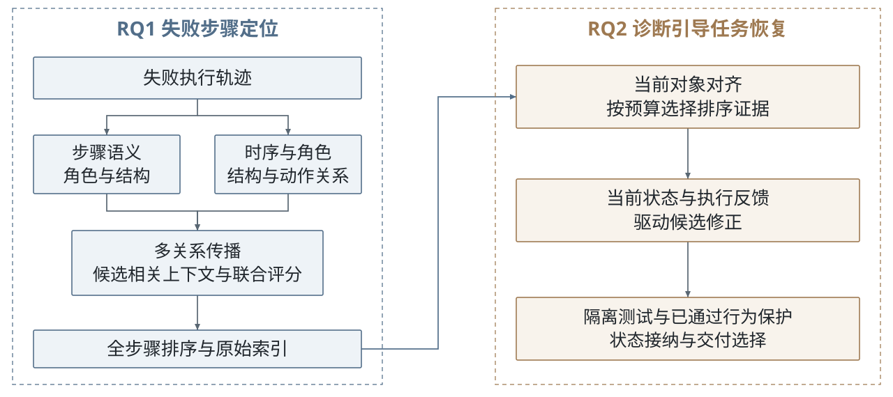
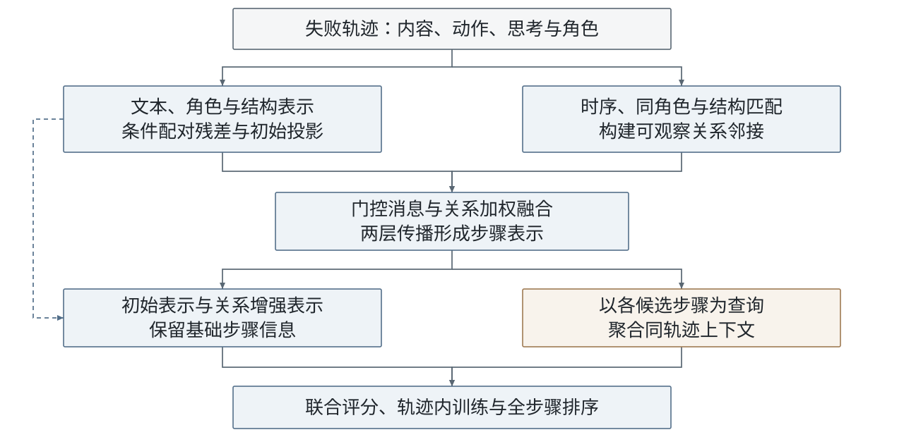
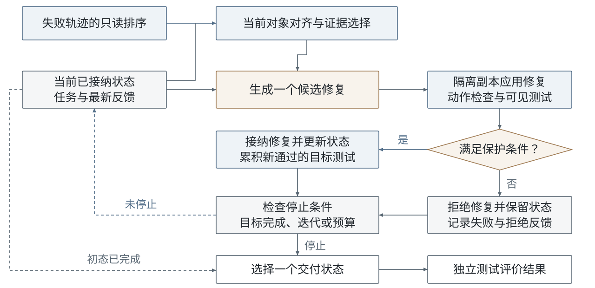
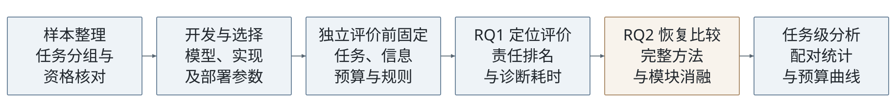
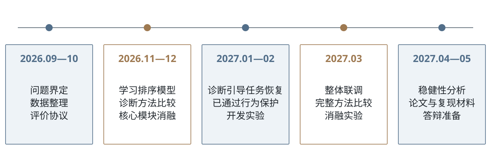

# 基于学习排序的智能体失败诊断与任务恢复方法

开题报告

## 第一章 研究背景与国内外研究现状

### 1.1 研究背景

大语言模型在语言理解、指令遵循和多步推理方面的进展，使其应用逐渐由文本生成扩展到需要规划与执行的复杂任务。模型通过调用工具获取信息、执行操作，再依据环境反馈调整后续行动。如何将语言模型的推理能力转化为实际任务完成能力，已成为智能体研究的重要问题。[1,2,3]

基于大语言模型的智能体连接模型、工具与环境，形成持续的决策和执行过程。多智能体系统进一步通过角色分工和信息交换组织协作。[3,4,5] 目前，相关应用已覆盖科学实验、网页操作、计算机使用和软件工程等场景。不同场景的操作方式各异，但都要求系统在多步交互中理解任务、利用反馈并完成目标。[6,7,8,9]

复杂任务的失败可能涉及任务分解、信息协调、操作选择和结果验证等多个环节。早期错误还可能影响后续步骤，使最终失败难以由某一次输出单独解释。[10,11] 随着执行轨迹增长，需要检查的信息增多，关键错误与后续异常之间也更难区分。

任务结果评价回答一次执行是否成功，失败诊断则进一步寻找值得检查和改进的环节。细粒度失败归因研究开始识别责任智能体和关键错误步骤，为系统改进提供依据。[12] 定位之后，系统还需要采取修正行动，并通过重新执行检验任务能否完成。[13]

任务恢复还面临已有进展的保持问题。重新尝试可能重复已完成的工作，局部修改也可能破坏此前已经通过的行为。恢复过程因此需要同时考虑当前环境、执行反馈以及修改对已有行为的影响。[14,15] 本课题围绕失败步骤定位与任务恢复开展研究，以软件任务作为主要验证场景。

### 1.2 研究对象与问题定义

研究对象是大语言模型智能体通过工具与环境交互形成的任务执行过程，既包括单智能体执行，也包括多智能体协作。本文关注已经发生失败的任务，研究如何从执行记录中定位关键步骤，以及如何利用诊断结果继续完成原任务。

**执行轨迹**是同一任务产生的有序步骤记录，包含可用的文本、动作、环境观察和行为来源。**责任步骤**是数据集按其标注规则确定的关键错误位置，作为失败步骤定位的预测目标。本文据此评价定位结果；进一步确认因果根因需要干预证据，其他步骤的责任也需结合具体证据判断。

**任务恢复**是指从失败执行形成的当前环境出发，利用诊断线索和执行反馈修正后续行动，继续完成原任务。软件场景中的修复操作主要表现为代码修改与测试。恢复效果以任务最终是否完成评价。

本课题研究的两个问题是：失败轨迹中的哪些步骤应当优先检查；这些定位信息能否帮助系统更有效地完成失败任务。前者评价诊断质量，后者评价诊断在实际行动中的作用。

### 1.3 国内外研究现状

#### 1.3.1 智能体构建与执行可靠性

Yao等于2023年提出ReAct，将推理、动作与环境观察交替组织，使语言模型能够依据外部反馈调整行动。[3]

Wu等于2024年提出AutoGen，通过可编程会话连接具有不同职责的智能体；Hong等同年提出MetaGPT，以角色分工和结构化中间产物组织协作。[4,5] 这些研究推动了语言模型从单次生成向持续执行和协同求解发展。

Cemri等于2025年提出多智能体失败分类体系MAST，通过执行轨迹分析，将失败归纳为系统设计、智能体间失配和任务验证等类别。[10] 该研究说明了失败在执行过程中的多种表现，为后续责任定位提供了问题分类依据。

#### 1.3.2 失败归因与责任步骤定位

Zhang等于2025年提出Who&When，将自动失败归因具体化为责任智能体与决定性错误步骤的识别，并比较完整日志一次判断、二分搜索和逐前缀检查等定位方式。[12] 该工作建立了细粒度归因的评价对象。

Sun等于2026年提出SDBL，先约束可疑范围，再识别责任位置。[16] Zhu等同年提出StepFinder，结合步骤语义、时序与角色交互学习责任分数，将部分诊断计算转移到专门的学习模型。[11] 两类方法分别从搜索范围和轨迹表示改善定位。

Rafi等于2026年在FALAT预印本中研究依赖引导的轨迹搜索；Deng等同年在DeFA预印本中探索依赖信息对归因的作用。[17,18] 这些研究说明了步骤联系在组织诊断证据中的作用，也为比较不同关系表示提供了参照。

Kong等于2026年提出Aegis，利用错误生成构造归因学习数据；Zhang等同年提出AgenTracer，利用故障诱发构造学习数据。[19,20] Chen等同年提出TraceElephant，强调工具返回、环境信息和系统配置等完整观察对责任判断的影响。[21] 数据构造和可见信息由此成为诊断模型评价中的重要条件。

#### 1.3.3 反馈纠错与可恢复执行

Madaan等于2023年提出Self-Refine，使语言模型交替生成反馈和修订结果；Shinn等同年提出Reflexion，将执行反馈转化为语言反思，用于后续尝试。[22,23]

Gou等于2024年提出CRITIC，通过外部工具验证输出，再依据反馈修改结果。[24] Huang等同年研究缺少外部反馈时的推理自纠错，发现反复要求模型修改答案并不能稳定改善结果。[25] 反馈来源和验证条件因此直接影响纠错效果。

Chang和Geng于2025年提出SagaLLM，将上下文管理、验证与事务补偿用于多智能体规划，补偿操作用于处理已执行动作的影响。[14] Zhuang等于2026年在AgentRewind预印本中研究上下文与受控环境的同步回退，并保留恢复记忆；Yu等同年在Rollback-Induced Reflection预印本中联合考虑回退位置和反思保留。[15,26] 这些方法把纠错对象从输出文本扩展到执行上下文与环境操作。

#### 1.3.4 诊断引导恢复与软件任务求解

Xia等于2025年发表Agentless，通过分层定位、补丁生成和验证选择完成仓库级问题求解。[27] Li等同年提出PatchPilot，依据验证反馈持续细化修复。[28]

Tian等于2026年提出EnAgent，通过候选生成、剪枝和工具辅助选择组织集成求解；Ruan等同年提出AOrchestra，通过按需创建子智能体组织复杂任务执行。[29,30] 这些完整方法为软件任务求解提供了不同的执行流程。

Guo等于2025年提出SyncMind，研究智能体对代码的理解与实际代码变化不同步时的恢复。[31] Ma等于2026年提出DoVer，通过实际干预和重新执行检验故障解释。[13] Wang等同年在DARC预印本中利用开发阶段的任务族失败分析约束恢复策略，并在测试前固定策略。[32] 诊断信息由此开始直接参与行动选择。

Vasudev等于2026年在失败预测与预防预印本中发现，较高的失败预测能力未必带来有效干预，中途纠偏还可能破坏原本能够成功的过程。[33] 因此，诊断模型的定位效果和诊断引导后的任务完成效果需要分别评价。

### 1.4 现有问题与研究意义

**失败步骤定位需要结合局部内容与执行关系。** 时序和角色信息已经被用于归因，但不同关系与上下文能提供多少有效信息，仍需在共同数据和监督条件下比较。[11,17,18,21] 研究这一问题有助于提高诊断准确性，并明确增加轨迹信息带来的计算代价。

**历史错误位置与当前修正对象存在差异。** 诊断面向已经发生的执行，修正行动则作用于变化后的环境。历史代码可能已被覆盖，相关文件也可能发生移动。[13,31] 将定位信息用于恢复，需要建立历史记录与当前对象之间的对应，并检验这种信息能否改善后续行动。

**局部修正需要兼顾已有进展。** 一次修改可能解决某个问题，同时破坏此前通过的行为。已有研究通过反馈、回退和补偿处理执行失败，[14,15,26] 而修改之后哪些行为仍然成立，需要结合实际执行判断。研究恢复过程中的行为保持，有助于分析任务推进与修改风险之间的关系。

软件任务具有代码变更、工具记录和可执行测试，能够为上述问题提供可观察的验证条件。[9,34,35] 本课题据此分别评价失败步骤定位和任务恢复，并分析诊断信息参与修正行动的具体过程。

## 第二章 研究目标与理论基础

### 2.1 总体研究框架

本课题以**学习排序（Learning to Rank，LTR）**为核心技术。学习排序利用标注数据学习评分函数，为同一条件下的一组候选对象确定相对优先次序。[36] 在本文中，一条失败轨迹构成候选组，执行步骤构成待排序对象，责任步骤标注用于训练检查优先次序。

总体框架包括失败步骤定位和诊断引导任务恢复两个部分。定位模型读取失败轨迹，输出全步骤的检查次序；任务恢复根据该次序组织诊断证据，结合当前环境和执行反馈生成修正行动，并通过测试判断修正是否保留。

图2-1 基于学习排序的失败步骤定位与诊断引导任务恢复总体框架

两部分分别对应定位质量和任务完成效果。定位结果提供恢复过程的输入，恢复过程则用于检验诊断信息的实际作用。本文在软件任务中实现这一流程，最终结论结合任务条件和测试范围说明。

### 2.2 研究目标与研究问题

第一项目标是构建轨迹内的步骤排序模型。模型联合利用步骤语义、可观察关系和待排序步骤相关的上下文，提高标注责任步骤的排名，并分析不同轨迹长度下的推断开销。

**RQ1：如何联合步骤语义、可观察关系与候选相关上下文，提高责任步骤在失败轨迹内的排名？**

步骤语义描述当前位置的执行内容；可观察关系描述时间顺序、角色来源和记录结构等联系；候选相关上下文针对每个待排序步骤，从整条轨迹聚合与其有关的信息。研究将比较这些信息的联合评分效果，以及删除相应模块后的变化。

第二项目标是建立诊断引导的任务恢复方法。系统依据排序选择历史线索，重新定位当前可修改对象，结合执行反馈提出修正，并保留已经验证通过的行为。

**RQ2：责任排序能否通过有限预算下的证据选择，提高失败任务的恢复成功率？**

完整方法比较用于评价共同任务和资源条件下的恢复效果；固定恢复器中的诊断器替换与模块消融，用于分析排序证据、当前对象对齐和行为保护的作用。行为保持作为恢复质量的补充检查。

### 2.3 学习排序与轨迹内步骤评分

学习排序关注同一候选组内部的相对次序。以文档检索为例，一次查询对应一组候选文档，标注描述文档与查询的相关程度，评分函数据此学习返回次序。列表式学习（listwise learning）将一组候选共同作为训练单位。其代表方法ListNet将评分与标注转为概率分布，通过分布差异训练排序函数。[36]

本课题将这一建模方式用于失败诊断：失败轨迹提供共同执行背景，步骤提供候选项，关键错误步骤标注提供监督。不同轨迹的步骤数可以不同，训练与推断均在各自轨迹内完成。输出分数用于比较同一轨迹中的检查优先级。

本文采用轨迹内归一化的交叉熵目标。在当前单个责任步骤标注的设置下，训练提高该步骤在组内的预测权重，推断再按原始分数排列全部步骤。该目标与单标签位置分类交叉熵具有相同形式；本课题的研究重点是步骤表示、关系传播和候选相关上下文对评分质量的影响。

完整排序使恢复过程能够按证据预算读取前若干步骤。由于当前监督只指定关键位置，其他步骤之间的次序主要由模型预测形成。实验因此以责任步骤的排名评价定位质量，并另外检验排序输入对任务恢复的作用。

### 2.4 方法依据与研究意义

多关系表示学习为组织不同类型的步骤联系提供基础。关系图卷积等方法按关系类型聚合邻居信息，[37] 本课题据此组织时序、角色和结构联系，使单个步骤能够利用其他步骤中的相关线索。这些边描述可观察的联系，其诊断价值通过实验比较确定。

反馈纠错研究表明，工具结果和执行反馈可以支持后续修改。[23,24] 本文将执行过程中可使用的测试及其结果称为**可见测试**，将与生成过程隔离、仅用于最终评价的测试称为**独立测试**。可见测试为下一轮修正提供反馈，独立测试评价最终交付结果。

行为保持的依据来自回归测试和执行状态管理。回归测试检查修改是否影响已有功能；Sagas等工作通过记录操作和补偿关系处理长过程失败。[38] 本文在软件环境中记录已通过测试的标识，在每次修正后检查这些行为是否仍然通过。

本课题预期形成轨迹内学习排序与诊断引导任务恢复相衔接的方法。定位研究说明哪些轨迹信息有助于发现关键错误，恢复研究进一步检验这些信息能否改善实际任务完成效果，并给出相应的资源代价与适用条件。

## 第三章 学习排序模型与诊断引导任务恢复

### 3.1 失败步骤的排序任务

设第q条样本为失败轨迹及其责任标签，定义如下：

$$
D_q=(T_q,Y_q),\qquad T_q=(x_{q1},\ldots,x_{qm_q}).
\tag{1}
$$

其中，$m_q$为轨迹步骤数，$x_{qi}$为第i个步骤，$Y_q$为来源标注的责任步骤索引集合。轨迹及其可见字段构成共同排序条件，步骤构成候选项。当前编码输入包括步骤内容、动作、思考和角色来源，恢复生成器另行读取原任务要求与当前反馈。

模型为每个步骤计算分数，并输出降序排列的步骤索引：

$$
s_{qi}=f_\theta(T_q,i),\qquad \pi_q=\operatorname{argsort}_i(-s_{qi}).
\tag{2}
$$

其中，$f_\theta$为学习得到的评分函数，$\theta$为模型参数；$\pi_q$记录按分数从高到低排列的步骤索引。该输出既用于定位评价，也为后续证据选择提供次序。

步骤边界与原始索引在预处理时固定，同分按原始索引处理，补齐位置不参加训练和排序。模型读取完整的已发生轨迹，包括候选之后已观察到的步骤，因此该任务属于执行后的失败定位。

### 3.2 步骤表示与多关系传播

#### 3.2.1 输入表示与关系构建

步骤表示由文本、角色和记录结构三类特征组成。文本编码器处理步骤内容、动作与思考；编码器参数保持固定，后续排序网络参与训练。角色特征区分行为来源，结构特征描述记录格式、步骤位置和角色出现次序。

角色标识在每条轨迹内按首次出现顺序映射为role_0、role_1等。同一角色的步骤使用相同编号，模型据此构建同角色联系。该处理保留角色区分，减少角色名称本身对评分的影响。当前软件恢复输入只有一个执行角色，多角色适应性主要在诊断数据中分析。

初始配置采用128维文本表示、32维角色表示和23维结构描述。文本与角色向量分别归一化，结构描述按训练组统计量标准化，拼接后投影到96维隐空间。上述配置作为开发起点，在独立测试前固定。

23维结构描述由17项字段结构标记和6项辅助量组成。字段标记记录内容、动作和思考是否存在、能否解析、数组或对象形式、嵌套情况及动作列表特征；辅助量包含局部结构评分、相对位置、前中后三段位置指示和角色出现次序。局部结构评分将记录格式标记与邻域结构统计按固定权重组合。

部分日志将决策上下文与紧随其后的动作分开记录。对原始步骤号相邻、角色相同且具有明确日志标记的记录建立配对，将配对文本表示、与当前文本的差值及有效标记拼接，经门控变换后加入输入表示；无有效配对时该更新量为零。这里的门控以0到1的权重调节更新量。

关系集合包含时序相邻、同角色、相同完整结构签名和相同非空动作结构。结构签名是只保留数据类型、数组或对象的嵌套及大小分档的结构描述，构造时去除键名和具体值。完整签名联合内容、动作和思考字段的结构及动作列表标记，动作结构关系只比较非空动作字段。每类关系连接当前位置前后最近的匹配步骤，关系构建只使用轨迹可见信息。

图3-1 步骤表示、多关系传播与候选相关上下文的联合评分模型

#### 3.2.2 门控消息与关系融合

令$h_i^{(0)}$为初始步骤表示，$N_r(i)$为关系r下的邻居集合。门控函数根据当前步骤表示及邻居与当前步骤的差异，为邻居消息计算权重，控制各条信息对当前位置的贡献：

$$
m_{ir}^{(l)}=\frac{1}{\max(1,|N_r(i)|)}\sum_{j\in N_r(i)}\sigma\!\left(g_r([h_i^{(l)};h_j^{(l)}-h_i^{(l)}])\right)\odot\phi_r([h_j^{(l)};h_j^{(l)}-h_i^{(l)}]),
\tag{3}
$$

不同关系的消息再按当前步骤计算的关系权重融合。权重由softmax归一化得到，各关系通道的权重之和为1，据此更新步骤表示：

$$
\beta_{ir}^{(l)}=\operatorname{softmax}_{r}(W_\beta h_i^{(l)}),\qquad
h_i^{(l+1)}=\operatorname{LN}\!\left(h_i^{(l)}+\operatorname{Dropout}\left(\sum_r\beta_{ir}^{(l)}m_{ir}^{(l)}\right)\right).
\tag{4}
$$

其中，l表示传播层，分号表示拼接，$g_r$与$\phi_r$为关系r对应的可学习变换，$\sigma$通过sigmoid函数产生0到1的门控权重，$\odot$表示逐维乘积。LN对单个步骤的特征归一化，Dropout在训练中随机置零部分特征。模型采用两层传播，更新结果与输入相加以保留节点自身信息，空邻居产生零消息。

单角色轨迹中的同角色关系可能与时序相邻关系重合。实验记录关系重合情况，并结合单角色和多角色轨迹分析关系模块的作用，避免把重复信息造成的变化解释为协作信息的收益。

### 3.3 候选相关上下文与联合评分

**候选相关上下文**针对每个待排序步骤分别聚合轨迹信息。关系传播后的步骤表示为$h_i$，同轨迹步骤的均值为$\bar h$。模型以当前位置表示作为注意力查询，为整条轨迹中的有效步骤计算权重，得到面向该位置的上下文：

$$
\alpha_{ij}=\operatorname{softmax}_{j\in T_q}\!\left(\frac{(W_Qh_i)^\top W_Kh_j}{\sqrt d}\right),\quad
z_i=\sum_j\alpha_{ij}W_Vh_j,\quad
c_i=\bar h+W_O(z_i-W_V\bar h).
\tag{5}
$$

式（5）中，各W为可学习投影矩阵，d为注意力维数。$\alpha_{ij}$表示步骤i对步骤j的注意力权重，$z_i$为加权聚合结果，$c_i$是在全轨迹均值基础上加入候选相关信息后的上下文表示。

同一段历史对不同待排序步骤可以具有不同权重。模型保留全轨迹均值作为基准，再将关系增强表示、初始表示、候选上下文及其差异输入多层感知机（MLP），产生一个评分：

$$
s_{qi}=\operatorname{MLP}([h_i;h_i^{(0)};c_i;h_i-c_i]).
\tag{6}
$$

设训练集包含N条轨迹，第q条轨迹的标注责任位置为$i_q^*$。softmax归一化将同轨迹步骤分数转为和为1的权重，交叉熵据此提高标注位置的相对权重：

$$
p_{qi}=\frac{\exp(s_{qi})}{\sum_{j=1}^{m_q}\exp(s_{qj})},\qquad
\mathcal L=-\frac1N\sum_{q=1}^{N}\log p_{q i_q^*}.
\tag{7}
$$

式（7）中，$p_{qi}$为轨迹内归一化权重，$\mathcal L$为平均训练损失。该式用于当前单个责任位置的监督。不同来源的标签分别处理；若采用多个可接受位置，需要先确定标签表示“命中任一”还是“全部关注”，再选择对应训练目标。

推断按原始评分降序生成全步骤次序。候选相关注意力在整条轨迹上计算，时间和存储开销随步骤数呈二次增长，实验同时测量定位质量与端到端耗时，并记录长轨迹的截断和批处理条件。

### 3.4 诊断证据选择与当前对象对齐

任务恢复使用排序靠前的步骤组织诊断证据。历史记录中的文件、代码片段或工具操作可能已经发生变化，因此先在当前环境中重新定位相关对象，读取最新内容，再形成生成器可使用的证据。每项证据保留原始步骤索引、历史动作、当前内容及对应状态，以便追踪诊断线索如何参与修正。

设当前已保留的代码与环境状态为$S_t$，最新执行反馈为$F_t$，历史排序为$\pi$，初始失败轨迹包含m个步骤。映射函数M完成历史步骤到当前对象的对应，选择器按证据条数$K_t$和输入词元（token）上限$C_E$选取内容。token是模型处理文本的计量单位。生成器G结合原任务Q、当前状态、反馈和证据产生修正动作：

$$
E_t=\operatorname{Select}_{K_t,C_E}\{M(x_{\pi(j)},S_t,F_t):j=1,\ldots,m\},\qquad
a_t\sim G(Q,S_t,F_t,E_t).
\tag{8}
$$

选择器依次扫描排序结果，合并涉及相同动作或对象的重复线索，并保留来源。对象仍存在时使用当前内容，对象发生变化时重新读取；无法可靠对应的记录只作为解释线索。证据不足时使用实际可用内容，超长片段按固定规则截断，并记录实际条数与长度。

基本方法在初始失败轨迹上计算一次排序，后续每轮更新对象对应和执行反馈。共同实验固定证据条数规则与token上限，保存排序结果、选中证据和实际生成输入。新动作后的重新诊断作为后续扩展，单独评价其触发条件与额外成本。

有限输入预算使排序能够影响优先进入生成器的线索。若不同排序在映射和去重后得到相同证据，恢复过程获得的输入也可能相同。实验记录这些中间结果，结合修正动作和任务完成结果分析排序的作用。

### 3.5 反馈驱动的迭代任务恢复

每轮恢复从当前已保留的状态开始，整理尚未满足的任务要求、优先诊断证据和最新反馈，生成一个候选修复。软件任务中的修正主要表现为修改当前代码；具有明确撤销含义的历史操作可采用受控回退。

候选修复在隔离副本中应用，先检查编辑格式、修改对象和匹配位置，再运行可见测试。格式错误、应用失败、执行异常和测试结果分别记录。生成器可使用任务许可范围内的代码、工具观察和测试反馈，独立测试结果与其他方法的补丁保持隔离。

通过行为保护检查的候选被保留，成为下一轮的当前状态；其余候选被拒绝，并保留失败反馈。下一轮根据最新状态重新组织证据，继续生成修正。流程如图3-2所示。

图3-2 诊断证据、执行反馈与行为保护共同驱动的任务恢复流程

达到可见任务完成条件、内部迭代上限或资源预算时停止。交付结果依据事先固定的可见测试规则选择，独立测试仅评价这一结果。计时、调用和token按全过程累计，包含失败候选及验证消耗。

### 3.6 已通过行为的保护与修复接纳

行为保护按稳定的测试标识追踪已经通过的行为。令B为初始状态中通过的既有回归测试集合，$\mathcal G$为可见的目标测试集合，$H_t$为截至第t轮已通过且需要继续保留的目标测试，$\operatorname{Pass}(S)$为状态S下确认通过的测试标识集合。初始取$H_0=\mathcal G\cap\operatorname{Pass}(S_0)$，对候选状态$S'$采用以下接纳规则：

$$
\operatorname{Accept}(S'\mid S_t)=\mathbf1[B\cup H_t\subseteq\operatorname{Pass}(S')],\qquad
H_{t+1}=H_t\cup(\mathcal G\cap\operatorname{Pass}(S'))
\tag{9}
$$

候选通过B及$H_t$中的全部测试后被接纳，新通过的目标测试加入$H_{t+1}$。拒绝候选时保持原状态和保护集合。测试定义固定，结果缺失或不确定时重新核查，获得明确通过结果后才计入保护集合。

基本方法允许保留满足保护条件、但暂未新增通过目标的修改，为多步修复保留空间。内容完全相同的状态按内容标识去重。可见目标全部通过时交付当前状态；其余情况下，按可见失败目标数量、改动规模和固定先后规则，从已接纳状态中选择交付结果。

按测试标识保护能够区分“通过数量相同、具体通过项不同”的情况，同时也可能阻止需要暂时退步的修复路径。实验将比较去除累积目标保护后的恢复效果，并在机制样本中比较按数量与按标识保护的接纳差异，分析保护带来的收益和代价。保障范围以实际执行的测试为准。

当前原型已经具备步骤排序、候选相关上下文、诊断接入、反馈修复和状态记录。共同证据预算、统一测试标识和重复修复处理将在正式比较前完善。分支探索、软保护和重新诊断留作后续扩展，主要实验先评价本章定义的完整方法。

## 第四章 拟解决的关键问题与预期创新

### 4.1 拟解决的关键问题

**关系与候选上下文的有效信息。** 单个步骤的文本可能不足以说明其与最终失败的联系。多关系传播用于收集邻步线索，候选相关聚合用于区分这些信息对不同位置的作用。关键在于检验两者在共同输入、监督和训练条件下能否提高责任步骤排名，并分析额外计算开销。[11,17,18,21]

**历史诊断到当前修正的对应。** 历史代码与当前代码可能发生变化，排序中的关键位置需要转化为当前可使用的对象和证据。关键在于保留线索来源、重新读取当前内容，并在有限输入预算下组织有效证据。[13,31,32]

**修复推进与已有行为保持。** 局部修复可能破坏此前已通过的功能，单看通过测试数量还可能遗漏具体行为的替换。关键在于用稳定测试标识判断候选修复应否保留，同时分析严格保护对多步修复路径的影响。[14,28,39,40]

### 4.2 预期创新设计

**语义、多关系与候选上下文联合的学习排序。** 面向失败轨迹中步骤联系复杂、候选信息需求不同的问题，联合关系增强表示、初始步骤表示和候选相关上下文进行评分。通过完整模型与两个核心模块的消融，检验信息组合对责任排名的贡献。

**排序证据与已通过行为保护相结合的任务恢复。** 将责任排序映射为当前对象的证据，结合最新执行反馈生成修正，并按测试标识保护已有进展。通过完整系统比较和固定恢复器中的模块对照，检验诊断证据能否改善预算内任务完成效果，分析保护机制的具体作用。

两项设计分别对应定位信息的质量和诊断信息的行动效用。创新性与有效性将在共同数据、统一条件和独立测试中检验，前期开发结果作为方法完善的依据。

## 第五章 数据来源与实验设计

### 5.1 数据来源与评价划分

实验分别评价失败步骤定位和任务恢复。AFTraj与AgenTracer提供责任步骤标注，SWE-Gym及其配套执行轨迹提供可重新执行的软件问题。[12,20,35] 本文将软件问题记为issue，以原始任务身份组织划分和统计。

表5-1 数据来源与研究样本

| 数据来源 | 发布规模 | 当前研究样本 | 主要用途 |
|---|---|---|---|
| AFTraj | 2,276条轨迹 | 731条失败轨迹；716任务组 | 失败步骤定位 |
| AgenTracer coding | 训练1,141条；测试127条 | 614条来源池；363条coding评价轨迹 | 软件轨迹定位 |
| SWE-Gym | 2,438个Python问题 | 23个已整理issue | 恢复方法开发 |

AFTraj发布数据中，正常轨迹1,162条、失败轨迹1,114条。[41] 已整理的731条失败轨迹对应716个源任务组，其中120个不同任务组构成开发子集。该子集在五个任务类型与标注来源组合中各取24条，按领域为coding 24条、math 48条、agentic 48条，已用于调试和方法分析。

AgenTracer采用扩展发布版，规模按该版本记录。[42] 614条训练验证来源池包含coding 320条、math 294条，363条固定评价轨迹为coding。两部分来自所用发布版的官方训练部分，并按源任务组隔离，固定评价集属于开发评价数据。

所有划分以原始任务为单位，同一问题的多条轨迹、错误变体和派生样本归入同一组。清洗处理步骤边界、可读格式和原始位置映射，标签沿用来源定义。各数据集分别记录责任标签的对象与判定规则，需要合并训练时，先核对标签是否表示同一类责任位置。样本资格依据轨迹完整性、标注可映射性和环境可运行性确定，报告排除数量与原因。

#### 5.1.1 诊断数据划分

**AFTraj开发评价：** 将716个任务组分为5份，轮流使用其中1份进行外层评价，其余4份再划分训练与验证组，构成五折分组评价。每个配置使用三次预定初始化，模型选择依据内部验证。每条轨迹由未使用该任务组训练的模型产生外层预测，汇总731条结果。已用于方法选择的外层结果归入开发评价。

**AgenTracer开发评价：** 采用A、B、C三个分组划分，每个划分训练492条、验证122条，均在同一363条coding开发评价集上比较，每个划分使用三次预定初始化。训练含coding 256条和math 236条，验证含coding 64条和math 58条；训练、验证与固定评价任务组相互隔离。

**独立测试：** 方法结构、输入处理、训练和选择规则确定后，分别从AFTraj官方测试部分的163条失败轨迹及AgenTracer官方coding测试部分的127条轨迹中筛选未参与开发的样本。筛选核对原始任务身份与历史开发使用记录，报告最终合格数量。候选轨迹数与独立任务组数分别统计。

#### 5.1.2 任务恢复数据划分

恢复样本由原任务描述、失败执行形成的代码、可见失败轨迹、执行反馈和独立测试共同构成。纳入前核对issue、仓库版本与轨迹的对应关系，并确认初始环境可重建、反馈可用和测试可执行。主要评价保留智能体实际执行形成的失败环境；受控构造样本用于解释特定保护与对齐机制。

现有23个已整理issue用于接口核对、恢复方法开发和资源估计。独立评价计划从SWE-Gym同一来源另行筛选20个未参与方法开发的合格issue，覆盖至少3个仓库。候选按预定顺序核对任务身份、失败初态、反馈和测试条件，最终样本数以实际合格数量为准。

### 5.2 实验流程与共同条件

实验先完成数据划分和开发配置选择，再固定定位模型、恢复实现与评价规则。随后分别开展责任排序比较、完整任务恢复比较和核心模块消融。独立测试结果用于最终评价，开发阶段负责确定参数和修正实现。

图5-1 学习排序评价、任务恢复比较与模块消融的实验流程

#### 5.2.1 诊断训练设置

模型选择依据验证集的平均倒数排名（Mean Reciprocal Rank，MRR），即责任步骤排名倒数的平均值，具体汇总方法见5.4节。诊断模型采用固定文本编码器与可学习排序网络，初始配置为两层关系传播、96维隐表示和0.15的Dropout。

训练采用AdamW优化器更新参数，学习率从$10^{-4},3\times10^{-4},10^{-3}$中由内部验证选择，最多训练80轮；验证MRR连续10轮未改善时停止。

本文和StepFinder使用相同的可见轨迹、任务分组和模型选择信息，保留各自核心结构。标准化统计量从对应训练部分计算，测试只应用已确定的处理规则。长轨迹按长度分组进行批处理，并记录编码输入上限及实际截断情况。

结构消融均重新训练，沿用完整模型的任务划分、初始化和参数选择范围。各次结果及标准差同时报告，模型参数量和硬件配置写入实验设置。

#### 5.2.2 任务恢复运行设置

完整恢复比较使用共同任务描述、仓库版本、失败初态、代码访问许可、可见测试和独立测试。生成后端统一采用deepseek-flash，本地诊断模型单独记录配置。各方法保留自身的定位、生成、验证与选择流程，部署参数在开发结束后固定。

表5-2 任务恢复的共同运行条件

| 条件 | 统一设置 |
|---|---|
| 任务起点 | 同一issue、版本与失败环境 |
| 生成模型 | deepseek-flash；部署参数预先固定 |
| 可见信息 | 同任务、代码与执行反馈许可 |
| 结果评价 | 同一独立测试 |
| 资源上限 | 共同时间与token上限 |
| 独立重复 | 每题三次完整运行 |

每次重复从共同初态重新运行。内部多候选、投票和既有响应复用属于一次运行内部的计算。时间与token覆盖所有子智能体、生成、工具执行、验证和选择阶段。

排序到恢复的衔接按“选定模型与训练任务—排序结果—选中证据—实际生成输入”核对。恢复任务与对应诊断模型的训练任务按原始任务身份隔离，确保实际使用的是规定评价模型产生的排序。

### 5.3 比较方法

责任排序比较用于检验相同轨迹输入下的定位质量和推断开销。选择StepFinder作为专门学习模型，All-at-Once与Binary Search作为完整日志判断和区间搜索参照。[11,12] 各方法共同报告首位命中率（Top-1），完整排序方法进一步比较责任步骤的总体排名。

表5-3 失败诊断比较方法

| 方法 | 主要机制 | 原生输出 | 论文来源与时间 |
|---|---|---|---|
| 本文 | 多关系与候选相关上下文 | 全步骤排序 | 本研究 |
| StepFinder | 时序语义与角色交互 | 步骤分数 | KDD 2026 [11] |
| All-at-Once | 完整日志一次判断 | 单个责任位置 | ICML 2025 [12] |
| Binary Search | 递归缩小日志区间 | 单个责任位置 | ICML 2025 [12] |

本文与StepFinder依据原始步骤分数计算共同排序指标，完整MRR由双方预测统一重算。All-at-Once与Binary Search以Top-1进行共同比较，无效输出计为该题未命中，并单列其数量。

完整任务恢复比较统一回答：**在相同失败任务与资源预算下，诊断引导的方法能否提高任务恢复成功率？** 选用Agentless、EnAgent和AOrchestra进行比较，三者分别代表分层定位与修复、多轨迹集成和动态子智能体组织。[27,29,30]

表5-4 完整任务恢复比较方法

| 方法 | 核心流程 | 论文来源与时间 |
|---|---|---|
| 本文 | 排序证据、反馈修正、已通过行为保护 | 本研究 |
| Agentless | 分层定位、补丁生成、验证选择 | FSE 2025 [27] |
| EnAgent | 多轨迹生成、剪枝、工具辅助选择 | ICSE 2026 [29] |
| AOrchestra | 动态子智能体、任务与工具组织 | ICML 2026 [30] |

比较保留各方法的核心阶段，说明作者配置与本机部署之间的差异。任务纳入依据共同资格，统计保留各方法的正常成功、失败和未完成记录。

诊断器替换单独固定本文恢复器，比较本文排序与StepFinder排序。顺序对照采用相同证据条数上限、字段、映射与去重规则和token上限，对步骤优先次序进行置换，并记录实际条数与token用量。两类对照用于分析排序来源和顺序的作用，完整系统比较仍以上表四种方法为准。

### 5.4 评价指标与预算

实验以MRR衡量责任位置的总体排名，以Top-1及前3位、前5位命中率（Hit@3、Hit@5）描述不同检查范围下的定位效果，端到端耗时评价诊断开销。恢复部分采用预算内任务恢复成功率（Recovery Success Rate，RSR）。已通过行为的保持情况放在模块分析中结合具体测试记录说明。

表5-5 主要评价指标

| 指标 | 计算口径 |
|---|---|
| MRR ↑ | 责任步骤倒数排名的任务组均值 |
| Top-1 ↑ | 首位命中责任步骤的比例 |
| Hit@3 / Hit@5 ↑ | 前3 / 5位命中责任步骤的比例 |
| 端到端耗时P50 / P95 ↓ | 诊断耗时的中位数 / 95分位数 |
| RSR@30min ↑ | 30分钟内交付并通过独立测试的比例 |

#### 5.4.1 定位质量与诊断耗时

诊断按原始任务组汇总。对轨迹q，$r_q$为标注责任步骤中最靠前的预测排名，即$r_q=\min_{i\in Y_q}\operatorname{rank}_{\pi_q}(i)$；无效输出取$r_q=\infty$。$D_g$表示任务组g中的轨迹集合，组内轨迹先取均值，再对G个任务组平均：

$$
\operatorname{Hit@k}=\frac1G\sum_{g=1}^{G}\frac1{|D_g|}\sum_{q\in D_g}\mathbf1[r_q\leq\min(k,m_q)],\qquad
\operatorname{MRR}=\frac1G\sum_{g=1}^{G}\frac1{|D_g|}\sum_{q\in D_g}\frac1{r_q}.
\tag{10}
$$

Top-1对应Hit@1，Hit@k统计前k位是否命中至少一个可接受责任位置。端到端诊断耗时从输入原始轨迹开始，包含文本编码、结构构建和步骤评分；在同一硬件与部署条件下报告中位数P50和95分位数P95。首次加载与模型已加载的运行分别记录，主要比较采用统一条件。

#### 5.4.2 预算内任务恢复

每个issue预定进行R=3次独立完整运行。令$S_{jr}(B)$为第j个issue在第r次运行、预算B处按方法自身规则选定的交付状态，$A(S)$检查任务目标与要求保留的既有行为是否同时通过独立测试。对J个共同issue，RSR定义为：

$$
\operatorname{RSR}(B)=\frac1J\sum_{j=1}^{J}\frac1R\sum_{r=1}^{R}\mathbf1[A(S_{jr}(B))=1].
\tag{11}
$$

三次重复全部计入均值，以估计一次部署的随机表现。主要结果采用30分钟预算，同时保留15分钟和60分钟节点，观察迭代时间对恢复效果的影响。所有节点使用相同内部配置，评价该时刻实际选定的交付结果。

到达预算时，仍在处理的候选尚未交付；实际运行至预算仍无通过结果，记为预算内未成功。提前达到内部停止条件或共同token上限的运行，按当时选定的交付结果评价后续时间节点。

预算快照在运行期间保存，独立测试在运行结束后实施，测试结果只用于评价。候选选择依据执行中可见的信息，各节点的成功率按实际交付结果计算。相同内部配置运行至自身停止条件后的成功率另行报告，用于补充说明预算限制的影响。

恢复计时覆盖轨迹编码、排序、证据对齐、候选生成、工具执行、可见测试和结果选择。共同token上限依据开发任务中完整方法的资源需求确定，并在独立评价前固定。累计token、调用、验证次数和费用作为资源记录，用于解释效果与开销。

### 5.5 核心消融与过程分析

#### 5.5.1 失败诊断模型消融

诊断模型的核心设计包含多关系传播和候选相关上下文，两项消融分别删除对应模块，其余输入与训练流程保持一致。“w/o”表示去除指定部件。

表5-6 失败诊断模型消融

| 条件 | 模块改动 |
|---|---|
| Full | 完整学习排序模型 |
| w/o RelProp | 去除多关系传播 |
| w/o CandCtx | 候选上下文改为全局均值 |

w/o RelProp令$h_i=h_i^{(0)}$，用初始表示计算原有候选聚合与评分；w/o CandCtx保留关系传播，令$c_i$取同轨迹$h_i$的均值。各条件重新训练，比较MRR、Top-1、Hit@3、Hit@5和端到端耗时，记录参数规模。

逐类关系删除、角色编号置换和长轨迹分析用于开发阶段定位原因。主消融聚焦上述两个模块，独立测试前固定配置和比较范围。

#### 5.5.2 任务恢复模块消融

任务恢复的三个关键部件是历史诊断证据、当前对象对齐和累积目标测试保护。固定生成器、动作处理、可见测试、交付规则及资源上限，分别去除一个部件。

表5-7 任务恢复模块消融

| 条件 | 模块改动 | 保留内容 |
|---|---|---|
| Full | 完整任务恢复流程 | 全部部件 |
| w/o DiagEvidence | 去除历史诊断证据 | 当前代码与执行反馈 |
| w/o StateAlign | 去除显式当前对象对齐 | 历史片段与源码访问 |
| w/o TargetGuard | 去除累积目标测试保护 | 初始回归测试保护 |

w/o DiagEvidence令历史证据$E_t$为空，省去不再使用的排序与映射计算，按实际运行累计资源。w/o StateAlign保留历史片段，证据中省去专门重新读取的当前内容与对齐状态，生成器仍可访问共同源码，并采用相同动作应用检查。

w/o TargetGuard仅以初始回归集合B约束接纳，删除$H_0$及后续累积目标测试的保护；可见目标测试、执行反馈和交付选择规则保持不变。各条件仍在真实当前副本中生成与验证修复。

各条件以预算内RSR比较任务恢复效果，保留各轮通过和失效的具体测试。诊断器替换与顺序置换作为单独对照，反馈组合和额外上下文选择留待主要比较之后分析。

#### 5.5.3 诊断到行动的过程解释

过程分析记录“责任步骤—选中证据—当前对象—修正动作—测试结果”的对应。代表性轨迹用于解释诊断线索如何影响修复，同时保留不同排序得到相同证据或动作的情况。这些记录辅助解释总体结果。

对每次已接纳修改，统一比较修改前后同一组可见测试：既有回归测试以B为准，目标测试以修改前已接纳状态中通过的标识为准，记录由通过转为失效的具体测试。该观察范围对所有变体相同，被拒绝候选的受损项单独记录。

少量预先定义的机制样本比较按目标通过数量与按测试标识保护的接纳差异，重点检查“通过数量相同但具体测试发生替换”的情况。需要暂时退步的修复路径同时记录，用于分析保护的代价。

严格保护规则下，保护范围内的测试持续通过属于规则预期。该记录用于检查保护是否正确执行，方法收益则结合RSR与修复过程判断。受控样本和自然失败任务分别报告，最终交付结果仍由共同独立测试评价。

### 5.6 统计方法、有效性与工作量

统计以原始任务组或issue为单位。诊断先汇总同一任务组中的轨迹，恢复先汇总每个issue的三次重复，再比较方法差异。主要差异采用配对自助法（paired bootstrap）：以任务为单位共同重采样各方法结果，估计95%置信区间。样本较少时同时给出逐题结果与配对差异。

结果展示共同计划任务数、可评价覆盖和完整配对数量。在每个预算节点，完整配对集合包含各比较方法的三次预定运行均有可判定结果的issue，式（11）的J取该集合大小，另列缺失原因。预算结果已经可判定时，保留该节点的记录；后续完整运行未完成只影响后续结果。未运行、工程中断和结果不明分别注明。

预设分层以轨迹长度和初始已通过测试规模为主，分层界限依据开发数据确定。任务类型、角色数和关系重合情况用于描述方法的适用条件。全部计划任务保留在逐题记录中，分层分析解释效果差异。

有效性控制包括任务身份隔离、相同输入许可、基线核心流程保留、统一动作处理、全过程预算计量和独立测试隔离。开发结果、受控机制结果和独立评价分别报告，保证每项结论对应其实际数据范围。

完整系统比较计划为20个issue、4种方法、每题3次运行，共240条。按每条30分钟计算，累计时间上限120小时；若同一运行保留至60分钟，则上限240小时。StepFinder诊断器替换与顺序置换计划各增加60条运行，完整本文配置直接复用。

三项恢复模块消融先在开发与机制样本上完成；扩展到独立任务的条件与资源在测试前确定。若三项均覆盖20个issue、每题3次运行，另需180条运行，30分钟累计上限90小时。时间节点复用同一运行的已保存快照，独立重复分别执行，资源估计据开发测量结果完善。

主要结果以诊断质量与耗时比较表、任务恢复成功率随时间变化的曲线，以及核心消融结果表组织。研究结论结合总体比较、逐题差异和代表性过程，说明有效条件与限制。

## 第六章 研究基础、进度安排与预期成果

### 6.1 前期研究基础

前期已建立失败轨迹整理、步骤位置映射和分组评价流程，完成语义、多关系与候选相关上下文排序模型的原型训练。在已用于开发的AFTraj固定120个任务组上，本文现有配置Top-1为86/120，StepFinder对照为82/120，相差3.33个百分点。这组开发结果为后续研究提供了依据，独立评价仍需在固定模型与分组规则后完成。

AgenTracer已有614条训练验证来源池、363条固定coding开发评价轨迹和A、B、C三个分组划分，可用于检验模型对训练划分的适应情况。独立测试将继续核对官方测试样本与现有开发记录的任务重叠。

任务恢复原型已实现排序接入、当前代码与反馈组织、候选生成、可见测试和状态记录。最新排序替换先导包含五条轨迹，均来自同一个已参与开发的issue；已完成条件运行至自身停止条件后的结果均通过独立测试，当前先导尚未显示排序之间的任务完成率差异。该结果说明联合流程可以执行，排序的恢复收益仍需多任务比较。

Agentless与EnAgent已有完整运行基础，AOrchestra已完成保留原方法核心的完整先导，并通过独立测试。现有记录保留预算内交付结果及相同配置继续运行后的结果，多任务、共同信息和参数条件下的系统比较仍待完成。

状态管理开发中已观察到临时退步及相关接口变化，当前案例不足以确认按测试标识保护相对按数量保护的独立收益。下一阶段将统一动作格式、测试标识与证据预算，完善定位模型到实际恢复输入的对应，再开展共同任务比较。

### 6.2 研究进度安排

研究进度安排如下，分阶段完成问题界定、两项研究问题的方法与实验，以及论文和答辩材料。

图6-1 研究阶段与具体时间安排

正式测试前确定任务组、方法配置和评价规则，后续按既定流程完成比较。资料整理、实现完善和论文撰写可以结合阶段进展交叉进行。

### 6.3 预期研究成果

形成一种基于轨迹内学习排序的智能体失败步骤定位方法，明确多关系传播和候选相关上下文对责任排名的作用，报告定位质量、训练变化和推断开销。

形成一种由诊断证据、执行反馈与已通过行为保护支持的任务恢复方法，建立历史步骤到当前对象、修正动作和测试结果的对应，通过完整方法比较与核心消融评价其效果。

完成学位论文、研究原型、数据划分与评价说明，以及可复查的实验记录。结论围绕软件验证场景中观察到的定位与任务恢复效果展开，说明适用条件和后续研究问题。

## 参考文献

[1] Long Ouyang, Jeff Wu, Xu Jiang, et al. Training language models to follow instructions with human feedback. Advances in Neural Information Processing Systems 35, 2022. [原文](https://proceedings.neurips.cc/paper/2022/hash/b1efde53be364a73914f58805a001731-Abstract.html).

[2] Jason Wei, Xuezhi Wang, Dale Schuurmans, et al. Chain-of-Thought Prompting Elicits Reasoning in Large Language Models. Advances in Neural Information Processing Systems 35, 2022. [原文](https://proceedings.neurips.cc/paper/2022/hash/9d5609613524ecf4f15af0f7b31abca4-Abstract.html).

[3] Shunyu Yao, Jeffrey Zhao, Dian Yu, et al. ReAct: Synergizing Reasoning and Acting in Language Models. International Conference on Learning Representations (ICLR), 2023. [原文](https://arxiv.org/abs/2210.03629).

[4] Qingyun Wu, Gagan Bansal, Jieyu Zhang, et al. AutoGen: Enabling Next-Gen LLM Applications via Multi-Agent Conversations. Conference on Language Modeling (COLM 2024). [原文](https://www.microsoft.com/en-us/research/publication/autogen-enabling-next-gen-llm-applications-via-multi-agent-conversation-framework/).

[5] Sirui Hong, Mingchen Zhuge, Jonathan Chen, et al. MetaGPT: Meta Programming for A Multi-Agent Collaborative Framework. International Conference on Learning Representations (ICLR 2024). [原文](https://proceedings.iclr.cc/paper_files/paper/2024/hash/6507b115562bb0a305f1958ccc87355a-Abstract-Conference.html).

[6] Daniil A. Boiko, Robert MacKnight, Ben Kline, et al. Autonomous chemical research with large language models. Nature 624:570-578, 2023. [原文](https://doi.org/10.1038/s41586-023-06792-0).

[7] Shuyan Zhou, Frank F. Xu, Hao Zhu, et al. WebArena: A Realistic Web Environment for Building Autonomous Agents. International Conference on Learning Representations (ICLR 2024). [原文](https://proceedings.iclr.cc/paper_files/paper/2024/hash/4410c0711e9154a7a2d26f9b3816d1ef-Abstract-Conference.html).

[8] Tianbao Xie, Danyang Zhang, Jixuan Chen, et al. OSWorld: Benchmarking Multimodal Agents for Open-Ended Tasks in Real Computer Environments. Advances in Neural Information Processing Systems 37, Datasets and Benchmarks Track, 2024. [原文](https://proceedings.neurips.cc/paper_files/paper/2024/hash/5d413e48f84dc61244b6be550f1cd8f5-Abstract-Datasets_and_Benchmarks_Track.html).

[9] John Yang, Carlos E. Jimenez, Alexander Wettig, et al. SWE-agent: Agent-Computer Interfaces Enable Automated Software Engineering. Advances in Neural Information Processing Systems, 2024. [原文](https://proceedings.neurips.cc/paper_files/paper/2024/hash/5a7c947568c1b1328ccc5230172e1e7c-Abstract-Conference.html).

[10] Mert Cemri, Melissa Z Pan, Shuyi Yang, et al. Why Do Multi-Agent LLM Systems Fail? Advances in Neural Information Processing Systems, Datasets and Benchmarks Track, 2025. [原文](https://papers.nips.cc/paper_files/paper/2025/hash/b1041e52d3be19f0a9bc491657488e4a-Abstract-Datasets_and_Benchmarks_Track.html).

[11] Taiyu Zhu, Yifan Wu, Weilin Jin, et al. StepFinder: A Temporal Semantic Framework for Failure Attribution in Multi-Agent Systems. Proceedings of the 32nd ACM SIGKDD Conference on Knowledge Discovery and Data Mining V.2: 6946–6957, 2026. [原文](https://doi.org/10.1145/3770855.3817991).

[12] Shaokun Zhang, Ming Yin, Jieyu Zhang, et al. Which Agent Causes Task Failures and When? On Automated Failure Attribution of LLM Multi-Agent Systems. Proceedings of the 42nd International Conference on Machine Learning (ICML), PMLR 267: 76583–76599, 2025. [原文](https://proceedings.mlr.press/v267/zhang25cq.html).

[13] Ming Ma, Jue Zhang, Fangkai Yang, et al. DoVer: Intervention-Driven Auto Debugging for LLM Multi-Agent Systems. International Conference on Learning Representations (ICLR), 2026. [原文](https://openreview.net/forum?id=mrEK16Jy6h).

[14] Edward Y. Chang, Longling Geng. SagaLLM: Context Management, Validation, and Transaction Guarantees for Multi-Agent LLM Planning. Proceedings of the VLDB Endowment, 18(12): 4874–4886, 2025. [原文](https://doi.org/10.14778/3750601.3750611).

[15] Yu Zhuang, Kefei Chen, Yitong Duan, et al. AgentRewind: Recoverable Execution for Long-Horizon LLM Agents. arXiv preprint arXiv:2608.14380, 2026. [原文](https://arxiv.org/abs/2608.14380).

[16] Kai Sun, Wenqiang Li, Bo Dong, et al. Scope Delineation Before Localization: A Two-Stage Framework for Enhancing Failure Attribution in Multi-Agent Systems. Proceedings of the AAAI Conference on Artificial Intelligence, 40(39): 33108–33116, 2026. [原文](https://ojs.aaai.org/index.php/AAAI/article/view/40594).

[17] Md Nakhla Rafi, Md Ahasanuzzaman, Dong Jae Kim, et al. FALAT: Tracing Failures in LLM Agent Trajectories via Dependency-Guided Search. arXiv preprint arXiv:2606.00765, 2026. [原文](https://arxiv.org/abs/2606.00765).

[18] Bo Deng, Xinlei Zheng, Yi Wei, et al. DeFA: Dependency-Guided Failure Attribution for LLM Agents. arXiv preprint arXiv:2610.01256, 2026. [原文](https://arxiv.org/abs/2610.01256).

[19] Fanqi Kong, Ruijie Zhang, Huaxiao Yin, et al. Aegis: Automated Error Generation and Attribution for Multi-Agent Systems. International Conference on Learning Representations (ICLR), 2026. [原文](https://iclr.cc/virtual/2026/poster/10006419).

[20] Guibin Zhang, Junhao Wang, Junjie Chen, et al. AgenTracer: Who Is Inducing Failure in the LLM Agentic Systems? International Conference on Learning Representations (ICLR), 2026. [原文](https://openreview.net/forum?id=l05DseqvuD).

[21] Mengzhuo Chen, Junjie Wang, Fangwen Mu, et al. Seeing the Whole Elephant: A Benchmark for Failure Attribution in LLM-based Multi-Agent Systems. Proceedings of the 64th Annual Meeting of the Association for Computational Linguistics (Volume 1: Long Papers): 19888–19905, 2026. [原文](https://aclanthology.org/2026.acl-long.912/).

[22] Aman Madaan, Niket Tandon, Prakhar Gupta, et al. Self-Refine: Iterative Refinement with Self-Feedback. Advances in Neural Information Processing Systems, 36, 2023. [原文](https://proceedings.neurips.cc/paper_files/paper/2023/hash/91edff07232fb1b55a505a9e9f6c0ff3-Abstract-Conference.html).

[23] Noah Shinn, Federico Cassano, Ashwin Gopinath, et al. Reflexion: Language Agents with Verbal Reinforcement Learning. Advances in Neural Information Processing Systems, 2023. [原文](https://proceedings.neurips.cc/paper_files/paper/2023/hash/1b44b878bb782e6954cd888628510e90-Abstract-Conference.html).

[24] Zhibin Gou, Zhihong Shao, Yeyun Gong, et al. CRITIC: Large Language Models Can Self-Correct with Tool-Interactive Critiquing. International Conference on Learning Representations (ICLR), 2024. [原文](https://openreview.net/forum?id=Sx038qxjek).

[25] Jie Huang, Xinyun Chen, Swaroop Mishra, et al. Large Language Models Cannot Self-Correct Reasoning Yet. International Conference on Learning Representations (ICLR), 2024. [原文](https://proceedings.iclr.cc/paper_files/paper/2024/hash/8b4add8b0aa8749d80a34ca5d941c355-Abstract-Conference.html).

[26] Yi Yu, Liuyi Yao, Yaliang Li, et al. Rollback the World, Keep the Reflection: Rollback-Induced Reflection for Long-Horizon LLM Agents. arXiv preprint arXiv:2609.18304, 2026. [原文](https://arxiv.org/abs/2609.18304).

[27] Chunqiu Steven Xia, Yinlin Deng, Soren Dunn, et al. Demystifying LLM-Based Software Engineering Agents. Proceedings of the ACM on Software Engineering, 2(FSE): 801–824, 2025. [原文](https://doi.org/10.1145/3715754).

[28] Hongwei Li, Yuheng Tang, Shiqi Wang, et al. PatchPilot: A Cost-Efficient Software Engineering Agent with Early Attempts on Formal Verification. Proceedings of the 42nd International Conference on Machine Learning (ICML), PMLR 267: 35922–35941, 2025. [原文](https://proceedings.mlr.press/v267/li25cf.html).

[29] Zhao Tian, Pengfei Gao, Junjie Chen, et al. Agent-Based Ensemble Reasoning for Repository-Level Issue Resolution. Proceedings of the IEEE/ACM 48th International Conference on Software Engineering (ICSE): 1406–1418, 2026. [原文](https://conf.researchr.org/details/icse-2026/icse-2026-research-track/233/Agent-Based-Ensemble-Reasoning-for-Repository-Level-Issue-Resolution).

[30] Jianhao Ruan, Zhihao Xu, Yiran Peng, et al. AOrchestra: Automating Sub-Agent Creation for Agentic Orchestration. Proceedings of the 43rd International Conference on Machine Learning (ICML), PMLR 306: 106017–106040, 2026. [原文](https://proceedings.mlr.press/v306/ruan26e.html).

[31] Xuehang Guo, Xingyao Wang, Yangyi Chen, et al. SyncMind: Measuring Agent Out-of-Sync Recovery in Collaborative Software Engineering. Proceedings of the 42nd International Conference on Machine Learning (ICML), PMLR 267: 20993–21066, 2025. [原文](https://proceedings.mlr.press/v267/guo25l.html).

[32] Pan Wang, Yihao Hu, Hang Wang, et al. Diagnosis Before Recovery: Turning Agent Failures into Selective Self-Correction. arXiv preprint arXiv:2608.11772, 2026. [原文](https://arxiv.org/abs/2608.11772).

[33] Rakshith Vasudev, Melisa Russak, Dan Bikel, et al. The Intervention Paradox: Accurate Failure Prediction in Agents Does Not Imply Effective Failure Prevention. arXiv preprint arXiv:2602.03338, 2026. [原文](https://arxiv.org/abs/2602.03338).

[34] Carlos E. Jimenez, John Yang, Alexander Wettig, et al. SWE-bench: Can Language Models Resolve Real-world GitHub Issues? International Conference on Learning Representations (ICLR), 2024. [原文](https://www.swebench.com/original.html).

[35] Jiayi Pan, Xingyao Wang, Graham Neubig, et al. Training Software Engineering Agents and Verifiers with SWE-Gym. Proceedings of the 42nd International Conference on Machine Learning (ICML), PMLR 267: 47717–47737, 2025. [原文](https://proceedings.mlr.press/v267/pan25g.html).

[36] Zhe Cao, Tao Qin, Tie-Yan Liu, et al. Learning to Rank: From Pairwise Approach to Listwise Approach. Proceedings of the 24th International Conference on Machine Learning (ICML): 129–136, 2007. [原文](https://doi.org/10.1145/1273496.1273513).

[37] Michael Schlichtkrull, Thomas N. Kipf, Peter Bloem, et al. Modeling Relational Data with Graph Convolutional Networks. The Semantic Web (ESWC), Lecture Notes in Computer Science: 593–607, 2018. [原文](https://doi.org/10.1007/978-3-319-93417-4_38).

[38] Hector Garcia-Molina, Kenneth Salem. Sagas. Proceedings of the ACM SIGMOD International Conference on Management of Data: 249–259, 1987. [原文](https://doi.org/10.1145/38713.38742).

[39] Xingzuo Li, Kehai Chen, Yunfei Long, et al. Generator-Assistant Stepwise Rollback Framework for Large Language Model Agent. Proceedings of the Conference on Empirical Methods in Natural Language Processing (EMNLP): 17683–17700, 2025. [原文](https://aclanthology.org/2025.emnlp-main.892/).

[40] Zhisong Zhang, Tianqing Fang, Kaixin Ma, et al. WebRollback: Enhancing Web Agents with Explicit Rollback Mechanisms. Proceedings of the Conference of the European Chapter of the Association for Computational Linguistics (Volume 2: Short Papers): 187–197, 2026. [原文](https://aclanthology.org/2026.eacl-short.12/).

[41] ZBox008003. AFTraj dataset card. Hugging Face, 数据集说明，2026年10月13日访问. [数据说明](https://huggingface.co/datasets/ZBox008003/AFTraj/blob/main/README.md).

[42] AgenTracer authors. AgenTracer expanded dataset release, data-v1.0.0. GitHub, 数据发布说明，2026年10月13日访问. [发布说明](https://github.com/bingreeky/AgenTracer/releases/tag/data-v1.0.0).
