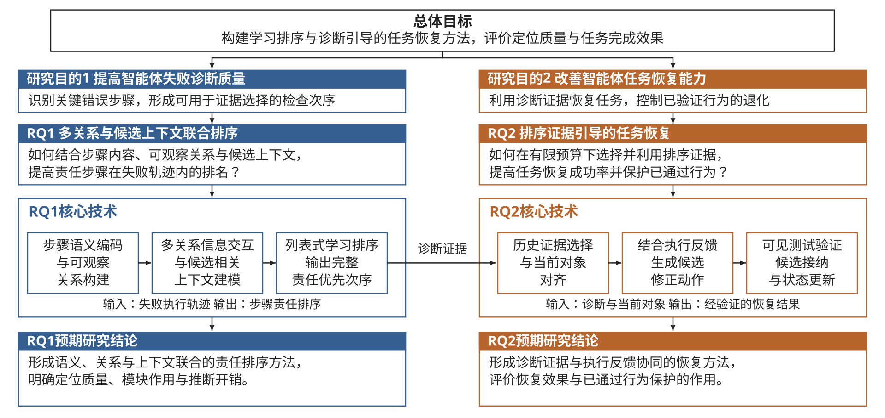
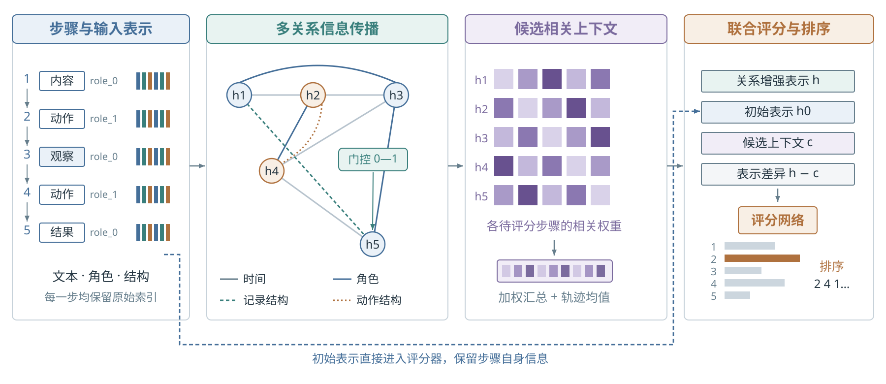
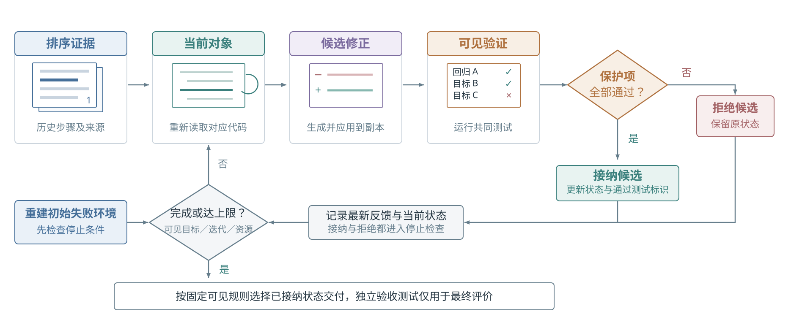
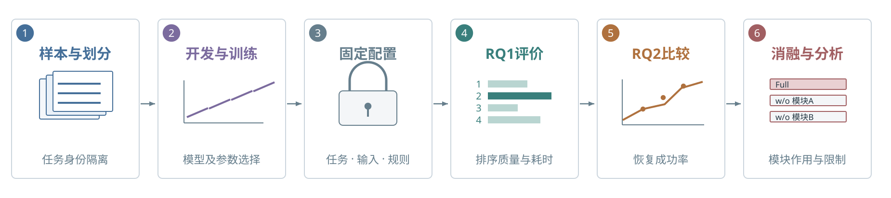

# 基于学习排序的智能体失败诊断与任务恢复方法

开题报告

## 第一章 研究背景与国内外研究现状

### 1.1 研究背景

大语言模型在语言理解、指令遵循和多步推理方面的进展，使其应用逐渐由文本生成扩展到需要规划与执行的复杂任务。模型通过调用工具获取信息、执行操作，再依据环境反馈调整后续行动。如何将语言模型的推理能力转化为实际任务完成能力，已成为智能体研究的重要问题。[1,2,3]

基于大语言模型的智能体连接模型、工具与环境，形成持续的决策和执行过程。多智能体系统进一步通过角色分工和信息交换组织协作。[3,4,5] 目前，相关应用已覆盖科学实验、网页操作、计算机使用和软件工程等场景。不同场景的操作方式各异，但都要求系统在多步交互中理解任务、利用反馈并完成目标。[6,7,8,9]

复杂任务的失败可能涉及任务分解、信息协调、操作选择和结果验证等多个环节。早期错误还可能影响后续步骤，使最终失败难以由某一次输出单独解释。[10,11] 随着执行轨迹增长，需要检查的信息增多，关键错误与后续异常之间也更难区分。

任务结果评价回答一次执行是否成功，失败诊断则进一步寻找值得检查和改进的环节。细粒度失败归因研究开始识别责任智能体和关键错误步骤，为系统改进提供依据。[12] 定位之后，系统还需要采取修正行动，并通过重新执行检验任务能否完成。[13]

任务恢复还面临已有进展的保持问题。重新尝试可能重复已完成的工作，局部修改也可能破坏此前已经通过的行为。恢复过程因此需要同时考虑当前环境、执行反馈以及修改对已有行为的影响。[14,15] 本课题围绕失败步骤定位与任务恢复开展研究，以软件任务作为主要验证场景。

### 1.2 研究对象与问题定义

研究对象是大语言模型智能体通过工具与环境交互形成的任务执行过程，既包括单智能体执行，也包括多智能体协作。本文关注已经发生失败的任务，研究如何从执行记录中定位关键步骤，以及如何利用诊断结果继续完成原任务。

**执行轨迹**是同一任务产生的有序步骤记录，包含可用的文本、动作、环境观察和行为来源。**责任步骤**是数据集按其标注规则确定的关键错误位置，作为失败步骤定位的预测目标。本文据此评价定位结果；进一步确认因果根因需要干预证据，其他步骤的责任也需结合具体证据判断。

**任务恢复**是指从失败执行形成的当前环境出发，利用诊断线索和执行反馈修正后续行动，继续完成原任务。软件场景中的修复操作主要表现为代码修改与测试。恢复效果以任务最终是否完成评价。

本课题研究的两个问题是：失败轨迹中的哪些步骤应当优先检查，以及这些定位信息能否帮助系统更有效地完成失败任务。前者评价诊断质量，后者评价诊断在实际行动中的作用。

### 1.3 国内外研究现状

- **智能体构建与执行可靠性**

Yao等（2023）的ReAct以任务和当前观察为输入，交替生成推理与工具动作，再把环境返回结果加入后续决策。它使求解过程形成可检查的执行轨迹，也便于根据新信息调整计划；但获取了外部反馈，并不代表系统已正确理解反馈，错误检索和错误推理仍可能沿后续行动传播。[3]

Wu等（2024）的AutoGen把模型、工具和人工输入封装为可会话智能体，通过自动回复与可编程会话控制连接不同职责。开发者可据此组织代码生成、执行和反馈等多轮协作；其重点是会话与流程构建，具体失败由哪个步骤引入，仍需另外诊断。[4]

Hong等（2024）的MetaGPT将软件开发中的标准操作流程引入协作，由产品、架构、工程与测试角色依次产出需求、接口和代码等结构化材料，并依据执行反馈修订代码。结构化交接减少了沟通遗漏，但上游产物若存在错误，后续角色仍可能沿用，因此需要检查产物内容及其使用关系。[5]

Cemri等（2025）的MAST通过执行轨迹分析，将十四种失败模式归入系统设计、智能体间失配和任务验证三类，区分角色越界、信息遗漏、重复行动与验证不足等表现。它为分析失败发生在哪类环节提供了统一描述，但模式标签仍需进一步落到具体执行步骤，才能支持有针对性的修正。[10]

- **失败归因与责任步骤定位**

Zhang等（2025）的Who&When将失败归因明确为两个目标：找出责任智能体，以及引入决定性错误的步骤。研究以失败日志和专家标注建立评价对象，并比较整段日志一次判断、逐步检查和二分搜索。完整阅读便于理解全局，逐步检查更关注局部，二分搜索减少检查范围；这些方式均面临长日志中证据分散和错误传播的干扰。[12]

Sun等（2026）的SDBL先收集值得重点关注的步骤，再结合完整日志确定责任位置。可疑步骤既可由逐步检查得到，也可依据越权和重复命令等专家模式筛出。这样把寻找线索与最终判断分开，减轻单次判断负担；但先验模式能否覆盖当前失败、提示是否准确，仍会影响定位结果。[16]

Zhu等（2026）的StepFinder先将步骤内容与角色编码为向量，以双向时序模型结合前后记录，再用角色感知注意力联系相隔较远的步骤。模型综合步骤表示、多尺度变化和位置偏置输出责任分数，减少诊断时的文本生成。该方法已有跨步骤交互，但较早步骤优先的显式先验，以及关系和上下文的表示方式，仍需结合不同轨迹检验。[11]

这些工作把责任定位从人工读日志推进到搜索和学习建模。本文沿用步骤级评价对象，进一步比较同一轨迹内不同执行关系和候选相关上下文，能否改善优先检查顺序，同时报告编码与推断开销。[11,12,16]

- **依赖信息与归因数据**

Rafi等（2026）的FALAT先依据任务和角色构造预期行为，再把长轨迹分层，利用信息采用、纠正等依赖区分错误来源与后续传播，并复核候选步骤。它能组织分散证据，但多阶段判断依赖语言模型，窗口化处理也可能遗漏远距离联系。[17]

Deng等（2026）的DeFA先将工具请求与返回、前后内容使用等联系构成事件依赖图，召回可疑步骤；再追踪其来源和后续影响，建立失败传播图，输出责任位置、错误类别及解释。其优势是比较错误如何影响结果，代价是关系恢复与多阶段裁决需要额外调用。[18]

Kong等（2026）的Aegis从成功执行出发，按错误模式修改输入或输出，仅保留确实导致失败的轨迹，得到责任智能体与错误模式的组合标签。它降低了归因数据构造成本，但标签目标和错误注入分布，与自然失败中的精确步骤定位存在区别。[19]

Zhang等（2026）的AgenTracer同时利用自然失败轨迹的修正重放，以及成功轨迹的故障注入，构造TracerTraj；再用角色、步骤距离与输出格式等多粒度奖励训练专用诊断模型。数据构造方式由此直接影响模型学习的责任概念，不能只比较最终分数。[20]

Chen等（2026）的TraceElephant进一步记录任务要求、系统配置、步骤输入、输出与工具日志，并提供可重放环境。它比较完整观察与部分观察下的归因差异，说明缺少输入可能使同一异常产生不同解释；因此，诊断比较必须交代各方法实际能读取的信息。[21]

- **反馈纠错与可恢复执行**

Madaan等（2023）的Self-Refine让同一模型生成初稿、提出反馈并反复修订；Shinn等（2023）的Reflexion则把执行评价转化为语言反思，存入记忆供下一轮尝试使用。二者说明反馈可改变后续求解，但前者依赖反馈质量，后者依赖评价与反思能否保留有效经验。[22,23]

Gou等（2024）的CRITIC先调用搜索或代码解释器验证输出，再依据工具反馈修订，将纠错建立在外部证据上。Huang等（2024）区分有正确标签辅助和无外部标签的推理自纠错，发现后者在所测条件下可能把正确答案改错，提示纠错效果必须结合反馈来源判断。[24,25]

Chang和Geng（2025）的SagaLLM把上下文管理、独立验证和事务补偿结合起来：保存操作及依赖状态，在失败后执行相应补偿。它处理的是已执行操作的影响，但补偿能否成立取决于领域操作和约束，需要预先明确可恢复范围。[14]

Zhuang等（2026）的AgentRewind记录执行上下文与工作区检查点，回退时同步恢复二者，并把失败尝试中的经验带入新执行。它避免只改提示而保留错误文件状态；其恢复边界主要是受控文件系统，外部服务等副作用不能一并撤销。[15]

Yu等（2026）的Rollback-Induced Reflection同时决定何时回退、从哪个检查点继续，以及保留哪些经验。方法恢复环境与当前分支上下文，另外保存可复用知识，并重新核验已被撤销动作关联的状态信息，避免把历史进展误当成当前仍成立的事实。[26]

- **软件任务求解**

Xia等（2025）的Agentless以问题描述和代码仓库为输入，依次定位可疑文件、代码元素与编辑位置，生成多个补丁，再用复现和回归检查筛选、排序。其流程明确、便于控制开销；这里的定位对象是需要修改的源码位置，与失败执行中应优先检查的责任步骤不同。[27]

Li等（2025）的PatchPilot在复现、定位、生成与验证之外加入补丁细化：利用复现输出、覆盖文件和验证反馈，继续修改有希望的补丁，或重新检查定位。这样可利用部分正确的已有修改；但候选质量仍取决于复现与可见测试是否覆盖真实问题。[28]

Tian等（2026）的EnAgent用多次执行生成候选补丁，先通过规范化去重和回归测试缩小候选集合，再由选择智能体结合代码阅读、动态测试和多次投票作出选择。它把集成推理扩展到仓库级理解，但若候选中没有正确解，后续选择仍无法补足生成能力。[29]

Ruan等（2026）的AOrchestra由主控按需配置子任务的指令、上下文、工具和模型，子智能体执行后返回结果与日志，主控再继续委派。它以动态分工适应复杂任务，效果也依赖主控能否正确拆解目标、筛选上下文并配置执行能力。[30]

这些方法提供了从问题到补丁及验证的完整流程，可用于检验整体任务求解能力。要评价本文诊断信息的作用，还需固定生成器、信息与预算，单独替换诊断排序，观察实际证据、修正动作和最终任务结果是否改变。[27,28,29,30]

- **诊断引导恢复**

Guo等（2025）的SyncMind研究协作代码更新后，智能体仍按旧理解行动的失步问题。它用提交历史和可执行测试构造任务，比较独立探索与寻求协作者帮助的恢复。该研究表明，继续修改前需要了解当前环境变化；其重点是失步恢复评测，而非直接从历史责任步骤产生修复。[31]

Ma等（2026）的DoVer先按重新规划把日志分成多次尝试，再为各次尝试提出责任假设，生成计划或指令修改，并保留干预前记录继续实际执行。方法用任务成功和中间进展检验修改是否有效，还区分干预已执行与未执行的情况；因此，一次恢复失败不能直接说明原假设错误。[13]

Wang等（2026）的DARC从开发集分析任务族的主要失败模式，据此限制动作约束、程序知识或示例检索等干预，再利用训练集成功与成本反馈选择短策略，并在测试前冻结。它体现诊断应约束行动选择，但任务族策略与逐条失败轨迹的责任排序属于不同层次。[32]

Vasudev等（2026）研究用失败预测触发回退或警告，发现较准确的预测仍可能破坏原本正确的执行，其净效果随模型和任务条件变化。该结果针对在线干预，不能直接等同于事后责任定位，但说明诊断指标提高并不自动带来任务完成率提高。[33]

本文据此分别评价责任排序与任务恢复：先检验哪些步骤更应优先检查，再核对历史线索对应的当前代码，利用可见反馈修正，并持续检查此前已通过的行为。恢复价值最终由共同任务和独立验收测试判断。[13,31,32,33]

### 1.4 现有问题与研究意义

**失败步骤定位需要结合局部内容与执行关系。** 时序和角色信息已经被用于归因，但不同关系与上下文能提供多少有效信息，仍需在共同数据和监督条件下比较。[11,17,18,21] 研究这一问题有助于提高诊断准确性，并明确增加轨迹信息带来的计算代价。

**历史错误位置与当前修正对象存在差异。** 诊断面向已经发生的执行，修正行动则作用于变化后的环境。历史代码可能已被覆盖，相关文件也可能发生移动。[13,31] 将定位信息用于恢复，需要建立历史记录与当前对象之间的对应，并检验这种信息能否改善后续行动。

**局部修正需要兼顾已有进展。** 一次修改可能解决某个问题，同时破坏此前通过的行为。已有研究通过反馈、回退和补偿处理执行失败，[14,15,26] 而修改之后哪些行为仍然成立，需要结合实际执行判断。研究恢复过程中的行为保持，有助于分析任务推进与修改风险之间的关系。

软件任务具有代码变更、工具记录和可执行测试，能够为上述问题提供可观察的验证条件。[9,34,35] 本课题据此分别评价失败步骤定位和任务恢复，并分析诊断信息参与修正行动的具体过程。

## 第二章 研究目标与理论基础

### 2.1 总体研究框架

本课题以**学习排序（Learning to Rank，LTR）**为核心技术。学习排序利用标注数据学习评分函数，为同一条件下的一组候选对象确定相对优先次序。[36] 在本文中，一条失败轨迹构成候选组，执行步骤构成待排序对象，责任步骤标注用于训练检查优先次序。

总体框架包括失败步骤定位和诊断引导任务恢复两个部分。定位模型读取失败轨迹，输出全步骤的检查次序；任务恢复根据该次序组织诊断证据，结合当前环境和执行反馈生成修正行动，并通过测试判断修正是否保留。

图2-1 基于学习排序的失败步骤定位与诊断引导任务恢复总体框架

两部分分别对应定位质量和任务完成效果。定位结果提供恢复过程的输入，恢复过程则用于检验诊断信息的实际作用。本文在软件任务中实现这一流程，最终结论结合任务条件和测试范围说明。

### 2.2 研究目标与研究问题

**RQ1：如何利用步骤内容、可观察关系和候选相关上下文，提高责任步骤在失败轨迹内的排名？**

第一项目标是构建步骤排序模型。模型先读取每一步做了什么，再沿时间、角色和记录结构等联系汇集信息，并针对每个待评分步骤，从整条轨迹补充相关线索。研究比较完整模型与去除核心模块后的定位质量和推断开销。

**RQ2：责任排序能否通过有限预算下的证据选择，提高失败任务的恢复成功率？**

第二项目标是建立诊断引导的任务恢复流程。系统按排序选择历史线索，重新读取当前代码，结合执行反馈生成修正，并检查修改是否破坏已通过的测试。完整方法比较评价任务完成效果，固定恢复器中的诊断器替换与模块消融进一步分析各部分的作用。

### 2.3 学习排序与轨迹内步骤评分

学习排序关注同一组对象的相对次序。例如，搜索系统根据一次查询对候选文档评分，再按分数返回结果。列表式学习（listwise learning）把同组候选共同作为训练单位。ListNet将评分与标注转为概率分布，通过减小两者差异学习排序函数。[36]

本文将一条失败轨迹看作候选组，把其中每一步看作**定位候选**，即一个需要评分、判断检查优先级的步骤。训练时使用来源标注的责任位置，推断时只读取轨迹可见信息，为全部步骤给出分数。

当前数据按一个责任位置训练。模型通过softmax把同轨迹分数转成和为1的权重，再用交叉熵损失提高标注位置的权重。softmax在这里用于相对比较，输出权重不等于经过校准的“导致失败的概率”。这种损失与单标签位置分类形式相同，研究重点是怎样利用轨迹信息改进评分。

完整次序便于恢复器按输入预算优先读取靠前的线索。由于监督只指定责任位置，其余步骤之间的次序没有完整人工标注。因此，实验先评价责任步骤的排名，再单独检验这些排序能否改善任务恢复。

### 2.4 方法依据与研究意义

多关系表示学习为组织不同类型的步骤联系提供基础。关系图卷积等方法按关系类型聚合邻居信息，[37] 本课题据此组织时序、角色和结构联系，使单个步骤能够利用其他步骤中的相关线索。这些边描述可观察的联系，其诊断价值通过实验比较确定。

反馈纠错研究表明，工具结果和执行反馈可以支持后续修改。[23,24] 本文将执行过程中可使用的测试及其结果称为**可见测试**，将与生成过程隔离、仅用于最终评价的测试称为**独立验收测试**。可见测试为下一轮修正提供反馈，独立验收测试评价最终交付结果。

行为保持的依据来自回归测试和执行状态管理。回归测试检查修改是否影响已有功能；Sagas等工作通过记录操作和补偿关系处理长过程失败。[38] 本文在软件环境中记录已通过测试的标识，在每次修正后检查这些行为是否仍然通过。

本课题预期形成轨迹内学习排序与诊断引导任务恢复相衔接的方法。定位研究说明哪些轨迹信息有助于发现关键错误，恢复研究进一步检验这些信息能否改善实际任务完成效果，并给出相应的资源代价与适用条件。

## 第三章 学习排序模型与诊断引导任务恢复

### 3.1 失败步骤的排序任务

输入是一条已经发生失败的完整执行轨迹，输出是全部步骤的检查优先次序。每个步骤包含来源提供的内容、动作、思考和角色等字段。训练使用来源标注的责任步骤，推断时不读取责任标签。

例如，前一步选择了错误对象，后面多步操作才出现报错。定位模型需要把值得检查的早期步骤排到前面，而不能只把最后一个报错位置当作答案。这里的评价目标仍以数据集标注规则为准，是否构成因果根因需进一步干预确认。

模型按“步骤表示、多关系传播、候选相关上下文、联合评分”依次处理轨迹。步骤表示保留自身内容，关系传播汇集有可观察联系的步骤信息，候选相关上下文补充与当前待评分步骤有关的全轨迹线索。图3-1展示这一过程。

步骤边界和原始索引在预处理时固定，补齐位置不参与评分。模型可以读取待评分步骤之后已经发生的记录，因此本课题属于执行后的失败定位。单模型按分数降序排序，同分按原始索引处理。

### 3.2 步骤表示与多关系传播

- **步骤表示**

步骤表示分别回答三个问题：**这一步做了什么、由谁执行、记录处在什么位置和格式**。固定文本编码器将内容、动作与思考转为数值向量，角色特征区分行为来源，结构特征描述字段格式、相对位置及同类结构在本条轨迹中的重复情况。

角色按本条轨迹中的首次出现顺序匿名编号为role_0、role_1等。同一来源保持相同编号，以保留协作联系并减少名称影响。当前软件恢复输入只有一个执行角色，多角色条件主要在诊断数据中分析。

本地原型用Qwen3-Embedding-0.6B编码器生成128维文本与32维角色表示，另加入23维结构特征，拼接后投影为96维表示。文本和角色向量分别归一化，结构特征只用对应训练部分的统计量标准化。编码器保持固定，训练更新后续排序网络。

部分日志把决策上下文和紧随的输出分成两条。仅当原始步骤相邻、角色相同且日志标记明确对应时，预处理才让两条记录互相补充文本信息。没有明确对应就保持原输入。这项条件处理不改变步骤索引，当前软件发布的18条轨迹中没有触发有效配对。

- **多关系传播**

多关系传播让一个步骤能够参考与其有联系的其他步骤。模型建立四类连接：时间上相邻、同一匿名角色、相同完整记录结构、相同非空动作结构。后两类只比较类型、嵌套和大小等形式，去除键名及具体值。各类连接选取前后最近的匹配步骤。这些连接是信息汇集通道，其因果含义并未得到预先证明。

**门控**是模型学出的0到1权重，用来控制一条邻居信息被采用多少。模型结合当前步骤、邻居步骤及二者差异，为每条信息计算一个权重，权重越小，传入的信息越少。随后再学习四类关系各占多大比重，汇总结果与步骤原有表示相加。权重随责任位置监督共同训练。

本地模型进行两轮关系传播，使步骤在直接联系之外进一步利用相连步骤的信息。没有邻居的通道不增加信息，步骤本身的表示仍然保留。单角色轨迹中，同角色连接可能与时间连接重合，实验会记录这种情况，分别分析单角色和多角色输入。

图3-1 步骤表示、多关系传播与候选相关上下文的联合评分模型（连接与权重为示意）

### 3.3 候选相关上下文与联合评分

- **面向每个步骤的上下文**

同一段记录对不同待评分步骤的作用可能不同。**候选相关上下文**就是在评分某一步时，根据与这一步的相关程度，从整条已经发生的轨迹中汇总信息。更换待评分步骤，采用的权重也可以改变。

模型用注意力机制计算这种权重。注意力根据步骤向量的相似联系分配比重，再对全轨迹信息加权求和，并保留全轨迹均值作为基础。这里的权重反映模型采用了哪些相关信息，不能直接当作因果解释。

- **联合评分**

为了保留步骤自身的信息，评分器同时读取关系增强表示、初始表示、候选上下文，以及关系增强表示与候选上下文的差异。初始表示通过一条直接支路进入评分器，避免连续汇集其他步骤后削弱本步骤内容。评分器采用多层感知机（MLP），即由多层全连接变换组成的小型神经网络，输出一个步骤分数：

$$
s_i=\operatorname{MLP}([h_i;h_i^{(0)};c_i;h_i-c_i]).
\tag{1}
$$

式（1）中，$h_i$是第i步的关系增强表示，$h_i^{(0)}$是经过输入处理后的初始表示，$c_i$是面向该步的上下文，分号表示向量拼接。分数只用于比较同一轨迹中各步骤的检查优先级。

- **训练与集成**

训练提高标注责任步骤在同轨迹中的相对得分。设该轨迹有m个步骤，责任位置为y，单条轨迹的训练目标为：

$$
p_i=\frac{\exp(s_i)}{\sum_{j=1}^{m}\exp(s_j)},\qquad \ell=-\log p_y.
\tag{2}
$$

$p_i$是轨迹内归一化权重，$\ell$是单轨迹损失。AgenTracer来源池训练对轨迹损失取平均，AFTraj训练则先在同一源任务组内平均，再对任务组等权平均，避免同一任务的多条记录获得过大权重。

报告三次训练的集成结果时，先将各模型的步骤分数在轨迹内归一化，再平均预测权重并排序。全轨迹注意力的时间与存储开销随步骤数呈二次增长，实验会同时测量定位质量和包含编码在内的端到端耗时。

### 3.4 诊断证据选择与当前对象对齐

排序结果指出哪些历史步骤应当优先检查，但修正作用于当前环境。过去记录中的文件或代码片段可能已经变化，因此恢复器需要先确认线索对应的当前对象。**当前对象对齐**就是依据历史文件、位置和操作线索，重新定位并读取当前代码，记录对象是否仍然存在、是否已经改变。

恢复器依次扫描排序，合并指向相同动作或对象的重复线索，并保留原始步骤索引。能够可靠定位时提供当前内容，不能对应时只保留历史解释。生成器结合原任务、当前代码、最新执行反馈和选中证据，提出修正动作。

证据选择同时受条数和输入词元（token）上限约束。token是模型处理文本的计量单位。过长片段按统一规则截断，记录实际条数和长度。有限输入容量使靠前线索有更多机会进入生成器，这也是排序可能影响恢复结果的环节。

基本方法对初始失败轨迹排序一次，后续每轮更新当前对象内容和执行反馈。实验固定证据选择规则，保存排序、选中证据及实际生成输入。若不同排序经映射、去重后提供了相同证据，也如实记录，不能仅凭排序分数变化认定恢复机制已受影响。

### 3.5 反馈驱动的迭代任务恢复

每轮恢复从当前已保留的状态开始，整理尚未满足的任务要求、优先诊断证据和最新反馈，生成一个候选修复。软件任务中的修正主要表现为修改当前代码；具有明确撤销含义的历史操作可采用受控回退。

候选修复在隔离副本中应用，先检查编辑格式、修改对象和匹配位置，再运行可见测试。格式错误、应用失败、执行异常和测试结果分别记录。生成器可使用任务许可范围内的代码、工具观察和测试反馈，独立验收测试结果与其他方法的补丁保持隔离。

通过行为保护检查的候选被保留，成为下一轮的当前状态；其余候选被拒绝，并保留失败反馈。下一轮根据最新状态重新组织证据，继续生成修正。流程如图3-2所示。

图3-2 诊断证据、执行反馈与行为保护共同驱动的任务恢复流程

达到可见任务完成条件、内部迭代上限或资源预算时停止。交付结果依据事先固定的可见测试规则选择，独立验收测试仅评价这一结果。计时、调用和token按全过程累计，包含失败候选及验证消耗。

### 3.6 已通过行为的保护与修复接纳

行为保护用于防止一次修正破坏已经通过的功能。系统按固定测试标识记录已通过项，而不只比较通过数量。例如，修改前A、B通过，修改后B、C通过，数量相同但A已经失效，不能据此认定已有进展得到保留。

保护范围包括初始通过的既有回归测试B，以及截至第t轮恢复时已经通过的可见目标测试集合$H_t$。目标测试检查当前软件问题要求解决的行为，回归测试检查已有功能。初始已经通过的目标项也进入保护集合。候选状态$S'$必须继续通过这些项才可接纳：

$$
B\cup H_t\subseteq\operatorname{Pass}(S').
\tag{3}
$$

$\operatorname{Pass}(S')$是候选状态确认通过的测试标识集合。接纳后，将新通过的目标项加入保护集合。拒绝候选时保留原状态，并把失败反馈交给下一轮。测试结果缺失或不确定时先核查，明确通过后才纳入保护。

方法允许接纳暂未增加通过项、但满足保护要求的修改，为多步修复保留空间。相同代码状态去重。可见目标全部通过时交付当前状态，否则按可见失败目标数量、改动规模和固定先后规则，从已接纳状态中选择结果。上述规则也用于预算节点的结果选择。

严格保护也可能阻止需要暂时退步的修复路径。因此，实验将比较去除累积目标保护后的效果，并通过具体测试变化解释收益与代价。保护范围以实际执行的测试为准，最终任务效果仍由独立验收测试评价。

当前原型已实现排序接入、反馈修复和状态记录。统一证据预算、测试标识和重复状态处理将在正式比较前完善。分支探索、软保护和重新诊断留作后续扩展，主要实验评价本章定义的完整方法。

## 第四章 拟解决的关键问题与预期创新

### 4.1 拟解决的关键问题

**关系与候选上下文的有效信息。** 单个步骤的文本可能不足以说明其与最终失败的联系。多关系传播用于收集邻步线索，候选相关聚合用于区分这些信息对不同位置的作用。关键在于检验两者在共同输入、监督和训练条件下能否提高责任步骤排名，并分析额外计算开销。[11,17,18,21]

**历史诊断到当前修正的对应。** 历史代码与当前代码可能发生变化，排序中的关键位置需要转化为当前可使用的对象和证据。关键在于保留线索来源、重新读取当前内容，并在有限输入预算下组织有效证据。[13,31,32]

**修复推进与已有行为保持。** 局部修复可能破坏此前已通过的功能，单看通过测试数量还可能遗漏具体行为的替换。关键在于用稳定测试标识判断候选修复应否保留，同时分析严格保护对多步修复路径的影响。[14,28,39,40]

### 4.2 预期创新设计

**语义、多关系与候选上下文联合的学习排序。** 面向失败轨迹中步骤联系复杂、候选信息需求不同的问题，联合关系增强表示、初始步骤表示和候选相关上下文进行评分。通过完整模型与两个核心模块的消融，检验信息组合对责任排名的贡献。

**排序证据与已通过行为保护相结合的任务恢复。** 将责任排序映射为当前对象的证据，结合最新执行反馈生成修正，并按测试标识保护已有进展。通过完整系统比较和固定恢复器中的模块对照，检验诊断证据能否改善预算内任务完成效果，分析保护机制的具体作用。

两项设计分别对应定位信息的质量和诊断信息的行动效用。创新性与有效性将在共同数据、统一条件和独立评价中检验，前期开发结果作为方法完善的依据。

## 第五章 数据来源与实验设计

### 5.1 数据来源与评价划分

实验分别评价失败步骤定位和任务恢复。AFTraj与AgenTracer提供责任步骤标注，SWE-Gym及其配套执行轨迹提供可重新执行的软件问题。[12,20,35] 本文将软件问题记为issue，以原始任务身份组织划分和统计。

表5-1 数据来源与研究样本

| 数据来源 | 发布规模 | 当前研究样本 | 主要用途 |
|---|---|---|---|
| AFTraj | 2,276条轨迹 | 731条失败轨迹；716任务组 | 失败步骤定位 |
| AgenTracer coding | 训练1,141条；测试127条 | 614条来源池；363条coding评价轨迹 | 软件轨迹定位 |
| SWE-Gym | 2,438个Python问题 | 23个已整理issue | 恢复方法开发 |

AFTraj发布数据中，正常轨迹1,162条、失败轨迹1,114条。[41] 已整理的731条失败轨迹对应716个源任务组，其中120个不同任务组构成开发子集。该子集在五个任务类型与标注来源组合中各取24条，按领域为coding 24条、math 48条、agentic 48条，已用于调试和方法分析。

AgenTracer采用扩展发布版，规模按该版本记录。[42] 614条训练验证来源池包含coding 320条、math 294条，363条固定评价轨迹为coding。两部分来自所用发布版的官方训练部分，并按源任务组隔离，固定评价集属于开发评价数据。

所有划分以原始任务为单位，同一问题的多条轨迹、错误变体和派生样本归入同一组。清洗处理步骤边界、可读格式和原始位置映射，标签沿用来源定义。各数据集分别记录责任标签的对象与判定规则，需要合并训练时，先核对标签是否表示同一类责任位置。样本资格依据轨迹完整性、标注可映射性和环境可运行性确定，报告排除数量与原因。

- **诊断数据划分**

**AFTraj开发评价：** 将716个任务组分为5份，轮流使用其中1份进行外层评价，其余4份再划分训练与验证组，构成五折分组评价。每个配置使用三次预定初始化，模型选择依据内部验证。每条轨迹由未使用该任务组训练的模型产生外层预测，汇总731条结果。已用于方法选择的外层结果归入开发评价。

**AgenTracer开发评价：** 采用A、B、C三个分组划分，每个划分训练492条、验证122条，均在同一363条coding开发评价集上比较，每个划分使用三次预定初始化。训练含coding 256条和math 236条，验证含coding 64条和math 58条；训练、验证与固定评价任务组相互隔离。

**独立评价集：** 方法结构、输入处理、训练和选择规则确定后，分别从AFTraj官方测试部分的163条失败轨迹及AgenTracer官方coding测试部分的127条轨迹中筛选未参与开发的样本。筛选核对原始任务身份与历史开发使用记录，报告最终合格数量。候选轨迹数与独立任务组数分别统计。

- **任务恢复数据划分**

恢复样本由原任务描述、失败执行形成的代码、可见失败轨迹、执行反馈和独立验收测试共同构成。纳入前核对issue、仓库版本与轨迹的对应关系，并确认初始环境可重建、反馈可用和测试可执行。主要评价保留智能体实际执行形成的失败环境；受控构造样本用于解释特定保护与对齐机制。

现有23个已整理issue用于接口核对、恢复方法开发和资源估计。独立评价计划从SWE-Gym同一来源另行筛选20个未参与方法开发的合格issue，覆盖至少3个仓库。候选按预定顺序核对任务身份、失败初态、反馈和测试条件，最终样本数以实际合格数量为准。

### 5.2 实验流程与共同条件

实验先完成数据划分和开发配置选择，再固定定位模型、恢复实现与评价规则。随后分别开展责任排序比较、完整任务恢复比较和核心模块消融。独立评价结果用于最终评价，开发阶段负责确定参数和修正实现。

图5-1 学习排序评价、任务恢复比较与模块消融的实验流程

- **诊断训练设置**

本地已执行训练采用固定文本编码器与可学习排序网络。排序网络为两层关系传播、96维隐表示，训练中用0.15的Dropout随机置零部分特征，降低对个别特征的依赖。Top-1是责任步骤排在首位的比例，平均倒数排名（MRR）对责任步骤的排名倒数取平均，越靠前数值越高。模型先按验证集Top-1选轮，再用MRR打破并列，两项相同时保留最早轮。

已执行配置使用AdamW优化器，固定学习率0.001，本文权重衰减0.0001，梯度范数裁剪为1.0。最多训练40轮，连续8轮无提升时停止。AgenTracer来源池批次为16条轨迹，AFTraj批次为16个完整任务组。AFTraj外折预测先在内层选择轮数，再用其余四折重训。

本文与StepFinder使用共同的可见轨迹、任务分组和模型选择信息，保留各自核心结构与训练设置。标准化统计量只从对应训练部分计算。正式测试前固定配置，记录编码输入上限、实际截断、硬件与参数量。

结构消融重新训练，沿用完整模型的任务划分、预定初始化和选择规则。单次结果、均值与标准差共同报告，三次模型的集成结果另外注明，避免混用单模型和集成成绩。

- **任务恢复运行设置**

完整恢复比较使用共同任务描述、仓库版本、失败初态、代码访问许可、可见测试和独立验收测试。生成后端统一采用deepseek-flash，本地诊断模型单独记录配置。各方法保留自身的定位、生成、验证与选择流程，部署参数在开发结束后固定。

表5-2 任务恢复的共同运行条件

| 条件 | 统一设置 |
|---|---|
| 任务起点 | 同一issue、版本与失败环境 |
| 生成模型 | deepseek-flash；部署参数预先固定 |
| 可见信息 | 同任务、代码与执行反馈许可 |
| 结果评价 | 同一独立验收测试 |
| 资源上限 | 共同时间与token上限 |
| 独立重复 | 每题三次完整运行 |

每次重复从共同初态重新运行。内部多候选、投票和既有响应复用属于一次运行内部的计算。时间与token覆盖所有子智能体、生成、工具执行、验证和选择阶段。

排序到恢复的衔接按“选定模型与训练任务—排序结果—选中证据—实际生成输入”核对。恢复任务与对应诊断模型的训练任务按原始任务身份隔离，确保实际使用的是规定评价模型产生的排序。

### 5.3 比较方法

责任排序比较用于检验相同轨迹输入下的定位质量和推断开销。选择StepFinder作为专门学习模型，All-at-Once与Binary Search作为完整日志判断和区间搜索参照。[11,12] 各方法共同报告首位命中率（Top-1），完整排序方法进一步比较责任步骤的总体排名。

表5-3 失败诊断比较方法

| 方法 | 主要机制 | 原生输出 | 论文来源与时间 |
|---|---|---|---|
| 本文 | 多关系与候选相关上下文 | 全步骤排序 | 本研究 |
| StepFinder | 时序语义与角色交互 | 步骤分数 | KDD 2026 [11] |
| All-at-Once | 完整日志一次判断 | 单个责任位置 | ICML 2025 [12] |
| Binary Search | 递归缩小日志区间 | 单个责任位置 | ICML 2025 [12] |

本文与StepFinder均按各自最终输出的完整步骤次序，统一计算责任步骤的排名指标。单模型按步骤分数排序，集成结果按平均预测权重排序。All-at-Once与Binary Search以Top-1进行共同比较，无效输出计为该题未命中，并单列其数量。

完整任务恢复比较统一回答：**在相同失败任务与资源预算下，诊断引导的方法能否提高任务恢复成功率？** 选用Agentless、EnAgent和AOrchestra进行比较，三者分别代表分层定位与修复、多轨迹集成和动态子智能体组织。[27,29,30]

表5-4 完整任务恢复比较方法

| 方法 | 核心流程 | 论文来源与时间 |
|---|---|---|
| 本文 | 排序证据、反馈修正、已通过行为保护 | 本研究 |
| Agentless | 分层定位、补丁生成、验证选择 | FSE 2025 [27] |
| EnAgent | 多轨迹生成、剪枝、工具辅助选择 | ICSE 2026 [29] |
| AOrchestra | 动态子智能体、任务与工具组织 | ICML 2026 [30] |

比较保留各方法的核心阶段，说明作者配置与本机部署之间的差异。任务纳入依据共同资格，统计保留各方法的正常成功、失败和未完成记录。

诊断器替换单独固定本文恢复器，比较本文排序与StepFinder排序。顺序对照采用相同证据条数上限、字段、映射与去重规则和token上限，对步骤优先次序进行置换，并记录实际条数与token用量。两类对照用于分析排序来源和顺序的作用，完整系统比较仍以上表四种方法为准。

### 5.4 评价指标与预算

实验以MRR衡量责任位置的总体排名，以Top-1及前3位、前5位命中率（Hit@3、Hit@5）描述不同检查范围下的定位效果，端到端耗时评价诊断开销。恢复部分采用预算内任务恢复成功率（Recovery Success Rate，RSR）。已通过行为的保持情况放在模块分析中结合具体测试记录说明。

表5-5 主要评价指标

| 指标 | 计算口径 |
|---|---|
| MRR ↑ | 责任步骤倒数排名的任务组均值 |
| Top-1 ↑ | 首位命中责任步骤的比例 |
| Hit@3 / Hit@5 ↑ | 前3 / 5位命中责任步骤的比例 |
| 端到端耗时P50 / P95 ↓ | 诊断耗时的中位数 / 95分位数 |
| RSR@30min ↑ | 30分钟内交付并通过独立验收测试的比例 |

- **定位质量与诊断耗时**

MRR先计算每条轨迹中标注责任步骤的排名倒数，再在同一源任务组内平均，最后对任务组等权平均。例如，排第1位计1，排第2位计0.5，排第5位计0.2。若来源允许多个责任位置，按其中最靠前者计算，并单列该标签条件。

Top-1表示首位命中责任步骤的比例，Hit@3和Hit@5表示前3位或前5位中至少命中一个可接受责任位置的比例。无效输出记为未命中，并单列数量。上述比例同样先组内平均，再按任务组汇总。

端到端诊断耗时从输入原始轨迹开始，包含文本编码、结构构建和步骤评分。统一硬件与部署条件后，报告中位数P50和95分位数P95。首次加载与模型已加载时的运行分别记录。

- **预算内任务恢复**

每个issue进行三次独立完整运行。预算内任务恢复成功率RSR先对每个issue的三次结果取成功比例，再对共同issue平均。成功要求：方法在预算内已选定并交付结果，且该结果通过同一独立验收测试。未交付的处理中候选不计成功。

主要结果采用30分钟预算，同时保存15分钟、60分钟节点。各节点沿用相同内部配置，只评价当时实际选定的结果。提前达到内部停止条件或共同token上限的运行，按已选结果评价后续节点。另报相同配置运行至自身停止条件的结果，说明外部时间限制的影响。

运行中保存预算快照，结束后再执行独立验收测试，评价反馈不返回生成器。计时覆盖编码、排序、证据对齐、生成、工具执行、可见测试和选择。共同token上限依据开发资源需求预先固定，所有子智能体、失败候选和验证消耗均累计。

### 5.5 核心消融与过程分析

- **失败诊断模型消融**

消融实验每次去掉一个模块，用来判断该模块是否带来额外作用。“w/o”表示去除指定部件。RQ1聚焦多关系传播和候选相关上下文两项设计，其余输入、任务划分和训练规则保持一致。

表5-6 失败诊断模型消融

| 条件 | 模块改动 |
|---|---|
| Full | 完整学习排序模型 |
| w/o RelProp | 跳过关系传播，使用步骤初始表示 |
| w/o CandCtx | 各步骤共用全轨迹均值上下文 |

两项变体均重新训练，比较MRR、Top-1、Hit@3、Hit@5和诊断耗时，并记录参数量。逐类关系与长轨迹分析用于解释结果，不再扩展为主要消融项目。

- **任务恢复模块消融**

固定生成器、源码许可、动作检查、可见测试、交付规则和资源，每次去掉一项，比较预算内RSR。

表5-7 任务恢复模块消融

| 条件 | 去除的内容 | 仍可使用的信息或保护 |
|---|---|---|
| Full | 无 | 完整任务恢复流程 |
| w/o DiagEvidence | 排序选出的历史证据 | 当前代码与执行反馈 |
| w/o StateAlign | 证据中专门读取的当前对应内容 | 历史片段与共同源码访问 |
| w/o TargetGuard | 初始及后续通过的目标项保护 | 初始通过的既有回归测试 |

各条件仍在当前代码中生成并验证，省去未使用计算后按实际资源累计。

- **诊断到行动的过程解释**

记录责任步骤、选中证据、当前对象、修正动作与测试结果，解释诊断怎样影响行动。不同排序产生相同证据或动作时也保留。

对各变体采用相同观察范围，比较修改前后同一组测试，分别记录接纳修改和被拒候选破坏了哪些已通过项。少量预设机制样本再比较“按通过数量”与“按具体标识”保护的差异，并保留需要暂时退步的修复路径。此类过程证据用于解释机制，总体收益仍结合独立验收测试下的RSR判断。

### 5.6 统计方法、有效性与工作量

统计以原始任务组或issue为单位，先汇总组内轨迹或同issue的三次重复，再比较方法。主要差异采用配对自助法，即以任务为单位共同重采样各方法结果，估计95%置信区间。样本较少时，同时展示逐题结果和配对差异。

报告共同计划任务数、可评价覆盖和完整配对数。每个预算节点的共同集合要求各方法三次预定运行均有可判定结果，缺失原因另列。预算结果可判定时保留该节点记录，后续未完成不改写已有结果。未运行、工程中断与结果不明分别注明。

有效性控制包括任务身份隔离、共同输入许可、完整基线流程、统一动作处理、全过程预算计量与独立验收测试隔离。轨迹长度、初始通过测试规模、角色数和关系重合用于解释适用条件，分层规则在开发阶段确定。

完整系统比较计划为20个issue、4种方法、每题3次，共240条运行。每条30分钟对应累计上限120小时，延至60分钟为240小时。StepFinder诊断器替换与顺序置换各增加60条。三项恢复消融先在开发和机制样本上比较，若全部扩展至独立20题，则另需180条。预算节点复用同一运行快照，独立重复分别执行，实际资源依据开发测量完善。

结果以诊断质量与耗时表、恢复成功率随时间变化的曲线、核心消融表和代表性过程组织。开发、机制和独立评价分别报告，各结论限定在实际样本与测试范围内。

## 第六章 研究基础、进度安排与预期成果

### 6.1 前期研究基础

前期已建立失败轨迹整理、步骤位置映射和分组评价流程，完成多关系与候选相关上下文联合排序模型的训练。在已用于开发的AFTraj固定120个任务组上，本文三组初始化的外折预测集成首位命中86组，同轮StepFinder对照命中82组，相差3.33个百分点。该差异尚不足以确认稳定优势，独立评价仍需在模型与任务划分固定后完成。

AgenTracer已有614条训练验证来源池、363条固定coding开发评价轨迹和A、B、C三个分组划分。当前软件恢复接入AgenTracer来源池训练条件的三模型集成，与AFTraj外折模型采用相同架构、不同训练权重。正式独立评价前仍需核对诊断训练任务与恢复任务的重叠，并固定最终恢复部署模型。

任务恢复原型已实现排序接入、当前代码与反馈组织、候选生成、可见测试和状态记录。最新排序替换先导包含五条轨迹，均来自同一个已参与开发的issue；已完成条件运行至自身停止条件后的结果均通过独立验收测试，当前先导尚未显示排序之间的任务完成率差异。该结果说明联合流程可以执行，排序的恢复收益仍需多任务比较。

Agentless与EnAgent已有完整运行基础，AOrchestra已完成保留原方法核心的完整先导，并通过独立验收测试。现有记录保留预算内交付结果及相同配置继续运行后的结果，多任务、共同信息和参数条件下的系统比较仍待完成。

状态管理开发中已观察到临时退步及相关接口变化，当前案例不足以确认按测试标识保护相对按数量保护的独立收益。下一阶段将统一动作格式、测试标识与证据预算，完善定位模型到实际恢复输入的对应，再开展共同任务比较。

### 6.2 研究进度安排

研究分阶段完成问题界定、两项研究问题的方法与实验，以及论文和答辩材料。

| 时间 | 阶段任务 |
|---|---|
| 2026.09—10 | 文献梳理、问题界定与原型验证 |
| 2026.11—12 | 失败步骤排序模型与诊断实验 |
| 2027.01—02 | 诊断引导任务恢复与系统比较 |
| 2027.03 | 消融分析、结果整理与论文初稿 |
| 2027.04—05 | 论文修改、定稿与答辩准备 |

正式测试前确定任务组、方法配置和评价规则，后续按既定流程比较。资料整理、实现完善和论文撰写随阶段进展交叉进行。

### 6.3 预期研究成果

形成一种基于轨迹内学习排序的智能体失败步骤定位方法，明确多关系传播和候选相关上下文对责任排名的作用，报告定位质量、训练变化和推断开销。

形成一种由诊断证据、执行反馈与已通过行为保护支持的任务恢复方法，建立历史步骤到当前对象、修正动作和测试结果的对应，通过完整方法比较与核心消融评价其效果。

完成学位论文、研究原型、数据划分与评价说明，以及可复查的实验记录。结论围绕软件验证场景中观察到的定位与任务恢复效果展开，说明适用条件和后续研究问题。

## 参考文献

[1] Long Ouyang, Jeff Wu, Xu Jiang, et al. Training language models to follow instructions with human feedback. Advances in Neural Information Processing Systems 35, 2022. [原文](https://proceedings.neurips.cc/paper/2022/hash/b1efde53be364a73914f58805a001731-Abstract.html).

[2] Jason Wei, Xuezhi Wang, Dale Schuurmans, et al. Chain-of-Thought Prompting Elicits Reasoning in Large Language Models. Advances in Neural Information Processing Systems 35, 2022. [原文](https://proceedings.neurips.cc/paper/2022/hash/9d5609613524ecf4f15af0f7b31abca4-Abstract.html).

[3] Shunyu Yao, Jeffrey Zhao, Dian Yu, et al. ReAct: Synergizing Reasoning and Acting in Language Models. International Conference on Learning Representations (ICLR), 2023. [原文](https://arxiv.org/abs/2210.03629).

[4] Qingyun Wu, Gagan Bansal, Jieyu Zhang, et al. AutoGen: Enabling Next-Gen LLM Applications via Multi-Agent Conversations. Conference on Language Modeling (COLM 2024). [原文](https://www.microsoft.com/en-us/research/publication/autogen-enabling-next-gen-llm-applications-via-multi-agent-conversation-framework/).

[5] Sirui Hong, Mingchen Zhuge, Jonathan Chen, et al. MetaGPT: Meta Programming for A Multi-Agent Collaborative Framework. International Conference on Learning Representations (ICLR 2024). [原文](https://proceedings.iclr.cc/paper_files/paper/2024/hash/6507b115562bb0a305f1958ccc87355a-Abstract-Conference.html).

[6] Daniil A. Boiko, Robert MacKnight, Ben Kline, et al. Autonomous chemical research with large language models. Nature 624:570-578, 2023. [原文](https://doi.org/10.1038/s41586-023-06792-0).

[7] Shuyan Zhou, Frank F. Xu, Hao Zhu, et al. WebArena: A Realistic Web Environment for Building Autonomous Agents. International Conference on Learning Representations (ICLR 2024). [原文](https://proceedings.iclr.cc/paper_files/paper/2024/hash/4410c0711e9154a7a2d26f9b3816d1ef-Abstract-Conference.html).

[8] Tianbao Xie, Danyang Zhang, Jixuan Chen, et al. OSWorld: Benchmarking Multimodal Agents for Open-Ended Tasks in Real Computer Environments. Advances in Neural Information Processing Systems 37, Datasets and Benchmarks Track, 2024. [原文](https://proceedings.neurips.cc/paper_files/paper/2024/hash/5d413e48f84dc61244b6be550f1cd8f5-Abstract-Datasets_and_Benchmarks_Track.html).

[9] John Yang, Carlos E. Jimenez, Alexander Wettig, et al. SWE-agent: Agent-Computer Interfaces Enable Automated Software Engineering. Advances in Neural Information Processing Systems, 2024. [原文](https://proceedings.neurips.cc/paper_files/paper/2024/hash/5a7c947568c1b1328ccc5230172e1e7c-Abstract-Conference.html).

[10] Mert Cemri, Melissa Z Pan, Shuyi Yang, et al. Why Do Multi-Agent LLM Systems Fail? Advances in Neural Information Processing Systems, Datasets and Benchmarks Track, 2025. [原文](https://papers.nips.cc/paper_files/paper/2025/hash/b1041e52d3be19f0a9bc491657488e4a-Abstract-Datasets_and_Benchmarks_Track.html).

[11] Taiyu Zhu, Yifan Wu, Weilin Jin, et al. StepFinder: A Temporal Semantic Framework for Failure Attribution in Multi-Agent Systems. Proceedings of the 32nd ACM SIGKDD Conference on Knowledge Discovery and Data Mining V.2: 6946–6957, 2026. [原文](https://doi.org/10.1145/3770855.3817991).

[12] Shaokun Zhang, Ming Yin, Jieyu Zhang, et al. Which Agent Causes Task Failures and When? On Automated Failure Attribution of LLM Multi-Agent Systems. Proceedings of the 42nd International Conference on Machine Learning (ICML), PMLR 267: 76583–76599, 2025. [原文](https://proceedings.mlr.press/v267/zhang25cq.html).

[13] Ming Ma, Jue Zhang, Fangkai Yang, et al. DoVer: Intervention-Driven Auto Debugging for LLM Multi-Agent Systems. International Conference on Learning Representations (ICLR), 2026. [原文](https://openreview.net/forum?id=mrEK16Jy6h).

[14] Edward Y. Chang, Longling Geng. SagaLLM: Context Management, Validation, and Transaction Guarantees for Multi-Agent LLM Planning. Proceedings of the VLDB Endowment, 18(12): 4874–4886, 2025. [原文](https://doi.org/10.14778/3750601.3750611).

[15] Yu Zhuang, Kefei Chen, Yitong Duan, et al. AgentRewind: Recoverable Execution for Long-Horizon LLM Agents. arXiv preprint arXiv:2608.14380, 2026. [原文](https://arxiv.org/abs/2608.14380).

[16] Kai Sun, Wenqiang Li, Bo Dong, et al. Scope Delineation Before Localization: A Two-Stage Framework for Enhancing Failure Attribution in Multi-Agent Systems. Proceedings of the AAAI Conference on Artificial Intelligence, 40(39): 33108–33116, 2026. [原文](https://ojs.aaai.org/index.php/AAAI/article/view/40594).

[17] Md Nakhla Rafi, Md Ahasanuzzaman, Dong Jae Kim, et al. FALAT: Tracing Failures in LLM Agent Trajectories via Dependency-Guided Search. arXiv preprint arXiv:2606.00765, 2026. [原文](https://arxiv.org/abs/2606.00765).

[18] Bo Deng, Xinlei Zheng, Yi Wei, et al. DeFA: Dependency-Guided Failure Attribution for LLM Agents. arXiv preprint arXiv:2610.01256, 2026. [原文](https://arxiv.org/abs/2610.01256).

[19] Fanqi Kong, Ruijie Zhang, Huaxiao Yin, et al. Aegis: Automated Error Generation and Attribution for Multi-Agent Systems. International Conference on Learning Representations (ICLR), 2026. [原文](https://iclr.cc/virtual/2026/poster/10006419).

[20] Guibin Zhang, Junhao Wang, Junjie Chen, et al. AgenTracer: Who Is Inducing Failure in the LLM Agentic Systems? International Conference on Learning Representations (ICLR), 2026. [原文](https://openreview.net/forum?id=l05DseqvuD).

[21] Mengzhuo Chen, Junjie Wang, Fangwen Mu, et al. Seeing the Whole Elephant: A Benchmark for Failure Attribution in LLM-based Multi-Agent Systems. Proceedings of the 64th Annual Meeting of the Association for Computational Linguistics (Volume 1: Long Papers): 19888–19905, 2026. [原文](https://aclanthology.org/2026.acl-long.912/).

[22] Aman Madaan, Niket Tandon, Prakhar Gupta, et al. Self-Refine: Iterative Refinement with Self-Feedback. Advances in Neural Information Processing Systems, 36, 2023. [原文](https://proceedings.neurips.cc/paper_files/paper/2023/hash/91edff07232fb1b55a505a9e9f6c0ff3-Abstract-Conference.html).

[23] Noah Shinn, Federico Cassano, Ashwin Gopinath, et al. Reflexion: Language Agents with Verbal Reinforcement Learning. Advances in Neural Information Processing Systems, 2023. [原文](https://proceedings.neurips.cc/paper_files/paper/2023/hash/1b44b878bb782e6954cd888628510e90-Abstract-Conference.html).

[24] Zhibin Gou, Zhihong Shao, Yeyun Gong, et al. CRITIC: Large Language Models Can Self-Correct with Tool-Interactive Critiquing. International Conference on Learning Representations (ICLR), 2024. [原文](https://openreview.net/forum?id=Sx038qxjek).

[25] Jie Huang, Xinyun Chen, Swaroop Mishra, et al. Large Language Models Cannot Self-Correct Reasoning Yet. International Conference on Learning Representations (ICLR), 2024. [原文](https://proceedings.iclr.cc/paper_files/paper/2024/hash/8b4add8b0aa8749d80a34ca5d941c355-Abstract-Conference.html).

[26] Yi Yu, Liuyi Yao, Yaliang Li, et al. Rollback the World, Keep the Reflection: Rollback-Induced Reflection for Long-Horizon LLM Agents. arXiv preprint arXiv:2609.18304, 2026. [原文](https://arxiv.org/abs/2609.18304).

[27] Chunqiu Steven Xia, Yinlin Deng, Soren Dunn, et al. Demystifying LLM-Based Software Engineering Agents. Proceedings of the ACM on Software Engineering, 2(FSE): 801–824, 2025. [原文](https://doi.org/10.1145/3715754).

[28] Hongwei Li, Yuheng Tang, Shiqi Wang, et al. PatchPilot: A Cost-Efficient Software Engineering Agent with Early Attempts on Formal Verification. Proceedings of the 42nd International Conference on Machine Learning (ICML), PMLR 267: 35922–35941, 2025. [原文](https://proceedings.mlr.press/v267/li25cf.html).

[29] Zhao Tian, Pengfei Gao, Junjie Chen, et al. Agent-Based Ensemble Reasoning for Repository-Level Issue Resolution. Proceedings of the IEEE/ACM 48th International Conference on Software Engineering (ICSE): 1406–1418, 2026. [原文](https://conf.researchr.org/details/icse-2026/icse-2026-research-track/233/Agent-Based-Ensemble-Reasoning-for-Repository-Level-Issue-Resolution).

[30] Jianhao Ruan, Zhihao Xu, Yiran Peng, et al. AOrchestra: Automating Sub-Agent Creation for Agentic Orchestration. Proceedings of the 43rd International Conference on Machine Learning (ICML), PMLR 306: 106017–106040, 2026. [原文](https://proceedings.mlr.press/v306/ruan26e.html).

[31] Xuehang Guo, Xingyao Wang, Yangyi Chen, et al. SyncMind: Measuring Agent Out-of-Sync Recovery in Collaborative Software Engineering. Proceedings of the 42nd International Conference on Machine Learning (ICML), PMLR 267: 20993–21066, 2025. [原文](https://proceedings.mlr.press/v267/guo25l.html).

[32] Pan Wang, Yihao Hu, Hang Wang, et al. Diagnosis Before Recovery: Turning Agent Failures into Selective Self-Correction. arXiv preprint arXiv:2608.11772, 2026. [原文](https://arxiv.org/abs/2608.11772).

[33] Rakshith Vasudev, Melisa Russak, Dan Bikel, et al. The Intervention Paradox: Accurate Failure Prediction in Agents Does Not Imply Effective Failure Prevention. arXiv preprint arXiv:2602.03338, 2026. [原文](https://arxiv.org/abs/2602.03338).

[34] Carlos E. Jimenez, John Yang, Alexander Wettig, et al. SWE-bench: Can Language Models Resolve Real-world GitHub Issues? International Conference on Learning Representations (ICLR), 2024. [原文](https://www.swebench.com/original.html).

[35] Jiayi Pan, Xingyao Wang, Graham Neubig, et al. Training Software Engineering Agents and Verifiers with SWE-Gym. Proceedings of the 42nd International Conference on Machine Learning (ICML), PMLR 267: 47717–47737, 2025. [原文](https://proceedings.mlr.press/v267/pan25g.html).

[36] Zhe Cao, Tao Qin, Tie-Yan Liu, et al. Learning to Rank: From Pairwise Approach to Listwise Approach. Proceedings of the 24th International Conference on Machine Learning (ICML): 129–136, 2007. [原文](https://doi.org/10.1145/1273496.1273513).

[37] Michael Schlichtkrull, Thomas N. Kipf, Peter Bloem, et al. Modeling Relational Data with Graph Convolutional Networks. The Semantic Web (ESWC), Lecture Notes in Computer Science: 593–607, 2018. [原文](https://doi.org/10.1007/978-3-319-93417-4_38).

[38] Hector Garcia-Molina, Kenneth Salem. Sagas. Proceedings of the ACM SIGMOD International Conference on Management of Data: 249–259, 1987. [原文](https://doi.org/10.1145/38713.38742).

[39] Xingzuo Li, Kehai Chen, Yunfei Long, et al. Generator-Assistant Stepwise Rollback Framework for Large Language Model Agent. Proceedings of the Conference on Empirical Methods in Natural Language Processing (EMNLP): 17683–17700, 2025. [原文](https://aclanthology.org/2025.emnlp-main.892/).

[40] Zhisong Zhang, Tianqing Fang, Kaixin Ma, et al. WebRollback: Enhancing Web Agents with Explicit Rollback Mechanisms. Proceedings of the Conference of the European Chapter of the Association for Computational Linguistics (Volume 2: Short Papers): 187–197, 2026. [原文](https://aclanthology.org/2026.eacl-short.12/).

[41] ZBox008003. AFTraj dataset card. Hugging Face, 数据集说明，2026年10月13日访问. [数据说明](https://huggingface.co/datasets/ZBox008003/AFTraj/blob/main/README.md).

[42] AgenTracer authors. AgenTracer expanded dataset release, data-v1.0.0. GitHub, 数据发布说明，2026年10月13日访问. [发布说明](https://github.com/bingreeky/AgenTracer/releases/tag/data-v1.0.0).
