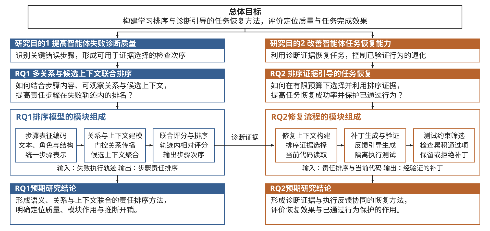
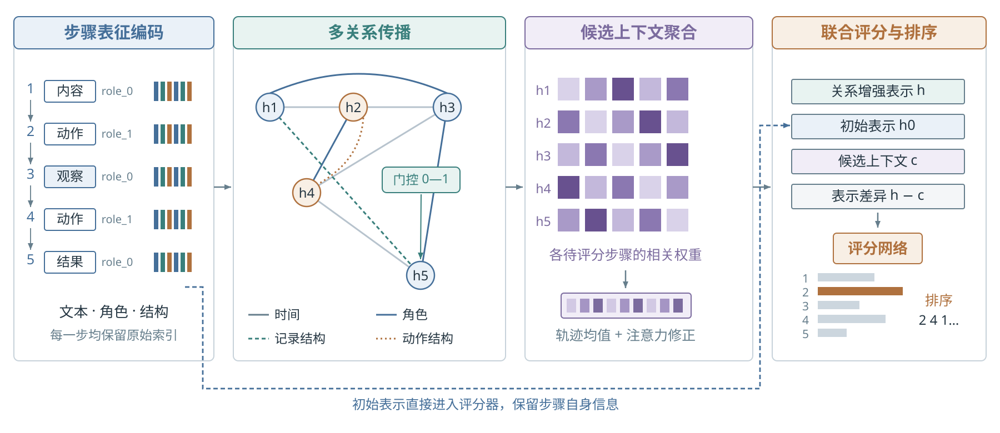
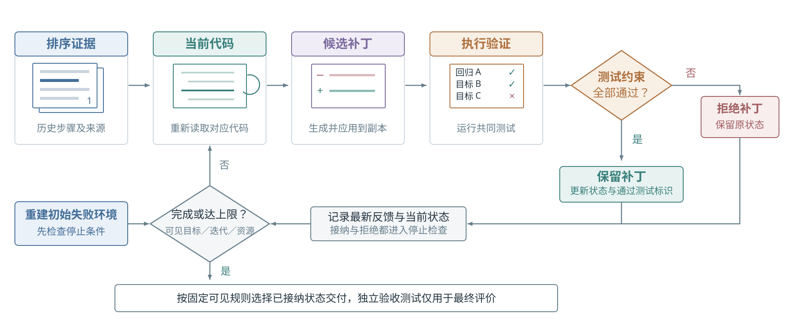
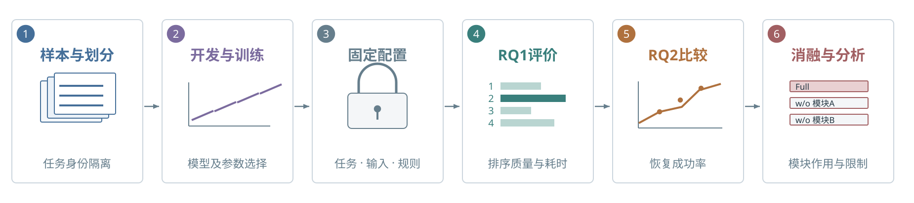

# 基于学习排序的智能体失败诊断与任务恢复方法

开题报告

## 第一章 研究背景与国内外研究现状

### 1.1 研究背景

大语言模型使计算机能够以自然语言接收任务要求，并根据已有知识生成回答、分析过程或操作建议。思维链（Chain-of-Thought，CoT）通过在提示中示范中间推理步骤，引导模型分步生成求解过程，为复杂问题分析提供了一种基础方式。[1] 随着应用目标逐渐扩展，用户对系统的要求也由获得一段合理的文本，转向完成具有明确目标和实际操作的任务。在这类任务中，系统需要了解外部环境，根据当前条件作出判断，并通过实际执行检验方案是否可行。任务能否完成，取决于模型生成的内容如何参与后续行动，以及这些行动在环境中产生了什么结果。

基于大语言模型的智能体通过调用工具获取信息、执行操作，并依据环境反馈调整后续行动。ReAct将推理、动作与环境观察交替组织，使模型的求解过程扩展为可以持续执行的任务过程。[2] 其中，推理用于分析目标和组织行动，工具执行使计划作用于环境，观察则为后续判断提供新的依据。在此基础上，任务既可以由一个智能体连续完成，也可以通过角色分工交由多个智能体协作。不同组织形式都需要在执行过程中保存和传递信息，使后续行动能够利用此前获得的结果。

以软件任务为例，解释一个程序的功能与修复一个程序中的问题具有不同的执行要求。前者可以围绕给定文本展开，后者通常需要查看代码仓库、理解问题涉及的调用关系、修改相关内容，并运行测试检查行为。[3] 如果一次修改没有解决问题，还需要根据执行结果重新分析。任务求解由此形成持续的交互过程：模型根据目标和当前信息提出行动，工具执行行动并返回观察，模型再利用新获得的信息决定下一步操作。

随着任务步骤增多，执行过程中的信息和状态也不断变化。一次检索会影响后续判断，一份中间产物可能被其他步骤继续使用，一次操作还可能改变后续行动所面对的环境。系统需要在连续交互中保持对目标、已有进展和当前状态的理解。局部步骤看似合理，也可能因采用了不完整的信息或不合适的前提，使执行逐渐偏离任务要求；多智能体协作还需要处理不同角色之间的信息交接和理解差异。[4]

这使失败分析需要关注整个执行过程。任务最终未完成，可以表现为测试不通过、输出不符合要求，或执行停留在无法继续推进的状态。这些结果提供了检查线索，但错误可能在更早的决策或操作中引入，随后通过信息使用和状态变化影响其他步骤。随着轨迹增长，重复尝试、正常操作和失败表现交织在一起，逐条阅读记录的负担也随之增加。[5] 如何从已有记录中识别更值得检查的位置，是理解执行失败并开展后续修正的重要前提。

找到可疑位置之后，系统仍需把历史线索转化为当前可执行的修正。诊断反映的是过去某一步所处的条件，恢复行动面对的则是已经变化的环境。协作开发中的代码更新可能使执行者已有的认识与当前环境产生偏差。[6] 对于失败后的修正，此前读取的代码可能已被修改，某项操作的结果也可能在后续执行中失效。恢复过程需要重新确认当前状态，判断历史线索仍能提供什么信息，再利用新的执行反馈调整行动。诊断信息能否改善任务完成效果，需要在实际恢复过程中检验。

连续修正还会带来已有进展的保持问题。一次尝试可能解决当前暴露的错误，同时影响此前正常的行为；重新开始整个任务，则可能重复已经完成的工作。对于软件任务，代码差异和测试结果能够为目标问题是否得到修复、已有功能是否仍然保持提供检查依据。[7] 因此，恢复过程既要考虑如何继续推进，也要检查修改对已有行为的影响，使每轮行动的收益与代价具有可核查的依据。

基于上述背景，本课题围绕失败步骤定位与任务恢复展开研究：先从失败执行记录中确定步骤的检查优先次序，再研究这些定位信息如何参与后续修正。软件任务具有可记录的操作、可检查的代码状态和可执行的测试，能够为这一过程提供具体的验证条件。以下进一步界定研究对象、诊断目标与恢复范围，为后续研究现状分析和方法设计建立一致的问题描述。

### 1.2 研究对象与问题定义

本课题的研究对象是大语言模型智能体围绕一个任务，通过工具与环境交互形成的执行过程。一个任务从原始要求出发，经历信息获取、判断和操作，逐步形成结果。本文关注其中已经发生失败的执行，利用可获得的过程记录分析问题，并研究如何从失败执行留下的环境继续完成原任务。诊断对象可以来自单智能体执行或多智能体协作，任务恢复主要在软件场景中验证。

为描述这一过程，本文将同一任务产生的有序步骤记录称为**执行轨迹**。一个步骤保留来源中可获得的内容、动作、环境观察和执行角色等信息。[8] 轨迹既反映某一步做了什么，也保留它在整体执行中的位置，使分析能够追溯前后操作、信息使用和角色交接。不同来源的日志组织方式可能不同，研究中需要明确步骤边界和原始位置，保持诊断结果与原始记录之间的对应。

**任务失败**指一次执行未满足该任务规定的完成条件。在软件场景中，这可能表现为要求修复的问题仍然存在，或提交的修改未通过规定的验收。[7] 最终失败描述的是一次执行的结果，而轨迹中各步骤对这一结果的作用可能不同：有的步骤引入偏差，有的继续采用了有问题的信息，有的只是暴露已有异常。因此，分析需要结合步骤内容及其前后联系，确定应该优先检查哪些位置。

本文将依据执行记录分析可疑环节的过程称为**失败诊断**，将其落实到具体记录位置的任务称为**失败步骤定位**。[5] 用于训练和评价的**责任步骤**，是数据集按照其标注规则指定的关键位置。不同数据来源可能强调错误引入、未履行的验证职责或错过的纠正机会，使用这些标注时需要核对其具体含义。[8] 本文据此评价定位结果；进一步确认某一步的因果作用，还需要相应的干预证据。

在输出形式上，本文为同一轨迹内的步骤确定**检查优先次序**，使有限的检查时间和后续输入空间优先用于更有价值的线索。这一排序首先服务于责任步骤定位，也为恢复过程提供证据选择的依据。定位对象是历史执行中的步骤，需要修改的源码位置或当前环境对象则由后续恢复过程确认。二者通过线索来源建立联系，再结合当前内容确定具体行动。

失败分析之后，还需要通过实际执行检验修正是否能够改善任务结果。[9] 本文将**任务恢复**界定为：从失败执行形成的当前环境出发，利用诊断线索和可用反馈修正后续行动，继续完成原任务。在软件场景中，系统需要重新读取相关代码和执行状态，选择可实施的修改，运行可见测试，再根据结果决定下一轮操作。本文将恢复过程中允许使用、能够向系统提供反馈的测试称为**可见测试**，将与生成过程隔离、用于评价最终交付结果的测试称为**独立验收测试**。

例如，某次修改未能解决目标问题，但已有一部分功能通过了测试。诊断可以帮助系统选择下一步应检查的历史线索，恢复则需要核对相关代码当前的实际内容，再生成并验证新修改。新修改是否值得保留，既与目标问题是否得到推进有关，也与此前通过的行为是否保持有关。因此，恢复效果需要结合执行前后的状态和最终任务结果评价。

由此，本课题形成两个相互衔接的研究问题：失败轨迹中的哪些步骤应当优先检查，以及这些定位信息能否帮助系统更有效地完成失败任务。前者评价诊断质量，后者评价诊断信息在实际行动中的作用。两部分分别开展比较，再通过诊断证据、修正动作和验证结果之间的对应分析其联系。

### 1.3 国内外研究现状

- **智能体构建与执行可靠性**

Yao等（2023）的ReAct以任务和当前观察为输入，交替生成推理与工具动作，再把环境返回结果加入后续决策。它使求解过程形成可检查的执行轨迹，也便于根据新信息调整计划；但获取了外部反馈，并不代表系统已正确理解反馈，错误检索和错误推理仍可能沿后续行动传播。[2]

Wu等（2024）的AutoGen把模型、工具和人工输入封装为可会话智能体，通过自动回复与可编程会话控制连接不同职责。开发者可据此组织代码生成、执行和反馈等多轮协作；其重点是会话与流程构建，具体失败由哪个步骤引入，仍需另外诊断。[10]

Hong等（2024）的MetaGPT将软件开发中的标准操作流程引入协作，由产品、架构、工程与测试角色依次产出需求、接口和代码等结构化材料，并依据执行反馈修订代码。结构化交接减少了沟通遗漏，但上游产物若存在错误，后续角色仍可能沿用，因此需要检查产物内容及其使用关系。[11]

Cemri等（2025）的MAST通过执行轨迹分析，将十四种失败模式归入系统设计、智能体间失配和任务验证三类，区分角色越界、信息遗漏、重复行动与验证不足等表现。它为分析失败发生在哪类环节提供了统一描述，但模式标签仍需进一步落到具体执行步骤，才能支持有针对性的修正。[4]

- **失败归因与责任步骤定位**

Zhang等（2025）的Who&When将失败归因明确为两个目标：找出责任智能体，以及引入决定性错误的步骤。研究以失败日志和专家标注建立评价对象，并比较整段日志一次判断、逐步检查和二分搜索。完整阅读便于理解全局，逐步检查更关注局部，二分搜索减少检查范围；这些方式均面临长日志中证据分散和错误传播的干扰。[5]

Sun等（2026）的SDBL先收集值得重点关注的步骤，再结合完整日志确定责任位置。可疑步骤既可由逐步检查得到，也可依据越权和重复命令等专家模式筛出。这样把寻找线索与最终判断分开，减轻单次判断负担；但先验模式能否覆盖当前失败、提示是否准确，仍会影响定位结果。[12]

Zhu等（2026）的StepFinder先将步骤内容与角色编码为向量，以双向时序模型结合前后记录，再用角色感知注意力联系相隔较远的步骤。模型综合步骤表示、多尺度变化和位置偏置输出责任分数，减少诊断时的文本生成。该方法已有跨步骤交互，但较早步骤优先的显式先验，以及关系和上下文的表示方式，仍需结合不同轨迹检验。[13]

这些工作把责任定位从人工读日志推进到搜索和学习建模。本文沿用步骤级评价对象，进一步比较同一轨迹内不同执行关系和候选相关上下文，能否改善优先检查顺序，同时报告编码与推断开销。

- **失败归因的执行证据与责任标注**

前述步骤定位研究首先明确了“由谁、在哪一步引入关键问题”的评价对象。2025年的Who&When已经通过失败日志与专家标注，将这一问题落实到责任智能体和决定性步骤。[5] 在此基础上，分析一处异常为什么值得检查，还需要了解该步骤实际接收了哪些信息、后续操作如何使用这些信息，以及评价数据依据什么规则标注责任位置。执行证据与责任标注分别构成诊断的判断依据和评价参照。

步骤之间的信息使用关系，是分析错误传播的一类证据。例如，后一步依据前一步给出的文件路径执行修改，前一步的路径错误就可能影响后续操作。Deng等（2026）的DeFA据此组织工具请求与返回、前后内容使用等联系，构成事件依赖图，再追踪可疑步骤的来源与后续影响。[14] 这里的“依赖”关注执行中信息如何被使用；记录相邻或属于同一角色，只能提供可观察的联系，仍需结合内容判断。依赖分析可以帮助区分错误来源与后续表现，但恢复这些联系和多阶段判断也会增加调用开销。

有了可检查的执行记录，还需要确定训练和评价所用的责任标签。自然失败往往包含相互影响的多个异常，人工判断也可能存在分歧。因此，归因数据除了保存日志，还需要交代失败如何产生、标签如何获得，以及所标注的“责任”具体指什么。

Zhang等（2026）的AgenTracer结合自然失败轨迹的修正重放和成功轨迹的故障注入，构造包含责任信息的TracerTraj，并训练专用诊断模型。[15] 这类工作为学习定位提供了监督数据，也使数据构造方式成为需要分析的因素：注入错误与自然失败可能具有不同分布，训练和测试必须交代来源及划分，才能判断模型学到了什么定位能力。

Chen等（2026）的TraceElephant进一步保存步骤实际收到的输入、系统配置、输出与工具日志，并提供可重放环境。其标注考虑角色职责和可恢复性：上游已出现错误，但下游验证者仍有责任和机会纠正时，责任可能落在后续未完成纠正的步骤。[8] 因此，相同的表面异常可能因可读信息和标注规则不同而得到不同解释。本文使用执行关系组织诊断线索，同时核对数据中的责任定义，使模型输入、监督标签和评价对象保持一致。

- **反馈纠错与可恢复执行**

Madaan等（2023）的Self-Refine让同一模型生成初稿、提出反馈并反复修订；Shinn等（2023）的Reflexion则把执行评价转化为语言反思，存入记忆供下一轮尝试使用。二者说明反馈可改变后续求解，但前者依赖反馈质量，后者依赖评价与反思能否保留有效经验。[16,17]

Gou等（2024）的CRITIC先调用搜索或代码解释器验证输出，再依据工具反馈修订，将纠错建立在外部证据上。Huang等（2024）区分有正确标签辅助和无外部标签的推理自纠错，发现后者在所测条件下可能把正确答案改错，提示纠错效果必须结合反馈来源判断。[18,19]

Chang和Geng（2025）的SagaLLM把上下文管理、独立验证和事务补偿结合起来：保存操作及依赖状态，在失败后执行相应补偿。它处理的是已执行操作的影响，但补偿能否成立取决于领域操作和约束，需要预先明确可恢复范围。[20]

Zhuang等（2026）的AgentRewind记录执行上下文与工作区检查点，回退时同步恢复二者，并把失败尝试中的经验带入新执行。它避免只改提示而保留错误文件状态；其恢复边界主要是受控文件系统，外部服务等副作用不能一并撤销。[21]

Yu等（2026）的Rollback-Induced Reflection同时决定何时回退、从哪个检查点继续，以及保留哪些经验。方法恢复环境与当前分支上下文，另外保存可复用知识，并重新核验已被撤销动作关联的状态信息，避免把历史进展误当成当前仍成立的事实。[22]

- **软件任务求解**

Xia等（2025）的Agentless以问题描述和代码仓库为输入，依次定位可疑文件、代码元素与编辑位置，生成多个补丁，再用复现和回归检查筛选、排序。其流程明确、便于控制开销；这里的定位对象是需要修改的源码位置，与失败执行中应优先检查的责任步骤不同。[23]

Li等（2025）的PatchPilot在复现、定位、生成与验证之外加入补丁细化：利用复现输出、覆盖文件和验证反馈，继续修改有希望的补丁，或重新检查定位。这样可利用部分正确的已有修改；但候选质量仍取决于复现与可见测试是否覆盖真实问题。[24]

Tian等（2026）的EnAgent用多次执行生成候选补丁，先通过规范化去重和回归测试缩小候选集合，再由选择智能体结合代码阅读、动态测试和多次投票作出选择。它把集成推理扩展到仓库级理解，但若候选中没有正确解，后续选择仍无法补足生成能力。[25]

Ruan等（2026）的AOrchestra由主控按需配置子任务的指令、上下文、工具和模型，子智能体执行后返回结果与日志，主控再继续委派。它以动态分工适应复杂任务，效果也依赖主控能否正确拆解目标、筛选上下文并配置执行能力。[26]

这些方法提供了从问题到补丁及验证的完整流程，可用于检验整体任务求解能力。要评价本文诊断信息的作用，还需固定生成器、信息与预算，单独替换诊断排序，观察实际证据、修正动作和最终任务结果是否改变。

- **诊断引导恢复**

Guo等（2025）的SyncMind研究协作代码更新后，智能体仍按旧理解行动的失步问题。它用提交历史和可执行测试构造任务，比较独立探索与寻求协作者帮助的恢复。该研究表明，继续修改前需要了解当前环境变化；其重点是失步恢复评测，而非直接从历史责任步骤产生修复。[6]

Ma等（2026）的DoVer先按重新规划把日志分成多次尝试，再为各次尝试提出责任假设，生成计划或指令修改，并保留干预前记录继续实际执行。方法用任务成功和中间进展检验修改是否有效，还区分干预已执行与未执行的情况；因此，一次恢复失败不能直接说明原假设错误。[9]

Wang等（2026）的DARC从开发集分析任务族的主要失败模式，据此限制动作约束、程序知识或示例检索等干预，再利用训练集成功与成本反馈选择短策略，并在测试前冻结。它体现诊断应约束行动选择，但任务族策略与逐条失败轨迹的责任排序属于不同层次。[27]

Vasudev等（2026）研究用失败预测触发回退或警告，发现较准确的预测仍可能破坏原本正确的执行，其净效果随模型和任务条件变化。该结果针对在线干预，不能直接等同于事后责任定位，但说明诊断指标提高并不自动带来任务完成率提高。[28]

本文据此分别评价责任排序与任务恢复：先检验哪些步骤更应优先检查，再核对历史线索对应的当前代码，利用可见反馈修正，并持续检查此前已通过的行为。恢复价值最终由共同任务和独立验收测试判断。

### 1.4 现有问题与研究意义

**复杂执行记录中的有效信息组织。** 失败轨迹中的单个步骤可能只呈现局部现象，对其作用的判断还需要参考前后的操作和信息使用情况。[13] 时间位置、执行角色和记录结构能够提供不同的联系线索，整条轨迹中也可能存在与当前候选相关的远距离信息。如何组织这些信息、区分它们对不同步骤的作用，需要在共同输入和监督条件下检验，并同时考虑增加上下文所带来的计算代价。

**历史执行线索与当前修正对象的对应。** 诊断面向已经发生的执行，修正行动作用于当前环境。软件环境更新可能使执行者沿用过时的认识，[6] 因而需要重新核对历史记录中的文件、代码内容或操作结果是否仍然有效。将定位结果用于恢复，需要保留线索的来源，重新核对当前对象，明确哪些历史信息仍然有效，使诊断结果能够转化为有依据的修正。

**恢复推进中的已有行为保持。** 软件修复既需要检查目标问题是否解决，也需要检查已有功能是否保持。[7] 仅观察通过测试的数量，可能遗漏具体行为的变化。恢复过程需要识别此前通过了哪些行为，检查新修改是否使其失效，并分析严格保护已有进展是否会阻碍某些多步修复路径。研究这一问题，有助于理解局部修正、任务推进和行为保持之间的关系。

本课题将上述问题放在软件任务中验证。代码变更、工具记录和可执行测试能够帮助追踪诊断线索如何影响后续行动，并核查行动是否改善任务结果。通过分别评价责任步骤排序与完整任务恢复，再分析各模块的作用，可以为复杂执行中的失败检查提供方法依据，也为利用诊断信息开展可验证的任务恢复提供实现和评价参考。

## 第二章 研究目标与技术框架

### 2.1 学习排序基础与总体研究框架

**学习排序（Learning to Rank，LTR）**利用带有相关性、偏好或优先级标注的数据学习评分函数，再按照分数确定一组候选对象的次序。它关注特定条件下哪些对象应当排在前面，训练数据需要明确候选属于哪个组、组内对象如何表示，以及依据什么监督信号学习优先级。[29]

以搜索为例，一次查询对应一组候选文档，模型根据查询与文档的信息学习评分，推断时返回有序结果。迁移到本课题，一条失败轨迹对应一个候选组，执行步骤对应待排序对象，数据集标注的责任位置提供监督。模型需要学习：在这条轨迹的整体执行条件下，哪些步骤更值得优先检查。不同轨迹分别完成组内比较，步骤分数不作为跨任务通用的风险刻度。

学习排序通常按训练时比较候选的方式分为逐点式、成对式和列表式。[29] 三者的区别主要体现在监督组织和训练目标，并不要求推断时使用三种不同形式的输出：

| 训练方式 | 训练时如何利用候选 | 与本课题的关系 |
|---|---|---|
| 逐点式（pointwise） | 对候选分别预测相关程度或类别，再依据预测评分排序 | 可以作为步骤独立评分的建模方式，但需要另行表示轨迹上下文 |
| 成对式（pairwise） | 比较两个候选的相对先后，学习哪一个应当优先 | 需要从责任标注构造步骤对，并处理不同轨迹产生的样本数量差异 |
| 列表式（listwise） | 将同一候选组的分数共同纳入训练目标，学习组内优先次序 | 适合以整条轨迹为训练单位，对责任位置施加组内监督 |

本课题采用以轨迹为单位的列表式训练思路。每条轨迹中的全部有效步骤共同产生分数，训练提高标注责任步骤的相对得分；推断时将步骤按分数排序。当前监督为单个责任位置，具体训练使用轨迹内softmax与交叉熵，并未获得其余步骤之间的完整人工次序。该选择确定了模型的训练单位和输出方式；步骤表征、关系传播与上下文聚合则负责提供评分所需的信息。[30]

总体研究包含两个相互衔接的部分。RQ1构建责任步骤排序模型，研究如何利用步骤内容和执行联系改善组内评分；RQ2在软件任务中构建诊断引导的修复流程，将排序转化为修复上下文，再生成、验证和筛选候选补丁。前者输出诊断优先次序，后者通过实际执行检验这些信息的行动价值。整体框架如图2-1所示。

图2-1 列表式责任步骤排序与诊断引导任务恢复的总体框架

### 2.2 研究目标与研究问题

**RQ1：如何利用步骤内容、可观察关系和候选相关上下文，提高责任步骤在失败轨迹内的排名？**

第一项目标是构建多关系与上下文增强的责任步骤排序模型。模型先编码每一步的内容及角色、结构信息，再通过关系传播和面向待评分步骤的上下文聚合补充执行线索，最后学习组内评分。研究比较完整模型与核心模块变体的定位质量、参数量和推断开销。

**RQ2：责任排序能否通过有限预算下的证据选择，提高失败任务的恢复成功率？**

第二项目标是在软件场景中建立诊断引导的程序修复流程。系统将排序线索与当前代码、执行反馈组织为修复上下文，生成并验证候选补丁，再按测试约束决定是否保留。完整系统比较评价任务完成效果，固定修复流程下的诊断器替换和模块消融进一步分析诊断信息、当前代码读取及测试约束的作用。

### 2.3 责任步骤排序模型的模块设计

学习排序需要一个能够为候选评分的模型。本课题将其组织为**步骤表征编码、关系与上下文建模、联合评分与轨迹内排序**三个功能模块。三者分别完成输入表示、执行信息融合和优先级输出，具体对应关系如下。

| 模块 | 主要输入 | 核心处理 | 输出及后续用途 |
|---|---|---|---|
| 步骤表征编码 | 步骤文本、执行角色和记录结构 | 编码语义，组织角色与结构特征，形成统一向量 | 每一步的初始表示，供关系建模和评分使用 |
| 关系与上下文建模 | 初始表示及可观察步骤关系 | 门控多关系传播，并为各待评分步骤聚合全轨迹上下文 | 关系增强表示和候选相关上下文，补充局部内容之外的线索 |
| 联合评分与轨迹内排序 | 初始表示、关系增强表示及候选上下文 | 联合计算步骤分数，按轨迹组织训练和排序 | 各步骤分数与检查次序，供诊断评价和修复证据选择使用 |

**步骤表征编码**解决不同日志字段如何进入模型的问题。文本描述操作内容，角色表明行为来源，结构特征补充记录格式与位置。统一表示使后续模块能够在同一特征空间中处理不同长度的轨迹，同时保留每一步与原始记录的对应。

**关系与上下文建模**包含两个互补环节。多关系传播按时间、角色和记录结构等联系汇集邻步信息，借鉴了按关系类型组织信息传递的思想。[31] 候选相关上下文聚合则以每一个待评分步骤为查询，从整条轨迹中选择相关信息。同一段记录可以对不同步骤产生不同作用，因此上下文不局限于所有步骤共享一个轨迹摘要。二者分别对应本文拟检验的关系传播与候选上下文设计。

**联合评分与轨迹内排序**将上述信息转为检查优先级。初始表示保留本步骤内容，关系增强表示提供邻步线索，候选上下文提供与该步有关的全局信息；评分器联合读取这些表示并输出标量分数。训练阶段以整条轨迹的分数和责任位置计算损失，推断阶段据分数形成完整次序。列表式思想规定组内训练方式，评分网络承担具体预测，二者属于同一排序模型的不同层次。

ListNet为通过组内分布匹配学习排序提供了基础参考。[30] 本文采用单责任位置监督的轨迹内交叉熵，其形式也可解释为位置分类；未使用多级相关性标注，也不将训练目标本身作为新损失函数。完整次序为后续证据选择提供接口，责任步骤以外的相对次序仍需结合实际恢复效果分析。第三章进一步说明上述模块的实现。

### 2.4 诊断引导程序修复的模块设计

RQ2在软件任务中研究排序信息如何参与实际修复。诊断输出是历史步骤的检查次序，程序修复需要的是当前可用的代码、问题线索与验证反馈。因此，修复流程首先构建生成输入，再形成候选补丁，最后作出保留或拒绝的决定。

| 模块 | 主要输入 | 核心处理 | 输出及后续用途 |
|---|---|---|---|
| 修复上下文构建 | 责任排序、原始任务、当前仓库与最新反馈 | 按预算选择历史证据，合并重复线索，定位并读取对应的当前代码 | 带来源的诊断证据和当前代码上下文，作为生成输入 |
| 候选补丁生成与验证 | 修复上下文及既有尝试的执行反馈 | 生成补丁，在隔离副本中应用并运行可见测试 | 候选代码状态和验证记录，供约束检查使用 |
| 测试约束下的补丁筛选 | 候选验证结果、初始回归项和累积通过的目标项 | 按稳定测试标识检查约束，决定保留或拒绝并更新通过项 | 下一轮使用的代码状态及反馈，或最终交付候选 |

**修复上下文构建**统一承载排序证据选择与当前代码定位。它的目标是形成可直接用于生成的输入，历史位置只是查找线索。代码环境发生变化后，需要重新确认当前内容，才能避免依据过时信息行动。[6]

**候选补丁生成与验证**围绕一次修正尝试展开。执行反馈为后续修改提供外部依据，[18] 生成器据此提出候选，验证过程返回应用结果和可见测试结果。该模块产出待判断的候选及证据，是否替换当前代码由筛选模块决定。

**测试约束下的补丁筛选**把已有行为的保持转化为可执行判据。回归测试已被用于候选补丁验证与选择，[23] 本文进一步关注初始回归项以及修复过程中累积通过的目标项，并按稳定标识检查它们是否继续通过。约束以实际执行的测试为范围，其作用及可能阻碍多步修复的代价均通过实验分析。

三个模块反复衔接，构成任务恢复的总体迭代流程：构建上下文、生成并验证候选、依据约束更新状态，再进入下一轮。达到可见完成条件、内部迭代上限或共同资源预算时停止。迭代是系统的执行方式；上述模块分别负责生成输入、提出候选和判定候选，便于明确各自接口并开展过程分析。

## 第三章 责任步骤排序模型与诊断引导程序修复

### 3.1 排序任务与模型结构

排序模型读取一条已经发生失败的完整执行轨迹，为全部有效步骤输出检查优先次序。步骤包含来源提供的内容、动作、思考和角色等字段。训练时使用数据集标注的责任位置，推断时只读取轨迹可见信息，保留原始步骤索引用于结果回查。

例如，某一步选择了错误对象，后续多步操作才出现报错。模型需要结合执行上下文判断各步骤的检查价值。评价仍以数据集的责任标注为目标，进一步确认因果作用需要相应干预证据。

图3-1展开了第二章的三个功能模块。步骤表征编码产生初始表示；关系与上下文建模进一步包含多关系传播和候选上下文聚合；联合评分器融合这些信息，为每一步给出分数。训练目标将同一轨迹中的分数联系起来，最终形成组内排序。

图3-1 步骤表征、多关系传播、候选上下文聚合与联合评分（连接和权重为示意）

步骤边界和原始索引在预处理时固定，补齐位置不参与评分。模型可以读取待评分步骤之后已经发生的记录，因此本课题研究执行后的失败定位。单模型按步骤分数降序排列，同分按原始索引处理；集成结果按各模型归一化后平均的预测权重排序。

### 3.2 步骤表征与多关系传播

- **步骤表征编码**

步骤表征将日志信息转换为排序网络可以处理的向量。文本编码描述这一步执行了什么操作、使用了什么信息；角色特征区分行为来源；结构特征补充字段格式、相对位置以及同类结构在轨迹中的重复情况。三类信息拼接并投影到统一维度，得到步骤初始表示。

角色按本条轨迹中的首次出现顺序匿名编号为role_0、role_1等。同一来源保持相同编号，以保留协作联系并减少名称影响。当前软件恢复输入只有一个执行角色，多角色条件主要在诊断数据中分析。

部分日志将决策上下文和紧随的输出分成两条。仅当原始步骤相邻、角色相同且日志标记明确对应时，预处理才让两条记录互相补充文本信息。没有明确对应就保持原输入，原始步骤索引不变。当前软件发布的18条轨迹中没有触发有效配对，因此这一条件处理不作为软件场景中已验证的收益来源。

- **多关系传播**

多关系传播以步骤初始表示和关系连接为输入，输出关系增强表示。模型建立四类可观察连接：时间相邻、同一匿名角色、相同完整记录结构、相同非空动作结构。后两类比较类型、嵌套和大小等形式，并去除键名及具体值；每类关系选取前后最近的匹配步骤。这些连接用于传递信息，其含义限定为可观察联系。

每条邻步消息通过一个可学习的标量门控控制强度。门控结合当前步骤、邻居步骤及二者差异，产生0到1的权重；权重较小时，该条消息的影响减弱。模型再学习四类关系通道的融合权重，将汇总信息与步骤原有表示相加。这样既能采用其他步骤的线索，也保留本步骤内容。

两轮关系传播使一个步骤能够进一步利用相连步骤传来的信息。没有邻居的通道不增加信息；单角色轨迹中，同角色连接可能与时间连接重合，实验分别记录单角色和多角色条件，以分析连接重合对实际作用的影响。

当前原型使用固定的Qwen3-Embedding-0.6B编码器，生成128维文本和32维角色表示，另加入23维结构特征，拼接后投影为96维表示。文本和角色向量分别归一化，结构特征仅使用对应训练部分的统计量标准化。编码器保持固定，后续排序网络随责任位置监督训练。

### 3.3 候选上下文聚合与列表式排序

- **候选相关上下文聚合**

这里的候选是一个待评分步骤。聚合模块读取关系增强表示，以当前候选作为查询，从整条已发生轨迹中提取与其相关的信息，形成该步骤的上下文向量。评分另一个步骤时，查询随之变化，采用的轨迹信息也可以改变。

模型通过注意力权重进行加权聚合，并在轨迹均值的基础上学习由当前候选引出的上下文修正。轨迹均值提供共享背景，注意力补充对该步骤更有用的线索，得到候选上下文。聚合范围包含当前步骤自身及其前后记录；注意力权重表示模型采用信息的程度，不直接作为因果解释。

- **联合评分**

评分模块联合读取关系增强表示、步骤初始表示、候选上下文，以及关系增强表示与候选上下文的差异。初始表示通过直接支路进入评分器，使本步骤的局部内容在信息融合后仍可使用。评分器采用多层感知机（MLP），为每一步输出一个标量分数：

$$
s_i=\operatorname{MLP}([h_i;h_i^{(0)};c_i;h_i-c_i]).
\tag{1}
$$

式（1）中，$h_i$是第i步的关系增强表示，$h_i^{(0)}$是经过输入处理后的初始表示，$c_i$是面向该步的上下文，分号表示向量拼接。分数用于比较同一轨迹中各步骤的检查优先级，形成后续证据选择的排序接口。

- **轨迹内列表式训练**

训练时，同一轨迹的全部有效步骤共同进入归一化和损失计算。设轨迹有m个步骤，标注责任位置为y，单条轨迹采用以下目标：

$$
p_i=\frac{\exp(s_i)}{\sum_{j=1}^{m}\exp(s_j)},\qquad \ell=-\log p_y.
\tag{2}
$$

$p_i$是轨迹内归一化权重，$\ell$是单轨迹损失。提高标注位置的权重，会促使它在同组候选中获得更高得分。该目标使用单责任位置标签，其形式为轨迹内位置分类的交叉熵；列表式在这里指候选组的组织与联合归一化方式。输出权重不作为已经校准的致错概率，未标注步骤之间也没有完整人工次序监督。

AgenTracer来源池训练对轨迹损失取平均；AFTraj训练先在同一源任务组内平均，再对任务组等权平均，避免同一任务的多条记录获得过大权重。报告三次训练的集成结果时，先将各模型的步骤分数在轨迹内归一化，再平均预测权重并排序。

上述过程形成从步骤表征、关系增强到上下文聚合和排序学习的完整模型。实验分别删除多关系传播或替换候选相关上下文，检验它们在共同输入和训练条件下的作用。全轨迹注意力的时间与存储开销随步骤数呈二次增长，定位质量与包含编码的端到端耗时共同报告。

### 3.4 排序引导的修复上下文构建

本模块将责任步骤排序转化为生成器可直接使用的修复上下文。输入包括原始软件问题、排序后的历史步骤、当前仓库和最新执行反馈；输出是在输入预算内组织好的历史诊断证据与当前代码。排序线索用于决定优先查看什么，当前代码用于确认实际上能够修改什么。

系统依次扫描排序，合并指向相同动作或对象的重复线索，并保留原始步骤索引。根据历史文件、位置及操作线索重新定位和读取当前代码，记录对象是否仍然存在、内容是否已经改变。能够可靠定位时提供当前内容；无法对应时保留历史解释及定位状态，避免将旧片段误作当前代码。

选中的证据与原任务、当前代码、最新反馈共同形成生成输入。证据选择受条数和输入词元（token）上限约束，过长片段按统一规则截断，并记录实际条数和长度。在有限输入容量下，靠前线索有更多机会进入生成器，排序由此参与修复决策。

基本方法对初始失败轨迹排序一次，后续每轮更新当前代码和执行反馈。实验固定证据选择规则，保存排序、选中证据与实际生成输入之间的对应。若不同排序经定位和去重后形成相同证据，也如实记录，据此判断排序是否实际改变了修复条件。

### 3.5 反馈驱动的候选补丁生成与验证

本模块读取修复上下文，围绕一次修正尝试生成候选补丁，并返回执行验证记录。生成器结合尚未满足的任务要求、诊断证据、当前代码及此前尝试的反馈，提出对当前代码的修改。对于具有明确撤销含义的历史操作，可按既定规则生成受控回退动作。

候选补丁在隔离副本中应用。验证先检查编辑格式、修改对象和匹配位置，再运行任务许可范围内的可见测试。应用后的代码状态与验证记录共同构成模块输出：格式错误、应用失败、执行异常和测试结果分别保留，供候选筛选与下一轮生成使用。

该模块负责产生候选及验证证据，补丁是否替换当前状态由3.6节的测试约束决定。被保留的候选提供下一轮代码状态；被拒绝的候选保留失败反馈，生成器仍可依据这些信息调整后续修正。独立验收测试结果及其他方法的补丁与生成过程保持隔离。

三个修复模块反复衔接的执行流程如图3-2所示。图中的“排序证据”和“当前代码”共同实现修复上下文构建，“候选补丁”和“执行验证”对应本节的生成与验证，测试约束判定及状态更新对应补丁筛选模块。

图3-2 修复上下文构建、候选补丁生成与验证、测试约束筛选组成的迭代流程

### 3.6 测试约束下的补丁筛选

本模块根据候选的可见测试结果，决定保留或拒绝，并更新后续轮次使用的代码状态与通过项记录。筛选以稳定测试标识为依据。例如，修改前A、B通过，修改后B、C通过，数量相同但A已经失效，候选并未保持所有既有通过项。

约束包括初始通过的既有回归测试B，以及截至第t轮恢复时已经通过的可见目标测试集合$H_t$。目标测试检查当前软件问题要求解决的行为，初始已通过的目标项也进入$H_t$。候选状态$S'$满足以下条件时才可接纳：

$$
B\cup H_t\subseteq\operatorname{Pass}(S').
\tag{3}
$$

$\operatorname{Pass}(S')$是候选状态确认通过的测试标识集合。候选被保留后，将新通过的目标项加入约束集合，用于检查后续补丁；候选被拒绝时保留原代码状态，并把失败反馈交给下一轮。测试结果缺失或不确定时先核查，明确通过后才纳入保护。

筛选允许保留暂未增加通过项、但满足约束的修改，为多步修复保留空间；相同代码状态去重。达到可见任务完成条件、内部迭代上限或资源预算时结束循环。可见目标全部通过时交付当前状态，否则按可见失败目标数量、改动规模及固定先后规则，从已接纳状态中选择结果。预算节点也采用相同的结果选择规则。

严格约束可能阻止需要暂时退步的修复路径。实验因此比较去除累积目标保护后的效果，并通过具体测试变化分析收益与代价。约束范围以实际执行的测试为准，最终任务效果由独立验收测试评价；计时、调用和token按全过程累计，包含失败候选及验证消耗。

当前原型已实现排序接入、反馈修复和状态记录。统一证据预算、测试标识和重复状态处理将在正式比较前完善。分支探索、软保护和重新诊断留作后续扩展，主要实验评价本章定义的完整方法。

## 第四章 拟解决的关键问题与预期创新

### 4.1 拟解决的关键问题

**关系与候选上下文的有效信息。** 单个步骤的文本可能不足以说明其与最终失败的联系。多关系传播用于收集邻步线索，候选相关聚合用于区分这些信息对不同位置的作用。关键在于检验两者在共同输入、监督和训练条件下能否提高责任步骤排名，并分析额外计算开销。

**历史诊断到当前修正的对应。** 软件环境变化可能使智能体依据过时信息行动。[6] 本文需要将历史排序中的关键位置转化为当前可使用的对象和证据，保留线索来源、重新读取当前内容，并在有限输入预算下组织有效证据。

**修复推进与已有行为保持。** 局部修复可能破坏此前已通过的功能，单看通过测试数量还可能遗漏具体行为的替换。关键在于用稳定测试标识判断候选修复应否保留，同时分析严格保护对多步修复路径的影响。

### 4.2 预期创新设计

**语义、多关系与候选上下文联合的学习排序。** 面向失败轨迹中步骤联系复杂、候选信息需求不同的问题，联合关系增强表示、初始步骤表示和候选相关上下文进行评分。通过完整模型与两个核心模块的消融，检验信息组合对责任排名的贡献。

**排序证据与已通过行为保护相结合的任务恢复。** 将责任排序映射为当前对象的证据，结合最新执行反馈生成修正，并按测试标识保护已有进展。通过完整系统比较和固定恢复器中的模块对照，检验诊断证据能否改善预算内任务完成效果，分析保护机制的具体作用。

两项设计分别对应定位信息的质量和诊断信息的行动效用。创新性与有效性将在共同数据、统一条件和独立评价中检验，前期开发结果作为方法完善的依据。

## 第五章 数据来源与实验设计

### 5.1 数据来源与评价划分

实验分别评价失败步骤定位和任务恢复。AFTraj与AgenTracer扩展发布版提供责任步骤标注，[32,33] SWE-Gym及其配套执行轨迹提供可重新执行的软件问题。[34] 本文将软件问题记为issue，以原始任务身份组织划分和统计。

表5-1 数据来源与研究样本

| 数据来源 | 发布规模 | 当前研究样本 | 主要用途 |
|---|---|---|---|
| AFTraj | 2,276条轨迹 | 731条失败轨迹；716任务组 | 失败步骤定位 |
| AgenTracer coding | 训练1,141条；测试127条 | 614条来源池；363条coding评价轨迹 | 软件轨迹定位 |
| SWE-Gym | 2,438个Python问题 | 23个已整理issue | 恢复方法开发 |

AFTraj发布数据中，安全轨迹1,162条、不安全轨迹1,114条。[32] 本文从失败轨迹中整理的731条记录对应716个源任务组，其中120个不同任务组构成开发子集。该子集在五个任务类型与标注来源组合中各取24条，按领域为coding 24条、math 48条、agentic 48条，已用于调试和方法分析。

AgenTracer采用扩展发布版，该版本与论文版的发布规模不同。[33] 以下规模是本文本地筛选与划分的结果。614条训练验证来源池包含coding 320条、math 294条，363条固定评价轨迹为coding。两部分来自所用发布版的官方训练部分，并按源任务组隔离，固定评价集属于开发评价数据。

所有划分以原始任务为单位，同一问题的多条轨迹、错误变体和派生样本归入同一组。清洗处理步骤边界、可读格式和原始位置映射，标签沿用来源定义。各数据集分别记录责任标签的对象与判定规则，需要合并训练时，先核对标签是否表示同一类责任位置。样本资格依据轨迹完整性、标注可映射性和环境可运行性确定，报告排除数量与原因。

- **诊断数据划分**

**AFTraj开发评价：** 将716个任务组分为5份，轮流使用其中1份进行外层评价，其余4份再划分训练与验证组，构成五折分组评价。每个配置使用三次预定初始化，模型选择依据内部验证。每条轨迹由未使用该任务组训练的模型产生外层预测，汇总731条结果。已用于方法选择的外层结果归入开发评价。

**AgenTracer开发评价：** 采用A、B、C三个分组划分，每个划分训练492条、验证122条，均在同一363条coding开发评价集上比较，每个划分使用三次预定初始化。训练含coding 256条和math 236条，验证含coding 64条和math 58条；训练、验证与固定评价任务组相互隔离。

**独立评价集：** 方法结构、输入处理、训练和选择规则确定后，分别从AFTraj官方测试部分的163条失败轨迹及AgenTracer官方coding测试部分的127条轨迹中筛选未参与开发的样本。筛选核对原始任务身份与历史开发使用记录，报告最终合格数量。候选轨迹数与独立任务组数分别统计。

- **任务恢复数据划分**

恢复样本由原任务描述、失败执行形成的代码、可见失败轨迹、执行反馈和独立验收测试共同构成。纳入前核对issue、仓库版本与轨迹的对应关系，并确认初始环境可重建、反馈可用和测试可执行。主要评价保留智能体实际执行形成的失败环境；受控构造样本用于解释特定保护与对齐机制。

现有23个已整理issue用于接口核对、恢复方法开发和资源估计。独立评价计划从SWE-Gym同一来源另行筛选20个未参与方法开发的合格issue，覆盖至少3个仓库。候选按预定顺序核对任务身份、失败初态、反馈和测试条件，最终样本数以实际合格数量为准。

### 5.2 实验流程与共同条件

实验先完成数据划分和开发配置选择，再固定定位模型、恢复实现与评价规则。随后分别开展责任排序比较、完整任务恢复比较和核心模块消融。独立评价结果用于最终评价，开发阶段负责确定参数和修正实现。

图5-1 学习排序评价、任务恢复比较与模块消融的实验流程

- **诊断训练设置**

本地已执行训练采用固定文本编码器与可学习排序网络。排序网络为两层关系传播、96维隐表示，训练中用0.15的Dropout随机置零部分特征，降低对个别特征的依赖。Top-1是责任步骤排在首位的比例，平均倒数排名（MRR）对责任步骤的排名倒数取平均，越靠前数值越高。模型先按验证集Top-1选轮，再用MRR打破并列，两项相同时保留最早轮。

已执行配置使用AdamW优化器，固定学习率0.001，本文权重衰减0.0001，梯度范数裁剪为1.0。最多训练40轮，连续8轮无提升时停止。AgenTracer来源池批次为16条轨迹，AFTraj批次为16个完整任务组。AFTraj外折预测先在内层选择轮数，再用其余四折重训。

本文与StepFinder使用共同的可见轨迹、任务分组和模型选择信息，保留各自核心结构与训练设置。标准化统计量只从对应训练部分计算。正式测试前固定配置，记录编码输入上限、实际截断、硬件与参数量。

结构消融重新训练，沿用完整模型的任务划分、预定初始化和选择规则。单次结果、均值与标准差共同报告，三次模型的集成结果另外注明，避免混用单模型和集成成绩。

- **任务恢复运行设置**

完整恢复比较使用共同任务描述、仓库版本、失败初态、代码访问许可、可见测试和独立验收测试。生成后端统一采用deepseek-flash，本地诊断模型单独记录配置。各方法保留自身的定位、生成、验证与选择流程，部署参数在开发结束后固定。

表5-2 任务恢复的共同运行条件

| 条件 | 统一设置 |
|---|---|
| 任务起点 | 同一issue、版本与失败环境 |
| 生成模型 | deepseek-flash；部署参数预先固定 |
| 可见信息 | 同任务、代码与执行反馈许可 |
| 结果评价 | 同一独立验收测试 |
| 资源上限 | 共同时间与token上限 |
| 独立重复 | 每题三次完整运行 |

每次重复从共同初态重新运行。内部多候选、投票和既有响应复用属于一次运行内部的计算。时间与token覆盖所有子智能体、生成、工具执行、验证和选择阶段。

排序到恢复的衔接按“选定模型与训练任务—排序结果—选中证据—实际生成输入”核对。恢复任务与对应诊断模型的训练任务按原始任务身份隔离，确保实际使用的是规定评价模型产生的排序。

### 5.3 比较方法

责任排序比较用于检验相同轨迹输入下的定位质量和推断开销。选择StepFinder作为专门学习模型，All-at-Once与Binary Search作为完整日志判断和区间搜索参照。[13,5] 各方法共同报告首位命中率（Top-1），完整排序方法进一步比较责任步骤的总体排名。

表5-3 失败诊断比较方法

| 方法 | 主要机制 | 原生输出 | 论文来源与时间 |
|---|---|---|---|
| 本文 | 多关系与候选相关上下文 | 全步骤排序 | 本研究 |
| StepFinder | 时序语义与角色交互 | 步骤分数 | KDD 2026 [13] |
| All-at-Once | 完整日志一次判断 | 单个责任位置 | ICML 2025 [5] |
| Binary Search | 递归缩小日志区间 | 单个责任位置 | ICML 2025 [5] |

本文与StepFinder均按各自最终输出的完整步骤次序，统一计算责任步骤的排名指标。单模型按步骤分数排序，集成结果按平均预测权重排序。All-at-Once与Binary Search以Top-1进行共同比较，无效输出计为该题未命中，并单列其数量。

完整任务恢复比较统一回答：**在相同失败任务与资源预算下，诊断引导的方法能否提高任务恢复成功率？** 选用Agentless、EnAgent和AOrchestra进行比较，三者分别代表分层定位与修复、多轨迹集成和动态子智能体组织。[23,25,26]

表5-4 完整任务恢复比较方法

| 方法 | 核心流程 | 论文来源与时间 |
|---|---|---|
| 本文 | 排序证据、反馈修正、已通过行为保护 | 本研究 |
| Agentless | 分层定位、补丁生成、验证选择 | FSE 2025 [23] |
| EnAgent | 多轨迹生成、剪枝、工具辅助选择 | ICSE 2026 [25] |
| AOrchestra | 动态子智能体、任务与工具组织 | ICML 2026 [26] |

比较保留各方法的核心阶段，说明作者配置与本机部署之间的差异。任务纳入依据共同资格，统计保留各方法的正常成功、失败和未完成记录。

诊断器替换单独固定本文恢复器，比较本文排序与StepFinder排序。顺序对照采用相同证据条数上限、字段、映射与去重规则和token上限，对步骤优先次序进行置换，并记录实际条数与token用量。两类对照用于分析排序来源和顺序的作用，完整系统比较仍以上表四种方法为准。

### 5.4 评价指标与预算

实验以MRR衡量责任位置的总体排名，以Top-1及前3位、前5位命中率（Hit@3、Hit@5）描述不同检查范围下的定位效果，端到端耗时评价诊断开销。恢复部分采用预算内任务恢复成功率（Recovery Success Rate，RSR）。已通过行为的保持情况放在模块分析中结合具体测试记录说明。

表5-5 主要评价指标

| 指标 | 计算口径 |
|---|---|
| MRR ↑ | 责任步骤倒数排名的任务组均值 |
| Top-1 ↑ | 首位命中责任步骤的比例 |
| Hit@3 / Hit@5 ↑ | 前3 / 5位命中责任步骤的比例 |
| 端到端耗时P50 / P95 ↓ | 诊断耗时的中位数 / 95分位数 |
| RSR@30min ↑ | 30分钟内交付并通过独立验收测试的比例 |

- **定位质量与诊断耗时**

MRR先计算每条轨迹中标注责任步骤的排名倒数，再在同一源任务组内平均，最后对任务组等权平均。例如，排第1位计1，排第2位计0.5，排第5位计0.2。若来源允许多个责任位置，按其中最靠前者计算，并单列该标签条件。

Top-1表示首位命中责任步骤的比例，Hit@3和Hit@5表示前3位或前5位中至少命中一个可接受责任位置的比例。无效输出记为未命中，并单列数量。上述比例同样先组内平均，再按任务组汇总。

端到端诊断耗时从输入原始轨迹开始，包含文本编码、结构构建和步骤评分。统一硬件与部署条件后，报告中位数P50和95分位数P95。首次加载与模型已加载时的运行分别记录。

- **预算内任务恢复**

每个issue进行三次独立完整运行。预算内任务恢复成功率RSR先对每个issue的三次结果取成功比例，再对共同issue平均。成功要求：方法在预算内已选定并交付结果，且该结果通过同一独立验收测试。未交付的处理中候选不计成功。

主要结果采用30分钟预算，同时保存15分钟、60分钟节点。各节点沿用相同内部配置，只评价当时实际选定的结果。提前达到内部停止条件或共同token上限的运行，按已选结果评价后续节点。另报相同配置运行至自身停止条件的结果，说明外部时间限制的影响。

运行中保存预算快照，结束后再执行独立验收测试，评价反馈不返回生成器。计时覆盖编码、排序、证据对齐、生成、工具执行、可见测试和选择。共同token上限依据开发资源需求预先固定，所有子智能体、失败候选和验证消耗均累计。

### 5.5 核心消融与过程分析

- **失败诊断模型消融**

消融实验每次去掉一个模块，用来判断该模块是否带来额外作用。“w/o”表示去除指定部件。RQ1聚焦多关系传播和候选相关上下文两项设计，其余输入、任务划分和训练规则保持一致。

表5-6 失败诊断模型消融

| 条件 | 模块改动 |
|---|---|
| Full | 完整学习排序模型 |
| w/o RelProp | 跳过关系传播，使用步骤初始表示 |
| w/o CandCtx | 各步骤共用全轨迹均值上下文 |

两项变体均重新训练，比较MRR、Top-1、Hit@3、Hit@5和诊断耗时，并记录参数量。逐类关系与长轨迹分析用于解释结果，不再扩展为主要消融项目。

- **任务恢复模块消融**

固定生成器、源码许可、动作检查、可见测试、交付规则和资源，每次去掉一项，比较预算内RSR。

表5-7 任务恢复模块消融

| 条件 | 去除的内容 | 仍可使用的信息或保护 |
|---|---|---|
| Full | 无 | 完整任务恢复流程 |
| w/o DiagEvidence | 排序选出的历史证据 | 当前代码与执行反馈 |
| w/o StateAlign | 证据中专门读取的当前对应内容 | 历史片段与共同源码访问 |
| w/o TargetGuard | 初始及后续通过的目标项保护 | 初始通过的既有回归测试 |

三项消融分别检验修复上下文中的诊断证据、当前代码读取，以及补丁筛选中的累积目标约束。各条件继续执行候选补丁生成与可见测试验证，省去未使用计算后按实际资源累计。

- **诊断到行动的过程解释**

记录责任步骤、选中证据、当前对象、修正动作与测试结果，解释诊断怎样影响行动。不同排序产生相同证据或动作时也保留。

对各变体采用相同观察范围，比较修改前后同一组测试，分别记录接纳修改和被拒候选破坏了哪些已通过项。少量预设机制样本再比较“按通过数量”与“按具体标识”保护的差异，并保留需要暂时退步的修复路径。此类过程证据用于解释机制，总体收益仍结合独立验收测试下的RSR判断。

### 5.6 统计方法、有效性与工作量

统计以原始任务组或issue为单位，先汇总组内轨迹或同issue的三次重复，再比较方法。主要差异采用配对自助法，即以任务为单位共同重采样各方法结果，估计95%置信区间。样本较少时，同时展示逐题结果和配对差异。

报告共同计划任务数、可评价覆盖和完整配对数。每个预算节点的共同集合要求各方法三次预定运行均有可判定结果，缺失原因另列。预算结果可判定时保留该节点记录，后续未完成不改写已有结果。未运行、工程中断与结果不明分别注明。

有效性控制包括任务身份隔离、共同输入许可、完整基线流程、统一动作处理、全过程预算计量与独立验收测试隔离。轨迹长度、初始通过测试规模、角色数和关系重合用于解释适用条件，分层规则在开发阶段确定。

完整系统比较计划为20个issue、4种方法、每题3次，共240条运行。每条30分钟对应累计上限120小时，延至60分钟为240小时。StepFinder诊断器替换与顺序置换各增加60条。三项恢复消融先在开发和机制样本上比较，若全部扩展至独立20题，则另需180条。预算节点复用同一运行快照，独立重复分别执行，实际资源依据开发测量完善。

结果以诊断质量与耗时表、恢复成功率随时间变化的曲线、核心消融表和代表性过程组织。开发、机制和独立评价分别报告，各结论限定在实际样本与测试范围内。

## 第六章 研究基础、进度安排与预期成果

### 6.1 前期研究基础

前期已建立失败轨迹整理、步骤位置映射和分组评价流程，完成多关系与候选相关上下文联合排序模型的训练。在已用于开发的AFTraj固定120个任务组上，本文三组初始化的外折预测集成首位命中86组，同轮StepFinder对照命中82组，相差3.33个百分点。该差异尚不足以确认稳定优势，独立评价仍需在模型与任务划分固定后完成。

AgenTracer已有614条训练验证来源池、363条固定coding开发评价轨迹和A、B、C三个分组划分。当前软件恢复接入AgenTracer来源池训练条件的三模型集成，与AFTraj外折模型采用相同架构、不同训练权重。正式独立评价前仍需核对诊断训练任务与恢复任务的重叠，并固定最终恢复部署模型。

任务恢复原型已实现排序接入、当前代码与反馈组织、候选生成、可见测试和状态记录。最新排序替换先导包含五条轨迹，均来自同一个已参与开发的issue；已完成条件运行至自身停止条件后的结果均通过独立验收测试，当前先导尚未显示排序之间的任务完成率差异。该结果说明联合流程可以执行，排序的恢复收益仍需多任务比较。

Agentless与EnAgent已有完整运行基础，AOrchestra已完成保留原方法核心的完整先导，并通过独立验收测试。现有记录保留预算内交付结果及相同配置继续运行后的结果，多任务、共同信息和参数条件下的系统比较仍待完成。

状态管理开发中已观察到临时退步及相关接口变化，当前案例不足以确认按测试标识保护相对按数量保护的独立收益。下一阶段将统一动作格式、测试标识与证据预算，完善定位模型到实际恢复输入的对应，再开展共同任务比较。

### 6.2 研究进度安排

研究分阶段完成问题界定、两项研究问题的方法与实验，以及论文和答辩材料。

| 时间 | 阶段任务 |
|---|---|
| 2026.09—10 | 文献梳理、问题界定与原型验证 |
| 2026.11—12 | 失败步骤排序模型与诊断实验 |
| 2027.01—02 | 诊断引导任务恢复与系统比较 |
| 2027.03 | 消融分析、结果整理与论文初稿 |
| 2027.04—05 | 论文修改、定稿与答辩准备 |

正式测试前确定任务组、方法配置和评价规则，后续按既定流程比较。资料整理、实现完善和论文撰写随阶段进展交叉进行。

### 6.3 预期研究成果

形成一种基于轨迹内学习排序的智能体失败步骤定位方法，明确多关系传播和候选相关上下文对责任排名的作用，报告定位质量、训练变化和推断开销。

形成一种由诊断证据、执行反馈与已通过行为保护支持的任务恢复方法，建立历史步骤到当前对象、修正动作和测试结果的对应，通过完整方法比较与核心消融评价其效果。

完成学位论文、研究原型、数据划分与评价说明，以及可复查的实验记录。结论围绕软件验证场景中观察到的定位与任务恢复效果展开，说明适用条件和后续研究问题。

## 参考文献

[1] Jason Wei, Xuezhi Wang, Dale Schuurmans, et al. Chain-of-Thought Prompting Elicits Reasoning in Large Language Models. Advances in Neural Information Processing Systems 35, 2022. [原文](https://proceedings.neurips.cc/paper/2022/hash/9d5609613524ecf4f15af0f7b31abca4-Abstract.html).

[2] Shunyu Yao, Jeffrey Zhao, Dian Yu, et al. ReAct: Synergizing Reasoning and Acting in Language Models. International Conference on Learning Representations (ICLR), 2023. [原文](https://openreview.net/forum?id=WE_vluYUL-X).

[3] John Yang, Carlos E. Jimenez, Alexander Wettig, et al. SWE-agent: Agent-Computer Interfaces Enable Automated Software Engineering. Advances in Neural Information Processing Systems, 2024. [原文](https://proceedings.neurips.cc/paper_files/paper/2024/hash/5a7c947568c1b1328ccc5230172e1e7c-Abstract-Conference.html).

[4] Mert Cemri, Melissa Z Pan, Shuyi Yang, et al. Why Do Multi-Agent LLM Systems Fail? Advances in Neural Information Processing Systems, Datasets and Benchmarks Track, 2025. [原文](https://papers.nips.cc/paper_files/paper/2025/hash/b1041e52d3be19f0a9bc491657488e4a-Abstract-Datasets_and_Benchmarks_Track.html).

[5] Shaokun Zhang, Ming Yin, Jieyu Zhang, et al. Which Agent Causes Task Failures and When? On Automated Failure Attribution of LLM Multi-Agent Systems. Proceedings of the 42nd International Conference on Machine Learning (ICML), PMLR 267: 76583–76599, 2025. [原文](https://proceedings.mlr.press/v267/zhang25cq.html).

[6] Xuehang Guo, Xingyao Wang, Yangyi Chen, et al. SyncMind: Measuring Agent Out-of-Sync Recovery in Collaborative Software Engineering. Proceedings of the 42nd International Conference on Machine Learning (ICML), PMLR 267: 20993–21066, 2025. [原文](https://proceedings.mlr.press/v267/guo25l.html).

[7] Carlos E. Jimenez, John Yang, Alexander Wettig, et al. SWE-bench: Can Language Models Resolve Real-world GitHub Issues? International Conference on Learning Representations (ICLR), 2024. [原文](https://proceedings.iclr.cc/paper_files/paper/2024/hash/edac78c3e300629acfe6cbe9ca88fb84-Abstract-Conference.html).

[8] Mengzhuo Chen, Junjie Wang, Fangwen Mu, et al. Seeing the Whole Elephant: A Benchmark for Failure Attribution in LLM-based Multi-Agent Systems. Proceedings of the 64th Annual Meeting of the Association for Computational Linguistics (Volume 1: Long Papers): 19888–19905, 2026. [原文](https://aclanthology.org/2026.acl-long.912/).

[9] Ming Ma, Jue Zhang, Fangkai Yang, et al. DoVer: Intervention-Driven Auto Debugging for LLM Multi-Agent Systems. International Conference on Learning Representations (ICLR), 2026. [原文](https://openreview.net/forum?id=mrEK16Jy6h).

[10] Qingyun Wu, Gagan Bansal, Jieyu Zhang, et al. AutoGen: Enabling Next-Gen LLM Applications via Multi-Agent Conversation. Conference on Language Modeling (COLM 2024). [原文](https://www.microsoft.com/en-us/research/publication/autogen-enabling-next-gen-llm-applications-via-multi-agent-conversation-framework/).

[11] Sirui Hong, Mingchen Zhuge, Jonathan Chen, et al. MetaGPT: Meta Programming for A Multi-Agent Collaborative Framework. International Conference on Learning Representations (ICLR 2024). [原文](https://proceedings.iclr.cc/paper_files/paper/2024/hash/6507b115562bb0a305f1958ccc87355a-Abstract-Conference.html).

[12] Kai Sun, Wenqiang Li, Bo Dong, et al. Scope Delineation Before Localization: A Two-Stage Framework for Enhancing Failure Attribution in Multi-Agent Systems. Proceedings of the AAAI Conference on Artificial Intelligence, 40(39): 33108–33116, 2026. [原文](https://ojs.aaai.org/index.php/AAAI/article/view/40594).

[13] Taiyu Zhu, Yifan Wu, Weilin Jin, et al. StepFinder: A Temporal Semantic Framework for Failure Attribution in Multi-Agent Systems. Proceedings of the 32nd ACM SIGKDD Conference on Knowledge Discovery and Data Mining V.2: 6946–6957, 2026. [原文](https://doi.org/10.1145/3770855.3817991).

[14] Bo Deng, Xinlei Zheng, Yi Wei, et al. DeFA: Dependency-Guided Failure Attribution for LLM Agents. arXiv preprint arXiv:2610.01256, 2026. [原文](https://arxiv.org/abs/2610.01256).

[15] Guibin Zhang, Junhao Wang, Junjie Chen, et al. AgenTracer: Who Is Inducing Failure in the LLM Agentic Systems? International Conference on Learning Representations (ICLR), 2026. [原文](https://proceedings.iclr.cc/paper_files/paper/2026/hash/134ed7a477770f227f12450ef0cbb8f4-Abstract-Conference.html).

[16] Aman Madaan, Niket Tandon, Prakhar Gupta, et al. Self-Refine: Iterative Refinement with Self-Feedback. Advances in Neural Information Processing Systems, 36, 2023. [原文](https://proceedings.neurips.cc/paper_files/paper/2023/hash/91edff07232fb1b55a505a9e9f6c0ff3-Abstract-Conference.html).

[17] Noah Shinn, Federico Cassano, Ashwin Gopinath, et al. Reflexion: Language Agents with Verbal Reinforcement Learning. Advances in Neural Information Processing Systems, 2023. [原文](https://proceedings.neurips.cc/paper_files/paper/2023/hash/1b44b878bb782e6954cd888628510e90-Abstract-Conference.html).

[18] Zhibin Gou, Zhihong Shao, Yeyun Gong, et al. CRITIC: Large Language Models Can Self-Correct with Tool-Interactive Critiquing. International Conference on Learning Representations (ICLR), 2024. [原文](https://proceedings.iclr.cc/paper_files/paper/2024/hash/fef126561bbf9d4467dbb8d27334b8fe-Abstract-Conference.html).

[19] Jie Huang, Xinyun Chen, Swaroop Mishra, et al. Large Language Models Cannot Self-Correct Reasoning Yet. International Conference on Learning Representations (ICLR), 2024. [原文](https://proceedings.iclr.cc/paper_files/paper/2024/hash/8b4add8b0aa8749d80a34ca5d941c355-Abstract-Conference.html).

[20] Edward Y. Chang, Longling Geng. SagaLLM: Context Management, Validation, and Transaction Guarantees for Multi-Agent LLM Planning. Proceedings of the VLDB Endowment, 18(12): 4874–4886, 2025. [原文](https://doi.org/10.14778/3750601.3750611).

[21] Yu Zhuang, Kefei Chen, Yitong Duan, et al. AgentRewind: Recoverable Execution for Long-Horizon LLM Agents. arXiv preprint arXiv:2608.14380, 2026. [原文](https://arxiv.org/abs/2608.14380).

[22] Yi Yu, Liuyi Yao, Yaliang Li, et al. Rollback the World, Keep the Reflection: Rollback-Induced Reflection for Long-Horizon LLM Agents. arXiv preprint arXiv:2609.18304, 2026. [原文](https://arxiv.org/abs/2609.18304).

[23] Chunqiu Steven Xia, Yinlin Deng, Soren Dunn, et al. Demystifying LLM-Based Software Engineering Agents. Proceedings of the ACM on Software Engineering, 2(FSE): 801–824, 2025. [原文](https://doi.org/10.1145/3715754).

[24] Hongwei Li, Yuheng Tang, Shiqi Wang, et al. PatchPilot: A Cost-Efficient Software Engineering Agent with Early Attempts on Formal Verification. Proceedings of the 42nd International Conference on Machine Learning (ICML), PMLR 267: 35922–35941, 2025. [原文](https://proceedings.mlr.press/v267/li25cf.html).

[25] Zhao Tian, Pengfei Gao, Junjie Chen, et al. Agent-Based Ensemble Reasoning for Repository-Level Issue Resolution. Proceedings of the IEEE/ACM 48th International Conference on Software Engineering (ICSE): 1406–1418, 2026. [原文](https://doi.org/10.1145/3744916.3787761).

[26] Jianhao Ruan, Zhihao Xu, Yiran Peng, et al. AOrchestra: Automating Sub-Agent Creation for Agentic Orchestration. Proceedings of the 43rd International Conference on Machine Learning (ICML), PMLR 306: 106017–106040, 2026. [原文](https://proceedings.mlr.press/v306/ruan26e.html).

[27] Pan Wang, Yihao Hu, Hang Wang, et al. Diagnosis Before Recovery: Turning Agent Failures into Selective Self-Correction. arXiv preprint arXiv:2608.11772, 2026. [原文](https://arxiv.org/abs/2608.11772).

[28] Rakshith Vasudev, Melisa Russak, Dan Bikel, et al. The Intervention Paradox: Accurate Failure Prediction in Agents Does Not Imply Effective Failure Prevention. arXiv preprint arXiv:2602.03338, 2026. [原文](https://arxiv.org/abs/2602.03338).

[29] Tie-Yan Liu. Learning to Rank for Information Retrieval. Foundations and Trends in Information Retrieval, 3(3): 225–331, 2009. [原文](https://doi.org/10.1561/1500000016).

[30] Zhe Cao, Tao Qin, Tie-Yan Liu, et al. Learning to Rank: From Pairwise Approach to Listwise Approach. Proceedings of the 24th International Conference on Machine Learning (ICML): 129–136, 2007. [原文](https://doi.org/10.1145/1273496.1273513).

[31] Michael Schlichtkrull, Thomas N. Kipf, Peter Bloem, et al. Modeling Relational Data with Graph Convolutional Networks. The Semantic Web (ESWC), Lecture Notes in Computer Science: 593–607, 2018. [原文](https://doi.org/10.1007/978-3-319-93417-4_38).

[32] ZBox008003. AFTraj dataset card. Hugging Face, 数据集说明，2026年10月20日访问. [数据说明](https://huggingface.co/datasets/ZBox008003/AFTraj/blob/main/README.md).

[33] AgenTracer authors. AgenTracer expanded dataset release, data-v1.0.0. GitHub, 数据发布说明，2026年10月20日访问. [发布说明](https://github.com/bingreeky/AgenTracer/releases/tag/data-v1.0.0).

[34] Jiayi Pan, Xingyao Wang, Graham Neubig, et al. Training Software Engineering Agents and Verifiers with SWE-Gym. Proceedings of the 42nd International Conference on Machine Learning (ICML), PMLR 267: 47717–47737, 2025. [原文](https://proceedings.mlr.press/v267/pan25g.html).
