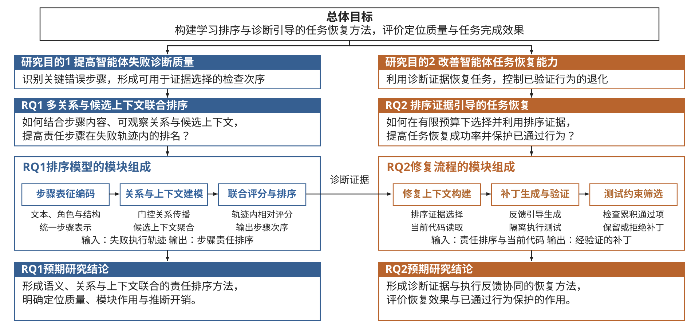
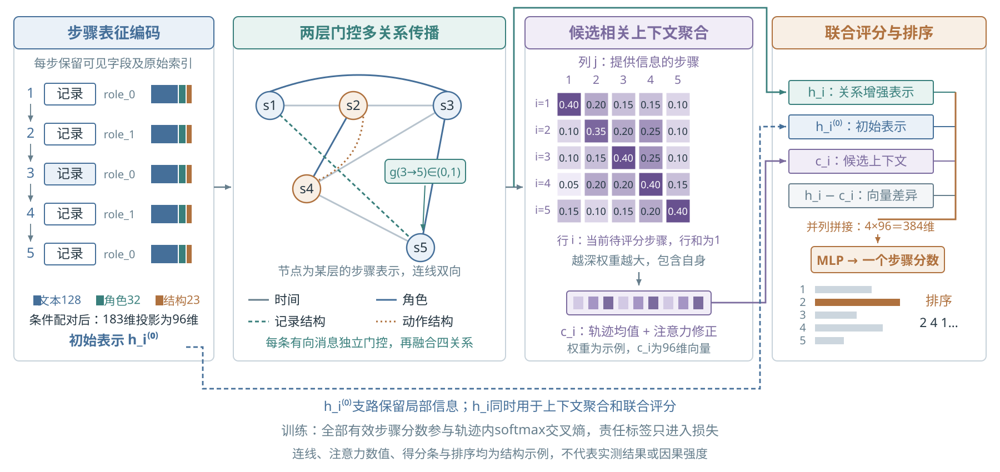
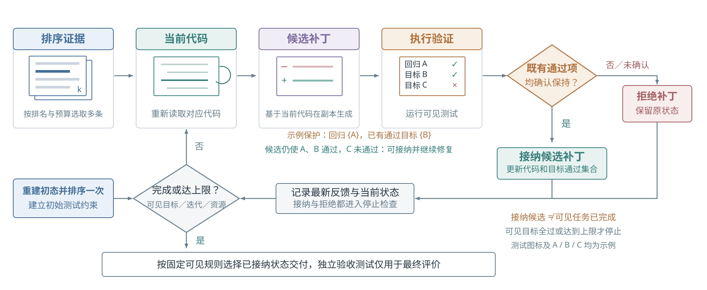
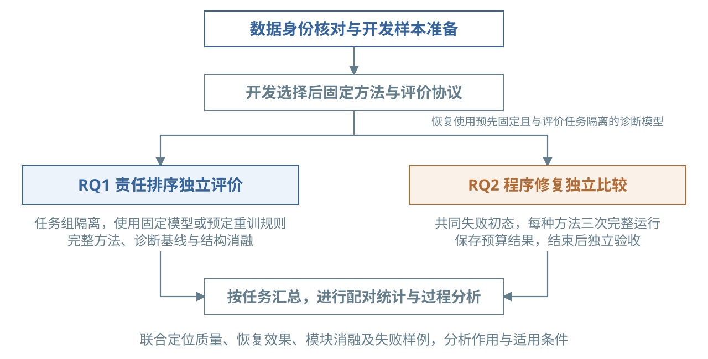

# 基于学习排序的智能体失败诊断与任务恢复方法

开题汇报PPT内容总结（V12.1）

## 第一章 背景与现状

### 1.1 研究背景

大语言模型能够根据自然语言要求生成回答、分析过程和操作建议。思维链（Chain-of-Thought，CoT）通过在提示中示范中间推理步骤，引导模型分步求解，为复杂问题分析提供了基础方式。[1] 随着应用目标扩展，系统还需要获取外部信息、操作实际环境，并判断任务是否完成。此时，生成内容需要转化为能够执行和检验的行动，任务结果也取决于连续操作在环境中产生的影响。

基于大语言模型的智能体通过调用工具获取信息、执行操作，并依据环境反馈调整后续行动。ReAct将推理、动作与环境观察交替组织，使模型的求解过程扩展为可以持续执行的任务过程。[2] 推理用于理解目标和组织行动，工具使行动作用于环境，观察则为下一步判断提供依据。任务可以由单个智能体连续完成，也可以由多个智能体分工协作，两种形式都需要保存并传递执行信息。

以软件任务为例，解释程序功能与修复实际问题具有不同要求。修复通常需要阅读仓库、理解相关代码、实施修改，再运行测试检查行为；一次修改未成功时，还需依据反馈继续分析。[3] 因此，求解过程表现为多轮“判断、操作、观察”，而不是一次性生成答案。每次执行既产生新的信息，也可能改变后续行动面对的代码和运行状态。

随着步骤增多，一次检索结果可能影响后续判断，一份中间产物可能被其他角色采用，一次错误修改也可能干扰之后的测试。任务最终失败可能涉及信息遗漏、操作选择不当或验证不足等多个环节。[4] 最后出现的报错提供了检查线索，却不一定就是关键错误被引入的位置。重复尝试、正常操作和异常表现交织后，逐条阅读记录的负担也会增加。[5]

失败分析因而需要把结果与过程联系起来。系统不仅要判断任务是否成功，还需要从已有记录中识别值得优先检查的位置，分析这些步骤获得了什么信息、执行了什么操作，以及后续行为如何受到影响。对于已经失败的完整执行，可以利用前后记录形成判断；责任位置则依据数据来源的标注规则进行训练和评价。[5]

诊断之后，还需要考虑如何继续完成原任务。历史记录描述过去的执行条件，修正面对的是当前环境。代码可能已被后续操作改变，先前获得的信息也可能失效。[6] 软件场景提供了可检查的代码差异和可执行的测试，[7] 因此适合进一步研究历史线索怎样参与当前修复，以及新修改是否解决问题并保持已有行为。以下先明确研究对象和评价边界，再梳理相关工作。

### 1.2 研究对象与问题定义

本课题研究大语言模型智能体通过工具与环境交互形成的任务执行过程。分析对象是已经失败的执行，诊断可以来自单智能体或多智能体场景；后续任务恢复主要在软件场景中验证。研究围绕同一原始任务，将历史执行记录、失败后留下的环境和最终任务结果联系起来。

**执行轨迹**是同一任务的一次尝试所产生的有序步骤记录。每步保留来源中可获得的文本、动作、环境观察和执行角色等字段。[8] 轨迹用于追溯前后操作和信息使用情况。不同日志的记录格式可能不同，需要固定步骤边界、保留原始位置，使模型给出的定位结果能够回查到具体记录。

**任务失败**表示一次执行没有满足规定的完成条件。在软件场景中，通常需要检查原问题要求的行为，以及提交修改是否通过规定验收。[7] 轨迹中的步骤可能分别引入偏差、沿用错误信息或暴露已有异常。因此，最终结果说明尝试是否成功，步骤定位则进一步回答哪些历史位置值得检查。

本文将依据执行记录分析可疑环节的过程称为**失败诊断**，将其落实到记录位置的任务称为**失败步骤定位**。[5] **责任步骤**是数据集按照自身规则标注的关键位置，可能强调错误引入，也可能考虑未履行的验证职责或错过的纠正机会。[8] 本文依据相应标签评价定位，进一步确认因果作用仍需干预证据。

模型输出同一轨迹内全部步骤的**检查优先次序**。训练提高标注责任位置的相对得分，推断时只使用可见轨迹。排序既用于衡量责任步骤是否靠前，也为后续有限输入空间中的证据选择提供依据。历史步骤与需要修改的源码位置属于不同对象，需要通过文件、操作和内容线索建立对应。

**任务恢复**是从失败尝试留下的当前环境出发，利用诊断线索和执行反馈继续完成原任务的过程。[9] 软件恢复中的修正主要表现为代码修改及测试。本文将允许向恢复过程提供反馈的测试称为**可见测试**，将与生成过程隔离、仅用于评价交付结果的测试称为**独立验收测试**。

例如，一次修改未解决目标问题，但仍有部分功能通过测试。系统需要先选择值得检查的历史线索，重新确认当前代码，再生成和验证候选修改。候选是否保留，既取决于可见目标的推进，也需要检查已有通过项是否保持。由此形成两个衔接的问题：能否改善失败步骤的检查次序，以及这些定位信息能否帮助恢复任务。

### 1.3 国内外研究现状

相关研究按两条主线组织：前两节讨论执行失败如何形成可评价的责任位置，以及诊断所需的关系和标注；后两节讨论反馈如何支持软件修复，以及诊断和状态信息怎样参与恢复。

#### 1.3.1 智能体执行与责任步骤定位

- **AutoGen（Wu等，2024）**：通过可编程会话连接不同职责的智能体，组织模型、工具和人工输入。它为持续协作提供流程基础，具体失败由哪个历史步骤引入，仍需进一步诊断。[10]
- **MetaGPT（Hong等，2024）**：通过标准操作流程组织需求、设计、代码与测试产物，以结构化交接支持软件协作。上游产物有误时，下游仍可能沿用，需要检查产物内容及其使用关系。[11]
- **MAST（Cemri等，2025）**：从执行轨迹归纳系统设计、智能体间失配和任务验证等失败模式，为描述失败提供分类。模式标签还需落实到具体步骤，才能支持有针对性的修正。[4]
- **Who&When（Zhang等，2025）**：将归因落到责任智能体和决定性步骤，比较整段日志判断、逐步检查和二分搜索。研究对象由失败类型推进到责任位置，其标签定义和诊断开销也成为评价依据。[5]
- **SDBL（Sun等，2026）**：先确定可疑范围，再结合日志定位责任步骤，以分阶段处理缩小检查空间。定位效果依赖候选线索能否覆盖关键位置，范围划定与精确定位需要共同评价。[12]
- **StepFinder（Zhu等，2026）**：结合步骤语义、双向时序和角色交互直接输出步骤分数，减少诊断时的生成调用。本文以其为学习式定位参照，进一步检验可观察关系与候选相关上下文，并测量推断开销。[13]

#### 1.3.2 执行关系与责任标注

- **DeFA（Deng等，2026）**：组织工具请求、返回及内容使用关系，追踪可疑步骤的来源和后续影响。关系分析有助于连接分散线索，但关系恢复和多阶段判断增加调用开销，记录相邻、角色相同与实际信息依赖仍需区分。[14]
- **AgenTracer（Zhang等，2026）**：结合自然失败的修正重放和成功轨迹的故障注入，构造带责任信息的数据并训练诊断模型。注入错误与自然失败可能具有不同分布，需要公开数据来源、责任定义和任务划分。[15]
- **TraceElephant（Chen等，2026）**：保存步骤实际输入、配置、输出和工具日志，并提供重放环境。责任标注考虑角色职责和可恢复性，下游验证者错过纠正机会时也可能承担责任。本文据此区分可观察关系与评价标签，核对各来源的责任定义。[8]

#### 1.3.3 反馈纠错与软件任务求解

- **Self-Refine（Madaan等，2023）**：由同一模型生成初稿、自反馈与修订，反复改善输出。其反馈主要来自模型自身，需要结合任务条件判断实际纠错效果。[16]
- **Reflexion（Shinn等，2023）**：将执行评价转化为可供后续尝试使用的语言反思，以经验记忆支持调整。反思是否有用仍取决于评价信号及后续行动能否落实。[17]
- **CRITIC（Gou等，2024）**：借助工具检查输出，再利用外部反馈修正。该研究说明纠错需要关注可验证信息，工具检查本身也产生调用和执行开销。[18]
- **推理自纠错研究（Huang等，2024）**：在所测条件下，无外部标签辅助的推理自纠错可能把原本正确的答案改错。因此需要区分反馈来源，并直接评价修订后的结果。[19]
- **Agentless（Xia等，2025）**：依次完成分层定位、补丁生成与验证选择，为软件问题提供完整求解流程。其定位对象是源码编辑位置，与历史执行中的责任步骤不同。[20]
- **PatchPilot（Li等，2025）**：利用问题复现输出和验证反馈细化候选补丁。它体现了可执行反馈在软件修复中的作用，历史诊断线索如何参与当前修复仍需另外设计。[21]
- **EnAgent（Tian等，2026）**：通过多轨迹生成、回归剪枝和工具辅助投票选择候选。本文将其作为完整恢复系统参照，保留候选生成与选择核心，并在共同资源下比较任务结果。[22]
- **AOrchestra（Ruan等，2026）**：由主控动态配置子智能体的任务、上下文和工具，组织完整任务求解。本文既比较系统效果，也在固定恢复器中替换诊断排序，以分析定位信息的实际作用。[23]

#### 1.3.4 状态恢复与诊断引导修复

- **SyncMind（Guo等，2025）**：研究协作代码更新后的失步恢复，比较独立探索和寻求帮助等方式。它提示修复前需要确认历史认识与当前代码是否一致。[6]
- **AgentRewind（Zhuang等，2026）**：在受控工作区同步恢复执行上下文和文件检查点，并保留失败经验。恢复涉及提示和文件环境等相互关联的执行条件。[24]
- **DoVer（Ma等，2026）**：依据失败日志提出责任假设，生成计划或指令干预，再通过继续执行评价效果。恢复失败也可能来自干预未落实或修正能力不足，不能直接归结为责任假设错误。[9]
- **Intervention Paradox（Vasudev等，2026）**：发现较准确的在线失败预测也可能触发有害干预，净效果随模型和任务改变。该设置与事后定位不同，但说明诊断分数和任务收益需分别评价。本文据此检验责任排名、当前代码对应及实际恢复效果。[25]

### 1.4 现有问题

**长轨迹中的诊断线索较为分散。** 最终报错、早期决策和后续信息使用可能位于不同步骤，逐条阅读也会受到重复尝试和正常操作干扰。[5] 时间、角色和记录结构提供不同联系，全轨迹中还可能存在与特定步骤相关的远距离线索。[13] 如何组织这些信息，并在定位质量与计算开销之间取得合理取舍，仍需共同条件下的比较。

**历史定位结果尚需转化为当前修复输入。** 诊断描述过去的执行，恢复作用于已经变化的代码。此前读取的文件可能被修改，某项操作的结果也可能失效。[6] 责任位置不能直接作为当前编辑位置，需要保留线索来源、重新确认当前内容，并在有限输入预算下组织证据。

**连续修复需要同时检查目标推进与已有行为。** 一次修改可能解决新暴露的问题，也可能破坏此前正常的功能。[7] 仅比较通过测试的数量，还可能遗漏通过项被替换的情况。已有通过项能否保持、严格约束是否阻碍需要暂时退步的修复路径，需要结合具体测试标识和最终验收分析。

上述问题分别涉及诊断信息的组织、诊断到行动的衔接和连续修复的结果约束。下一章据此明确研究目标及意义，再概述两部分的技术组成。

## 第二章 目标与意义

### 2.1 学习排序基础与总体研究框架

**学习排序（Learning to Rank，LTR）**利用标注数据学习评分函数，为同一条件下的一组对象确定相对次序。[26] 例如，搜索系统根据查询和候选文档的信息学习相关性评分。迁移到本课题，一条失败轨迹对应一个候选组，执行步骤对应待排序对象，责任位置标注提供监督。模型学习哪些步骤应当优先检查，分数用于轨迹内比较。

学习排序通常包括三类训练方式：[26]

- **逐点式（pointwise）**：分别预测候选的相关程度，再依据评分排序。
- **成对式（pairwise）**：比较两个候选的先后，学习相对偏好。
- **列表式（listwise）**：以同一候选组为训练单位，联合利用组内分数学习次序。

本文采用以轨迹为单位的列表式训练思路。全部有效步骤共同进入归一化，训练提高标注责任位置的相对得分，推断输出步骤次序。ListNet为组内分布学习提供基础参考，[27] 当前单责任位置监督具体使用轨迹内softmax和交叉熵，形式也可解释为位置分类，未获得其余步骤之间的完整人工次序。

总体研究包括责任步骤排序和诊断引导程序修复。前者从失败轨迹输出检查次序，后者将排序转为历史证据，结合当前代码和执行反馈生成、验证并筛选补丁。两部分分别评价定位质量与任务恢复效果，衔接关系如图2-1所示。

图2-1 责任步骤排序与诊断引导程序修复的总体研究框架

### 2.2 研究目标与研究问题

#### 责任步骤定位目标

**RQ1：如何利用步骤内容、可观察关系和候选相关上下文，提高责任步骤在失败轨迹内的排名？**

构建多关系与上下文增强的责任步骤排序模型，比较完整模型及核心模块变体的定位质量、参数量和端到端诊断耗时，检验不同信息组织方式对责任排名的作用。

#### 诊断引导恢复目标

**RQ2：责任排序能否通过有限预算下的证据选择，提高失败任务的恢复成功率？**

在软件场景中建立诊断引导的修复流程，比较共同任务和资源条件下的完整恢复效果，并通过诊断器替换、顺序对照与模块消融，分析排序证据、当前代码读取和测试约束的贡献。

### 2.3 责任步骤排序的技术组成

排序模型包含三个功能模块，依次完成表示、信息融合和评分输出：

- **步骤表征编码**：编码步骤文本、匿名角色及记录结构，得到与原始步骤对应的初始向量。
- **关系与上下文建模**：通过多关系传播汇集邻步线索，并面向各待评分步骤聚合全轨迹信息。关系通道借鉴按关系类型组织消息传递的思想。[28]
- **联合评分与轨迹内排序**：融合步骤自身、关系增强及候选上下文表示，学习组内相对分数，输出检查次序。

列表式学习规定训练单位和监督组织，三个模块实现具体的评分模型。第三章进一步说明各模块的计算及连接方式。

### 2.4 诊断引导程序修复的技术组成

修复流程围绕一次候选生成与选择组织为三个功能模块：

- **修复上下文构建**：依据责任排序选择历史证据，重新定位并读取当前代码，形成生成器可用的输入。
- **候选补丁生成与验证**：结合任务和执行反馈提出候选修改，在隔离副本中应用并运行可见测试。
- **测试约束下的补丁筛选**：检查初始回归项和累积通过目标项，决定保留或拒绝候选，并更新下一轮使用的状态。

三个模块反复衔接形成迭代恢复流程。模块说明各自承担的功能，循环则规定它们何时重复及停止；具体规则在第三章展开。

### 2.5 研究意义

**诊断建模方面，** 失败轨迹中的错误来源和最终表现可能相隔较远，仅凭单步内容难以组织完整线索。[5] 本研究将责任定位表述为轨迹内候选比较，检验关系传播与候选相关上下文的作用，为分析步骤信息如何支持失败定位提供可比较的模型和实验依据。

**任务恢复方面，** 找到历史可疑位置之后，仍需核对当前代码并检验修改效果。[6,7] 本研究将诊断证据、执行反馈和测试约束连接起来，分析定位质量能否转化为预算内任务收益，以及保持已有通过项的收益和代价，为失败后的连续修复提供可检查的方法。

**评价方法方面，** 软件任务具有可记录的操作、可比较的代码状态和可执行测试。研究分别报告诊断质量、完整恢复效果和模块贡献，结合原始任务分组、全过程资源计量及独立验收，明确诊断指标与行动效果之间的关系，并说明结论适用的样本和测试范围。

## 第三章 内容与方法

### 3.1 排序任务与模型结构

#### 排序对象与监督边界

排序模型读取一条已经发生失败的完整执行轨迹，为全部有效步骤输出检查优先次序。步骤包含来源提供的内容、动作、思考和角色等字段。训练使用数据集标注的责任位置，推断只读取轨迹可见信息，保留原始步骤索引用于结果回查。

例如，某一步选择了错误对象，后续多步操作才出现报错。模型结合已发生的前后记录判断各步骤的检查价值，评价仍以数据集责任标注为目标。进一步确认因果作用需要干预证据，因此本课题研究执行后的责任定位。

步骤边界和索引在预处理时固定，补齐位置不参与评分。单模型按步骤分数降序排列，同分按原始索引处理；集成先对各模型分数作轨迹内归一化，再平均预测权重并排序。

图3-1 责任步骤排序模型与训练目标（五步轨迹为结构示意）

#### 图3-1的四部分含义

- **彩色特征条**：每条表示同一步的文本、匿名角色和记录结构三组特征，颜色只区分类别。当前原型为128、32、23维，条件日志配对处理后投影为96维初始表示$h_i^{(0)}$。彩条不表示概率或特征贡献。
- **五节点关系图**：节点对应原始步骤，四种线连接时间、同角色、同记录结构和同非空动作结构的前后最近匹配。线表示双向可观察联系，示例门控展示一条有向消息，两层传播后得到$h_i$。示例中角色0对应1/3/5、角色1对应2/4，记录结构仅1/5同类，动作结构仅2/4同类。
- **5×5权重图**：第i行是待评分步骤，第j列是提供信息的步骤，每行权重和为1。颜色越深表示该示例权重越大，可包含自身及已发生的前后记录。上下文$c_i$由轨迹均值加上注意力修正得到。
- **四输入评分图**：$h_i$、$h_i^{(0)}$、$c_i$、$h_i-c_i$是并列输入，拼接为384维向量后交给MLP，输出一个步骤分数。得分条与排序也只是示例，责任标签仅参与训练损失。

### 3.2 步骤表征与多关系传播

- **步骤表征编码**

步骤表征将日志信息转换为排序网络可以处理的向量。文本编码描述这一步执行了什么操作、使用了什么信息；角色特征区分行为来源；结构特征补充字段格式、相对位置以及同类结构在轨迹中的重复情况。三类信息拼接并投影到统一维度，得到步骤初始表示。

当前原型使用固定的Qwen3-Embedding-0.6B编码器，生成128维文本和32维角色表示，另加入23维结构特征，拼接后投影为96维表示。文本和角色向量分别归一化，结构特征仅使用对应训练部分的统计量标准化。编码器保持固定，后续排序网络随责任位置监督训练。

角色按本条轨迹中的首次出现顺序匿名编号为role_0、role_1等。同一来源保持相同编号，以保留协作联系并减少名称影响。当前软件恢复输入只有一个执行角色，多角色条件主要在诊断数据中分析。

部分日志将决策上下文和紧随的输出分成两条。仅当原始步骤相邻、角色相同且日志标记明确对应时，预处理才让两条记录互相补充文本信息。没有明确对应就保持原输入，原始步骤索引不变。当前软件发布的18条轨迹中没有触发有效配对，因此这一条件处理不作为软件场景中已验证的收益来源。

- **多关系传播**

多关系传播以步骤初始表示和关系连接为输入，输出关系增强表示。模型建立四类可观察连接：时间相邻、同一匿名角色、相同完整记录结构、相同非空动作结构。后两类比较类型、嵌套和大小等形式，并去除键名及具体值；每类关系选取前后最近的匹配步骤。这些连接用于传递信息，其含义限定为可观察联系。

每条邻步消息通过一个可学习的标量门控控制强度。门控读取接收步骤与“邻居减接收步骤”的差异，产生0到1的标量权重；权重较小时，该条消息的影响减弱。消息变换读取邻居表示及上述差异，各关系内部先对门控消息取邻居均值，再学习四类关系的融合权重，经残差和归一化得到更新表示。这样既能采用其他步骤的线索，也保留本步骤内容。

两轮关系传播使一个步骤能够进一步利用相连步骤传来的信息。没有邻居的通道不增加信息；单角色轨迹中，同角色连接可能与时间连接重合，实验分别记录单角色和多角色条件，以分析连接重合对实际作用的影响。

### 3.3 候选上下文聚合与列表式排序

- **候选相关上下文聚合**

这里的候选是一个待评分步骤。聚合模块读取关系增强表示，以当前候选作为查询，从整条已发生轨迹中提取与其相关的信息，形成该步骤的上下文向量。评分另一个步骤时，查询随之变化，采用的轨迹信息也可以改变。

模型将步骤表示分别映射为查询、键和值，按查询与各键的相似度计算一行softmax权重。图3-1第3行的示例为0.10、0.15、0.40、0.25、0.10，和为1，表示评分步骤3时对五步信息的聚合权重。它与最终责任排名的归一化权重属于不同计算。

上下文以全轨迹均值为共享背景，再加上线性映射后的“注意力加权值减去均值的值映射”修正。因此$c_i$是96维向量，不等于热图中的一行，也不只是直接加权平均。聚合包含自身及已发生的前后步骤，注意力不直接作为因果解释。全轨迹注意力的时间和存储开销随步骤数呈二次增长，实验同时报告定位质量和端到端耗时。

- **联合评分**

评分模块联合读取关系增强表示、步骤初始表示、候选上下文，以及关系增强表示与候选上下文的差异。初始表示通过直接支路进入评分器，使本步骤的局部内容在信息融合后仍可使用。评分器采用多层感知机（MLP），为每一步输出一个标量分数：

$$
s_i=\operatorname{MLP}([h_i;h_i^{(0)};c_i;h_i-c_i]).
\tag{1}
$$

式（1）的四组向量各为96维，并列拼接为384维。$h_i$是第i步的关系增强表示，$h_i^{(0)}$是经过输入处理后的初始表示，$c_i$是面向该步的上下文，分号表示向量拼接。分数用于比较同一轨迹中各步骤的检查优先级，形成后续证据选择的排序接口。

- **轨迹内列表式训练**

训练时，同一轨迹的全部有效步骤共同进入归一化和损失计算。设轨迹有m个步骤，标注责任位置为y，单条轨迹采用以下目标：

$$
p_i=\frac{\exp(s_i)}{\sum_{j=1}^{m}\exp(s_j)},\qquad \ell=-\log p_y.
\tag{2}
$$

$p_i$是轨迹内归一化权重，$\ell$是单轨迹损失。提高标注位置的权重，会促使它在同组候选中获得更高得分。该目标使用单责任位置标签，其形式为轨迹内位置分类的交叉熵；列表式在这里指候选组的组织与联合归一化方式。输出权重不作为已经校准的致错概率，未标注步骤之间也没有完整人工次序监督。

AgenTracer来源池训练对轨迹损失取平均；AFTraj训练先在同一源任务组内平均，再对任务组等权平均，避免同一任务的多条记录获得过大权重。报告三次训练的集成结果时，先将各模型的步骤分数在轨迹内归一化，再平均预测权重并排序。

实验分别删除多关系传播或替换候选相关上下文，在共同输入和训练条件下检验作用。

### 3.4 排序引导的修复上下文构建

本模块将责任步骤排序转化为生成器可直接使用的修复上下文。输入包括原始软件问题、排序后的历史步骤、当前仓库和最新执行反馈；输出是在输入预算内组织好的历史诊断证据与当前代码。排序线索用于决定优先查看什么，当前代码用于确认实际上能够修改什么。

系统依次扫描排序，合并指向相同动作或对象的重复线索，并保留原始步骤索引。根据历史文件、位置及操作线索重新定位和读取当前代码，记录对象是否仍然存在、内容是否已经改变。能够可靠定位时提供当前内容；无法对应时保留历史解释及定位状态，避免将旧片段误作当前代码。

选中的证据与原任务、当前代码、最新反馈共同形成生成输入。证据选择受条数和输入词元（token）上限约束，过长片段按统一规则截断，并记录实际条数和长度。在有限输入容量下，靠前线索有更多机会进入生成器，排序由此参与修复决策。

基本方法对初始失败轨迹排序一次，后续每轮更新当前代码和执行反馈。实验固定证据选择规则，保存排序、选中证据与实际生成输入之间的对应。若不同排序经定位和去重后形成相同证据，也如实记录，据此判断排序是否实际改变了修复条件。

### 3.5 反馈驱动的候选补丁生成与验证

#### 单轮候选生成与验证

本模块读取修复上下文，围绕一次修正尝试生成候选补丁，并返回执行验证记录。生成器结合尚未满足的任务要求、诊断证据、当前代码及此前尝试的反馈，提出对当前代码的修改。对于具有明确撤销含义的历史操作，可按既定规则生成受控回退动作。

候选补丁在隔离副本中应用。验证先检查编辑格式、修改对象和匹配位置，再运行任务许可范围内的可见测试。应用后的代码状态与验证记录共同构成模块输出：格式错误、应用失败、执行异常和测试结果分别保留，供候选筛选与下一轮生成使用。

该模块负责产生候选及验证证据，补丁是否替换当前状态由3.6节的测试约束决定。被保留的候选提供下一轮代码状态；被拒绝的候选保留失败反馈，生成器仍可依据这些信息调整后续修正。独立验收测试结果及其他方法的补丁与生成过程保持隔离。

图3-2 诊断引导修复中的候选生成、约束筛选与状态反馈

### 3.6 测试约束下的补丁筛选

#### 补丁接纳规则

本模块根据候选的可见测试结果，决定保留或拒绝，并更新后续轮次使用的代码状态与通过项记录。筛选以稳定测试标识为依据。例如，修改前A、B通过，修改后B、C通过，数量相同但A已经失效，候选并未保持所有既有通过项。

约束包括初始通过的既有回归测试B，以及截至第t轮恢复时已经通过的可见目标测试集合$H_t$。目标测试检查当前软件问题要求解决的行为，初始已通过的目标项也进入$H_t$。候选状态$S'$满足以下条件时才可接纳：

$$
B\cup H_t\subseteq\operatorname{Pass}(S').
\tag{3}
$$

$\operatorname{Pass}(S')$是候选状态确认通过的测试标识集合。候选被保留后，将新通过的目标项加入约束集合，用于检查后续补丁；候选被拒绝时保留原代码状态，并把失败反馈交给下一轮。测试结果缺失或不确定时先核查，明确通过后才纳入保护。

#### 迭代停止与候选交付

筛选允许保留暂未增加通过项、但满足约束的修改，为多步修复保留空间；相同代码状态去重。达到可见任务完成条件、内部迭代上限或资源预算时结束循环。可见目标全部通过时交付当前状态，否则按可见失败目标数量、改动规模及固定先后规则，从满足最终保护集合的已接纳状态中选择结果。预算节点也采用相同的结果选择规则。

严格约束可能阻止需要暂时退步的修复路径。实验因此比较去除累积目标保护后的效果，并通过具体测试变化分析收益与代价。约束范围以实际执行的测试为准，最终任务效果由独立验收测试评价；计时、调用和token按全过程累计，包含失败候选及验证消耗。

当前原型已实现排序接入、反馈修复和状态记录。统一证据预算、测试标识和重复状态处理将在正式比较前完善。分支探索、软保护和重新诊断留作后续扩展，主要实验评价本章定义的完整方法。

#### 图3-2的图示与测试示例

图中叠放纸片表示按排序和输入预算选出的多条历史步骤及来源。代码窗口旁的回转符号表示重新读取当前文件，排序仍由初始失败轨迹计算一次。补丁中的加减号表示对当前代码的新增与删除，候选在隔离副本应用和验证。

测试框给出一个示例：回归集合$B=\{A\}$，已有通过目标$H_t=\{B\}$，候选仍使A、B通过，但目标C失败。该候选满足保护约束，可以接纳并继续修复，尚未达到可见任务完成条件。若A或已保护的B失败，候选就应拒绝；未确认通过也不能当作保持。

接纳时更新当前代码和目标通过集合，拒绝时恢复原代码并保留失败反馈。两条分支均检查可见目标、迭代与资源停止条件。未停止就从当前状态继续构建上下文，结束后按固定可见规则选定交付，独立验收只评价结果。

## 第四章 难点与创新

### 4.1 拟解决的关键问题

**关系与候选上下文的有效信息。** 单个步骤的文本可能不足以说明其与最终失败的联系。多关系传播用于收集邻步线索，候选相关聚合用于区分这些信息对不同位置的作用。关键在于检验两者在共同输入、监督和训练条件下能否提高责任步骤排名，并分析额外计算开销。

**历史诊断到当前修正的对应。** 软件环境变化可能使智能体依据过时信息行动。[6] 本文需要将历史排序中的关键位置转化为当前可使用的对象和证据，保留线索来源、重新读取当前内容，并在有限输入预算下组织有效证据。

**修复推进与已有行为保持。** 局部修复可能破坏此前已通过的功能，单看通过测试数量还可能遗漏具体行为的替换。关键在于用稳定测试标识判断候选修复应否保留，同时分析严格保护对多步修复路径的影响。

### 4.2 预期创新设计

**语义、多关系与候选上下文联合的学习排序。** 面向失败轨迹中步骤联系复杂、候选信息需求不同的问题，联合关系增强表示、初始步骤表示和候选相关上下文进行评分。通过完整模型与两个核心模块的消融，检验信息组合对责任排名的贡献。

**排序证据与已通过行为保护相结合的任务恢复。** 将责任排序映射为当前对象的证据，结合最新执行反馈生成修正，并按测试标识保护已有进展。通过完整系统比较和固定恢复器中的模块对照，检验诊断证据能否改善预算内任务完成效果，分析保护机制的具体作用。

两项设计分别对应定位信息的质量和诊断信息的行动效用。创新性与有效性将在共同数据、统一条件和独立评价中检验，前期开发结果作为方法完善的依据。

### 4.3 适用边界与可能不足

**责任标签与监督范围**：责任定位依据数据来源的标签，跨来源的责任定义可能不同。当前单责任位置监督也不能完整规定其他步骤之间的次序。

**长轨迹与关系重合**：全轨迹上下文增加长记录的计算开销。单角色软件轨迹还可能使部分关系重合，需要通过分层与消融限定模块作用。

**测试覆盖与正确性**：恢复约束仅覆盖实际执行的可见测试，不构成程序正确性的形式化保证。

**严格保护与预算**：严格保护可能阻碍需要暂时退步的修复，反复验证也会消耗预算。因此，独立评价同时报告恢复结果、资源和失败过程，分析方法在哪些条件下有效及何时受到限制。

## 第五章 实验与数据

### 5.1 数据来源与评价划分

#### 实验单位与失败初态

本章分别回答两个问题：RQ1评价责任步骤排序的质量、开销及模块作用；RQ2评价共同失败初态与资源条件下的任务恢复效果。AFTraj与AgenTracer扩展发布版提供责任步骤标注，[29,30] SWE-Gym及其配套执行轨迹提供可重新执行的软件问题。[31]

**软件问题（issue）**指仓库中一个待解决的原始问题，例如某个函数在特定输入下输出错误。它是恢复实验的任务与统计单位。问题身份依据来源、仓库及原始问题标识核对，任务描述用于确认对应关系，代码版本和失败初态属于运行条件。同一原始问题的不同版本不自动计为独立问题。**失败轨迹**是智能体解决该问题时一次未成功尝试的步骤记录，该尝试留下的代码和必要运行状态称为**失败初态**。同一个软件问题可以产生多条轨迹，它们不因此成为多个独立问题。

例如，一个软件问题先后产生两条失败轨迹，仍只对应一个问题身份。正式恢复评价预先为每个问题固定一个来源明确、可重建的失败初态，各方法均从该状态开始。每种方法再重新启动三次完整恢复运行，衡量同一任务条件下的运行变化。若后续设计采用多个初态，应先规定问题内汇总规则，不能将其直接计为多个问题。

#### 数据来源与研究样本

**任务组**用于诊断数据划分：同一原始任务的多条轨迹、错误变体和派生记录归入同组，防止同一问题以不同记录形式进入训练和评价。表5-1中的轨迹数、任务组数和软件问题数因此分别统计。

表5-1 数据来源与研究样本

| 数据来源 | 发布规模 | 当前研究样本 | 主要用途 |
|---|---|---|---|
| AFTraj | 2,276条轨迹 | 731条失败轨迹；716任务组 | 失败步骤定位 |
| AgenTracer扩展版 | coding训练1,141条；测试127条 | 614条来源池；363条coding评价轨迹 | 软件轨迹定位 |
| SWE-Gym | 2,438个Python问题 | 23个已整理软件问题 | 恢复方法开发 |

#### 发布数据与本地开发子集

AFTraj发布数据中，安全轨迹1,162条、不安全轨迹1,114条。[29] 安全分类与任务执行失败属于不同判断，不能直接互换；纳入时分别核对任务结果、责任标签及其可映射性。 本文从失败轨迹中整理的731条记录对应716个源任务组，其中120个不同任务组构成开发子集。该子集在五个任务类型与标注来源组合中各取24条，按领域为编程（coding）24条、数学（math）48条、工具交互任务（agentic）48条，已用于调试和方法分析。

AgenTracer采用扩展发布版，该版本与论文版的发布规模不同。[30] 以下规模是本文本地筛选与划分的结果。614条训练验证来源池包含coding 320条、math 294条，363条固定评价轨迹为coding。两部分来自所用发布版的官方训练部分，并按源任务组隔离，固定评价集属于开发评价数据。

所有划分以原始任务为单位，同一问题的多条轨迹、错误变体和派生样本归入同一组。清洗处理步骤边界、可读格式和原始位置映射，标签沿用来源定义。各数据集分别记录责任标签的对象与判定规则，需要合并训练时，先核对标签是否表示同一类责任位置。诊断样本依据轨迹完整性与标注可映射性纳入；恢复样本另核对失败环境可重建、反馈可用和测试可执行。分别报告排除数量及原因。

#### 5.1.1 诊断数据与任务分组

**AFTraj开发评价：** 将716个任务组分为5份，轮流使用其中1份进行外层评价，其余4份再划分训练与验证组，构成五折分组评价。每个配置使用三次预定初始化，模型选择依据内部验证。每条轨迹由未使用该任务组训练的模型产生外层预测，汇总731条结果。已用于方法选择的外层结果归入开发评价。

**AgenTracer开发评价：** 采用A、B、C三个分组划分，每个划分训练492条、验证122条，均在同一363条coding开发评价集上比较，每个划分使用三次预定初始化。训练含coding 256条和math 236条，验证含coding 64条和math 58条；训练、验证与固定评价任务组相互隔离。

**独立评价集：** 方法结构、输入处理、训练和选择规则确定后，分别从AFTraj官方测试部分的163条失败轨迹及AgenTracer官方coding测试部分的127条轨迹中筛选未参与开发的样本。筛选核对原始任务身份与历史开发使用记录，报告最终合格数量。候选轨迹数与独立任务组数分别统计。

#### 5.1.2 软件恢复样本与失败初态

恢复样本由原问题描述、失败初态、来源轨迹、可见执行反馈和独立验收测试共同构成。失败初态需要保存失败后实际文件内容及必要运行环境，仅恢复仓库原始提交不足以重建失败现场。纳入前核对原问题标识、仓库提交、失败后代码与轨迹之间的对应，保存依赖、测试命令及初始测试结果，确认环境可重建。共同可见测试检查目标问题和已有功能，独立验收测试单独封存。主要评价保留智能体实际执行形成的失败环境；受控构造样本用于解释特定保护与对齐机制。

现有23个已整理软件问题用于接口核对、恢复方法开发和资源估计。独立评价计划从SWE-Gym同一来源另行筛选20个未参与方法开发的合格软件问题，覆盖至少3个仓库。候选按预定顺序核对任务身份、失败初态、反馈和测试条件，最终样本数以实际合格数量为准。

### 5.2 实验流程与共同条件

实验先核对样本身份并区分开发与独立评价数据，在开发部分选择配置，再固定样本、实现、输入和评价规则。随后分别开展RQ1责任排序评价和RQ2程序修复比较，核心消融与相应完整方法使用共同划分。两条评价分支可以独立执行；RQ2使用已固定且与恢复任务隔离的诊断模型，不能依据独立恢复结果反向选择排序模型。

图5-1 配置冻结后的责任排序评价与程序修复比较

#### 5.2.1 责任排序的训练与评价

模型结构、步骤表示及单轨迹训练目标见3.1—3.3。RQ1的执行顺序为：建立任务组清单，生成分组划分，在训练部分拟合标准化和排序网络，依据验证部分选轮，再对未参与该次训练的任务生成预测。评价时保留任务、轨迹、步骤索引与预测的对应。

本地已执行训练采用固定文本编码器与可学习排序网络。排序网络为两层关系传播、96维隐表示，训练中用0.15的Dropout随机置零部分特征，降低对个别特征的依赖。模型先按验证集Top-1选轮，再用MRR打破并列，两项相同时保留最早轮。

已执行配置使用AdamW优化器，固定学习率0.001，本文权重衰减0.0001，梯度范数裁剪为1.0。最多训练40轮，连续8轮无提升时停止。AgenTracer来源池批次为16条轨迹，AFTraj批次为16个完整任务组。AFTraj外折预测先在内层选择轮数，再用其余四折重训。

本文与StepFinder使用共同的可见轨迹、任务分组和模型选择信息，保留各自核心结构与训练设置。标准化统计量只从对应训练部分计算。正式测试前固定配置，记录编码输入上限、实际截断、硬件与参数量。

结构消融重新训练，沿用完整模型的任务划分、预定初始化和选择规则。AFTraj分别报告三次初始化的完整外折汇总及其均值、标准差。AgenTracer先在A、B、C各划分内部汇总三次初始化，再报告跨划分变化，避免混合两种变化来源。三模型集成另列，不与单次模型成绩混用。

#### 5.2.2 程序修复的共同运行条件

完整恢复比较使用共同任务描述、仓库版本、失败初态、代码访问许可、可见测试和独立验收测试。生成后端统一采用deepseek-flash，本地诊断模型单独记录配置。各方法保留自身的定位、生成、验证与选择流程，部署参数在开发结束后固定。

表5-2 任务恢复的共同运行条件

| 条件 | 统一设置 |
|---|---|
| 任务起点 | 同一原始问题、失败后代码及运行环境 |
| 生成模型 | deepseek-flash；部署参数预先固定 |
| 可见信息 | 同任务、代码与执行反馈许可 |
| 结果评价 | 同一独立验收测试 |
| 资源上限 | 共同时间与token上限 |
| 独立重复 | 每题三次完整运行 |

#### 独立重复与预算计量

每次独立重复从同一失败初态重新启动，重置本轮交互历史，不继承其他重复产生的补丁、选择结果或测试反馈。一次运行内生成多个候选、配置多个子智能体或投票，均只算一次完整运行；同一次运行的中断续跑继续累计原预算，不新增独立重复。三次运行分别评价，不能以其中最好一次代表整题结果。

环境重建和共同初始测试属于各方法一致的准备阶段，单独记录开销。准备完成后，从方法开始读取任务输入时计时，包含本地诊断模型加载、编码排序、生成、工具执行、测试和选择。并行子智能体按同一墙钟计量，同时记录累计计算消耗。token是模型处理文本的计量单位，共同上限累计各阶段及全部子智能体的输入、输出，包括失败候选和验证相关模型调用。纯工具执行耗时计入时间，不计为模型token。

#### 恢复执行与排序接入

恢复运行先完成共同环境与初始测试准备，再在预算内调用固定诊断模型生成排序，按第三章规则选择证据并读取当前代码，生成和验证候选，依据可见测试更新状态，保存预算节点的已选结果，结束后再执行独立验收。可见目标测试检查原问题要求解决的行为，回归测试检查已有功能。测试集合、稳定标识及反馈许可随样本一起固定。

排序到恢复的衔接按“选定模型与训练任务—排序结果—选中证据—实际生成输入”核对。恢复任务与对应诊断模型的训练任务按原始任务身份隔离，确保实际使用的是规定评价模型产生的排序。

#### 5.2.3 独立评价前需固定的执行条件

本章给出实验设计与已有配置，正式运行还需形成可交接的执行协议。协议至少包括以下内容，未确定项不能由执行者自行采用默认值：

- **数据与划分清单**：数据发布版本及校验、任务身份映射、最终纳入与排除清单、每个分组划分和初始化值。
- **模型与方法实例**：编码器、输入上限及截断、训练与选轮配置、独立评价使用的权重或集成方式，各基线代码版本、提示和完整内部参数。
- **恢复输入与验收**：每题仓库提交、失败后代码和环境重建方式、可见与独立验收测试命令、目标与回归项标识、证据选择及候选交付规则。
- **资源与随机性**：生成模型版本及采样参数、共同token上限、单次执行和重试规则、缓存范围、停止条件及统计重采样设置。

其中，共同token上限和最终证据预算依据开发阶段资源测量确定，当前不填入未经验证的数值。共同小试在开发样本上完成；独立评价样本只按预定规则核验资格和环境，不用于调参或方法选择。执行清单完整、实现固定且小试可运行后，再启动独立评价。

### 5.3 比较方法

#### 责任排序比较

责任排序比较用于检验相同轨迹输入下的定位质量和推断开销。选择StepFinder作为专门学习模型，All-at-Once与Binary Search作为完整日志判断和区间搜索参照。[13,5] 各方法共同报告首位命中率（Top-1），完整排序方法进一步比较责任步骤的总体排名。

表5-3 失败诊断比较方法

| 方法 | 主要机制 | 原生输出 | 论文来源与时间 |
|---|---|---|---|
| 本文 | 多关系与候选相关上下文 | 全步骤排序 | 本研究 |
| StepFinder | 时序语义与角色交互 | 步骤分数 | KDD 2026 [13] |
| All-at-Once | 完整日志一次判断 | 单个责任位置 | ICML 2025 [5] |
| Binary Search | 递归缩小日志区间 | 单个责任位置 | ICML 2025 [5] |

本文与StepFinder均按各自最终输出的完整步骤次序，统一计算责任步骤的排名指标。单模型按步骤分数排序，集成结果按平均预测权重排序。All-at-Once与Binary Search以Top-1进行共同比较，无效输出计为该题未命中，并单列其数量。

#### 完整任务恢复比较

完整任务恢复比较统一回答：**在相同软件问题、失败初态、可见信息与资源预算下，诊断引导能否提高恢复成功率？** 选用Agentless、EnAgent和AOrchestra进行比较，三者分别代表分层定位与修复、多轨迹集成和动态子智能体组织。[20,22,23]

表5-4 完整任务恢复比较方法

| 方法 | 核心流程 | 论文来源与时间 |
|---|---|---|
| 本文 | 排序证据、反馈修正、已通过行为保护 | 本研究 |
| Agentless | 分层定位、补丁生成、验证选择 | FSE 2025 [20] |
| EnAgent | 多轨迹生成、剪枝、工具辅助选择 | ICSE 2026 [22] |
| AOrchestra | 动态子智能体、任务与工具组织 | ICML 2026 [23] |

保留方法核心并公开部署差异，按共同资格纳入任务，记录成功、失败和未完成。

固定本文恢复器，对比本文与StepFinder排序。顺序置换统一证据条数、字段、映射去重和token上限，记录实际用量。两类对照分析排序来源与顺序，系统比较采用表中四种方法。

### 5.4 评价指标与预算

实验以MRR衡量责任位置的总体排名，以Top-1及前3位、前5位命中率（Hit@3、Hit@5）描述不同检查范围下的定位效果，端到端耗时评价诊断开销。恢复部分采用预算内任务恢复成功率（Recovery Success Rate，RSR）。已通过行为的保持情况放在模块分析中结合具体测试记录说明。

表5-5 主要评价指标

| 指标 | 计算口径 |
|---|---|
| MRR ↑ | 责任步骤倒数排名的任务组均值 |
| Top-1 ↑ | 首位命中责任步骤的比例 |
| Hit@3 / Hit@5 ↑ | 前3 / 5位命中责任步骤的比例 |
| 端到端耗时P50 / P95 ↓ | 诊断耗时的中位数 / 95分位数 |
| RSR@30min ↑ | 30分钟内已选定交付、事后通过独立验收测试的比例 |

- **定位质量与诊断耗时**

MRR先计算每条轨迹中标注责任步骤的排名倒数，再在同一源任务组内平均，最后对任务组等权平均。例如，排第1位计1，排第2位计0.5，排第5位计0.2。若来源允许多个责任位置，按其中最靠前者计算，并单列该标签条件。

Top-1表示首位命中责任步骤的比例，Hit@3和Hit@5表示前3位或前5位中至少命中一个可接受责任位置的比例。无效输出记为未命中，并单列数量。上述比例同样先组内平均，再按任务组汇总。

端到端诊断耗时从输入原始轨迹开始，包含文本编码、结构构建和步骤评分。统一硬件与部署条件后，报告中位数P50和95分位数P95。首次加载与模型已加载时的运行分别记录。

- **预算内任务恢复**

每个软件问题进行三次独立完整运行。预算内任务恢复成功率RSR先对每个软件问题的三次结果取成功比例，再对共同软件问题平均。成功要求：方法在预算内已选定并交付结果，且该结果通过同一独立验收测试。未交付的处理中候选不计成功。

#### 预算节点与继续运行

主要结果采用30分钟预算，同时保存15分钟、60分钟节点。为获得这些快照，运行持续到60分钟或更早触发内部停止、共同token上限。各节点保持同一内部配置，只评价当时实际选定的结果。提前达到内部停止条件或共同token上限的运行，按已选结果评价后续节点。若另行取消60分钟时间截断并运行至自身停止条件，则保留相同内部配置和原预算轨迹，另记额外资源及未完成原因，不把安全中断称作自然停止。

#### 结果选定与事后验收

运行中保存预算快照，包括已选结果的代码标识、选定时间及累计资源；预算后才选定的结果不回填早期节点。结束后对各快照单独执行独立验收，评价反馈不返回生成器。计时覆盖模型加载、编码、排序、证据对齐、生成、工具执行、可见测试和选择。共同token上限依据开发资源需求预先固定，所有子智能体、失败候选和验证消耗均累计。

### 5.5 核心消融与过程分析

- **失败诊断模型消融**

消融实验每次去掉一个模块，用来判断该模块是否带来额外作用。“w/o”表示去除指定部件。RQ1聚焦多关系传播和候选相关上下文两项设计，其余输入、任务划分和训练规则保持一致。

表5-6 失败诊断模型消融

| 条件 | 模块改动 |
|---|---|
| Full | 完整学习排序模型 |
| w/o RelProp | 跳过关系传播，使用步骤初始表示 |
| w/o CandCtx | 各步骤共用全轨迹均值上下文 |

两项变体均重新训练，比较MRR、Top-1、Hit@3、Hit@5和诊断耗时，并记录参数量。逐类关系与长轨迹分析用于解释结果，不再扩展为主要消融项目。

- **任务恢复模块消融**

固定生成器、源码许可、动作检查、可见测试、交付规则和资源，每次去掉一项，比较预算内RSR。

表5-7 诊断引导程序修复的模块消融

| 条件 | 去除的内容 | 仍可使用的信息或保护 |
|---|---|---|
| Full | 无 | 完整任务恢复流程 |
| w/o DiagEvidence | 排序选出的历史证据 | 当前代码与执行反馈 |
| w/o StateAlign | 证据中专门读取的当前对应内容 | 历史片段与共同源码访问 |
| w/o TargetGuard | 初始及后续通过的目标项保护 | 初始通过的既有回归测试 |

三项消融分别检验修复上下文中的诊断证据、专门的当前代码读取，以及补丁筛选中的累积目标约束。当前代码读取消融关闭历史证据映射所触发的专门读取，保留共同源码访问许可，并记录生成器是否通过其他操作重新获得相同内容。各条件继续执行候选补丁生成与可见测试验证，省去未使用计算后按实际资源累计。

- **诊断到行动的过程解释**

记录责任步骤、选中证据、当前对象、修正动作与测试结果，解释诊断怎样影响行动。不同排序产生相同证据或动作时也保留。

对各变体采用相同观察范围，比较修改前后同一组测试，分别记录接纳修改和被拒候选破坏了哪些已通过项。少量预设机制样本再比较“按通过数量”与“按具体标识”保护的差异，并保留需要暂时退步的修复路径。此类过程证据用于解释机制，总体收益仍结合独立验收测试下的RSR判断。

### 5.6 统计方法、有效性与工作量

#### 任务级配对统计

统计以原始任务组或软件问题为单位，先汇总组内轨迹或同软件问题的三次重复，再比较方法。主要差异采用配对自助法，即以任务为单位共同重采样各方法结果，估计95%置信区间。样本较少时，同时展示逐题结果和配对差异。

#### 评价覆盖与有效性控制

报告共同计划任务数、可评价覆盖和完整配对数。每个预算节点的共同集合要求各方法三次预定运行均有可判定结果，缺失原因另列。正常达到资源上限但未交付验收通过结果，计为该预算下未成功；工程中断、测试不确定与未运行另列。预算结果可判定时保留该节点记录，后续未完成不改写已有结果。

有效性控制包括任务身份隔离、共同输入许可、完整基线流程、统一动作处理、全过程预算计量与独立验收测试隔离。轨迹长度、初始通过测试规模、角色数和关系重合用于解释适用条件，分层规则在开发阶段确定。

#### 实验工作量与结果呈现

完整系统比较计划为20个软件问题、4种方法、每题3次，共240条运行。每条30分钟对应累计运行预算120小时，延至60分钟为240小时；这些是各条运行时间相加，不等于并行后的日历时长。StepFinder诊断器替换与顺序置换各增加60条。三项恢复消融先在开发和机制样本上比较，若全部扩展至独立20题，则另需180条。预算节点复用同一运行快照，独立重复分别执行，实际资源依据开发测量完善。

结果以诊断质量与耗时表、恢复成功率随时间变化的曲线、核心消融表和代表性过程组织。开发、机制和独立评价分别报告，各结论限定在实际样本与测试范围内。

## 第六章 进度与文献

### 6.1 前期研究基础

#### 责任排序与分组评价基础

前期已建立失败轨迹整理、步骤位置映射和分组评价流程，完成多关系与候选相关上下文联合排序模型的训练。在已用于开发的AFTraj固定120个任务组上，本文三组初始化的外折预测集成首位命中86组，同轮StepFinder对照命中82组，相差3.33个百分点。该差异尚不足以确认稳定优势，独立评价仍需在模型与任务划分固定后完成。

AgenTracer已有614条训练验证来源池、363条固定coding开发评价轨迹和A、B、C三个分组划分。当前软件恢复接入AgenTracer来源池训练条件的三模型集成，与AFTraj外折模型采用相同架构、不同训练权重。正式独立评价前仍需核对诊断训练任务与恢复任务的重叠，并固定最终恢复部署模型。

#### 恢复原型与方法比较基础

任务恢复原型已实现排序接入、当前代码与反馈组织、候选生成、可见测试和状态记录。最新排序替换先导包含五条轨迹，均来自同一个已参与开发的软件问题；已完成条件运行至自身停止条件后的结果均通过独立验收测试，当前先导尚未显示排序之间的任务完成率差异。该结果说明联合流程可以执行，排序的恢复收益仍需多任务比较。

Agentless与EnAgent已有完整运行基础，AOrchestra已完成保留原方法核心的完整先导，并通过独立验收测试。现有记录保留预算内交付结果及相同配置继续运行后的结果，多任务、共同信息和参数条件下的系统比较仍待完成。

#### 状态管理与后续工作

状态管理开发中已观察到临时退步及相关接口变化，当前案例不足以确认按测试标识保护相对按数量保护的独立收益。下一阶段将统一动作格式、测试标识与证据预算，完善定位模型到实际恢复输入的对应，再开展共同任务比较。

### 6.2 研究进度安排

研究分阶段完成问题界定、两项研究问题的方法与实验，以及论文和答辩材料。

- **2026.09—10**：文献梳理、问题界定与原型验证
- **2026.11—12**：失败步骤排序模型与诊断实验
- **2027.01—02**：诊断引导任务恢复与系统比较
- **2027.03**：消融分析、结果整理与论文初稿
- **2027.04—05**：论文修改、定稿与答辩准备

正式测试前确定任务组、方法配置和评价规则，后续按既定流程比较。资料整理、实现完善和论文撰写随阶段进展交叉进行。

### 6.3 预期研究成果

**责任步骤定位方法**：形成一种基于轨迹内学习排序的智能体失败步骤定位方法，明确多关系传播和候选相关上下文对责任排名的作用，报告定位质量、训练变化和推断开销。

**诊断引导恢复方法**：形成一种由诊断证据、执行反馈与已通过行为保护支持的任务恢复方法，建立历史步骤到当前对象、修正动作和测试结果的对应，通过完整方法比较与核心消融评价其效果。

**论文与可复查研究资产**：完成学位论文、研究原型、数据划分与评价说明，以及可复查的实验记录。结论围绕软件验证场景中观察到的定位与任务恢复效果展开，说明适用条件和后续研究问题。

### 6.4 主要参考文献

[1] Jason Wei, Xuezhi Wang, Dale Schuurmans, et al. Chain-of-Thought Prompting Elicits Reasoning in Large Language Models. Advances in Neural Information Processing Systems 35, 2022. [原文](https://proceedings.neurips.cc/paper/2022/hash/9d5609613524ecf4f15af0f7b31abca4-Abstract.html).

[2] Shunyu Yao, Jeffrey Zhao, Dian Yu, et al. ReAct: Synergizing Reasoning and Acting in Language Models. International Conference on Learning Representations (ICLR), 2023. [原文](https://openreview.net/forum?id=WE_vluYUL-X).

[3] John Yang, Carlos E. Jimenez, Alexander Wettig, et al. SWE-agent: Agent-Computer Interfaces Enable Automated Software Engineering. Advances in Neural Information Processing Systems, 2024. [原文](https://proceedings.neurips.cc/paper_files/paper/2024/hash/5a7c947568c1b1328ccc5230172e1e7c-Abstract-Conference.html).

[4] Mert Cemri, Melissa Z Pan, Shuyi Yang, et al. Why Do Multi-Agent LLM Systems Fail? Advances in Neural Information Processing Systems, Datasets and Benchmarks Track, 2025. [原文](https://papers.nips.cc/paper_files/paper/2025/hash/b1041e52d3be19f0a9bc491657488e4a-Abstract-Datasets_and_Benchmarks_Track.html).

[5] Shaokun Zhang, Ming Yin, Jieyu Zhang, et al. Which Agent Causes Task Failures and When? On Automated Failure Attribution of LLM Multi-Agent Systems. Proceedings of the 42nd International Conference on Machine Learning (ICML), PMLR 267: 76583–76599, 2025. [原文](https://proceedings.mlr.press/v267/zhang25cq.html).

[6] Xuehang Guo, Xingyao Wang, Yangyi Chen, et al. SyncMind: Measuring Agent Out-of-Sync Recovery in Collaborative Software Engineering. Proceedings of the 42nd International Conference on Machine Learning (ICML), PMLR 267: 20993–21066, 2025. [原文](https://proceedings.mlr.press/v267/guo25l.html).

[7] Carlos E. Jimenez, John Yang, Alexander Wettig, et al. SWE-bench: Can Language Models Resolve Real-world GitHub Issues? International Conference on Learning Representations (ICLR), 2024. [原文](https://proceedings.iclr.cc/paper_files/paper/2024/hash/edac78c3e300629acfe6cbe9ca88fb84-Abstract-Conference.html).

[8] Mengzhuo Chen, Junjie Wang, Fangwen Mu, et al. Seeing the Whole Elephant: A Benchmark for Failure Attribution in LLM-based Multi-Agent Systems. Proceedings of the 64th Annual Meeting of the Association for Computational Linguistics (Volume 1: Long Papers): 19888–19905, 2026. [原文](https://aclanthology.org/2026.acl-long.912/).

[9] Ming Ma, Jue Zhang, Fangkai Yang, et al. DoVer: Intervention-Driven Auto Debugging for LLM Multi-Agent Systems. International Conference on Learning Representations (ICLR), 2026. [原文](https://openreview.net/forum?id=mrEK16Jy6h).

[10] Qingyun Wu, Gagan Bansal, Jieyu Zhang, et al. AutoGen: Enabling Next-Gen LLM Applications via Multi-Agent Conversation. Conference on Language Modeling (COLM 2024). [原文](https://www.microsoft.com/en-us/research/publication/autogen-enabling-next-gen-llm-applications-via-multi-agent-conversation-framework/).

[11] Sirui Hong, Mingchen Zhuge, Jonathan Chen, et al. MetaGPT: Meta Programming for A Multi-Agent Collaborative Framework. International Conference on Learning Representations (ICLR 2024). [原文](https://proceedings.iclr.cc/paper_files/paper/2024/hash/6507b115562bb0a305f1958ccc87355a-Abstract-Conference.html).

[12] Kai Sun, Wenqiang Li, Bo Dong, et al. Scope Delineation Before Localization: A Two-Stage Framework for Enhancing Failure Attribution in Multi-Agent Systems. Proceedings of the AAAI Conference on Artificial Intelligence, 40(39): 33108–33116, 2026. [原文](https://ojs.aaai.org/index.php/AAAI/article/view/40594).

[13] Taiyu Zhu, Yifan Wu, Weilin Jin, et al. StepFinder: A Temporal Semantic Framework for Failure Attribution in Multi-Agent Systems. Proceedings of the 32nd ACM SIGKDD Conference on Knowledge Discovery and Data Mining V.2: 6946–6957, 2026. [原文](https://doi.org/10.1145/3770855.3817991).

[14] Bo Deng, Xinlei Zheng, Yi Wei, et al. DeFA: Dependency-Guided Failure Attribution for LLM Agents. arXiv preprint arXiv:2610.01256, 2026. [原文](https://arxiv.org/abs/2610.01256).

[15] Guibin Zhang, Junhao Wang, Junjie Chen, et al. AgenTracer: Who Is Inducing Failure in the LLM Agentic Systems? International Conference on Learning Representations (ICLR), 2026. [原文](https://proceedings.iclr.cc/paper_files/paper/2026/hash/134ed7a477770f227f12450ef0cbb8f4-Abstract-Conference.html).

[16] Aman Madaan, Niket Tandon, Prakhar Gupta, et al. Self-Refine: Iterative Refinement with Self-Feedback. Advances in Neural Information Processing Systems, 36, 2023. [原文](https://proceedings.neurips.cc/paper_files/paper/2023/hash/91edff07232fb1b55a505a9e9f6c0ff3-Abstract-Conference.html).

[17] Noah Shinn, Federico Cassano, Ashwin Gopinath, et al. Reflexion: Language Agents with Verbal Reinforcement Learning. Advances in Neural Information Processing Systems, 2023. [原文](https://proceedings.neurips.cc/paper_files/paper/2023/hash/1b44b878bb782e6954cd888628510e90-Abstract-Conference.html).

[18] Zhibin Gou, Zhihong Shao, Yeyun Gong, et al. CRITIC: Large Language Models Can Self-Correct with Tool-Interactive Critiquing. International Conference on Learning Representations (ICLR), 2024. [原文](https://proceedings.iclr.cc/paper_files/paper/2024/hash/fef126561bbf9d4467dbb8d27334b8fe-Abstract-Conference.html).

[19] Jie Huang, Xinyun Chen, Swaroop Mishra, et al. Large Language Models Cannot Self-Correct Reasoning Yet. International Conference on Learning Representations (ICLR), 2024. [原文](https://proceedings.iclr.cc/paper_files/paper/2024/hash/8b4add8b0aa8749d80a34ca5d941c355-Abstract-Conference.html).

[20] Chunqiu Steven Xia, Yinlin Deng, Soren Dunn, et al. Demystifying LLM-Based Software Engineering Agents. Proceedings of the ACM on Software Engineering, 2(FSE): 801–824, 2025. [原文](https://doi.org/10.1145/3715754).

[21] Hongwei Li, Yuheng Tang, Shiqi Wang, et al. PatchPilot: A Cost-Efficient Software Engineering Agent with Early Attempts on Formal Verification. Proceedings of the 42nd International Conference on Machine Learning (ICML), PMLR 267: 35922–35941, 2025. [原文](https://proceedings.mlr.press/v267/li25cf.html).

[22] Zhao Tian, Pengfei Gao, Junjie Chen, et al. Agent-Based Ensemble Reasoning for Repository-Level Issue Resolution. Proceedings of the IEEE/ACM 48th International Conference on Software Engineering (ICSE): 1406–1418, 2026. [原文](https://doi.org/10.1145/3744916.3787761).

[23] Jianhao Ruan, Zhihao Xu, Yiran Peng, et al. AOrchestra: Automating Sub-Agent Creation for Agentic Orchestration. Proceedings of the 43rd International Conference on Machine Learning (ICML), PMLR 306: 106017–106040, 2026. [原文](https://proceedings.mlr.press/v306/ruan26e.html).

[24] Yu Zhuang, Kefei Chen, Yitong Duan, et al. AgentRewind: Recoverable Execution for Long-Horizon LLM Agents. arXiv preprint arXiv:2608.14380, 2026. [原文](https://arxiv.org/abs/2608.14380).

[25] Rakshith Vasudev, Melisa Russak, Dan Bikel, et al. The Intervention Paradox: Accurate Failure Prediction in Agents Does Not Imply Effective Failure Prevention. arXiv preprint arXiv:2602.03338, 2026. [原文](https://arxiv.org/abs/2602.03338).

[26] Tie-Yan Liu. Learning to Rank for Information Retrieval. Foundations and Trends in Information Retrieval, 3(3): 225–331, 2009. [原文](https://doi.org/10.1561/1500000016).

[27] Zhe Cao, Tao Qin, Tie-Yan Liu, et al. Learning to Rank: From Pairwise Approach to Listwise Approach. Proceedings of the 24th International Conference on Machine Learning (ICML): 129–136, 2007. [原文](https://doi.org/10.1145/1273496.1273513).

[28] Michael Schlichtkrull, Thomas N. Kipf, Peter Bloem, et al. Modeling Relational Data with Graph Convolutional Networks. The Semantic Web (ESWC), Lecture Notes in Computer Science: 593–607, 2018. [原文](https://doi.org/10.1007/978-3-319-93417-4_38).

[29] ZBox008003. AFTraj dataset card. Hugging Face, 数据集说明，2026年10月20日访问. [数据说明](https://huggingface.co/datasets/ZBox008003/AFTraj/blob/main/README.md).

[30] AgenTracer authors. AgenTracer expanded dataset release, data-v1.0.0. GitHub, 数据发布说明，2026年10月20日访问. [发布说明](https://github.com/bingreeky/AgenTracer/releases/tag/data-v1.0.0).

[31] Jiayi Pan, Xingyao Wang, Graham Neubig, et al. Training Software Engineering Agents and Verifiers with SWE-Gym. Proceedings of the 42nd International Conference on Machine Learning (ICML), PMLR 267: 47717–47737, 2025. [原文](https://proceedings.mlr.press/v267/pan25g.html).
