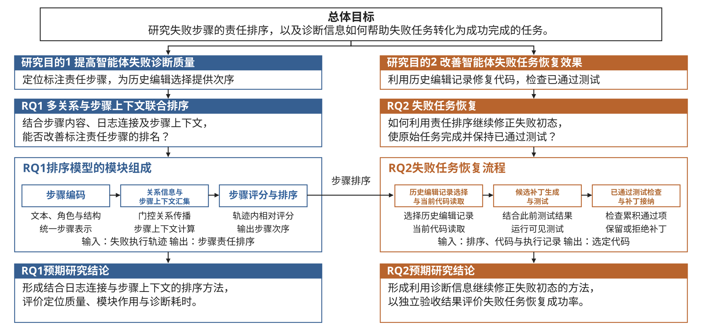
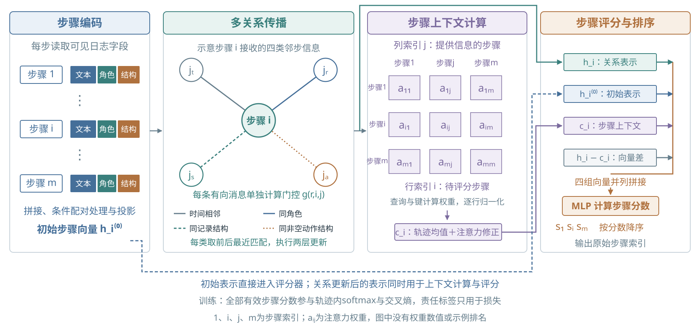
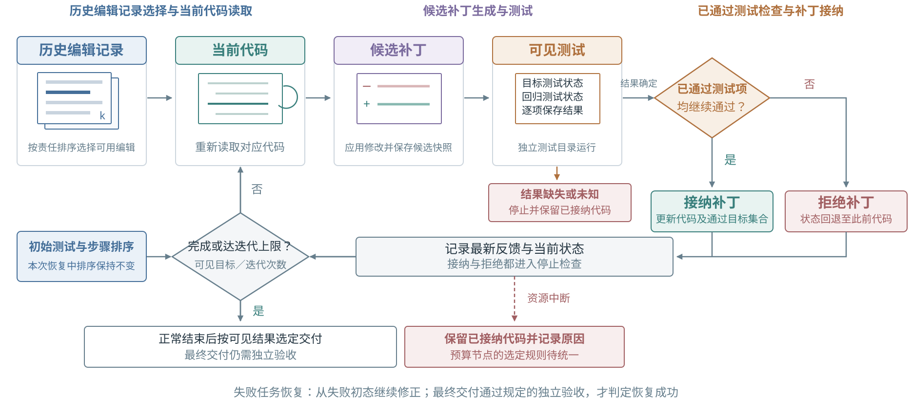
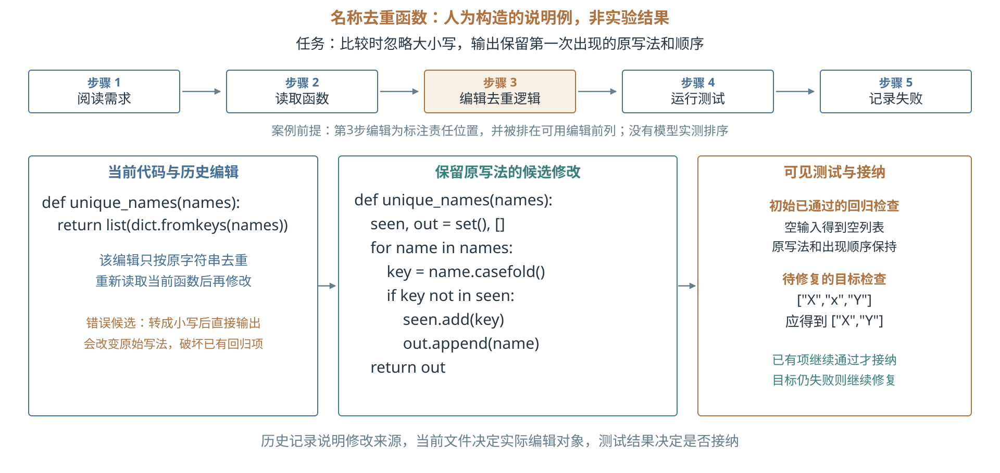
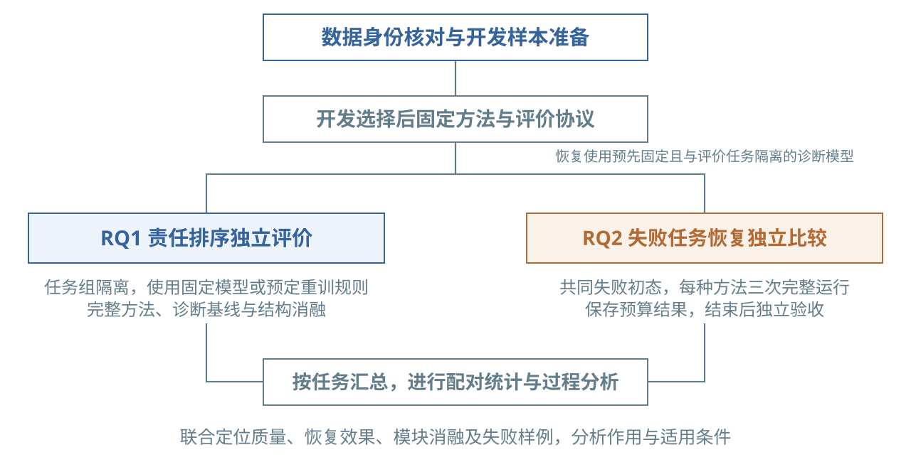

# 基于学习排序的智能体失败诊断与失败任务恢复方法

开题汇报PPT内容总结（V13）

## 第一章 背景与现状

### 1.1 研究背景

大语言模型（Large Language Model，LLM）能够理解自然语言要求，并生成回答、分析和操作建议。要将这些建议用于完成实际任务，系统还需要获取外部信息、执行操作，并根据操作结果决定下一步。基于大语言模型的智能体（Agent）将模型接入工具与运行环境，使其能够围绕任务目标持续行动。ReAct将推理、动作与环境观察交替组织，为这种连续交互提供了基础形式。[1]

在智能体执行中，模型依据任务目标和已有观察选择行动，工具将行动作用于环境，环境返回的信息再用于后续判断。任务可以由单个智能体连续完成，也可以由多个智能体分工协作。随着交互持续，系统需要保留中间信息、衔接前后操作，并检查最终结果是否满足原始要求。

以软件任务为例，解释程序功能与修复实际问题具有不同要求。修复通常需要阅读仓库、理解相关代码、实施修改，再运行测试检查行为；一次修改未成功时，还需依据反馈继续分析。[2] 因此，求解过程表现为多轮“判断、操作、观察”，而不是一次性生成答案。每次执行既产生新的信息，也可能改变后续行动面对的代码和运行状态。

随着步骤增多，一次检索结果可能影响后续判断，一份中间产物可能被其他角色采用，一次错误修改也可能干扰之后的测试。任务最终失败可能涉及信息遗漏、操作选择不当或验证不足等多个环节。[3] 最后出现的报错提供了检查线索，却不一定就是关键错误被引入的位置。重复尝试、正常操作和异常表现交织后，逐条阅读记录的负担也会增加。[4]

失败分析因而需要把结果与过程联系起来。系统不仅要判断任务是否成功，还需要从已有记录中识别值得优先检查的位置，分析这些步骤获得了什么信息、执行了什么操作，以及后续行为如何受到影响。对于已经失败的完整执行，可以利用前后记录形成判断；责任位置则依据数据来源的标注规则进行训练和评价。[4]

诊断之后，还需要考虑如何完成原始任务。历史记录描述过去的执行条件，修正面对的是当前环境。代码可能已被后续操作改变，先前获得的信息也可能失效。[5] 软件场景提供了可检查的代码差异和可执行的测试，[6] 因此适合进一步研究历史线索怎样参与当前修复，以及新修改是否解决问题并保持已有行为。以下先明确研究对象和评价边界，再梳理相关工作。

### 1.2 研究对象与问题定义

本课题研究大语言模型智能体通过工具与环境交互形成的任务执行过程。分析对象是已经失败的执行，诊断可以来自单智能体或多智能体场景；后续修正过程主要在软件场景中验证。研究围绕同一原始任务，将历史执行记录、失败后留下的环境和最终任务结果联系起来。

**执行轨迹**是同一任务的一次尝试所产生的有序步骤记录。每步保留来源中可获得的文本、动作、环境观察和执行角色等字段。[7] 轨迹用于追溯前后操作和信息使用情况。不同日志的记录格式可能不同，需要固定步骤边界、保留原始位置，使模型给出的定位结果能够回查到具体记录。

**任务失败**表示一次执行没有满足规定的完成条件。在软件场景中，通常需要检查原问题要求的行为，以及提交修改是否通过规定验收。[6] 轨迹中的步骤可能分别引入偏差、沿用错误信息或暴露已有异常。因此，最终结果说明尝试是否成功，步骤定位则进一步回答哪些历史位置值得检查。

本文将分析已经失败的执行轨迹、输出历史步骤责任排序的过程称为**失败诊断**，回答“哪些步骤应优先检查”。失败步骤定位将诊断结果落实到具体记录位置。[4] **责任步骤**是数据集按照自身规则标注的关键位置，可能强调错误引入，也可能考虑未履行的验证职责或错过的纠正机会。[7] 本文依据相应标签评价责任排序，进一步确认因果作用仍需干预证据。

模型输出同一轨迹内全部步骤的**责任排序**，将其作为检查优先次序。训练提高标注责任位置的相对得分，推断只使用可见轨迹。评价检查标注责任步骤是否排在前面，后续修正则按排序选择可放入生成模型的历史记录。历史步骤与当前源码编辑位置属于不同对象，需要通过文件、操作和内容线索建立对应。

本文将从失败执行留下的代码和运行环境出发，利用诊断信息进行修正、以成功完成原始任务为目标的过程称为失败任务恢复；最终交付通过规定的独立验收时，判定为恢复成功。

失败执行留下的代码和必要运行环境称为**失败初态**。相关研究通过失败后的干预和继续执行评价修正效果。[8] 本文在软件场景中实施代码修复、补丁生成和测试，必要时进行状态回退。候选补丁被接纳、部分可见测试改善或执行得以继续，分别表示过程进展；状态回退表示恢复此前代码，均需与最终恢复成功区分。

本文将允许向生成过程提供反馈的测试称为**可见测试**，将与生成过程隔离、仅用于评价最终交付的测试称为**独立验收测试**。独立验收检查最终交付是否满足原始任务规定的完成条件。

例如，一次修改未解决目标问题，但仍有部分功能通过测试。系统需要先选择值得检查的历史线索，重新确认当前代码，再生成和验证候选修改。候选是否保留，既取决于可见目标的推进，也需要检查已有通过项是否保持。由此形成两个衔接的问题：能否改善失败步骤的检查次序，以及这些定位信息能否帮助失败任务成功完成。

### 1.3 国内外研究现状

相关研究按两条主线组织：前两节讨论执行失败如何形成可评价的责任位置，以及诊断所需的关系和标注；后两节讨论反馈如何支持软件修复，以及诊断和状态信息怎样参与恢复。

#### 1.3.1 智能体执行与责任步骤定位

- **AutoGen（Wu等，2024）**：通过可编程会话连接不同职责的智能体，组织模型、工具和人工输入。它为持续协作提供流程基础，具体失败由哪个历史步骤引入，仍需进一步诊断。[9]
- **MetaGPT（Hong等，2024）**：通过标准操作流程组织需求、设计、代码与测试产物，以结构化交接支持软件协作。上游产物有误时，下游仍可能沿用，需要检查产物内容及其使用关系。[10]
- **MAST（Cemri等，2025）**：从执行轨迹归纳系统设计、智能体间失配和任务验证等失败模式，为描述失败提供分类。模式标签还需落实到具体步骤，才能支持有针对性的修正。[3]
- **Who&When（Zhang等，2025）**：将归因落到责任智能体和决定性步骤，比较整段日志判断、逐步检查和二分搜索。研究对象由失败类型推进到责任位置，其标签定义和诊断开销也成为评价依据。[4]
- **SDBL（Sun等，2026）**：先确定可疑范围，再结合日志定位责任步骤，以分阶段处理缩小检查空间。定位效果依赖候选线索能否覆盖关键位置，范围划定与精确定位需要共同评价。[11]
- **StepFinder（Zhu等，2026）**：结合步骤语义、双向时序和角色交互直接输出步骤分数，减少诊断时的生成调用。本文以其为学习式定位参照，进一步检验日志连接及面向各步骤汇集的全轨迹信息，并测量推断开销。[12]

#### 1.3.2 执行关系与责任标注

- **DeFA（Deng等，2026）**：组织工具请求、返回及内容使用关系，追踪可疑步骤的来源和后续影响。关系分析有助于连接分散线索，但关系恢复和多阶段判断增加调用开销，记录相邻、角色相同与实际信息依赖仍需区分。[13]
- **AgenTracer（Zhang等，2026）**：结合自然失败的修正重放和成功轨迹的故障注入，构造带责任信息的数据并训练诊断模型。注入错误与自然失败可能具有不同分布，需要公开数据来源、责任定义和任务划分。[14]
- **TraceElephant（Chen等，2026）**：保存步骤实际输入、配置、输出和工具日志，并提供重放环境。责任标注考虑角色职责和可恢复性，下游验证者错过纠正机会时也可能承担责任。本文据此区分可观察关系与评价标签，核对各来源的责任定义。[7]

#### 1.3.3 反馈纠错与软件任务求解

- **CRITIC（Gou等，2024）**：利用工具检查结果修正输出，说明外部反馈可参与纠错，调用与执行开销需同时计量。[15]
- **Large Language Models Cannot Self-Correct Reasoning Yet（Huang等，2024）**：在所测条件下，无外部反馈的推理自纠错也可能把正确答案改错，修订结果需直接评价。[16]
- **Agentless（Xia等，2025）**：依次完成分层定位、补丁生成与验证选择，其定位对象是源码编辑位置。[17]
- **EnAgent（Tian等，2026）**：以多轨迹生成、回归剪枝和工具辅助投票选择候选，作为完整系统比较基线。[18]
- **AOrchestra（Ruan等，2026）**：由主控配置子智能体的任务、上下文和工具，作为完整任务求解方法比较整体效果。[19]

#### 1.3.4 失败后的继续执行与诊断信息使用

- **SyncMind（Guo等，2025）**：研究协作代码更新后的失步恢复，比较独立探索和寻求帮助等方式。它提示修复前需要确认历史认识与当前代码是否一致。[5]
- **AgentRewind（Zhuang等，2026）**：在受控工作区同步恢复执行上下文和文件检查点，并保留失败经验。恢复涉及提示和文件环境等相互关联的执行条件。[20]
- **DoVer（Ma等，2026）**：依据失败日志提出责任假设，生成计划或指令干预，再通过继续执行评价效果。恢复失败也可能来自干预未落实或修正能力不足，不能直接归结为责任假设错误。[8]
- **Intervention Paradox（Vasudev等，2026）**：发现较准确的在线失败预测也可能触发有害干预，净效果随模型和任务改变。该设置与事后定位不同，但说明诊断分数和任务收益需分别评价。本文据此检验责任排名、当前代码对应及实际恢复效果。[21]

### 1.4 现有问题

- **长轨迹中的责任线索分散，检查次序缺少充分依据。** 最终报错、早期决策和后续信息使用可能位于不同步骤，重复尝试和正常操作又会干扰逐条检查。[4] 时间、角色和记录结构提供不同联系，全轨迹中也可能存在与特定步骤相关的远距离线索。[12] 需要组织这些信息，为历史步骤建立检查次序，并共同评价定位质量与诊断开销。

- **历史诊断与当前任务执行之间仍有衔接缺口。** 诊断描述过去的执行，继续修正面对的代码和环境可能已经变化。[5] 责任位置需要转化为可用的历史记录，并与当前代码对应。连续修改还可能破坏已通过的测试，[6] 因而需要检验诊断信息如何参与补丁生成、候选如何接纳，以及最终交付能否完成原始任务。仅有定位改善、候选接纳或测试数量增加，尚不足以说明失败任务已恢复成功。

前一问题涉及诊断信息的组织与责任排序，后一问题涉及诊断到当前修正的衔接及最终任务结果。下一章据此明确研究目标，并提出相互衔接的两个研究问题。

## 第二章 目标与意义

### 2.1 学习排序基础与总体研究框架

**学习排序（Learning to Rank，LTR）**利用标注数据学习评分函数，为同一条件下的一组对象确定相对次序。[22] 例如，搜索系统根据查询和候选文档的信息学习相关性评分。迁移到本课题，一条失败轨迹构成一个排序组，每个步骤都是待评分对象，责任位置标注提供监督。模型学习哪些步骤应当优先检查，分数用于轨迹内比较。

学习排序通常包括三类训练方式：[22]

- **逐点式（pointwise）**：分别预测候选的相关程度，再依据评分排序。
- **成对式（pairwise）**：比较两个候选的先后，学习相对偏好。
- **列表式（listwise）**：以同一排序组为训练单位，联合利用组内分数学习次序。

本文采用以轨迹为单位的列表式训练思路。全部有效步骤共同进入归一化，训练提高标注责任位置的相对得分，推断输出步骤次序。ListNet为组内分布学习提供基础参考，[23] 当前单责任位置监督具体使用轨迹内softmax和交叉熵，形式也可解释为位置分类，未获得其余步骤之间的完整人工次序。

总体研究包括责任步骤排序和失败任务恢复。前者为失败轨迹的步骤给出检查次序，后者按该次序选择历史编辑记录，结合当前代码和测试结果修改代码。两部分分别评价定位质量与失败任务恢复效果，衔接关系如图2-1所示。

图2-1 责任步骤排序与失败任务恢复的研究框架

### 2.2 研究目标与研究问题

**研究失败步骤的责任排序，以及诊断信息如何帮助失败任务转化为成功完成的任务。**

#### 失败诊断

**RQ1：结合步骤内容、步骤间的日志连接和与各步骤相关的轨迹信息，能否改善标注责任步骤的排名？**

在共同数据划分与训练条件下比较责任排名和诊断耗时，去除关系传播或步骤上下文计算，分析两项设计的作用。

#### 失败任务恢复

**RQ2：如何利用责任步骤排序，帮助失败任务成功完成，并在迭代中保持已通过的测试项？**

按排序选择历史编辑并读取当前代码，生成、测试和接纳候选补丁。以独立验收下的失败任务恢复成功率评价整套流程，再用固定流程的排序对照和模块消融分析各项设计。

### 2.3 责任步骤排序的技术组成

排序模型依次完成步骤编码、信息汇集和评分：

- **步骤编码**：将步骤文本、匿名角色及日志格式转换为数值向量，得到各步骤的初始表示。
- **关系信息与步骤上下文汇集**：先沿时间、角色和日志结构等连接汇集邻步向量，再针对每个待评分步骤，从整条已发生轨迹中汇集与该步骤相关的信息，形成**步骤上下文向量**。按关系类型组织消息传递的思想参考已有关系图神经网络研究。[24]
- **步骤评分与排序**：将初始表示、关系更新后的表示和步骤上下文向量一起输入评分网络，为每一步计算分数，再在同一轨迹内排序。

下文的“多关系传播”指沿不同类型连接汇集向量信息并更新步骤表示，连接来自可见日志，不表示已经确认了错误的因果传播路径。三个部分及其计算关系见第三章。

### 2.4 失败任务恢复的三个操作

失败任务恢复在软件场景中重复执行以下三项操作。它们是修复流程中的功能划分，主要设计在于历史编辑记录的选择和已通过测试的保持。

- **历史编辑记录选择与当前代码读取**：按责任排序提取可用的历史代码修改，读取所涉及文件的当前内容。选中记录、当前代码、原问题和此前执行结果组成生成模型本轮收到的**修复输入**。
- **候选补丁生成与测试**：生成模型提出尚未接纳的代码修改，称为**候选补丁**。执行端检查修改能否应用，再运行许可的可见测试。
- **已通过测试检查与补丁接纳**：检查候选是否使初始已通过的回归项，以及初始和后续已接纳代码中确认通过的目标项继续通过，决定保留修改或恢复此前代码。

“反馈”就是此前的应用错误和测试结果，下一轮将其加入输入。排序不直接产生补丁，测试也不提供完整正确性证明。达到停止条件后，再依据可见结果选定交付代码。

### 2.5 研究意义

- **为失败诊断提供可比较的责任排序方法。** 失败轨迹中的错误来源与最终表现可能相隔较远，单步文本难以组织分散的检查线索。[4] 本研究将责任定位表述为同一轨迹内的步骤比较，结合可观察日志连接和各步骤相关的轨迹信息，检验这些信息能否改善责任排名。通过共同划分、结构消融和诊断耗时测量，分析不同信息的作用与计算代价，为长轨迹的检查次序提供实验依据，并明确结论适用的责任标签和任务条件。

- **检验诊断信息帮助失败任务完成的实际价值。** 历史可疑位置需要与当前代码对应，候选修改也需要可执行反馈支持。[5,6] 本研究从失败初态出发，按责任排序选择历史编辑，结合当前代码生成补丁，并检查已通过测试是否保持。以独立验收下的失败任务恢复成功率评价最终结果，再通过固定恢复流程的排序对照和模块消融，分析诊断信息是否带来任务收益、测试保持条件有何作用与代价。任务分组、全过程资源记录和独立验收隔离共同支撑可复查的比较。

## 第三章 内容与方法

### 3.1 责任步骤排序任务与模型

#### 排序对象与监督

模型读取一条已经失败的完整执行轨迹，为全部有效步骤计算检查优先次序。输入包括来源提供的文本、动作、环境观察和角色等字段。责任位置标签用于训练和评价，推断只读取轨迹可见信息。步骤边界和原始索引在预处理时固定，补齐位置不参与评分。

每一步先形成初始表示，再结合邻步信息更新表示，并计算该步的上下文向量。评分网络同时读取这些向量，输出一个步骤分数。单模型按分数降序排列，同分按原始索引处理；集成先对每个模型的分数作轨迹内归一化，再平均预测权重并排序。

图3-1 责任步骤排序模型的计算结构

#### 图中符号与计算关系

- **步骤向量**：$h_i^{(0)}$表示步骤i编码后的初始向量，颜色区分文本、角色和日志结构三组输入，不表示概率或特征贡献。
- **关系连接**：节点是步骤，线型区分四类日志连接。每条有向邻步消息单独计算门控，再按关系类型汇集。图中邻居符号用于说明连接，不对应某条实际轨迹。
- **注意力权重**：$a_{ij}$表示评分步骤i时汇集步骤j信息的权重，各行分别归一化。行列中的1、i、j、m均为步骤索引，a的下标标明接收与提供信息的步骤。由这些权重计算步骤上下文向量$c_i$，方法图只给符号，不展示假设数值。
- **评分输入**：关系更新后的$h_i$、初始表示$h_i^{(0)}$、步骤上下文$c_i$及向量差$h_i-c_i$并列进入多层感知机（MLP）。它由全连接层和非线性变换组成，为每一步输出一个标量分数。

### 3.2 步骤表征与多关系传播

- **步骤编码**

步骤表征将日志信息转换为排序网络可以处理的向量。文本编码描述这一步执行了什么操作、使用了什么信息；角色特征区分行为来源；结构特征补充字段格式、相对位置以及同类结构在轨迹中的重复情况。这里的结构指日志字段形式。三类信息拼接并投影到统一维度，得到步骤初始表示。

当前原型使用固定的Qwen3-Embedding-0.6B编码器，生成128维文本和32维角色表示，另加入23维结构特征，拼接后投影为96维表示。文本和角色向量分别归一化，结构特征仅使用对应训练部分的统计量标准化。编码器保持固定，后续排序网络随责任位置监督训练。

角色按本条轨迹中的首次出现顺序匿名编号为role_0、role_1等。同一角色在这条轨迹内始终使用相同编号，以保留协作联系并减少名称影响。当前失败任务恢复输入只有一个执行角色，多角色条件主要在诊断数据中分析。

部分日志将决策上下文和紧随的输出分成两条。仅当原始步骤相邻、角色相同且日志标记明确对应时，预处理才让两条记录互相补充文本信息。没有明确对应就保持原输入，原始步骤索引不变。当前软件发布的18条轨迹中没有触发有效配对，因此这一条件处理不作为软件场景中已验证的收益来源。

- **多关系传播**

多关系传播以步骤初始表示和关系连接为输入，输出关系增强表示。模型建立四类可观察连接：时间相邻、同一匿名角色、相同完整记录结构、相同非空动作结构。后两类比较类型、嵌套和大小等形式，并去除键名及具体值；每类关系选取前后最近的匹配步骤。这些连接用于传递信息，其含义限定为可观察联系。

每条邻步消息通过一个可学习的标量门控控制强度。门控读取接收步骤与“邻居减接收步骤”的差异，产生0到1的标量权重；权重较小时，该条消息的影响减弱。消息变换读取邻居表示及上述差异，各关系内部先对门控消息取邻居均值，再学习四类关系的融合权重，将汇集结果与原表示相加，并经归一化得到更新表示。这样既能采用其他步骤的线索，也保留本步骤内容。

两轮更新后，一个步骤还可接收经由其他节点传来的向量信息。没有邻居的通道不增加信息；单角色轨迹中，同角色连接可能与时间连接重合，实验分别记录单角色和多角色条件，以分析连接重合对实际作用的影响。

### 3.3 步骤上下文与轨迹内评分

#### 步骤上下文计算

步骤上下文向量是在评分某一步时，从整条已发生轨迹中汇集得到的信息表示。模型将关系更新后的步骤向量分别线性映射为查询、键和值。步骤i的查询与各步骤的键计算相似度，经softmax归一化后得到一行权重$a_{ij}$，再用它们加权汇集各步骤的值向量。

softmax将一组分数转换为非负且和为1的权重。这里沿信息提供步骤j归一化，每行和为1；它与后面用于责任排序训练的归一化属于不同计算。聚合可包含自身和已经发生的前后步骤，适用于执行后的失败定位。

实际实现先计算整条轨迹步骤表示的均值，再加入当前步骤注意力结果的线性修正，得到96维的$c_i$。它是评分网络的输入向量，不是一行注意力权重。权重也不能直接解释为因果强度。完整注意力的时间与存储开销随步骤数呈二次增长，实验同时报告定位质量和诊断耗时。

- **步骤评分**

评分网络读取关系更新后的步骤表示、初始表示、步骤上下文及表示差异。初始表示通过直接支路保留局部信息，四组向量并列拼接后输入MLP：

$$
s_i=\operatorname{MLP}([h_i;h_i^{(0)};c_i;h_i-c_i]).
\tag{1}
$$

式（1）中四组向量各为96维，拼接后为384维。分号表示向量拼接，$h_i-c_i$为逐元素相减。分数只用于比较同一轨迹中的步骤，后续修复按这一顺序选择可用的历史编辑记录。

- **轨迹内训练与预测**

设轨迹有m个有效步骤，标注责任位置为y。全部步骤分数共同归一化，单条轨迹使用责任位置的交叉熵损失：

$$
p_i=\frac{\exp(s_i)}{\sum_{j=1}^{m}\exp(s_j)},\qquad \ell=-\log p_y.
\tag{2}
$$

$p_i$是轨迹内预测权重，$\ell$是训练损失。提高标注位置的权重会降低其损失，促使它排在前面。当前监督是单责任位置分类，按轨迹组织全部步骤并联合归一化，不提供其余步骤之间的完整人工次序。输出权重用于同轨迹排序，不解释为步骤致错的概率。

AgenTracer来源训练对轨迹损失取平均；AFTraj先在同一源任务组内平均，再对任务组等权平均。三次初始化集成时，先分别计算轨迹内预测权重，再平均并排序。结构消融均重新训练，比较两项信息汇集设计的作用。

### 3.4 历史编辑记录选择与当前代码读取

责任排序决定历史编辑记录进入生成模型的先后次序。当前原型从排序步骤中提取成功执行、确实修改了许可范围内项目源码的编辑，按编辑调用标识去重，并保留原始步骤索引。同一文件中的不同编辑分别保留。排序中没有可用编辑的步骤不会被补造为编辑记录。

系统保存历史修改前后的差异，每轮重新读取对应的当前文件，分别提供历史修改和当前内容。还根据历史改动涉及的函数及可见失败记录，补充当前可能相关的函数。文件路径和语法符号提供读取线索，静态匹配不作为因果依赖证明。

选定编辑记录、当前代码、原始问题和此前执行结果共同组成修复输入。当前原型按记录条数和编辑记录文本的字节数限制历史输入，字节数与模型token数分别记录，每轮按既定顺序增加选入的编辑记录，保留此前已选部分，完整函数片段在容量允许时进入输入，不切断代码；超出容量的情况单独记录。正式实验前统一容量与计量规则。

初始失败轨迹只排序一次，后续更新当前代码和执行结果。实验保存模型、排序、选中编辑及实际生成输入的对应关系；若不同排序最终提供相同信息，也如实记录。

### 3.5 候选补丁生成与测试

本模块读取修复输入，由生成模型提出对当前文件的文本修改。候选补丁包含：

- **文件路径**：指定本次修改的源码文件。
- **待替换文本**：在当前文件中需要唯一匹配的原内容。
- **新文本**：用于替换原内容的代码。

执行端先检查路径许可及格式，再确认待替换文本在当前文件中唯一匹配。格式错误与应用失败分别记录。

有效修改应用到当前代码后保存候选快照。测试执行器依据该快照，在本次尝试的独立测试目录重建代码并运行指定的可见目标测试和回归测试。候选代码、应用错误及逐项测试结果构成本轮输出，交给接纳操作处理。

下一轮输入包含此前尝试的应用错误和可见测试结果，生成模型据此继续提出修改。这里使用执行记录调整生成输入，没有依据反馈在线训练模型。独立验收结果及其他方法的补丁不提供给生成模型。

图3-2 失败任务恢复流程

### 3.6 已通过测试检查与补丁接纳

#### 已通过测试的检查

目标测试检查当前软件问题要求修正的行为，回归测试检查已有功能。令B为失败初态下已通过的回归测试集合，$H_t$为初始及截至第t轮已接纳代码中确认通过的目标测试集合。候选必须使B与$H_t$中的每个测试继续通过：

$$
B\cup H_t\subseteq\operatorname{Pass}(S').
\tag{3}
$$

$\operatorname{Pass}(S')$表示候选代码确认通过的测试标识集合。接纳候选后，将新通过目标加入$H_t$；拒绝候选时，进行状态回退，恢复此前已接纳代码并保留失败记录。被拒候选的新通过项不加入集合。候选即使没有增加通过数量，只要满足接纳条件，也可用于下一轮。

当前原型要求测试结果覆盖完整且状态确定；缺失或不确定时停止该次运行，保留已接纳代码，原因单独记录。这里的保持条件只覆盖实际执行的测试，不构成程序正确性的证明。

#### 迭代、状态回退与结果选择

每轮接纳或拒绝后检查停止条件。可见目标全部通过或达到迭代上限时正常结束；资源中断时保留已接纳代码并记录原因。正常结束时，在初态及已接纳代码中，先保留仍满足最终测试保持条件的状态，再依次比较可见失败目标数、修改行数和尝试先后。独立验收只评价选定交付；只有通过规定的独立验收，才判定为恢复成功。

严格保持条件可能阻止需要暂时使某项测试失败的修复路径。实验比较去除累积目标保持后的结果，并分析具体测试变化和最终失败任务恢复效果。预算节点的保存与选定规则将在正式实验前统一，不能把原型的异常中断处理直接当作已完成的预算评价。

### 3.7 说明性案例：名称去重函数

本例为解释方法而构造，不是实验结果，没有给出模型实测权重或排序成绩。任务是修改一个名称去重函数：比较名称时忽略大小写，保留第一次出现的原始写法和顺序。

#### 从失败历史到当前修改

假设历史执行依次经历阅读需求、读取函数、把原实现改为按原字符串去重、运行测试和记录失败。第3步的编辑保留了顺序，却没有处理大小写，因此输入`["X","x","Y"]`仍会得到三项。为讲解RQ1，假定该编辑被标注为责任步骤，且被模型排在可用编辑的前列；这只是案例前提。

RQ2据此取出第3步的修改记录，重新读取当前函数。历史记录用于说明修改来源，当前文件才是实际编辑对象。生成模型同时读取“应忽略大小写”的原问题和失败测试结果，再提出候选补丁。

图3-3 名称去重函数的修复说明例（人为构造，非实验结果）

#### 测试检查与候选接纳

本例将空输入和保持原始写法、顺序的检查作为初始已通过回归项，将大小写去重检查作为待修复目标。直接把名称转成小写再输出，会改变原始写法，因此即使某些重复项被删除，候选仍会破坏回归项而被拒绝。后续修改可以只用转换为同一大小写形式的字符串判断是否重复，输出仍保存原名称。

候选使已有回归项继续通过，且可见目标测试通过后，可结束本轮代码修复并选定交付。该进展仍需独立验收确认，才能判定为恢复成功。若仅满足已有通过项而仍有目标失败，可以接纳并继续。案例只解释输入、修改和测试之间的关系，失败任务恢复成功率仍需第五章的真实实验评价。

## 第四章 难点与创新

### 4.1 拟解决的关键问题

- **日志连接和步骤上下文的作用**

单步文本可能不足以说明它与最终失败的联系。需要在相同数据与监督条件下，判断邻步信息和全轨迹上下文是否改善责任排名，并测量额外计算开销。

- **历史编辑与当前代码的关系**

排序对象是过去的步骤，修改对象是当前文件。需要保留编辑来源、读取当前内容，并检查不同排序是否真的改变了生成模型收到的信息。[5]

- **目标测试改善与已通过测试保持**

后续修改可能使此前通过的测试失败，单看通过数量还可能遗漏测试项的替换。需要按测试标识决定是否接纳，同时分析严格保持条件对修复路径的限制。

### 4.2 预期创新设计

- **结合日志连接和步骤上下文的责任步骤排序**

在文本与角色表示的基础上，利用四类可观察连接更新步骤表示，再计算各步骤的上下文向量并联合评分。通过结构消融判断两项设计在当前任务和训练条件下的作用。

- **按责任排序选择历史编辑，并依据测试结果接纳修改**

将排序用于修复输入选择，每轮读取当前代码，根据可见测试保持条件决定是否保留修改。完整系统比较评价整套方法，固定恢复器的排序对照分析排序的作用，其余操作通过相应消融分析。

设计与已有方法的区别由文献比较说明，实际效果由共同任务上的实验检验。现有开发结果用于完善方法，尚不能证明独立评价中的优势。

### 4.3 适用边界与可能不足

**责任标签与监督范围**：责任定位依据数据来源的标签，跨来源的责任定义可能不同。当前单责任位置监督也不能完整规定其他步骤之间的次序。

**长轨迹与关系重合**：全轨迹上下文增加长记录的计算开销。单角色软件轨迹还可能使部分关系重合，需要通过分层与消融限定模块作用。

**测试覆盖与正确性**：已通过测试的保持条件仅覆盖实际执行的可见测试，不构成程序正确性的形式化保证。

**严格保持条件与预算**：严格保持条件可能阻碍需要暂时退步的修复，反复验证也会消耗预算。因此，独立评价同时报告恢复结果、资源和失败过程，分析方法在哪些条件下有效及何时受到限制。

## 第五章 实验与数据

### 5.1 数据来源与评价划分

#### 实验单位与失败初态

本章分别回答两个问题：RQ1评价责任步骤排序的质量、开销及模块作用；RQ2评价共同失败初态与资源条件下的失败任务恢复效果。AFTraj与AgenTracer扩展发布版提供责任步骤标注，[25,26] SWE-Gym及其配套执行轨迹提供可重新执行的软件问题。[27]

**软件问题（issue）**指仓库中一个待解决的原始问题，例如某个函数在特定输入下输出错误。它是恢复实验的任务与统计单位。问题身份依据来源、仓库及原始问题标识核对，任务描述用于确认对应关系，代码版本和失败初态属于运行条件。同一原始问题的不同版本不自动计为独立问题。**失败轨迹**是智能体解决该问题时一次未成功尝试的步骤记录，该尝试留下的代码和必要运行状态称为**失败初态**。同一个软件问题可以产生多条轨迹，它们不因此成为多个独立问题。

以一个软件问题为例，评价单位与运行方式如下：

- 两条失败轨迹对应同一原始问题，任务数仍记为1。
- 为该问题预先固定一个来源明确、可重建的失败初态。
- 各方法都从该初态开始，各自重新启动3次完整恢复运行。
- 三次运行衡量同一任务条件下的运行变化，不增加独立问题数。
- 若以后采用多个失败初态，先规定问题内汇总规则，再进行比较。

#### 数据来源与研究样本

**任务组**用于诊断数据划分：同一原始任务的多条轨迹、错误变体和派生记录归入同组，防止同一问题以不同记录形式进入训练和评价。表5-1中的轨迹数、任务组数和软件问题数因此分别统计。

表5-1 数据来源与研究样本

| 数据来源 | 发布规模 | 当前研究样本 | 主要用途 |
|---|---|---|---|
| AFTraj | 2,276条轨迹 | 731条失败轨迹；716任务组 | 失败步骤定位 |
| AgenTracer扩展版 | coding训练1,141条；测试127条 | 614条来源池；363条coding评价轨迹 | 软件轨迹定位 |
| SWE-Gym | 2,438个Python问题 | 23个已整理软件问题 | 恢复方法开发 |

#### 发布数据与本地开发子集

AFTraj发布数据共2,276条轨迹，其中安全轨迹1,162条、不安全轨迹1,114条。[25] 安全分类与任务执行失败属于不同判断，纳入时需核对任务结果、责任标签及其可映射性。

本文本地整理与开发子集分别为：

- **失败来源池**：731条失败轨迹，对应716个源任务组。
- **开发子集**：120个不同任务组，已用于调试和方法分析。
- **抽取方式**：在五个任务类型与标注来源组合中，各取24条。
- **领域构成**：编程（coding）24条、数学（math）48条、工具交互任务（agentic）48条。

AgenTracer采用扩展发布版，该版本与论文版的发布规模不同。[26] 以下规模是本文本地筛选与划分的结果。614条训练验证来源池包含coding 320条、math 294条，363条固定评价轨迹为coding。两部分来自所用发布版的官方训练部分，并按源任务组隔离，固定评价集属于开发评价数据。

所有划分以原始任务为单位，同一问题的多条轨迹、错误变体和派生样本归入同一组。清洗处理步骤边界、可读格式和原始位置映射，标签沿用来源定义。各数据集分别记录责任标签的对象与判定规则，需要合并训练时，先核对标签是否表示同一类责任位置。诊断样本依据轨迹完整性与标注可映射性纳入；恢复样本另核对失败环境可重建、反馈可用和测试可执行。分别报告排除数量及原因。

#### 5.1.1 诊断数据与任务分组

**AFTraj开发评价：** 将716个任务组分为5份，轮流使用其中1份进行外层评价，其余4份再划分训练与验证组，构成五折分组评价。每个配置使用三次预定初始化，模型选择依据内部验证。每条轨迹由未使用该任务组训练的模型产生外层预测，汇总731条结果。已用于方法选择的外层结果归入开发评价。

**AgenTracer开发评价：** 采用A、B、C三个分组划分，每个划分训练492条、验证122条，均在同一363条coding开发评价集上比较，每个划分使用三次预定初始化。训练含coding 256条和math 236条，验证含coding 64条和math 58条；训练、验证与固定评价任务组相互隔离。

**独立评价集：** 方法结构、输入处理、训练和模型选择规则确定后，分别从AFTraj官方测试部分的163条失败轨迹及AgenTracer官方coding测试部分的127条轨迹中筛选未参与开发的样本。筛选核对原始任务身份与历史开发使用记录，报告最终合格数量。候选轨迹数与独立任务组数分别统计。

#### 5.1.2 失败任务恢复样本与失败初态

恢复样本由原问题描述、失败初态、来源轨迹、可见执行反馈和独立验收测试共同构成。失败初态需要保存失败后实际文件内容及必要运行环境，仅恢复仓库原始提交不足以重建失败现场。纳入前核对原问题标识、仓库提交、失败后代码与轨迹之间的对应，保存依赖、测试命令及初始测试结果，确认环境可重建。共同可见测试检查目标问题和已有功能，独立验收测试单独隔离保存。主要评价保留智能体实际执行形成的失败环境；人为构造样本仅用于检查历史代码读取和已通过测试保持的具体过程，单独报告。

现有23个已整理软件问题用于接口核对、恢复方法开发和资源估计。独立评价计划从SWE-Gym同一来源另行筛选20个未参与方法开发的合格软件问题，覆盖至少3个仓库。候选按预定顺序核对任务身份、失败初态、反馈和测试条件，最终样本数以实际合格数量为准。

### 5.2 实验流程与共同条件

实验先核对样本身份并区分开发与独立评价数据，在开发部分选择配置，再固定样本、实现、输入和评价规则。随后分别开展RQ1责任排序评价和RQ2失败任务恢复比较，核心消融与相应完整方法使用共同划分。两条评价分支可以独立执行；RQ2使用已固定且与恢复任务隔离的诊断模型，不能依据独立恢复结果反向选择排序模型。

图5-1 责任步骤排序与失败任务恢复的实验流程

#### 5.2.1 责任排序的训练与评价

模型结构、步骤表示及单轨迹训练目标见3.1—3.3。RQ1的执行顺序为：建立任务组清单，生成分组划分，在训练部分拟合标准化和排序网络，依据验证部分选轮，再对未参与该次训练的任务生成预测。评价时保留任务、轨迹、步骤索引与预测的对应。

本地已执行训练采用固定文本编码器与可学习排序网络。排序网络为两层关系传播、96维隐表示，训练中用0.15的Dropout随机置零部分特征，降低对个别特征的依赖。模型先按验证集首位命中率Top-1选轮，再用平均倒数排名MRR打破并列，两项相同时保留最早轮。

已执行配置使用AdamW优化器，固定学习率0.001，本文权重衰减0.0001，梯度范数裁剪为1.0。最多训练40轮，连续8轮无提升时停止。AgenTracer来源池批次为16条轨迹，AFTraj批次为16个完整任务组。AFTraj外折预测先在内层选择轮数，再用其余四折重训。

本文与StepFinder使用共同的可见轨迹、任务分组和模型选择信息，保留各自核心结构与训练设置。标准化统计量只从对应训练部分计算。正式测试前固定配置，记录编码输入上限、实际截断、硬件与参数量。

结构消融重新训练，沿用完整模型的任务划分、预定初始化和选择规则。AFTraj分别报告三次初始化的完整外折汇总及其均值、标准差。AgenTracer先在A、B、C各划分内部汇总三次初始化，再报告跨划分变化，避免混合两种变化来源。三模型集成另列，不与单次模型成绩混用。

#### 5.2.2 失败任务恢复的共同运行条件

完整恢复比较使用共同任务描述、仓库版本、失败初态、代码访问许可、可见测试和独立验收测试。生成后端统一采用deepseek-flash，本地诊断模型单独记录配置。各方法保留自身的定位、生成、验证与选择流程，部署参数在开发结束后固定。

表5-2 失败任务恢复的共同运行条件

| 条件 | 统一设置 |
|---|---|
| 任务起点 | 同一原始问题、失败后代码及运行环境 |
| 生成模型 | deepseek-flash；部署参数预先固定 |
| 可见信息 | 同任务、代码与执行反馈许可 |
| 结果评价 | 同一独立验收测试 |
| 资源上限 | 共同时间与token上限 |
| 独立重复 | 每题三次完整运行 |

#### 独立重复与预算计量

每次独立重复从同一失败初态重新启动，重置本轮交互历史，不继承其他重复产生的补丁、选择结果或测试反馈。一次运行内生成多个候选、配置多个子智能体或投票，均只算一次完整运行；同一次运行的中断续跑继续累计原预算，不新增独立重复。三次运行分别评价，不能以其中最好一次代表整题结果。

环境重建和共同初始测试属于各方法一致的准备阶段，单独记录开销。准备完成后，从方法开始读取任务输入时计时，包含本地诊断模型加载、编码排序、生成、工具执行、测试和选择。并行子智能体按同一墙钟计量，同时记录累计计算消耗。token是模型处理文本的计量单位，共同上限累计各阶段及全部子智能体的输入、输出，包括失败候选和验证相关模型调用。纯工具执行耗时计入时间，不计为模型token。

#### 恢复执行与排序接入

恢复运行先完成共同环境与初始测试准备，再在预算内调用固定诊断模型生成排序，按第三章规则选择历史编辑并读取当前代码，生成和验证候选，依据可见测试更新状态，保存预算节点的已选结果，结束后再执行独立验收。可见目标测试检查原问题要求解决的行为，回归测试检查已有功能。测试集合、稳定标识及反馈许可随样本一起固定。

排序到恢复的衔接按“选定模型与训练任务、排序结果、选中编辑记录、实际生成输入”核对。恢复任务与对应诊断模型的训练任务按原始任务身份隔离，确保实际使用的是规定评价模型产生的排序。

#### 5.2.3 独立评价前需固定的执行条件

独立评价前，还需确定并记录以下执行条件。未确定项不由执行者自行采用默认值：

- **数据与划分清单**：数据发布版本及校验、任务身份映射、最终纳入与排除清单、每个分组划分和初始化值。
- **模型与方法实例**：编码器、输入上限及截断、训练与选轮配置、独立评价使用的权重或集成方式，各基线代码版本、提示和完整内部参数。
- **恢复输入与验收**：每题仓库提交、失败后代码和环境重建方式、可见与独立验收测试命令、目标与回归项标识、历史编辑选择及结果选定规则。
- **资源与随机性**：生成模型版本及采样参数、共同token上限、单次执行和重试规则、缓存范围、停止条件及统计重采样设置。

其中，共同token上限和历史编辑输入容量依据开发阶段资源测量确定，当前不填入未经验证的数值。共同小试在开发样本上完成；独立评价样本只按预定规则核验资格和环境，不用于调参或方法选择。完成上述条件、实现完善及开发小试后，再开展独立评价。

### 5.3 比较方法

#### 责任排序比较

责任排序比较用于检验相同轨迹输入下的定位质量和推断开销。选择StepFinder作为专门学习模型，All-at-Once与Binary Search作为完整日志判断和区间搜索参照。[4,12] 各方法共同报告首位命中率（Top-1），完整排序方法进一步比较责任步骤的总体排名。

表5-3 失败诊断比较方法

| 方法 | 主要机制 | 原生输出 | 论文来源与时间 |
|---|---|---|---|
| 本文 | 多关系与步骤上下文 | 全步骤排序 | 本研究 |
| StepFinder | 时序语义与角色交互 | 步骤分数 | KDD 2026 [12] |
| All-at-Once | 完整日志一次判断 | 单个责任位置 | ICML 2025 [4] |
| Binary Search | 递归缩小日志区间 | 单个责任位置 | ICML 2025 [4] |

本文与StepFinder均按各自最终输出的完整步骤次序，统一计算责任步骤的排名指标。单模型按步骤分数排序，集成结果按平均预测权重排序。All-at-Once与Binary Search以Top-1进行共同比较，无效输出计为该题未命中，并单列其数量。

#### 完整失败任务恢复比较

完整失败任务恢复比较评价本文整套修复流程在相同软件问题、失败初态、可见信息与资源条件下的恢复效果。 选用Agentless、EnAgent和AOrchestra进行比较，三者分别代表分层定位与修复、多轨迹集成和动态子智能体组织。[17,18,19]

表5-4 完整失败任务恢复比较方法

| 方法 | 核心流程 | 论文来源与时间 |
|---|---|---|
| 本文 | 历史编辑选择、补丁生成与测试、通过项保持 | 本研究 |
| Agentless | 分层定位、补丁生成、验证选择 | FSE 2025 [17] |
| EnAgent | 多轨迹生成、剪枝、工具辅助选择 | ICSE 2026 [18] |
| AOrchestra | 动态子智能体、任务与工具组织 | ICML 2026 [19] |

保留方法核心并公开部署差异，按共同资格纳入任务，记录成功、失败和未完成。

固定本文其余修复流程，分别替换StepFinder排序和历史记录顺序。编辑选择、去重和容量规则相同，记录实际输入及恢复结果。该对照分析排序作用，系统比较评价整体效果。

### 5.4 评价指标与预算

实验以MRR衡量责任位置的总体排名，以Top-1及前3位、前5位命中率（Hit@3、Hit@5）描述不同检查范围下的定位效果，端到端耗时评价诊断开销。失败任务恢复部分采用预算内失败任务恢复成功率（Recovery Success Rate，RSR）。已通过测试项的保持情况放在模块分析中结合具体测试记录说明。

表5-5 主要评价指标

| 指标 | 计算口径 |
|---|---|
| MRR ↑ | 责任步骤倒数排名的任务组均值 |
| Top-1 ↑ | 首位命中责任步骤的比例 |
| Hit@3 / Hit@5 ↑ | 前3 / 5位命中责任步骤的比例 |
| 端到端耗时P50 / P95 ↓ | 诊断耗时的中位数 / 95分位数 |
| RSR@30min ↑ | 30分钟内已选定交付、事后通过独立验收测试的比例 |

- **定位质量与诊断耗时**

MRR先计算每条轨迹中标注责任步骤的排名倒数，再在同一源任务组内平均，最后对任务组等权平均。例如，排第1位计1，排第2位计0.5，排第5位计0.2。若来源允许多个责任位置，按其中最靠前者计算，并单列该标签条件。

Top-1表示首位命中责任步骤的比例，Hit@3和Hit@5表示前3位或前5位中至少命中一个可接受责任位置的比例。无效输出记为未命中，并单列数量。上述比例同样先组内平均，再按任务组汇总。

端到端诊断耗时从输入原始轨迹开始，包含文本编码、结构构建和步骤评分。统一硬件与部署条件后，报告中位数P50和95分位数P95。主要诊断耗时包含模型首次加载，另列模型已加载条件的结果，两种加载条件分别统计。

- **预算内失败任务恢复**

每个软件问题进行三次独立完整运行。预算内失败任务恢复成功率RSR先对每个软件问题的三次结果取成功比例，再对共同软件问题平均。成功要求：方法在预算内已选定并交付结果，且该结果通过同一独立验收测试。未交付的处理中候选不计成功。

#### 预算节点与继续运行

主要结果采用30分钟预算，同时保存15分钟、60分钟节点。为获得这些快照，运行持续到60分钟或更早触发内部停止、共同token上限。各节点保持同一内部配置，只评价当时实际选定的结果。提前达到内部停止条件或共同token上限的运行，按已选结果评价后续节点。若另行取消60分钟时间截断并运行至自身停止条件，则保留相同内部配置和原预算轨迹，另记额外资源及未完成原因，不把安全中断称作自然停止。

#### 结果选定与事后验收

结果选定、预算记录与独立验收按以下规则执行：

- **保存预算快照**：记录已选代码标识、选定时间与累计资源。
- **保留当时结果**：预算后才选定的结果不回填早期节点。
- **事后独立验收**：结束后单独验收各快照，评价反馈不返回生成模型。
- **覆盖完整计时**：模型加载、编码排序、历史编辑选择与当前代码读取、生成、工具执行、可见测试及结果选定均计入。
- **累计共同token预算**：上限依据开发资源需求预先固定，所有子智能体、失败候选和验证消耗均累计。

### 5.5 核心消融与过程分析

- **失败诊断模型消融**

消融实验在其余条件相同的设置下去除一项设计，观察指标变化。“w/o”表示去除指定部件。RQ1聚焦多关系传播和步骤上下文两项设计，其余输入、任务划分和训练规则保持一致。

表5-6 失败诊断模型消融

| 条件 | 模块改动 |
|---|---|
| Full | 完整学习排序模型 |
| w/o RelProp | 跳过关系传播，使用步骤初始表示 |
| w/o CandCtx | 各步骤使用同一个全轨迹均值向量 |

两项变体均重新训练，比较MRR、Top-1、Hit@3、Hit@5和诊断耗时，并记录参数量。逐类关系与长轨迹分析用于解释结果，不再扩展为主要消融项目。

- **失败任务恢复模块消融**

固定生成模型、源码许可、动作检查、可见测试、交付规则和资源，每次去掉一项，比较预算内RSR。

表5-7 失败任务恢复的模块消融

| 条件 | 去除的内容 | 仍可使用的信息或保护 |
|---|---|---|
| Full | 无 | 完整失败任务恢复流程 |
| w/o HistEdit | 历史编辑记录 | 当前代码与执行反馈 |
| w/o CurrentRead | 根据历史编辑专门读取当前代码 | 历史编辑记录与共同源码访问 |
| w/o TargetKeep | 初始及后续已接纳代码中已通过目标项的保持条件 | 初始通过的回归测试 |

三项为拟开展的消融，分别删除历史编辑输入、专门的当前代码读取或累积目标保持条件。共同源码访问许可保留，并记录生成模型是否从其他操作获得相同内容。各条件继续生成补丁并运行可见测试，资源按实际使用累计。已有时间顺序对照仍提供历史编辑，不能当作删除历史编辑的消融。

- **诊断到行动的过程解释**

记录步骤排序、选中编辑、当前代码、候选补丁和测试结果，检查排序是否改变输入及后续修改。不同排序产生相同输入或修改时也保留。

对各变体采用相同观察范围，比较修改前后同一组测试，分别记录接纳修改和被拒候选破坏了哪些已通过项。少量预设机制样本再比较“按通过数量”与“按具体标识”保护的差异，并保留需要暂时退步的修复路径。此类过程证据用于解释机制，总体收益仍结合独立验收测试下的RSR判断。

### 5.6 统计方法、有效性与工作量

#### 任务级配对统计

统计以原始任务组或软件问题为单位，先汇总组内轨迹或同软件问题的三次重复，再比较方法。主要差异采用配对自助法，即以任务为单位共同重采样各方法结果，估计95%置信区间。样本较少时，同时展示逐题结果和配对差异。

#### 评价覆盖与有效性控制

报告共同计划任务数、可评价覆盖和完整配对数。每个预算节点的共同集合要求各方法三次预定运行均有可判定结果，缺失原因另列。正常达到资源上限但未交付验收通过结果，计为该预算下未成功；工程中断、测试不确定与未运行另列。预算结果可判定时保留该节点记录，后续未完成不改写已有结果。

有效性控制包括任务身份隔离、共同输入许可、完整基线流程、统一动作处理、全过程预算计量与独立验收测试隔离。轨迹长度、初始通过测试规模、角色数和关系重合用于解释适用条件，分层规则在开发阶段确定。

#### 实验工作量与结果呈现

完整系统比较计划为20个软件问题、4种方法、每题3次，共240条运行。每条运行30分钟对应累计时间120小时，延至60分钟为240小时；这些是各条运行时间相加，不等于并行后的日历时长。StepFinder诊断器替换与顺序置换各增加60条。三项恢复消融先在开发和机制样本上比较，若全部扩展至独立20题，则另需180条。预算节点复用同一运行快照，独立重复分别执行，实际资源依据开发测量完善。

结果以诊断质量与耗时表、失败任务恢复成功率随时间变化的曲线、核心消融表和代表性过程组织。开发、机制和独立评价分别报告，各结论限定在实际样本与测试范围内。

## 第六章 进度与文献

### 6.1 前期研究基础

#### 责任排序与分组评价基础

前期已建立失败轨迹整理、步骤位置映射和分组评价流程，完成多关系与步骤上下文联合排序模型的训练。在已用于开发的AFTraj固定120个任务组上，本文三组初始化的外折预测集成首位命中86组，同轮StepFinder对照命中82组，相差3.33个百分点。该差异尚不足以确认稳定优势，独立评价仍需在模型与任务划分固定后完成。

AgenTracer已有614条训练验证来源池、363条固定coding开发评价轨迹和A、B、C三个分组划分。当前失败任务恢复接入AgenTracer来源池训练条件的三模型集成，与AFTraj外折模型采用相同架构、不同训练权重。正式独立评价前仍需核对诊断训练任务与恢复任务的重叠，并固定最终恢复部署模型。

#### 恢复原型与方法比较基础

失败任务恢复原型已实现排序接入、当前代码与反馈组织、候选生成、可见测试和状态记录。最新排序替换先导包含五条轨迹，均来自同一个已参与开发的软件问题；已完成的对照条件在运行至自身停止条件后，其选定结果均通过独立验收测试，当前先导尚未显示排序之间的任务完成率差异。该结果说明联合流程可以执行，排序的恢复收益仍需多任务比较。

Agentless与EnAgent已有完整运行基础，AOrchestra已完成保留原方法核心的完整先导，并通过独立验收测试。现有记录保留预算内交付结果及相同配置继续运行后的结果，多任务、共同信息和参数条件下的系统比较仍待完成。

#### 原型完善与后续工作

前期修复记录中已观察到后续修改使此前通过的测试失败。现有案例还不足以确认按测试标识检查通过项相对只比较数量的收益。正式实验前需完善输入容量、结果未知处理和预算节点的结果选定规则，再开展共同任务比较。

### 6.2 研究进度安排

研究分阶段完成问题界定、两项研究问题的方法与实验，以及论文和答辩材料。

- **2026.09—10**：文献梳理、问题界定与原型验证
- **2026.11—12**：失败步骤排序模型与诊断实验
- **2027.01—02**：失败任务恢复与系统比较
- **2027.03**：消融分析、结果整理与论文初稿
- **2027.04—05**：论文修改、定稿与答辩准备

正式测试前确定任务组、方法配置和评价规则，后续按既定流程比较。资料整理、实现完善和论文撰写随阶段进展交叉进行。

### 6.3 预期研究成果

- **责任步骤定位方法**

形成一种基于轨迹内学习排序的智能体失败步骤定位方法，明确多关系传播和步骤上下文对责任排名的作用，报告定位质量、不同初始化与划分下的结果变化，以及推断开销。

- **失败任务恢复方法**

形成一种按责任步骤排序选择历史编辑记录、读取当前代码并生成修改的方法，依据可见测试检查已通过项并决定是否接纳补丁，通过完整方法比较与核心消融评价恢复效果。

- **学位论文、研究原型与实验记录**

完成学位论文、研究原型、数据划分与评价说明，以及可复查的实验记录。结论围绕软件验证场景中观察到的定位与失败任务恢复效果展开，说明适用条件和后续研究问题。

### 6.4 主要参考文献

[1] Shunyu Yao, Jeffrey Zhao, Dian Yu, et al. ReAct: Synergizing Reasoning and Acting in Language Models. International Conference on Learning Representations (ICLR), 2023. [原文](https://openreview.net/forum?id=WE_vluYUL-X).

[2] John Yang, Carlos E. Jimenez, Alexander Wettig, et al. SWE-agent: Agent-Computer Interfaces Enable Automated Software Engineering. Advances in Neural Information Processing Systems, 2024. [原文](https://proceedings.neurips.cc/paper_files/paper/2024/hash/5a7c947568c1b1328ccc5230172e1e7c-Abstract-Conference.html).

[3] Mert Cemri, Melissa Z Pan, Shuyi Yang, et al. Why Do Multi-Agent LLM Systems Fail? Advances in Neural Information Processing Systems, Datasets and Benchmarks Track, 2025. [原文](https://papers.nips.cc/paper_files/paper/2025/hash/b1041e52d3be19f0a9bc491657488e4a-Abstract-Datasets_and_Benchmarks_Track.html).

[4] Shaokun Zhang, Ming Yin, Jieyu Zhang, et al. Which Agent Causes Task Failures and When? On Automated Failure Attribution of LLM Multi-Agent Systems. Proceedings of the 42nd International Conference on Machine Learning (ICML), PMLR 267: 76583–76599, 2025. [原文](https://proceedings.mlr.press/v267/zhang25cq.html).

[5] Xuehang Guo, Xingyao Wang, Yangyi Chen, et al. SyncMind: Measuring Agent Out-of-Sync Recovery in Collaborative Software Engineering. Proceedings of the 42nd International Conference on Machine Learning (ICML), PMLR 267: 20993–21066, 2025. [原文](https://proceedings.mlr.press/v267/guo25l.html).

[6] Carlos E. Jimenez, John Yang, Alexander Wettig, et al. SWE-bench: Can Language Models Resolve Real-world GitHub Issues? International Conference on Learning Representations (ICLR), 2024. [原文](https://proceedings.iclr.cc/paper_files/paper/2024/hash/edac78c3e300629acfe6cbe9ca88fb84-Abstract-Conference.html).

[7] Mengzhuo Chen, Junjie Wang, Fangwen Mu, et al. Seeing the Whole Elephant: A Benchmark for Failure Attribution in LLM-based Multi-Agent Systems. Proceedings of the 64th Annual Meeting of the Association for Computational Linguistics (Volume 1: Long Papers): 19888–19905, 2026. [原文](https://aclanthology.org/2026.acl-long.912/).

[8] Ming Ma, Jue Zhang, Fangkai Yang, et al. DoVer: Intervention-Driven Auto Debugging for LLM Multi-Agent Systems. International Conference on Learning Representations (ICLR), 2026. [原文](https://openreview.net/forum?id=mrEK16Jy6h).

[9] Qingyun Wu, Gagan Bansal, Jieyu Zhang, et al. AutoGen: Enabling Next-Gen LLM Applications via Multi-Agent Conversation. Conference on Language Modeling (COLM 2024). [原文](https://www.microsoft.com/en-us/research/publication/autogen-enabling-next-gen-llm-applications-via-multi-agent-conversation-framework/).

[10] Sirui Hong, Mingchen Zhuge, Jonathan Chen, et al. MetaGPT: Meta Programming for A Multi-Agent Collaborative Framework. International Conference on Learning Representations (ICLR 2024). [原文](https://proceedings.iclr.cc/paper_files/paper/2024/hash/6507b115562bb0a305f1958ccc87355a-Abstract-Conference.html).

[11] Kai Sun, Wenqiang Li, Bo Dong, et al. Scope Delineation Before Localization: A Two-Stage Framework for Enhancing Failure Attribution in Multi-Agent Systems. Proceedings of the AAAI Conference on Artificial Intelligence, 40(39): 33108–33116, 2026. [原文](https://ojs.aaai.org/index.php/AAAI/article/view/40594).

[12] Taiyu Zhu, Yifan Wu, Weilin Jin, et al. StepFinder: A Temporal Semantic Framework for Failure Attribution in Multi-Agent Systems. Proceedings of the 32nd ACM SIGKDD Conference on Knowledge Discovery and Data Mining V.2: 6946–6957, 2026. [原文](https://doi.org/10.1145/3770855.3817991).

[13] Bo Deng, Xinlei Zheng, Yi Wei, et al. DeFA: Dependency-Guided Failure Attribution for LLM Agents. arXiv preprint arXiv:2610.01256, 2026. [原文](https://arxiv.org/abs/2610.01256).

[14] Guibin Zhang, Junhao Wang, Junjie Chen, et al. AgenTracer: Who Is Inducing Failure in the LLM Agentic Systems? International Conference on Learning Representations (ICLR), 2026. [原文](https://proceedings.iclr.cc/paper_files/paper/2026/hash/134ed7a477770f227f12450ef0cbb8f4-Abstract-Conference.html).

[15] Zhibin Gou, Zhihong Shao, Yeyun Gong, et al. CRITIC: Large Language Models Can Self-Correct with Tool-Interactive Critiquing. International Conference on Learning Representations (ICLR), 2024. [原文](https://proceedings.iclr.cc/paper_files/paper/2024/hash/fef126561bbf9d4467dbb8d27334b8fe-Abstract-Conference.html).

[16] Jie Huang, Xinyun Chen, Swaroop Mishra, et al. Large Language Models Cannot Self-Correct Reasoning Yet. International Conference on Learning Representations (ICLR), 2024. [原文](https://proceedings.iclr.cc/paper_files/paper/2024/hash/8b4add8b0aa8749d80a34ca5d941c355-Abstract-Conference.html).

[17] Chunqiu Steven Xia, Yinlin Deng, Soren Dunn, et al. Demystifying LLM-Based Software Engineering Agents. Proceedings of the ACM on Software Engineering, 2(FSE): 801–824, 2025. [原文](https://doi.org/10.1145/3715754).

[18] Zhao Tian, Pengfei Gao, Junjie Chen, et al. Agent-Based Ensemble Reasoning for Repository-Level Issue Resolution. Proceedings of the IEEE/ACM 48th International Conference on Software Engineering (ICSE): 1406–1418, 2026. [原文](https://doi.org/10.1145/3744916.3787761).

[19] Jianhao Ruan, Zhihao Xu, Yiran Peng, et al. AOrchestra: Automating Sub-Agent Creation for Agentic Orchestration. Proceedings of the 43rd International Conference on Machine Learning (ICML), PMLR 306: 106017–106040, 2026. [原文](https://proceedings.mlr.press/v306/ruan26e.html).

[20] Yu Zhuang, Kefei Chen, Yitong Duan, et al. AgentRewind: Recoverable Execution for Long-Horizon LLM Agents. arXiv preprint arXiv:2608.14380, 2026. [原文](https://arxiv.org/abs/2608.14380).

[21] Rakshith Vasudev, Melisa Russak, Dan Bikel, et al. The Intervention Paradox: Accurate Failure Prediction in Agents Does Not Imply Effective Failure Prevention. arXiv preprint arXiv:2602.03338, 2026. [原文](https://arxiv.org/abs/2602.03338).

[22] Tie-Yan Liu. Learning to Rank for Information Retrieval. Foundations and Trends in Information Retrieval, 3(3): 225–331, 2009. [原文](https://doi.org/10.1561/1500000016).

[23] Zhe Cao, Tao Qin, Tie-Yan Liu, et al. Learning to Rank: From Pairwise Approach to Listwise Approach. Proceedings of the 24th International Conference on Machine Learning (ICML): 129–136, 2007. [原文](https://doi.org/10.1145/1273496.1273513).

[24] Michael Schlichtkrull, Thomas N. Kipf, Peter Bloem, et al. Modeling Relational Data with Graph Convolutional Networks. The Semantic Web (ESWC), Lecture Notes in Computer Science: 593–607, 2018. [原文](https://doi.org/10.1007/978-3-319-93417-4_38).

[25] ZBox008003. AFTraj dataset card. Hugging Face, 数据集说明，2026年10月20日访问. [数据说明](https://huggingface.co/datasets/ZBox008003/AFTraj/blob/main/README.md).

[26] AgenTracer authors. AgenTracer expanded dataset release, data-v1.0.0. GitHub, 数据发布说明，2026年10月20日访问. [发布说明](https://github.com/bingreeky/AgenTracer/releases/tag/data-v1.0.0).

[27] Jiayi Pan, Xingyao Wang, Graham Neubig, et al. Training Software Engineering Agents and Verifiers with SWE-Gym. Proceedings of the 42nd International Conference on Machine Learning (ICML), PMLR 267: 47717–47737, 2025. [原文](https://proceedings.mlr.press/v267/pan25g.html).
