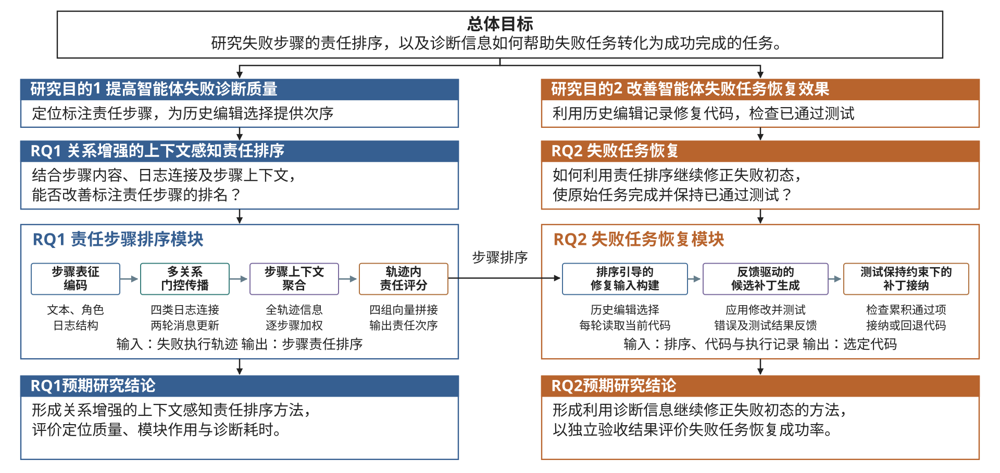
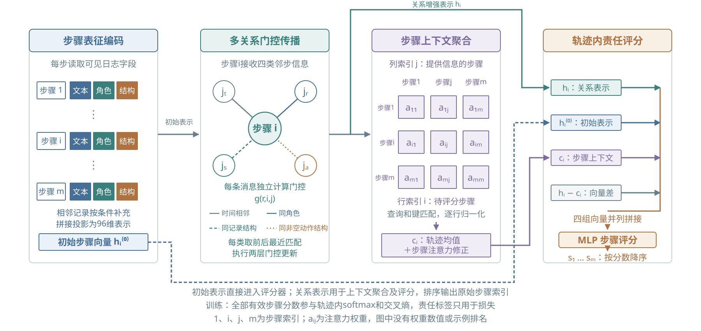
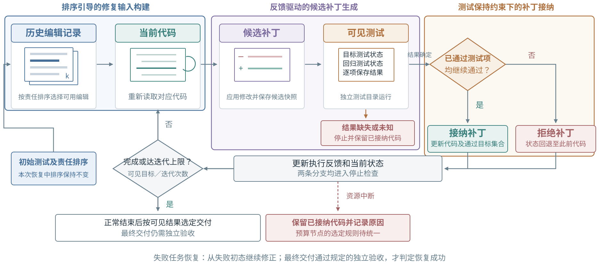
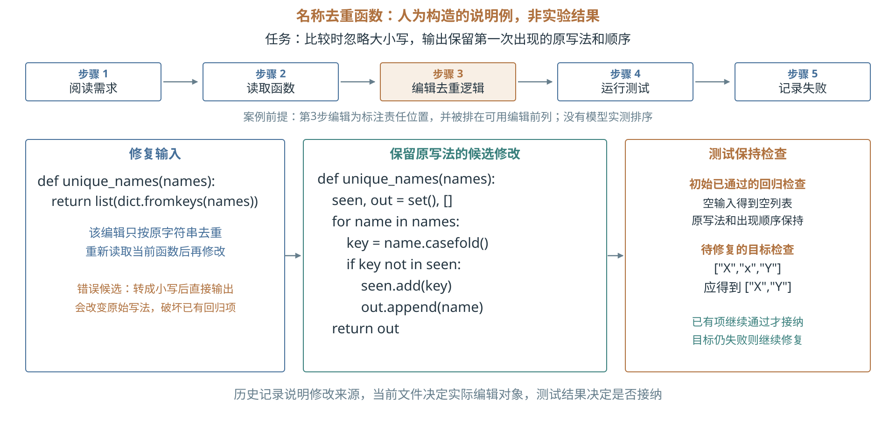
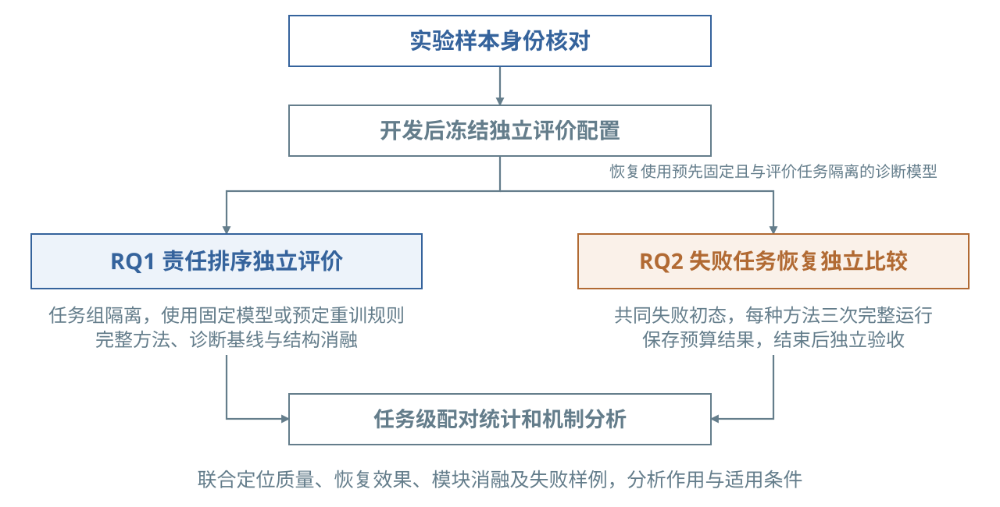

# 基于学习排序的智能体失败诊断与任务恢复方法

开题汇报文案 V15（按拟用PPT页序编排）

> 页码包含封面、目录和六个章节标题页。小节编号在MD中完整保留，PPT正文可只显示小节名称。参考文献恢复紧凑单倍行距。

## 第01页｜封面

基于学习排序的智能体失败诊断与任务恢复方法

开题报告 · 汇报人：杨亚鹏 · 2026年10月

Learning to Rank for Agent Failure Diagnosis and Task Recovery

---

## 第02页｜目录

1. 背景与现状
2. 目标与意义
3. 内容与方法
4. 难点与创新
5. 实验与数据
6. 进度与文献

---

## 第03页｜第一章 背景与现状

（保留模板章节标题页）

---

## 第04页｜1.1 研究背景

大语言模型（Large Language Model，LLM）能够理解自然语言要求，并生成回答、分析和操作建议。要将这些建议用于完成实际任务，系统还需要获取外部信息、执行操作，并根据操作结果决定下一步。基于大语言模型的智能体（Agent）将模型接入工具与运行环境，使其能够围绕任务目标持续行动。ReAct将推理、动作与环境观察交替组织，为这种连续交互提供了基础形式。[1]

在智能体执行中，模型依据任务目标和已有观察选择行动，工具将行动作用于环境，环境返回的信息再用于后续判断。任务可以由单个智能体连续完成，也可以由多个智能体分工协作。随着交互持续，系统需要保留中间信息、衔接前后操作，并检查最终结果是否满足原始要求。

以软件任务为例，解释程序功能与修复实际问题具有不同要求。修复通常需要阅读仓库、理解相关代码、实施修改，再运行测试检查行为；一次修改未成功时，还需依据反馈继续分析。[2] 因此，求解过程表现为多轮“判断、操作、观察”，而不是一次性生成答案。每次执行既产生新的信息，也可能改变后续行动面对的代码和运行状态。

---

## 第05页｜1.1 研究背景

随着步骤增多，一次检索结果可能影响后续判断，一份中间产物可能被其他角色采用，一次错误修改也可能干扰之后的测试。任务最终失败可能涉及信息遗漏、操作选择不当或验证不足等多个环节。[3] 最后出现的报错提供了检查线索，却不一定就是关键错误被引入的位置。重复尝试、正常操作和异常表现交织后，逐条阅读记录的负担也会增加。[4]

失败分析因而需要把结果与过程联系起来。系统不仅要判断任务是否成功，还需要从已有记录中识别值得优先检查的位置，分析这些步骤获得了什么信息、执行了什么操作，以及后续行为如何受到影响。对于已经失败的完整执行，可以利用前后记录形成判断；责任位置则依据数据来源的标注规则进行训练和评价。[4]

诊断之后，还需要考虑如何完成原始任务。历史记录描述过去的执行条件，修正面对的是当前环境。代码可能已被后续操作改变，先前获得的信息也可能失效。[5] 软件场景提供了可检查的代码差异和可执行的测试，[6] 因此适合进一步研究历史线索怎样参与当前修复，以及新修改是否解决问题并保持已有行为。以下先明确研究对象和评价边界，再梳理相关工作。

---

## 第06页｜1.2 研究问题定义

本课题研究智能体通过工具和环境完成任务的执行过程。诊断对象是已经失败的执行，既可来自单智能体，也可来自多智能体；失败任务恢复主要在软件场景中验证。

- **执行轨迹**是同一任务一次尝试产生的有序步骤记录，保存可获得的文本、动作、环境观察和执行角色。轨迹连接前后操作，诊断结果应能回查到具体记录。

- **任务失败**表示执行未满足规定完成条件。软件问题是否解决，需要检查原始要求和规定验收；最后的报错提供线索，但未必就是关键错误被引入的位置。[4,6]

研究将历史轨迹、失败后的代码和最终任务结果联系起来：先确定历史步骤的检查次序，再考察这些信息能否帮助继续完成原始任务。

---

## 第07页｜1.2 研究问题定义

- **失败诊断**分析已经失败的轨迹，输出历史步骤的责任排序，回答“哪些步骤应优先检查”。责任步骤依照数据来源的标注规则训练和评价，排名靠前表示应优先检查，进一步确认因果作用仍需干预证据。[4]

- **失败任务恢复**从失败执行留下的代码和运行环境出发，利用诊断信息继续修正，以成功完成原始任务为目标；最终交付通过规定的独立验收时，判定为恢复成功。

两者分别研究检查次序和最终任务结果。历史步骤不是当前源码位置，需要将历史记录同当前代码对应；一次候选修改被接纳也只是过程进展，仍须评价原始任务是否完成。

因此，本文分别评价责任排序的定位质量，以及诊断信息在失败任务恢复中的实际作用。排序任务、修复输入和测试条件在第三章具体说明。

---

## 第08页｜1.3 国内外研究现状

#### 1.3.1 智能体失败步骤定位

- **MAST（2025）**归纳系统设计、智能体间失配和任务验证等失败模式，说明失败涉及不同环节；模式分类还需落实到具体步骤，才能支持有针对性的检查。[3]

- **Who&When（2025）**将归因落到责任智能体和关键步骤，比较整段日志判断、逐步检查和二分搜索；长日志中的检查次序和诊断开销仍需共同评价。[4]

- **SDBL（2026）**先划定可疑范围，再定位责任步骤，减少直接检查的空间；效果仍取决于候选范围能否覆盖关键位置。[7]

- **StepFinder（2026）**结合时序特征和角色感知交互计算步骤分数，已经评价Top-k及排名质量。本文以其为直接参照，检验日志连接和步骤上下文的作用，同时比较诊断开销。[8]

---

## 第09页｜1.3 国内外研究现状

#### 1.3.2 反馈驱动的代码修复

- **CRITIC（2024）**利用工具检查结果修正输出，说明外部反馈可以参与纠错；调用和执行开销也需要计入比较。[9]

- **Large Language Models Cannot Self-Correct Reasoning Yet（2024）**发现，在所测条件下，无外部反馈的自纠错可能把正确答案改错。因此，需要直接检查修改后的结果。[10]

- **LATS（2024）**利用环境反馈、反思和候选搜索安排后续尝试。它研究任务求解中的搜索，尚未回答历史责任步骤排序怎样形成当前修复输入。[11]

- **Agentless（2025）**依次定位源码、生成补丁并进行测试筛选，为软件修复提供清晰流程。其定位对象是当前源码，本文进一步研究失败历史中的责任线索如何参与修复。[12]

---

## 第10页｜1.3 国内外研究现状

#### 1.3.3 失败任务恢复的执行条件

- **SyncMind（2025）**研究代码更新后智能体认识和当前仓库失步时的恢复，比较独立探索和求助。它提示，继续修正前需要确认历史认识同当前代码是否一致；源码状态恢复也不能直接替代历史责任定位。[5]

- **STRATUS（2025）**在云服务故障处理中结合试执行、检查和撤销，说明后续尝试需要关注已有状态。其保证依赖精确撤销等运行前提，研究对象也不同于本文的软件任务恢复。[13]

这些工作分别提供反馈使用、当前状态确认和修改检查的依据，尚未直接回答：历史步骤的责任次序是否改变修复输入，以及连续修改能否在保持已通过测试的同时完成原始任务。

本文据此保留两个研究问题：先评价责任排序，再把排序接入固定的失败任务恢复流程，用独立验收判断最终结果。测试保持只约束实际执行的测试，不能解释为程序正确性的证明。

---

## 第11页｜1.4 现有问题

- **长轨迹中的责任线索分散，检查次序缺少充分依据。** 最终报错、早期决策和后续信息使用可能位于不同步骤，重复尝试和正常操作又会干扰逐条检查。[4] 时间、角色和记录结构提供不同联系，全轨迹中也可能存在与特定步骤相关的远距离线索。[8] 需要组织这些信息，为历史步骤建立检查次序，并共同评价定位质量与诊断开销。

- **历史诊断与当前任务执行之间仍有衔接缺口。** 诊断描述过去的执行，继续修正面对的代码和环境可能已经变化。[5] 责任位置需要转化为可用的历史记录，并与当前代码对应。连续修改还可能破坏已通过的测试，[6] 因而需要检验诊断信息如何参与补丁生成、候选如何接纳，以及最终交付能否完成原始任务。仅有定位改善、候选接纳或测试数量增加，尚不足以说明失败任务已恢复成功。

前一问题涉及诊断信息的组织与责任排序，后一问题涉及诊断到当前修正的衔接及最终任务结果。下一章据此明确研究目标，并提出相互衔接的两个研究问题。

---

## 第12页｜第二章 目标与意义

（保留模板章节标题页）

---

## 第13页｜2.1 研究目标

**研究失败步骤的责任排序，以及诊断信息如何帮助失败任务转化为成功完成的任务。**

#### 失败诊断

**RQ1：结合步骤内容、步骤间的日志连接和与各步骤相关的轨迹信息，能否改善标注责任步骤的排名？**

在共同任务划分和训练条件下，评价责任排名、诊断耗时及不同轨迹条件下的结果变化。

#### 失败任务恢复

**RQ2：如何利用责任步骤排序，帮助失败任务成功完成，并在迭代中保持已通过的测试项？**

以独立验收下的失败任务恢复成功率评价最终效果，并通过排序对照和模块消融分析诊断信息及测试保持条件的作用。

---

## 第14页｜2.2 研究意义

- **为失败诊断提供可比较的责任排序方法。** 长轨迹中的错误来源和最终表现可能相隔较远。[4] 本研究评价步骤内容、日志连接和步骤上下文对责任排名的作用，共同测量定位质量和计算开销。任务分组、结构消融及分层分析为长轨迹的检查次序提供实验依据，结论限定于相应责任标签和任务条件。

- **检验诊断信息帮助失败任务完成的实际价值。** 历史线索需要同当前代码对应，新修改也可能影响已有行为。[5,6] 本研究分别评价责任排序和恢复结果，分析定位改善能否转化为任务收益，以及保持已通过测试的作用和代价。共同任务、完整资源记录和隔离的独立验收支撑可复查的比较。

---

## 第15页｜第三章 内容与方法

（保留模板章节标题页）

---

## 第16页｜3.1 总体研究框架

失败诊断输出历史步骤的责任排序；失败任务恢复按排序选择历史编辑，结合当前代码和测试反馈继续修正。两个部分分别评价定位质量和最终恢复效果。

图3-1 责任步骤排序与失败任务恢复的研究框架

---

## 第17页｜3.2 研究任务定义

#### 3.2.1 责任步骤排序任务

一条已经失败的完整轨迹构成一个排序组，全部有效步骤为候选。文本、动作、观察和角色等可见字段进入模型；步骤边界及原始索引固定，补齐位置不评分。轨迹可来自对话协作或产物交接式系统。[14,15]

**学习排序**利用标注学习组内相对次序：逐点式分别预测候选相关程度，成对式学习两候选的相对偏好，列表式共同利用组内分数。[16] 本文采用轨迹内softmax和单责任位置交叉熵；参考ListNet的组内训练思想，但当前监督可解释为位置分类，不提供其余步骤的完整人工次序。[17]

责任标签沿用来源规范。不同来源可能强调错误引入、职责遗漏或错过的纠正机会；自然失败和干预构造的标注也须区分。[18,19] 标签只用于训练和评价，推断读取可见轨迹；责任排名不等同于已确认的因果作用。

---

## 第18页｜3.2 研究任务定义

#### 3.2.2 失败任务恢复任务

失败执行留下的代码和必要运行环境称为**失败初态**。失败后的干预及继续执行用于评价修正效果。[20] 重建时须对应失败记录、实际文件和必要环境，历史上下文不能替代当前代码。[21] 本文实施代码修复、补丁生成和测试，必要时回退此前已接纳代码。

允许向生成过程提供反馈的测试称为**可见测试**；与生成隔离、仅评价最终交付的称为**独立验收测试**，用于检查原始任务完成条件。候选接纳、可见测试改善和继续执行均是过程进展，状态回退是恢复此前代码，须同最终恢复成功区分。

例如，一次修改仍未解决目标问题，但部分功能已经通过测试。系统选择历史线索并确认当前代码，生成和测试候选，依据已有通过项是否保持决定接纳；最终仍以独立验收判断任务是否完成。

---

## 第19页｜3.3 责任步骤排序模型

责任步骤排序模型包括四个模块，依次形成步骤表示、汇集上下文并输出责任次序：

- **步骤表征编码**：将步骤文本、匿名角色和日志结构特征编码为初始表示。

- **多关系门控传播**：沿四类可观察日志连接传递邻步信息，以可学习门控控制各条消息的强度，形成关系增强表示。[22]

- **步骤上下文聚合**：针对每个待评分步骤，从整条已发生轨迹中汇集相关信息，形成步骤上下文向量。

- **轨迹内责任评分**：拼接初始表示、关系增强表示、步骤上下文及表示差异，计算步骤分数并在轨迹内排序。

单模型按步骤分数降序排序，同分按原始步骤索引处理；三模型集成先各自作轨迹内归一化，再平均预测权重并排序。输出完整责任次序，供后续选择可用历史编辑。

日志连接表示可观察联系。门控和注意力用于加权信息，其权重不直接表示因果强度。

---

## 第20页｜3.3 责任步骤排序模型

图3-2 责任步骤排序模型的计算结构

---

## 第21页｜3.4 关系增强的步骤表征

#### 3.4.1 步骤表征编码

- **编码输入**：步骤文本描述操作和观察，匿名角色区分行为来源，日志结构特征描述字段形式、相对位置及同类结构的重复情况。三类信息形成步骤初始表示。

- **表示维度**：当前原型固定Qwen3-Embedding-0.6B编码器，文本128维、角色32维、结构特征23维，拼接后投影为96维。文本和角色向量归一化，结构特征仅用训练部分统计量标准化。

- **角色匿名**：按本轨迹首次出现顺序编号为role_0、role_1等，轨迹内保持一致。当前恢复输入只有一个执行角色，多角色条件主要在诊断数据中分析。

- **记录补充**：只有原始步骤相邻、角色相同且日志明确标记对应时，两条记录才互补文本，并保持原索引。当前软件发布的18条轨迹未触发有效配对，其收益尚未在该场景验证。

---

## 第22页｜3.4 关系增强的步骤表征

#### 3.4.2 多关系门控传播

多关系门控传播沿时间相邻、同一匿名角色、相同完整记录结构及相同非空动作结构四类连接更新初始表示。后两类比较类型、嵌套和大小，去除键名及具体值；每类取前后最近匹配步骤，连接只表示可观察联系。

每条邻步消息通过一个可学习的标量门控控制强度。门控读取接收步骤与“邻居减接收步骤”的差异，产生0到1的标量权重；权重较小时，该条消息的影响减弱。消息变换读取邻居表示及上述差异，各关系内部先对门控消息取邻居均值，再学习四类关系的融合权重，将汇集结果与原表示相加，并经归一化得到更新表示。这样既能采用其他步骤的线索，也保留本步骤内容。

两轮更新后，一个步骤还可接收经由其他节点传来的向量信息。没有邻居的通道不增加信息；单角色轨迹中，同角色连接可能与时间连接重合，实验分别记录单角色和多角色条件，以分析连接重合对实际作用的影响。 四类连接依据日志形式建立，须同工具请求、返回及内容使用所恢复的依赖关系区分。[23]

---

## 第23页｜3.5 上下文感知的责任评分

#### 3.5.1 步骤上下文聚合

步骤上下文向量是在评分某一步时，从整条已发生轨迹中汇集得到的信息表示。模型将关系更新后的步骤向量分别线性映射为查询、键和值。步骤i的查询与各步骤的键计算相似度，经softmax归一化后得到一行权重$a_{ij}$，再用它们加权汇集各步骤的值向量。

softmax将一组分数转换为非负且和为1的权重。这里沿信息提供步骤j归一化，每行和为1；它与后面用于责任排序训练的归一化属于不同计算。聚合可包含自身和已经发生的前后步骤，适用于执行后的失败定位。

实际实现先计算整条轨迹步骤表示的均值，再加入当前步骤注意力结果的线性修正，得到96维的$c_i$。它是评分网络的输入向量，不是一行注意力权重。权重也不能直接解释为因果强度。完整注意力的时间与存储开销随步骤数呈二次增长，实验同时报告定位质量和诊断耗时。

---

## 第24页｜3.5 上下文感知的责任评分

#### 3.5.2 轨迹内责任评分

评分网络读取关系更新后的步骤表示、初始表示、步骤上下文及表示差异。初始表示通过直接支路保留局部信息，四组向量并列拼接后输入MLP：

$$
s_i=\operatorname{MLP}([h_i;h_i^{(0)};c_i;h_i-c_i]).
\tag{1}
$$

式（1）中四组向量各为96维，拼接后为384维。分号表示向量拼接，$h_i-c_i$为逐元素相减。分数只用于比较同一轨迹中的步骤，后续修复按这一顺序选择可用的历史编辑记录。

---

## 第25页｜3.5 上下文感知的责任评分

#### 3.5.3 轨迹级监督学习

设轨迹有m个有效步骤，标注责任位置为y。全部步骤分数共同归一化，单条轨迹使用责任位置的交叉熵损失：

$$
p_i=\frac{\exp(s_i)}{\sum_{j=1}^{m}\exp(s_j)},\qquad \ell=-\log p_y.
\tag{2}
$$

$p_i$是轨迹内预测权重，$\ell$是训练损失。提高标注位置的权重会降低其损失，促使它排在前面。当前监督是单责任位置分类，按轨迹组织全部步骤并联合归一化，不提供其余步骤之间的完整人工次序。输出权重用于同轨迹排序，不解释为步骤致错的概率。

AgenTracer来源训练对轨迹损失取平均；AFTraj先在同一源任务组内平均，再对任务组等权平均。三次初始化集成时，先分别计算轨迹内预测权重，再平均并排序。结构消融均重新训练，比较两项信息汇集设计的作用。

---

## 第26页｜3.6 失败任务恢复流程

失败任务恢复包括以下三个模块。修复输入组织历史线索，候选生成落实代码修改，补丁接纳控制当前代码的更新。

- **排序引导的修复输入构建**：按责任排序选择可用历史编辑，每轮读取相关当前代码，并加入原始问题和此前执行反馈，形成生成模型的修复输入。

- **反馈驱动的候选补丁生成**：生成模型根据修复输入提出候选补丁，执行端检查修改能否应用，再运行许可的可见测试，为后续尝试提供反馈。

- **测试保持约束下的补丁接纳**：检查初始已通过回归项和累积已通过目标项是否保持，决定接纳候选或回退至此前代码。

“反馈驱动”指根据应用错误和测试结果调整下一轮输入。达到停止条件后依据可见结果选定交付，最终通过独立验收才判定恢复成功。

---

## 第27页｜3.6 失败任务恢复流程

图3-3 失败任务恢复流程

---

## 第28页｜3.7 排序引导的修复输入构建

责任排序决定历史编辑记录进入生成模型的先后次序。当前原型从排序步骤中提取成功执行、确实修改了许可范围内项目源码的编辑，按编辑调用标识去重，并保留原始步骤索引。同一文件中的不同编辑分别保留。排序中没有可用编辑的步骤不会被补造为编辑记录。

系统保存历史修改前后的差异，每轮重新读取对应的当前文件，分别提供历史修改和当前内容。还根据历史改动涉及的函数及可见失败记录，补充当前可能相关的函数。文件路径和语法符号提供读取线索，静态匹配不作为因果依赖证明。

选定编辑记录、当前代码、原始问题和此前执行结果共同组成修复输入。当前原型按记录条数和编辑记录文本的字节数限制历史输入，字节数与模型token数分别记录，每轮按既定顺序增加选入的编辑记录，保留此前已选部分，完整函数片段在容量允许时进入输入，不切断代码；超出容量的情况单独记录。正式实验前统一容量与计量规则。

初始失败轨迹只排序一次，后续更新当前代码和执行结果。实验保存模型、排序、选中编辑及实际生成输入的对应关系；若不同排序最终提供相同信息，也如实记录。

---

## 第29页｜3.8 反馈驱动的候选补丁生成

本模块以修复输入为依据，生成候选补丁，并通过应用检查和可见测试获得下一轮反馈。一次候选尚未被接纳，按以下四步处理：

- **生成修改**：输出文件路径、待替换文本和新文本。待替换文本须能在当前文件中唯一匹配。

- **检查应用**：核对路径许可、输出格式和文本匹配。格式错误、应用失败分别记录，满足条件后应用修改并保存候选快照。

- **执行测试**：在本次尝试的独立测试目录中按候选快照重建代码，运行指定的可见目标测试和回归测试，保存逐项结果。

- **更新反馈**：将应用错误及可见测试结果加入下一轮输入。生成模型参数在恢复过程中保持固定，独立验收结果和其他方法补丁均不进入生成输入。

---

## 第30页｜3.9 测试保持约束下的补丁接纳

#### 已通过测试的检查

目标测试检查当前软件问题要求修正的行为，回归测试检查已有功能。令B为失败初态下已通过的回归测试集合，$H_t$为初始及截至第t轮已接纳代码中确认通过的目标测试集合。候选必须使B与$H_t$中的每个测试继续通过：

$$
B\cup H_t\subseteq\operatorname{Pass}(S').
\tag{3}
$$

$\operatorname{Pass}(S')$表示候选代码确认通过的测试标识集合。接纳候选后，将新通过目标加入$H_t$；拒绝候选时，进行状态回退，恢复此前已接纳代码并保留失败记录。被拒候选的新通过项不加入集合。候选即使没有增加通过数量，只要满足接纳条件，也可用于下一轮。

当前原型要求测试结果覆盖完整且状态确定；缺失或不确定时停止该次运行，保留已接纳代码，原因单独记录。这里的保持条件只覆盖实际执行的测试，不构成程序正确性的证明。

---

## 第31页｜3.9 测试保持约束下的补丁接纳

#### 迭代终止规则

每轮接纳或拒绝后检查停止条件。可见目标全部通过或达到迭代上限时正常结束；资源中断时保留已接纳代码并记录原因。正常结束时，在初态及已接纳代码中，先保留仍满足最终测试保持条件的状态，再依次比较可见失败目标数、修改行数和尝试先后。独立验收只评价选定交付；只有通过规定的独立验收，才判定为恢复成功。

严格保持条件可能阻止需要暂时使某项测试失败的修复路径。实验比较去除累积目标保持后的结果，并分析具体测试变化和最终失败任务恢复效果。预算节点的保存与选定规则将在正式实验前统一，不能把原型的异常中断处理直接当作已完成的预算评价。

---

## 第32页｜3.10 方法示例：名称去重函数

本例为解释方法而构造，不是实验结果，没有给出模型实测权重或排序成绩。任务是修改一个名称去重函数：比较名称时忽略大小写，保留第一次出现的原始写法和顺序。

#### 责任排序的修复输入

假设历史执行依次经历阅读需求、读取函数、把原实现改为按原字符串去重、运行测试和记录失败。第3步的编辑保留了顺序，却没有处理大小写，因此输入`["X","x","Y"]`仍会得到三项。为讲解RQ1，假定该编辑被标注为责任步骤，且被模型排在可用编辑的前列；这只是案例前提。

RQ2据此取出第3步的修改记录，重新读取当前函数。历史记录用于说明修改来源，当前文件才是实际编辑对象。生成模型同时读取“应忽略大小写”的原问题和失败测试结果，再提出候选补丁。

---

## 第33页｜3.10 方法示例：名称去重函数

图3-4 名称去重函数的修复说明例（人为构造，非实验结果）

---

## 第34页｜3.10 方法示例：名称去重函数

#### 候选补丁的接纳依据

本例将空输入和保持原始写法、顺序的检查作为初始已通过回归项，将大小写去重检查作为待修复目标。直接把名称转成小写再输出，会改变原始写法，因此即使某些重复项被删除，候选仍会破坏回归项而被拒绝。后续修改可以只用转换为同一大小写形式的字符串判断是否重复，输出仍保存原名称。

候选使已有回归项继续通过，且可见目标测试通过后，可结束本轮代码修复并选定交付。该进展仍需独立验收确认，才能判定为恢复成功。若仅满足已有通过项而仍有目标失败，可以接纳并继续。案例只解释输入、修改和测试之间的关系，失败任务恢复成功率仍需第五章的真实实验评价。

---

## 第35页｜第四章 难点与创新

（保留模板章节标题页）

---

## 第36页｜4.1 拟解决的关键问题

- **责任排序**：单步文本难以组织分散线索。需要判断日志连接和步骤上下文能否改善责任排名，同时处理关系重合和长轨迹计算开销。

- **失败任务恢复**：历史步骤需要对应当前代码，后续修改又可能破坏已通过测试。需要检查排序是否改变修复输入，并分析严格保持条件的作用及代价。

#### 4.2 预期创新设计

- **责任步骤排序方法**：在步骤表征编码基础上，通过多关系门控传播形成关系增强表示，再由步骤上下文聚合和轨迹内责任评分输出排序，用结构消融验证两项信息汇集设计。

- **失败任务恢复方法**：按已固定的三个模块实施修复输入构建、候选补丁生成和补丁接纳；系统基线比较评价完整流程，排序替换和模块消融分析各项设计。

实际效果由共同任务上的实验检验，现有开发结果用于完善方法，尚不能证明独立评价中的优势。

---

## 第37页｜4.3 方法适用范围

**责任监督范围**：责任定位依据数据来源的标签，跨来源的责任定义可能不同。当前单责任位置监督也不能完整规定其他步骤之间的次序。 责任定位和实际干预收益须分别判断。[24]

**长轨迹适用性**：全轨迹上下文增加长记录的计算开销。单角色软件轨迹还可能使部分关系重合，需要通过分层与消融限定模块作用。

**测试覆盖范围**：已通过测试的保持条件仅覆盖实际执行的可见测试，不构成程序正确性的形式化保证。

**测试保持的资源代价**：严格保持条件可能阻碍需要暂时退步的修复，反复验证也会消耗预算。因此，独立评价同时报告恢复结果、资源和失败过程，分析方法在哪些条件下有效及何时受到限制。

---

## 第38页｜第五章 实验与数据

（保留模板章节标题页）

---

## 第39页｜5.1 实验数据设计

#### 5.1.1 数据来源

表5-1 数据来源与研究样本

| 数据来源 | 发布规模 | 当前研究样本 | 主要用途 |
| --- | --- | --- | --- |
| AFTraj | 2,276条轨迹 | 731条失败轨迹；716任务组 | 失败步骤定位 |
| AgenTracer扩展版 | coding训练1,141条；测试127条 | 来源池614条；coding评价363条 | 软件轨迹定位 |
| SWE-Gym | 2,438个Python问题 | 23个已整理软件问题 | 恢复方法开发 |

AFTraj发布2,276条轨迹，安全1,162、不安全1,114，安全标签与任务失败分别核对。[25] 开发子集为120个不同任务组：五个任务类型和标注来源组合各24条，含coding 24、math 48、agentic 48。

AgenTracer扩展版与论文版规模不同。[26] 614条来源池含coding 320、math 294；363条固定coding开发评价轨迹同样取自官方训练部分，按源任务组隔离。恢复样本来自SWE-Gym。[27]

---

## 第40页｜5.1 实验数据设计

#### 5.1.2 诊断样本划分

- **任务分组**：同一原始任务的轨迹、错误变体和派生样本归同组；清洗可读格式，固定步骤边界、原始索引及标签映射，记录排除原因。标签沿用来源规范，合并训练前核对责任含义。

- **AFTraj开发评价**：716组作五折分组评价，外层留一折，其余组内部训练和验证；每配置三次预定初始化。未使用该任务组训练的模型产生外折预测，汇总731条；参与方法选择的结果仍属开发评价。

- **AgenTracer开发评价**：A、B、C划分各训练492条、验证122条，在同一363条coding集比较，各作三次初始化。训练含coding 256、math 236，验证含coding 64、math 58，三部分任务组隔离。

- **独立评价**：配置固定后，从AFTraj官方测试的163条失败轨迹和AgenTracer官方coding测试的127条中筛选未参与开发的样本，核对任务身份及历史使用，分别报告合格轨迹数和任务组数。

---

## 第41页｜5.1 实验数据设计

#### 5.1.3 失败任务恢复样本

- **评价单位**：软件问题（issue）按来源、仓库和原问题标识确认。同一问题的多条失败轨迹或不同代码版本不增加独立问题数；每题预先固定一个失败初态，各方法从该初态独立运行3次。如采用多个初态，先规定问题内汇总。

- **失败初态**：保存原问题、来源轨迹、失败后实际代码及必要环境，核对仓库提交、依赖、测试命令和初始结果。可见目标测试检查待修行为，回归测试检查已有功能；独立验收测试与生成隔离。仅恢复原始提交不足以重建失败现场。

- **样本纳入**：诊断核对轨迹完整和标注可映射，恢复另核对环境可重建、反馈可用、测试可执行，报告排除数量及原因。主要采用智能体真实失败环境，人为构造样本只作机制检查并单列。

- **研究样本**：现有23个软件问题用于开发、接口和资源估计；独立评价另从SWE-Gym筛选20个未参与开发的合格问题，覆盖至少3个仓库。按预定顺序核资格，最终数量以实际合格为准。

---

## 第42页｜5.2 实验流程设计

#### 5.2.1 总体实验流程

先核对任务身份并分开开发和独立评价，在开发部分选择配置，再固定样本、实现、输入及评价规则。RQ1评价责任排序，RQ2从共同失败初态运行完整方法；两分支独立评价，消融沿用相应完整方法的划分。RQ2使用预先固定且同恢复任务隔离的诊断模型。

图5-1 责任步骤排序与失败任务恢复的实验流程

---

## 第43页｜5.2 实验流程设计

#### 5.2.2 责任排序评价流程

- **训练和选轮**：按任务分组划分，只在训练部分拟合标准化及排序网络，在验证部分先按Top-1、再按MRR选轮，并列取最早轮。本文与StepFinder共用可见轨迹、分组和选择信息，各自保留核心结构及训练设置。

- **已执行配置**：固定文本编码器，排序网络采用两层多关系门控传播、96维表示、Dropout 0.15；AdamW学习率0.001、权重衰减0.0001、梯度范数裁剪1.0，最多40轮，连续8轮无提升停止。

- **分组预测**：AgenTracer批次为16条轨迹，AFTraj为16个完整任务组；AFTraj内层选轮后在其余四折重训。保留任务、轨迹、步骤索引及预测对应，记录输入上限、实际截断、硬件和参数量。

- **结果汇总**：消融重新训练并沿用划分、初始化及选轮规则。AFTraj报告三次完整外折结果及均值、标准差；AgenTracer先在各划分内汇总三次初始化，再报告划分间变化。三模型集成另列。

---

## 第44页｜5.2 实验流程设计

#### 5.2.3 失败任务恢复执行流程

表5-2 失败任务恢复的共同运行条件

| 条件 | 统一设置 |
| --- | --- |
| 任务起点 | 同一原问题、仓库版本、失败代码及环境 |
| 生成模型 | deepseek-flash；部署参数预先固定 |
| 测试条件 | 同代码和反馈许可、可见测试及独立验收 |
| 运行设置 | 共同时间及token上限；每题独立运行3次 |

环境和初始测试单列准备开销，随后依次排序、构建修复输入、生成候选、测试及补丁接纳，保存预算交付后独立验收；核对模型及训练任务、排序、选中编辑和实际输入。

独立重复重建同一初态并重置历史，不继承其他重复结果；候选、子智能体及投票均属一次运行，续跑累计原预算。计时包含加载、诊断、生成、工具、测试及选择；并行按同一墙钟，token累计全部阶段、子智能体及失败候选的模型输入输出，工具耗时只计时间。

---

## 第45页｜5.2 实验流程设计

#### 5.2.4 独立评价前固定配置

- **数据划分**：发布版本和校验、任务身份映射、纳入及排除清单、分组划分、初始化值。开发小试和独立评价样本分开，后者只按预定规则核验资格和环境。

- **方法配置**：编码器、输入上限及截断、训练及选轮参数、评价权重或集成方式；各基线代码版本、提示和完整内部参数，记录部署差异并保留方法核心。

- **恢复条件**：每题提交、失败后代码、环境重建方式、可见及独立验收命令、目标和回归项标识、历史编辑选择、动作检查、交付选定规则。

- **资源规则**：生成模型版本、采样参数、共同token上限、执行和重试、缓存、停止及统计重采样设置。token上限和历史编辑容量据开发测量确定，未确定项补齐后再开展独立评价。

---

## 第46页｜5.3 基线方法设置

#### 5.3.1 失败诊断基线

All-at-Once、Binary Search来自Who&When（ICML 2025）[4]，StepFinder发表于KDD 2026。[8] 在共同条件下比较定位和诊断开销。

表5-3 失败诊断基线设置

| 方法 | 方法类型 | 核心机制 |
| --- | --- | --- |
| All-at-Once | 生成式诊断 | 整条日志的一次性归因 |
| Binary Search | 生成式诊断 | 递归区间搜索 |
| StepFinder | 学习式诊断 | 时序特征提取、角色感知交互 |
| 本文 | 学习式诊断 | 多关系门控传播、步骤上下文聚合 |

所有方法比较Top-1，无效输出计未命中并单列数量。本文和StepFinder另比较MRR、Hit@3、Hit@5：单模型按分数排序，集成按平均轨迹内预测权重排序；All-at-Once和Binary Search采用原始单位置设置。生成式方法固定后端、提示和搜索规则，训练及计时条件见5.2。

---

## 第47页｜5.3 基线方法设置

#### 5.3.2 失败任务恢复基线

Agentless（FSE 2025）[12]、EnAgent（ICSE 2026）[28]和AOrchestra（ICML 2026）[29]作为完整系统基线，共同运行条件见5.2。

表5-4 失败任务恢复基线设置

| 方法 | 核心机制 |
| --- | --- |
| Agentless | 分层定位、补丁生成、测试筛选 |
| EnAgent | 多轨迹生成、回归剪枝、工具辅助投票 |
| AOrchestra | 任务相关上下文组织、动态子智能体创建 |
| 本文 | 排序引导的修复输入构建、反馈驱动的候选补丁生成、测试保持约束下的补丁接纳 |

各基线保留定位、生成、验证及选择的核心流程，公开本实验部署参数和差异。成功、正常失败、工程中断及未完成分别记录。

---

## 第48页｜5.4 预算约束下的评价指标

#### 5.4.1 失败诊断评价

表5-5 主要评价指标

| 指标 | 计算口径 |
| --- | --- |
| MRR ↑ | 责任步骤倒数排名的任务组均值 |
| Top-1 ↑ | 首位命中责任步骤的比例 |
| Hit@3 / Hit@5 ↑ | 前3 / 5位命中责任步骤的比例 |
| 端到端耗时P50 / P95 ↓ | 诊断耗时的中位数 / 95分位数 |
| RSR@30min ↑ | 30分钟内已选定交付、事后通过独立验收测试的比例 |

MRR先取责任步骤倒数排名，再组内平均、任务组等权汇总，如第1/2/5位分别记1/0.5/0.2；多标签取最靠前责任位置并单列。Top-1和Hit@3/5按相同规则汇总，评价首位及前3/5位命中。诊断耗时从原始轨迹开始，含加载、编码、结构构建和评分或生成；统一硬件及部署，分别统计首次加载和模型已加载时的P50、P95。

---

## 第49页｜5.4 预算约束下的评价指标

#### 5.4.2 失败任务恢复评价

失败任务恢复成功率（RSR）先取每题3次独立运行的成功比例，再对共同问题平均。成功要求预算内已选定并交付，事后通过同一独立验收；处理中候选不计成功，不取三次中的最好一次。

- **预算记录**：主要30分钟，同时保存15、60分钟节点的代码、选定时间和累计资源。运行至60分钟或更早达到内部停止及共同token上限，只评价当时已选结果；提前停止后沿用已选结果，较晚结果不回填较早节点。

- **独立验收**：结束后单独验收各快照，反馈不返回生成。达到共同资源上限但未成功交付计该预算下未成功；工程中断、测试不确定和未运行另列，已可判定节点保留。取消60分钟截断的继续运行保持原配置及预算轨迹，另记额外资源和原因，区分自然停止与安全中断。

---

## 第50页｜5.5 核心消融实验

#### 5.5.1 核心模块消融

“w/o”表示移除指定设计。两类消融分别以本RQ的Full为参照，每次只改变表中所列部件。

表5-6 核心模块消融设计

| 研究问题 | 实验条件 | 相对完整方法的改动 |
| --- | --- | --- |
| RQ1 责任排序 | Full | 完整责任步骤排序模型 |
|  | w/o RelProp | 跳过多关系门控传播，直接使用初始表示 |
|  | w/o StepCtx | 以全轨迹均值替代各步骤的上下文向量 |
| RQ2 失败任务恢复 | Full | 完整失败任务恢复流程 |
|  | w/o HistEdit | 移除历史编辑输入，保留当前代码和反馈 |
|  | w/o CurrentRead | 移除依据历史编辑的专门当前代码读取 |
|  | w/o TargetKeep | 移除累积目标保持条件，保留初始回归项保持 |

---

## 第51页｜5.5 核心消融实验

#### 5.5.1 核心模块消融

- **责任排序消融**：两项变体均重新训练，保持任务划分、其余输入、预定初始化及模型选择规则一致。比较MRR、Top-1、Hit@3、Hit@5和诊断耗时，记录参数量。逐类关系和长轨迹分析用于解释结果。

- **失败任务恢复消融**：固定生成模型、源码许可、动作检查、可见测试、交付规则及资源。三项变体保留表中未移除的信息或保护，按实际使用累计资源，比较预算内RSR。

w/o CurrentRead仍保留共同源码访问许可，须记录是否经其他操作获得相同代码；w/o TargetKeep仅移除初始及后续已接纳代码中已通过目标项的保持条件，初始已通过回归项仍须保持。上述消融均为拟开展设计。

逐类关系、轨迹长度、角色数和关系重合按开发阶段确定的规则分层，用于解释作用范围；已通过测试规模及各轮测试变化一并记录。

---

## 第52页｜5.6 实验结果分析方案

- **排序作用**：固定恢复流程，替换StepFinder排序和历史时间顺序，保持筛选、去重及容量规则。保存排序、编辑、输入和补丁，相同结果也保留；时间顺序仍含历史编辑，同w/o HistEdit区分。

- **测试保持**：逐项检查接纳修改及被拒候选影响的测试，机制样本比较按数量和按标识保持，并保留需要暂时退步的修复路径。过程解释同最终RSR分开，开发、机制和独立评价分别报告。

- **配对统计**：先在任务内汇总轨迹或三次重复，再按任务配对自助重采样，估计95%置信区间，少样本同时列逐题差异。报告计划、可评价及完整配对数；预算节点共同集合要求各方法三次均可判定，缺失原因单列。

- **工作量**：20题×4方法×3次＝240条，30/60分钟累计120/240小时，均非日历时长。StepFinder替换、时间顺序各增加60条；三项恢复消融若覆盖20题，另需180条。预算快照复用同一运行，呈现诊断表、RSR时间曲线、消融和代表性过程。

---

## 第53页｜第六章 进度与文献

（保留模板章节标题页）

---

## 第54页｜6.1 前期研究基础

- **责任排序**：已建立轨迹整理、步骤映射、分组评价和模型训练。在开发用AFTraj 120任务组上，三次初始化的外折预测集成命中86组，StepFinder命中82组，相差3.33个百分点；尚不足以确认稳定优势。

- **部署模型**：AgenTracer已建立614条来源池、363条coding评价集及A/B/C划分。当前恢复使用该来源训练的三模型集成，同AFTraj模型架构相同、权重不同；独立评价前仍须核对任务重叠并固定最终模型。

- **恢复原型**：已实现排序接入、当前代码、反馈、候选生成、可见测试及状态记录。排序替换先导的五条轨迹来自同一开发问题，已完成条件在自然停止后均通过独立验收，尚未显示排序间恢复成功率差异。

- **比较基础**：Agentless、EnAgent已有完整运行，AOrchestra完整先导已通过独立验收。后续修改破坏已通过测试的现象已有记录；仍需完善容量、未知处理及预算交付规则，完成共同任务系统比较和测试保持收益验证。

---

## 第55页｜6.2 研究进度安排

研究分阶段完成问题界定、两项研究问题的方法与实验，以及论文和答辩材料。

- **2026.09—10**：文献梳理、问题界定与原型验证
- **2026.11—12**：失败步骤排序模型与诊断实验
- **2027.01—02**：失败任务恢复与系统比较
- **2027.03**：消融分析、结果整理与论文初稿
- **2027.04—05**：论文修改、定稿与答辩准备

正式测试前确定任务组、方法配置和评价规则，后续按既定流程比较。资料整理、实现完善和论文撰写随阶段进展交叉进行。

---

## 第56页｜6.3 预期研究成果

#### 责任步骤排序方法

形成基于轨迹内学习排序的智能体失败诊断方法，明确多关系门控传播和步骤上下文聚合对责任排名的作用。交付排序模型、分组评价说明及可复查的诊断记录，报告定位质量、结果变化和推断开销。

#### 失败任务恢复方法

形成利用责任排序构建修复输入、根据反馈生成候选补丁并按测试保持条件接纳修改的方法，通过系统基线比较和核心消融评价恢复效果。交付研究原型及恢复实验记录，并完成学位论文，说明两项研究的适用条件和后续问题。

---

## 第57页｜6.4 参考文献

[1] Shunyu Yao, Jeffrey Zhao, Dian Yu, et al. ReAct: Synergizing Reasoning and Acting in Language Models. International Conference on Learning Representations (ICLR), 2023. [原文](https://openreview.net/forum?id=WE_vluYUL-X).

[2] John Yang, Carlos E. Jimenez, Alexander Wettig, et al. SWE-agent: Agent-Computer Interfaces Enable Automated Software Engineering. Advances in Neural Information Processing Systems, 2024. [原文](https://proceedings.neurips.cc/paper_files/paper/2024/hash/5a7c947568c1b1328ccc5230172e1e7c-Abstract-Conference.html).

[3] Mert Cemri, Melissa Z Pan, Shuyi Yang, et al. Why Do Multi-Agent LLM Systems Fail? Advances in Neural Information Processing Systems, Datasets and Benchmarks Track, 2025. [原文](https://papers.nips.cc/paper_files/paper/2025/hash/b1041e52d3be19f0a9bc491657488e4a-Abstract-Datasets_and_Benchmarks_Track.html).

[4] Shaokun Zhang, Ming Yin, Jieyu Zhang, et al. Which Agent Causes Task Failures and When? On Automated Failure Attribution of LLM Multi-Agent Systems. Proceedings of the 42nd International Conference on Machine Learning (ICML), PMLR 267: 76583–76599, 2025. [原文](https://proceedings.mlr.press/v267/zhang25cq.html).

[5] Xuehang Guo, Xingyao Wang, Yangyi Chen, et al. SyncMind: Measuring Agent Out-of-Sync Recovery in Collaborative Software Engineering. Proceedings of the 42nd International Conference on Machine Learning (ICML), PMLR 267: 20993–21066, 2025. [原文](https://proceedings.mlr.press/v267/guo25l.html).

[6] Carlos E. Jimenez, John Yang, Alexander Wettig, et al. SWE-bench: Can Language Models Resolve Real-world GitHub Issues? International Conference on Learning Representations (ICLR), 2024. [原文](https://proceedings.iclr.cc/paper_files/paper/2024/hash/edac78c3e300629acfe6cbe9ca88fb84-Abstract-Conference.html).

[7] Kai Sun, Wenqiang Li, Bo Dong, et al. Scope Delineation Before Localization: A Two-Stage Framework for Enhancing Failure Attribution in Multi-Agent Systems. Proceedings of the AAAI Conference on Artificial Intelligence, 40(39): 33108–33116, 2026. [原文](https://ojs.aaai.org/index.php/AAAI/article/view/40594).

[8] Taiyu Zhu, Yifan Wu, Weilin Jin, et al. StepFinder: A Temporal Semantic Framework for Failure Attribution in Multi-Agent Systems. Proceedings of the 32nd ACM SIGKDD Conference on Knowledge Discovery and Data Mining V.2: 6946–6957, 2026. [原文](https://doi.org/10.1145/3770855.3817991).

[9] Zhibin Gou, Zhihong Shao, Yeyun Gong, et al. CRITIC: Large Language Models Can Self-Correct with Tool-Interactive Critiquing. International Conference on Learning Representations (ICLR), 2024. [原文](https://proceedings.iclr.cc/paper_files/paper/2024/hash/fef126561bbf9d4467dbb8d27334b8fe-Abstract-Conference.html).

---

## 第58页｜6.4 参考文献

[10] Jie Huang, Xinyun Chen, Swaroop Mishra, et al. Large Language Models Cannot Self-Correct Reasoning Yet. International Conference on Learning Representations (ICLR), 2024. [原文](https://proceedings.iclr.cc/paper_files/paper/2024/hash/8b4add8b0aa8749d80a34ca5d941c355-Abstract-Conference.html).

[11] Andy Zhou, Kai Yan, Michal Shlapentokh-Rothman, et al. Language Agent Tree Search Unifies Reasoning, Acting, and Planning in Language Models. Proceedings of the 41st International Conference on Machine Learning (ICML), PMLR 235: 62138–62160, 2024. [原文](https://proceedings.mlr.press/v235/zhou24r.html).

[12] Chunqiu Steven Xia, Yinlin Deng, Soren Dunn, et al. Demystifying LLM-Based Software Engineering Agents. Proceedings of the ACM on Software Engineering, 2(FSE): 801–824, 2025. [原文](https://doi.org/10.1145/3715754).

[13] Yinfang Chen, Jiaqi Pan, Jackson Clark, et al. STRATUS: A Multi-agent System for Autonomous Reliability Engineering of Modern Clouds. Advances in Neural Information Processing Systems 38, 2025. [原文](https://proceedings.neurips.cc/paper_files/paper/2025/hash/47a6e9e2c3019f13ad94a0f259fe4970-Abstract-Conference.html).

[14] Qingyun Wu, Gagan Bansal, Jieyu Zhang, et al. AutoGen: Enabling Next-Gen LLM Applications via Multi-Agent Conversation. Conference on Language Modeling (COLM 2024). [原文](https://www.microsoft.com/en-us/research/publication/autogen-enabling-next-gen-llm-applications-via-multi-agent-conversation-framework/).

[15] Sirui Hong, Mingchen Zhuge, Jonathan Chen, et al. MetaGPT: Meta Programming for A Multi-Agent Collaborative Framework. International Conference on Learning Representations (ICLR 2024). [原文](https://proceedings.iclr.cc/paper_files/paper/2024/hash/6507b115562bb0a305f1958ccc87355a-Abstract-Conference.html).

[16] Tie-Yan Liu. Learning to Rank for Information Retrieval. Foundations and Trends in Information Retrieval, 3(3): 225–331, 2009. [原文](https://doi.org/10.1561/1500000016).

[17] Zhe Cao, Tao Qin, Tie-Yan Liu, et al. Learning to Rank: From Pairwise Approach to Listwise Approach. Proceedings of the 24th International Conference on Machine Learning (ICML): 129–136, 2007. [原文](https://doi.org/10.1145/1273496.1273513).

[18] Mengzhuo Chen, Junjie Wang, Fangwen Mu, et al. Seeing the Whole Elephant: A Benchmark for Failure Attribution in LLM-based Multi-Agent Systems. Proceedings of the 64th Annual Meeting of the Association for Computational Linguistics (Volume 1: Long Papers): 19888–19905, 2026. [原文](https://aclanthology.org/2026.acl-long.912/).

[19] Guibin Zhang, Junhao Wang, Junjie Chen, et al. AgenTracer: Who Is Inducing Failure in the LLM Agentic Systems? International Conference on Learning Representations (ICLR), 2026. [原文](https://proceedings.iclr.cc/paper_files/paper/2026/hash/134ed7a477770f227f12450ef0cbb8f4-Abstract-Conference.html).

---

## 第59页｜6.4 参考文献

[20] Ming Ma, Jue Zhang, Fangkai Yang, et al. DoVer: Intervention-Driven Auto Debugging for LLM Multi-Agent Systems. International Conference on Learning Representations (ICLR), 2026. [原文](https://openreview.net/forum?id=mrEK16Jy6h).

[21] Yu Zhuang, Kefei Chen, Yitong Duan, et al. AgentRewind: Recoverable Execution for Long-Horizon LLM Agents. arXiv preprint arXiv:2608.14380, 2026. [原文](https://arxiv.org/abs/2608.14380).

[22] Michael Schlichtkrull, Thomas N. Kipf, Peter Bloem, et al. Modeling Relational Data with Graph Convolutional Networks. The Semantic Web (ESWC), Lecture Notes in Computer Science: 593–607, 2018. [原文](https://doi.org/10.1007/978-3-319-93417-4_38).

[23] Bo Deng, Xinlei Zheng, Yi Wei, et al. DeFA: Dependency-Guided Failure Attribution for LLM Agents. arXiv preprint arXiv:2610.01256, 2026. [原文](https://arxiv.org/abs/2610.01256).

[24] Rakshith Vasudev, Melisa Russak, Dan Bikel, et al. The Intervention Paradox: Accurate Failure Prediction in Agents Does Not Imply Effective Failure Prevention. arXiv preprint arXiv:2602.03338, 2026. [原文](https://arxiv.org/abs/2602.03338).

[25] ZBox008003. AFTraj dataset card. Hugging Face, 数据集说明，2026年10月20日访问. [数据说明](https://huggingface.co/datasets/ZBox008003/AFTraj/blob/main/README.md).

[26] AgenTracer authors. AgenTracer expanded dataset release, data-v1.0.0. GitHub, 数据发布说明，2026年10月20日访问. [发布说明](https://github.com/bingreeky/AgenTracer/releases/tag/data-v1.0.0).

[27] Jiayi Pan, Xingyao Wang, Graham Neubig, et al. Training Software Engineering Agents and Verifiers with SWE-Gym. Proceedings of the 42nd International Conference on Machine Learning (ICML), PMLR 267: 47717–47737, 2025. [原文](https://proceedings.mlr.press/v267/pan25g.html).

[28] Zhao Tian, Pengfei Gao, Junjie Chen, et al. Agent-Based Ensemble Reasoning for Repository-Level Issue Resolution. Proceedings of the IEEE/ACM 48th International Conference on Software Engineering (ICSE): 1406–1418, 2026. [原文](https://doi.org/10.1145/3744916.3787761).

[29] Jianhao Ruan, Zhihao Xu, Yiran Peng, et al. AOrchestra: Automating Sub-Agent Creation for Agentic Orchestration. Proceedings of the 43rd International Conference on Machine Learning (ICML), PMLR 306: 106017–106040, 2026. [原文](https://proceedings.mlr.press/v306/ruan26e.html).

---

## 第60页｜结束页

感谢聆听，敬请指正

自强、弘毅、求是、拓新

---

