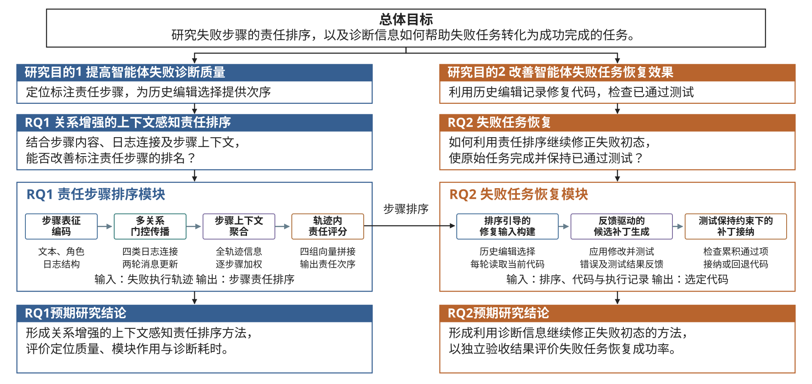
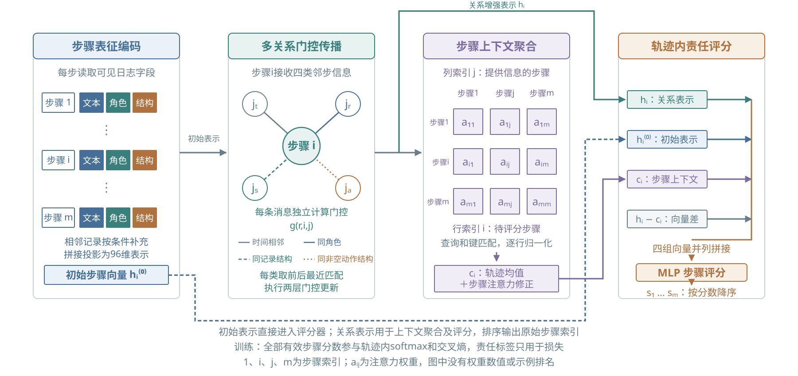
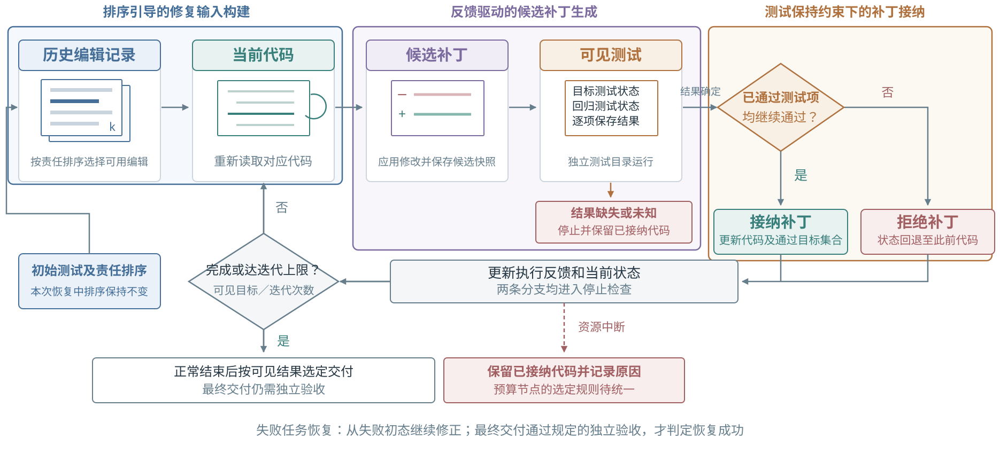
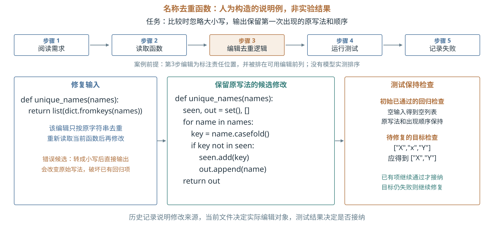
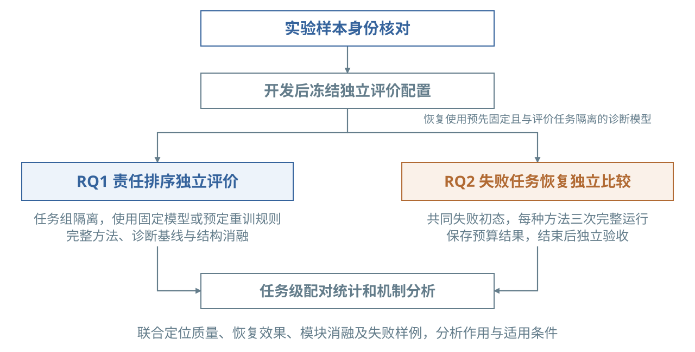

# V15 图表汇编

## 图3-1 责任步骤排序与失败任务恢复的研究框架

## 图3-2 责任步骤排序模型的计算结构

## 图3-3 失败任务恢复流程

## 图3-4 名称去重函数的修复说明例（人为构造，非实验结果）

## 图5-1 责任步骤排序与失败任务恢复的实验流程

## 表5-1 数据来源与研究样本

| 数据来源 | 发布规模 | 当前研究样本 | 主要用途 |
| --- | --- | --- | --- |
| AFTraj | 2,276条轨迹 | 731条失败轨迹；716任务组 | 失败步骤定位 |
| AgenTracer扩展版 | coding训练1,141条；测试127条 | 来源池614条；coding评价363条 | 软件轨迹定位 |
| SWE-Gym | 2,438个Python问题 | 23个已整理软件问题 | 恢复方法开发 |

## 表5-2 失败任务恢复的共同运行条件

| 条件 | 统一设置 |
| --- | --- |
| 任务起点 | 同一原问题、仓库版本、失败代码及环境 |
| 生成模型 | deepseek-flash；部署参数预先固定 |
| 测试条件 | 同代码和反馈许可、可见测试及独立验收 |
| 运行设置 | 共同时间及token上限；每题独立运行3次 |

## 表5-3 失败诊断基线设置

| 方法 | 方法类型 | 核心机制 |
| --- | --- | --- |
| All-at-Once | 生成式诊断 | 整条日志的一次性归因 |
| Binary Search | 生成式诊断 | 递归区间搜索 |
| StepFinder | 学习式诊断 | 时序特征提取、角色感知交互 |
| 本文 | 学习式诊断 | 多关系门控传播、步骤上下文聚合 |

## 表5-4 失败任务恢复基线设置

| 方法 | 核心机制 |
| --- | --- |
| Agentless | 分层定位、补丁生成、测试筛选 |
| EnAgent | 多轨迹生成、回归剪枝、工具辅助投票 |
| AOrchestra | 任务相关上下文组织、动态子智能体创建 |
| 本文 | 排序引导的修复输入构建、反馈驱动的候选补丁生成、测试保持约束下的补丁接纳 |

## 表5-5 主要评价指标

| 指标 | 计算口径 |
| --- | --- |
| MRR ↑ | 责任步骤倒数排名的任务组均值 |
| Top-1 ↑ | 首位命中责任步骤的比例 |
| Hit@3 / Hit@5 ↑ | 前3 / 5位命中责任步骤的比例 |
| 端到端耗时P50 / P95 ↓ | 诊断耗时的中位数 / 95分位数 |
| RSR@30min ↑ | 30分钟内已选定交付、事后通过独立验收测试的比例 |

## 表5-6 核心模块消融设计

| 研究问题 | 实验条件 | 相对完整方法的改动 |
| --- | --- | --- |
| RQ1 责任排序 | Full | 完整责任步骤排序模型 |
|  | w/o RelProp | 跳过多关系门控传播，直接使用初始表示 |
|  | w/o StepCtx | 以全轨迹均值替代各步骤的上下文向量 |
| RQ2 失败任务恢复 | Full | 完整失败任务恢复流程 |
|  | w/o HistEdit | 移除历史编辑输入，保留当前代码和反馈 |
|  | w/o CurrentRead | 移除依据历史编辑的专门当前代码读取 |
|  | w/o TargetKeep | 移除累积目标保持条件，保留初始回归项保持 |

图稿以SVG保存，文字、图形和连接线可继续编辑。表格正文以Markdown提供；后续同步PPT时使用原生三线表，研究进度使用时间线。
