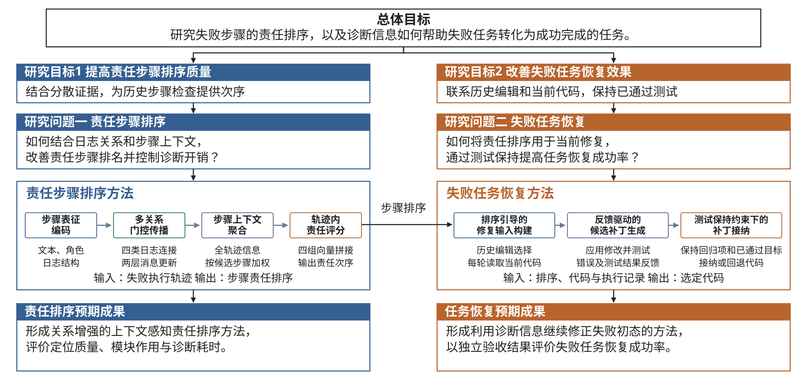
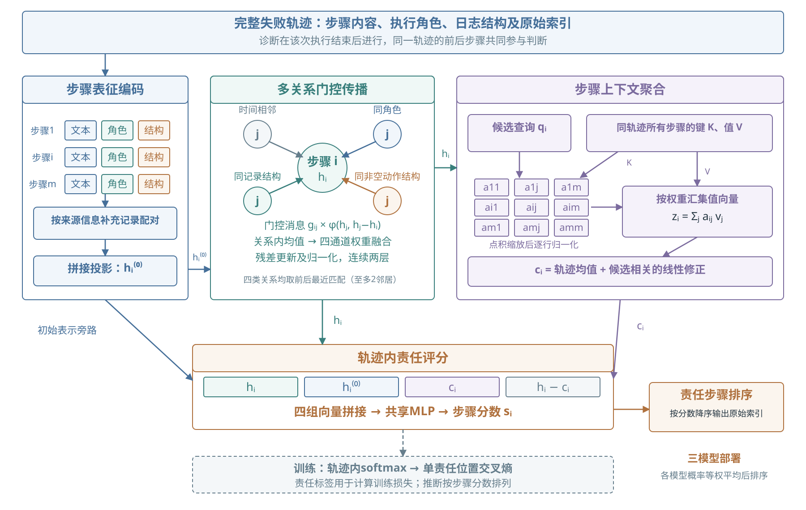
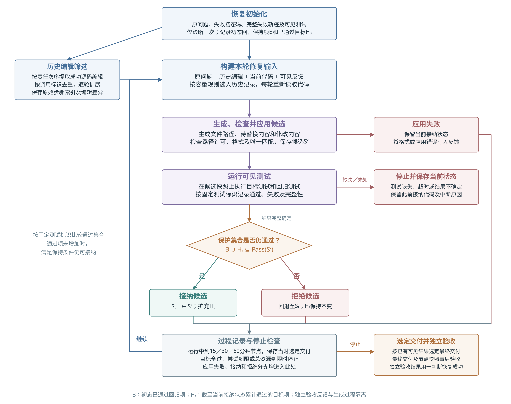

# 核心图表汇编

总体框图保留原版设计；两项研究的技术图按当前方法及实现重新绘制。

**图3-1 责任步骤排序与失败任务恢复的研究框架**

**图3-2 责任步骤排序模型的计算结构**

**图3-3 失败任务恢复流程**

**表3-1 两项研究的对象、方法与评价依据**

| 研究部分 | 主要对象 | 拟形成的方法 | 主要验证依据 |
| --- | --- | --- | --- |
| 责任步骤排序 | 已失败的完整执行轨迹 | 结合稀疏日志关系与步骤上下文的责任评分 | 分组定位评价、表示消融、成本及分层分析 |
| 失败任务恢复 | 可重建的软件失败初态 | 历史编辑选择、当前代码核对与测试保持下的连续修复 | 完整系统比较、排序替换、信息及接纳策略控制 |

**表5-1 数据来源与研究样本**

| 数据来源 | 发布信息 | 当前已整理范围 | 研究用途 |
| --- | --- | --- | --- |
| AFTraj | 数据卡列2,276条轨迹 | 本地731条失败轨迹、716个任务组；其中120组用于固定开发分析 | 责任定位与跨任务条件分析 |
| AgenTracer扩展发布版 | coding训练部分1,141条、测试部分127条 | 614条训练验证来源池及363条coding开发评价轨迹 | 软件相关轨迹的责任定位 |
| SWE-Gym | 2,438个可执行Python问题 | 23个已整理软件问题；既有不同实验协议分别保存 | 恢复方法开发与新评价任务来源 |

**表5-2 失败任务恢复的共同运行条件**

| 条件 | 统一设置 |
| --- | --- |
| 任务起点 | 同一原问题、仓库版本、失败代码和运行环境 |
| 生成模型 | deepseek-flash；各方法的实际部署参数分别记录 |
| 信息与测试 | 共同源码访问和反馈许可；固定可见测试；独立验收与生成过程隔离 |
| 独立重复 | 每个问题、每种方法独立运行3次，每次重建相同失败初态 |
| 时间与资源 | 主预算30分钟，同时保存15、60分钟节点；共同token上限，计入诊断、生成、工具、验证及选择 |
| 交付与评价 | 节点前按已获得的可见结果选定并保存交付，事后统一独立验收；未知和未运行状态分别记录 |

**表5-3 失败诊断基线设置及发表时间**

| 方法 | 发表年份 | 发表会议／期刊 | 诊断形式 | 主要比较内容 |
| --- | --- | --- | --- | --- |
| All-at-Once | 2025 | ICML | 读取完整日志并生成责任位置 | 一次性生成归因的定位质量与调用开销 |
| Binary Search | 2025 | ICML | 通过区间判断缩小责任范围 | 分阶段搜索的定位质量与累计调用开销 |
| StepFinder | 2026 | KDD | 时序编码、角色感知全局交互及步骤评分 | 完整学习式诊断与本文表示设计的比较 |
| 本文方法 | — | 本课题研究方案 | 多关系门控传播及步骤上下文评分 | 责任前列排名、作用条件与计算代价 |

**表5-4 失败任务恢复基线设置及发表时间**

| 方法 | 发表年份 | 发表会议／期刊 | 保留的核心过程 | 比较层次 |
| --- | --- | --- | --- | --- |
| Agentless | 2025 | FSE / PACMSE | 分层定位、补丁生成、复现与回归验证、最终选择 | 完整系统 |
| EnAgent | 2026 | ICSE | 多轨迹生成、回归剪枝、工具辅助选择与投票 | 完整系统 |
| AOrchestra | 2026 | ICML | 主控委派、任务相关上下文与工具配置、子智能体执行 | 完整系统 |
| 本文方法 | — | 本课题研究方案 | 责任排序、历史编辑与当前代码输入、反馈生成、测试保持接纳 | 完整系统 |

**表5-5 主要评价指标**

| 指标 | 计算方法及含义 |
| --- | --- |
| Top-1 ↑ | 责任步骤排在首位的命中率，先在任务组内汇总，再对任务组等权平均 |
| MRR ↑ | 标注责任步骤倒数排名的任务组等权平均 |
| Hit@3 / Hit@5 ↑ | 标注责任步骤进入前3／5位的命中率，采用同一任务组汇总规则 |
| 诊断耗时P50 / P95 ↓ | 从轨迹输入到诊断输出的耗时中位数／95分位数，分别报告首次加载与已加载条件 |
| 失败任务恢复成功率RSR ↑ | 每题3次独立运行成功情况的平均，再对完整共同问题等权平均 |
| RSR@15 / 30 / 60min ↑ | 对相应时间节点前已选定交付进行事后独立验收；30分钟为主比较节点 |
| 资源消耗 | 记录完整流程的墙钟时间、模型调用、token及相应显存或内存条件 |

**表5-6 核心模块消融与控制设计**

| 研究问题 | 条件 | 改动及对应判断 |
| --- | --- | --- |
| 研究问题一 | Full | 完整责任步骤排序模型 |
| 研究问题一 | w/o RelProp | 跳过关系传播，检验关系增强信息的作用 |
| 研究问题一 | w/o StepCtx | 以轨迹均值替代步骤相关上下文，检验候选相关汇集的作用 |
| 研究问题一 | 容量与关系控制 | 保持相近参数规模或关系容量，检验增益是否仅来自额外容量 |
| 研究问题二 | Full | 完整失败任务恢复流程 |
| 研究问题二 | w/o HistEdit | 移除历史编辑输入，保留当前代码和反馈，检验历史线索的作用 |
| 研究问题二 | w/o CurrentRead | 移除依据历史编辑发起的专门当前代码读取，检验历史—当前对应的作用 |
| 研究问题二 | w/o TargetKeep | 移除累计目标保持，保留初态回归保持，检验目标保护的作用 |
| 研究问题二 | 数量保持 | 保留回归约束，仅要求目标失败数量不增加，与按标识保持比较 |

**表6-1 前期开发结果及后续研究依据**

| 开发范围 | 已观察结果 | 对后续研究的作用 |
| --- | --- | --- |
| AFTraj固定120任务组 | 当前上下文模型命中86组，StepFinder命中82组；差异校正p值为0.5235 | 支持原型可行，尚需独立评价定位改善是否稳定 |
| coding363开发集合 | 当前模型命中186条，StepFinder148条；共享静态上下文控制187条 | 共享静态上下文表现相近，步骤上下文的独立作用需进一步检验 |
| 较早五个共同软件问题 | 自然终态下本文2/5、Agentless3/5、EnAgent2/5；旧协议30分钟结果分别2/5、3/5、0/5 | 该部署下Agentless成功率较高；后续比较需统一预算规则 |
| 一个软件问题的排序控制 | 5条已启动轨迹自然终态均成功，原30分钟内均未成功交付；仅一轮形成完整三条件比较 | 排序已接入恢复流程，当前样本未显示排序间的恢复率差异 |
| 一个问题的测试保持压力实验 | 3次重复中，集合保持3/3、数量保持2/3、仅回归保持3/3 | 已观察目标退化；集合保持相对仅回归保持的最终收益尚未确立 |

