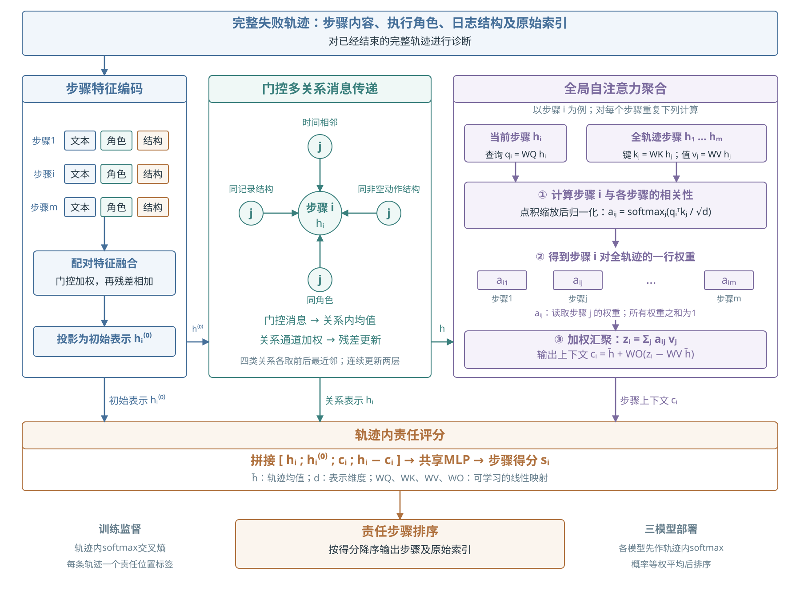
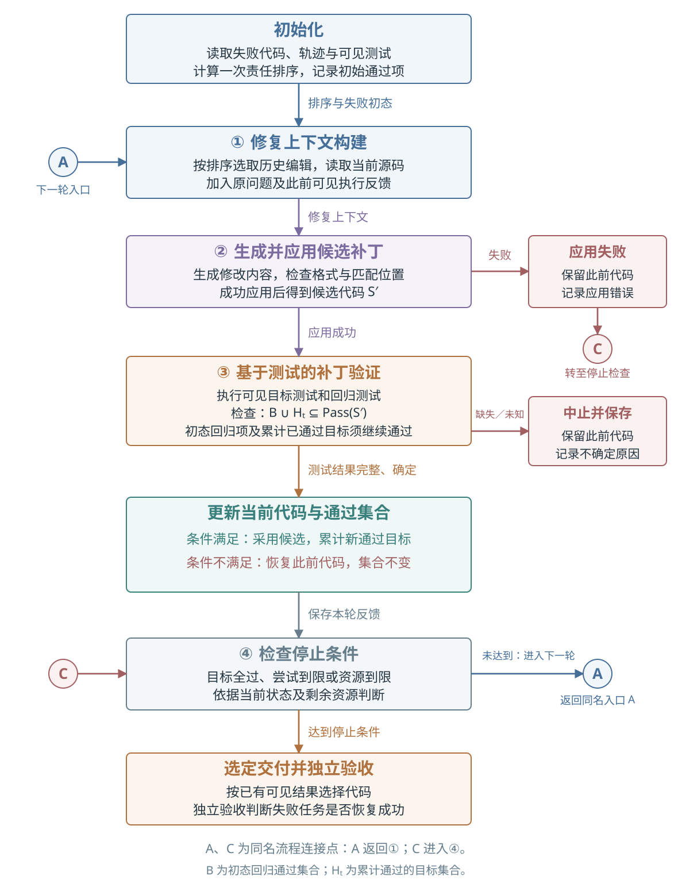

# 面向智能体失败任务的责任步骤排序与恢复方法研究

开题报告  
汇报人：杨亚鹏  
2026年10月26日

## 摘要

大语言模型智能体通过调用工具、读取环境反馈和持续调整操作完成任务。随着执行过程延长，早期错误可能经由后续操作逐步传播，导致关键步骤与最终异常表现相隔较远；任务失败后，历史操作涉及的代码又可能已经改变，继续修改还可能破坏已经通过的功能检查。本课题面向已经失败的智能体任务，研究历史步骤的责任排序，以及诊断信息支持的任务恢复方法。

针对责任线索分散的问题，拟构建关系增强的上下文感知责任评分模型。模型以同一轨迹中的步骤为候选，综合步骤内容、执行角色和可观察的日志关系形成表示，再针对每个候选汇集全轨迹信息，通过单责任位置监督学习评分函数，输出步骤的检查次序。针对历史诊断难以直接用于当前修复的问题，拟按责任排序选择可用历史编辑，结合当前代码和可见测试反馈生成候选补丁，并以累计已通过测试项的保持条件决定候选接纳，形成连续修复流程。

本研究重点分析局部日志关系与步骤上下文对责任判断的共同作用，以及历史编辑选择和测试保持对修复过程的影响。计划在原始任务层面划分数据，分别评价责任定位质量、诊断开销和独立验收下的失败任务恢复成功率，通过模块消融、排序替换及接纳策略对照解释方法效果。前期已建立诊断和恢复原型，完成分组训练、排序接入及开发任务验证。预期形成责任步骤排序方法、诊断引导的失败任务恢复方法，以及相应的实验结果和复现材料，为智能体失败分析和软件任务的持续修正提供方法依据。

**关键词：** 大语言模型智能体；失败诊断；责任步骤排序；轨迹表示；失败任务恢复；测试保持

## 1 背景与研究现状

### 1.1 研究背景

大语言模型（Large Language Model，LLM）能够根据自然语言指令理解任务要求、生成文本和代码，并结合上下文展开分析。这些能力使自然语言逐渐成为人机协作的重要接口：用户可以描述目标，由模型提供解答、方案或程序。然而，软件开发等任务的完成还涉及外部信息获取和实际环境操作。例如，解决一个代码仓库中的问题，需要查找实现、修改文件、运行测试，并根据执行结果调整方案。模型生成的内容由此需要进一步转化为能够执行和检验的操作。[1,2]

将大语言模型与工具、运行环境和过程管理机制结合，可以形成围绕任务目标持续行动的智能体。模型依据当前信息分析任务并选择操作，工具将操作作用于环境，环境返回的观察结果再进入下一步决策。推理、动作与观察由此交替进行，使模型能够根据执行结果持续调整后续行为。[3] 在这样的交互中，模型的作用从提供一次回答扩展为参与多步决策，系统也需要持续维护任务进展、执行记录和当前状态。

智能体的任务完成情况取决于连续操作的累积结果。一次检索决定后续能够获得哪些信息，一次编辑改变当前代码，一次测试为继续修改提供依据；多个角色参与时，还需要传递设计、实现和验证结果。因而，评价智能体既要考察输出内容，也要考察工具使用、环境交互、执行效率和最终任务结果。[4,5] 软件任务具有可检查的代码变化和可执行的测试，为研究这种连续决策过程提供了具体场景。

执行过程的延长也增加了失败分析的困难。早期遗漏的需求、错误的代码修改或未及时识别的问题，都可能在后续步骤中累积，最终表现为测试失败或任务未完成。失败位置与错误来源之间存在时间和信息上的距离，末尾报错通常只能反映当时的异常。分析失败需要重新联系任务要求、历史操作及其后果，从完整执行记录中寻找值得优先检查的步骤。[6,7]

找到可疑步骤后，任务仍需要在当前状态下继续完成。历史记录保存了过去的操作及其上下文，而当前代码可能已经经历多轮修改；新的修复还可能影响此前正常的功能。因此，历史线索需要与当前代码和执行反馈结合，候选修改也需要经过验证。[8,9] 本课题围绕这一过程研究两个相互衔接的环节：通过失败诊断建立历史步骤的检查次序，并利用诊断信息支持失败任务的持续修正。

### 1.2 从失败诊断到任务恢复

失败诊断首先面对的是执行记录中的信息分散问题。需求理解、工具调用、代码编辑和测试反馈分布在不同步骤，一个步骤的作用往往需要结合其前后记录才能判断。若只检查最终报错，可能遗漏较早引入的问题；若逐条独立判断，又难以联系远距离证据。因此，需要围绕待检查步骤组织相关信息，形成能够比较不同步骤检查优先级的依据。[7]

任务恢复进一步要求诊断结果能够支持具体修改。历史步骤反映过去发生了什么，当前源码则决定现在能够修改什么。两者之间需要通过文件、操作内容及执行反馈建立联系。软件缺陷定位通常以当前代码中的文件、方法或语句为候选；本文关注历史执行步骤，并研究这些步骤如何为当前修复提供线索。[10] 这一联系使失败分析能够进一步服务于原始任务的完成。

连续修复还需要处理新目标与已有功能之间的关系。候选修改可能解决部分问题，同时破坏已经通过的测试；某些修正又需要调整多个相互关联的实现。[9]因此，恢复过程既要利用反馈推进任务，也要检查已取得的进展，并分析相应约束对后续修改的影响。诊断质量、线索使用方式和候选接纳条件共同影响最终结果。

基于上述考虑，本文将分析失败轨迹并输出历史步骤责任排序的过程称为失败诊断；将从失败执行留下的代码和运行环境出发，利用诊断信息进行修正、以成功完成原始任务为目标的过程称为失败任务恢复。最终交付通过规定的独立验收时，判定为恢复成功。两项研究分别关注历史步骤的检查次序和当前任务的完成，并通过诊断信息的实际使用相互联系。

### 1.3 国内外研究现状

#### 1.3.1 智能体失败步骤定位

智能体失败研究逐渐从失败现象分类发展到具体执行位置的判断。MAST从实际执行材料中归纳系统设计、智能体间失配和任务验证等失败模式，为分析不同系统中的失败提供了分类依据。Who&When进一步研究责任角色和决定性错误步骤：其标注关注修正后能够改变失败结果的位置，并在多个候选中关注较早的关键错误；诊断方法包括整段日志一次判断、逐步分析和二分搜索。前者描述失败的表现及类型，后者提供位置级监督和评价对象。[6,7]

围绕位置级诊断，SDBL（2026）将可疑范围划定与精确定位分阶段处理，先确定需要重点关注的区间，再结合范围提示和完整日志完成定位。这种方式通过组织分析范围降低判断难度，其效果取决于范围识别与后续定位之间的配合。[11] StepFinder（2026）采用步骤语义、双向时序建模、全局注意力和角色门控，输出步骤分数，并以责任位置交叉熵和时间一致性辅助目标训练。该方法将轨迹表示与位置判断结合，为比较学习式诊断的定位质量和计算代价提供了直接参照。[12]

将候选步骤转化为分数并输出次序，还可以联系排序学习的研究框架。排序学习根据训练数据学习候选评分函数，常见方法按监督和目标组织方式分为点级、对级和列表级方法。[13,14] ListNet将候选列表作为训练单位，依据标签构造目标分布；后续二值相关性排序研究分析了softmax交叉熵目标与排序评价之间的关系，为单正例条件下学习候选次序提供了方法依据。[15,16]

现有研究已经建立步骤标注、搜索式诊断和学习式评分方法。进一步提高责任判断质量，需要分析不同信息如何形成对具体候选有区分力的表示。时序、角色及日志结构描述了不同的步骤联系，远距离记录又可能提供局部观察缺少的证据；这些信息之间的互补、重合及计算代价构成了本文责任排序研究的切入点。

#### 1.3.2 责任归因的数据基础

诊断能够利用的证据与执行系统保存过程的方式密切相关。AutoGen通过可编程会话组织模型、工具和人工输入，MetaGPT通过标准操作流程组织需求、设计、代码及测试产物。两类系统分别形成会话协作和产物交接式记录，为观察角色、动作和中间结果提供了不同的数据结构。[17,18] 将这些记录用于责任分析，还需要确定步骤边界、记录之间的联系以及监督标签的含义。

步骤级监督可以描述不同研究对象。Let's Verify Step by Step利用数学推理步骤的正确性反馈训练过程评价模型，支持对推理候选的判断。[19] 失败责任标注则关注一次执行失败中的关键位置，其监督信息取决于标注者如何处理错误引入、职责遗漏和错过纠正机会等情形。单个责任位置标签提供了该步骤的归责依据，其余步骤的正确性需要其他证据判断。

AgenTracer（2026）通过自然失败的修正重放与成功轨迹的故障注入构造责任监督，并训练诊断模型，将标签获取与可修正性联系起来。自然失败和注入错误具有不同形成过程，评价时需要保留相应来源。[20] TraceElephant（2026）保存步骤输入、配置、输出和工具日志，并结合角色职责与可恢复性确定责任位置；下游验证者错过应有的纠正机会，也可能成为标注对象。[21]

上述研究说明，轨迹数量、记录完整性和责任标注规则共同决定诊断数据的使用方式。统一输入形式时，需要保留不同来源的标注含义；组织评价时，需要以原始任务为单位处理轨迹变体和派生样本。这为本文分别分析信息表示、监督来源及跨任务表现提供了数据基础。

#### 1.3.3 反馈驱动的软件任务求解

软件智能体将语言模型的分析能力与代码操作结合，使任务求解逐步转化为执行和反馈交替进行的过程。ReAct以推理、动作和观察的交替组织支持任务交互，为连续决策提供了基础形式。[3] SWE-agent研究适合智能体使用的软件操作接口；AgentBench和SWE-bench分别从多环境交互、真实仓库问题及可执行测试等角度评价任务完成情况。[2,4,5]

反馈为连续修正提供了外部依据。Reflexion将先前尝试和评价转化为后续执行的语言记忆；CRITIC通过工具交互检查已有输出，再据此修订。[22,23] Huang等关于推理自纠错的研究表明，纠错收益受到外部正确性信号、停止条件及初始提示的影响。[24] 这些工作共同提示，分析修正效果时需要明确反馈来源，以及模型能够从反馈中获得什么信息。

反馈还用于组织候选搜索和代码修改。LATS结合环境交互、反思和树搜索，SWE-Search将搜索与迭代细化用于软件智能体求解。[25,26] 在仓库级任务中，CodeAgent通过工具接口提供构建和测试反馈，AutoCodeRover利用程序结构检索组织定位与修改，RepairAgent通过工具交互和阶段控制推进程序修复。[27,28,29] 这些方法从搜索、上下文获取和执行控制等方面改善求解过程，表明修复效果与输入材料、编辑对象及反馈使用方式密切相关。

Agentless将流程组织为分层定位、补丁生成和验证选择，已有回归测试及生成的复现测试均参与候选筛选。[30] EnAgent（2026）通过多条求解轨迹生成候选，利用回归测试剪枝，并以工具辅助比较和投票选择补丁。[31] AOrchestra（2026）由主控配置任务相关的子智能体、上下文及工具，通过动态分工完成复杂任务。[32] 这些完整系统分别体现固定阶段、多轨迹集成和动态协作的求解方式，为本文的完整系统比较提供了参照。

现有方法已形成较完整的定位、生成和验证流程。本文从已经失败的代码状态继续修复，重点考察历史诊断能否补充当前反馈，并改变有限资源下的修复依据。连续接纳过程中，后来通过的目标测试如何参与后续验证，也是连接候选选择与任务进展的重要问题。

#### 1.3.4 诊断信息支持的任务恢复

诊断结果用于恢复时，需要联系历史认识与当前环境。SyncMind研究协作代码更新引起的失步，说明重新获取当前代码和环境信息对恢复具有重要作用。[8] AgentRewind（2026，预印本）将执行上下文与文件检查点共同恢复，并保留失败经验，使恢复状态和已有知识能够对应。[33] 两类工作从环境同步和执行状态管理出发，说明历史信息的使用需要以当前可执行状态为基础。

DoVer（2026）依据失败日志构造责任假设，再生成干预并继续执行，通过干预结果检查诊断与修正之间的联系。[34] 这一方向将诊断评价推进到实际任务效果，干预能否落实以及执行系统的修正能力也随之成为研究对象。STRATUS在云系统故障处理中组织试执行、检查和撤销，利用状态管理约束连续操作；其环境和撤销前提为理解恢复机制的适用条件提供了另一类参照。[35]

从这些研究可以看出，诊断与恢复之间需要建立明确的执行过程：历史位置提供线索，当前状态决定可实施的修改，执行反馈支持后续判断。本文据此研究责任排序如何转化为当前修复输入，以及测试保持如何影响连续修正和最终任务完成情况。

### 1.4 有待解决的研究问题

**分散执行证据的组织与责任步骤判断。** 现有失败定位方法已建立位置监督和步骤评分机制，但不同证据对同一候选的作用仍需进一步分析。时序、角色和日志结构之间存在重合，局部连接又难以覆盖全部远距离线索；扩大全轨迹信息范围会同时增加无关信息和计算开销。因此，需要研究局部联系与步骤相关上下文的结合方式，解释它们在不同轨迹条件下对责任判断的作用。

**历史诊断向当前任务修复的转化。** 软件求解研究已广泛使用测试、反馈和状态管理，但历史责任位置与当前可修改代码之间仍存在对应困难。高责任步骤可能属于推理或验证，同一历史编辑也可能被重复记录，不同排序经过筛选后还可能形成相同输入。与此同时，候选修改既可能推进任务，也可能破坏已有进展；按测试标识保持通过项又会限制后续可接受的修改。需要将历史线索选择、当前代码核对和候选接纳联系起来，研究诊断信息的实际作用及进展保持的收益与代价。

## 2 研究目标与意义

### 2.1 研究目标

本课题旨在研究失败步骤的责任排序，以及诊断信息如何帮助失败任务转化为成功完成的任务。针对分散证据难以形成有效判断、历史诊断难以直接用于当前修复这两个问题，分别开展以下研究。

**研究问题一：如何结合可观察的日志关系和步骤相关上下文，提高失败轨迹中责任步骤的排序质量，并控制诊断开销？** 研究目标是形成面向具体候选的信息表示和评分方法，分析不同轨迹结构及长度条件下的信息作用，使责任排序能够为历史步骤的优先检查提供依据。

**研究问题二：如何将责任步骤排序转化为当前软件状态下的修复依据，并通过测试保持组织连续修改，提高失败任务恢复成功率？** 研究目标是建立诊断信息参与的恢复流程，明确历史线索的使用方式，分析候选接纳对任务进展和最终结果的影响。

两项研究通过责任排序的输出及使用相互衔接。前者关注历史步骤的定位质量，后者关注原始任务的最终完成；分别评价两者，并分析其联系，可以说明诊断改善在何种条件下能够转化为恢复收益。

### 2.2 研究意义

**为失败诊断提供可比较的责任排序方法。** 智能体失败的来源和表现可能分布在相隔较远的步骤中，研究日志关系及步骤上下文的组织方式，有助于把分散记录转化为对候选责任的判断依据。本课题将形成面向完整失败轨迹的评分模型，并在共同任务划分下分析定位质量、信息作用和诊断代价，为不同轨迹条件下的诊断方法选择提供依据。责任标签、来源规范和步骤映射的对应记录，也有助于解释不同数据条件下的结果差异。

**为失败任务恢复提供诊断引导的修复方法。** 本课题将历史责任线索落实为当前修复过程中的输入，通过当前代码核对、反馈生成和测试保持，形成从失败状态继续完成原始任务的技术路径。对实际输入、候选状态、测试变化及独立验收结果的联合记录，可以说明诊断信息在恢复过程中的具体作用，并揭示保持已有进展对继续修正的影响。相应的任务级比较、资源记录和失败分析将为复现方法及理解其适用条件提供实验依据。

## 3 研究内容与方法

### 3.1 研究对象及任务定义

本文以一次已经结束且未满足任务完成条件的执行为诊断对象，既包含单智能体执行，也包含多智能体协作。执行轨迹由有序步骤组成，每步保存来源允许获得的文本、动作、工具或环境观察、执行角色和原始索引。模型沿用实际记录的步骤边界，并保持输出与原始日志的对应。由于诊断发生在该次执行结束后，可利用轨迹中已经发生的前后步骤信息。

责任步骤依据数据来源的标注规范确定，训练和评价采用相应位置标签。不同来源可能关注错误引入、职责遗漏或错过纠正机会。[7,20,21] 本文保留这些标注含义并分别报告结果。单责任位置监督表明标注步骤相对其他候选应具有较高检查优先级；其余步骤之间的次序由评分函数给出，数据本身未提供这些步骤的完整人工排序。诊断数据中的数学及其他交互任务用于考察表示方法的适用范围，恢复研究则在环境可重建、代码变化可检查、测试可执行的软件任务中开展。

设一次失败执行的可见轨迹为 $\tau=(x_1,\ldots,x_m)$，其中 $x_i$ 为第 $i$ 个有效步骤的记录，轨迹长度 $m$ 随任务变化；单责任标注为 $y\in\{1,\ldots,m\}$。诊断模型学习共享函数 $s_i=f_\theta(x_i,\tau,\mathcal R)$，其中 $\mathcal R$ 为从可见日志构造的关系集合。模型按 $s_i$ 降序输出步骤索引，分数表达当前监督和观察条件下的检查优先级。责任标签用于训练和评价，独立验收反馈和其他方法的修复结果与模型输入隔离。

恢复任务以原问题 $q$、失败初态 $S_0$、轨迹 $\tau$ 和预先许可的可见测试为输入。失败初态包含执行结束后的实际代码及运行环境，与原始仓库提交分别保存。本文将允许反馈给修复过程的测试称为可见测试，将与生成过程隔离、用于判断最终交付的测试称为独立验收测试。恢复过程生成候选状态 $S'$，经过应用和测试检查后更新当前接纳状态 $S_t$，最后选定代码快照并提交独立验收。

候选接纳表示一次修改满足既定状态更新条件；代码修复、补丁生成、测试和状态回退描述恢复过程中的具体操作。恢复成功以最终交付通过规定独立验收为依据。恢复主实验要求历史源码编辑可回查、环境能够重建且反馈测试可执行；缺少可映射编辑的轨迹仍可用于诊断评价，其恢复适用性及排除原因分别记录。样本资格按方法所需信息判断，与本轮方法胜负及独立验收结果隔离。

### 3.2 总体研究框架

本研究围绕以下设计思路组织两项方法：责任判断需要针对候选步骤联系分散证据，历史诊断需要结合当前代码和执行反馈才能用于修复。诊断模型读取步骤内容、角色和日志结构，输出保持原始索引的责任评分及排序；恢复模块依照该次序选择历史编辑，结合当前代码生成候选，并通过测试保持条件控制接纳或回退，直至选定交付。总体框架如图3-1所示。

**图3-1 责任步骤排序与失败任务恢复的研究框架**

责任排序依次包括步骤特征编码、门控多关系消息传递、全局自注意力聚合和轨迹内责任评分四个模块。步骤特征编码保留文本、角色和记录形式；门控多关系消息传递利用可观察连接传递邻步信息；全局自注意力聚合针对每个候选汇集全轨迹证据；轨迹内责任评分综合初始表示、关系表示及上下文，生成检查次序。

失败任务恢复包括排序引导的修复上下文构建、反馈驱动的候选补丁生成、基于测试的补丁验证三个模块。排序引导具体体现为历史编辑的选择顺序和输入容量分配；反馈驱动体现为后续生成利用此前应用结果与可见测试结果；测试保持则要求候选保留已纳入保护的通过项。历史编辑与当前代码共同提供修复依据，候选接纳使后来取得的进展进入后续验证条件。

诊断与恢复之间保留“原始步骤索引—编辑调用标识—文件及差异—当前源码—实际生成输入”的对应记录。由此可以追踪责任次序如何影响输入，并分析输入、候选、接纳决定和最终结果之间的联系。两项方法分别具有可独立评价的输出，研究对象和评价关系见表3-1。

**表3-1 两项研究的对象、方法与评价依据**

| 研究部分 | 主要对象 | 拟形成的方法 | 主要验证依据 |
| --- | --- | --- | --- |
| 责任步骤排序 | 已失败的完整执行轨迹 | 结合稀疏日志关系与步骤上下文的责任评分 | 分组定位评价、表示消融、成本及分层分析 |
| 失败任务恢复 | 可重建的软件失败初态 | 历史编辑选择、当前代码核对与测试保持下的连续修复 | 完整系统比较、排序替换、信息及接纳策略控制 |

两项研究共同记录任务标识和步骤索引、实际输入、候选状态、测试变化及资源消耗，以任务级配对结果和独立验收支持联合分析。

### 3.3 关系增强的上下文感知责任排序

模型计算结构如图3-2所示。注意力部分以步骤i为例，依次展示查询与键的相关性计算、对应全轨迹各步骤的一行权重及值向量的加权汇聚。每个步骤分别执行这一计算，初始表示、关系表示和步骤上下文共同进入评分器。

**图3-2 责任步骤排序模型的计算结构**

#### 3.3.1 步骤特征编码

步骤初始表示综合文本、匿名角色和日志结构。文本描述操作与观察，角色区分轨迹中的行为来源，结构特征描述字段类型、嵌套形式、相对位置及重复情况。角色按同一轨迹中首次出现顺序编号，保留轨迹内的一致性，减少直接记忆特定名称的机会。若日志明确提供相邻、同角色的记录配对，输入适配保留这种对应；没有配对时使用原记录。对有效配对，模型根据配对记录的内容、内容差值及有效标志计算特征变换和标量门控，将门控后的信息残差加回当前特征，再投影为步骤初始表示。这一过程形成事件配对特征融合。

关系集合包含时间相邻、同一匿名角色、相同完整记录结构和相同非空动作结构四类。结构比较去除具体键名和值，关注可重复的记录形式。时间关系连接相邻步骤，其余关系连接前后最近的同类步骤，使每个关系通道的邻居数至多为2。这一构造保留近邻结构，并将各通道的连接规模限制为随步骤数线性增长。

关系类型决定邻步信息的变换和聚合方式。[36] 本文采用可以直接从日志构造的联系：结构相同表示记录形式相近，角色相同表示行为来源一致。这些联系保留可观察的执行结构，语义上的内容依赖则需要工具请求、返回及后续使用等证据。[37,38] 选择上述四类关系，可以在较低构图开销下组织步骤邻域；其有效性通过定位评价和关系控制实验分析。

#### 3.3.2 门控多关系消息传递

本模块采用图神经网络的消息传递机制：沿给定关系读取邻居表示，聚合消息，再更新当前步骤。关系类型用于区分消息变换与聚合。[36] 本文进一步依据接收步骤及两步表示的差异调节消息贡献。对于接收步骤 $i$、关系类型 $r$ 及邻居 $j$，模型以邻居表示和两步差异构造消息，以接收表示和该差异计算门控。令 $h_i$ 为当前层表示，可写为：

$$
g_{ij}^{(r)}=\sigma\!\left(G_r[h_i;\,h_j-h_i]\right),\qquad
u_i^{(r)}=\frac{1}{|\mathcal N_r(i)|}
\sum_{j\in\mathcal N_r(i)}
g_{ij}^{(r)}\,\phi_r([h_j;\,h_j-h_i]).
\tag{1}
$$

式（1）中，$g_{ij}^{(r)}$ 是0至1的标量，$\phi_r$ 是关系对应的可学习消息变换。该门控独立作用于每条边，不在邻居之间进行softmax归一化。没有邻居的通道取零向量。模型再根据接收步骤计算四个关系通道的归一化权重，汇集 $u_i^{(r)}$，与原表示作残差相加并归一化。当前原型使用两层更新。

门控根据接收步骤及两步差异调节消息贡献，初始内容通过残差和后续评分旁路继续保留。同一对步骤可能出现在多个关系通道中，重复消息的影响取决于各通道的变换和权重。实验将记录通道边数、重合比例及有效邻居覆盖，分析关系重合条件下的信息作用。

#### 3.3.3 全局自注意力聚合

两层稀疏传播限定了每步能够直接获得的信息范围。为利用更远的执行记录，模型将关系增强表示映射为查询、键和值，采用单头缩放点积自注意力计算聚合权重。查询、键和值均来自同一条完整轨迹的步骤表示。该计算通过查询与键的点积衡量相关程度，再按表示维度缩放并归一化。[39] 本文以待评分步骤为查询，并在全轨迹均值的基础上形成候选相关的上下文修正：

$$
a_{ij}=
\operatorname{softmax}_{j}
\left(\frac{(W_Qh_i)^\top W_Kh_j}{\sqrt d}\right),\qquad
c_i=\bar h+
W_O\left(\sum_j a_{ij}W_Vh_j-W_V\bar h\right),
\tag{2}
$$

其中 $\bar h=m^{-1}\sum_jh_j$，$d$ 为表示维度。$a_{ij}$ 是第 $i$ 个候选从步骤 $j$ 汇集信息的权重，$c_i$ 则是加入候选相关修正后的上下文向量。它以全轨迹均值为基础，再根据当前候选调节汇集内容。模型可使用同轨迹的自身及前后已发生步骤，跨轨迹位置被屏蔽。

步骤上下文用于表达同一证据与不同候选之间的关联。例如，后续测试失败可以为此前某次编辑提供判断依据，对正常读取步骤则主要补充任务背景。长上下文条件下，语言模型对相关信息的利用受到其所在位置的影响。[40] 因此，本文结合轨迹长度和信息分布分析步骤上下文的作用，并与共享上下文、局部上下文比较，检验监督学习获得的聚合权重能否有效组织候选证据。

单条轨迹的密集注意力需要 $O(m^2d)$ 量级的计算，注意力权重存储为 $O(m^2)$；稀疏关系层在固定关系数和邻居上限下，其边聚合随步骤数线性增长。整体诊断仍包含文本编码和表示变换，实验将记录端到端耗时、批处理设置及输入截断，将算子复杂度与实际部署成本分别报告。

#### 3.3.4 轨迹内责任评分

评分器同时读取关系表示 $h_i$、初始表示 $h_i^{(0)}$、步骤上下文 $c_i$ 及两者差异，生成轨迹内步骤分数。对于单责任位置监督，采用softmax交叉熵学习标注步骤相对其余候选的优先性。[16] 评分函数、归一化分布及轨迹损失为：

$$
s_i=\operatorname{MLP}
\left([h_i;\,h_i^{(0)};\,c_i;\,h_i-c_i]\right),\qquad
p_i=\frac{\exp(s_i)}{\sum_{j=1}^{m}\exp(s_j)},\qquad
\ell_\tau=-\log p_y.
\tag{3}
$$

式（3）将单责任标注转化为组内竞争：标注步骤的相对分数提高，损失降低。其对每个分数的梯度为 $p_i-\mathbf1[i=y]$，体现目标步骤与同组其他候选之间的约束。本文以轨迹为候选组，以单责任位置为监督，学习可以应用于新轨迹的共享评分函数，再依据分数输出次序。训练目标直接表述为轨迹内错误位置的单标签softmax交叉熵；从候选评分与排序的角度，同一目标也对应单正例的列表级softmax排序目标。[13,14,16] 单责任标签规定标注步骤的优先性，没有提供其余步骤之间的完整责任次序。 本文用单责任位置的独热分布作为训练目标，与对标签得分作softmax归一化形成目标分布的做法有所区别。[15]

单模型按分数降序输出索引，同分按原始索引处理。三模型集成先分别作轨迹内softmax，再平均预测权重并排序。归一化值表达同一轨迹内候选的相对检查优先级，其含义由训练标签和该轨迹候选集合共同确定。

训练沿用按任务分组的数据组织。AgenTracer来源配置对轨迹损失取平均；AFTraj中同一任务可能有多条派生记录，先在任务组内平均，再对任务组等权平均。标准化统计量只在训练部分估计，验证部分用于模型选择，评价部分不参与选轮。具体原型设置汇总于附录A。

### 3.4 诊断引导的失败任务恢复

本方法采用生成—验证式程序修复流程：先构建修复上下文，再生成候选补丁，通过测试验证决定是否更新当前代码，并将执行反馈用于后续尝试。程序修复研究将补丁生成与补丁验证作为核心阶段，迭代修复进一步利用执行结果调整后续修改。[9,29,30]

恢复流程如图3-3所示。初始化时完成一次责任排序并建立测试保持集合；每轮扩展历史编辑输入、读取当前代码，再生成和验证候选。应用失败、接纳和拒绝分支均进入反馈记录及停止检查；测试观察缺失或不确定时保存此前接纳状态并停止。 图中主流程自上而下展开，同名连接点A表示返回下一轮上下文构建，连接点C表示应用失败后直接进入停止检查。

**图3-3 失败任务恢复流程**

#### 3.4.1 排序引导的修复上下文构建

初始失败轨迹只诊断一次，后续保持责任次序不变。恢复模块依次检查排序步骤，提取成功执行且实际改变许可范围内项目源码的编辑，按编辑调用标识去重，并保存原始步骤索引。同一文件中的不同有效编辑分别保留；推理、读取及未成功执行的调用保留在诊断轨迹中，历史编辑输入仅收录实际发生的源码修改。

历史编辑保存修改前后差异。每轮生成前，系统重新读取相应当前文件，并依据历史变更涉及的函数及可见失败记录补充可能相关的代码。文件路径和语法符号用于定位读取范围，历史修改与当前内容分别呈现，使模型能够判断哪些历史操作仍与当前问题有关。

选入编辑按固定规则逐步扩展，受记录容量和输入容量共同限制；已经选入的记录继续保留。当前原型使用记录条数及历史文本字节限制，正式评价将同时报告实际模型token，并在开发阶段固定容量。代码片段超出容量时，记录实际保留范围、截断位置和覆盖情况。

排序的作用发生在筛选之后。若两个步骤全序不同，但过滤、去重和容量限制后的历史输入相同，这一任务没有形成相应的输入干预。实验将同时记录全步骤次序、合法编辑次序与实际生成输入差异，在全体任务评价之外，按预先定义的可用编辑数量及输入机会作机制分析。

将全步骤责任评分用于历史编辑选择，需要考察监督对象与使用对象之间的差异。标注责任位置可能属于推理或验证，此时保留的编辑均处于其他位置，其相互次序来自模型评分。本文在固定恢复流程下替换排序来源，记录实际输入并比较最终结果，分别评价全步骤责任定位质量和历史编辑选择的恢复效果。

#### 3.4.2 反馈驱动的候选补丁生成

可执行反馈为判断候选结果和组织后续修正提供依据。[23,29] 本文的修复输入由原问题、选定历史编辑、当前代码及此前可见执行结果组成。生成模型提出文件路径、待替换内容和修改内容；执行端检查路径许可、格式及唯一匹配，成功应用后保存候选快照。补丁格式错误、无法应用和已应用但测试失败是不同阶段的结果，分别记录并用于下一轮反馈。

每个候选在独立测试目录中按其快照重建代码，运行共同许可的目标测试与回归测试。这两组共享测试的代码和标识在评价前固定，恢复过程修改业务源码。方法依据许可信息自行生成的复现或辅助测试属于其内部求解机制，与共享测试分别记录；各方法具有相同的生成与执行许可，其相应调用、token和运行时间计入总成本。独立验收与生成隔离，其他方法的补丁也不进入当前方法的输入。

目标测试和回归测试的选择依据原问题的行为要求。初态已通过测试若包含与新需求冲突的旧行为，应在任务资格核验时根据问题说明确定其适用性，并记录处理理由。所有方法共用这一核验结果；核验在本轮方法运行前完成，使保护条件与任务目标保持一致。

#### 3.4.3 基于测试的补丁验证

本模块通过执行测试评估候选修改，并依据验证条件更新当前代码。补丁验证是程序修复中的既有阶段；本文具体研究将后来通过的目标测试持续加入后续约束的作用。[9,30,47]

令 $B$ 为失败初态下确认通过、纳入保护的回归测试标识集合，$T_{\mathrm{goal}}$ 为固定的可见目标测试集合，$H_t$ 为初态及截至第 $t$ 轮已接纳状态中累计确认通过的目标集合。对候选状态 $S'$，接纳条件为：

$$
B\cup H_t\subseteq\operatorname{Pass}(S').
\tag{4}
$$

其中 $\operatorname{Pass}(S')$ 表示本次完整观察中确认通过的测试标识。候选被接纳后，更新当前代码，并令
$H_{t+1}=H_t\cup(\operatorname{Pass}(S')\cap T_{\mathrm{goal}})$。
候选被拒绝时恢复此前接纳代码，$H_t$ 不变，被拒候选新通过的目标不纳入保护集合。只要满足保持条件，即使未增加通过项，也允许接纳并继续，以保留在相同测试表现下改变实现路径的空间。

该规则以已确认通过的测试标识表示任务进展。在测试标识、测试代码及环境条件稳定、结果完整确定的前提下，接纳状态保留 $B$ 与已有 $H_t$，并有 $H_t=\operatorname{Pass}(S_t)\cap T_{\mathrm{goal}}$：初态满足该关系，每次接纳保留旧通过项并加入当前通过项，拒绝则不改变状态。因此，累计保护在这些条件下等价于保留当前接纳状态的全部已通过目标；它的作用是让后来取得的进展成为后续接纳条件，并使该条件随修复路径更新。这一性质覆盖实际执行的测试。缺失、超时或不确定的测试结果触发停止，保留此前接纳状态及原因。

在补丁验证后实施可执行的条件检查，可以将状态更新与执行结果联系起来。[41] 本文由已观察的目标测试形成保持集合，使后来通过的目标参与下一轮接纳判断，并通过策略对照分析这一条件对后续候选和最终结果的影响。

#### 3.4.4 停止、交付与约束代价

每轮接纳或拒绝后检查停止条件。可见目标全部通过、内部尝试次数达到上限或共同资源上限触发时，保存当前过程并选择交付。选择使用当时已经获得的可见结果：在初态及已接纳状态中保留满足当前保护集合的状态，再依次比较可见失败目标数、修改行数和尝试先后。预算节点采用同一选定规则，保存代码、选择时间和已用资源；事后较晚的结果不回填较早节点。

严格保持会使可接受状态受到历史路径影响。某些正确修复需要成组调整多个接口，中间候选可能暂时破坏先前通过项；反复运行测试还会消耗可用于生成和分析的预算。研究将通过去除累计目标保持、按数量保持及具体失败路径分析，判断保护避免了哪些退化、阻止了哪些继续修正，以及这些过程差异是否体现在最终恢复成功率上。

诊断信息对任务结果的影响还取决于后续操作。失败预测场景中的干预效果受到干预方式和执行能力影响，预测准确程度与任务收益需要分别评价。[42] 对于本文的事后诊断，责任次序经过历史编辑选择、候选生成和执行验证等环节影响恢复过程。因此，同时记录定位质量、实际修复输入和任务完成情况，通过固定恢复流程的控制实验分析诊断信息的作用。

### 3.5 方法过程示例

考虑一个名称去重函数，要求比较时忽略大小写，同时保留第一次出现的原始写法和顺序。一次失败轨迹依次记录读取需求、查看代码、修改去重逻辑、运行测试及记录失败。假设第3步把实现改为按原始字符串比较，则输入“X、x、Y”仍会保留三项；本说明例将该编辑设为标注责任步骤。

诊断模型比较该编辑与其他步骤：需求说明和后续测试反馈可为第3步的判断提供上下文。若该步骤进入排序前列，恢复模块据此取得历史差异，再读取当前函数。生成模型同时获得原始要求、历史操作来源、当前代码和失败反馈，提出候选修正。

若候选直接把所有输出转成小写，虽然可能消除大小写重复，却会破坏保留原始写法的回归检查，因此被拒绝。另一候选可以只用规范化后的名称判断是否见过，输出仍保存原始名称；在已有回归项和目标项均通过后，流程选定交付，再由独立验收判断任务完成情况。

若另一个来源协议将“未及时识别错误的验证操作”标为责任步骤，该位置即使排名正确，也没有可直接采用的源码编辑。恢复器仍须沿次序寻找可用历史编辑，并核对当前实现。这类情况说明责任定位与编辑选择分别需要评价。

上述案例为说明方法过程而设置，责任标签和排序位置均为示例假设。它展示候选步骤、历史编辑、当前代码和测试保持的对应关系；模型及恢复流程的实际效果由第五章的实验评价。

## 4 难点和创新

### 4.1 关键技术难点

**有限责任监督下的分散证据组织。** 判断一个步骤的责任，需要联系此前信息、当时操作及后续影响。局部内容相似的步骤可能承担不同作用，单责任标签却只为每条轨迹提供一个监督位置。模型需要从有限监督中学习哪些远距离记录与当前候选相关，并区分错误引入和后续异常表现。难点在于形成对候选具有区分力的上下文，同时控制无关记录对判断的干扰。

**关系重合与全局信息开销并存。** 可观察的时间、角色和结构联系可低成本构造，但同角色连接在单角色轨迹中会与时间连接完全重合，结构相似也不一定意味着内容依赖。重复通道可能放大同一证据，无关消息可能削弱原步骤信息。全轨迹注意力能够跨越局部连接，却需要计算候选之间的密集相关性。研究因此需要在信息范围、冗余和计算代价之间作出明确选择，并用关系重合率及长轨迹分析解释实际效果。

**历史责任位置与当前编辑对象之间存在不一致。** 轨迹步骤可能是推理、检索、编辑或测试，责任位置不一定包含可执行修改；一个编辑又可能同时出现在请求和工具返回中。失败之后，相关代码还可能被后续操作改写。直接把高分步骤交给修复模型，可能提供重复、失效或不完整的信息。难点在于保留历史线索的来源和原始步骤对应，将其映射到当前可修改代码，并在有限输入容量内保留有用内容。

**候选进展保持与继续修正的张力。** 软件补丁具有跨函数影响，解决一项问题可能破坏另一项已通过的目标。只比较通过数量可能遗漏行为替换，按标识严格保持则可能拒绝需要暂时退步的修复路径。测试覆盖不完整、结果不确定及反复执行的成本进一步影响接纳判断。研究需要定义可以实际检查的进展，并分析限制候选后的任务收益及机会损失。

### 4.2 拟研究的创新设计

**稀疏日志关系与步骤上下文共同支持的责任表示。** 针对分散证据和有限监督之间的困难，本文利用四类可观察联系构造稀疏邻接，通过步骤差异门控调节邻步消息，再以待评分步骤为查询形成全轨迹上下文。其设计依据是：局部联系保留可观察结构，针对候选的全局聚合表达远距离证据的不同作用，初始表示旁路保留原始内容。拟研究的创新集中于三类信息在责任表示中的结合方式及其有效条件。通过完整学习式基线比较、共享上下文和关系控制，分别分析信息组织方式与模型容量的影响。

**历史诊断参与的修复输入和动态测试保持。** 针对历史位置与当前编辑对象不一致、连续修改可能破坏已有进展的问题，本文将责任次序用于历史编辑选择和输入容量分配，每轮依据当前代码核对线索，并将后来通过的目标测试加入后续接纳条件。历史操作来源为当前报错补充执行背景，按标识保持使已取得的进展参与后续候选判断。拟研究的创新集中于诊断输入与动态接纳条件共同影响修复路径的机制，通过排序替换、信息消融及接纳策略对照分析任务收益和探索代价。

### 4.3 创新主张的验证安排

第一项设计需要同时回答信息与容量两个问题。去除关系传播、改用共享上下文，可以判断模块是否有用；保持参数规模的节点变换、关系置换和上下文控制，可以进一步判断变化是否来自特定信息组织。步骤上下文与共享上下文的比较将同时报告定位差异及开销，以确定针对候选聚合信息的实际作用。

第二项设计需要完整系统比较与固定恢复流程的控制实验共同支持。替换责任排序但保持编辑筛选和容量不变，可检验排序的作用；移除历史编辑或专门的当前代码读取，可检验信息来源；比较累计目标集合保持、数量保持和仅回归保持，可检验候选接纳机制。第6章汇总已有开发结果及后续验证依据，本章提出的设计将在独立评价中检验。

## 5 实验设计

实验分别评价责任排序和失败任务恢复，并通过控制实验分析二者的联系。整体流程依次为任务资格核验、数据分组及模型选择、共同条件下的完整方法运行、预算节点交付和独立验收。诊断比较考察责任位置的前列排名及计算开销；恢复比较考察最终任务完成情况；模块消融和过程记录用于解释信息表示、历史输入及接纳条件的作用。各阶段使用的数据和反馈范围在下文分别说明。

### 5.1 数据来源与样本组织

诊断实验采用AFTraj及AgenTracer相关轨迹；恢复实验从具有可执行环境、测试和智能体轨迹的软件问题中整理真实失败初态，以SWE-Gym为主要来源。[43] 表5-1分别列出数据发布信息和本课题已整理范围。

**表5-1 数据来源与研究样本**

| 数据来源 | 发布信息 | 当前已整理范围 | 研究用途 |
| --- | --- | --- | --- |
| AFTraj | 数据卡列2,276条轨迹 | 本地731条失败轨迹、716个任务组；其中120组用于固定开发分析 | 责任定位与跨任务条件分析 |
| AgenTracer扩展发布版 | coding训练部分1,141条、测试部分127条 | 614条训练验证来源池及363条coding开发评价轨迹 | 软件相关轨迹的责任定位 |
| SWE-Gym | 2,438个可执行Python问题 | 23个已整理软件问题；既有不同实验协议分别保存 | 恢复方法开发与新评价任务来源 |

AFTraj数据卡列安全轨迹1,162条、不安全轨迹1,114条；其安全标签与本文任务失败资格需要逐项对应。[44] 本地731条、716组及120组为本课题筛选和分组后的规模。AgenTracer扩展发布版与论文使用版本存在差异；本地614条包含coding 320条、math 294条，363条coding开发轨迹也来自官方训练部分。[45]

自然失败和可控干预产生的错误具有不同的数据形成过程。[20,46] 本文记录原始任务、轨迹变体及错误来源，将同一任务的派生记录归入同组，并分别分析自然失败与注入错误的诊断结果，使结果解释与数据条件相对应。

### 5.2 实验流程设计

#### 5.2.1 任务核验及分组

同一原问题的轨迹、错误变体和派生样本归为同组，保存来源标识、规范化任务标识及步骤映射。训练、验证与评价在任务组层面隔离。任务重叠核验结合模型输入和输出，检查任务文本、轨迹来源及仓库问题标识，记录实际能够检测的范围。[47]

#### 5.2.2 诊断模型开发

 AFTraj的716组采用五折分组评价，外层留一折，其余组内部训练和验证；选轮后在外层其余组重新训练，生成每条记录的外折预测。每个配置采用三次预定初始化，重复记录先在组内汇总。AgenTracer当前部署已核实为一组492条训练、122条验证划分及三次初始化；拟保留A、B、C三种任务组隔离划分作为划分稳健性分析，每种仍为492/122，并在共同363条coding开发集合比较。数据划分编号和模型初始化编号分别保存，分别用于分析样本划分及训练随机性的影响。参与方法选择的结果均归入开发证据。

#### 5.2.3 独立评价材料准备

诊断评价以AFTraj官方test_unsafe列表中的163条候选轨迹、AgenTracer扩展版coding测试中的127条作为候选来源。先按来源任务完成规范及可核查执行结果确认失败资格，再核对本项目历史使用和任务重叠，确定可以纳入的轨迹及任务组。unsafe是来源标签，最终失败资格与独立性均由上述核验确定。只有未参与开发与选择的合格部分进入独立评价；已曝光部分作为外部分布开发分析。若筛选后数量不足，按预先规定的来源和任务规则补充新样本，并报告实际合格样本数及独立性核验结果。

恢复评价使用独立的软件问题。现有23个软件问题用于开发、接口检查和资源估计。计划另从SWE-Gym筛选约20个未参与本课题开发的合格问题，覆盖至少3个仓库。每个问题预先固定一个真实失败初态，保存原问题、来源轨迹、仓库版本、失败代码、依赖环境、可见测试及初始结果。任务筛选在方法运行前完成，依预定顺序检查环境重建、历史编辑可映射和反馈可用性，并报告纳入、排除及合格数量。

#### 5.2.4 共同运行及结果评价

完成数据和模型准备后，各诊断方法在相同可见轨迹上输出责任位置或排序，按任务组汇总定位指标及诊断开销。恢复实验则为每种方法、每次重复重建同一失败初态，在共同信息和资源条件下运行；到达预算节点时选定并保存交付，随后统一执行独立验收。完整系统比较用于评价总体效果，排序替换和模块消融用于解释具体设计的作用。各项运行同时保留实际输入、候选状态、测试结果及资源记录，支持任务级配对和过程分析。

共同运行条件汇总于表5-2。

**表5-2 失败任务恢复的共同运行条件**

| 条件 | 统一设置 |
| --- | --- |
| 任务起点 | 同一原问题、仓库版本、失败代码和运行环境 |
| 生成模型 | deepseek-flash；各方法的实际部署参数分别记录 |
| 信息与测试 | 共同源码访问和反馈许可；固定可见测试；独立验收与生成过程隔离 |
| 独立重复 | 每个问题、每种方法独立运行3次，每次重建相同失败初态 |
| 时间与资源 | 主预算30分钟，同时保存15、60分钟节点；共同token上限，计入诊断、生成、工具、验证及选择 |
| 交付与评价 | 节点前按已获得的可见结果选定并保存交付，事后统一独立验收；未知和未运行状态分别记录 |

### 5.3 基线方法及共同条件

#### 5.3.1 失败诊断比较

诊断基线设置为All-at-Once、Binary Search和StepFinder，分别按对应的完整方法进行部署。[7,12] 实验保存方法及代码版本、输入转换、训练参数和模型选择过程，以明确各项比较的实际条件。表5-3列出诊断基线及正式发表时间。

**表5-3 失败诊断基线设置及发表时间**

| 方法 | 发表年份 | 发表会议／期刊 | 诊断形式 | 主要比较内容 |
| --- | --- | --- | --- | --- |
| All-at-Once | 2025 | ICML | 读取完整日志并生成责任位置 | 一次性生成归因的定位质量与调用开销 |
| Binary Search | 2025 | ICML | 通过区间判断缩小责任范围 | 分阶段搜索的定位质量与累计调用开销 |
| StepFinder | 2026 | KDD | 时序编码、角色感知全局交互及步骤评分 | 完整学习式诊断与本文表示设计的比较 |
| 本文方法 | — | 本课题研究方案 | 门控多关系消息传递及步骤上下文评分 | 责任前列排名、作用条件与计算代价 |

表中年份采用正式发表年份；All-at-Once与Binary Search对应同一项2025年ICML工作。本文方案的发表信息以“—”标记。

各方法共用可见轨迹、步骤边界、任务划分和评价标签。学习式方法各自保留核心结构及目标，在相同训练/验证信息条件下选轮；生成式方法固定模型、提示和搜索规则。所有方法比较Top-1；本文与StepFinder另外比较MRR、Hit@3、Hit@5。单位置输出方法采用Top-1评价，完整排序指标用于具有对应输出的方法。无效输出按预定规则记为未命中，并单列数量及原因。

#### 5.3.2 失败任务恢复比较

拟采用Agentless、EnAgent、AOrchestra作为外部完整系统基线，分别代表固定阶段求解、多轨迹集成和动态智能体编排。[30,31,32] 正式实验选择已发表的CCF A类完整方法，包含2026年的代表性工作，并分别核验出版信息和实际运行条件。表5-4列出完整系统基线及正式发表时间。

**表5-4 失败任务恢复基线设置及发表时间**

| 方法 | 发表年份 | 发表会议／期刊 | 保留的核心过程 | 比较层次 |
| --- | --- | --- | --- | --- |
| Agentless | 2025 | FSE / PACMSE | 分层定位、补丁生成、复现与回归验证、最终选择 | 完整系统 |
| EnAgent | 2026 | ICSE | 多轨迹生成、回归剪枝、工具辅助选择与投票 | 完整系统 |
| AOrchestra | 2026 | ICML | 主控委派、任务相关上下文与工具配置、子智能体执行 | 完整系统 |
| 本文方法 | — | 本课题研究方案 | 责任排序、历史编辑与当前代码输入、反馈生成、测试保持接纳 | 完整系统 |

表中年份采用正式发表年份，Agentless对应2025年FSE／PACMSE正式版本。

方法统一从同一失败初态出发，使用同一生成模型deepseek-flash、可访问源码、原始信息许可、可见测试与独立验收条件。各方法保留原有求解机制，并记录实际提示、工具访问及信息使用范围。诊断、生成、工具执行、验证和选择均计入部署成本。实验报告明确列出失败初态适配和内部参数，将结果对应到本研究的具体部署条件。

正式运行前分别核验出版记录、作者核心源码、完整阶段实现和小试中的非零有效表现。主要基线采用已完成有效运行的完整方法；恒零配置及未完整运行的工程情况单独记录。比较保留全部合格方法及其实际结果，包括优于本文的结果。StepFinder诊断接入本文恢复器的配置用于排序模块控制，外部完整系统数量按各自独立求解流程统计。

### 5.4 评价指标及资源设置

主要评价指标汇总于表5-5，具体计算、重复和资源条件在下文说明。

**表5-5 主要评价指标**

| 指标 | 计算方法及含义 |
| --- | --- |
| Top-1 ↑ | 责任步骤排在首位的命中率，先在任务组内汇总，再对任务组等权平均 |
| MRR ↑ | 标注责任步骤倒数排名的任务组等权平均 |
| Hit@3 / Hit@5 ↑ | 标注责任步骤进入前3／5位的命中率，采用同一任务组汇总规则 |
| 诊断耗时P50 / P95 ↓ | 从轨迹输入到诊断输出的耗时中位数／95分位数，分别报告首次加载与已加载条件 |
| 失败任务恢复成功率RSR ↑ | 每题3次独立运行成功情况的平均，再对完整共同问题等权平均 |
| RSR@15 / 30 / 60min ↑ | 对相应时间节点前已选定交付进行事后独立验收；30分钟为主比较节点 |
| 资源消耗 | 记录完整流程的墙钟时间、模型调用、token及相应显存或内存条件 |

#### 5.4.1 责任排序质量与诊断成本

主要定位指标包括首位命中率（Top-1）、平均倒数排名（Mean Reciprocal Rank，MRR）及前3、前5位命中率（Hit@3、Hit@5）。[14]若标注责任位置在输出中的排名为 $r_\tau$，则该轨迹倒数排名为 $1/r_\tau$；先在同一任务组内平均，再对任务组等权汇总得到MRR。Top-1和Hit@k采用相同的任务组汇总原则。存在多个责任标签的数据按最靠前有效责任位置计算，并单独报告标签规则及评价结果。

上述指标衡量标注责任步骤在候选次序中的位置，评价范围与单责任监督相对应。成本从原始轨迹进入系统起计量，覆盖加载、文本编码、结构构造和评分或生成；报告首次加载与模型已加载两种条件的P50、P95耗时，另列参数量、模型调用、token及显存或内存测量条件。输入长度与截断情况同时报告。

#### 5.4.2 失败任务恢复成功率

每个软件问题、每种方法独立运行3次。每次重建相同初态、清空该次恢复历史，使用预定采样参数；不同重复不继承其他重复的补丁或反馈。一次运行内部的候选、子智能体及投票统一计入该次运行。恢复成功要求在指定预算节点前选定并保存交付，且该交付事后通过规定的独立验收。

对具有完整可判定结果的共同任务集合 $\mathcal U_b$，令 $z_{a,u,r}(b)$ 表示方法 $a$ 在问题 $u$ 的第 $r$ 次重复于预算 $b$ 下是否恢复成功，则：

$$
\operatorname{RSR}_a(b)=
\frac{1}{|\mathcal U_b|}
\sum_{u\in\mathcal U_b}
\left(\frac{1}{3}\sum_{r=1}^{3}z_{a,u,r}(b)\right).
\tag{5}
$$

该定义汇总每个问题的全部3次独立运行，再对问题等权平均，表示一次独立运行的平均成功情况。计划任务数、实际启动数、可判定数和完整共同配对数同时列出。已知预算内没有成功交付的运行计为该预算下未成功；已选交付但验收未知、运行未开始等情况分别保留状态，测试结果缺失时记录为未知。主比较使用各方法三次均可判定的共同问题；同时列全计划任务矩阵及未知结果对应的范围，便于判断缺失对结论的影响。

#### 5.4.3 时间节点与自然终态

主预算节点为30分钟，并记录15、60分钟节点的选定代码及累计资源。一次最长60分钟的运行可复用这些快照，提前自然停止时沿用已选交付，各节点保留当时实际选定的代码及资源记录。共同token上限、内部尝试次数、测试执行与停止规则均在正式评价前固定；token汇总包括所有阶段、子智能体和失败候选，时间按完整流程墙钟计算。

环境重建与初始资格检查作为准备成本单列；从方法开始读取输入、加载模型及诊断起，后续分析、生成、工具、测试与选择均计入运行时间。若需要考察取消外部60分钟截断后的自然终态，则保留原配置、原时钟、已用尝试和累计资源，单独报告继续运行结果。触及进程保护或出现费用未知时，按过程删失记录中断原因及已观察结果。

### 5.5 消融与机制验证

核心消融保持相应完整方法的划分、模型选择和共同运行条件，仅改变指定设计，具体设置见表5-6。

**表5-6 核心模块消融与控制设计**

| 研究问题 | 条件 | 改动及对应判断 |
| --- | --- | --- |
| 研究问题一 | Full | 完整责任步骤排序模型 |
| 研究问题一 | w/o RelProp | 跳过关系传播，检验关系增强信息的作用 |
| 研究问题一 | w/o StepCtx | 以轨迹均值替代步骤相关上下文，检验候选相关汇集的作用 |
| 研究问题一 | 容量与关系控制 | 保持相近参数规模或关系容量，检验增益是否仅来自额外容量 |
| 研究问题二 | Full | 完整失败任务恢复流程 |
| 研究问题二 | w/o HistEdit | 移除历史编辑输入，保留当前代码和反馈，检验历史线索的作用 |
| 研究问题二 | w/o CurrentRead | 移除依据历史编辑发起的专门当前代码读取，检验历史—当前对应的作用 |
| 研究问题二 | w/o TargetKeep | 移除累计目标保持，保留初态回归保持，检验目标保护的作用 |
| 研究问题二 | 数量保持 | 保留回归约束，仅要求目标失败数量不增加，与按标识保持比较 |

研究问题一变体重新训练，并使用同一任务分组、初始化集合及验证选轮规则。进一步按关系类型、角色数、轨迹长度和连接重合率分层，比较去内容、关系置换、共享查询或局部上下文等针对性控制，分析有用信息来自哪里。分层和控制在开发阶段确定，主要主张对应的比较在独立评价前固定。

研究问题二固定恢复流程，分别替换为StepFinder排序及历史时间顺序，保留相同的编辑筛选、去重和容量规则。时间顺序仍包含历史编辑，与w/o HistEdit分别定义。w/o CurrentRead继续拥有共同源码访问权限，并记录是否通过其他操作获得相同代码；由此解释专门读取的实际差异。

测试保持机制除完整方法与w/o TargetKeep外，增加按目标失败数量接纳的对照，观察“通过数量相同但已通过目标不同”的候选。机制分析保存每次候选的已通过、丢失和新增测试标识，以及接纳决定与后续状态。对同一候选离线重算不同接纳规则，可以分析该候选的决策差异；策略对后续生成路径的影响则由独立运行评价。

排序作用的分析依次检查责任次序、历史输入、生成候选、后续修复路径和最终结果的变化。全部任务均纳入记录，包括输入没有差异或最终结果相同的任务。将这些观察与排序控制实验结合，可以确定差异出现在哪个环节，并分析离线定位质量与实际恢复效果的联系。

### 5.6 统计分析与有效性

比较在原始任务层面配对。诊断先汇总同组轨迹，恢复先汇总同题3次重复，再对任务进行配对自助重采样，报告差异及95%置信区间；小样本同时给出逐题结果和不一致配对数。三次重复用于观察同一问题上生成过程的随机变化，独立样本量按原始问题数计算。主方法与多项对照的显著性分析事先划分检验族并进行多重比较校正，探索性分层明确标注。

实验有效性主要受到数据来源、信息表示和运行条件的影响。不同来源的责任标签具有不同含义，结果按来源分别解释；位置、角色及记录模板可能形成与责任判断无关的统计关联，因此设置输入和关系控制。可见测试覆盖有限，独立验收用于检验对未参与修复反馈的行为要求的满足情况。系统比较采用共同的任务资格、反馈许可和资源条件，并记录内部参数；模型采样及服务端行为的随机变化通过独立重复及逐题结果分析。

实验结果分别按开发证据、独立评价和机制样本汇报。全部预定任务、合格基线及独立重复均保留，报告成功、正常失败、超时、工程中断、删失及未运行的数量和原因，并依据事先确定的共同样本及资源条件进行比较。

## 6 研究基础、进度与预期成果

### 6.1 已有方法与数据基础

前期已经建立轨迹整理、原始步骤映射、任务分组、特征编码、模型训练及责任排序输出流程。当前诊断主线采用关系增强与全轨迹上下文结构；AFTraj外折模型和AgenTracer来源模型具有相同结构，但训练任务和权重不同。恢复部署已保存模型版本及权重来源、排序产物、历史编辑选择及实际生成请求之间的对应关系。

恢复原型已具备失败代码重建、当前源码读取、候选生成与应用、可见测试、通过集合保持、状态回退及最终交付记录。Agentless和EnAgent已有共同任务上的完整运行；AOrchestra后续完整先导也已到达自然终态并通过独立验收。这些基础使研究可以围绕方法差异与验证设计继续推进。

### 6.2 已有结果及其研究含义

表6-1汇总与本课题主张直接相关的开发证据。不同协议分别列出，重复运行不增加独立任务数。

**表6-1 前期开发结果及后续研究依据**

| 开发范围 | 已观察结果 | 对后续研究的作用 |
| --- | --- | --- |
| AFTraj固定120任务组 | 当前上下文模型命中86组，StepFinder命中82组；差异校正p值为0.5235 | 支持原型可行，尚需独立评价定位改善是否稳定 |
| coding363开发集合 | 当前模型命中186条，StepFinder148条；共享静态上下文控制187条 | 共享静态上下文表现相近，步骤上下文的独立作用需进一步检验 |
| 较早五个共同软件问题 | 自然终态下本文2/5、Agentless3/5、EnAgent2/5；旧协议30分钟结果分别2/5、3/5、0/5 | 该部署下Agentless成功率较高；后续比较需统一预算规则 |
| 一个软件问题的排序控制 | 5条已启动轨迹自然终态均成功，原30分钟内均未成功交付；仅一轮形成完整三条件比较 | 排序已接入恢复流程，当前样本未显示排序间的恢复率差异 |
| 一个问题的测试保持压力实验 | 3次重复中，集合保持3/3、数量保持2/3、仅回归保持3/3 | 已观察目标退化；集合保持相对仅回归保持的最终收益尚未确立 |

表中结果来源见附录B。五题比较采用当时的资源受限部署，本文使用历史AFTraj模型排序；排序控制采用后续AgenTracer来源模型，两组结果分别对应不同权重和实验条件。AFTraj全部716任务组的上下文控制也未观察到稳定的模块优势。因此，后续实验将同时保留完整方法比较、共享上下文及关系控制，以进一步解释信息表示的作用。

五题旧协议把独立终验计入原30分钟时限；本报告拟采用预算节点前选定并保存交付、事后统一独立验收的规则。表中历史数字沿用旧定义，与式（5）对应的新协议结果分别报告。五条排序控制轨迹的后续成功属于取消旧外部截断且包含通用接口修复的条件续跑，作为接口与联合流程可行性证据保留，其结果变化同时涉及运行时长和接口条件。

已有排序发布在18条合格软件轨迹上得到不同的全步骤次序，经过合法编辑过滤和容量规则后，其中12条仍有不同输入前缀。这些轨迹均为单角色，时间关系与角色关系完全重合，记录配对模块未触发。因此，软件恢复数据目前能够检验历史输入选择，却不足以单独验证多角色关系及配对模块的贡献。

测试保持压力实验中，仅回归保持策略曾接纳使已通过目标退化的候选，随后仍完成任务；集合保持与数量保持对该候选都会拒绝。现有事件尚未出现“通过数量相同但已通过目标不同”的独有分歧。该证据说明进展退化确实可能发生，也明确了下一步需要寻找和评价的机制条件。

AOrchestra在一个既定开发问题上完成了保留作者核心阶段的完整运行，并通过独立验收；运行包含接口修复及等待，原30分钟成绩仍未成功。它提供第三个整体方法的非零可行性证据，正式共同比较将采用事先确定的新任务集合及统一资源条件。

### 6.3 工作量、资源与完成条件

研究以现有文本编码器和轻量责任评分网络为基础，编码器参数保持不变，方法改进集中于责任表示和诊断引导的恢复流程。诊断主要开展分组训练、有限结构控制和独立评价；恢复主要围绕三项模块及三种外部完整系统展开。数据处理、模型版本及权重来源、输入映射与测试记录已有基础，可复用到正式研究。

若独立恢复评价最终纳入20个问题，4种完整方法、每题3次重复，共240条运行；每条60分钟时，累计上限为240小时，30分钟节点对应累计120小时。以上为各运行时长之和，实际工期还取决于并行度和环境准备时间。两种排序替换共增加120条，三项恢复消融若全部覆盖20题增加180条，数量保持对照再增加60条。全部配置共600条，按每条60分钟计算的累计上限为600小时；30分钟节点对应累计300小时。15、30、60分钟结果复用同一运行快照，不重复生成。并行度须依据机器与环境隔离能力确定。

正式实验分为两个阶段：先完成共同任务的整体比较和与主要主张直接对应的核心消融，再按预先确定的机制条件进行补充分析。根据开发数据确定输入容量、总token上限和费用估算，并在正式评价前写入实验协议。可用额度限制任务完成规模时，保留各方法核心阶段及预定任务矩阵，分别报告已完成和未完成部分。

本课题的可完成范围是两项方法、共同条件下的系统比较及相应机制解释。完成判据包括：明确的数据版本、模型配置及权重来源、可运行的完整方法和基线、未参与方法选择的评价材料、任务层面的配对结果，以及保留全部负结果的分析。方法改善若只出现在部分轨迹或任务条件下，论文据此说明适用范围及计算代价。

### 6.4 研究进度

**2026年9—10月：问题界定与开题准备。** 完成核心文献调查、术语与现有实现核对，确定两项研究问题、中心设计论点及实验方案，整理原型和开发证据，形成开题报告。

**2026年11—12月：诊断与恢复模块完善。** 完成责任评分模型及控制条件整理，核对任务划分与最终模型版本及权重来源；完善历史编辑到当前代码的对应、测试保持和预算节点交付，固定正式评价配置。

**2027年1—2月：独立评价与完整基线比较。** 按预定资格规则构建独立任务集合，完成责任排序评价和失败任务恢复比较，记录全部重复、资源和异常原因，形成可复查结果。

**2027年3月：消融分析与论文初稿。** 完成核心模块与机制条件分析，结合有利及不利结果解释两项设计的作用，整理图表、案例和研究结论。

**2027年4—5月：论文修改与答辩准备。** 根据评阅意见修订论证、方法说明和实验分析，完成论文定稿、复现材料及答辩展示。资料整理与论文撰写随各阶段交叉进行。

### 6.5 预期成果

第一，形成关系增强的上下文感知责任步骤排序方法，给出单责任监督下的任务定义、评分模型、分组评价和诊断成本分析，说明可观察日志关系及步骤上下文在不同轨迹条件下的作用，并整理数据版本、分组方案、模型配置和排序结果。

第二，形成诊断引导的失败任务恢复方法，将历史编辑选择、当前代码核对、反馈生成和测试保持接纳组织为可执行流程，依据独立验收评价任务完成情况，分析诊断信息及目标保持的收益与代价。整理方法和基线配置、排序到实际输入的映射、候选状态、测试及资源记录，形成任务级比较和代表性失败分析，完成学位论文、复现材料及答辩文稿。

## 参考文献

[1] 董益宏, 姜雪, 钱家如, 等. 基于大语言模型智能体的代码生成综述[J]. 软件学报, 2026, 37(8): 3089–3115. DOI: 10.13328/j.cnki.jos.007593. [正式出版记录](https://www.jos.org.cn/jos/article/abstract/7593)。

[2] John Yang, Carlos E. Jimenez, Alexander Wettig, et al. SWE-agent: Agent-Computer Interfaces Enable Automated Software Engineering[C]//Advances in Neural Information Processing Systems, 2024. [正式出版记录](https://proceedings.neurips.cc/paper_files/paper/2024/hash/5a7c947568c1b1328ccc5230172e1e7c-Abstract-Conference.html)。

[3] Shunyu Yao, Jeffrey Zhao, Dian Yu, et al. ReAct: Synergizing Reasoning and Acting in Language Models[C]//International Conference on Learning Representations (ICLR), 2023. [正式出版记录](https://openreview.net/forum?id=WE_vluYUL-X)。

[4] Xiao Liu, Hao Yu, Hanchen Zhang, et al. AgentBench: Evaluating LLMs as Agents[C]//International Conference on Learning Representations (ICLR), 2024. [正式出版记录](https://proceedings.iclr.cc/paper_files/paper/2024/hash/e9df36b21ff4ee211a8b71ee8b7e9f57-Abstract-Conference.html)。

[5] Carlos E. Jimenez, John Yang, Alexander Wettig, et al. SWE-bench: Can Language Models Resolve Real-world GitHub Issues?[C]//International Conference on Learning Representations (ICLR), 2024. [正式出版记录](https://proceedings.iclr.cc/paper_files/paper/2024/hash/edac78c3e300629acfe6cbe9ca88fb84-Abstract-Conference.html)。

[6] Mert Cemri, Melissa Z Pan, Shuyi Yang, et al. Why Do Multi-Agent LLM Systems Fail?[C]//Advances in Neural Information Processing Systems, Datasets and Benchmarks Track, 2025. [正式出版记录](https://papers.nips.cc/paper_files/paper/2025/hash/b1041e52d3be19f0a9bc491657488e4a-Abstract-Datasets_and_Benchmarks_Track.html)。

[7] Shaokun Zhang, Ming Yin, Jieyu Zhang, et al. Which Agent Causes Task Failures and When? On Automated Failure Attribution of LLM Multi-Agent Systems[C]//Proceedings of the 42nd International Conference on Machine Learning (ICML), PMLR 267: 76583–76599, 2025. [正式出版记录](https://proceedings.mlr.press/v267/zhang25cq.html)。

[8] Xuehang Guo, Xingyao Wang, Yangyi Chen, et al. SyncMind: Measuring Agent Out-of-Sync Recovery in Collaborative Software Engineering[C]//Proceedings of the 42nd International Conference on Machine Learning (ICML), PMLR 267: 20993–21066, 2025. [正式出版记录](https://proceedings.mlr.press/v267/guo25l.html)。

[9] 香佳宏, 徐霄阳, 孔繁初, 等. 大模型在软件缺陷检测与修复的应用发展综述[J]. 软件学报, 2025, 36(4): 1489–1529. DOI: 10.13328/j.cnki.jos.007268. [正式出版记录](https://www.jos.org.cn/html/2025/4/7268.htm)。

[10] 曹帅, 牛菲菲, 李传艺, 等. 深度学习在基于信息检索的缺陷定位中的应用综述[J]. 软件学报, 2025, 36(4): 1530–1556. DOI: 10.13328/j.cnki.jos.007288. [正式出版记录](https://www.jos.org.cn/jos/article/abstract/7288)。

[11] Kai Sun, Wenqiang Li, Bo Dong, et al. Scope Delineation Before Localization: A Two-Stage Framework for Enhancing Failure Attribution in Multi-Agent Systems[C]//Proceedings of the AAAI Conference on Artificial Intelligence, 40(39): 33108–33116, 2026. [正式出版记录](https://ojs.aaai.org/index.php/AAAI/article/view/40594)。

[12] Taiyu Zhu, Yifan Wu, Weilin Jin, et al. StepFinder: A Temporal Semantic Framework for Failure Attribution in Multi-Agent Systems[C]//Proceedings of the 32nd ACM SIGKDD Conference on Knowledge Discovery and Data Mining V.2: 6946–6957, 2026. [正式出版记录](https://doi.org/10.1145/3770855.3817991)。

[13] 黄震华, 张佳雯, 田春岐, 等. 基于排序学习的推荐算法研究综述[J]. 软件学报, 2016, 27(3): 691–713. DOI: 10.13328/j.cnki.jos.004948. [正式出版记录](https://www.jos.org.cn/jos/article/abstract/4948)。

[14] Tie-Yan Liu. Learning to Rank for Information Retrieval[J]. Foundations and Trends in Information Retrieval, 3(3): 225–331, 2009. [正式出版记录](https://doi.org/10.1561/1500000016)。

[15] Zhe Cao, Tao Qin, Tie-Yan Liu, et al. Learning to Rank: From Pairwise Approach to Listwise Approach[C]//Proceedings of the 24th International Conference on Machine Learning (ICML): 129–136, 2007. [正式出版记录](https://doi.org/10.1145/1273496.1273513)。

[16] Sebastian Bruch, Xuanhui Wang, Michael Bendersky, Marc Najork. An Analysis of the Softmax Cross Entropy Loss for Learning-to-Rank with Binary Relevance[C]//Proceedings of the 2019 ACM SIGIR International Conference on Theory of Information Retrieval (ICTIR). 2019: 75–78. DOI: 10.1145/3341981.3344221. [正式出版记录](https://research.google/pubs/an-analysis-of-the-softmax-cross-entropy-loss-for-learning-to-rank-with-binary-relevance/)。

[17] Qingyun Wu, Gagan Bansal, Jieyu Zhang, et al. AutoGen: Enabling Next-Gen LLM Applications via Multi-Agent Conversations[C]//Conference on Language Modeling (COLM), 2024. [正式出版记录](https://openreview.net/forum?id=BAakY1hNKS)。

[18] Sirui Hong, Mingchen Zhuge, Jonathan Chen, et al. MetaGPT: Meta Programming for A Multi-Agent Collaborative Framework[C]//International Conference on Learning Representations (ICLR 2024). [正式出版记录](https://proceedings.iclr.cc/paper_files/paper/2024/hash/6507b115562bb0a305f1958ccc87355a-Abstract-Conference.html)。

[19] Hunter Lightman, Vineet Kosaraju, Yuri Burda, et al. Let’s Verify Step by Step[C]//International Conference on Learning Representations (ICLR), 2024. [正式出版记录](https://proceedings.iclr.cc/paper_files/paper/2024/hash/aca97732e30bcf1303bc22ac3924fd16-Abstract-Conference.html)。

[20] Guibin Zhang, Junhao Wang, Junjie Chen, et al. AgenTracer: Who Is Inducing Failure in the LLM Agentic Systems?[C]//International Conference on Learning Representations (ICLR), 2026. [正式出版记录](https://proceedings.iclr.cc/paper_files/paper/2026/hash/134ed7a477770f227f12450ef0cbb8f4-Abstract-Conference.html)。

[21] Mengzhuo Chen, Junjie Wang, Fangwen Mu, et al. Seeing the Whole Elephant: A Benchmark for Failure Attribution in LLM-based Multi-Agent Systems[C]//Proceedings of the 64th Annual Meeting of the Association for Computational Linguistics (Volume 1: Long Papers): 19888–19905, 2026. [正式出版记录](https://aclanthology.org/2026.acl-long.912/)。

[22] Noah Shinn, Federico Cassano, Ashwin Gopinath, et al. Reflexion: Language Agents with Verbal Reinforcement Learning[C]//Advances in Neural Information Processing Systems (NeurIPS), 2023. [正式出版记录](https://proceedings.neurips.cc/paper_files/paper/2023/hash/1b44b878bb782e6954cd888628510e90-Abstract-Conference.html)。

[23] Zhibin Gou, Zhihong Shao, Yeyun Gong, et al. CRITIC: Large Language Models Can Self-Correct with Tool-Interactive Critiquing[C]//International Conference on Learning Representations (ICLR), 2024. [正式出版记录](https://proceedings.iclr.cc/paper_files/paper/2024/hash/fef126561bbf9d4467dbb8d27334b8fe-Abstract-Conference.html)。

[24] Jie Huang, Xinyun Chen, Swaroop Mishra, et al. Large Language Models Cannot Self-Correct Reasoning Yet[C]//International Conference on Learning Representations (ICLR), 2024. [正式出版记录](https://proceedings.iclr.cc/paper_files/paper/2024/hash/8b4add8b0aa8749d80a34ca5d941c355-Abstract-Conference.html)。

[25] Andy Zhou, Kai Yan, Michal Shlapentokh-Rothman, et al. Language Agent Tree Search Unifies Reasoning, Acting, and Planning in Language Models[C]//Proceedings of the 41st International Conference on Machine Learning (ICML), PMLR 235: 62138–62160, 2024. [正式出版记录](https://proceedings.mlr.press/v235/zhou24r.html)。

[26] Antonis Antoniades, Albert Örwall, Kexun Zhang, et al. SWE-Search: Enhancing Software Agents with Monte Carlo Tree Search and Iterative Refinement[C]//International Conference on Learning Representations (ICLR), 2025. [正式出版记录](https://proceedings.iclr.cc/paper_files/paper/2025/hash/a1e6783e4d739196cad3336f12d402bf-Abstract-Conference.html)。

[27] Kechi Zhang, Jia Li, Ge Li, et al. CodeAgent: Enhancing Code Generation with Tool-Integrated Agent Systems for Real-World Repo-level Coding Challenges[C]//Proceedings of the 62nd Annual Meeting of the Association for Computational Linguistics, 2024:13643–13658. [正式出版记录](https://aclanthology.org/2024.acl-long.737/)。

[28] Yuntong Zhang, Haifeng Ruan, Zhiyu Fan, Abhik Roychoudhury. AutoCodeRover: Autonomous Program Improvement[C]//Proceedings of the 33rd ACM SIGSOFT International Symposium on Software Testing and Analysis, 2024:1592–1604. [正式出版记录](https://doi.org/10.1145/3650212.3680384)。

[29] Islem Bouzenia, Premkumar Devanbu, Michael Pradel. RepairAgent: An Autonomous, LLM-Based Agent for Program Repair[C]//Proceedings of the IEEE/ACM 47th International Conference on Software Engineering (ICSE): 2188–2200, 2025. [正式出版记录](https://doi.org/10.1109/ICSE55347.2025.00157)。

[30] Chunqiu Steven Xia, Yinlin Deng, Soren Dunn, et al. Demystifying LLM-Based Software Engineering Agents[J]. Proceedings of the ACM on Software Engineering, 2(FSE): 801–824, 2025. [正式出版记录](https://doi.org/10.1145/3715754)。

[31] Zhao Tian, Pengfei Gao, Junjie Chen, et al. Agent-Based Ensemble Reasoning for Repository-Level Issue Resolution[C]//Proceedings of the IEEE/ACM 48th International Conference on Software Engineering (ICSE): 1406–1418, 2026. [正式出版记录](https://doi.org/10.1145/3744916.3787761)。

[32] Jianhao Ruan, Zhihao Xu, Yiran Peng, et al. AOrchestra: Automating Sub-Agent Creation for Agentic Orchestration[C]//Proceedings of the 43rd International Conference on Machine Learning (ICML), PMLR 306: 106017–106040, 2026. [正式出版记录](https://proceedings.mlr.press/v306/ruan26e.html)。

[33] Yu Zhuang, Kefei Chen, Yitong Duan, et al. AgentRewind: Recoverable Execution for Long-Horizon LLM Agents[EB/OL]. arXiv preprint arXiv:2608.14380, 2026. [2026-10-23]. [预印本](https://arxiv.org/abs/2608.14380)。

[34] Ming Ma, Jue Zhang, Fangkai Yang, et al. DoVer: Intervention-Driven Auto Debugging for LLM Multi-Agent Systems[C]//International Conference on Learning Representations (ICLR), 2026. [正式出版记录](https://proceedings.iclr.cc/paper_files/paper/2026/hash/2f5fdce256ff0d7fb774da76e5e63209-Abstract-Conference.html)。

[35] Yinfang Chen, Jiaqi Pan, Jackson Clark, et al. STRATUS: A Multi-agent System for Autonomous Reliability Engineering of Modern Clouds[C]//Advances in Neural Information Processing Systems 38, 2025. [正式出版记录](https://proceedings.neurips.cc/paper_files/paper/2025/hash/47a6e9e2c3019f13ad94a0f259fe4970-Abstract-Conference.html)。

[36] Michael Schlichtkrull, Thomas N. Kipf, Peter Bloem, et al. Modeling Relational Data with Graph Convolutional Networks[C]//The Semantic Web (ESWC), Lecture Notes in Computer Science: 593–607, 2018. [正式出版记录](https://doi.org/10.1007/978-3-319-93417-4_38)。

[37] Shuyang Liu, Yang Chen, Rahul Krishna, et al. Process-Centric Analysis of Agentic Software Systems[J]. Proceedings of the ACM on Programming Languages, 10(OOPSLA1): 1961–1988, Article 163, 2026. [正式出版记录](https://doi.org/10.1145/3798271)。

[38] Bo Deng, Xinlei Zheng, Yi Wei, et al. DeFA: Dependency-Guided Failure Attribution for LLM Agents[EB/OL]. arXiv preprint arXiv:2610.01256, 2026. [2026-10-23]. [预印本](https://arxiv.org/abs/2610.01256)。

[39] Ashish Vaswani, Noam Shazeer, Niki Parmar, et al. Attention Is All You Need[C]//Advances in Neural Information Processing Systems 30. 2017. [正式出版记录](https://proceedings.neurips.cc/paper_files/paper/2017/hash/3f5ee243547dee91fbd053c1c4a845aa-Abstract.html)。

[40] Nelson F. Liu, Kevin Lin, John Hewitt, et al. Lost in the Middle: How Language Models Use Long Contexts[J]. Transactions of the Association for Computational Linguistics, 12:157–173, 2024. [正式出版记录](https://aclanthology.org/2024.tacl-1.9/)。

[41] Haoyu Wang, Christopher M. Poskitt, Jun Sun. AgentSpec: Customizable Runtime Enforcement for Safe and Reliable LLM Agents[C]//Proceedings of the IEEE/ACM 48th International Conference on Software Engineering, 2026:2938–2950. [正式出版记录](https://doi.org/10.1145/3744916.3764546)。

[42] Rakshith Vasudev, Melisa Russak, Dan Bikel, Waseem Alshikh. Accurate Failure Prediction in Agents Does Not Imply Effective Failure Prevention[EB/OL]. arXiv:2602.03338, 2026. [2026-10-23]. [预印本](https://arxiv.org/abs/2602.03338)。

[43] Jiayi Pan, Xingyao Wang, Graham Neubig, et al. Training Software Engineering Agents and Verifiers with SWE-Gym[C]//Proceedings of the 42nd International Conference on Machine Learning (ICML), PMLR 267: 47717–47737, 2025. [正式出版记录](https://proceedings.mlr.press/v267/pan25g.html)。

[44] ZBox008003. AFTraj-2K dataset card[DB/OL]. Hugging Face, 2026[2026-10-23]. [数据来源](https://huggingface.co/datasets/ZBox008003/AFTraj/blob/main/README.md)。

[45] AgenTracer authors. AgenTracer Data v1.0.0: Expanded Dataset Release[DB/OL]. GitHub, 2026-08-27[2026-10-23]. [数据来源](https://github.com/bingreeky/AgenTracer/releases/tag/data-v1.0.0)。

[46] Fanqi Kong, Ruijie Zhang, Huaxiao Yin, et al. Aegis: Automated Error Generation and Attribution for Multi-Agent Systems[C]//International Conference on Learning Representations (ICLR), 2026. [正式出版记录](https://proceedings.iclr.cc/paper_files/paper/2026/hash/56e8943ecd44b67bbea2702b9117b858-Abstract-Conference.html)。

[47] 李卿源, 钟文康, 李传艺, 等. 神经程序修复领域数据泄露问题的实证研究[J]. 软件学报, 2024, 35(7): 3071–3092. DOI: 10.13328/j.cnki.jos.007110. [正式出版记录](https://www.jos.org.cn/html/2024/7/7110.htm)。

## 附录A 当前原型参数与拟开展事项

当前原型固定Qwen3-Embedding-0.6B文本编码器，使用128维内容表示、32维角色表示及23维结构特征，投影为96维。关系更新为两层，Dropout为0.15；评分输入为四组96维向量。已有训练采用AdamW，本文网络学习率0.001、权重衰减0.0001、梯度范数裁剪1.0，最多40轮，连续8轮无验证提升停止。验证按Top-1、再按MRR选轮，并列时取最早轮。StepFinder保留其独立核心及相应训练设置。

AgenTracer来源训练批次为16条轨迹；AFTraj为16个完整任务组，内层选轮后在外层训练部分重新拟合。当前软件恢复部署使用AgenTracer来源的三初始化集成；AFTraj外折集成为另一组独立权重，实验记录分别注明其训练来源和使用配置。记录配对分支在有明确配对时参与输入变换，18条既有软件发布轨迹中该分支没有有效配对。

当前恢复原型已实现逐轮扩展历史编辑、当前代码读取、生成与应用检查、可见测试及累计通过集合保护。正式评价前还需统一最终诊断权重、无任务重叠证明、历史输入容量、总token上限、预算节点保存及交付规则。正文中的独立评价、完整消融和新任务比较均为后续研究计划，已有结果以附录B所列开发实验为依据。

## 附录B 前期证据索引

- **E1 责任评分与上下文开发结果：** [实验153汇总](../../工作区/1007-exp153-global-context/实验/实验153_候选条件全轨迹上下文/compact_summary.json)，[StepFinder强预设对照](../../工作区/1007-exp158-author-preset-baseline/实验/实验158_StepFinder论文双预设强对照/compact_summary.json)。
- **E2 排序发布与输入机会：** [实验257实际发布报告](../../实验/实验257_source3与强SF推断发布/实际推断发布与机会结论.md)。
- **E3 较早五题完整系统比较：** [固定五题报告](../../实验/实验244_固定五题恢复比较_完整终态封存/REPORT.md)。
- **E4 排序替换的后续完整收尾：** [五条轨迹收尾报告](../../实验/实验260_排序与当前反馈共同恢复/CONTINUE_AFTER_USER2335/五条已启动轨迹完整收尾260.md)。
- **E5 测试保持开发压力结果：** [实验262科学报告](../../实验/实验262_已有进展保护真实压力场景/科学报告262.md)。
- **E6 AOrchestra完整先导：** [后续自然终态报告](../../工作区/1012-exp261-aorchestra-postreview/实验/实验261_AOrchestra完整资格/CONTINUE_AFTER_USER2335/FINAL_SCIENTIFIC_REPORT261.md)。

本报告的方法与源码对应、当前PPT变动及历史版本处理详见[现有文稿与实现证据核对](../24_开题报告_学术重写/06_现有文稿与实现证据核对.md)；出版状态、等级、原文阅读位置及引用用途详见[文献调查与原文阅读笔记](../24_开题报告_学术重写/02_文献调查与原文阅读笔记.md)。
