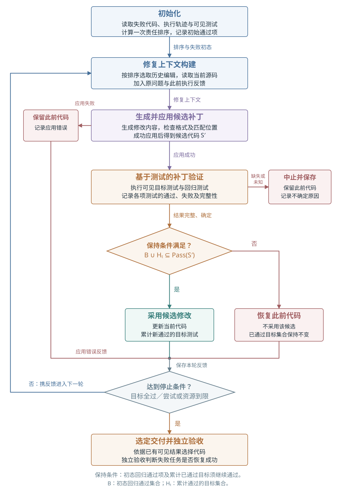

# 面向智能体失败任务的责任步骤排序与恢复方法研究

开题报告  
汇报人：杨亚鹏  
2026年10月26日

## 摘要

大语言模型智能体通过工具调用、环境交互和多步决策完成任务。执行失败时，责任线索可能分散在需求理解、代码编辑和测试反馈等不同步骤中，关键错误与最终异常表现之间也可能相隔较远。历史操作涉及的代码经过后续修改后，诊断结果还需要与当前状态重新对应。本课题面向已经失败的智能体任务，研究历史步骤的责任排序，以及诊断信息支持的失败任务恢复方法。

针对分散证据难以支持责任判断的问题，拟构建关系增强的上下文感知责任评分模型。模型综合步骤内容、执行角色和可观察的日志关系，针对每个候选步骤汇集全轨迹信息，通过单责任位置监督学习评分函数，输出历史步骤的检查次序。针对历史诊断与当前修复对象之间的对应困难，拟按责任排序选择可用历史编辑，结合当前代码和可见测试反馈生成候选补丁，并以累计已通过测试项的保持条件决定候选接纳，使已取得的进展参与后续修复。

研究将分别评价责任定位质量、诊断开销和独立验收下的失败任务恢复成功率，分析日志关系与步骤上下文的互补作用，以及历史编辑选择和测试保持对修复路径的影响。实验以原始任务为划分和比较单位，通过完整系统比较、模块消融、排序替换及接纳策略对照检验上述设计。前期已建立诊断与恢复原型，完成分组训练、排序接入和开发任务验证。预期形成责任步骤排序方法、诊断引导的失败任务恢复方法，以及相应的实验结果和复现材料。

**关键词：** 大语言模型智能体；失败诊断；责任步骤排序；轨迹表示；失败任务恢复；测试保持

## 1 背景与研究现状

### 1.1 研究背景

大语言模型（Large Language Model，LLM）能够理解自然语言指令、生成文本和代码，并结合上下文分析问题。用户可以直接描述目标，由模型给出解答、方案或程序。软件开发任务还要求将这些输出落实为环境中的实际操作。例如，解决代码仓库中的一个问题，需要查找实现、修改文件、运行测试，并依据执行结果调整方案。因此，模型生成能力需要与代码操作和结果检验相结合。[1,2]

将大语言模型与工具、运行环境和过程管理机制结合，可以构成围绕任务目标持续行动的智能体。模型依据当前信息选择操作，工具将操作作用于环境，返回的观察结果再进入后续决策。推理、动作与观察交替进行，使模型能够根据执行结果调整行为。[3] 这一过程需要持续维护任务进展、执行记录和当前状态，模型输出也成为连续执行中的一个环节。

智能体的任务结果由连续操作共同决定。检索结果为后续分析提供信息，代码编辑改变待验证的程序，测试结果影响下一步修改；多个角色参与时，设计、实现和验证产物还会在角色之间传递。评价智能体因而需要同时考察工具使用、环境交互、执行效率和最终任务结果。[4,5] 软件任务中的代码差异与可执行测试，为分析操作影响及检验任务完成情况提供了具体依据。

连续操作也使失败来源的追溯更加困难。早期遗漏的需求、错误的代码修改或未及时识别的问题，可能经由后续步骤传播，最终表现为测试失败或任务未完成。最终异常与关键错误之间存在时间和信息上的距离，末尾报错主要反映当时的执行状态。责任判断需要结合任务要求、历史操作及其后果，从完整轨迹中确定值得优先检查的步骤。[6,7]

责任定位之后，任务恢复仍需处理历史操作与当前代码之间的差异。执行记录保存过去的操作及上下文，当前源码则已经承受多轮修改；继续修复还可能影响此前正常的功能。因此，恢复过程需要核对历史线索与当前状态，并验证候选修改。[8,9] 本课题据此研究两个相互衔接的环节：通过失败诊断建立历史步骤的检查次序，再利用诊断信息支持当前任务的持续修正。

### 1.2 从失败诊断到任务恢复

失败诊断的核心困难是将分散记录转化为针对候选步骤的判断依据。需求理解、工具调用、代码编辑和测试反馈分别记录执行过程的不同侧面，一个步骤的作用需要结合前后记录判断。同一条反馈对不同候选的解释作用也可能不同。诊断模型需要联系远距离证据，并区分这些证据对各候选检查优先级的影响。[7]

失败任务恢复要求将历史步骤与当前可修改对象对应起来。历史记录说明过去发生了什么，当前源码决定现在能够实施什么修改；文件路径、编辑差异和执行反馈是联系两者的依据。软件缺陷定位通常以当前代码中的文件、方法或语句为候选。[10] 本文以历史执行步骤为诊断对象，进一步研究如何从这些步骤中提取当前修复所需的线索。

连续修复还涉及任务推进与已有功能保持之间的关系。候选修改可能解决部分问题，同时破坏已经通过的测试；某些修正又需要共同调整多个关联实现。[9] 因此，恢复过程需要同时判断候选是否推进任务、是否保留已有进展，以及相应约束是否限制后续修正。诊断质量、线索使用方式和候选接纳条件由此共同影响最终结果。

本文将分析失败轨迹并输出历史步骤责任排序的过程称为失败诊断；将从失败执行留下的代码和运行环境出发，利用诊断信息继续修正、以完成原始任务为目标的过程称为失败任务恢复。最终交付通过规定的独立验收时，判定为恢复成功。前者评价历史步骤的检查次序，后者评价当前任务的完成情况，两者通过诊断信息的实际使用相联系。

### 1.3 国内外研究现状

#### 1.3.1 智能体失败步骤定位

将候选步骤转化为分数并输出次序，可以联系排序学习的研究框架。2007年，Cao等提出ListNet，将候选列表作为训练单位，依据标签构造目标分布。[11] 2009年，Liu系统总结了从训练数据学习候选评分函数的排序学习方法，并按监督和目标组织方式区分点级、对级和列表级方法。[12] 2016年，黄震华等梳理了排序学习在推荐算法中的应用，说明了评分函数学习与候选排序之间的联系。[13] 2019年，Bruch等分析了二值相关性条件下softmax交叉熵目标与排序评价之间的关系，为单正例条件下学习候选次序提供了方法依据。[14]

2025年，Cemri等提出MAST，从实际执行材料中归纳系统设计、智能体间失配和任务验证等失败模式，为分析不同系统中的失败提供了分类依据。[6] 同年，Shaokun Zhang等构建Who&When，研究责任角色和决定性错误步骤：其标注关注修正后能够改变失败结果的位置，并在多个候选中关注较早的关键错误；诊断方法包括整段日志一次判断、逐步分析和二分搜索。[7] 这两项工作分别从失败模式和责任位置开展分析，为步骤级诊断提供了分类依据、位置级监督和评价对象。

2026年，Sun等提出SDBL，将可疑范围划定与精确定位分阶段处理，先确定需要重点关注的区间，再结合范围提示和完整日志完成定位。这种方式通过组织分析范围降低判断难度，其效果取决于范围识别与后续定位之间的配合。[15] 同年，Zhu等提出StepFinder，采用步骤语义、双向时序建模、全局注意力和角色门控，输出步骤分数，并以责任位置交叉熵和时间一致性辅助目标训练。该方法将轨迹表示与位置判断结合，为比较学习式诊断的定位质量和计算代价提供了直接参照。[16]

这些研究已将失败分析推进到具有位置监督和可比较输出的步骤级诊断。排序质量进一步取决于候选表示能否区分错误引入、后续异常和纠正机会。时序、角色及日志结构提供不同的步骤联系，远距离记录则可能补充局部信息。本文研究这些信息如何共同参与责任评分，并通过关系与上下文控制区分信息作用、连接冗余和计算开销。

#### 1.3.2 责任归因的数据基础

诊断能够利用的证据与执行系统保存过程的方式密切相关。2024年，Wu等提出AutoGen，通过可编程会话组织模型、工具和人工输入；Hong等提出MetaGPT，通过标准操作流程组织需求、设计、代码及测试产物。[17,18] 两类系统分别形成会话协作和产物交接式记录，为观察角色、动作和中间结果提供了不同的数据结构。将这些记录用于责任分析，还需要确定步骤边界、记录之间的联系以及监督标签的含义。

同年，Lightman等在Let's Verify Step by Step中利用数学推理步骤的正确性反馈训练过程评价模型，支持对推理候选的判断。[19] 这类步骤级监督与失败责任标注关注的对象有所不同。失败责任标注关注一次执行失败中的关键位置，其监督信息取决于标注者如何处理错误引入、职责遗漏和错过纠正机会等情形。单个责任位置标签提供了该步骤的归责依据，其余步骤的正确性需要其他证据判断。

2026年，Guibin Zhang等提出AgenTracer，通过自然失败的修正重放与成功轨迹的故障注入构造责任监督，并训练诊断模型，将标签获取与可修正性联系起来。自然失败和注入错误具有不同形成过程，评价时需要保留相应来源。[20] 同年，Mengzhuo Chen等构建TraceElephant，保存步骤输入、配置、输出和工具日志，并结合角色职责与可恢复性确定责任位置；下游验证者错过应有的纠正机会，也可能成为标注对象。[21]

责任归因数据的使用同时受到记录完整性和标注规则的约束。完整轨迹决定模型能够观察哪些证据，责任定义决定位置标签实际表达什么。本文统一输入形式时保留来源标注含义，评价时将同一原始任务的轨迹变体和派生样本归为同组，据此分析表示方法在不同监督来源和任务条件下的表现。

#### 1.3.3 反馈驱动的软件任务求解

软件智能体将语言模型的分析能力与代码操作结合，使任务求解逐步转化为执行和反馈交替进行的过程。2023年，Yao等提出ReAct，以推理、动作和观察的交替组织支持任务交互，为连续决策提供了基础形式。[3] 同年，Shinn等提出Reflexion，将先前尝试和评价转化为后续执行的语言记忆，为利用执行反馈组织后续尝试提供了方法。[22]

2024年，Liu等提出AgentBench，Jimenez等提出SWE-bench，分别从多环境交互、真实仓库问题及可执行测试等角度评价任务完成情况。[4,5] Yang等提出SWE-agent，研究适合智能体使用的软件操作接口，将模型决策与仓库操作及环境反馈相结合。[2] 这些工作从任务环境、交互方式和结果评价三个方面，为反馈驱动的软件任务求解提供了研究基础。

同年，Gou等提出CRITIC，通过工具交互检查已有输出，再据此修订。[23] Huang等关于推理自纠错的研究表明，纠错收益受到外部正确性信号、停止条件及初始提示的影响。[24] 在候选搜索和代码修改方面，Zhou等提出LATS，结合环境交互、反思和树搜索组织后续尝试；Kechi Zhang等提出CodeAgent，通过工具接口提供构建和测试反馈；Yuntong Zhang等提出AutoCodeRover，利用程序结构检索组织定位与修改。[25,26,27] 这些研究表明，分析修正效果时需要明确反馈来源、模型能够从反馈中获得的信息，以及上下文获取和候选搜索的组织方式。

2025年，Antoniades等提出SWE-Search，将搜索与迭代细化用于软件智能体求解；Bouzenia等提出RepairAgent，通过工具交互和阶段控制推进程序修复。[28,29] Xia等提出Agentless，将流程组织为分层定位、补丁生成和验证选择，已有回归测试及生成的复现测试均参与候选筛选。[30] 这些方法从搜索、上下文获取和执行控制等方面改善求解过程，表明修复效果与输入材料、编辑对象及反馈使用方式密切相关。

2026年，Tian等提出EnAgent，通过多条求解轨迹生成候选，利用回归测试剪枝，并以工具辅助比较和投票选择补丁。[31] 同年，Ruan等提出AOrchestra，由主控配置任务相关的子智能体、上下文及工具，通过动态分工完成复杂任务。[32] 与采用固定阶段流程的Agentless相比，这两项工作分别采用多轨迹集成和动态协作的求解方式，为本文的完整系统比较提供了参照。

现有方法已形成定位、补丁生成和验证选择相衔接的软件求解流程。本文关注已有执行失败后留下的代码状态，研究历史责任线索能否补充当前代码与测试反馈。相应问题包括：责任次序是否改变实际修复输入，以及修复中新通过的目标测试如何影响后续候选接纳。这两点分别对应诊断信息的使用方式和连续修正中的进展保持。

#### 1.3.4 诊断信息支持的任务恢复

诊断结果用于恢复时，需要联系历史认识与当前环境。2025年，Guo等提出SyncMind，研究协作代码更新引起的失步，说明重新获取当前代码和环境信息对恢复具有重要作用。[8] 同年，Yinfang Chen等提出STRATUS，在云系统故障处理中组织试执行、检查和撤销，利用状态管理约束连续操作；其环境和撤销前提为理解恢复机制的适用条件提供了另一类参照。[33] 两项研究分别从环境同步和操作状态管理出发，说明恢复过程需要核对当前状态，并检查后续操作对已有状态的影响。

2026年，Ma等提出DoVer，依据失败日志构造责任假设，再生成干预并继续执行，通过干预结果检查诊断与修正之间的联系。[34] 这一方向将诊断评价推进到实际任务效果，干预能否落实以及执行系统的修正能力也随之成为研究对象。同年，Zhuang等提出AgentRewind（预印本），将执行上下文与文件检查点共同恢复，并保留失败经验，使恢复状态和已有知识能够对应。[35] 该工作进一步从执行状态管理出发，说明历史信息的使用需要以当前可执行状态为基础。

已有研究表明，诊断信息进入恢复过程还涉及状态对应、干预实施和执行验证。历史位置提供检查线索，当前状态限定可实施的修改，反馈结果影响后续决策。本文据此将责任排序、历史编辑选择和测试保持联系起来，分别考察诊断是否改变修复依据，以及接纳条件如何影响修复路径和最终任务完成情况。

### 1.4 有待解决的研究问题

**分散执行证据的组织与责任步骤判断。** 步骤级监督已为失败定位提供评价对象，但单责任位置标签只指出一个归责位置，模型仍需学习如何比较同一轨迹中的候选。时序、角色和结构联系可能重复覆盖同一步骤，局部连接又难以传递全部远距离信息；扩大全轨迹信息范围则会引入无关记录和额外计算。因此，需要研究局部联系与步骤相关上下文的结合方式，并区分其效果来自有效证据组织、模型容量还是轨迹中的统计关联。

**历史诊断向当前任务修复的转化。** 责任位置、可用历史编辑和当前修改对象之间存在差异。高责任步骤可能属于推理或验证，同一编辑可能被重复记录，后续修改也可能使历史差异失效。筛选、去重和容量限制还可能使不同责任排序得到相同输入。同时，按测试标识保持已有通过项能够约束退化，也可能限制需要关联修改的候选。需要沿历史线索选择、当前代码核对、候选生成与接纳的过程，分析诊断信息何时形成实际差异，以及进展保持对最终恢复结果的收益和代价。

## 2 研究目标与意义

### 2.1 研究目标

本课题围绕责任步骤判断和诊断引导的失败任务恢复开展研究。目标是以可观察执行证据学习历史步骤的检查次序，并将该次序用于当前软件状态下的连续修复。两项研究分别回答以下问题。

**研究问题一：如何结合可观察的日志关系和步骤相关上下文，提高失败轨迹中责任步骤的排序质量，并控制诊断开销？** 研究将构建面向候选步骤的表示与评分方法，分析局部关系和全轨迹信息在不同轨迹结构及长度条件下的作用，确定责任定位质量与计算代价之间的关系。

**研究问题二：如何将责任步骤排序转化为当前软件状态下的修复依据，并通过测试保持组织连续修改，提高失败任务恢复成功率？** 研究将建立历史编辑选择、当前代码核对和候选验证相衔接的恢复流程，分析实际修复输入及接纳条件如何影响后续路径和最终结果。

责任排序的输出是两项研究的接口。研究问题一评价历史步骤定位，研究问题二评价原始任务完成；排序替换和过程记录进一步检验二者的联系。这样的评价安排可以区分定位质量改善、修复输入变化和最终恢复收益。

### 2.2 研究意义

**为失败诊断提供可比较的责任排序方法。** 本课题将分散的步骤内容、日志联系和执行上下文纳入统一评分模型，在共同任务划分下评价责任定位质量和诊断代价。对关系重合、轨迹长度和监督来源的分析，将说明不同信息在责任判断中的作用条件，为失败轨迹的优先检查和诊断方法选择提供依据。责任标签、来源规范与原始步骤映射的保留，也有助于解释不同数据条件下的结果。

**为失败任务恢复提供诊断引导的修复方法。** 本课题通过历史编辑选择、当前代码核对、反馈生成和测试保持，将责任排序接入从失败状态继续完成原始任务的过程。任务级比较及候选状态记录将揭示历史线索如何参与修复，以及保持已有进展如何影响后续修改。研究同时整理实际输入、测试变化、资源消耗和独立验收结果，为方法复现、适用条件分析及软件任务的持续修正提供实验依据。

## 3 研究内容与方法

### 3.1 研究对象及任务定义

本文以一次已经结束且未满足任务完成条件的执行为诊断对象，既包含单智能体执行，也包含多智能体协作。执行轨迹由有序步骤组成，每步保存来源允许获得的文本、动作、工具或环境观察、执行角色和原始索引。模型沿用实际记录的步骤边界，并保持输出与原始日志的对应。由于诊断发生在该次执行结束后，可利用轨迹中已经发生的前后步骤信息。

责任步骤由数据来源的标注规范确定，训练和评价采用相应位置标签。不同来源可能关注错误引入、职责遗漏或错过纠正机会。[7,20,21] 本文保留这些标注含义并分别报告结果。单责任位置监督要求标注步骤相对其他候选具有较高检查优先级，其余步骤之间的次序由评分函数给出。诊断数据中的数学及其他交互任务用于考察表示方法的适用范围；恢复研究则限定于环境可重建、代码变化可检查、测试可执行的软件任务。

设一次失败执行的可见轨迹为 <i>τ</i> = (<i>x</i>1, …, <i>x</i><i>m</i>)，其中 <i>x</i><i>i</i> 为第 <i>i</i> 个有效步骤的记录，轨迹长度 <i>m</i> 随任务变化；单责任标注为 <i>y</i> ∈ {1, …, <i>m</i>}。诊断模型学习共享函数 <i>s</i><i>i</i> = <i>f</i><i>θ</i>(<i>x</i><i>i</i>, <i>τ</i>, ℛ)，其中 ℛ 为从可见日志构造的关系集合。模型按 <i>s</i><i>i</i> 降序输出步骤索引，分数表达当前监督和观察条件下的检查优先级。责任标签用于训练和评价，独立验收反馈和其他方法的修复结果与模型输入隔离。

恢复任务以原问题 <i>q</i>、失败初态 <i>S</i>0、轨迹 <i>τ</i> 和预先许可的可见测试为输入。失败初态包含执行结束后的实际代码及运行环境，与原始仓库提交分别保存。本文将允许反馈给修复过程的测试称为可见测试，将与生成过程隔离、用于判断最终交付的测试称为独立验收测试。恢复过程生成候选状态 <i>S</i>′，经过应用和测试检查后更新当前接纳状态 <i>S</i><i>t</i>，最后选定代码快照并提交独立验收。

候选接纳表示一次修改满足既定状态更新条件；代码修复、补丁生成、测试和状态回退描述恢复过程中的具体操作。恢复成功以最终交付通过规定独立验收为依据。恢复主实验要求历史源码编辑可回查、环境能够重建且反馈测试可执行；缺少可映射编辑的轨迹仍可用于诊断评价，其恢复适用性及排除原因分别记录。样本资格按方法所需信息判断，与本轮方法胜负及独立验收结果隔离。

### 3.2 总体研究框架

总体框架如图3-1所示。责任排序模型针对候选步骤组织分散执行证据，恢复流程将历史诊断转化为当前状态下的修复输入。诊断模型读取步骤内容、角色和日志结构，输出与原始索引对应的责任评分及排序；恢复模块依照该次序选择历史编辑，结合当前代码生成候选，再通过测试保持条件决定接纳或回退，直至选定交付。两项方法通过实际修复输入衔接，分别评价定位质量和任务完成情况。

**图3-1 责任步骤排序与失败任务恢复的研究框架**

责任排序依次包括步骤特征编码、门控多关系消息传递、全局自注意力聚合和轨迹内责任评分四个模块。步骤特征编码保留文本、角色和记录形式；门控多关系消息传递利用可观察连接传递邻步信息；全局自注意力聚合针对每个候选汇集全轨迹证据；轨迹内责任评分综合初始表示、关系增强表示及步骤上下文，生成检查次序。

失败任务恢复包括排序引导的修复上下文构建、反馈驱动的候选补丁生成、基于测试的补丁验证三个模块。责任排序决定历史编辑的选择顺序和输入容量分配；应用结果与可见测试反馈用于后续生成；测试保持要求候选保留已纳入保护的通过项。历史编辑解释过去的修改，当前代码限定可实施的操作，两者共同构成修复依据。候选接纳后，新通过的目标测试加入后续验证条件。

诊断与恢复之间保存“原始步骤索引—编辑调用标识—文件及差异—当前源码—实际生成输入”的对应记录。这些记录用于判断责任次序是否改变模型实际获得的信息，再联系候选、接纳决定和最终结果分析其作用。两项研究的对象、方法和评价关系见表3-1。

**表3-1 两项研究的对象、方法与评价依据**

| 研究部分 | 主要对象 | 拟形成的方法 | 主要验证依据 |
| --- | --- | --- | --- |
| 责任步骤排序 | 已失败的完整执行轨迹 | 结合稀疏日志关系与步骤上下文的责任评分 | 分组定位评价、表示消融、成本及分层分析 |
| 失败任务恢复 | 可重建的软件失败初态 | 历史编辑选择、当前代码核对与测试保持下的连续修复 | 完整系统比较、排序替换、信息及接纳策略控制 |

联合分析以任务标识和步骤索引建立对应，将定位结果与同一任务的实际输入、候选状态、测试变化及资源消耗联系起来，并在任务层面配对比较独立验收结果。

### 3.3 关系增强的上下文感知责任排序

图3-2展示责任排序模型的计算结构。图中以一个待评分步骤为例，依次说明查询与键的相关性计算、对全轨迹各步骤的权重分配及值向量的加权汇聚。每个候选分别计算步骤上下文，再与初始表示和关系增强表示共同进入评分器。

**图3-2 责任步骤排序模型的计算结构**

#### 3.3.1 步骤特征编码

步骤初始表示综合文本、匿名角色和日志结构。文本描述操作与观察，角色区分轨迹中的行为来源，结构特征描述字段类型、嵌套形式、相对位置及重复情况。角色按同一轨迹中首次出现顺序编号，以轨迹内身份对应保留角色一致性，减少对特定名称的直接记忆。

若日志明确提供相邻、同角色的记录配对，输入适配保留该对应；没有配对时使用原记录。对有效配对，模型根据配对记录的内容、内容差值及有效标志计算特征变换和标量门控，将门控后的信息残差加回当前特征，再投影为步骤初始表示。该过程为事件配对特征融合，使配对信息在进入关系传播前参与步骤编码。

关系集合包含时间相邻、同一匿名角色、相同完整记录结构和相同非空动作结构四类。结构比较去除具体键名和值，保留可重复的记录形式。时间关系连接相邻步骤，其余关系连接前后最近的同类步骤，每个关系通道的邻居数至多为2。因此，各通道的连接规模随步骤数线性增长，关系传播获得有明确容量限制的局部信息范围。

关系类型决定邻步信息的变换和聚合方式。[36] 本文从可见日志构造邻接：结构相同表示记录形式相近，角色相同表示行为来源一致。这些联系用于确定信息读取范围，语义上的内容依赖还需要工具请求、返回及后续使用等证据。[37,38] 四类关系的选择兼顾日志可获得性与构图开销，其是否有助于责任判断，由定位评价和关系控制实验检验。

#### 3.3.2 门控多关系消息传递

本模块采用图神经网络的消息传递机制：沿给定关系读取邻居表示，聚合消息，再更新当前步骤。关系类型用于区分消息变换与聚合。[36] 本文进一步依据接收步骤及两步表示的差异调节消息贡献。对于接收步骤 <i>i</i>、关系类型 <i>r</i> 及邻居 <i>j</i>，模型以邻居表示和两步差异构造消息，以接收表示和该差异计算门控。令 <i>h</i><i>i</i> 为当前层表示，可写为：

$$

\begin{aligned}
g_{ij}^{(r)} &= \sigma\!\left(G_r[h_i;\,h_j-h_i]\right),\\
u_i^{(r)} &= \frac{1}{|\mathcal N_r(i)|}
\sum_{j\in\mathcal N_r(i)}
g_{ij}^{(r)}\,\phi_r([h_j;\,h_j-h_i]).
\end{aligned}
\tag{1}
$$

式（1）中，<i>g</i><i>ij</i>(<i>r</i>) 是0至1的标量，<i>φ</i><i>r</i> 是关系对应的可学习消息变换。该门控独立作用于每条边，不在邻居之间进行softmax归一化。没有邻居的通道取零向量。模型再根据接收步骤计算四个关系通道的归一化权重，汇集 <i>u</i><i>i</i>(<i>r</i>)，与原表示作残差相加并归一化。当前原型使用两层更新。

门控使邻步消息的贡献可以随接收步骤及两步差异变化，原始内容则经残差与评分旁路进入后续计算。同一对步骤可能出现在多个关系通道中，通道融合因而同时受到消息内容和连接重合的影响。实验将记录通道边数、重合比例及有效邻居覆盖，分析重复联系何时补充证据、何时主要增加冗余。

#### 3.3.3 全局自注意力聚合

两层稀疏传播能够联系的信息受邻接范围限制，而责任判断还可能依赖更远的执行记录。模型因此将关系增强表示映射为查询、键和值，采用单头缩放点积自注意力计算聚合权重。查询、键和值均来自同一条完整轨迹，通过点积衡量相关程度，再按表示维度缩放并归一化。[39] 每个待评分步骤生成各自的查询，在全轨迹均值基础上获得候选相关的上下文修正：

$$

\begin{aligned}
a_{ij} &= \operatorname{softmax}_{j}
\left(\frac{(W_Qh_i)^\top W_Kh_j}{\sqrt d}\right),\\
c_i &= \bar h+
W_O\left(\sum_j a_{ij}W_Vh_j-W_V\bar h\right).
\end{aligned}
\tag{2}
$$

其中 <i>h̄</i> = <i>m</i>−1∑<i>j</i><i>h</i><i>j</i>，<i>d</i> 为表示维度。<i>a</i><i>ij</i> 是第 <i>i</i> 个候选从步骤 <i>j</i> 汇集信息的权重，<i>c</i><i>i</i> 是加入候选相关修正后的上下文向量。全轨迹均值提供共享信息，每个候选再依据自身查询调整汇集内容。聚合权重用于组织信息，责任检查优先级由后续评分器产生。模型可使用同轨迹的自身及前后已发生步骤，跨轨迹位置被屏蔽。

步骤上下文使同一条证据能够针对不同候选发挥不同作用。例如，后续测试失败可为此前某次编辑提供判断依据，对正常读取步骤则主要补充任务背景。已有研究发现，语言模型对长上下文信息的利用受到信息位置的影响。[40] 本文将轨迹长度和信息分布作为分析维度，通过步骤上下文、共享查询上下文对照、轨迹均值上下文及局部上下文的比较，检验当前模型如何利用候选相关证据。

单条轨迹的密集注意力需要 <i>O</i>(<i>m</i>2<i>d</i>) 量级的计算，注意力权重存储为 <i>O</i>(<i>m</i>2)；稀疏关系层在关系数和邻居上限固定时，其边聚合随步骤数线性增长。这一区别决定了两类模块的开销随轨迹长度变化的方式。端到端诊断还包含文本编码和表示变换，实验将同时记录实际耗时、批处理设置和输入截断，分别分析算子复杂度与部署成本。

#### 3.3.4 轨迹内责任评分

评分器读取关系增强表示 <i>h</i><i>i</i>、初始表示 <i>h</i><i>i</i>(0)、步骤上下文 <i>c</i><i>i</i>，以及关系增强表示与步骤上下文之差，生成各候选的轨迹内步骤分数。单责任位置监督采用softmax交叉熵，学习标注步骤相对其余候选的检查优先性。[14] 评分函数、归一化分布及轨迹损失为：

$$

\begin{aligned}
s_i &= \operatorname{MLP}
\left([h_i;\,h_i^{(0)};\,c_i;\,h_i-c_i]\right),\\
p_i &= \frac{\exp(s_i)}{\sum_{j=1}^{m}\exp(s_j)},\\
\ell_\tau &= -\log p_y.
\end{aligned}
\tag{3}
$$

式（3）将单责任标注转化为组内竞争：在其他分数不变时，提高标注步骤的分数会降低损失。其对每个分数的梯度为 <i>p</i><i>i</i> − <b>1</b>[<i>i</i> = <i>y</i>]，使标注步骤与同组其他候选在训练中受到不同方向的约束。本文以轨迹为候选组，以单责任位置为监督，学习可用于新轨迹的共享评分函数。

训练目标为轨迹内错误位置的单标签softmax交叉熵；从候选评分与排序的角度，同一目标也对应单正例的列表级softmax排序目标。[12,13,14] 标注规定责任步骤的优先性，其余步骤之间的完整责任次序仍由模型估计。本文采用单责任位置的独热分布作为训练目标，与依据标签得分作softmax归一化构造目标分布的做法有所区别。[11]

单模型按分数降序输出原始步骤索引，同分时按原始索引处理。三模型集成先分别作轨迹内softmax，再平均预测权重并排序。归一化值表示同一轨迹内候选的相对检查优先级，解释时保留训练标签及候选集合这一条件。

训练以原始任务组织数据。AgenTracer来源配置对轨迹损失取平均；AFTraj中同一任务可能产生多条派生记录，先在任务组内平均，再对任务组等权平均，以控制派生数量对训练权重的影响。标准化统计量仅由训练部分估计，验证部分用于模型选择，评价部分不参与选轮。原型参数见附录A。

### 3.4 诊断引导的失败任务恢复

本方法采用生成—验证式程序修复流程：构建修复上下文、生成候选补丁、执行测试并决定代码更新，再将执行反馈用于后续尝试。程序修复研究已将补丁生成与补丁验证作为核心阶段，迭代修复则利用执行结果调整修改。[9,29,30] 本课题在这一流程中研究历史诊断输入和累计测试保持条件的作用。

恢复流程如图3-3所示。初始化时完成一次责任排序并建立测试保持集合，每轮扩展历史编辑输入、读取当前代码，再生成候选。应用失败时记录原因并检查停止条件；成功应用后执行测试，结果完整时依据保持条件接纳候选或恢复此前代码。测试观察缺失或不确定时，保存此前接纳状态并停止。尚未达到停止条件的分支沿反馈回路进入下一轮上下文构建。

**图3-3 失败任务恢复流程**

#### 3.4.1 排序引导的修复上下文构建

初始失败轨迹只诊断一次，后续保持责任次序不变。恢复模块依次检查排序步骤，提取成功执行且实际改变许可范围内项目源码的编辑，按编辑调用标识去重，并保存原始步骤索引。同一文件中的不同有效编辑分别保留；推理、读取及未成功执行的调用保留在诊断轨迹中，历史编辑输入仅收录实际发生的源码修改。

历史编辑保存修改前后的差异，用于说明过去的操作。每轮生成前，系统重新读取相应当前文件，并依据历史变更涉及的函数及可见失败记录补充可能相关的代码。文件路径和语法符号限定读取范围，历史差异与当前内容分别呈现，使生成模型能够结合现状判断历史操作的相关性。

选入编辑按固定规则逐轮扩展，受记录容量和输入容量共同限制，已选记录继续保留。有限容量使历史编辑的先后次序能够影响当轮可见材料。当前原型采用记录条数及历史文本字节限制，正式评价还将报告实际模型token，并在开发阶段固定容量。代码片段超出容量时，保存实际保留范围、截断位置和覆盖情况。

排序对修复输入的影响需要经过编辑筛选、去重和容量限制确认。两个步骤全序即使不同，最终历史输入仍可能相同；此时，排序变化没有在该输入环节形成干预。实验将同时记录全步骤次序、可用历史编辑次序和实际生成输入，在全体任务评价之外，按预先定义的可用编辑数量及输入机会分析作用条件。

全步骤责任定位与历史编辑选择具有不同的评价对象。标注责任位置可能属于推理或验证，保留编辑之间的相互次序则由评分函数估计。因此，本文在固定恢复流程下替换排序来源，同时记录实际输入和最终结果，检验步骤评分经过筛选后能否形成有助于修复的编辑选择。

#### 3.4.2 反馈驱动的候选补丁生成

可执行反馈提供候选结果的外部检查，并为后续修正提供依据。[23,29] 修复输入由原问题、选定历史编辑、当前代码及此前可见执行结果组成。生成模型提出文件路径、待替换内容和修改内容，执行端检查路径许可、格式及唯一匹配，应用成功后保存候选快照。格式错误、无法应用和应用后测试失败分别对应不同阶段，反馈记录保留这些差异，供下一轮生成使用。

每个候选在独立测试目录中按其快照重建代码，执行共同许可的目标测试与回归测试。这两组共享测试的代码和标识在评价前固定，恢复过程修改业务源码。各方法依据许可信息自行生成的复现或辅助测试属于内部求解机制，与共享测试分别记录；生成与执行许可保持一致，相应调用、token和运行时间计入总成本。独立验收与生成过程隔离，其他方法的补丁不进入当前方法的输入。

目标测试和回归测试依据原问题的行为要求确定。初态已通过测试若包含与新需求冲突的旧行为，须在任务资格核验时根据问题说明判断其适用性并记录理由。所有方法共用运行前确定的核验结果，使保持条件对应任务需要保留的行为，避免以过时要求约束正确修改。

#### 3.4.3 基于测试的补丁验证

本模块通过测试结果判断候选能否更新当前代码。补丁验证是程序修复中的既有阶段，本课题研究的具体条件是：将修复中新通过的目标测试持续加入后续约束，使任务进展随已接纳状态更新。[9,30,41]

令 <i>B</i> 为失败初态下确认通过、纳入保护的回归测试标识集合，<i>T</i>goal 为固定的可见目标测试集合，<i>H</i><i>t</i> 为初态及截至第 <i>t</i> 轮已接纳状态中累计确认通过的目标集合。对候选状态 <i>S</i>′，接纳条件为：

$$

B\cup H_t\subseteq\operatorname{Pass}(S').
\tag{4}
$$

其中 Pass(<i>S</i>′) 表示本次完整观察中确认通过的测试标识。候选被接纳后，更新当前代码，并令
<i>H</i><i>t</i>+1 = <i>H</i><i>t</i> ∪ (Pass(<i>S</i>′) ∩ <i>T</i>goal)。
候选被拒绝时恢复此前接纳代码，<i>H</i><i>t</i> 不变，被拒候选新通过的目标不纳入保护集合。只要满足保持条件，即使未增加通过项，也允许接纳并继续，以保留在相同测试表现下改变实现路径的空间。

该规则以测试标识集合表示已观察到的任务进展。在测试标识、测试代码和环境稳定，且结果完整确定的前提下，接纳状态保留 <i>B</i> 与已有 <i>H</i><i>t</i>，并有 <i>H</i><i>t</i> = Pass(<i>S</i><i>t</i>) ∩ <i>T</i>goal。初态满足该关系；每次接纳保留旧通过项并加入当前通过项，拒绝时状态与集合均不变。由此，累计保护等价于保留当前接纳状态的全部已通过目标，后续候选的约束随修复路径更新。该性质以实际执行的测试为范围。缺失、超时或不确定的测试结果触发停止，保存此前接纳状态及原因。

执行结果可以作为状态更新前的可检查条件。[42] 本文将已观察的目标测试纳入保持集合，通过接纳策略对照评价其作用：一方面检查是否避免已有目标退化，另一方面考察候选受限后能否继续完成任务。这两类结果共同决定测试保持的实际价值。

#### 3.4.4 停止、交付与约束代价

每轮接纳或拒绝后检查停止条件。可见目标全部通过、内部尝试次数达到上限或共同资源上限触发时，保存过程并选择交付。选择仅使用当时已获得的可见结果：先从初态及已接纳状态中保留满足当前保护集合的状态，再依次比较可见失败目标数、修改行数和尝试先后。各预算节点采用相同规则，记录选定代码、选择时间和累计资源，较晚结果不回填较早节点。

测试保持使候选接纳受到先前修复路径的影响。某些修复需要共同调整多个接口，中间候选可能暂时破坏先前通过项；反复执行测试也会占用生成和分析预算。实验将比较累计目标保持、数量保持和仅回归保持，并结合具体路径分析被避免的退化、被限制的修改及相应资源消耗，再评价这些过程差异是否转化为最终恢复收益。

诊断结果影响任务完成需要经过后续执行环节。失败预测研究中的干预效果受到干预方式和执行能力影响，预测准确程度与任务收益需要分别评价。[43] 本文同样分别记录责任定位、历史编辑选择、实际修复输入、候选生成和执行验证，通过固定恢复流程的排序替换实验，分析诊断差异在哪个环节保留，以及是否影响最终结果。

### 3.5 方法过程示例

考虑一个名称去重函数，要求比较时忽略大小写，同时保留第一次出现的原始写法和顺序。一次失败轨迹依次记录读取需求、查看代码、修改去重逻辑、运行测试及记录失败。假设第3步把实现改为按原始字符串比较，则输入“X、x、Y”仍会保留三项；本说明例将该编辑设为标注责任步骤。

诊断模型结合需求说明和后续测试反馈，比较第3步编辑与其他步骤的责任优先级。若该编辑进入排序前列，恢复模块提取其历史差异，再读取当前函数。生成模型获得原始要求、历史操作来源、当前代码和失败反馈，据此提出候选修正。

若候选将所有输出转成小写，可能消除大小写重复，却会破坏保留原始写法的回归检查，因而被拒绝。另一候选仅用规范化后的名称判断是否已经出现，输出继续保留原始名称。已有回归项和目标项均通过后，流程选定交付，再由独立验收判断任务是否完成。

若另一来源协议将“未及时识别错误的验证操作”标为责任步骤，该位置即使定位正确，也没有可直接采用的源码编辑。恢复器需要继续沿排序查找可用历史编辑，并核对当前实现。这一情形具体说明了责任定位质量与编辑选择效果需要分别评价的原因。

上述案例用于说明候选步骤、历史编辑、当前代码和测试保持之间的关系，责任标签与排序位置均为示例假设。方法效果将通过第五章规定的任务级比较和独立验收评价。

## 4 难点和创新

### 4.1 关键技术难点

**有限责任监督下的分散证据组织。** 单个步骤的作用取决于此前获得的信息、当时实施的操作及后续结果，内容相似的步骤也可能承担不同责任。单责任标签每条轨迹仅提供一个位置，不能直接规定应从哪些记录中取得判断依据。模型需要学习候选与远距离证据之间的关联，并区分错误引入、异常表现和错过纠正机会。技术困难在于从有限位置监督中形成有区分力的步骤上下文，同时控制无关记录及位置、角色等统计关联对判断的干扰。

**关系重合与全局信息开销并存。** 时间、角色和结构联系可以低成本构造，但不同通道可能读取相同步骤。在单角色轨迹中，同角色连接与时间连接完全重合；记录形式相近也不直接说明内容存在依赖。重复消息可能放大同一证据，无关消息则可能干扰原步骤表示。全轨迹注意力扩大了信息范围，也引入候选之间的密集相关性计算。因此，需要同时分析关系覆盖、通道重合和轨迹长度，判断局部结构与全局信息各自带来的定位收益及开销。

**历史责任位置与当前编辑对象之间存在不一致。** 责任位置可能是推理、检索、编辑或测试，定位正确的步骤未必包含可执行修改。同一编辑还可能同时出现在请求和工具返回中，涉及的源码也可能被后续操作覆盖。因此，历史线索需要经过有效性筛选、调用去重和当前代码核对，才能进入修复上下文。技术困难在于保留责任步骤与编辑来源的对应关系，并在有限输入容量下提供与当前状态相关的材料。

**进展保持对后续修复路径的约束。** 软件修改可能跨越多个函数或接口，解决一个目标也可能破坏另一个已通过目标。按通过数量接纳会忽略测试身份的替换，按标识保持则可能限制需要暂时改变既有行为的中间候选。测试覆盖、结果确定性和重复执行成本还会共同影响判断。研究需要以可观察测试定义进展，分析保持条件避免的退化、限制的关联修改，以及由此产生的最终恢复收益和代价。

### 4.2 拟研究的创新设计

**稀疏日志关系与步骤上下文共同支持的责任表示。** 本课题将四类可观察联系、步骤差异门控和候选相关的全轨迹聚合纳入责任评分。其设计判断是：局部联系提供可获得的执行结构，每个候选的查询区分远距离证据的作用，初始表示旁路保留未经关系传播的内容。研究重点是初始内容、关系增强表示与步骤上下文如何共同支持责任判断，以及这种结合在关系重合和长轨迹条件下是否仍然有效。完整学习式基线、共享上下文和关系控制分别用于检验整体表现、候选相关聚合及连接对应关系的作用。

**历史诊断参与的修复输入和动态测试保持。** 本课题将责任次序用于历史编辑选择与输入容量分配，每轮依据当前代码核对线索，并将新通过的目标测试纳入后续接纳条件。历史信息影响生成模型获得什么修复依据，测试保持影响哪些候选能够成为后续状态。拟研究的创新在于二者对连续修复路径的共同作用：通过排序替换与信息消融分析诊断输入，通过接纳策略对照分析进展保持，再以独立验收评价最终任务效果。

### 4.3 创新主张的验证安排

第一项设计分别检验模块作用和信息来源。去除关系传播或以轨迹均值替代步骤上下文，检验相应模块是否影响定位；保持相近参数规模的节点变换与关系置换，检验差异是否与特定连接及信息组织有关。共享查询上下文对照保留注意力计算，轨迹均值上下文则直接采用均值，两者分别与步骤上下文比较，并同时报告定位质量和开销。

第二项设计以完整系统比较评价总体恢复效果，以固定流程的控制实验解释具体机制。排序替换保持编辑筛选与容量规则一致，信息消融分别改变历史编辑或专门的当前代码读取，接纳对照比较累计目标集合保持、数量保持和仅回归保持。过程记录用于确认这些控制是否改变实际输入或候选决策，再联系独立验收结果解释作用。第6章所列开发结果用于确定后续问题，正式主张由独立评价检验。

## 5 实验设计

实验依次开展任务资格核验、数据分组与模型选择、共同条件下的完整方法运行、预算节点交付和独立验收。责任排序比较检验历史步骤的定位质量及诊断开销，完整系统比较检验失败任务恢复成功率，排序替换与模块控制分析两者之间的联系。三类评价分别回答整体效果、具体设计作用及作用条件，过程记录则用于解释实际差异发生在哪个环节。

### 5.1 数据来源与样本组织

诊断实验采用AFTraj及AgenTracer相关轨迹；恢复实验从具有可执行环境、测试和智能体轨迹的软件问题中整理真实失败初态，以SWE-Gym为主要来源。[44] 表5-1分别列出数据发布信息和本课题已整理范围。

**表5-1 数据来源与研究样本**

| 数据来源 | 发布信息 | 当前已整理范围 | 研究用途 |
| --- | --- | --- | --- |
| AFTraj | 数据卡列2,276条轨迹 | 本地731条失败轨迹、716个任务组；其中120组用于固定开发分析 | 责任定位与跨任务条件分析 |
| AgenTracer扩展发布版 | coding训练部分1,141条、测试部分127条 | 614条训练验证来源池及363条coding开发评价轨迹 | 软件相关轨迹的责任定位 |
| SWE-Gym | 2,438个可执行Python问题 | 23个已整理软件问题；既有不同实验协议分别保存 | 恢复方法开发与新评价任务来源 |

AFTraj数据卡列安全轨迹1,162条、不安全轨迹1,114条；其安全标签与本文任务失败资格需要逐项对应。[45] 本地731条、716组及120组为本课题筛选和分组后的规模。AgenTracer扩展发布版与论文使用版本存在差异；本地614条包含coding 320条、math 294条，363条coding开发轨迹也来自官方训练部分。[46]

自然失败与可控干预错误具有不同的数据形成过程。[20,47] 本文记录原始任务、轨迹变体和错误来源，将同一任务的派生记录归入同组，分别分析自然失败与注入错误的诊断表现。这样既保留监督来源的含义，也使样本划分及结果汇总对应到原始任务。

### 5.2 实验流程设计

#### 5.2.1 任务核验及分组

同一原问题的轨迹、错误变体和派生样本归为同组，保存来源标识、规范化任务标识及步骤映射。训练、验证与评价在任务组层面隔离，以减少同源任务信息跨集合出现。任务重叠核验结合模型输入和输出，检查任务文本、轨迹来源及仓库问题标识，并说明核验实际覆盖的范围。[41]

#### 5.2.2 诊断模型开发

AFTraj的716组采用五折分组评价：外层留一折，其余组用于内部训练和验证；选轮后在外层其余组重新训练，生成每条记录的外折预测。每个配置采用三次预定初始化，同一任务的记录先在组内汇总。

AgenTracer当前部署为一组492条训练、122条验证划分及三次初始化。拟保留A、B、C三种任务组隔离划分开展划分稳健性分析，每种仍为492/122，并在共同363条coding开发集合比较。数据划分编号和模型初始化编号分别保存，用于分析划分差异与训练随机性。参与方法选择的结果均作为开发证据。

#### 5.2.3 独立评价材料准备

独立诊断评价的候选来源为AFTraj官方test_unsafe列表中的163条轨迹，以及AgenTracer扩展版coding测试中的127条轨迹。先依据来源任务完成规范和可核查执行结果确认失败资格，再核对项目历史使用及任务重叠，确定纳入的轨迹和任务组。unsafe是来源标签，最终失败资格与独立性由上述核验判断。

未参与开发和选择的合格部分进入独立评价，已曝光部分用于外部分布开发分析。筛选后数量不足时，依照预先规定的来源和任务规则补充样本，并报告实际合格数量及独立性核验结果。候选来源规模与最终独立样本规模分别列明。

恢复评价计划另从SWE-Gym筛选约20个未参与本课题开发的合格问题，覆盖至少3个仓库。现有23个软件问题继续用于开发、接口检查和资源估计。每个新问题预先固定一个真实失败初态，保存原问题、来源轨迹、仓库版本、失败代码、依赖环境、可见测试及初始结果。方法运行前，依预定顺序核验环境重建、历史编辑映射和反馈可用性，记录纳入、排除及实际合格数量。

#### 5.2.4 共同运行及结果评价

各诊断方法在相同可见轨迹上输出责任位置或排序，按任务组汇总定位指标和诊断开销。恢复实验为每种方法、每次重复重建同一失败初态，在共同信息和资源条件下运行，到达预算节点时选定并保存交付，随后统一执行独立验收。完整系统比较评价整体效果，排序替换与模块消融解释设计作用。实际输入、候选状态、测试结果和资源记录贯穿运行过程，用于任务级配对及机制分析。

共同运行条件汇总于表5-2。

**表5-2 失败任务恢复的共同运行条件**

| 条件 | 统一设置 |
| --- | --- |
| 任务起点 | 同一原问题、仓库版本、失败代码和运行环境 |
| 生成模型 | deepseek-flash；各方法的实际部署参数分别记录 |
| 信息与测试 | 共同源码访问和反馈许可；固定可见测试；独立验收与生成过程隔离 |
| 独立重复 | 每个问题、每种方法独立运行3次，每次重建相同失败初态 |
| 时间与资源 | 主预算30分钟，同时保存15、60分钟节点；共同token上限，计入诊断、生成、工具、验证及选择 |
| 交付与评价 | 节点前按已获得的可见结果选定并保存交付，事后统一独立验收；未知和未运行状态分别记录 |

### 5.3 基线方法及共同条件

#### 5.3.1 失败诊断比较

诊断基线采用All-at-Once、Binary Search和StepFinder，分别保留其完整方法。[7,16] 三者提供一次性生成归因、搜索式归因和学习式定位的比较。实验保存代码版本、输入转换、训练参数及模型选择过程，表5-3列出各方法的诊断形式与正式发表时间。

**表5-3 失败诊断基线设置及发表时间**

| 方法 | 发表年份 | 发表会议／期刊 | 诊断形式 | 主要比较内容 |
| --- | --- | --- | --- | --- |
| All-at-Once | 2025 | ICML | 读取完整日志并生成责任位置 | 一次性生成归因的定位质量与调用开销 |
| Binary Search | 2025 | ICML | 通过区间判断缩小责任范围 | 分阶段搜索的定位质量与累计调用开销 |
| StepFinder | 2026 | KDD | 时序编码、角色感知全局交互及步骤评分 | 完整学习式诊断与本文表示设计的比较 |
| 本文方法 | — | 本课题研究方案 | 门控多关系消息传递及步骤上下文评分 | 责任前列排名、作用条件与计算代价 |

表中年份采用正式发表年份；All-at-Once与Binary Search对应同一项2025年ICML工作。本文方案的发表信息以“—”标记。

各方法共用可见轨迹、步骤边界、任务划分和评价标签。学习式方法保留各自核心结构与训练目标，在相同训练和验证信息条件下选轮；生成式方法固定模型、提示及搜索规则。所有方法比较Top-1，本文与StepFinder进一步比较MRR、Hit@3和Hit@5。单位置输出对应定位命中率，完整排序输出对应前列排名指标。无效输出按预定规则记为未命中，并单列数量和原因。

#### 5.3.2 失败任务恢复比较

拟采用Agentless、EnAgent、AOrchestra作为外部完整系统基线，分别代表固定阶段求解、多轨迹集成和动态智能体编排。[30,31,32] 正式实验选择已发表的CCF A类完整方法，包含2026年的代表性工作，并分别核验出版信息和实际运行条件。表5-4列出完整系统基线及正式发表时间。

**表5-4 失败任务恢复基线设置及发表时间**

| 方法 | 发表年份 | 发表会议／期刊 | 保留的核心过程 | 比较层次 |
| --- | --- | --- | --- | --- |
| Agentless | 2025 | FSE / PACMSE | 分层定位、补丁生成、复现与回归验证、最终选择 | 完整系统 |
| EnAgent | 2026 | ICSE | 多轨迹生成、回归剪枝、工具辅助选择与投票 | 完整系统 |
| AOrchestra | 2026 | ICML | 主控委派、任务相关上下文与工具配置、子智能体执行 | 完整系统 |
| 本文方法 | — | 本课题研究方案 | 责任排序、历史编辑与当前代码输入、反馈生成、测试保持接纳 | 完整系统 |

表中年份采用正式发表年份，Agentless对应2025年FSE／PACMSE正式版本。

完整系统从同一失败初态出发，使用同一生成模型deepseek-flash、共同源码访问权限、原始信息许可、可见测试和独立验收条件。各方法保留原有求解机制，实际提示、工具访问及信息使用范围分别记录。诊断、生成、工具执行、验证和选择均计入成本，失败初态适配与内部参数也在报告中列明，使比较结果对应本研究的实际部署。

正式运行前核验出版记录、作者核心源码、完整阶段实现及小试中的非零有效表现，以确认基线具备完整运行资格。恒零配置和未完整运行的工程情况分别保留，合格方法的全部实际结果均进入比较。StepFinder诊断接入本文恢复器用于排序模块控制；Agentless、EnAgent和AOrchestra按各自独立求解流程进行完整系统比较。

### 5.4 评价指标及资源设置

主要评价指标汇总于表5-5，具体计算、重复和资源条件在下文说明。

**表5-5 主要评价指标**

| 指标 | 计算方法及含义 |
| --- | --- |
| Top-1 ↑ | 责任步骤排在首位的命中率，先在任务组内汇总，再对任务组等权平均 |
| MRR ↑ | 标注责任步骤倒数排名的任务组等权平均 |
| Hit@3 / Hit@5 ↑ | 标注责任步骤进入前3／5位的命中率，采用同一任务组汇总规则 |
| 诊断耗时P50 / P95 ↓ | 从轨迹输入到诊断输出的耗时中位数／95分位数，分别报告首次加载与已加载条件 |
| 失败任务恢复成功率RSR ↑ | 每题3次独立运行成功情况的平均，再对完整共同问题等权平均 |
| RSR@15 / 30 / 60min ↑ | 对相应时间节点前已选定交付进行事后独立验收；30分钟为主比较节点 |
| 资源消耗 | 记录完整流程的墙钟时间、模型调用、token及相应显存或内存条件 |

#### 5.4.1 责任排序质量与诊断成本

主要定位指标包括首位命中率（Top-1）、平均倒数排名（Mean Reciprocal Rank，MRR）及前3、前5位命中率（Hit@3、Hit@5）。[12] 若标注责任位置在输出中的排名为 <i>r</i><i>τ</i>，则该轨迹倒数排名为 1/<i>r</i><i>τ</i>；先在同一任务组内平均，再对任务组等权汇总得到MRR。Top-1和Hit@k采用相同的任务组汇总原则。多责任标签数据按最靠前有效责任位置计算，单独说明标签规则并报告结果。

定位指标评价标注责任步骤在候选次序中的位置，其解释以相应标签规范为条件。成本从原始轨迹进入系统起计算，覆盖加载、文本编码、结构构造及评分或生成；分别报告首次加载和模型已加载条件下的P50、P95耗时，同时记录参数量、模型调用、token、显存或内存测量条件，以及输入长度和截断情况。

#### 5.4.2 失败任务恢复成功率

每个软件问题、每种方法独立运行3次，使用预定采样参数，每次重建相同初态并清空该次恢复历史。不同重复不继承其他重复的补丁或反馈，各次结果分别保存；内部候选、子智能体及投票统一计入所属运行。恢复成功要求在指定预算节点前选定并保存交付，且该交付事后通过规定的独立验收。

对具有完整可判定结果的共同任务集合 𝒰<i>b</i>，令 <i>z</i><i>a</i>,<i>u</i>,<i>r</i>(<i>b</i>) 表示方法 <i>a</i> 在问题 <i>u</i> 的第 <i>r</i> 次重复于预算 <i>b</i> 下是否恢复成功，则：

$$

\operatorname{RSR}_a(b)=
\frac{1}{|\mathcal U_b|}
\sum_{u\in\mathcal U_b}
\left(\frac{1}{3}\sum_{r=1}^{3}z_{a,u,r}(b)\right).
\tag{5}
$$

式（5）先汇总每个问题的全部3次独立运行，再对问题等权平均，表示一次独立运行的平均成功情况。计划任务数、实际启动数、可判定数和完整共同配对数同时报告。已知预算内没有成功交付的运行计为该预算下未成功；已选交付但验收未知和运行未开始分别保留状态，测试结果缺失时记为未知。主比较采用各方法三次均可判定的共同问题，并列出全计划任务矩阵及未知结果对应的范围，以分析缺失对结论的影响。

#### 5.4.3 时间节点与自然终态

主预算节点为30分钟，同时记录15、60分钟节点的选定代码及累计资源。这些结果来自同一次最长60分钟运行的不同快照；提前自然停止时，各后续节点沿用已选交付，并保留相应代码和资源记录。共同token上限、内部尝试次数、测试执行与停止规则在正式评价前固定。token汇总覆盖所有阶段、子智能体和失败候选，时间按完整流程墙钟计算。

环境重建与初始资格检查单列为准备成本；从方法读取输入、加载模型及开始诊断起，后续分析、生成、工具、测试和选择均计入运行时间。若进一步观察取消外部60分钟截断后的自然终态，保留原配置、原时钟、已用尝试和累计资源，单独报告续跑结果。进程保护或费用未知导致的中断按过程删失记录，并保留原因及已观察结果。

### 5.5 消融与机制验证

核心消融保持相应完整方法的划分、模型选择和共同运行条件，仅改变指定设计，具体设置见表5-6。

**表5-6 核心模块消融与控制设计**

| 研究问题 | 条件 | 改动及对应判断 |
| --- | --- | --- |
| 研究问题一 | Full | 完整责任步骤排序模型 |
| 研究问题一 | w/o RelProp | 跳过关系传播，检验关系增强信息的作用 |
| 研究问题一 | w/o StepCtx | 以轨迹均值替代步骤相关上下文，检验候选相关汇集的作用 |
| 研究问题一 | 容量与关系控制 | 保持相近参数规模或关系容量，检验增益是否仅来自额外容量 |
| 研究问题二 | Full | 完整失败任务恢复流程 |
| 研究问题二 | w/o HistEdit | 移除历史编辑输入，保留当前代码和反馈，检验历史线索的作用 |
| 研究问题二 | w/o CurrentRead | 移除依据历史编辑发起的专门当前代码读取，检验历史—当前对应的作用 |
| 研究问题二 | w/o TargetKeep | 移除累计目标保持，保留初态回归保持，检验目标保护的作用 |
| 研究问题二 | 数量保持 | 保留回归约束，仅要求目标失败数量不增加，与按标识保持比较 |

研究问题一的变体重新训练，共用任务分组、初始化集合和验证选轮规则。按关系类型、角色数、轨迹长度及连接重合率分层，结合去内容、关系置换、共享查询和局部上下文控制，区分记录内容、连接对应关系与模型容量的作用。分层与控制在开发阶段确定，主要主张对应的比较在独立评价前固定。

研究问题二保持恢复流程不变，分别以StepFinder排序和历史时间顺序替换本文排序，沿用相同的编辑筛选、去重及容量规则。时间顺序条件保留历史编辑，w/o HistEdit则移除该信息，两者检验不同问题。w/o CurrentRead保留共同源码访问权限，记录是否通过其他操作取得相同代码，据实际输入判断专门读取是否形成差异。

测试保持比较完整方法、w/o TargetKeep和按目标失败数量接纳的条件，重点记录“通过数量相同但已通过目标不同”的候选。每次保存已通过、丢失及新增测试标识，连同接纳决定和后续状态进行分析。对同一候选离线重算规则，只用于识别接纳决策的差异；接纳改变后续生成路径所产生的任务效果，由各策略的独立运行评价。

排序机制分析沿责任次序、历史输入、生成候选、后续路径和最终结果逐项建立对应。全部任务均保留，包括实际输入相同或最终结果相同的任务。结合预先确定的输入机会分层和排序控制实验，判断差异在哪个环节出现或消失，解释离线责任定位与实际恢复效果之间的联系。

### 5.6 统计分析与有效性

统计比较以原始任务为配对单位。诊断先汇总同组轨迹，恢复先汇总同题3次重复，再对任务进行配对自助重采样，报告方法差异及95%置信区间；小样本同时列出逐题结果和不一致配对数。三次重复用于观察同题生成过程的随机变化，独立样本量按原始问题数计算。主方法与多项对照的显著性分析预先划分检验族并进行多重比较校正，探索性分层单独标注。

有效性分析分别考察数据、表示和运行条件。不同来源的责任标签按各自含义解释，位置、角色和记录模板中的统计关联通过输入及关系控制分析。可见测试覆盖有限，独立验收用于检验未参与修复反馈的行为要求。完整系统比较保持共同任务资格、反馈许可和资源条件，记录各方法内部参数；模型采样及服务端行为的随机变化则通过独立重复和逐题结果观察。

开发证据、独立评价和机制样本分别汇报。全部预定任务、合格基线及独立重复保留，成功、正常失败、超时、工程中断、删失和未运行分别统计数量及原因。方法比较采用事先确定的共同样本和资源条件，使结果解释能够对应实际观测范围。

## 6 研究基础、进度与预期成果

### 6.1 已有方法与数据基础

前期已建立轨迹整理、原始步骤映射、任务分组、特征编码、模型训练和责任排序输出流程。当前诊断主线采用关系增强与全轨迹上下文结构。AFTraj外折模型和AgenTracer来源模型结构相同，训练任务与权重不同；恢复部署分别保存模型版本、权重来源、排序产物、历史编辑选择和实际生成请求之间的对应关系。

恢复原型已实现失败代码重建、当前源码读取、候选生成与应用、可见测试、通过集合保持、状态回退和最终交付记录。Agentless与EnAgent已在共同任务上完整运行，AOrchestra的后续先导也已到达自然终态并通过独立验收。这些结果支持完整流程和比较接口的可行性，后续工作将完善共同条件下的评价及机制分析。

### 6.2 已有结果及其研究含义

表6-1汇总与本课题主张直接相关的开发证据。不同协议分别列出，重复运行不增加独立任务数。

**表6-1 前期开发结果及后续研究依据**

| 开发范围 | 已观察结果 | 对后续研究的作用 |
| --- | --- | --- |
| AFTraj固定120任务组 | 当前上下文模型命中86组，StepFinder命中82组；差异校正p值为0.5235 | 支持原型可行，尚需独立评价定位改善是否稳定 |
| coding363开发集合 | 当前模型命中186条，StepFinder148条；共享静态上下文控制187条 | 共享静态上下文表现相近，步骤上下文的独立作用需进一步检验 |
| 较早五个共同软件问题 | 自然终态下本文2/5、Agentless3/5、EnAgent2/5；旧协议30分钟结果分别2/5、3/5、0/5 | 该部署下Agentless成功率较高；后续比较需统一预算规则 |
| 一个软件问题的排序控制 | 5条已启动轨迹自然终态均成功，原30分钟内均未成功交付；仅一轮形成完整三条件比较 | 排序已接入恢复流程，当前样本未显示排序间的恢复率差异 |
| 一个问题的测试保持压力实验 | 3次重复中，集合保持3/3、数量保持2/3、仅回归保持3/3 | 已观察目标退化；集合保持相对仅回归保持的最终收益尚未确立 |

表6-1所列结果分别对应不同的开发协议和模型权重，来源见附录B。五题比较采用当时的资源受限部署，本文使用历史AFTraj模型排序；后续排序控制使用AgenTracer来源模型。表中的共享静态上下文控制对应共享查询上下文对照，与直接采用轨迹均值的w/o StepCtx区分。AFTraj全部716任务组的上下文控制同样未观察到稳定的模块优势。因此，后续独立评价将保留完整方法、共享上下文及关系控制，继续检验步骤上下文和连接信息的具体作用。

五题旧协议将独立验收计入原30分钟时限，本报告拟采用预算节点前选定并保存交付、事后统一独立验收的规则。历史数字保留旧定义，与式（5）对应的新协议结果分别报告。五条排序控制轨迹的后续成功来自取消旧外部截断、并包含通用接口修复的条件续跑，结果变化同时涉及运行时长与接口条件，作为接口及联合流程可行性证据保留。

已有排序发布在18条合格软件轨迹上产生不同的全步骤次序，经可用历史编辑筛选和容量限制后，其中12条仍保留不同输入前缀。这为研究排序如何改变修复输入提供了开发材料。这些轨迹均为单角色，时间关系与角色关系完全重合，记录配对模块未触发；多角色关系及配对模块的贡献需要在具有相应结构的轨迹中评价。

测试保持压力实验中，仅回归保持策略曾接纳使已通过目标退化的候选，随后仍完成任务；集合保持和数量保持均会拒绝该候选。现有事件尚未出现“通过数量相同但已通过目标不同”的独有分歧。该证据确认了目标退化事件，并将后续机制问题具体化为：不同规则何时作出不同决策，以及这些决策是否改变后续修复和最终成功情况。

AOrchestra已在一个既定开发问题上保留作者核心阶段完成运行，并通过独立验收。该运行包含接口修复及等待，原30分钟成绩仍未成功。它支持第三项整体方法的运行可行性；正式共同比较将采用预先确定的新任务集合和统一资源条件。

### 6.3 工作量、资源与完成条件

本课题以现有文本编码器和轻量责任评分网络为基础，固定编码器参数，将方法研究集中于责任表示及诊断引导的恢复流程。诊断工作包括分组训练、结构控制和独立评价，恢复工作围绕三个模块与三种外部完整系统展开。已有的数据处理、模型与权重记录、输入映射及测试流程可用于正式评价。

若独立恢复评价最终纳入20个问题，4种完整方法、每题3次重复，共240条运行；每条60分钟时，累计上限为240小时，30分钟节点对应累计120小时。以上为各运行时长之和，实际工期还取决于并行度和环境准备时间。两种排序替换共增加120条，三项恢复消融若全部覆盖20题增加180条，数量保持对照再增加60条。全部配置共600条，按每条60分钟计算的累计上限为600小时；30分钟节点对应累计300小时。15、30、60分钟结果复用同一运行快照，不重复生成。并行度须依据机器与环境隔离能力确定。

正式实验分阶段完成。首先开展共同任务的整体比较及与主要主张直接对应的核心消融，再按预先确定的机制条件补充分析。输入容量、总token上限和费用估算依据开发数据确定，在正式评价前写入协议。可用额度限制完成规模时，保留各方法核心阶段与预定任务矩阵，分别报告已完成和未完成部分。

课题交付包括两项方法、共同条件下的系统比较和相应机制分析。完成条件为：明确数据版本、模型配置与权重来源，具备可运行的完整方法及基线，取得未参与方法选择的评价材料，并形成任务级配对结果和包含全部负结果的分析。若改善只出现在特定轨迹或任务条件下，论文据实际结果说明适用范围与计算代价。

### 6.4 研究进度

**2026年9—10月：问题界定与开题准备。** 完成核心文献调查、术语与现有实现核对，确定两项研究问题、中心设计论点及实验方案，整理原型和开发证据，形成开题报告。

**2026年11—12月：诊断与恢复模块完善。** 完成责任评分模型及控制条件整理，核对任务划分与最终模型版本及权重来源；完善历史编辑到当前代码的对应、测试保持和预算节点交付，固定正式评价配置。

**2027年1—2月：独立评价与完整基线比较。** 按预定资格规则构建独立任务集合，完成责任排序评价和失败任务恢复比较，记录全部重复、资源和异常原因，形成可复查结果。

**2027年3月：消融分析与论文初稿。** 完成核心模块与机制条件分析，结合有利及不利结果解释两项设计的作用，整理图表、案例和研究结论。

**2027年4—5月：论文修改与答辩准备。** 根据评阅意见修订论证、方法说明和实验分析，完成论文定稿、复现材料及答辩展示。资料整理与论文撰写随各阶段交叉进行。

### 6.5 预期成果

第一，形成关系增强的上下文感知责任步骤排序方法，明确单责任监督下的任务定义、评分模型、分组评价及诊断成本，分析可观察日志关系与步骤上下文在不同轨迹条件下的作用。配套整理数据版本、任务分组、模型配置及排序结果，为方法比较和复现提供材料。

第二，形成诊断引导的失败任务恢复方法，将历史编辑选择、当前代码核对、反馈生成与测试保持接纳组织为可执行流程。通过独立验收评价任务完成情况，结合排序到实际输入的映射、候选状态、测试和资源记录，分析诊断信息及目标保持的收益与代价。最终完成任务级比较、代表性失败分析、学位论文、复现材料和答辩文稿。

## 参考文献

[1] 董益宏, 姜雪, 钱家如, 等. 基于大语言模型智能体的代码生成综述[J]. 软件学报, 2026, 37(8): 3089–3115. DOI: 10.13328/j.cnki.jos.007593. [正式出版记录](https://www.jos.org.cn/jos/article/abstract/7593)。

[2] John Yang, Carlos E. Jimenez, Alexander Wettig, et al. SWE-agent: Agent-Computer Interfaces Enable Automated Software Engineering[C]//Advances in Neural Information Processing Systems, 2024. [正式出版记录](https://proceedings.neurips.cc/paper_files/paper/2024/hash/5a7c947568c1b1328ccc5230172e1e7c-Abstract-Conference.html)。

[3] Shunyu Yao, Jeffrey Zhao, Dian Yu, et al. ReAct: Synergizing Reasoning and Acting in Language Models[C]//International Conference on Learning Representations (ICLR), 2023. [正式出版记录](https://openreview.net/forum?id=WE_vluYUL-X)。

[4] Xiao Liu, Hao Yu, Hanchen Zhang, et al. AgentBench: Evaluating LLMs as Agents[C]//International Conference on Learning Representations (ICLR), 2024. [正式出版记录](https://proceedings.iclr.cc/paper_files/paper/2024/hash/e9df36b21ff4ee211a8b71ee8b7e9f57-Abstract-Conference.html)。

[5] Carlos E. Jimenez, John Yang, Alexander Wettig, et al. SWE-bench: Can Language Models Resolve Real-world GitHub Issues?[C]//International Conference on Learning Representations (ICLR), 2024. [正式出版记录](https://proceedings.iclr.cc/paper_files/paper/2024/hash/edac78c3e300629acfe6cbe9ca88fb84-Abstract-Conference.html)。

[6] Mert Cemri, Melissa Z Pan, Shuyi Yang, et al. Why Do Multi-Agent LLM Systems Fail?[C]//Advances in Neural Information Processing Systems, Datasets and Benchmarks Track, 2025. [正式出版记录](https://papers.nips.cc/paper_files/paper/2025/hash/b1041e52d3be19f0a9bc491657488e4a-Abstract-Datasets_and_Benchmarks_Track.html)。

[7] Shaokun Zhang, Ming Yin, Jieyu Zhang, et al. Which Agent Causes Task Failures and When? On Automated Failure Attribution of LLM Multi-Agent Systems[C]//Proceedings of the 42nd International Conference on Machine Learning (ICML), PMLR 267: 76583–76599, 2025. [正式出版记录](https://proceedings.mlr.press/v267/zhang25cq.html)。

[8] Xuehang Guo, Xingyao Wang, Yangyi Chen, et al. SyncMind: Measuring Agent Out-of-Sync Recovery in Collaborative Software Engineering[C]//Proceedings of the 42nd International Conference on Machine Learning (ICML), PMLR 267: 20993–21066, 2025. [正式出版记录](https://proceedings.mlr.press/v267/guo25l.html)。

[9] 香佳宏, 徐霄阳, 孔繁初, 等. 大模型在软件缺陷检测与修复的应用发展综述[J]. 软件学报, 2025, 36(4): 1489–1529. DOI: 10.13328/j.cnki.jos.007268. [正式出版记录](https://www.jos.org.cn/html/2025/4/7268.htm)。

[10] 曹帅, 牛菲菲, 李传艺, 等. 深度学习在基于信息检索的缺陷定位中的应用综述[J]. 软件学报, 2025, 36(4): 1530–1556. DOI: 10.13328/j.cnki.jos.007288. [正式出版记录](https://www.jos.org.cn/jos/article/abstract/7288)。

[11] Zhe Cao, Tao Qin, Tie-Yan Liu, et al. Learning to Rank: From Pairwise Approach to Listwise Approach[C]//Proceedings of the 24th International Conference on Machine Learning (ICML): 129–136, 2007. [正式出版记录](https://doi.org/10.1145/1273496.1273513)。

[12] Tie-Yan Liu. Learning to Rank for Information Retrieval[J]. Foundations and Trends in Information Retrieval, 3(3): 225–331, 2009. [正式出版记录](https://doi.org/10.1561/1500000016)。

[13] 黄震华, 张佳雯, 田春岐, 等. 基于排序学习的推荐算法研究综述[J]. 软件学报, 2016, 27(3): 691–713. DOI: 10.13328/j.cnki.jos.004948. [正式出版记录](https://www.jos.org.cn/jos/article/abstract/4948)。

[14] Sebastian Bruch, Xuanhui Wang, Michael Bendersky, Marc Najork. An Analysis of the Softmax Cross Entropy Loss for Learning-to-Rank with Binary Relevance[C]//Proceedings of the 2019 ACM SIGIR International Conference on Theory of Information Retrieval (ICTIR). 2019: 75–78. DOI: 10.1145/3341981.3344221. [正式出版记录](https://research.google/pubs/an-analysis-of-the-softmax-cross-entropy-loss-for-learning-to-rank-with-binary-relevance/)。

[15] Kai Sun, Wenqiang Li, Bo Dong, et al. Scope Delineation Before Localization: A Two-Stage Framework for Enhancing Failure Attribution in Multi-Agent Systems[C]//Proceedings of the AAAI Conference on Artificial Intelligence, 40(39): 33108–33116, 2026. [正式出版记录](https://ojs.aaai.org/index.php/AAAI/article/view/40594)。

[16] Taiyu Zhu, Yifan Wu, Weilin Jin, et al. StepFinder: A Temporal Semantic Framework for Failure Attribution in Multi-Agent Systems[C]//Proceedings of the 32nd ACM SIGKDD Conference on Knowledge Discovery and Data Mining V.2: 6946–6957, 2026. [正式出版记录](https://doi.org/10.1145/3770855.3817991)。

[17] Qingyun Wu, Gagan Bansal, Jieyu Zhang, et al. AutoGen: Enabling Next-Gen LLM Applications via Multi-Agent Conversations[C]//Conference on Language Modeling (COLM), 2024. [正式出版记录](https://openreview.net/forum?id=BAakY1hNKS)。

[18] Sirui Hong, Mingchen Zhuge, Jonathan Chen, et al. MetaGPT: Meta Programming for A Multi-Agent Collaborative Framework[C]//International Conference on Learning Representations (ICLR 2024). [正式出版记录](https://proceedings.iclr.cc/paper_files/paper/2024/hash/6507b115562bb0a305f1958ccc87355a-Abstract-Conference.html)。

[19] Hunter Lightman, Vineet Kosaraju, Yuri Burda, et al. Let’s Verify Step by Step[C]//International Conference on Learning Representations (ICLR), 2024. [正式出版记录](https://proceedings.iclr.cc/paper_files/paper/2024/hash/aca97732e30bcf1303bc22ac3924fd16-Abstract-Conference.html)。

[20] Guibin Zhang, Junhao Wang, Junjie Chen, et al. AgenTracer: Who Is Inducing Failure in the LLM Agentic Systems?[C]//International Conference on Learning Representations (ICLR), 2026. [正式出版记录](https://proceedings.iclr.cc/paper_files/paper/2026/hash/134ed7a477770f227f12450ef0cbb8f4-Abstract-Conference.html)。

[21] Mengzhuo Chen, Junjie Wang, Fangwen Mu, et al. Seeing the Whole Elephant: A Benchmark for Failure Attribution in LLM-based Multi-Agent Systems[C]//Proceedings of the 64th Annual Meeting of the Association for Computational Linguistics (Volume 1: Long Papers): 19888–19905, 2026. [正式出版记录](https://aclanthology.org/2026.acl-long.912/)。

[22] Noah Shinn, Federico Cassano, Ashwin Gopinath, et al. Reflexion: Language Agents with Verbal Reinforcement Learning[C]//Advances in Neural Information Processing Systems (NeurIPS), 2023. [正式出版记录](https://proceedings.neurips.cc/paper_files/paper/2023/hash/1b44b878bb782e6954cd888628510e90-Abstract-Conference.html)。

[23] Zhibin Gou, Zhihong Shao, Yeyun Gong, et al. CRITIC: Large Language Models Can Self-Correct with Tool-Interactive Critiquing[C]//International Conference on Learning Representations (ICLR), 2024. [正式出版记录](https://proceedings.iclr.cc/paper_files/paper/2024/hash/fef126561bbf9d4467dbb8d27334b8fe-Abstract-Conference.html)。

[24] Jie Huang, Xinyun Chen, Swaroop Mishra, et al. Large Language Models Cannot Self-Correct Reasoning Yet[C]//International Conference on Learning Representations (ICLR), 2024. [正式出版记录](https://proceedings.iclr.cc/paper_files/paper/2024/hash/8b4add8b0aa8749d80a34ca5d941c355-Abstract-Conference.html)。

[25] Andy Zhou, Kai Yan, Michal Shlapentokh-Rothman, et al. Language Agent Tree Search Unifies Reasoning, Acting, and Planning in Language Models[C]//Proceedings of the 41st International Conference on Machine Learning (ICML), PMLR 235: 62138–62160, 2024. [正式出版记录](https://proceedings.mlr.press/v235/zhou24r.html)。

[26] Kechi Zhang, Jia Li, Ge Li, et al. CodeAgent: Enhancing Code Generation with Tool-Integrated Agent Systems for Real-World Repo-level Coding Challenges[C]//Proceedings of the 62nd Annual Meeting of the Association for Computational Linguistics, 2024:13643–13658. [正式出版记录](https://aclanthology.org/2024.acl-long.737/)。

[27] Yuntong Zhang, Haifeng Ruan, Zhiyu Fan, Abhik Roychoudhury. AutoCodeRover: Autonomous Program Improvement[C]//Proceedings of the 33rd ACM SIGSOFT International Symposium on Software Testing and Analysis, 2024:1592–1604. [正式出版记录](https://doi.org/10.1145/3650212.3680384)。

[28] Antonis Antoniades, Albert Örwall, Kexun Zhang, et al. SWE-Search: Enhancing Software Agents with Monte Carlo Tree Search and Iterative Refinement[C]//International Conference on Learning Representations (ICLR), 2025. [正式出版记录](https://proceedings.iclr.cc/paper_files/paper/2025/hash/a1e6783e4d739196cad3336f12d402bf-Abstract-Conference.html)。

[29] Islem Bouzenia, Premkumar Devanbu, Michael Pradel. RepairAgent: An Autonomous, LLM-Based Agent for Program Repair[C]//Proceedings of the IEEE/ACM 47th International Conference on Software Engineering (ICSE): 2188–2200, 2025. [正式出版记录](https://doi.org/10.1109/ICSE55347.2025.00157)。

[30] Chunqiu Steven Xia, Yinlin Deng, Soren Dunn, et al. Demystifying LLM-Based Software Engineering Agents[J]. Proceedings of the ACM on Software Engineering, 2(FSE): 801–824, 2025. [正式出版记录](https://doi.org/10.1145/3715754)。

[31] Zhao Tian, Pengfei Gao, Junjie Chen, et al. Agent-Based Ensemble Reasoning for Repository-Level Issue Resolution[C]//Proceedings of the IEEE/ACM 48th International Conference on Software Engineering (ICSE): 1406–1418, 2026. [正式出版记录](https://doi.org/10.1145/3744916.3787761)。

[32] Jianhao Ruan, Zhihao Xu, Yiran Peng, et al. AOrchestra: Automating Sub-Agent Creation for Agentic Orchestration[C]//Proceedings of the 43rd International Conference on Machine Learning (ICML), PMLR 306: 106017–106040, 2026. [正式出版记录](https://proceedings.mlr.press/v306/ruan26e.html)。

[33] Yinfang Chen, Jiaqi Pan, Jackson Clark, et al. STRATUS: A Multi-agent System for Autonomous Reliability Engineering of Modern Clouds[C]//Advances in Neural Information Processing Systems 38, 2025. [正式出版记录](https://proceedings.neurips.cc/paper_files/paper/2025/hash/47a6e9e2c3019f13ad94a0f259fe4970-Abstract-Conference.html)。

[34] Ming Ma, Jue Zhang, Fangkai Yang, et al. DoVer: Intervention-Driven Auto Debugging for LLM Multi-Agent Systems[C]//International Conference on Learning Representations (ICLR), 2026. [正式出版记录](https://proceedings.iclr.cc/paper_files/paper/2026/hash/2f5fdce256ff0d7fb774da76e5e63209-Abstract-Conference.html)。

[35] Yu Zhuang, Kefei Chen, Yitong Duan, et al. AgentRewind: Recoverable Execution for Long-Horizon LLM Agents[EB/OL]. arXiv preprint arXiv:2608.14380, 2026. [2026-10-23]. [预印本](https://arxiv.org/abs/2608.14380)。

[36] Michael Schlichtkrull, Thomas N. Kipf, Peter Bloem, et al. Modeling Relational Data with Graph Convolutional Networks[C]//The Semantic Web (ESWC), Lecture Notes in Computer Science: 593–607, 2018. [正式出版记录](https://doi.org/10.1007/978-3-319-93417-4_38)。

[37] Shuyang Liu, Yang Chen, Rahul Krishna, et al. Process-Centric Analysis of Agentic Software Systems[J]. Proceedings of the ACM on Programming Languages, 10(OOPSLA1): 1961–1988, Article 163, 2026. [正式出版记录](https://doi.org/10.1145/3798271)。

[38] Bo Deng, Xinlei Zheng, Yi Wei, et al. DeFA: Dependency-Guided Failure Attribution for LLM Agents[EB/OL]. arXiv preprint arXiv:2610.01256, 2026. [2026-10-23]. [预印本](https://arxiv.org/abs/2610.01256)。

[39] Ashish Vaswani, Noam Shazeer, Niki Parmar, et al. Attention Is All You Need[C]//Advances in Neural Information Processing Systems 30. 2017. [正式出版记录](https://proceedings.neurips.cc/paper_files/paper/2017/hash/3f5ee243547dee91fbd053c1c4a845aa-Abstract.html)。

[40] Nelson F. Liu, Kevin Lin, John Hewitt, et al. Lost in the Middle: How Language Models Use Long Contexts[J]. Transactions of the Association for Computational Linguistics, 12:157–173, 2024. [正式出版记录](https://aclanthology.org/2024.tacl-1.9/)。

[41] 李卿源, 钟文康, 李传艺, 等. 神经程序修复领域数据泄露问题的实证研究[J]. 软件学报, 2024, 35(7): 3071–3092. DOI: 10.13328/j.cnki.jos.007110. [正式出版记录](https://www.jos.org.cn/html/2024/7/7110.htm)。

[42] Haoyu Wang, Christopher M. Poskitt, Jun Sun. AgentSpec: Customizable Runtime Enforcement for Safe and Reliable LLM Agents[C]//Proceedings of the IEEE/ACM 48th International Conference on Software Engineering, 2026:2938–2950. [正式出版记录](https://doi.org/10.1145/3744916.3764546)。

[43] Rakshith Vasudev, Melisa Russak, Dan Bikel, Waseem Alshikh. Accurate Failure Prediction in Agents Does Not Imply Effective Failure Prevention[EB/OL]. arXiv:2602.03338, 2026. [2026-10-23]. [预印本](https://arxiv.org/abs/2602.03338)。

[44] Jiayi Pan, Xingyao Wang, Graham Neubig, et al. Training Software Engineering Agents and Verifiers with SWE-Gym[C]//Proceedings of the 42nd International Conference on Machine Learning (ICML), PMLR 267: 47717–47737, 2025. [正式出版记录](https://proceedings.mlr.press/v267/pan25g.html)。

[45] ZBox008003. AFTraj-2K dataset card[DB/OL]. Hugging Face, 2026[2026-10-23]. [数据来源](https://huggingface.co/datasets/ZBox008003/AFTraj/blob/main/README.md)。

[46] AgenTracer authors. AgenTracer Data v1.0.0: Expanded Dataset Release[DB/OL]. GitHub, 2026-08-27[2026-10-23]. [数据来源](https://github.com/bingreeky/AgenTracer/releases/tag/data-v1.0.0)。

[47] Fanqi Kong, Ruijie Zhang, Huaxiao Yin, et al. Aegis: Automated Error Generation and Attribution for Multi-Agent Systems[C]//International Conference on Learning Representations (ICLR), 2026. [正式出版记录](https://proceedings.iclr.cc/paper_files/paper/2026/hash/56e8943ecd44b67bbea2702b9117b858-Abstract-Conference.html)。

## 附录A 当前原型参数与拟开展事项

当前原型固定Qwen3-Embedding-0.6B文本编码器，使用128维内容表示、32维角色表示及23维结构特征，投影为96维。关系更新为两层，Dropout为0.15；评分输入为四组96维向量。已有训练采用AdamW，本文网络学习率0.001、权重衰减0.0001、梯度范数裁剪1.0，最多40轮，连续8轮无验证提升停止。验证按Top-1、再按MRR选轮，并列时取最早轮。StepFinder保留其独立核心及相应训练设置。

AgenTracer来源训练批次为16条轨迹；AFTraj为16个完整任务组，内层选轮后在外层训练部分重新拟合。当前软件恢复部署使用AgenTracer来源的三初始化集成；AFTraj外折集成为另一组独立权重，实验记录分别注明其训练来源和使用配置。记录配对分支在有明确配对时参与输入变换，18条既有软件发布轨迹中该分支没有有效配对。

当前恢复原型已实现逐轮扩展历史编辑、当前代码读取、候选生成与应用检查、可见测试和累计通过集合保护。正式评价前还需统一最终诊断权重、任务重叠核验记录、历史输入容量、总token上限、预算节点保存及交付规则。独立评价、完整消融和新任务比较均为后续计划，已有结果以附录B所列开发实验为依据。

## 附录B 前期证据索引

- **E1 责任评分与上下文开发结果：** [实验153汇总](../../工作区/1007-exp153-global-context/实验/实验153_候选条件全轨迹上下文/compact_summary.json)，[StepFinder强预设对照](../../工作区/1007-exp158-author-preset-baseline/实验/实验158_StepFinder论文双预设强对照/compact_summary.json)。
- **E2 排序发布与输入机会：** [实验257实际发布报告](../../实验/实验257_source3与强SF推断发布/实际推断发布与机会结论.md)。
- **E3 较早五题完整系统比较：** [固定五题报告](../../实验/实验244_固定五题恢复比较_完整终态封存/REPORT.md)。
- **E4 排序替换的后续完整收尾：** [五条轨迹收尾报告](../../实验/实验260_排序与当前反馈共同恢复/CONTINUE_AFTER_USER2335/五条已启动轨迹完整收尾260.md)。
- **E5 测试保持开发压力结果：** [实验262科学报告](../../实验/实验262_已有进展保护真实压力场景/科学报告262.md)。
- **E6 AOrchestra完整先导：** [后续自然终态报告](../../工作区/1012-exp261-aorchestra-postreview/实验/实验261_AOrchestra完整资格/CONTINUE_AFTER_USER2335/FINAL_SCIENTIFIC_REPORT261.md)。

本报告的方法与源码对应、当前PPT变动及历史版本处理详见[现有文稿与实现证据核对](../24_开题报告_学术重写/06_现有文稿与实现证据核对.md)；出版状态、等级、原文阅读位置及引用用途详见[文献调查与原文阅读笔记](../24_开题报告_学术重写/02_文献调查与原文阅读笔记.md)。
