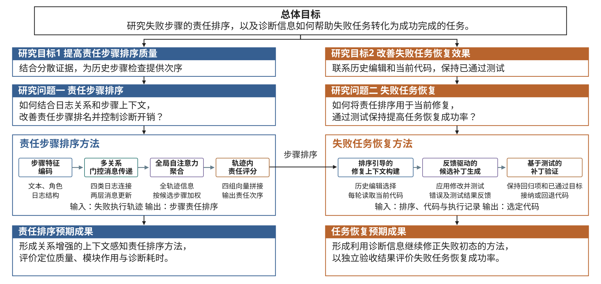
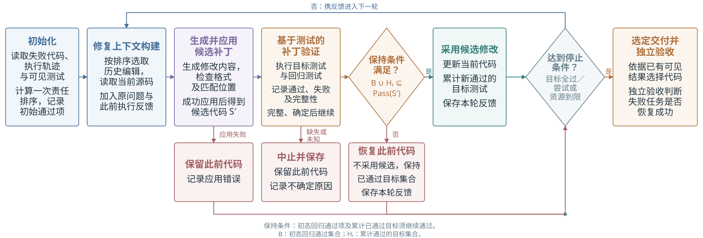

# 面向智能体失败任务的责任步骤排序与恢复方法研究

开题报告  
汇报人：杨亚鹏  
2026年10月27日

## 摘要

大语言模型智能体通过连续的代码操作、工具调用与环境反馈完成软件任务。一次执行失败后，错误原因可能分散在历史步骤中，遗留代码又可能已经发生多次变化。本课题研究如何从失败轨迹中确定历史步骤的检查次序，并将诊断信息用于当前代码的持续修正，以完成原始任务。

研究围绕两个相互衔接的问题展开。RQ1研究责任步骤排序，拟结合步骤内容、稀疏日志关系与候选相关的全轨迹上下文学习评分函数。RQ2研究诊断引导的失败任务恢复，沿排序选择历史编辑，每轮结合当前代码与测试反馈生成补丁，并依据已通过测试的保持条件更新代码。诊断输出经过编辑筛选后成为修复依据，最终交付通过隔离的独立验收才计为恢复成功。

实验分别评价定位与排序质量、诊断成本和失败任务恢复成功率，并通过排序替换、输入消融与接纳策略对照解释具体设计的作用。预期形成两项方法、共同条件下的比较结果及可回查的过程与复现材料。

**关键词：** 大语言模型智能体；失败诊断；责任步骤排序；失败任务恢复；测试保持

## 1 背景与研究现状

### 1.1 研究背景

大语言模型能够分析自然语言要求、生成文本和代码，但完成仓库中的软件问题还需要查找实现、修改源码、执行测试并根据结果继续调整。[1,2] 将模型与工具、环境和过程管理结合，可以形成围绕任务目标持续行动的智能体。模型提出动作，工具改变环境，返回的观察再参与下一轮决策，由此留下按时间排列的执行轨迹。[3]

一次任务的结果由连续操作共同决定。检索为编辑提供材料，编辑改变待测试程序，测试又影响后续修改；多角色协作还涉及需求、设计、代码和验证产物的交接。[4,5,16,17] 这些记录可以用于回查任务为何失败，代码差异和可执行测试也为检查历史操作及最终完成情况提供依据。

困难在于，错误引入与异常出现可能相隔很远。早期遗漏的要求或错误修改，可能到后续测试才表现出来；最后一条报错并不能完整说明失败形成过程。[6,7] 即使找到值得检查的历史步骤，继续修复时仍需面对已经变化的当前代码，并防止新修改破坏已有功能。[8,9] 因此，需要把失败过程分析与后续任务完成连起来研究。

### 1.2 从失败诊断到任务恢复

本课题将分析已失败执行轨迹、输出历史步骤检查次序的过程称为**失败诊断**。候选是轨迹中的推理、读取、源码编辑及验证步骤，责任标签沿用数据来源的规范。模型联系需求、动作和后续反馈，判断哪些步骤应优先检查；同一条证据对不同候选可能具有不同作用。

诊断结果还需转换为可以实施的修复依据。常规源码缺陷定位以文件、函数或代码行为作为候选，[10] 本课题则先评价历史执行步骤，再从中筛选实际源码编辑并核对当前实现。由此，将从失败执行留下的代码和环境出发、利用诊断继续完成原任务的过程称为**失败任务恢复**。其输入包含原问题、历史操作、当前代码与允许的测试反馈，输出是最终选定的代码交付。

两项研究分别评价标注责任步骤的优先检出能力与失败初态下的任务恢复效果。它们通过实际修复输入衔接：先检查排序是否改变了选入编辑与当前代码上下文，再分析这些变化怎样影响候选、状态更新和最终结果。只有选定交付通过与生成过程隔离的独立验收，才判定恢复成功。

### 1.3 国内外研究现状

#### 1.3.1 失败轨迹的责任步骤诊断（RQ1）

步骤级诊断需要把完整执行过程转化为候选判断。Lightman等（2024年）的**Let's Verify Step by Step**利用步骤正确性反馈训练过程评价模型，为细粒度监督提供基础；责任归因还需按任务规范确定错误引入、职责遗漏或错过纠正机会等标签含义。[18]

Cemri等（2025年）的**MAST**归纳系统设计、智能体间失配和任务验证等失败模式；Shaokun Zhang等（2025年）的**Who&When**进一步定位责任角色和关键错误步骤，并提出整轨迹判断、逐步分析与二分搜索。研究由失败现象分类推进到可用位置监督评价的步骤诊断。[6,7]

2026年的研究继续改进定位与监督获取。Sun等的**SDBL**先划定可疑范围，再精确定位；Zhu等的**StepFinder**结合步骤语义、时序和角色交互直接评分。Guibin Zhang等的**AgenTracer**通过修正重放与故障注入构造责任监督，Mengzhuo Chen等的**TraceElephant**结合职责与可恢复性标注责任位置。[14,15,19,20]

上述研究分别从过程评价、责任位置判定与轨迹表示学习推进了步骤诊断。本文关注单责任位置监督下的候选证据组织：稀疏日志联系与候选相关的全轨迹读取能否提供互补信息，其作用是否随轨迹长度及关系重合程度变化。该问题需要在共同任务划分下，将完整方法比较与表示控制结合起来检验。

#### 1.3.2 诊断支持的失败任务恢复（RQ2）

Yao等与Shinn等（2023年）的**ReAct**和**Reflexion**分别组织连续交互与利用先前尝试；Gou等与Huang等（2024年）的**CRITIC**和**自纠错分析**说明工具反馈及外部正确性信号对修订结果的重要性。Zhou等、Kechi Zhang等与Yuntong Zhang等（2024年）的**LATS**、**CodeAgent**和**AutoCodeRover**又从搜索、工具和程序结构检索完善软件求解。[3,21,22,23,24,25,26]

Antoniades等与Bouzenia等（2025年）的**SWE-Search**和**RepairAgent**将反馈与过程管理结合；Xia等（2025年）的**Agentless**采用定位、生成和验证选择的固定阶段流程。Tian等（2026年）的**EnAgent**通过多轨迹、回归剪枝和投票选补丁，Ruan等（2026年）的**AOrchestra**按任务动态配置子智能体及其上下文，提供不同的完整求解参照。[27,28,29,30,31]

针对已有失败状态，Guo等（2025年）的**SyncMind**关注更新后的代码与环境同步，Yinfang Chen等（2025年）的**STRATUS**以试执行、检查和撤销管理连续操作。Ma等（2026年）的**DoVer**通过实际干预检验诊断与修正的联系；Zhuang等（2026年预印本）的**AgentRewind**共同恢复执行上下文与文件检查点，体现历史信息与当前状态一致性的要求。[8,32,33,34]

已有研究为工具反馈求解、执行状态同步与操作撤销提供了基础。步骤排序的改进能否经过历史编辑筛选转化为有效修复输入，以及保护具体已通过目标能否改善后续修复路径，仍需在固定恢复流程中分别检验。本文据此研究诊断输入与动态测试保持的作用，并以共同条件下的独立验收评价任务效果。

### 1.4 有待解决的研究问题

**复杂执行过程中的失败诊断问题。** 一次失败涉及不同时间的需求理解、信息获取、代码修改和结果检查，相关证据分散，关键错误与最终异常相隔。需要研究如何联系这些过程证据，区分各步骤的作用，形成准确且代价可控的检查次序，为分析与后续修复确定重点。

**面向任务完成的失败任务恢复问题。** 历史操作、当前代码和未完成要求共同构成继续求解的起点。诊断位置需要与当前可实施修改建立对应，新修改又可能影响已经正常的行为。需要研究如何利用诊断与执行反馈组织连续修正，并将中间过程同最终独立验收联系起来。

## 2 研究目标与意义

### 2.1 研究目标

总体目标是从已失败执行的过程证据中确定检查重点，再支持当前软件状态下的持续修复，以完成原始任务。

**RQ1：如何从连续执行记录中识别关键责任步骤，形成准确且代价可控的失败诊断？** 研究历史步骤的共享评分函数，输出轨迹内责任次序，评价定位、排序质量与诊断开销，并分析不同证据与轨迹条件的作用。

**RQ2：如何将失败诊断转化为有效修复依据，并支持连续修正以提高失败任务恢复成功率？** 研究历史线索与当前代码的对应、反馈驱动的补丁生成和已通过测试保持，评价实际信息使用、修复路径与最终任务完成之间的联系。

两项研究以责任排序为接口，以实际输入和状态记录追查联系。RQ1的离线质量与RQ2的任务效果分别报告，排序替换用于检验诊断差异是否真正进入修复过程。

### 2.2 研究意义

**对应RQ1：为智能体失败分析与调试提供过程依据。** 软件缺陷定位研究旨在减轻开发者理解问题、查找原因的负担。[10] 智能体连续执行使错误线索跨越多个步骤与角色。研究这些过程证据怎样支持责任判断，有助于深化对失败形成过程的认识，为历史操作的优先检查、运行可靠性分析与人工调试提供细粒度依据。

**对应RQ2：支持利用已有工作持续完成软件任务。** 软件维护不仅需要提出修改，还需要验证修改并保留应有功能。[9] 失败执行往往已经形成部分代码与测试进展。研究怎样利用这些材料继续修正，并控制后续修改引起的退化，可为减少重复排查、支持人工接管及提高智能体辅助维护的可用性提供依据。

## 3 研究内容与方法

### 3.1 研究对象及任务定义

诊断对象是一次已结束且未满足完成条件的执行。轨迹τ=(x₁,…,xₘ)由来源规定的有效步骤组成，保存文本、动作、观察、角色和原始索引；单责任标签y∈{1,…,m}按来源规范确定。[7,19,20] 模型学习共享函数sᵢ=fθ(xᵢ,τ,ℛ)，按分数降序输出原索引。由于诊断发生在执行结束后，可使用同轨迹中前后已经发生的信息。RQ1覆盖来源中的软件及其他智能体任务，研究步骤诊断的一般表示；RQ2限定于可重建、可修改并可测试的软件失败状态。两项评价不要求使用同一批任务，恢复运行也不依赖责任标签；责任标签仅用于诊断训练与离线评价。

恢复输入为原问题q、失败初态S₀、轨迹τ和预先许可的测试。S₀包含失败执行结束后的实际代码与运行环境，与原始仓库提交分别保存。**修复反馈测试**允许向求解过程开放测试及执行结果，其中目标测试检查本次要求，回归测试检查应保留的已有行为；**独立验收测试**与生成隔离，判断最后选定的交付。

每轮补丁形成候选代码S′，经应用及测试决定是否更新当前接纳状态Sₜ。候选接纳只表示满足状态更新条件，恢复成功则要求最终交付通过规定独立验收。恢复实验在比较前确认环境可重建、历史编辑可回查和反馈测试可执行，不根据方法胜负或验收结果选题。

### 3.2 总体研究框架

**图3-1 责任步骤排序与失败任务恢复的研究框架**

研究从失败轨迹得到历史步骤的检查次序，再将可用历史编辑与当前代码组织为修复输入。诊断与恢复分别评价，通过任务标识、原始步骤、实际请求、候选快照与测试结果建立对应，分析诊断怎样参与后续执行。

**表3-1 两项研究的对象、方法与评价依据**

| 研究部分 | 研究对象 | 方法设计 | 评价依据 |
| --- | --- | --- | --- |
| 责任步骤排序 | 失败执行轨迹 | 稀疏日志关系与候选相关上下文评分 | 定位与排序、表示控制、诊断成本 |
| 失败任务恢复 | 失败代码与运行环境 | 排序引导上下文、反馈修复与测试保持 | 完整方法比较、排序替换、接纳对照 |

### 3.3 关系增强的上下文感知责任排序

**图3-2 责任步骤排序模型的计算结构**

RQ1依次完成步骤编码、局部关系传播、全轨迹聚合和责任评分。局部关系规定可读取的邻步，候选相关聚合从较远记录补充证据，评分器综合这些表示产生检查次序。

#### 3.3.1 步骤特征编码

本模块将**步骤文本、匿名角色和日志结构转换为初始向量**。文本保留操作与观察，现有实现以固定的Qwen3-Embedding-0.6B提取128维文本向量，训练后续表示与评分参数。结构特征描述字段类型、嵌套形式、位置与重复情况。角色按同一轨迹内首次出现次序编号，同角色沿用同一编号。跨轨迹编号只保留轨迹内身份，当前实现将角色字符串编码为32维稠密向量，用于身份特征和同角色关系构造。

来源明确给出相邻同角色记录配对时，模型结合两条记录的内容、差值与有效标志，以门控残差融合后再投影；没有配对时使用原记录。随后构造时间相邻、同角色、相同完整记录结构及相同非空动作结构四类关系。结构比较去掉具体键名和值，非时间关系只连接前后最近的同类步骤，每通道邻居至多2个。

固定邻居上限使各通道连接数随步骤数线性增长。关系类型决定信息变换与聚合方式，[35] 但同角色或同结构并不直接等同语义依赖；仍需结合工具请求、返回与后续使用理解证据。[36,37] 关系是否有助于诊断，通过定位与关系控制实验检验。

#### 3.3.2 门控多关系消息传递

本模块以初始表示和四类关系为输入，**汇集邻步信息，输出关系增强表示**。对接收步骤i、关系r和邻居j，模型用邻居内容及两步差异形成消息，用接收步骤及差异计算门控，调节每条消息的贡献。[35]

$$

\begin{aligned}
g_{ij}^{(r)} &= \sigma\!\left(G_r[h_i;\,h_j-h_i]\right),\\
u_i^{(r)} &= \frac{1}{|\mathcal N_r(i)|}
\sum_{j\in\mathcal N_r(i)}
g_{ij}^{(r)}\,\phi_r([h_j;\,h_j-h_i]).
\end{aligned}
\tag{1}
$$

式（1）中，𝒩ᵣ(i)为邻居集合，Gᵣ输出标量，经sigmoid得到0到1的g；φᵣ为可学习消息变换。每条边独立门控，不在邻居间作softmax；无邻居通道取零向量。四通道另计算归一化权重，融合后与原表示残差相加并归一化，采用两层更新。

同一邻步可能在多个通道重复出现，因此实验记录边数、重合率与覆盖，检查其补充证据或增加冗余的条件。原始内容仍经残差与评分旁路参与后续计算。

#### 3.3.3 全局自注意力聚合

两层局部传播的范围受连边限制，责任判断还可能依赖远处的需求和测试反馈。模型以关系增强表示构造查询、键和值，采用单头缩放点积自注意力，**为每个待评分步骤形成各自的上下文**。查询对应当前候选，键匹配记录，值承载汇集内容；三者来自同一完整轨迹。[38]

$$

\begin{aligned}
a_{ij} &= \operatorname{softmax}_{j}
\left(\frac{(W_Qh_i)^\top W_Kh_j}{\sqrt d}\right),\\
c_i &= \bar h+
W_O\left(\sum_j a_{ij}W_Vh_j-W_V\bar h\right).
\end{aligned}
\tag{2}
$$

式（2）中，h̄为全轨迹均值，d为表示维度，W为相应可学习映射。aᵢⱼ表示判断i时读取j的权重，cᵢ在共享均值上加入候选相关修正。注意力组织信息，责任次序由评分器产生；跨轨迹位置屏蔽。实验比较步骤查询、共享查询、轨迹均值和局部上下文，并结合长度及信息位置分析。[39]

当aᵢⱼ对所有j均为1/m时，加权值向量等于Wᵥh̄，式（2）的修正项为零，故cᵢ=h̄。该结构因而在共享均值上学习候选相关修正。轨迹均值对照检验非均匀聚合的作用，共享查询对照检验候选条件化的作用；若候选查询未改善定位或成本权衡，则不支持其在相应条件下的设计假设。

密集注意力计算约为O(m²d)，权重存储为O(m²)；固定关系与邻居上限的边聚合随m线性增长。实际诊断还包含文本编码等过程，成本评价同时注明输入长度、批处理和截断，不能直接用算子复杂度代替耗时。

#### 3.3.4 轨迹内责任评分

评分器使用多层感知机（MLP），拼接关系增强表示hᵢ、初始表示hᵢ⁽⁰⁾、候选上下文cᵢ及二者差异，输出步骤分数；训练采用单责任位置softmax交叉熵。[13]

$$

\begin{aligned}
s_i &= \operatorname{MLP}
\left([h_i;\,h_i^{(0)};\,c_i;\,h_i-c_i]\right),\\
p_i &= \frac{\exp(s_i)}{\sum_{j=1}^{m}\exp(s_j)},\\
\ell_\tau &= -\log p_y.
\end{aligned}
\tag{3}
$$

单责任监督可表示为**one-hot标签向量**：例如4步轨迹标注第2步，标签为(0,1,0,0)，损失为−log p₂。0表示不是该记录的标注位置，不表示步骤一定正确。每条轨迹构成一个候选组，该目标可解释为单正例列表级softmax排序目标，[12,13] 与ListNet依据标签得分构造目标分布的方式有所区别。[11]

单模型按分数降序输出，同分按原索引；三模型集成先分别作轨迹内softmax，再平均预测概率并排序。AFTraj同任务派生记录先组内平均、再对任务等权；标准化只用训练数据，验证用于选轮。完整责任次序由共享评分函数估计，不能从单位置标签中直接得到其余候选真值。

### 3.4 诊断引导的失败任务恢复

**图3-3 失败任务恢复流程**

图中“中止并保存”表示停止后续生成；已有可用交付仍独立验收，结果不确定时记录为未知。

RQ2以失败后的代码为起点，循环执行**准备修复输入、生成并应用补丁、运行反馈测试、接纳或回退**，到达停止条件后选定代码并独立验收。大模型获得原问题和可能相关的修改线索，提出修正；执行结果决定能否以该候选继续求解。

#### 3.4.1 排序引导的修复输入与候选生成

初始轨迹只诊断一次，后续排序固定。恢复器沿次序提取成功执行且实际改变许可项目源码的历史编辑，按调用标识去重并保存原始步骤。同文件不同有效编辑分别保留，推理、读取及未应用成功的调用不作为历史源码差异。

每轮重新读取相关当前文件，结合历史变更涉及的函数与失败反馈补充代码。**历史差异表征既往修改，当前源码约束本轮补丁的应用位置与修改内容**，二者分别呈现。历史排序提供可疑线索，不直接给正确修复行。拟沿有效编辑列表累计扩大输入前缀：各轮按预定日程增加前缀长度，达到上限后保留该前缀，当前源码及反馈每轮刷新。日程、条数和输入容量在开发结束时固定；容量不足时保留原问题与当前反馈，并按编辑优先次序截取历史差异及对应源码，保存实际输入和截断范围。

例如，排序前四位为[7,3,5,2]，第7步为验证，第3、5步为有效编辑，第2步为读取；若本轮纳入两条编辑，则形成[3,5]及其对应当前源码。另一排序[2,7,3,5]可能得到相同编辑输入。此为接口示意，未对应真实运行；共同背景按统一编码提供原问题、原始轨迹与公开反馈，后续请求保留该上下文；排序模块在此基础上另行呈现选中差异，非编辑步骤不作为该模块的源码差异。因此，去专门历史编辑输入评价的是显式选择的增量，全部历史信息的作用需由实际请求另行辨析。因而，排序干预需同时核对编辑列表和最终请求。

生成模型同时获得原问题、选定历史编辑、当前代码与此前反馈，输出路径、待替换内容及修改内容。执行端检查权限、格式和唯一匹配，应用后保存候选快照；格式错误、应用失败和测试失败分别反馈下一轮。[22,28] 固定流程下替换排序，并核对有效编辑与实际请求，才能判断排序变化是否真正改变生成依据。

#### 3.4.2 已通过测试保持与交付

每个候选按快照在独立目录执行预先固定的目标测试与回归测试。[9,29] B为初态确认通过并保护的回归标识，Tgoal为固定目标集合，Hₜ为初态及当前接纳路径累计通过的目标。**候选只有保留B和Hₜ中的全部测试，才能更新当前代码**：

$$

B\cup H_t\subseteq\operatorname{Pass}(S').
\tag{4}
$$

Pass(S′)表示本轮完整观察中确定通过的标识。接纳后更新代码，并令Hₜ₊₁=Hₜ∪(Pass(S′)∩Tgoal)；拒绝时恢复旧代码，H不变，被拒候选的新通过项不加入。保持旧项但没有新增通过项的候选也可接纳。在固定测试与环境、结果确定且完整的前提下，可对接纳轮次作归纳：初态通过H₀，接纳保留旧H并加入已通过新目标，拒绝保持代码与H不变，因此每个接纳状态均通过累计H，且H按集合包含关系单调增加。不确定或缺失结果触发中止保存。

全部目标测试通过、尝试次数耗尽或资源到限时停止。当前状态用于继续生成，最终交付则从已保存状态选择，未必是最后一次接纳的代码。交付只用当时反馈，从满足当前保护集合的初态及接纳状态中，依次按目标失败数、修改行数和尝试先后选择；较晚代码不回填早期节点。方法生成的辅助测试另行记录并计入资源，独立验收不向生成反馈。异常中止后若已有可用交付，则仍对该快照验收；无法取得确定验收结果时保留未知状态。

该约束只覆盖已执行测试，可能避免目标退化，也可能限制需要暂时破坏中间测试的关联修改。因此，最终效果还需由累计集合保持、数量保持与仅回归保持的独立运行比较决定，不能仅凭测试集合的单调性质认定恢复更好。

### 3.5 方法过程示例：沿RQ2流程恢复Moto设备接口

采用固定20题中的Moto7081公开开发记录说明图3-3。原问题要求创建及查询设备时返回thingId。初态S₀已补入部分字段，但创建测试test_create_thing_with_type包含describe_thing查询检查，此处仍报“FakeThing对象无法进行JSON序列化”。原公开运行合同将创建、删除、更新三个测试列为固定目标集合，分别覆盖创建及对象后续操作；这三个目标测试沿用原合同的评价划分，并不意味着它们分别对应三项新增需求。普通列表分页测试作为回归。初态删除、更新及列表已通过。因此，B={列表}，H₀={删除,更新}，未完成目标是创建。

**先形成修复输入，再生成当前候选。** 这次开发部署使用既有诊断器的责任排序（实验记录名SOURCE3）选择历史编辑，将原问题、相关当前代码和序列化异常提供给大模型。后端返回FakeThing对象，响应层直接执行json.dumps(thing)；该开发运行的补丁仅修改moto/iot/responses.py，调用thing.to_dict(include_default_client_id=True)取得字典，再转为JSON，保留内部使用对象属性的接口。

**测试结果决定更新状态。** 候选同时通过列表、创建、删除、更新，故B∪H₀⊆Pass(S′)，接纳为S₁，并将创建加入H₁。全部目标通过后进入停止与交付，已发布独立验收汇总记录为通过。表3-2将本例与流程节点逐一对应。

同一初态下的另一条开发运行曾把后端直接改成字典：创建通过，却使依赖对象属性的删除和更新失败。按本规则核验该候选应走“恢复此前代码”分支；这是对已观察候选的规则说明，不是本例先生成并拒绝它的实际顺序。此案例用于解释开发流程，排序独立收益与完整方法效果由共同评价检验。

**表3-2 Moto7081与RQ2恢复流程的对应**

| RQ2环节 | 本例输入或操作 | 状态与输出 |
| --- | --- | --- |
| 初始化与诊断 | 读取失败代码、轨迹及测试；使用既有排序 | 创建失败；B={列表}，H₀={删除,更新} |
| 构建修复输入 | 原问题、历史编辑、当前代码、序列化异常 | 大模型获得针对当前状态的修复材料 |
| 生成并应用 | 响应层先to_dict，再json.dumps | 得到候选S′，后端仍返回对象 |
| 测试与接纳 | 列表、创建、删除、更新全部通过 | 接纳S₁；H₁加入创建 |
| 停止与交付 | 目标全通过，选定S₁独立验收 | 已发布验收汇总为通过 |

## 4 难点和创新

### 4.1 关键技术难点

**RQ1：有限位置监督下的证据组织。** 每条轨迹只给一个责任位置，却不直接说明哪些邻步或远处记录支持判断。时间、角色和结构关系容易构造，但可能重合或读取无关消息；全轨迹聚合扩大范围，也增加计算。难点在于形成有区分力的候选表示，并同时控制冗余与成本。研究将结合轨迹长度、角色数与关系重合分析定位变化，用输入及关系控制区分内容、连接和统计关联的影响。

**RQ2：从历史判断到当前连续修复。** 排序中的高位步骤可能没有源码编辑，旧修改也可能被后续代码覆盖；不同全序经筛选后甚至产生相同请求。另一方面，修好一个目标可能破坏另一个目标，严格保持又可能拒绝必要中间修改。难点是让诊断形成实际有差异的修复依据，并在保持进展与继续修改之间取得有效结果。研究将保存实际输入、候选和测试标识，联系后续路径与最终验收分析。

### 4.2 拟研究的创新设计与验证

**RQ1：单责任位置监督下局部日志联系与候选相关上下文的互补作用。** 方法通过稀疏关系传播组织近邻记录，以候选条件化查询读取全轨迹，并保留初始表示参与评分。拟检验的研究增量是这种证据组织相对于共享摘要的作用及适用条件。完整基线比较评价总体表现；去传播、参数匹配、关系置换与均值、共享查询对照分别检验局部结构、参数规模、连接对应及候选条件化，并分析轨迹长度与关系重合的影响。

**RQ2：责任排序的输入作用与累计目标保持的路径效应。** 责任排序经编辑筛选及容量限制形成当前修复材料，累计目标保持约束后续状态更新。研究通过排序替换与信息消融检验输入作用，通过集合保持、数量保持和仅回归保持的独立运行检验路径效应，最后以隔离验收判断过程变化是否转化为任务完成收益。保持不变量是规则性质，恢复成功率及其代价是待检验效果。

## 5 实验设计

实验先完成数据分组和方法开发，再固定评价配置，运行诊断与恢复方法，最后按共同指标比较，并用控制实验解释差异。第一层回答方法是否有效，第二层回答具体设计是否起作用。下文先给数据与总体计划，再说明每个实验怎样执行、为何采用这些安排。

### 5.1 数据来源与任务组织

诊断采用AFTraj及AgenTracer轨迹和相应责任标签，[41,42] 恢复从SWE-Gym等已有软件问题材料整理失败初态。[40] 表5-1中的发布规模是来源总量，研究样本是本课题使用或计划组织的范围，两者分开。

**表5-1 数据来源与研究样本**

| 数据来源 | 发布规模 | 研究样本与组织 | 用途 |
| --- | --- | --- | --- |
| AFTraj | 2,276条轨迹 | 731条候选轨迹、716个任务组 | 责任定位与排序 |
| AgenTracer | coding训练1,141条、测试127条 | 614条训练验证来源（coding 320、math 294）；另363条coding开发轨迹 | 诊断开发与划分分析 |
| SWE-Gym | 2,438个Python问题 | 固定20个不同问题、覆盖5仓库 | 失败初态与恢复比较 |

恢复实验分为开发比较和独立评价两阶段。20题沿既有21题前瞻顺序取前20，已有开发接触，用于开发与可行性比较；其中17题已有排序记录，3题环境或输入待复核。方法固定后，另行确定未参与选择的恢复任务执行独立评价，作为选定方案的正式确认依据。两阶段分别报告，独立任务数量与工作量在运行前固定，不并入20题开发分母。诊断独立候选来自AFTraj的163条test_unsafe及AgenTracer的127条coding测试轨迹，经失败状态、历史使用与任务重叠核对后报告实际纳入量。

### 5.2 实验流程计划与执行

#### 5.2.1 总体流程与阶段产物

**先准备共同数据与起点。** 按原问题给诊断轨迹分组，划分训练、验证和评价；为恢复任务保存失败后的源码、环境、历史轨迹与反馈测试，重建后确认原问题仍未完成。该阶段产物是任务划分及可重复的失败快照，保证后续比较面对同一问题。

**再开发并固定方法。** 用训练数据学习诊断模型，验证数据选择配置；检查完整基线与本文恢复接口，确定模型、输入容量、内部尝试、测试与交付规则。开发结束后固定版本，正式评价期间不根据单题结果调整方法配置。

**随后执行开发比较与独立评价。** 将留出的轨迹输入各诊断方法，保存位置或排序与成本；将相同失败初态分别交给各恢复方法，独立运行3次，逐轮记录请求、候选与测试，在15/30/60分钟保存当时选定的交付。选定后再运行隔离验收，得到逐题结果。20题开发比较先执行以固定方案，随后按同一流程对独立任务确认，两阶段分别计分。

**最后进行解释性对照。** 完整比较确认总体表现，排序替换、输入消融和保持策略对照进一步改变一个因素，核实际输入或决定是否变化，再观察是否影响最终恢复。各阶段由准备材料、固定配置、实际输出到验收结果连续对应。

#### 5.2.2 责任排序的训练划分与评价方案

AFTraj按716个任务组做五折：每次留一折评价，其余任务内部划分训练与验证；验证选轮后，用外层其余组重新训练，再预测留出折。**这样让每条外折预测都来自没训练过该任务的模型**，避免同问题派生记录跨集合造成高估。每个配置采用三次预定初始化，以区分方法变化与训练随机性；同任务记录先组内平均，再让任务等权。

AgenTracer的614条训练验证来源包含320条coding与294条math轨迹。拟在相同来源池构造A、B、C三种任务组隔离划分，每种按492条训练、122条验证，用于检查结论是否依赖一次数据分配；每种采用三次初始化，观察同划分下的训练随机性。另有363条coding开发轨迹，与614条在公开任务组标识上无交集，作为固定开发评价对象，比较跨划分表现。该开发集合参与方法选择，不能作为最终独立确认。划分与初始化分别编号。

上述外折与开发比较用于方法选择和敏感性分析。开发结束后固定结构、选轮规则与部署方式，用预定训练组获得评价模型，再对未参与选择的轨迹评价。三次初始化先分别报告，以观察随机性；三模型概率均值集成作为预先声明的部署结果单列，恢复对照采用固定部署。独立轨迹输入本文、StepFinder及生成式诊断方法，保持步骤、标签和信息许可一致。学习式方法输出分数排序，生成式方法按固定提示或搜索规则输出位置，记录无效输出及实际成本。参与选模的结果标为开发证据，未参与选择的评价材料检验选定方案能否适用于新任务。

#### 5.2.3 失败任务恢复的运行与验收方案

每题先将失败快照复制到各方法各重复的独立目录，运行共同反馈测试确认起点，随后从该状态启动求解。本文先计算责任排序，再按图3-3循环构建输入、生成应用、执行测试与接纳回退；Agentless、EnAgent和AOrchestra按自身完整定位、生成、验证、集成或编排机制运行。共同条件见表5-2。

**表5-2 恢复实验的执行与共同设置**

| 环节 | 执行安排 |
| --- | --- |
| 共同起点 | 重建原问题、失败代码与环境，固定源码及反馈许可 |
| 生成求解 | 使用deepseek-flash和预定参数，保留各方法完整流程 |
| 候选反馈 | 应用候选，执行反馈测试，保存测试标识与状态变化 |
| 独立重复 | 每题每方法3次，各次从相同初态重新开始 |
| 节点交付 | 15/30/60分钟选定快照，30分钟主比较，统一token上限 |
| 独立验收 | 交付选定后验收，再按问题汇总与配对比较 |

三次重复用于观察大模型生成随机性，不继承其他重复的补丁或反馈，内部候选和子智能体计入所属运行。过程记录保存实际请求、应用结果、测试标识及交付代码，以确认恢复确实从共同失败状态继续，并解释最终结果来自哪条路径。

### 5.3 评价指标与资源设置

评价分别对应历史责任判断与当前任务完成。定位与排序评价标签位置，恢复评价选定代码是否完成任务，资源记录获得这些结果所需的实际开销。

**表5-3 主要评价指标**

| 指标 | 计算与含义 |
| --- | --- |
| Top-1 ↑ | 任务组等权首位命中率 |
| MRR ↑ | 标注位置倒数排名的任务组等权均值 |
| Hit@3 / Hit@5 ↑ | 标注责任进入前3/5位的任务组等权比例 |
| 诊断耗时P50 / P95 ↓ | 首次加载及已加载条件下的中位数/95分位数 |
| 失败任务恢复成功率RSR ↑ | 同题3次运行先平均，再对共同问题等权 |
| RSR@15 / 30 / 60min ↑ | 节点前选定交付的独立验收成功率 |
| 资源消耗 ↓ | 输入输出token总量、大模型API请求次数 |

诊断先在同任务组内汇总，再让各任务等权；MRR取标注位置排名的倒数，Hit@k看是否进入前k。所有诊断方法共同比Top-1，完整排序方法再比MRR与Hit@3/5。耗时从轨迹进入至诊断输出，注明长度、批处理、截断及加载条件。

恢复主指标取30分钟，15/60分钟来自同一次运行的快照，提前自然停止后沿用已选交付。令zₐ,ᵤ,ᵣ(b)表示方法a在问题u第r次运行中，预算b前选定的交付是否通过独立验收；Uᵦ为各方法三次均可判定的共同问题集：

$$

\operatorname{RSR}_a(b)=
\frac{1}{|\mathcal U_b|}
\sum_{u\in\mathcal U_b}
\left(\frac{1}{3}\sum_{r=1}^{3}z_{a,u,r}(b)\right).
\tag{5}
$$

式（5）先平均同题3次，再对问题等权。已知预算内没有成功交付记未成功；验收未知、工程中断与未运行分别保留，另列全计划矩阵及共同配对数。三次重复不增加独立问题数。

token与API请求覆盖诊断分析、补丁生成、候选选择、子智能体及重试；一次发送的大模型生成请求计一次，工具执行另记。共同token上限及方法内部参数在正式运行前固定，测试和工具也占用运行预算；usage未知不补0。若另观察取消60分钟外部截断后的自然终态，保留原配置、原时钟与累计资源，单列续跑结果。

### 5.4 基线方法及共同比较

**表5-4 失败诊断基线及正式发表时间**

| 方法 | 正式发表时间 | 发表载体 | 核心机制 | 评价指标 |
| --- | --- | --- | --- | --- |
| All-at-Once | 2025.10 | ICML | 整轨迹一次性归因 | Top-1、耗时、token、API请求次数 |
| Binary Search | 2025.10 | ICML | 区间判断与二分搜索 | Top-1、耗时、token、API请求次数 |
| StepFinder | 2026.08 | KDD | 时序、角色交互与步骤评分 | Top-1、MRR、Hit@3/5、耗时 |
| 本文方法 | — | 本课题 | 关系传播与候选相关上下文 | Top-1、MRR、Hit@3/5、耗时 |

诊断方法共用轨迹、步骤边界、任务划分和责任标签，学习式方法保留自身结构与训练目标，在同等训练验证信息下选模；生成式方法固定模型、提示和搜索规则。[7,15] 单位置输出不补造完整排名。All-at-Once与Binary Search来自同一篇论文，时间按正式出版记录。

**表5-5 失败任务恢复基线及正式发表时间**

| 方法 | 正式发表时间 | 发表载体 | 核心过程 | 评价指标 |
| --- | --- | --- | --- | --- |
| Agentless | 2025.06 | FSE / PACMSE | 定位、生成、复现与回归筛选 | RSR@15/30/60min、token、API请求次数 |
| EnAgent | 2026.04 | ICSE | 多轨迹、回归剪枝、工具选择与投票 | RSR@15/30/60min、token、API请求次数 |
| AOrchestra | 2026.09 | ICML | 动态子智能体及上下文配置 | RSR@15/30/60min、token、API请求次数 |
| 本文方法 | — | 本课题 | 诊断输入、反馈修复与测试保持 | RSR@15/30/60min、token、API请求次数 |

完整恢复基线从同一失败初态、共同模型及信息许可出发，保留各自求解核心，诊断到交付选择均纳入预算。[29,30,31] 运行前核源码、实现阶段和小试有效性，实际部署参数记录；未完整运行的工程状态单列。EnAgent采用2026年4月正式文集时间，9月在线日期另存。StepFinder接本文恢复器用于排序控制，不占完整系统基线名额。

### 5.5 消融实验与作用机制分析

完整方法比较回答能否更好地诊断和恢复；消融再回答**哪一项设计带来差异**。每次只改变指定因素，保持相同数据、选模与运行规则。RQ1变体重新训练；RQ2各变体独立执行后续恢复，避免将同一运行结果重复归入不同实验条件。

**表5-6 核心消融与对照**

| 研究部分 | 条件 | 改动与要回答的问题 |
| --- | --- | --- |
| RQ1 | Full | 完整模型，作为共同参照 |
| RQ1 | w/o RelProp | 去掉关系传播，局部联系是否有用 |
| RQ1 | w/o StepCtx | 均值替代注意力上下文，检验聚合模块整体作用 |
| RQ1 | 容量与关系控制 | 参数匹配、关系置换，区分参数规模与关系对应的作用 |
| RQ2 | Full | 完整恢复流程，作为共同参照 |
| RQ2 | w/o HistEdit | 去专门选入的编辑，检验显式历史选择增量 |
| RQ2 | w/o CurrentRead | 去掉专门当前读取，历史与现状对应是否有用 |
| RQ2 | w/o TargetKeep | 只保初始回归，新通过目标保护是否有用 |
| RQ2 | 数量保持 | 只限制目标失败数，不保身份，集合保持是否有用 |

**先解释诊断信息怎样起作用。** 在同一恢复器中，把本文排序换成StepFinder排序或历史时间顺序，仍用同样的编辑筛选和容量。时间顺序保留同样的历史选择模块，w/o HistEdit关闭专门选入的编辑输入，但共同背景与访问权限保持不变；两者分别检验排序次序与显式历史选择的增量。共享查询对照保留学习式加权聚合，进一步区分候选条件化的作用。w/o CurrentRead仍保留共同源码访问权限，要核实际请求是否经其他操作取得同样代码。

**再解释保持规则怎样改变路径。** 比较累计集合保持、只保目标数量与仅保初始回归。逐轮记录已通过、丢失与新增测试，特别检查“数量未变但身份替换”的候选。同一候选离线重算仅判断当前接纳是否不同；这些决定对下一轮生成和最终恢复的影响，由各策略独立运行比较。

解释机制时按“排序→有效编辑→实际输入→候选→状态→验收”追查。若输入或决定并未改变，应保留这一结果；若发生变化，再检验最终结果是否随之改变。这样才能把离线指标、过程变化和任务收益联系起来。

### 5.6 研究工作量

工作量包括数据与环境整理、诊断模型训练、完整恢复比较、机制对照及复现整理。表5-7按核心配置估算计划规模，基线训练和扩展控制另计，实际启动与完成数量随运行记录报告。

**表5-7 主要研究工作量与产物**

| 工作项 | 计划规模 | 主要产物 |
| --- | --- | --- |
| 数据与环境 | 2个诊断来源；20个软件问题、5个仓库 | 分组、版本绑定与共同失败初态 |
| 诊断模型 | 4组核心配置；AFTraj 60个外折评价单元，AgenTracer 36个训练评价单元 | 模型权重、预测、消融及成本结果 |
| 开发恢复比较 | 20题×4种完整方法×3次，计划240条运行 | 节点交付、独立验收与逐题矩阵 |
| 独立恢复评价 | 方法固定后另行确定任务与数量，另计 | 未参与方法选择的确认结果 |
| 机制与复现 | 排序替换、信息消融、3类保持策略，另计 | 输入、候选、测试路径与复现材料 |

诊断估算以Full、去关系传播、均值上下文和一组容量对照4组配置计算：AFTraj为4×5折×3初始化=60个评价单元，每单元包含内部选轮与外折重训；AgenTracer为4×3划分×3初始化=36个训练评价单元。它们是实验组织单元，不等同于简单的训练进程次数。

240条开发恢复运行以20题均完成运行前核验为前提，当前3题待复核，不能写成已完成数量。每条运行内包含多轮生成、工具和测试，15/30/60分钟为同一运行的交付节点。各类消融及排序替换在相同任务与重复规则下另行计量，并保留全部状态与结果。

## 6 进度与文献

### 6.1 研究进度

**2026年9—10月：问题界定与开题。** 完成文献、任务定义和方法依据核对，组织两个研究问题、总体方案及实验计划。

**2026年11—12月：方法与执行系统完善。** 完成诊断模型、历史编辑与当前代码对应、测试保持和节点交付，固定数据分组与评价配置。

**2027年1—2月：完整比较与独立评价。** 按纳入标准准备评价任务，运行诊断及恢复基线，保留全部重复、资源和异常状态。

**2027年3月：机制分析与论文初稿。** 完成消融、排序替换与保持策略对照，结合真实路径解释作用，整理图表和结论。

**2027年4—5月：论文修改与答辩。** 根据评阅意见完善论证、实验分析与复现材料，完成定稿和展示。写作随研究阶段同步推进。

### 6.2 参考文献

[1] 董益宏, 姜雪, 钱家如, 等. 基于大语言模型智能体的代码生成综述[J]. 软件学报, 2026, 37(8): 3089–3115. DOI: 10.13328/j.cnki.jos.007593. [原文](https://www.jos.org.cn/jos/article/abstract/7593)。

[2] John Yang, Carlos E. Jimenez, Alexander Wettig, et al. SWE-agent: Agent-Computer Interfaces Enable Automated Software Engineering[C]//Advances in Neural Information Processing Systems, 2024. [原文](https://proceedings.neurips.cc/paper_files/paper/2024/hash/5a7c947568c1b1328ccc5230172e1e7c-Abstract-Conference.html)。

[3] Shunyu Yao, Jeffrey Zhao, Dian Yu, et al. ReAct: Synergizing Reasoning and Acting in Language Models[C]//International Conference on Learning Representations (ICLR), 2023. [原文](https://openreview.net/forum?id=WE_vluYUL-X)。

[4] Xiao Liu, Hao Yu, Hanchen Zhang, et al. AgentBench: Evaluating LLMs as Agents[C]//International Conference on Learning Representations (ICLR), 2024. [原文](https://proceedings.iclr.cc/paper_files/paper/2024/hash/e9df36b21ff4ee211a8b71ee8b7e9f57-Abstract-Conference.html)。

[5] Carlos E. Jimenez, John Yang, Alexander Wettig, et al. SWE-bench: Can Language Models Resolve Real-world GitHub Issues?[C]//International Conference on Learning Representations (ICLR), 2024. [原文](https://proceedings.iclr.cc/paper_files/paper/2024/hash/edac78c3e300629acfe6cbe9ca88fb84-Abstract-Conference.html)。

[6] Mert Cemri, Melissa Z Pan, Shuyi Yang, et al. Why Do Multi-Agent LLM Systems Fail?[C]//Advances in Neural Information Processing Systems, Datasets and Benchmarks Track, 2025. [原文](https://papers.nips.cc/paper_files/paper/2025/hash/b1041e52d3be19f0a9bc491657488e4a-Abstract-Datasets_and_Benchmarks_Track.html)。

[7] Shaokun Zhang, Ming Yin, Jieyu Zhang, et al. Which Agent Causes Task Failures and When? On Automated Failure Attribution of LLM Multi-Agent Systems[C]//Proceedings of the 42nd International Conference on Machine Learning (ICML), PMLR 267: 76583–76599, 2025. [原文](https://proceedings.mlr.press/v267/zhang25cq.html)。

[8] Xuehang Guo, Xingyao Wang, Yangyi Chen, et al. SyncMind: Measuring Agent Out-of-Sync Recovery in Collaborative Software Engineering[C]//Proceedings of the 42nd International Conference on Machine Learning (ICML), PMLR 267: 20993–21066, 2025. [原文](https://proceedings.mlr.press/v267/guo25l.html)。

[9] 香佳宏, 徐霄阳, 孔繁初, 等. 大模型在软件缺陷检测与修复的应用发展综述[J]. 软件学报, 2025, 36(4): 1489–1529. DOI: 10.13328/j.cnki.jos.007268. [原文](https://www.jos.org.cn/html/2025/4/7268.htm)。

[10] 曹帅, 牛菲菲, 李传艺, 等. 深度学习在基于信息检索的缺陷定位中的应用综述[J]. 软件学报, 2025, 36(4): 1530–1556. DOI: 10.13328/j.cnki.jos.007288. [原文](https://www.jos.org.cn/jos/article/abstract/7288)。

[11] Zhe Cao, Tao Qin, Tie-Yan Liu, et al. Learning to Rank: From Pairwise Approach to Listwise Approach[C]//Proceedings of the 24th International Conference on Machine Learning (ICML): 129–136, 2007. [原文](https://doi.org/10.1145/1273496.1273513)。

[12] Tie-Yan Liu. Learning to Rank for Information Retrieval[J]. Foundations and Trends in Information Retrieval, 3(3): 225–331, 2009. [原文](https://doi.org/10.1561/1500000016)。

[13] Sebastian Bruch, Xuanhui Wang, Michael Bendersky, Marc Najork. An Analysis of the Softmax Cross Entropy Loss for Learning-to-Rank with Binary Relevance[C]//Proceedings of the 2019 ACM SIGIR International Conference on Theory of Information Retrieval (ICTIR). 2019: 75–78. DOI: 10.1145/3341981.3344221. [原文](https://research.google/pubs/an-analysis-of-the-softmax-cross-entropy-loss-for-learning-to-rank-with-binary-relevance/)。

[14] Kai Sun, Wenqiang Li, Bo Dong, et al. Scope Delineation Before Localization: A Two-Stage Framework for Enhancing Failure Attribution in Multi-Agent Systems[C]//Proceedings of the AAAI Conference on Artificial Intelligence, 40(39): 33108–33116, 2026. [原文](https://ojs.aaai.org/index.php/AAAI/article/view/40594)。

[15] Taiyu Zhu, Yifan Wu, Weilin Jin, et al. StepFinder: A Temporal Semantic Framework for Failure Attribution in Multi-Agent Systems[C]//Proceedings of the 32nd ACM SIGKDD Conference on Knowledge Discovery and Data Mining V.2: 6946–6957, 2026. [原文](https://doi.org/10.1145/3770855.3817991)。

[16] Qingyun Wu, Gagan Bansal, Jieyu Zhang, et al. AutoGen: Enabling Next-Gen LLM Applications via Multi-Agent Conversations[C]//Conference on Language Modeling (COLM), 2024. [原文](https://openreview.net/forum?id=BAakY1hNKS)。

[17] Sirui Hong, Mingchen Zhuge, Jonathan Chen, et al. MetaGPT: Meta Programming for A Multi-Agent Collaborative Framework[C]//International Conference on Learning Representations (ICLR 2024). [原文](https://proceedings.iclr.cc/paper_files/paper/2024/hash/6507b115562bb0a305f1958ccc87355a-Abstract-Conference.html)。

[18] Hunter Lightman, Vineet Kosaraju, Yuri Burda, et al. Let’s Verify Step by Step[C]//International Conference on Learning Representations (ICLR), 2024. [原文](https://proceedings.iclr.cc/paper_files/paper/2024/hash/aca97732e30bcf1303bc22ac3924fd16-Abstract-Conference.html)。

[19] Guibin Zhang, Junhao Wang, Junjie Chen, et al. AgenTracer: Who Is Inducing Failure in the LLM Agentic Systems?[C]//International Conference on Learning Representations (ICLR), 2026. [原文](https://proceedings.iclr.cc/paper_files/paper/2026/hash/134ed7a477770f227f12450ef0cbb8f4-Abstract-Conference.html)。

[20] Mengzhuo Chen, Junjie Wang, Fangwen Mu, et al. Seeing the Whole Elephant: A Benchmark for Failure Attribution in LLM-based Multi-Agent Systems[C]//Proceedings of the 64th Annual Meeting of the Association for Computational Linguistics (Volume 1: Long Papers): 19888–19905, 2026. [原文](https://aclanthology.org/2026.acl-long.912/)。

[21] Noah Shinn, Federico Cassano, Ashwin Gopinath, et al. Reflexion: Language Agents with Verbal Reinforcement Learning[C]//Advances in Neural Information Processing Systems (NeurIPS), 2023. [原文](https://proceedings.neurips.cc/paper_files/paper/2023/hash/1b44b878bb782e6954cd888628510e90-Abstract-Conference.html)。

[22] Zhibin Gou, Zhihong Shao, Yeyun Gong, et al. CRITIC: Large Language Models Can Self-Correct with Tool-Interactive Critiquing[C]//International Conference on Learning Representations (ICLR), 2024. [原文](https://proceedings.iclr.cc/paper_files/paper/2024/hash/fef126561bbf9d4467dbb8d27334b8fe-Abstract-Conference.html)。

[23] Jie Huang, Xinyun Chen, Swaroop Mishra, et al. Large Language Models Cannot Self-Correct Reasoning Yet[C]//International Conference on Learning Representations (ICLR), 2024. [原文](https://proceedings.iclr.cc/paper_files/paper/2024/hash/8b4add8b0aa8749d80a34ca5d941c355-Abstract-Conference.html)。

[24] Andy Zhou, Kai Yan, Michal Shlapentokh-Rothman, et al. Language Agent Tree Search Unifies Reasoning, Acting, and Planning in Language Models[C]//Proceedings of the 41st International Conference on Machine Learning (ICML), PMLR 235: 62138–62160, 2024. [原文](https://proceedings.mlr.press/v235/zhou24r.html)。

[25] Kechi Zhang, Jia Li, Ge Li, et al. CodeAgent: Enhancing Code Generation with Tool-Integrated Agent Systems for Real-World Repo-level Coding Challenges[C]//Proceedings of the 62nd Annual Meeting of the Association for Computational Linguistics, 2024:13643–13658. [原文](https://aclanthology.org/2024.acl-long.737/)。

[26] Yuntong Zhang, Haifeng Ruan, Zhiyu Fan, Abhik Roychoudhury. AutoCodeRover: Autonomous Program Improvement[C]//Proceedings of the 33rd ACM SIGSOFT International Symposium on Software Testing and Analysis, 2024:1592–1604. [原文](https://doi.org/10.1145/3650212.3680384)。

[27] Antonis Antoniades, Albert Örwall, Kexun Zhang, et al. SWE-Search: Enhancing Software Agents with Monte Carlo Tree Search and Iterative Refinement[C]//International Conference on Learning Representations (ICLR), 2025. [原文](https://proceedings.iclr.cc/paper_files/paper/2025/hash/a1e6783e4d739196cad3336f12d402bf-Abstract-Conference.html)。

[28] Islem Bouzenia, Premkumar Devanbu, Michael Pradel. RepairAgent: An Autonomous, LLM-Based Agent for Program Repair[C]//Proceedings of the IEEE/ACM 47th International Conference on Software Engineering (ICSE): 2188–2200, 2025. [原文](https://doi.org/10.1109/ICSE55347.2025.00157)。

[29] Chunqiu Steven Xia, Yinlin Deng, Soren Dunn, et al. Demystifying LLM-Based Software Engineering Agents[J]. Proceedings of the ACM on Software Engineering, 2(FSE): 801–824, 2025. [原文](https://doi.org/10.1145/3715754)。

[30] Zhao Tian, Pengfei Gao, Junjie Chen, et al. Agent-Based Ensemble Reasoning for Repository-Level Issue Resolution[C]//Proceedings of the IEEE/ACM 48th International Conference on Software Engineering (ICSE): 1406–1418, 2026. [原文](https://doi.org/10.1145/3744916.3787761)。

[31] Jianhao Ruan, Zhihao Xu, Yiran Peng, et al. AOrchestra: Automating Sub-Agent Creation for Agentic Orchestration[C]//Proceedings of the 43rd International Conference on Machine Learning (ICML), PMLR 306: 106017–106040, 2026. [原文](https://proceedings.mlr.press/v306/ruan26e.html)。

[32] Yinfang Chen, Jiaqi Pan, Jackson Clark, et al. STRATUS: A Multi-agent System for Autonomous Reliability Engineering of Modern Clouds[C]//Advances in Neural Information Processing Systems 38, 2025. [原文](https://proceedings.neurips.cc/paper_files/paper/2025/hash/47a6e9e2c3019f13ad94a0f259fe4970-Abstract-Conference.html)。

[33] Ming Ma, Jue Zhang, Fangkai Yang, et al. DoVer: Intervention-Driven Auto Debugging for LLM Multi-Agent Systems[C]//International Conference on Learning Representations (ICLR), 2026. [原文](https://proceedings.iclr.cc/paper_files/paper/2026/hash/2f5fdce256ff0d7fb774da76e5e63209-Abstract-Conference.html)。

[34] Yu Zhuang, Kefei Chen, Yitong Duan, et al. AgentRewind: Recoverable Execution for Long-Horizon LLM Agents[EB/OL]. arXiv preprint arXiv:2608.14380, 2026. [2026-10-23]. [预印本](https://arxiv.org/abs/2608.14380)。

[35] Michael Schlichtkrull, Thomas N. Kipf, Peter Bloem, et al. Modeling Relational Data with Graph Convolutional Networks[C]//The Semantic Web (ESWC), Lecture Notes in Computer Science: 593–607, 2018. [原文](https://doi.org/10.1007/978-3-319-93417-4_38)。

[36] Shuyang Liu, Yang Chen, Rahul Krishna, et al. Process-Centric Analysis of Agentic Software Systems[J]. Proceedings of the ACM on Programming Languages, 10(OOPSLA1): 1961–1988, Article 163, 2026. [原文](https://doi.org/10.1145/3798271)。

[37] Bo Deng, Xinlei Zheng, Yi Wei, et al. DeFA: Dependency-Guided Failure Attribution for LLM Agents[EB/OL]. arXiv preprint arXiv:2610.01256, 2026. [2026-10-23]. [预印本](https://arxiv.org/abs/2610.01256)。

[38] Ashish Vaswani, Noam Shazeer, Niki Parmar, et al. Attention Is All You Need[C]//Advances in Neural Information Processing Systems 30. 2017. [原文](https://proceedings.neurips.cc/paper_files/paper/2017/hash/3f5ee243547dee91fbd053c1c4a845aa-Abstract.html)。

[39] Nelson F. Liu, Kevin Lin, John Hewitt, et al. Lost in the Middle: How Language Models Use Long Contexts[J]. Transactions of the Association for Computational Linguistics, 12:157–173, 2024. [原文](https://aclanthology.org/2024.tacl-1.9/)。

[40] Jiayi Pan, Xingyao Wang, Graham Neubig, et al. Training Software Engineering Agents and Verifiers with SWE-Gym[C]//Proceedings of the 42nd International Conference on Machine Learning (ICML), PMLR 267: 47717–47737, 2025. [原文](https://proceedings.mlr.press/v267/pan25g.html)。

[41] ZBox008003. AFTraj-2K dataset card[DB/OL]. Hugging Face, 2026[2026-10-23]. [数据来源](https://huggingface.co/datasets/ZBox008003/AFTraj/blob/main/README.md)。

[42] AgenTracer authors. AgenTracer Data v1.0.0: Expanded Dataset Release[DB/OL]. GitHub, 2026-08-27[2026-10-23]. [数据来源](https://github.com/bingreeky/AgenTracer/releases/tag/data-v1.0.0)。
