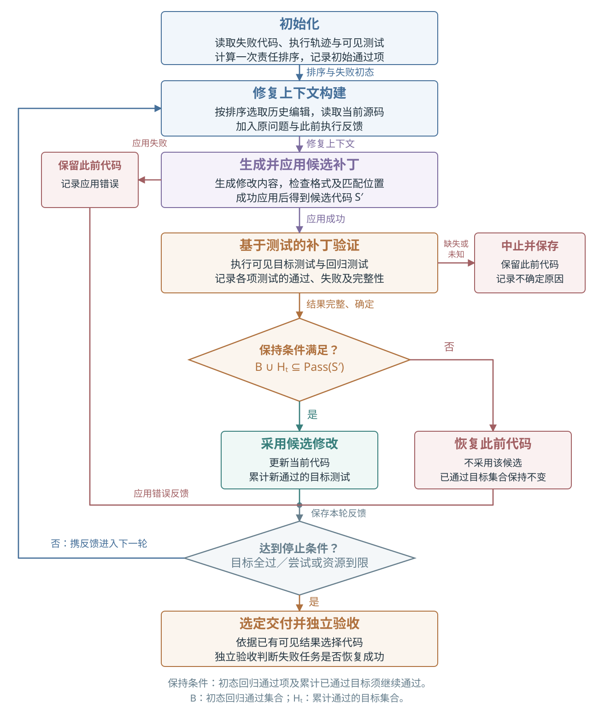

# 开题汇报按页文案与补充备注

## 第4页　1.1 研究背景

### 正文

大语言模型（Large Language Model，LLM）能够理解自然语言指令、生成文本和代码，并结合上下文分析问题。在软件开发中，任务完成还要求将生成内容落实为代码仓库中的实际操作。例如，解决一个功能缺陷，需要查找相关实现、修改源码、运行测试，并根据执行结果继续调整。因此，软件任务求解既依赖模型的分析与生成能力，也依赖代码操作和结果检验。[1,2]

将大语言模型与工具、运行环境及过程管理机制结合，可以构成围绕任务目标持续行动的智能体。模型根据任务要求和已有观察选择操作，工具将操作作用于环境，返回的观察结果再参与后续决策。推理、动作和观察交替进行，使模型能够依据执行结果调整行为。[3] 这一过程形成按时间组织的执行轨迹，其中保存任务理解、工具调用、中间产物及环境反馈，为分析任务结果提供过程证据。

智能体的任务结果由连续操作共同决定。检索结果为后续分析提供材料，代码编辑改变待验证的程序，测试反馈影响下一步修改。多个角色协作时，需求、设计、实现和验证产物还会在角色之间传递。智能体评价因而同时涉及工具使用、环境交互、执行效率和最终任务结果。[4,5] 软件任务中的代码差异和可执行测试，使历史操作的影响及任务完成情况具有可检查的依据。

### 补充备注

当任务由多轮操作完成时，最后一次报错只能提供局部现象。理解失败，需要回到整个执行过程，查看模型在此前获得了什么信息，又如何据此行动。这一联系引出失败轨迹的分析。

## 第5页　1.1 研究背景

### 正文

连续执行也使失败来源难以追溯。早期遗漏的需求、错误的源码编辑或未被及时识别的问题，可能经过多轮操作后才表现为测试失败。最终异常反映当时的状态，关键错误却可能发生得更早，二者之间存在时间和信息距离。[6,7]

因此，**失败诊断**需要联系原始要求、历史操作及其后果，从完整轨迹中形成步骤的检查次序。仅检查末尾报错难以解释此前的决策，也难以区分错误引入与后续异常表现。诊断结果的作用是帮助后续分析确定优先检查的位置。

定位之后，仍需把历史线索对应到当前代码。执行记录保存过去的操作，源码可能已被后续步骤多次修改；新的修正也可能影响此前正常的功能。因此，**失败任务恢复**需要重新读取当前实现，结合诊断信息生成候选，再检查任务推进及已有功能保持。[8,9]

本课题据此研究两个衔接环节：从分散执行证据中学习责任步骤排序，再将排序中的可用信息转化为当前状态下的修复依据，通过连续修正完成原始任务。

### 补充备注

同一错误可能在编辑时引入、在测试时暴露，也可能在本应发现问题的验证环节被遗漏。责任判断沿用具体来源的标注规范。后续分别评价检查次序和任务完成，并保存实际输入作为二者之间的证据。

## 第6页　1.2 从失败诊断到任务恢复

### 正文

**失败诊断**是分析已经结束的失败轨迹，为历史步骤输出责任排序。候选涵盖推理、读取、编辑和验证，责任标签沿用来源规范。同一条后续反馈对错误编辑和正常读取可能具有不同解释作用，模型需要结合前后记录形成候选相关判断。[7]同一候选的判断依据可能散布在多个位置，单条错误消息也可能由更早的操作引起。诊断因而关注历史步骤在完整执行中的作用，输出轨迹内的相对检查优先级。

诊断信息用于当前修复时，还需要经过对象转换。传统软件缺陷定位以当前文件、方法或语句为候选；本课题排序的是历史执行步骤，其中未必包含源码修改。恢复流程因此筛选可用历史编辑，核对涉及的当前实现，再构造修复上下文。[10]步骤索引用于追溯记录，文件路径和修改差异用于检查源码，二者通过编辑来源建立对应。

**失败任务恢复**从失败执行留下的代码和环境出发，结合诊断信息继续修正。候选既要推进任务，也要检查对已经通过的测试和关联实现的影响。[9] 候选接纳只表示满足一次状态更新条件；只有最终交付通过规定的独立验收，才判定为**恢复成功**。诊断次序、实际输入和任务结果分别评价。

### 补充备注

单个责任位置标签规定优先检查的位置，其余步骤并未因此获得正确性标签。恢复流程对历史编辑的进一步筛选，使位置判断能够与实际修改建立对应。

## 第7页　1.3.1 智能体失败步骤定位

### 正文

智能体失败步骤定位

- **Cemri等（MAST，2025年）** 该研究从实际执行材料中归纳系统设计、智能体间失配和任务验证等失败模式，为描述与比较系统失败提供分类依据。模式分类解释失败的表现类型；定位具体责任位置还需要分析各步骤在失败形成过程中的作用。[6]

- **Shaokun Zhang等（Who&When，2025年）** 将对象推进到责任角色和决定性错误步骤，标注关注修正后能改变失败结果的较早关键位置；比较整段日志判断、逐步分析和二分搜索，为步骤级归因提供位置监督。[7]

- **Sun等（SDBL，2026年）** 该方法将可疑范围划定和精确定位分为两个阶段，先确定重点分析区间，再结合范围提示与完整日志定位责任步骤。分阶段组织缩小了重点检查范围，范围识别与后续定位需要共同评价。[14]

- **Zhu等（StepFinder，2026年）** 综合步骤语义、双向时序、全局注意力与角色门控，直接输出步骤分数；采用责任位置交叉熵和时间一致性目标训练，为比较学习式定位质量与诊断开销提供参照。[15]

### 补充备注

Who&When的决定性错误步骤标注关注修正该位置后能否改变结果。将这类标签用于训练时，需要同时保存原始步骤边界和责任含义，才能解释定位指标所评价的对象。

## 第8页　1.3.2 责任归因的数据基础

### 正文

责任归因的数据基础

- **Wu等、Hong等（AutoGen、MetaGPT，2024年）** 分别以可编程会话和标准操作流程组织协作，保存角色、工具交互及中间产物。用于责任分析时，需统一步骤边界和记录对应。[16,17]

- **Lightman等（Let's Verify Step by Step，2024年）** 利用数学推理步骤的正确性反馈训练过程评价模型。失败责任监督则关注一次执行的关键位置，需保留错误引入、职责遗漏和错过纠正机会的标注规定。[18]

- **Guibin Zhang等（AgenTracer，2026年）** 该研究通过自然失败的修正重放和成功轨迹的故障注入构造责任监督，并训练诊断模型，将标签获取与可修正性联系起来。自然失败与注入错误具有不同的形成过程，评价时应保留相应来源及任务对应关系。[19]

- **Mengzhuo Chen等（TraceElephant，2026年）** 该数据保存步骤输入、配置、输出和工具日志，结合角色职责与可恢复性确定责任位置。验证者错过应有的纠正机会也可能被标注为责任位置，体现了责任定义与角色职责之间的联系。[20]

### 补充备注

Cao等的ListNet以候选列表组织训练，Liu系统总结排序学习，Bruch等分析单正例条件下softmax目标与排序评价的联系。[11,12,13] 这些直接方法基础支持本文的评分与训练目标。

## 第9页　1.3.3 反馈驱动的软件任务求解

### 正文

反馈驱动的软件任务求解

- **Yao等、Shinn等（2023年）** ReAct交替组织推理、动作和观察；Reflexion把先前尝试和评价转为语言记忆，分别为连续交互和后续反馈利用提供基础形式。[3,21]

- **Liu等、Jimenez等、Yang等（2024年）** AgentBench评价多环境交互，SWE-bench以真实仓库问题和可执行测试检验任务完成，SWE-agent研究软件操作接口，分别提供环境、结果评价和操作方式基础。[4,5,2]

- **Gou等、Huang等（2024年）** Gou等的CRITIC通过工具交互检查输出并修订；Huang等分析自纠错受到外部正确性信号、停止规则和初始提示的影响。两项研究强调反馈来源及其信息。[22,23]

- **Zhou等、Kechi Zhang等与Yuntong Zhang等（LATS、CodeAgent、AutoCodeRover，2024年）** LATS结合环境交互、反思和树搜索组织后续尝试；CodeAgent通过工具接口提供构建与测试反馈；AutoCodeRover利用程序结构检索组织定位和修改。三者从候选搜索、工具反馈和结构化上下文获取改进求解过程。[24,25,26]

### 补充备注

这些工作逐步把“模型提出方案”连接到“环境执行并返回结果”。在方法比较中，反馈的可获得范围与候选的组织方式同样影响求解效果，因此需要同时记录任务环境、工具权限和验证机制。此处按正式发表年份组织，保留各方法原有研究对象。

## 第10页　1.3.3 反馈驱动的软件任务求解

### 正文

反馈驱动的软件任务求解

- **Antoniades等与Bouzenia等（SWE-Search、RepairAgent，2025年）** SWE-Search以搜索和迭代细化组织软件求解，RepairAgent通过工具交互和阶段控制推进程序修复。两项工作进一步将反馈使用与求解过程管理结合起来。[27,28]

- **Xia等（Agentless，2025年）** 该方法采用分层定位、补丁生成和验证选择流程，以已有回归测试和生成的复现测试筛选候选，构成固定阶段的软件问题求解方式。[29]

- **Tian等（EnAgent，2026年）** 该方法生成多条求解轨迹，利用回归测试剪枝，再通过工具辅助比较和投票选择补丁，以候选集成组织软件任务求解。[30]

- **Ruan等（AOrchestra，2026年）** 该方法由主控配置任务相关的子智能体、上下文及工具，通过动态分工完成复杂任务，提供动态协作的完整求解方式。[31]

**与本课题的联系** 现有方法已形成定位、生成和验证选择流程。本文从已有失败代码继续求解，研究历史责任线索能否补充当前源码和测试反馈，以及新通过目标如何参与后续接纳。

### 补充备注

完整系统的初态适配是比较条件的一部分：外部方法从共同失败代码继续求解，原有核心过程保留，实际内部参数与运行成本另行公开。

## 第11页　1.3.4 诊断信息支持的任务恢复

### 正文

诊断信息支持的任务恢复

- **Guo等（SyncMind，2025年）** 该研究考察协作代码更新引起的失步，分析智能体重新获取当前代码和环境信息的恢复能力。其研究对象说明，历史认识需要结合当前环境重新核对，才能支持后续操作。[8]

- **Yinfang Chen等（STRATUS，2025年）** 该方法在云系统故障处理中组织试执行、检查和撤销，以状态管理约束连续操作。其执行环境与撤销前提，为分析恢复机制的适用条件提供参照。[32]

- **Ma等（DoVer，2026年）** 该方法依据失败日志形成责任假设，再生成干预并继续执行，通过干预结果检验诊断与修正之间的联系。诊断评价由此延伸到实际任务效果，干预的可实施性和执行能力也参与结果形成。[33]

- **Zhuang等（AgentRewind，2026年预印本）** 该方法共同恢复执行上下文和文件检查点，并保留失败经验，使可继续执行的状态与已有知识对应。它进一步体现了使用历史信息时对运行状态一致性的要求。[34]

### 补充备注

从诊断到恢复，需要把历史位置转化为当前环境中的可执行动作。本文沿这条联系选择历史编辑，重新读取当前源码，再通过测试决定候选是否进入下一轮状态。诊断、编辑选择及接纳条件分别对应可记录的过程环节，其任务效果由独立验收评价。

## 第12页　1.4 有待解决的研究问题

### 正文

- **分散证据如何支持责任判断**
单责任标签确定一个归责位置，模型仍需学习如何比较同轨迹中的候选，并从前后记录获取判断依据。内容相似、角色相同或结构相近的步骤，可能承担不同作用。

- **局部关系与全局上下文如何配合**
时序、角色和结构关系可能重复覆盖相同步骤，稀疏连接又难以传递全部远距离信息。扩展全轨迹读取范围时，还要分析无关记录、模型容量及计算开销。

- **历史排序如何形成当前修复依据**
高责任步骤可能属于推理或验证；编辑还需经过有效性筛选、调用去重和容量限制。历史差异也可能被后续操作改变，需要结合当前源码重新核对。

- **已有进展如何参与连续修改**
按测试标识保持已通过项可约束目标退化，也可能限制需要关联修改的候选。研究将联系实际输入、接纳决定和后续路径，评价其对任务完成的作用与代价。

### 补充备注

第一项研究问题对应表示学习，重点比较信息从哪里来、怎样组织以及相应成本。第二项研究问题对应实际执行，需要追踪诊断信息在哪个环节形成差异。离线排名变化与最终恢复收益通过输入和状态记录连接，避免仅凭单一指标解释整个流程。

## 第14页　2.1 研究目标

### 正文

- **总体目标**
面向已经失败的智能体任务，从可观察执行证据中学习历史步骤的检查次序，并将该次序用于当前软件状态下的连续修复，形成责任排序与失败任务恢复相衔接的方法。

- **研究问题一**
如何结合可观察的日志关系和步骤相关上下文，提高失败轨迹中责任步骤的排序质量，并控制诊断开销？重点分析局部关系、全轨迹信息及不同轨迹结构下的表示作用。

- **研究问题二**
如何将责任步骤排序转化为当前软件状态下的修复依据，并通过测试保持组织连续修改，提高失败任务恢复成功率？重点分析历史编辑、当前代码和候选接纳对修复路径的影响。

- **两项研究的联系**
责任排序构成恢复流程的输入接口。分别评价历史步骤定位与原始任务完成，再以排序替换和过程记录联系定位变化、实际修复输入及最终结果。

### 补充备注

例如，一个被正确定位的责任步骤可能只包含推理，没有可直接采用的源码修改。排序变化经过编辑筛选后是否仍然存在，需要由实际输入映射确认。这也是将定位评价、输入记录和恢复结果共同保存的原因。

## 第15页　2.2 研究意义

### 正文

- **支持失败轨迹的优先检查**
将步骤内容、日志关系和执行上下文纳入统一评分，在共同任务划分下比较责任定位质量与诊断开销，为历史步骤的检查次序和诊断方法选择提供依据。

- **说明执行信息的作用条件**
结合关系重合、轨迹长度和监督来源分析，考察局部联系与候选相关上下文在什么条件下有用，并保留责任标签、来源规范和原始步骤映射以支持结果解释。

- **支持从失败状态继续完成软件任务**
通过历史编辑选择、当前代码核对、反馈生成和测试保持，使诊断信息参与连续修复；任务级比较和候选记录用于分析历史线索与已有进展的实际作用。

- **形成可复查的实验材料**
配套整理模型配置、排序产物、实际输入、测试变化、资源消耗和独立验收结果，支持方法复现、适用范围分析及软件任务持续修正研究。

### 补充备注

## 第17页　3.1 研究对象及任务定义

### 正文

诊断对象是一次已经结束、未满足任务完成条件的执行，包含单智能体和多智能体协作。轨迹由有序步骤组成，每步保存许可范围内的文本、动作、工具或环境观察、角色及原始索引；模型沿用实际步骤边界，保持输出与原始记录的对应。文本内容描述步骤获得的信息与实施的行为，时间和角色等字段支持构造可观察关系。原始索引同时用于连接模型预测、责任标签和后续历史编辑筛选。

每个历史步骤均为评分候选，责任标签由数据来源的规范确定，可能指向错误引入、职责遗漏或错过纠正机会。训练和评价保留这些含义；单责任位置监督规定标注步骤相对其他候选的检查优先性，其余次序由评分函数估计。[7,19,20]候选数量随轨迹长度变化，评分参数在不同任务之间共享；各来源的标注规范和步骤映射随样本保存。

设完整轨迹为τ，步骤为xᵢ，可见日志关系为ℛ，模型学习共享函数sᵢ＝fθ(xᵢ,τ,ℛ)，按分数降序输出原始索引。诊断发生在执行结束后，可使用该轨迹中已发生的前后步骤。诊断适用于多类交互任务，恢复研究限定于环境可重建、代码变化可检查且测试可执行的软件任务。

### 补充备注

轨迹长度随任务变化，模型参数在轨迹之间共享。来源不同的责任标签可能关注不同关键位置，因此记录规范和步骤映射随数据保存。

## 第18页　3.1 研究对象及任务定义

### 正文

恢复任务以原问题q、失败初态S₀、历史轨迹τ和预先许可的可见测试为输入。失败初态包含执行结束后的实际代码及运行环境，与原始仓库提交分别保存，作为各完整方法共同的求解起点。历史轨迹提供失败过程中的操作线索，当前代码决定候选补丁实际作用的对象。二者共同构成恢复输入，避免将过去的修改直接视为当前仍需执行的操作。

生成模型提出候选状态S′，执行端检查补丁应用和测试结果，再决定是否更新当前接纳状态Sₜ。补丁生成、验证、接纳和回退共同组织连续修正；每次候选和对应反馈均与代码快照关联保存，以便复查状态变化。接纳后继续从更新状态求解，未接纳时保留此前状态及对应反馈。状态记录支持追查哪次修改推进了可见目标，以及后续修改是否保持这一进展。

可见测试用于提供修复反馈，**独立验收测试**与生成过程隔离，用于判断最终交付。主实验要求历史源码编辑可回查、环境可重建且反馈可执行；缺少可映射编辑的轨迹仍可用于诊断，恢复适用性与排除原因另行记录。样本资格在比较前确定，最终交付通过验收才称恢复成功。

### 补充备注

数学推理等轨迹可以具有明确责任位置，但未必具有可重建的软件初态。诊断与恢复分别进行资格核验，使评价与可观察、可执行条件对应。

## 第19页　3.2 总体研究框架

### 正文

### 补充备注

离线责任排序与实际任务完成之间，通过历史编辑的选择建立联系。框架同时保留输入、候选和接纳记录，使实验能够追踪排名差异何时转化为生成依据，以及何时被编辑筛选或容量限制消除。整体恢复效果与各中间环节分别评价。

## 第20页　3.2 总体研究框架

### 正文

- **接口对应** 保存原始步骤、编辑调用、文件差异、当前源码与实际生成输入之间的映射，确认责任排序经过编辑筛选后是否改变了修复依据。

- **过程分析** 将同一任务的定位结果与候选状态、测试变化和资源消耗联系起来，识别排序、输入和接纳决定发生差异的环节。

- **结果评价** 在任务层面对独立验收结果进行配对比较，分别分析定位质量、完整恢复效果及各模块作用，形成从过程到结果的对应证据。

**表3-1 两项研究的对象、方法与评价依据**

| 研究部分 | 研究对象 | 方法设计 | 评价依据 |
| --- | --- | --- | --- |
| 责任步骤排序 | 失败执行轨迹 | 稀疏日志关系与步骤上下文评分 | 分组定位评价、表示消融、诊断开销 |
| 失败任务恢复 | 可重建的失败初态 | 排序引导上下文与测试保持修复 | 完整系统比较、排序替换、接纳策略对照 |

### 补充备注

例如，两种排序前几步有所不同，去除非编辑步骤和重复调用后，却可能得到相同的有效编辑前缀。有限容量下实际提供给模型的历史材料，才是检查排序是否形成恢复干预的直接记录。

## 第21页　3.3 关系增强的上下文感知责任排序

### 正文

### 补充备注

图中的MLP是多层感知机，用于把拼接后的表示映射为步骤分数。在单角色轨迹中，同角色连接可能与时间连接重合，多个通道因而读取相同邻步。局部通道与全轨迹读取分别控制，以分析补充信息、重复消息和计算开销的作用。

## 第22页　3.3.1 步骤特征编码

### 正文

步骤特征编码

- **步骤输入**
综合文本、匿名角色和日志结构：文本描述操作与观察，角色区分行为来源，结构特征保存字段类型、嵌套形式、相对位置和重复情况。角色按轨迹内首次出现次序编号。

- **事件配对特征融合**
日志明确给出相邻、同角色记录配对时，结合两条记录的内容、差值和有效标志，计算特征变换与标量门控，以残差方式融合，再投影为步骤初始表示。

- **四类稀疏日志关系**
构造时间相邻、同一匿名角色、相同完整记录结构、相同非空动作结构四个通道。除时间关系外，其余通道连接前后最近的同类步骤，每通道邻居至多2个。

- **关系含义与验证**
结构比较去除具体键名和值，保留记录形式；角色一致表示行为来源一致。连接定义信息读取范围，其语义作用通过定位评价和关系控制实验检验。[35,36,37]

### 补充备注

匿名编号在同一轨迹内保持身份对应，减少模型直接记忆特定名称。没有明确配对时，输入保留原始记录。固定四类通道和邻居上限后，构图连接规模随步骤数线性增长；实际内容依赖还需结合工具请求、返回及后续使用判断。

## 第23页　3.3.2 门控多关系消息传递

### 正文

门控多关系消息传递

- **关系传播** 沿可见日志关系读取邻居表示，聚合消息并更新当前步骤；接收步骤及两步表示之差共同调节消息贡献。[35]

- **边级门控** g是0至1的标量，独立调节每条边的消息；φ是关系对应的可学习变换。空邻居通道输出零向量。

- **关系融合** 根据接收步骤计算四通道的归一化权重，汇集各关系消息，再与原表示残差相加并归一化，采用两层更新。

- **作用分析** 初始内容经残差与评分旁路保留；记录通道边数、连接重合及有效覆盖，分析关系补充信息与重复读取的影响。

$$

\begin{aligned}
g_{ij}^{(r)} &= \sigma\!\left(G_r[h_i;\,h_j-h_i]\right),\\
u_i^{(r)} &= \frac{1}{|\mathcal N_r(i)|}
\sum_{j\in\mathcal N_r(i)}
g_{ij}^{(r)}\,\phi_r([h_j;\,h_j-h_i]).
\end{aligned}
\tag{1}
$$

### 补充备注

式中i是接收步骤，j是关系r下的邻居，𝒩r(i)表示相应邻居集合，Gr为可学习标量映射，σ为sigmoid函数。边级门控独立计算，邻居之间不作softmax竞争；通道融合则在关系类型之间归一化。消息更新与保留初始表示的设计相配合，用于检验传播是否补充了判断依据。

## 第24页　3.3.3 全局自注意力聚合

### 正文

全局自注意力聚合

- **候选相关的全轨迹读取** 稀疏传播受邻接范围限制，模型以关系增强表示构造查询、键和值，用单头缩放点积自注意力汇集远距离记录。[38]

- **步骤上下文** aᵢⱼ表示候选i从步骤j汇集信息的权重；cᵢ在全轨迹均值上加入候选相关修正，每个候选拥有各自查询。

- **信息解释** 聚合权重组织信息，责任检查优先级由后续评分器给出。

- **成本与控制** 密集计算约为O(m²d)，权重存储为O(m²)。比较步骤、共享查询、均值和局部上下文，并分析轨迹长度与输入位置。[39]

$$

\begin{aligned}
a_{ij} &= \operatorname{softmax}_{j}
\left(\frac{(W_Qh_i)^\top W_Kh_j}{\sqrt d}\right),\\
c_i &= \bar h+
W_O\left(\sum_j a_{ij}W_Vh_j-W_V\bar h\right).
\end{aligned}
\tag{2}
$$

### 补充备注

查询表示当前需要判断的候选，键用于与可读取的轨迹记录匹配，值携带将被汇集的信息。例如，后续测试失败可为此前的错误编辑提供线索，对正常读取则主要补充背景。计算使用同一完整失败轨迹内已发生的前后步骤及自身，跨轨迹位置被屏蔽。部署耗时还包含编码、加载和表示变换。

## 第25页　3.3.4 轨迹内责任评分

### 正文

轨迹内责任评分

- **共享评分器** 多层感知机（MLP）综合关系增强表示、初始表示、步骤上下文，以及关系增强表示与步骤上下文之差，输出步骤分数；以单责任位置交叉熵学习检查优先级。[13]

- **轨迹内竞争** y是标注责任位置，pᵢ是归一化权重。提高标注步骤的相对分数可降低损失，候选之间通过共同分母比较。

- **排序输出** 模型学习可用于新轨迹的共享函数，并按步骤分数降序给出原始索引。单位置监督确定标注步骤的优先性，其余次序由模型估计。

$$

\begin{aligned}
s_i &= \operatorname{MLP}
\left([h_i;\,h_i^{(0)};\,c_i;\,h_i-c_i]\right),\\
p_i &= \frac{\exp(s_i)}{\sum_{j=1}^{m}\exp(s_j)},\\
\ell_\tau &= -\log p_y.
\end{aligned}
\tag{3}
$$

### 补充备注

损失对每个步骤分数的梯度为pᵢ−1[i＝y]，标注位置与其他候选因而受到不同方向的训练约束。这里的归一化结果表示给定轨迹和标签条件下的相对检查优先级。它与评分排序相对应，后续恢复仍需筛选其中可用的源码编辑。

## 第26页　3.3.4 轨迹内责任评分

### 正文

轨迹内责任评分

- **训练目标**
每条轨迹构成一个候选组，单责任标注使用独热目标分布。从候选评分与排序的角度，该交叉熵也对应单正例的列表级softmax排序目标。[12,13]

- **与标签分布构造的区别**
本方法直接把责任位置作为目标；ListNet依据候选标签得分构造归一化分布。监督提供一个优先位置，完整责任次序由评分函数估计。[11]

- **推断与集成**
单模型按步骤分数降序输出，同分时按原始索引处理。三模型集成先分别进行轨迹内softmax，再平均预测权重并排序，保留输出与原始记录的对应。

- **任务组训练**
AgenTracer来源对轨迹损失平均；AFTraj先在同一任务组内平均，再对任务组等权平均。标准化统计仅由训练部分估计，验证用于选轮，评价数据独立保留。

### 补充备注

例如，任务甲派生多条轨迹，任务乙只有一条；直接对所有轨迹平均，会使前者因记录较多而获得更大训练权重。先在任务组内汇总再对任务等权，可控制这种派生数量差异。此例用于解释加权规则。

## 第27页　3.4 诊断引导的失败任务恢复

### 正文

### 补充备注

历史编辑说明过去发生的修改，补丁实际针对本轮读取的当前实现生成。拒绝候选时恢复到此前接纳代码，原始任务目标保持不变。这个时间对应关系使诊断线索能够在代码已变化的条件下继续参与修正。

## 第28页　3.4.1 排序引导的修复上下文构建

### 正文

初始失败轨迹只诊断一次，后续保持责任次序固定。恢复器依次检查排序步骤，提取成功执行且实际改变许可范围内项目源码的**历史编辑**，按调用标识去重，并保存原始步骤索引。同一文件中的不同有效修改分别保留。

历史差异说明过去发生的操作，实际补丁则针对**当前代码**生成。每轮重新读取相关文件，结合变更涉及的函数及可见失败记录补充代码，分别呈现历史差异与当前内容。路径和语法符号限定读取范围，使模型能够据现状判断线索的相关性。

选入编辑按固定规则逐轮扩展，已选记录继续保留，并记录条数、字节和词元数。上限在开发阶段确定，正式评价前固定；实际截断及覆盖范围完整保存。两个全步骤次序经过筛选、去重和容量限制后可能得到相同输入，因此同时记录排序、有效编辑次序和实际请求，以检验诊断信息是否生效。同一任务采用相同的读取规则和容量上限，排序替换仅改变历史线索的优先次序。

### 补充备注

责任排序首先作用于编辑选择次序。若两种排序经筛选后得到相同历史输入，则该环节没有形成实际输入干预；这类任务仍保留在整体比较中。

## 第29页　3.4.2 反馈驱动的候选补丁生成

### 正文

反馈驱动的候选补丁生成

- **修复输入与应用检查**
原问题、选定历史编辑、当前代码和此前反馈共同进入生成请求。模型提出文件路径、待替换内容及修改内容，执行端检查路径许可、格式和唯一匹配后保存候选快照。[22,28]

- **测试的功能**
目标测试检查原问题要求实现或修复的行为，回归测试检查需保留的已有行为。各候选按快照在独立目录重建并执行共享测试，其代码和标识预先固定。

- **反馈、辅助测试与成本**
格式错误、应用失败和测试失败分别反馈。方法生成的辅助测试与固定共享测试分开保存，调用、词元和时间计入总成本；独立验收及其他方法补丁与生成隔离。

- **行为要求核验**
目标测试和回归测试依据原问题确定。初态通过项若包含与新需求冲突的旧行为，在资格核验时判断适用性并记录理由，各方法共用同一核验结果。

### 补充备注

候选快照使补丁与对应测试结果可以复查，独立目录降低不同候选残留状态对执行的影响。方法内部生成测试的权限在比较前统一；恢复过程修改业务源码，共享反馈测试及最终验收的身份和用途分别保存。

## 第30页　3.4.3 基于测试的补丁验证

### 正文

基于测试的补丁验证

- **验证对象** 依据测试结果接纳候选，并将新通过的目标持续纳入保护。[9,29]

- **集合定义** B为失败初态确认通过的受保护回归项；Tgoal为固定可见目标；Hₜ为截至当前接纳状态累计通过的目标。

- **接纳与更新** Pass(S′)为完整观察中确认通过的标识。满足式（4）时更新代码，并将候选通过的目标项并入Hₜ。

- **拒绝与继续** 不满足条件时恢复此前代码，保护集合不变；未增加通过项但保留全部保护项的候选仍可接纳。

- **适用条件** 测试标识、代码与环境稳定且结果完整确定时，已接纳状态保持累计通过项；缺失、超时或不确定观察触发停止。

$$

B\cup H_t\subseteq\operatorname{Pass}(S').
\tag{4}
$$

### 补充备注

例如，已有目标A和B通过，某候选只使B和C通过：通过数量相同，但A已经退化。集合规则比较测试身份，可识别这类替换。被拒候选的新通过项不进入累计保护。保持性质限于实际执行且结果确定的测试，能否促进任务完成还需由策略对照和最终验收判断。

## 第31页　3.4.4 停止、交付与约束代价

### 正文

停止、交付与约束代价

- **停止条件**
每轮接纳或拒绝后检查可见目标是否全部通过、内部尝试是否达到上限，以及共同资源上限是否触发；保存状态、过程记录和停止原因。

- **交付选择**
仅使用当时已经获得的可见结果：先保留满足当前保护集合的初态及已接纳状态，再依次比较失败目标数、修改行数和尝试先后。各预算节点采用同一规则，较晚结果不回填。

- **保持条件的代价**
关联修复可能需要共同调整多个接口，中间候选也可能暂时改变已通过行为。重复测试占用时间和资源，实验比较累计集合保持、数量保持与仅回归保持。

- **从诊断到任务结果**
定位准确程度、历史编辑选择和最终恢复收益分别记录；固定恢复流程并替换排序，分析诊断差异在哪些执行环节保留，以及是否改变独立验收结果。

### 补充备注

接纳规则参与形成后续代码状态，因此不同策略可能走向不同修复路径。离线重算同一候选的接纳条件可以识别决策差异，最终任务效果则需要各策略独立运行。自然停止、资源截断和观察不完整分别说明，便于解释结果对应的运行范围。

## 第32页　3.5 方法过程示例

### 正文

- **原始任务与失败编辑**
名称去重要求忽略大小写，同时保留第一次出现的原始写法与顺序。假设第3步改为按原始字符串比较，输入“X、x、Y”仍保留三项，该编辑作为示例责任位置。

- **诊断与上下文**
结合需求和后续测试反馈比较步骤责任；若第3步编辑进入排序前列，恢复流程提取其历史差异并读取当前函数，将原始要求、历史操作、当前代码和失败反馈共同提供给模型。

- **候选验证**
全部转成小写虽可消除大小写重复，却破坏原始写法要求；仅用规范化名称判断重复、输出保留原始名称的候选，需同时通过已有回归项和目标项，再提交独立验收。

- **责任位置与编辑选择**
若来源把“未识别错误的验证操作”标为责任步骤，定位正确也未必得到源码编辑。恢复器仍需沿排序查找有效修改，因而两个环节需要分别评价。

### 补充备注

本例中的标签和排序均为说明流程的假设，不作为实验结果。规范化比较与原样输出属于两个行为要求，可分别由测试检查；示例据此说明历史步骤、当前实现、目标推进和已有功能保持之间的关系。

## 第34页　4.1 关键技术难点

### 正文

- **RQ1：有限监督下的责任表示与信息开销**
单责任标签每条轨迹仅提供一个归责位置，不能直接规定判断依据来自哪些记录。模型需学习候选与远距离证据的关联，区分错误引入、异常表现和错过纠正机会。时间、角色和结构通道可能重复读取相同步骤，重复消息可能放大同一证据，无关消息则可能干扰原始表示。全轨迹注意力扩大信息范围，也增加密集计算。因此，难点是形成有区分力的步骤上下文，并结合关系覆盖、通道重合及轨迹长度分析定位收益与开销。

- **RQ2：历史诊断向当前连续修复的转化**
高责任步骤可能是推理、检索或验证，未必包含源码编辑；同一编辑可能重复记录，其涉及的实现也可能被后续操作覆盖。恢复器需筛选有效编辑、按调用去重并核对当前代码，在有限容量下提供相关材料。关联修改还可能同时影响多个目标，按通过数量接纳会忽略测试身份变化，按标识保持则可能限制中间候选。难点是联系测试覆盖、结果确定性和执行成本，分析保持条件对连续修复路径与最终任务结果的作用。

### 补充备注

单角色轨迹中的角色关系可能与时间邻接重合，这是RQ1分析连接冗余的具体情形。RQ2则通过保存历史来源和当前代码，检查排序经过输入适配后是否仍能形成差异。

## 第35页　4.2 拟研究的创新设计

### 正文

- **RQ1：日志关系与步骤上下文共同支持的责任表示**
本课题将四类可观察联系、步骤差异门控和候选相关的全轨迹聚合纳入责任评分。其设计判断是：局部联系提供可获得的执行结构，每个候选的查询区分远距离证据的作用，初始表示旁路保留未经关系传播的内容。研究将分析初始表示、关系增强表示与步骤上下文对责任判断的作用，并检验关系重合程度和轨迹长度变化时的定位质量与计算代价。完整学习式基线、共享上下文和关系控制分别用于检验整体表现、候选相关聚合及连接对应关系的作用。

- **RQ2：历史诊断参与的修复输入与动态测试保持**
本课题将责任次序用于历史编辑选择与输入容量分配，每轮依据当前代码核对线索，并将新通过的目标测试纳入后续接纳条件。历史信息影响生成模型获得什么修复依据，测试保持影响哪些候选能够成为后续状态。拟研究的创新在于二者对连续修复路径的共同作用：通过排序替换与信息消融分析诊断输入，通过接纳策略对照分析进展保持，再以独立验收评价最终任务效果。

### 补充备注

图传播、自注意力和生成—验证流程是采用的技术基础。拟研究的设计作用落实在证据组织、历史输入和候选接纳三个环节，其有效性由计划中的比较检验。

## 第36页　4.3 创新主张的验证安排

### 正文

- **RQ1：责任表示、信息来源与诊断成本验证**
去除关系传播或以轨迹均值替代步骤上下文，检验模块作用；通过参数匹配和关系置换，分析差异是否来自特定连接及信息组织。共享查询对照保留注意力计算，局部上下文对照限制读取范围。在相同任务分组下比较定位与排序质量，并按轨迹长度和关系重合程度分析条件变化。完整诊断耗时与内存开销用于说明获得该次序的代价，结合质量指标评价局部结构与全局聚合的作用。

- **RQ2：完整恢复效果与诊断使用机制验证**
完整系统比较评价总体任务效果，固定恢复流程的控制实验解释具体机制。排序替换保持编辑筛选和容量规则一致，信息消融分别改变历史编辑或专门当前代码读取，接纳对照比较累计目标集合、数量和仅回归保持。保存有效编辑次序、实际请求、候选测试及状态快照，确认控制改变了哪些输入与决策，再联系独立验收解释后续路径。各项控制、样本、信息许可和预算在正式评价前固定。

### 补充备注

完整系统比较与模块控制分别评价不同层次。控制实验需先确认其改变了实际输入或候选决策，再解释这些差异是否影响最终任务结果。

## 第38页　5.1 数据来源与样本组织

### 正文

诊断采用**AFTraj与AgenTracer**相关轨迹；恢复以具有可执行环境、测试及轨迹的**SWE-Gym**软件问题为主要来源。[40]

**样本资格与任务分组** 来源标签、任务失败和独立评价资格分别核验；同一原问题的轨迹变体归为同组。自然失败与注入错误保留来源并分别分析。[19,41,42,43]

**表5-1 数据来源与研究样本**

| 数据来源 | 发布规模 | 样本组织 | 研究用途 |
| --- | --- | --- | --- |
| AFTraj | 2,276条轨迹 | 731条候选轨迹、716个任务组 | 责任定位与排序 |
| AgenTracer扩展版 | coding训练1,141条、测试127条 | 614条训练验证来源池、363条coding开发轨迹 | 软件轨迹责任定位 |
| SWE-Gym | 2,438个Python问题 | 约20个独立问题、至少3个仓库 | 失败初态构建与恢复评价 |

### 补充备注

AFTraj数据卡区分1,162条安全和1,114条不安全轨迹，安全标签需要与任务失败定义逐项对应。AgenTracer扩展发布版与论文版本存在差异，614条来源池包含coding 320条、math 294条；363条coding开发轨迹来自官方训练部分。独立评价另核验来源和历史使用，避免把发布规模直接当作独立样本数。

## 第39页　5.2 实验流程设计

### 正文

任务核验及分组

同一原问题的轨迹、错误变体和派生样本归为同组，保存来源、规范化任务标识及步骤映射。训练、验证和评价按任务组隔离；结合输入输出、任务文本、轨迹及仓库问题标识核验重叠范围。

诊断模型开发

AFTraj的716组采用五折分组评价：外层留一折，其余组用于内部训练和验证，选轮后重新训练并生成外折预测。每配置采用三次预定初始化，同组记录先汇总；评价记录由未使用该任务训练的模型给出预测。

AgenTracer的614条来源池设置492条训练、122条验证，采用A、B、C三种任务组隔离划分及三次初始化，在共同363条coding开发集合比较。划分和初始化分别编号，模型选择结果归为开发证据。同一划分中的各配置共享评价对象，划分变化与初始化变化分别分析。最终独立评价使用预先确定的模型选择规则。

### 补充备注

外层评价折与内部选轮验证集承担不同作用。各模型的划分编号和初始化编号分别记录，便于分析任务划分与训练随机性的影响。

## 第40页　5.2.3 独立评价材料准备

### 正文

独立评价材料准备

- **诊断候选来源**
AFTraj官方test_unsafe列表中的163条轨迹，以及AgenTracer扩展版coding测试中的127条轨迹。先依据来源规范和可核查执行结果确认失败资格，再核对历史使用及任务重叠。

- **独立性与实际规模**
未参与开发和选择的合格部分进入独立评价；已用于选择的材料归入开发分析。按预定来源与任务规则补充不足样本，分别报告候选规模、合格任务组数和核验范围。

- **软件恢复任务**
从SWE-Gym筛选约20个未参与本课题开发的合格问题，覆盖至少3个仓库。开发任务用于方法选择、接口检查及资源估计，与正式独立任务隔离。

- **共同失败初态**
每个新问题固定一个真实失败状态，保存原问题、轨迹、仓库版本、失败代码、环境与可见测试。运行前按预定顺序核验重建、编辑映射和反馈可用性，记录纳入及排除原因。

### 补充备注

test_unsafe是来源字段，任务失败仍依据相应任务完成规范和执行结果确认。独立评价还要求样本未参与本课题的方法选择，因此发布测试列表规模、失败资格和本课题独立性分别核验。

## 第41页　5.2.4 共同运行及结果评价

### 正文

共同运行及结果评价

**诊断评价**按任务组汇总定位质量与开销；**恢复评价**在共同条件下运行完整方法，并独立验收预算节点前选定的交付。整体比较评价效果，排序替换与消融分析设计作用。

**表5-2 失败任务恢复的共同运行条件**

| 条件 | 统一设置 |
| --- | --- |
| 任务起点 | 原始问题、仓库版本、失败代码、运行环境 |
| 生成模型 | deepseek-flash、各方法实际部署参数 |
| 信息与测试 | 共同源码权限、可见测试、反馈许可、独立验收 |
| 独立重复 | 每题每方法3次、共同失败初态 |
| 时间与资源 | 30分钟主预算、15/60分钟快照、共同词元上限 |
| 交付与评价 | 预算节点代码快照、事后独立验收、未知与未运行状态 |

### 补充备注

预算节点固定求解过程能够使用的信息与资源，随后再检验已保存的交付。这样可以复查某一节点实际取得的结果，而不会把较晚完成的修改计入较早预算。各方法内部的候选、子智能体和投票均归入同一次完整运行。

## 第42页　5.3.1 失败诊断比较

### 正文

失败诊断比较

**比较层次** 一次性判断、区间搜索与学习式评分提供三类完整诊断参照。All-at-Once与Binary Search来自同一项2025年ICML工作。[7,15]

**表5-3 失败诊断基线设置及正式发表时间**

| 方法 | 正式发表时间 | 发表载体 | 诊断机制 | 比较维度 |
| --- | --- | --- | --- | --- |
| All-at-Once | 2025.10 | ICML | 整轨迹一次性归因 | 首位定位质量、调用开销 |
| Binary Search | 2025.10 | ICML | 区间责任判定、二分搜索 | 首位定位、累计调用开销 |
| StepFinder | 2026.08 | KDD | 时序编码、角色交互、步骤评分 | 定位与排序质量、诊断开销 |
| 本文方法 | — | 本课题方案 | 多关系消息传递、步骤上下文 | 定位与排序质量、诊断开销 |

### 补充备注

正式发表时间按出版记录核验：Who&When所在PMLR卷267发布于2025-10-06；StepFinder正式文集日期为2026-08-09，在线日期为2026-08-08。All-at-Once与Binary Search来自同一篇论文。表中均使用正式期刊或文集记录，而不使用会议日程或预印本时间。

## 第43页　5.3.1 失败诊断比较

### 正文

失败诊断比较

- **共同输入**
各诊断方法共用可见轨迹、步骤边界、任务划分和责任标签，输出与原始记录对应。保留来源标注含义，按同一任务组组织评价。

- **学习式方法**
本文模型与StepFinder保留各自核心结构及训练目标，使用相同训练和验证信息选择模型；保存特征转换、训练参数和选轮过程，评价部分保持隔离。

- **生成式方法**
All-at-Once与Binary Search固定生成模型、提示及搜索规则，分别记录完整日志判断和区间分析的累计开销，保留代码版本与无效输出原因。

- **输出与指标对应**
所有方法比较Top-1；本文与StepFinder进一步比较MRR、Hit@3和Hit@5。单位置输出评价定位命中，完整排序评价前列位置；无效输出按预定规则记为未命中，并单列数量。

### 补充备注

只返回一个责任位置的方法没有提供其余候选的完整次序，因此共同比较先使用首位定位命中率。能输出全部步骤分数的方法再比较前列排名质量，输出格式与指标适用范围保持对应。

## 第44页　5.3.2 失败任务恢复比较

### 正文

失败任务恢复比较

**完整系统参照** 三项基线分别采用固定阶段、多轨迹集成和动态编排，覆盖正式发表的CCF A类代表性工作。比较从共同失败初态继续求解的效果，并核验出版与实际运行条件。[29,30,31]

**表5-4 失败任务恢复基线设置及正式发表时间**

| 方法 | 正式发表时间 | 发表载体 | 核心过程 | 比较层次 |
| --- | --- | --- | --- | --- |
| Agentless | 2025.06 | FSE / PACMSE | 分层定位、补丁生成、复现与回归筛选 | 完整系统 |
| EnAgent | 2026.04 | ICSE | 多轨迹候选、回归剪枝、工具辅助选择与投票 | 完整系统 |
| AOrchestra | 2026.09 | ICML | 子智能体动态创建与委派、上下文配置 | 完整系统 |
| 本文方法 | — | 本课题方案 | 责任排序、修复上下文、反馈生成、测试保持 | 完整系统 |

### 补充备注

Agentless期刊正式出版于2025-06-19。EnAgent文集日期为2026-04-12，另有2026-09-11在线记录，表中采用文集日期。AOrchestra所在PMLR卷306发布于2026-09-29。出版时间与会议日程分别核对。

## 第45页　5.3.2 失败任务恢复比较

### 正文

失败任务恢复比较

- **共同起点与模型**
各完整系统从相同失败代码和运行环境出发，使用deepseek-flash生成模型，以及共同源码访问、原始信息许可、可见测试和独立验收条件。

- **保留方法核心**
各方法按原有定位、生成、验证、集成或编排机制求解，保存提示、工具权限、初态适配和内部参数，使结果对应实际部署。正式运行前核验源码、完整阶段实现及小试有效性。

- **完整成本**
诊断、分析、生成、工具执行、验证和最终选择均计入时间与token。方法内部候选、子智能体及投票也归入总资源，按共同预算节点选定交付。

- **比较层次与结果保留**
Agentless、EnAgent和AOrchestra用于完整系统比较；StepFinder排序接入本文恢复器用于模块控制。合格方法的全部实际结果保留，未完整运行的工程状态和原因单列。

### 补充备注

相同生成模型与许可信息为比较建立共同条件，各系统仍保留不同的求解组织。方法原论文默认配置与本研究实际部署分别说明，完整核心、小试运行资格及共同资源条件分别核验。

## 第46页　5.4 评价指标及资源设置

### 正文

以**责任定位、失败任务恢复和资源消耗**构成三类评价，具体指标如下。

**汇总单位** 诊断先在任务组内汇总，恢复先在同题3次独立运行中汇总，再对原始任务等权平均；时间节点结果使用同一运行的交付快照。

**表5-5 主要评价指标**

| 指标 | 计算方法及含义 |
| --- | --- |
| Top-1 ↑ | 任务组等权首位命中率 |
| MRR ↑ | 任务组等权倒数排名均值 |
| Hit@3 / Hit@5 ↑ | 任务组等权前3/5位命中率 |
| 诊断耗时P50 / P95 ↓ | 完整诊断流程耗时中位数/95分位数 |
| 失败任务恢复成功率RSR ↑ | 任务级独立运行平均恢复成功率 |
| RSR@15 / 30 / 60min ↑ | 预算节点交付的独立验收成功率 |
| 资源消耗 | 完整流程墙钟时间、词元、模型调用、显存/内存 |

### 补充备注

## 第47页　5.4.1 责任排序质量与诊断成本

### 正文

责任排序质量与诊断成本

- **责任排序质量**
Top-1评价责任步骤位于首位的命中率；MRR为标注位置倒数排名的平均；Hit@3、Hit@5评价责任位置是否进入前3或前5位。[12]

- **任务组汇总**
若责任步骤排名为r，则该轨迹倒数排名为1/r。先对同一任务组内记录平均，再对任务组等权汇总；其余定位指标采用同一原则，多责任标签按最靠前有效位置另行报告。

- **诊断耗时**
从原始轨迹进入系统到诊断输出，覆盖模型加载、文本编码、结构构造以及评分或生成。分别报告首次加载与已加载条件下的耗时中位数P50及95分位数P95。

- **部署与输入条件**
同时记录参数量、模型调用、token、显存或内存测量条件，注明轨迹长度、批处理和截断情况，使实际代价与相应输入规模及运行状态对应。

### 补充备注

P95是耗时分布的95分位点，用于观察较慢请求的运行代价。加载状态和输入规模分别记录后，定位差异可与实际部署成本联系起来，而不只依据网络算子的复杂度估计开销。

## 第48页　5.4.2 失败任务恢复成功率

### 正文

失败任务恢复成功率

- **独立重复** 每题每方法运行3次，重建相同初态并清空该次历史，采用预定采样参数；内部候选及投票计入所属运行。

- **成功指示** z表示方法a对问题u的第r次运行，在预算b前选定的交付是否通过事后独立验收；U为各方法三次均可判定的共同问题集。

- **两层等权平均** 先汇总每个问题的全部3次运行，再对共同问题平均，表示一次独立运行的平均成功情况。

- **完整结果范围** 同时报计划数、启动数、可判定数和完整配对数。预算内已知未成功、验收未知及未运行分别记录，并列出全计划矩阵。

$$

\operatorname{RSR}_a(b)=
\frac{1}{|\mathcal U_b|}
\sum_{u\in\mathcal U_b}
\left(\frac{1}{3}\sum_{r=1}^{3}z_{a,u,r}(b)\right).
\tag{5}
$$

### 补充备注

不同重复不继承其他运行的补丁或反馈。测试结果缺失记为未知，主比较使用完整共同问题，同时呈现未知结果可能影响的范围。重复次数用于观察同题生成的随机变化，独立任务规模仍按原始问题数计算。

## 第49页　5.4.3 时间节点与自然终态

### 正文

正式比较以**30分钟**为主预算，同时保存15和60分钟的选定代码及累计资源。各节点来自同一次最长60分钟运行；提前自然停止时，后续节点沿用已选交付。每个节点仅使用当时已经获得的可见结果，较晚修改不回填较早快照。

共同词元上限、内部尝试次数、测试和停止规则在正式评价前固定。成本覆盖诊断、分析、生成、工具、测试及选择，也包括内部候选、子智能体和失败尝试。环境重建与资格检查作为准备成本单列，从方法读取输入、加载模型并开始诊断起计算运行时间。各方法均保存完整阶段的开始和结束时间，将资源消耗与对应交付关联。预算内任务结果以选定代码的独立验收为准。

若进一步观察取消60分钟外部截断后的**自然终态**，保留原配置、原时钟、已用尝试和累计资源，单独报告续跑结果。自然停止、预算内未成功和观测中断分别解释；进程保护或费用未知导致的中断按删失记录，保留原因与已观察结果。

### 补充备注

预算节点的交付冻结后再进行独立验收，恢复过程不获得该次验收反馈。这样既保留统一反馈许可，也可复查各资源节点实际得到的代码。

## 第50页　5.5 消融与机制验证

### 正文

核心消融沿用完整方法的**划分、模型选择与运行条件**，仅改变指定因素。

**表5-6 核心模块消融与控制设计**

| 研究问题 | 条件 | 改动及验证对象 |
| --- | --- | --- |
| 研究问题一 | Full | 完整责任步骤排序模型 |
|  | w/o RelProp | 关系传播消融、关系信息贡献 |
|  | w/o StepCtx | 轨迹均值上下文、候选相关聚合贡献 |
|  | 容量与关系控制 | 参数匹配、关系容量控制 |
| 研究问题二 | Full | 完整失败任务恢复流程 |
|  | w/o HistEdit | 历史编辑输入消融、历史线索贡献 |
|  | w/o CurrentRead | 专门当前代码读取消融、历史—当前对应 |
|  | w/o TargetKeep | 累计目标保持消融、目标保护贡献 |
|  | 数量保持 | 目标失败数量约束、测试身份保持对照 |

### 补充备注

w/o CurrentRead只移除由历史编辑触发的专门代码读取，共同源码访问权限仍保留，并记录是否通过其他工具获得相同代码。时间顺序对照保留历史编辑而改变次序，与完全移除历史输入的w/o HistEdit分别检验不同因素。

## 第51页　5.5 消融与机制验证

### 正文

- **责任表示控制**
变体重新训练，共用任务分组、初始化和选轮规则；按关系类型、角色数、轨迹长度及连接重合率分层，结合去内容、关系置换、共享查询和局部上下文，分析信息来源与容量。

- **排序与输入控制**
固定恢复流程，以StepFinder排序和历史时间顺序替换本文排序，沿用相同筛选、去重及容量规则；信息消融分别移除历史编辑或专门当前代码读取，并核对实际请求。

- **测试保持控制**
比较完整方法、仅回归保持和按目标失败数量接纳，重点保存“数量相同但已通过目标不同”的候选，以及通过、丢失和新增标识、接纳决定及后续状态。

- **机制与任务效果**
同一候选的离线重算识别规则决策差异，各策略独立运行评价路径变化。全部任务均保留，联系责任次序、实际输入、候选和独立验收，分析差异出现或消失的环节。

### 补充备注

分层条件和主要主张对应的控制在独立评价前固定。输入相同或结果相同的任务同样具有解释价值：它们可说明某一干预没有通过适配环节，或过程差异没有改变本次终态。相应情况与形成实际差异的任务共同报告。

## 第52页　5.6 统计分析与有效性

### 正文

- **任务级配对推断**
诊断先汇总同组轨迹，恢复先汇总同题3次重复，再对原始任务配对自助重采样，报告方法差异及95%置信区间；小样本同时列出逐题结果与不一致配对数。

- **随机性与多重比较**
三次重复反映同题生成变化，独立样本量按原始问题数计算。主比较预先划分检验族并校正多重比较，探索性分层单独标注，保存划分与初始化编号。

- **数据与表示有效性**
各来源按其责任标签含义解释，利用输入及关系控制检查位置、角色和记录模板的统计关联。可见测试提供修复反馈，独立验收检验未参与生成的行为要求。

- **运行条件与结果范围**
保持共同资格、反馈许可和资源条件，记录内部参数；开发、独立评价与机制样本分别报告。全部任务和重复保留，成功、正常失败、超时、中断、删失及未运行分别统计。

### 补充备注

配对重采样每次选择原始任务，并同时保留该任务各方法的结果，从而维持任务难度的对应关系。置信区间用于呈现差异的不确定性；统计解释同时结合完整共同任务数、逐题差异和缺失范围，避免把重复运行当作新增独立问题。

## 第54页　6.1 研究进度

### 正文

**问题界定与开题准备。** 完成核心文献调查、术语及方法依据核对，确定两项研究问题、研究内容与实验方案，形成开题报告。

**诊断与恢复模块完善。** 完善责任评分模型及控制条件，确定任务划分、模型版本与权重来源；完成历史编辑到当前代码的对应、测试保持和预算节点交付，固定正式评价配置。

**独立评价与完整基线比较。** 按预定资格规则构建独立任务集合，完成责任排序评价和失败任务恢复比较，记录全部重复、资源和异常原因，形成可复查结果。

**消融分析与论文初稿。** 完成核心模块与机制条件分析，依据全部实验结果解释两项设计的作用，整理图表、案例和研究结论。

**论文修改与答辩准备。** 根据评阅意见修订论证、方法说明和实验分析，完成论文定稿、复现材料及答辩展示。资料整理与论文撰写随各阶段交叉进行。

### 补充备注

## 第55页　6.2 参考文献

### 正文

[1] 董益宏, 姜雪, 钱家如, 等. 基于大语言模型智能体的代码生成综述[J]. 软件学报, 2026, 37(8): 3089–3115. DOI: 10.13328/j.cnki.jos.007593. [原文](https://www.jos.org.cn/jos/article/abstract/7593)。

[2] John Yang, Carlos E. Jimenez, Alexander Wettig, et al. SWE-agent: Agent-Computer Interfaces Enable Automated Software Engineering[C]//Advances in Neural Information Processing Systems, 2024. [原文](https://proceedings.neurips.cc/paper_files/paper/2024/hash/5a7c947568c1b1328ccc5230172e1e7c-Abstract-Conference.html)。

[3] Shunyu Yao, Jeffrey Zhao, Dian Yu, et al. ReAct: Synergizing Reasoning and Acting in Language Models[C]//International Conference on Learning Representations (ICLR), 2023. [原文](https://openreview.net/forum?id=WE_vluYUL-X)。

[4] Xiao Liu, Hao Yu, Hanchen Zhang, et al. AgentBench: Evaluating LLMs as Agents[C]//International Conference on Learning Representations (ICLR), 2024. [原文](https://proceedings.iclr.cc/paper_files/paper/2024/hash/e9df36b21ff4ee211a8b71ee8b7e9f57-Abstract-Conference.html)。

[5] Carlos E. Jimenez, John Yang, Alexander Wettig, et al. SWE-bench: Can Language Models Resolve Real-world GitHub Issues?[C]//International Conference on Learning Representations (ICLR), 2024. [原文](https://proceedings.iclr.cc/paper_files/paper/2024/hash/edac78c3e300629acfe6cbe9ca88fb84-Abstract-Conference.html)。

[6] Mert Cemri, Melissa Z Pan, Shuyi Yang, et al. Why Do Multi-Agent LLM Systems Fail?[C]//Advances in Neural Information Processing Systems, Datasets and Benchmarks Track, 2025. [原文](https://papers.nips.cc/paper_files/paper/2025/hash/b1041e52d3be19f0a9bc491657488e4a-Abstract-Datasets_and_Benchmarks_Track.html)。

### 补充备注

## 第56页　6.2 参考文献

### 正文

[7] Shaokun Zhang, Ming Yin, Jieyu Zhang, et al. Which Agent Causes Task Failures and When? On Automated Failure Attribution of LLM Multi-Agent Systems[C]//Proceedings of the 42nd International Conference on Machine Learning (ICML), PMLR 267: 76583–76599, 2025. [原文](https://proceedings.mlr.press/v267/zhang25cq.html)。

[8] Xuehang Guo, Xingyao Wang, Yangyi Chen, et al. SyncMind: Measuring Agent Out-of-Sync Recovery in Collaborative Software Engineering[C]//Proceedings of the 42nd International Conference on Machine Learning (ICML), PMLR 267: 20993–21066, 2025. [原文](https://proceedings.mlr.press/v267/guo25l.html)。

[9] 香佳宏, 徐霄阳, 孔繁初, 等. 大模型在软件缺陷检测与修复的应用发展综述[J]. 软件学报, 2025, 36(4): 1489–1529. DOI: 10.13328/j.cnki.jos.007268. [原文](https://www.jos.org.cn/html/2025/4/7268.htm)。

[10] 曹帅, 牛菲菲, 李传艺, 等. 深度学习在基于信息检索的缺陷定位中的应用综述[J]. 软件学报, 2025, 36(4): 1530–1556. DOI: 10.13328/j.cnki.jos.007288. [原文](https://www.jos.org.cn/jos/article/abstract/7288)。

[11] Zhe Cao, Tao Qin, Tie-Yan Liu, et al. Learning to Rank: From Pairwise Approach to Listwise Approach[C]//Proceedings of the 24th International Conference on Machine Learning (ICML): 129–136, 2007. [原文](https://doi.org/10.1145/1273496.1273513)。

### 补充备注

## 第57页　6.2 参考文献

### 正文

[12] Tie-Yan Liu. Learning to Rank for Information Retrieval[J]. Foundations and Trends in Information Retrieval, 3(3): 225–331, 2009. [原文](https://doi.org/10.1561/1500000016)。

[13] Sebastian Bruch, Xuanhui Wang, Michael Bendersky, Marc Najork. An Analysis of the Softmax Cross Entropy Loss for Learning-to-Rank with Binary Relevance[C]//Proceedings of the 2019 ACM SIGIR International Conference on Theory of Information Retrieval (ICTIR). 2019: 75–78. DOI: 10.1145/3341981.3344221. [原文](https://research.google/pubs/an-analysis-of-the-softmax-cross-entropy-loss-for-learning-to-rank-with-binary-relevance/)。

[14] Kai Sun, Wenqiang Li, Bo Dong, et al. Scope Delineation Before Localization: A Two-Stage Framework for Enhancing Failure Attribution in Multi-Agent Systems[C]//Proceedings of the AAAI Conference on Artificial Intelligence, 40(39): 33108–33116, 2026. [原文](https://ojs.aaai.org/index.php/AAAI/article/view/40594)。

[15] Taiyu Zhu, Yifan Wu, Weilin Jin, et al. StepFinder: A Temporal Semantic Framework for Failure Attribution in Multi-Agent Systems[C]//Proceedings of the 32nd ACM SIGKDD Conference on Knowledge Discovery and Data Mining V.2: 6946–6957, 2026. [原文](https://doi.org/10.1145/3770855.3817991)。

[16] Qingyun Wu, Gagan Bansal, Jieyu Zhang, et al. AutoGen: Enabling Next-Gen LLM Applications via Multi-Agent Conversations[C]//Conference on Language Modeling (COLM), 2024. [原文](https://openreview.net/forum?id=BAakY1hNKS)。

### 补充备注

## 第58页　6.2 参考文献

### 正文

[17] Sirui Hong, Mingchen Zhuge, Jonathan Chen, et al. MetaGPT: Meta Programming for A Multi-Agent Collaborative Framework[C]//International Conference on Learning Representations (ICLR 2024). [原文](https://proceedings.iclr.cc/paper_files/paper/2024/hash/6507b115562bb0a305f1958ccc87355a-Abstract-Conference.html)。

[18] Hunter Lightman, Vineet Kosaraju, Yuri Burda, et al. Let’s Verify Step by Step[C]//International Conference on Learning Representations (ICLR), 2024. [原文](https://proceedings.iclr.cc/paper_files/paper/2024/hash/aca97732e30bcf1303bc22ac3924fd16-Abstract-Conference.html)。

[19] Guibin Zhang, Junhao Wang, Junjie Chen, et al. AgenTracer: Who Is Inducing Failure in the LLM Agentic Systems?[C]//International Conference on Learning Representations (ICLR), 2026. [原文](https://proceedings.iclr.cc/paper_files/paper/2026/hash/134ed7a477770f227f12450ef0cbb8f4-Abstract-Conference.html)。

[20] Mengzhuo Chen, Junjie Wang, Fangwen Mu, et al. Seeing the Whole Elephant: A Benchmark for Failure Attribution in LLM-based Multi-Agent Systems[C]//Proceedings of the 64th Annual Meeting of the Association for Computational Linguistics (Volume 1: Long Papers): 19888–19905, 2026. [原文](https://aclanthology.org/2026.acl-long.912/)。

[21] Noah Shinn, Federico Cassano, Ashwin Gopinath, et al. Reflexion: Language Agents with Verbal Reinforcement Learning[C]//Advances in Neural Information Processing Systems (NeurIPS), 2023. [原文](https://proceedings.neurips.cc/paper_files/paper/2023/hash/1b44b878bb782e6954cd888628510e90-Abstract-Conference.html)。

### 补充备注

## 第59页　6.2 参考文献

### 正文

[22] Zhibin Gou, Zhihong Shao, Yeyun Gong, et al. CRITIC: Large Language Models Can Self-Correct with Tool-Interactive Critiquing[C]//International Conference on Learning Representations (ICLR), 2024. [原文](https://proceedings.iclr.cc/paper_files/paper/2024/hash/fef126561bbf9d4467dbb8d27334b8fe-Abstract-Conference.html)。

[23] Jie Huang, Xinyun Chen, Swaroop Mishra, et al. Large Language Models Cannot Self-Correct Reasoning Yet[C]//International Conference on Learning Representations (ICLR), 2024. [原文](https://proceedings.iclr.cc/paper_files/paper/2024/hash/8b4add8b0aa8749d80a34ca5d941c355-Abstract-Conference.html)。

[24] Andy Zhou, Kai Yan, Michal Shlapentokh-Rothman, et al. Language Agent Tree Search Unifies Reasoning, Acting, and Planning in Language Models[C]//Proceedings of the 41st International Conference on Machine Learning (ICML), PMLR 235: 62138–62160, 2024. [原文](https://proceedings.mlr.press/v235/zhou24r.html)。

[25] Kechi Zhang, Jia Li, Ge Li, et al. CodeAgent: Enhancing Code Generation with Tool-Integrated Agent Systems for Real-World Repo-level Coding Challenges[C]//Proceedings of the 62nd Annual Meeting of the Association for Computational Linguistics, 2024:13643–13658. [原文](https://aclanthology.org/2024.acl-long.737/)。

[26] Yuntong Zhang, Haifeng Ruan, Zhiyu Fan, Abhik Roychoudhury. AutoCodeRover: Autonomous Program Improvement[C]//Proceedings of the 33rd ACM SIGSOFT International Symposium on Software Testing and Analysis, 2024:1592–1604. [原文](https://doi.org/10.1145/3650212.3680384)。

### 补充备注

## 第60页　6.2 参考文献

### 正文

[27] Antonis Antoniades, Albert Örwall, Kexun Zhang, et al. SWE-Search: Enhancing Software Agents with Monte Carlo Tree Search and Iterative Refinement[C]//International Conference on Learning Representations (ICLR), 2025. [原文](https://proceedings.iclr.cc/paper_files/paper/2025/hash/a1e6783e4d739196cad3336f12d402bf-Abstract-Conference.html)。

[28] Islem Bouzenia, Premkumar Devanbu, Michael Pradel. RepairAgent: An Autonomous, LLM-Based Agent for Program Repair[C]//Proceedings of the IEEE/ACM 47th International Conference on Software Engineering (ICSE): 2188–2200, 2025. [原文](https://doi.org/10.1109/ICSE55347.2025.00157)。

[29] Chunqiu Steven Xia, Yinlin Deng, Soren Dunn, et al. Demystifying LLM-Based Software Engineering Agents[J]. Proceedings of the ACM on Software Engineering, 2(FSE): 801–824, 2025. [原文](https://doi.org/10.1145/3715754)。

[30] Zhao Tian, Pengfei Gao, Junjie Chen, et al. Agent-Based Ensemble Reasoning for Repository-Level Issue Resolution[C]//Proceedings of the IEEE/ACM 48th International Conference on Software Engineering (ICSE): 1406–1418, 2026. [原文](https://doi.org/10.1145/3744916.3787761)。

[31] Jianhao Ruan, Zhihao Xu, Yiran Peng, et al. AOrchestra: Automating Sub-Agent Creation for Agentic Orchestration[C]//Proceedings of the 43rd International Conference on Machine Learning (ICML), PMLR 306: 106017–106040, 2026. [原文](https://proceedings.mlr.press/v306/ruan26e.html)。

### 补充备注

## 第61页　6.2 参考文献

### 正文

[32] Yinfang Chen, Jiaqi Pan, Jackson Clark, et al. STRATUS: A Multi-agent System for Autonomous Reliability Engineering of Modern Clouds[C]//Advances in Neural Information Processing Systems 38, 2025. [原文](https://proceedings.neurips.cc/paper_files/paper/2025/hash/47a6e9e2c3019f13ad94a0f259fe4970-Abstract-Conference.html)。

[33] Ming Ma, Jue Zhang, Fangkai Yang, et al. DoVer: Intervention-Driven Auto Debugging for LLM Multi-Agent Systems[C]//International Conference on Learning Representations (ICLR), 2026. [原文](https://proceedings.iclr.cc/paper_files/paper/2026/hash/2f5fdce256ff0d7fb774da76e5e63209-Abstract-Conference.html)。

[34] Yu Zhuang, Kefei Chen, Yitong Duan, et al. AgentRewind: Recoverable Execution for Long-Horizon LLM Agents[EB/OL]. arXiv preprint arXiv:2608.14380, 2026. [2026-10-23]. [预印本](https://arxiv.org/abs/2608.14380)。

[35] Michael Schlichtkrull, Thomas N. Kipf, Peter Bloem, et al. Modeling Relational Data with Graph Convolutional Networks[C]//The Semantic Web (ESWC), Lecture Notes in Computer Science: 593–607, 2018. [原文](https://doi.org/10.1007/978-3-319-93417-4_38)。

[36] Shuyang Liu, Yang Chen, Rahul Krishna, et al. Process-Centric Analysis of Agentic Software Systems[J]. Proceedings of the ACM on Programming Languages, 10(OOPSLA1): 1961–1988, Article 163, 2026. [原文](https://doi.org/10.1145/3798271)。

[37] Bo Deng, Xinlei Zheng, Yi Wei, et al. DeFA: Dependency-Guided Failure Attribution for LLM Agents[EB/OL]. arXiv preprint arXiv:2610.01256, 2026. [2026-10-23]. [预印本](https://arxiv.org/abs/2610.01256)。

### 补充备注

## 第62页　6.2 参考文献

### 正文

[38] Ashish Vaswani, Noam Shazeer, Niki Parmar, et al. Attention Is All You Need[C]//Advances in Neural Information Processing Systems 30. 2017. [原文](https://proceedings.neurips.cc/paper_files/paper/2017/hash/3f5ee243547dee91fbd053c1c4a845aa-Abstract.html)。

[39] Nelson F. Liu, Kevin Lin, John Hewitt, et al. Lost in the Middle: How Language Models Use Long Contexts[J]. Transactions of the Association for Computational Linguistics, 12:157–173, 2024. [原文](https://aclanthology.org/2024.tacl-1.9/)。

[40] Jiayi Pan, Xingyao Wang, Graham Neubig, et al. Training Software Engineering Agents and Verifiers with SWE-Gym[C]//Proceedings of the 42nd International Conference on Machine Learning (ICML), PMLR 267: 47717–47737, 2025. [原文](https://proceedings.mlr.press/v267/pan25g.html)。

[41] ZBox008003. AFTraj-2K dataset card[DB/OL]. Hugging Face, 2026[2026-10-23]. [数据来源](https://huggingface.co/datasets/ZBox008003/AFTraj/blob/main/README.md)。

[42] AgenTracer authors. AgenTracer Data v1.0.0: Expanded Dataset Release[DB/OL]. GitHub, 2026-08-27[2026-10-23]. [数据来源](https://github.com/bingreeky/AgenTracer/releases/tag/data-v1.0.0)。

[43] Fanqi Kong, Ruijie Zhang, Huaxiao Yin, et al. Aegis: Automated Error Generation and Attribution for Multi-Agent Systems[C]//International Conference on Learning Representations (ICLR), 2026. [原文](https://proceedings.iclr.cc/paper_files/paper/2026/hash/56e8943ecd44b67bbea2702b9117b858-Abstract-Conference.html)。

### 补充备注
