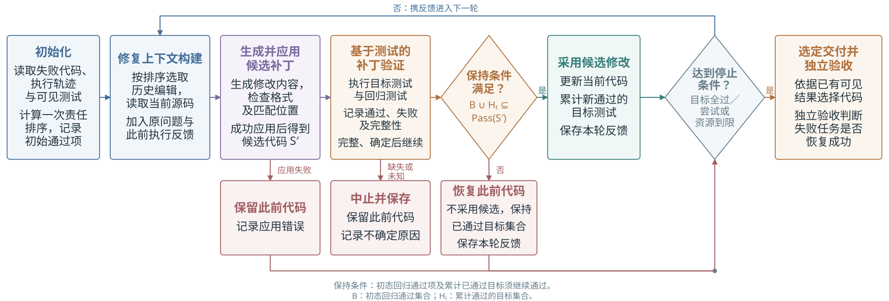

# 开题汇报按页文案与补充备注

## 第1页　

### 正文

### 补充备注

## 第2页　

### 正文

### 补充备注

## 第3页　

### 正文

### 补充备注

## 第4页　1.1 研究背景

### 正文

大语言模型（Large Language Model，LLM）能够理解自然语言指令、生成文本和代码，并结合上下文分析问题。在软件开发中，任务完成还要求将生成内容落实为代码仓库中的实际操作。例如，解决一个功能缺陷，需要查找相关实现、修改源码、运行测试，并根据执行结果继续调整。因此，软件任务求解既依赖模型的分析与生成能力，也依赖代码操作和结果检验。[1,2]

将大语言模型与工具、运行环境及过程管理机制结合，可以构成围绕任务目标持续行动的智能体。模型根据任务要求和已有观察选择操作，工具将操作作用于环境，返回的观察结果再参与后续决策。推理、动作和观察交替进行，使模型能够依据执行结果调整行为。[3] 这一过程形成按时间组织的执行轨迹，其中保存任务理解、工具调用、中间产物及环境反馈，为分析任务结果提供过程证据。

智能体的任务结果由连续操作共同决定。检索结果为后续分析提供材料，代码编辑改变待验证的程序，测试反馈影响下一步修改。多个角色协作时，需求、设计、实现和验证产物还会在角色之间传递。智能体评价因而同时涉及工具使用、环境交互、执行效率和最终任务结果。[4,5] 软件任务中的代码差异和可执行测试，使历史操作的影响及任务完成情况具有可检查的依据。

### 补充备注

当任务由多轮操作完成时，最后一次报错只能提供局部现象。理解失败，需要回到整个执行过程，查看模型在此前获得了什么信息，又如何据此行动。这一联系引出失败轨迹的分析。

## 第5页　1.1 研究背景

### 正文

连续执行也使失败来源难以追溯。早期遗漏的需求、错误的源码编辑或未被及时识别的问题，可能经过多轮操作后才表现为测试失败。最终异常反映当时的状态，关键错误却可能发生得更早，二者之间存在时间和信息距离。[6,7]

因此，**失败诊断**需要联系原始要求、历史操作及其后果，从完整轨迹中形成步骤的检查次序。仅检查末尾报错难以解释此前的决策，也难以区分错误引入与后续异常表现。诊断结果的作用是帮助后续分析确定优先检查的位置。

定位之后，仍需把历史线索对应到当前代码。执行记录保存过去的操作，源码可能已被后续步骤多次修改；新的修正也可能影响此前正常的功能。因此，**失败任务恢复**需要重新读取当前实现，结合诊断信息生成候选，再检查任务推进及已有功能保持。[8,9]

本课题据此研究两个衔接环节：从分散执行证据中学习责任步骤排序，再将排序中的可用信息转化为当前状态下的修复依据，通过连续修正完成原始任务。

### 补充备注

同一错误可能在编辑时引入、在测试时暴露，也可能在本应发现问题的验证环节被遗漏。责任判断沿用具体来源的标注规范。后续分别评价检查次序和任务完成，并保存实际输入作为二者之间的证据。

## 第6页　1.2 从失败诊断到任务恢复

### 正文

**失败诊断**是分析已经结束的失败轨迹，为历史步骤输出责任排序。候选涵盖推理、读取、编辑和验证，责任标签沿用来源规范。同一条后续反馈对错误编辑和正常读取可能具有不同解释作用，模型需要结合前后记录形成候选相关判断。[7]同一候选的判断依据可能散布在多个位置，单条错误消息也可能由更早的操作引起。诊断因而关注历史步骤在完整执行中的作用，输出轨迹内的相对检查优先级。

诊断信息用于当前修复时，还需要经过对象转换。传统软件缺陷定位以当前文件、方法或语句为候选；本课题排序的是历史执行步骤，其中未必包含源码修改。恢复流程因此筛选可用历史编辑，核对涉及的当前实现，再构造修复上下文。[10]步骤索引用于追溯记录，文件路径和修改差异用于检查源码，二者通过编辑来源建立对应。

**失败任务恢复**从失败执行留下的代码和环境出发，结合诊断信息继续修正。候选既要推进任务，也要检查对已经通过的测试和关联实现的影响。[9] 候选接纳只表示满足一次状态更新条件；只有最终交付通过规定的独立验收，才判定为**恢复成功**。诊断次序、实际输入和任务结果分别评价。

### 补充备注

单个责任位置标签规定优先检查的位置，其余步骤并未因此获得正确性标签。恢复流程对历史编辑的进一步筛选，使位置判断能够与实际修改建立对应。

## 第7页　1.3.1 智能体失败步骤定位

### 正文

- **MAST**（Cemri等，2025年）：该研究从实际执行材料中归纳系统设计、智能体间失配和任务验证等失败模式，为描述与比较系统失败提供分类依据。模式分类解释失败的表现类型；定位具体责任位置还需要分析各步骤在失败形成过程中的作用。[6]

- **Who&When**（Shaokun Zhang等，2025年）：将对象推进到责任角色和决定性错误步骤，标注关注修正后能改变失败结果的较早关键位置；比较整段日志判断、逐步分析和二分搜索，为步骤级归因提供位置监督。[7]

- **SDBL**（Sun等，2026年）：该方法将可疑范围划定和精确定位分为两个阶段，先确定重点分析区间，再结合范围提示与完整日志定位责任步骤。分阶段组织缩小了重点检查范围，范围识别与后续定位需要共同评价。[14]

- **StepFinder**（Zhu等，2026年）：综合步骤语义、双向时序、全局注意力与角色门控，直接输出步骤分数；采用责任位置交叉熵和时间一致性目标训练，为比较学习式定位质量与诊断开销提供参照。[15]

### 补充备注

失败模式分类说明系统怎样失败，责任位置标注进一步规定优先检查哪些历史步骤。后者使不同诊断方法能够在同一输出对象上比较。

## 第8页　1.3.2 责任归因的数据基础

### 正文

- **AutoGen、MetaGPT**（Wu等、Hong等，2024年）：分别以可编程会话和标准操作流程组织协作，保存角色、工具交互及中间产物。用于责任分析时，需统一步骤边界和记录对应。[16,17]

- **Let's Verify Step by Step**（Lightman等，2024年）：利用数学推理步骤的正确性反馈训练过程评价模型。失败责任监督则关注一次执行的关键位置，需保留错误引入、职责遗漏和错过纠正机会的标注规定。[18]

- **AgenTracer**（Guibin Zhang等，2026年）：该研究通过自然失败的修正重放和成功轨迹的故障注入构造责任监督，并训练诊断模型，将标签获取与可修正性联系起来。自然失败与注入错误具有不同的形成过程，评价时应保留相应来源及任务对应关系。[19]

- **TraceElephant**（Mengzhuo Chen等，2026年）：该数据保存步骤输入、配置、输出和工具日志，结合角色职责与可恢复性确定责任位置。验证者错过应有的纠正机会也可能被标注为责任位置，体现了责任定义与角色职责之间的联系。[20]

### 补充备注

单个责任标签给出归责位置，其含义由具体来源规定。采用不同标注材料时，需要先解释其责任定义，再解释模型指标。

## 第9页　1.3.3 反馈驱动的软件任务求解

### 正文

- **ReAct、Reflexion**（Yao等、Shinn等，2023年）：ReAct交替组织推理、动作和观察；Reflexion把先前尝试和评价转为语言记忆，分别为连续交互和后续反馈利用提供基础形式。[3,21]

- **AgentBench、SWE-bench、SWE-agent**（Liu等、Jimenez等、Yang等，2024年）：AgentBench评价多环境交互，SWE-bench以真实仓库问题和可执行测试检验任务完成，SWE-agent研究软件操作接口，分别提供环境、结果评价和操作方式基础。[2,4,5]

- **CRITIC、自纠错分析**（Gou等、Huang等，2024年）：Gou等的CRITIC通过工具交互检查输出并修订；Huang等分析自纠错受到外部正确性信号、停止规则和初始提示的影响。两项研究强调反馈来源及其信息。[22,23]

- **LATS、CodeAgent、AutoCodeRover**（Zhou等、Kechi Zhang等、Yuntong Zhang等，2024年）：LATS结合环境交互、反思和树搜索组织后续尝试；CodeAgent通过工具接口提供构建与测试反馈；AutoCodeRover利用程序结构检索组织定位和修改。[24,25,26]

### 补充备注

这些工作逐步把“模型提出方案”连接到“环境执行并返回结果”。在方法比较中，反馈的可获得范围与候选的组织方式同样影响求解效果，因此需要同时记录任务环境、工具权限和验证机制。此处按正式发表年份组织，保留各方法原有研究对象。

## 第10页　1.3.3 反馈驱动的软件任务求解

### 正文

- **SWE-Search、RepairAgent**（Antoniades等、Bouzenia等，2025年）：SWE-Search以搜索和迭代细化组织软件求解，RepairAgent通过工具交互和阶段控制推进程序修复。两项工作进一步将反馈使用与求解过程管理结合起来。[27,28]

- **Agentless**（Xia等，2025年）：该方法采用分层定位、补丁生成和验证选择流程，以已有回归测试和生成的复现测试筛选候选，构成固定阶段的软件问题求解方式。[29]

- **EnAgent**（Tian等，2026年）：该方法生成多条求解轨迹，利用回归测试剪枝，再通过工具辅助比较和投票选择补丁，以候选集成组织软件任务求解。[30]

- **AOrchestra**（Ruan等，2026年）：该方法由主控配置任务相关的子智能体、上下文及工具，通过动态分工完成复杂任务，提供动态协作的完整求解方式。[31]

**研究联系** 已有方法完善了定位、生成与验证选择。失败后留下的历史操作、当前代码和未完成目标，还需要形成相互对应的修复依据，并在连续修正中保持已取得的进展。

### 补充备注

固定阶段、多轨迹集成与动态编排分别组织求解过程。本课题的完整系统比较从同一个失败初态出发，模块控制再分析诊断信息如何参与恢复。

## 第11页　1.3.4 诊断信息支持的任务恢复

### 正文

- **SyncMind**（Guo等，2025年）：该研究考察协作代码更新引起的失步，分析智能体重新获取当前代码和环境信息的恢复能力。其研究对象说明，历史认识需要结合当前环境重新核对，才能支持后续操作。[8]

- **STRATUS**（Yinfang Chen等，2025年）：该方法在云系统故障处理中组织试执行、检查和撤销，以状态管理约束连续操作。其执行环境与撤销前提，为分析恢复机制的适用条件提供参照。[32]

- **DoVer**（Ma等，2026年）：该方法依据失败日志形成责任假设，再生成干预并继续执行，通过干预结果检验诊断与修正之间的联系。诊断评价由此延伸到实际任务效果，干预的可实施性和执行能力也参与结果形成。[33]

- **AgentRewind**（Zhuang等，2026年，预印本）：该方法共同恢复执行上下文和文件检查点，并保留失败经验，使可继续执行的状态与已有知识对应。它进一步体现了使用历史信息时对运行状态一致性的要求。[34]

### 补充备注

历史信息具有作用，需要经过可实施的后续操作。恢复过程中的状态对应、干预方式与执行反馈，共同决定诊断能否转化为任务收益。

## 第12页　1.4 有待解决的研究问题

### 正文

- **复杂执行过程中的失败诊断问题**
智能体通过连续决策、工具调用和环境交互完成任务，一次失败可能涉及此前的需求理解、信息获取、代码修改和结果检查。关键错误与最终异常在时间上相隔，相关证据也分散在不同记录中，使末尾反馈难以完整说明失败的形成过程。已有研究提供了失败分类、责任标注和定位方法，仍需研究如何结合这些过程证据，区分不同步骤在失败中的作用，形成准确且代价可控的责任判断。解决这一问题能够为失败分析提供有依据的检查次序，并为后续恢复确定重点。

- **面向任务完成的失败任务恢复问题**
一次执行失败后，历史操作、当前软件状态与尚未满足的任务要求共同决定继续求解的起点。诊断指出的历史位置需要与当前可实施的修改建立联系；新的修改既可能推进目标，也可能影响已经正常的功能。因此，恢复研究需要说明如何把诊断信息转化为有效的行动依据，并利用执行反馈协调多轮修正，使任务从失败状态继续推进。评价还应将中间诊断和修改过程与最终独立验收联系起来，判断后续执行是否真正完成原始任务。

### 补充备注

这两个问题分别针对失败理解和失败后的继续求解。后续研究目标将它们转化为责任排序与任务完成的可评价对象，方法章节再讨论具体技术选择。

## 第13页　

### 正文

### 补充备注

## 第14页　2.1 研究目标

### 正文

本课题以已经失败的智能体任务为对象，围绕失败诊断与失败任务恢复两个衔接环节开展研究。总体目标是从可观察执行证据中识别关键责任步骤，再利用诊断信息支持当前软件状态下的连续修复，以完成原始任务。两项研究分别回答以下问题。

- **研究问题一：如何从连续执行记录中识别关键责任步骤，形成准确且代价可控的失败诊断？** 面向历史步骤学习责任评分函数，输出同一失败轨迹内的检查次序。研究将分析分散证据对候选判断的作用，并评价不同轨迹条件下的责任定位、排序质量与诊断开销。

- **研究问题二：如何利用失败诊断形成有效的修复依据，并支持连续修正以提高失败任务恢复成功率？** 面向已有失败代码和运行环境，建立诊断信息与当前修改对象的对应，利用执行反馈组织后续修正，评价诊断使用、修复进展和最终任务完成之间的联系。

责任步骤排序是两项研究的衔接接口。研究问题一评价历史步骤的检查次序，研究问题二评价从失败状态继续完成任务的效果。排序替换与过程记录用于分析诊断是否改变了实际修复依据，以及这种变化能否影响最终结果；具体的信息组织与候选接纳机制在研究方法中展开。

### 补充备注

研究目标规定希望获得的能力及评价对象。具体信息组织和候选接纳方式属于方法设计，将在研究内容中逐步展开。

## 第15页　2.2 研究意义

### 正文

软件缺陷定位与修复研究旨在减轻开发者分析缺陷、查找原因和验证修改的负担，维护软件质量。[9,10] 当智能体承担连续的软件操作时，失败原因还可能分散在需求解释、代码修改和执行反馈之中。研究这些执行证据与责任判断的联系，有助于深化对智能体失败过程的认识，为其运行可靠性分析和调试提供细粒度依据。

在软件维护实践中，一次失败执行往往已经形成部分代码改动和测试结果。如何利用这些已有工作继续完成任务，同时防止后续修改破坏已实现的行为，是提高自动化修复可用性的重要问题。研究失败后的持续修正及其验证条件，可为减少重复排查、控制修复退化和支持人工接管提供依据，促进智能体辅助软件维护的可靠应用。

### 补充备注

研究意义先从软件维护中的理解与验证负担说明学科和实践价值，再说明智能体连续执行带来的新问题。文献[9]引言从可靠性、质量和修复投入展开，[10]从维护成本、定位困难展开；本节借鉴这种论证顺序，不将综述中的历史成本数据作为本课题效果。
参考：
https://www.jos.org.cn/html/2025/4/7268.htm
https://www.jos.org.cn/jos/article/abstract/7288

## 第16页　

### 正文

### 补充备注

## 第17页　3.1 研究对象及任务定义

### 正文

诊断对象是一次已经结束、未满足任务完成条件的执行，包含单智能体和多智能体协作。轨迹由有序步骤组成，每步保存许可范围内的文本、动作、工具或环境观察、角色及原始索引；模型沿用实际步骤边界，保持输出与原始记录的对应。文本内容描述步骤获得的信息与实施的行为，时间和角色等字段支持构造可观察关系。原始索引同时用于连接模型预测、责任标签和后续历史编辑筛选。

每个历史步骤均为评分候选，责任标签由数据来源的规范确定，可能指向错误引入、职责遗漏或错过纠正机会。训练和评价保留这些含义；单责任位置监督规定标注步骤相对其他候选的检查优先性，其余次序由评分函数估计。[7,19,20]候选数量随轨迹长度变化，评分参数在不同任务之间共享；各来源的标注规范和步骤映射随样本保存。

设完整轨迹为τ，步骤为xᵢ，可见日志关系为ℛ，模型学习共享函数sᵢ＝fθ(xᵢ,τ,ℛ)，按分数降序输出原始索引。诊断发生在执行结束后，可使用该轨迹中已发生的前后步骤。诊断适用于多类交互任务，恢复研究限定于环境可重建、代码变化可检查且测试可执行的软件任务。

### 补充备注

轨迹长度随任务变化，模型参数在轨迹之间共享。来源不同的责任标签可能关注不同关键位置，因此记录规范和步骤映射随数据保存。

## 第18页　3.1 研究对象及任务定义

### 正文

恢复输入包括**原问题q、失败初态S₀、历史轨迹τ和修复反馈测试**。失败初态是执行结束后的实际代码及运行环境，与原始仓库提交分别保存，作为各方法共同的求解起点。历史轨迹说明过去发生过什么，当前代码决定补丁现在作用于什么。

大模型生成候选补丁，执行端检查应用与测试结果，再决定是否更新当前接纳状态Sₜ。接纳后从新状态继续，拒绝时保留此前代码；每个候选、反馈和状态快照关联保存，以追查哪次修改推进了目标测试，以及后续是否保留这一进展。

**修复反馈测试**允许向求解过程提供结果，**独立验收测试**与生成隔离，判断最终交付。实验按历史编辑可回查、环境可重建、测试可执行等纳入标准组织；最终交付通过规定独立验收，才称恢复成功。

### 补充备注

“纳入标准”说明实验对象具备哪些输入和环境条件。它在比较前确定，用于准备可运行的共同任务；不能依据本文胜负或独立验收结果筛选。可见测试在本文中统一解释为修复反馈测试，二者指同一许可范围。

## 第19页　3.2 总体研究框架

### 正文

### 补充备注

离线责任排序与实际任务完成之间，通过历史编辑的选择建立联系。框架同时保留输入、候选和接纳记录，使实验能够追踪排名差异何时转化为生成依据，以及何时被编辑筛选或容量限制消除。整体恢复效果与各中间环节分别评价。

## 第20页　3.2 总体研究框架

### 正文

- **接口对应** 保存原始步骤、编辑调用、文件差异、当前源码与实际生成输入之间的映射，确认责任排序经过编辑筛选后是否改变了修复依据。

- **过程分析** 将同一任务的定位结果与候选状态、测试变化和资源消耗联系起来，识别排序、输入和接纳决定发生差异的环节。

- **结果评价** 在任务层面对独立验收结果进行配对比较，分别分析定位质量、完整恢复效果及各模块作用，形成从过程到结果的对应证据。

**表3-1 两项研究的对象、方法与评价依据**

| 研究部分 | 研究对象 | 方法设计 | 评价依据 |
| --- | --- | --- | --- |
| 责任步骤排序 | 失败执行轨迹 | 稀疏日志关系与步骤上下文评分 | 分组定位评价、表示消融、诊断开销 |
| 失败任务恢复 | 可重建的失败初态 | 排序引导上下文与测试保持修复 | 完整系统比较、排序替换、接纳策略对照 |

### 补充备注

例如，两种排序前几步有所不同，去除非编辑步骤和重复调用后，却可能得到相同的有效编辑前缀。有限容量下实际提供给模型的历史材料，才是检查排序是否形成恢复干预的直接记录。

## 第21页　3.3 关系增强的上下文感知责任排序

### 正文

### 补充备注

图中的MLP是多层感知机，用于把拼接后的表示映射为步骤分数。在单角色轨迹中，同角色连接可能与时间连接重合，多个通道因而读取相同邻步。局部通道与全轨迹读取分别控制，以分析补充信息、重复消息和计算开销的作用。

## 第22页　3.3.1 步骤特征编码

### 正文

步骤特征编码

本模块把步骤文本、执行角色和日志结构编码为**步骤初始表示**。文本记录操作与观察，结构特征描述字段类型、嵌套形式、相对位置和重复情况。

**匿名角色**是轨迹内的身份编号，按角色首次出现的顺序分配。同一角色在该轨迹中沿用同一编号，不同轨迹相同编号不代表相同职责。编号用于角色特征和同角色连边。

日志明确给出相邻、同角色的记录配对时，模型结合两条记录的内容、差值和有效标志，以门控残差融合配对信息，再投影为初始表示。没有有效配对时使用原记录。

随后构造时间相邻、同角色、同完整记录结构和同非空动作结构四类关系，每通道邻居至多2个。它们限定邻步信息的读取范围，其定位作用由关系控制实验检验。[35,36,37]

### 补充备注

例如，某轨迹中Planner先出现、Coder后出现，角色特征可记为role_0和role_1；Planner再次出现仍使用role_0。另一轨迹role_0可能对应Coder，所以编号本身不表示“规划者”。这不是将角色编码为one-hot：现有编码器将角色字符串转成32维稠密向量。原记录文本仍按来源处理。配对融合只使用来源明确提供的对应，不额外推断缺失配对。
参考：
https://doi.org/10.1007/978-3-319-93417-4_38
https://doi.org/10.1145/3798271
https://arxiv.org/abs/2610.01256

## 第23页　3.3.2 门控多关系消息传递

### 正文

门控多关系消息传递

本模块沿四类日志关系汇集邻步信息，输出**关系增强的步骤表示**。门控依据接收步骤及两步差异，调节每条消息的贡献。[35]

式（1）中，hᵢ是待更新步骤，hⱼ是邻步表示。g是0至1的标量，φ把邻步内容及差异转换为消息；先对每条消息加权，再在该关系的邻居内取平均。

每条边独立计算门控；无邻居通道取零向量。模型再为四个通道计算归一化权重，融合后与原表示残差相加并归一化，采用两层更新。

$$

\begin{aligned}
g_{ij}^{(r)} &= \sigma\!\left(G_r[h_i;\,h_j-h_i]\right),\\
u_i^{(r)} &= \frac{1}{|\mathcal N_r(i)|}
\sum_{j\in\mathcal N_r(i)}
g_{ij}^{(r)}\,\phi_r([h_j;\,h_j-h_i]).
\end{aligned}
\tag{1}
$$

### 补充备注

公式第一行决定邻步消息保留多少，第二行决定该关系通道汇集什么。边级sigmoid门控不在邻居之间作softmax；关系通道权重另行归一化。相同两步可能在多个通道连边，因此需记录连接重合与有效覆盖，不能只根据权重判断因果责任。
参考：
https://doi.org/10.1007/978-3-319-93417-4_38

## 第24页　3.3.3 全局自注意力聚合

### 正文

全局自注意力聚合

局部传播可能遗漏远处的需求或测试反馈。本模块读取全轨迹表示，为**每个待评分步骤**生成与其相关的上下文向量。[38]

查询对应正在判断的步骤，键用于匹配相关记录，值承载要汇集的信息。aᵢⱼ表示候选i读取步骤j的权重，cᵢ在全轨迹均值上加入候选相关修正。

每个步骤拥有各自查询；这些权重组织证据，责任次序由评分器给出。密集计算约为O(m²d)，实验比较共享查询、均值和局部上下文，并分析长度与信息位置。[39]

$$

\begin{aligned}
a_{ij} &= \operatorname{softmax}_{j}
\left(\frac{(W_Qh_i)^\top W_Kh_j}{\sqrt d}\right),\\
c_i &= \bar h+
W_O\left(\sum_j a_{ij}W_Vh_j-W_V\bar h\right).
\end{aligned}
\tag{2}
$$

### 补充备注

可以把查询理解为“判断这一步需要什么证据”，键说明“某条记录能与什么需求匹配”，值提供被读取的内容。这里的候选是历史步骤，不是候选补丁。完整轨迹已经结束，所以可以读取后续已发生反馈；注意力不跨任务。存储量O(m²)用于算法复杂度说明，不作为本轮删除的显存/内存测量指标。
参考：
https://proceedings.neurips.cc/paper_files/paper/2017/hash/3f5ee243547dee91fbd053c1c4a845aa-Abstract.html
https://aclanthology.org/2024.tacl-1.9/

## 第25页　3.3.4 轨迹内责任评分

### 正文

轨迹内责任评分

评分器综合初始表示、关系增强表示与步骤上下文，输出每步分数。**单责任位置交叉熵**训练共享函数，使标注步骤获得较高检查优先级。[13]

MLP将四部分表示拼接后映射为分数sᵢ；softmax把同一轨迹的分数归一化为pᵢ。y是标注责任位置，损失−log pᵧ在标注位置权重提高时减小。

模型按分数降序输出原始步骤索引。标注只提供一个优先责任位置，其余步骤的次序由模型估计。

$$

\begin{aligned}
s_i &= \operatorname{MLP}
\left([h_i;\,h_i^{(0)};\,c_i;\,h_i-c_i]\right),\\
p_i &= \frac{\exp(s_i)}{\sum_{j=1}^{m}\exp(s_j)},\\
\ell_\tau &= -\log p_y.
\end{aligned}
\tag{3}
$$

### 补充备注

例如标注y=2，模型给第2步的权重从0.2提高到0.6，−log p₂会减小，因此训练推动标注位置在该组内获得更大权重。pᵢ是给定候选组与标签规范下的相对权重，不是“这一步必然造成最终失败”的客观概率。
参考：
https://research.google/pubs/an-analysis-of-the-softmax-cross-entropy-loss-for-learning-to-rank-with-binary-relevance/

## 第26页　3.3.4 轨迹内责任评分

### 正文

轨迹内责任评分

单责任标注采用**one-hot标签向量（独热标签）**：标注位置为1，其余位置为0。例如4步轨迹标注第2步，标签为(0,1,0,0)，对应式（3）的−log p₂。0只表示该步不是本条记录的标注位置，不表示该步骤一定正确。

每条轨迹是一个候选组，从排序角度看，该交叉熵对应单正例的列表级softmax排序目标。[12,13] 本文直接使用责任位置标签；ListNet则依据候选标签得分构造目标分布。[11]

单模型按步骤分数降序输出，同分时按原始索引处理。三模型集成先分别作轨迹内softmax，再平均权重排序。训练按任务组汇总，标准化只使用训练数据，验证用于选轮。

### 补充备注

“独热目标分布”在数学上指全部质量放在标注位置的分布，本稿改称更易理解的one-hot标签向量。代码以整数位置调用交叉熵即可实现同一目标，无须真的创建一个0/1向量。角色编号与责任标签是不同输入：角色使用稠密编码；训练目标监督哪一个步骤优先检查。
参考：
https://doi.org/10.1145/1273496.1273513
https://doi.org/10.1561/1500000016
https://research.google/pubs/an-analysis-of-the-softmax-cross-entropy-loss-for-learning-to-rank-with-binary-relevance/

## 第27页　3.4 诊断引导的失败任务恢复

### 正文

### 补充备注

主干从左到右，生成、验证与保持判断分别引出应用失败、观测不确定和拒绝候选分支。应用失败与拒绝的反馈在下方合流进入停止判断；尚可继续时由上方单条回线返回修复上下文。采用候选沿主干直接进入停止判断，满足停止条件后选定代码并独立验收。修复反馈测试与最终独立验收测试分别承担过程反馈和最终评价。

## 第28页　3.4.1 排序引导的修复上下文构建

### 正文

排序引导的修复上下文构建

本模块把责任排序转换为大模型可用的修复材料。初始轨迹只诊断一次，恢复器沿固定次序提取**实际成功修改源码的历史编辑**，按调用标识去重，保留原始步骤索引。推理、读取和未成功执行的调用不作为源码编辑。

历史编辑提供可能要重新检查的位置与过去的变更。每轮重新读取相关当前文件，结合函数及失败反馈补充代码，将**历史差异与当前内容**分别交给模型，由模型判断线索是否仍与当前错误有关，再针对现状修正。

选入记录逐轮扩展，受条数和输入容量限制，保存实际材料与截断范围。不同排序经筛选后可能形成相同输入，因此同时记录步骤排序、有效编辑次序和实际大模型请求，核验诊断是否改变修复依据。

### 补充备注

排序给的是历史操作的检查次序，不是人工提供的正确补丁位置。历史代码可能已被后续修改覆盖，因此读取当前文件是生成前的必要核对。若排序靠前的是测试步骤，恢复器仍继续沿排序查找可用源码编辑。单纯离线Top-1提高不能自动证明恢复成功率提高。

## 第29页　3.4.2 反馈驱动的候选补丁生成

### 正文

反馈驱动的候选补丁生成

系统把**原问题、选定历史编辑、相关当前代码和此前反馈**提供给大模型，请其提出候选补丁。模型输出路径、待替换内容和修改内容；执行端检查权限、格式与唯一匹配，应用成功后保存代码快照。[22,28]

修复过程可使用的测试称为**修复反馈测试**：目标测试检查原问题需要实现或修复的行为，回归测试检查应保留的已有行为。每个候选按其快照重建代码，执行预先固定的共享测试。[9]

格式错误、应用失败和测试失败分别反馈给下一轮。方法自行生成的复现或辅助测试与共享测试分开记录，token及大模型API请求计入资源；独立验收测试不向生成过程反馈。

### 补充备注

“可见”描述信息许可：修复方法能读取这些测试或获得执行结果。它不表示所有目标都已通过，也不表示正确答案可见。本稿将“目标测试”具体写成目标测试，并将允许反馈的测试统称为修复反馈测试。旧测试若与新需求冲突，运行前依据问题说明统一处理；不能在看见某方法胜负后调整。
参考：
https://www.jos.org.cn/html/2025/4/7268.htm
https://proceedings.iclr.cc/paper_files/paper/2024/hash/fef126561bbf9d4467dbb8d27334b8fe-Abstract-Conference.html
https://doi.org/10.1109/ICSE55347.2025.00157

## 第30页　3.4.3 基于测试的补丁验证

### 正文

基于测试的补丁验证

候选补丁应用后执行测试，判断能否**更新当前代码**。B为初态已通过的受保护回归测试，Tgoal为固定目标测试，Hₜ为累计通过的目标测试。[9,29]

式（4）要求B和Hₜ中的每个测试都出现在候选通过集合Pass(S′)中。满足条件则接纳，并将新通过的目标测试加入Hₜ；否则恢复此前代码，保护集合不变。

未新增通过项但保留全部保护项的候选仍可接纳。规则约束已执行的测试；缺失、超时或不确定的结果触发停止，保存此前状态。

$$

B\cup H_t\subseteq\operatorname{Pass}(S').
\tag{4}
$$

### 补充备注

示例：B={回归1}、Hₜ={目标1}，候选通过{回归1,目标2}，虽然通过数量相同，却丢失目标1，因此拒绝。若候选通过{回归1,目标1,目标2}，则接纳并把目标2加入保护。测试保持只覆盖已观察行为；最终仍须独立验收。
参考：
https://www.jos.org.cn/html/2025/4/7268.htm
https://doi.org/10.1145/3715754

## 第31页　3.4.4 停止、交付与约束代价

### 正文

停止、交付与约束代价

每轮候选处理后，检查目标测试是否全部通过、内部尝试是否耗尽，以及共同资源上限是否到达。满足停止条件时，**从已有接纳状态中选定交付代码**，保留快照与原因。

选择只用当时已有的修复反馈：先保留满足当前保护集合的初态及接纳状态，再依次比较未通过目标测试数、修改行数和尝试先后。各预算节点用同一规则，较晚修改不回填较早节点。

已通过测试保持可能避免修复退化，也可能限制需要跨接口同时修改的中间状态。实验比较累计目标保持、数量保持与仅回归保持，联系候选路径与独立验收，评价约束的收益和代价。

### 补充备注

停止不等于恢复成功：资源到限也会停止。目标测试全通过说明该修复反馈集合已满足，选定代码仍要接受隔离的独立验收。仅回归保持使用B，不要求保留新通过目标；数量保持只限制失败数量，累计集合保持逐项保留已通过测试身份。

## 第32页　3.5 方法过程示例

### 正文

**真实问题：Moto7081设备接口缺少thingId。** 选取的开发初态已补入部分字段，但查询设备时仍报“FakeThing对象无法进行JSON序列化”。删除、更新和普通列表测试已通过。

排序提供历史编辑线索，模型结合当前代码与失败反馈生成补丁。真实候选只改响应层：将json.dumps(thing)改为**先调用thing.to_dict(...)，再转换成JSON**，保留后端供其他接口使用的对象。

另一开发运行将后端直接改成字典，创建虽通过，却使依赖对象属性的删除、更新失败。按本文规则核验，该候选丢失已通过目标，应拒绝。

本例候选使创建、删除、更新及列表测试全部通过，并有已发布独立验收通过记录。**这是开发过程示例**，用于说明修复输入和测试保持，排序独立收益仍需共同评价。

### 补充备注

本页采用固定20题清单中的moto7081真实公开开发记录。原问题是create_thing返回缺少thingId；选取的恢复初态已做部分修改，仍在describe_thing返回JSON时失败。示例展示真实补丁生成与验证，不虚构该任务的责任Gold、预测Top-1或最终RQ1模型效果。完整证据见配套真实案例与任务清单。

## 第33页　

### 正文

### 补充备注

## 第34页　4.1 关键技术难点

### 正文

- **RQ1：有限监督下的责任表示与信息开销**
单责任标签每条轨迹仅提供一个归责位置，不能直接规定判断依据来自哪些记录。模型需学习候选与远距离证据的关联，区分错误引入、异常表现和错过纠正机会。时间、角色和结构通道可能重复读取相同步骤，重复消息可能放大同一证据，无关消息则可能干扰原始表示。全轨迹注意力扩大信息范围，也增加密集计算。因此，难点是形成有区分力的步骤上下文，并结合关系覆盖、通道重合及轨迹长度分析定位收益与开销。

- **RQ2：历史诊断向当前连续修复的转化**
高责任步骤可能是推理、检索或验证，未必包含源码编辑；同一编辑可能重复记录，其涉及的实现也可能被后续操作覆盖。恢复器需筛选有效编辑、按调用去重并核对当前代码，在有限容量下提供相关材料。关联修改还可能同时影响多个目标，按通过数量接纳会忽略测试身份变化，按标识保持则可能限制中间候选。难点是联系测试覆盖、结果确定性和执行成本，分析保持条件对连续修复路径与最终任务结果的作用。

### 补充备注

单角色轨迹中的角色关系可能与时间邻接重合，这是RQ1分析连接冗余的具体情形。RQ2则通过保存历史来源和当前代码，检查排序经过输入适配后是否仍能形成差异。

## 第35页　4.2 拟研究的创新设计

### 正文

- **RQ1：日志关系与步骤上下文共同支持的责任表示**
本课题将四类可观察联系、步骤差异门控和候选相关的全轨迹聚合纳入责任评分。其设计判断是：局部联系提供可获得的执行结构，每个候选的查询区分远距离证据的作用，初始表示旁路保留未经关系传播的内容。研究将分析初始表示、关系增强表示与步骤上下文对责任判断的作用，并检验关系重合程度和轨迹长度变化时的定位质量与计算代价。完整学习式基线、共享上下文和关系控制分别用于检验整体表现、候选相关聚合及连接对应关系的作用。

- **RQ2：历史诊断参与的修复输入与动态测试保持**
本课题将责任次序用于历史编辑选择与输入容量分配，每轮依据当前代码核对线索，并将新通过的目标测试纳入后续接纳条件。历史信息影响生成模型获得什么修复依据，测试保持影响哪些候选能够成为后续状态。拟研究的创新在于二者对连续修复路径的共同作用：通过排序替换与信息消融分析诊断输入，通过接纳策略对照分析进展保持，再以独立验收评价最终任务效果。

### 补充备注

图传播、自注意力和生成—验证流程是采用的技术基础。拟研究的设计作用落实在证据组织、历史输入和候选接纳三个环节，其有效性由计划中的比较检验。

## 第36页　4.3 创新主张的验证安排

### 正文

- **RQ1：责任表示、信息来源与诊断成本验证**
去除关系传播或以轨迹均值替代步骤上下文，检验模块作用；通过参数匹配和关系置换，分析差异是否来自特定连接及信息组织。共享查询对照保留注意力计算，局部上下文对照限制读取范围。在相同任务分组下比较定位与排序质量，并按轨迹长度和关系重合程度分析条件变化。完整诊断耗时与token消耗用于说明获得该次序的代价，结合质量指标评价局部结构与全局聚合的作用。

- **RQ2：完整恢复效果与诊断使用机制验证**
完整系统比较评价总体任务效果，固定恢复流程的控制实验解释具体机制。排序替换保持编辑筛选和容量规则一致，信息消融分别改变历史编辑或专门当前代码读取，接纳对照比较累计目标集合、数量和仅回归保持。保存有效编辑次序、实际请求、候选测试及状态快照，确认控制改变了哪些输入与决策，再联系独立验收解释后续路径。各项控制、样本、信息许可和预算在正式评价前固定。

### 补充备注

完整系统比较与模块控制分别评价不同层次。控制实验需先确认其改变了实际输入或候选决策，再解释这些差异是否影响最终任务结果。

## 第37页　

### 正文

### 补充备注

## 第38页　5.1 数据来源与样本组织

### 正文

诊断使用**AFTraj与AgenTracer**轨迹，恢复以具有环境、测试和智能体轨迹的**SWE-Gym**问题为主要来源。[40,41,42]

**20题清单已固定**，覆盖5个仓库。它们已有开发接触；历史记录中17题已发布排序，3题运行条件待复核，不能将排序发布视为恢复完成。

**表5-1 数据来源与研究样本**

| 数据来源 | 发布规模 | 样本组织 | 研究用途 |
| --- | --- | --- | --- |
| AFTraj | 2,276条轨迹 | 731条候选轨迹、716个任务组 | 责任定位与排序 |
| AgenTracer | coding训练1,141条、测试127条 | 614条训练验证来源池、363条coding开发轨迹 | 软件轨迹责任定位 |
| SWE-Gym | 2,438个Python问题 | 20个不同问题、5个仓库 | 失败初态构建与恢复评价 |

### 补充备注

固定20题按既有21题前瞻顺序取前20，不按方法胜负选择，覆盖5个仓库。历史记录17题已发布排序、3题运行条件待复核，全部保留在计划分母。当前20题已有开发接触；正式独立评价任务需另行冻结。AFTraj的163条test_unsafe和AgenTracer的127条coding测试是候选来源规模，不是已经确认的独立失败样本数。
参考：
https://proceedings.mlr.press/v267/pan25g.html
https://huggingface.co/datasets/ZBox008003/AFTraj/blob/main/README.md
https://github.com/bingreeky/AgenTracer/releases/tag/data-v1.0.0

## 第39页　5.2 实验流程设计

### 正文

诊断数据分组与模型训练

**按原始任务分组**，同一问题的轨迹变体不跨训练、验证和评价集合，保留来源标识与步骤映射。AFTraj的716组采用五折分组评价，由未使用该任务训练的模型给出外折预测，每配置采用三次预定初始化。

AgenTracer的614条来源池按492条训练、122条验证组织，采用A、B、C三种任务组隔离划分及三次初始化，在共同363条coding开发集合比较。划分与初始化分别编号，参与选模的结果作为开发证据。

独立诊断候选来自AFTraj的163条test_unsafe轨迹及AgenTracer的127条coding测试轨迹。核对执行未完成、历史使用和任务重叠后，未参与开发的部分进入独立评价，分别报告候选数与实际纳入数。

### 补充备注

外折预测用于减少同任务信息泄漏：评价该条记录时，训练过程没有使用其所属任务组。开发集合用于选结构与参数，独立评价集合用于确认选好方法的效果。“执行未完成及纳入条件”原意是确认来源任务确实未完成及输入可用，本稿直接写具体纳入条件，不将其作为单独学术术语或整页实验贡献。

## 第40页　5.2 实验流程设计

### 正文

失败任务恢复的执行过程

**准备共同起点。** 每题重建失败后的代码与环境，固定原问题、轨迹、修复反馈测试和源码访问权限；每题每方法独立运行3次，重复之间不继承补丁。

**执行完整方法。** 本文先诊断轨迹，再将排序选出的历史编辑、当前代码及反馈交给大模型；生成补丁后运行测试，接纳或回退，再继续修正。基线按各自完整流程从相同初态运行。

**保存节点交付。** 同一次运行在15、30和60分钟保存当时选定的代码；记录请求、候选、测试结果、接纳决定及资源。

**独立验收与比较。** 交付选定后执行隔离的验收测试，以问题为单位比较各方法成功率；未知和未运行单列，完整共同配对数另报。

### 补充备注

本页说明实验实际怎么跑。论文方法内部阶段可以不同，公平条件统一的是任务起点、信息许可、模型、预算节点与验收。30分钟是主比较节点，15/60分钟分析资源变化。已有20题是开发比较清单；当前版本不把20题写成全部已完成或未曝光独立确认。

## 第41页　5.2.4 共同运行及结果评价

### 正文

共同运行条件

各方法从同一失败状态出发，**节点前选定交付，事后独立验收**。同题3次运行先汇总，再作任务级配对比较。

**表5-2 失败任务恢复的共同运行条件**

| 条件 | 统一设置 |
| --- | --- |
| 任务起点 | 原始问题、仓库版本、失败代码、运行环境 |
| 生成模型 | deepseek-flash、预先固定各方法部署参数 |
| 信息与测试 | 共同源码权限、修复反馈测试、独立验收 |
| 独立重复 | 每题每方法3次、每次重建共同失败初态 |
| 时间与资源 | 30分钟主预算、15/60分钟快照、共同token上限 |
| 交付与评价 | 节点前选定代码、事后独立验收、逐题结果矩阵 |

### 补充备注

表5-2统一的是各方法的外部条件，内部方法核心保留。每次独立重复均重建相同初态，方法内部候选与子智能体归入该次运行。表格全部7行采用相同高度与垂直居中。

## 第42页　5.3 评价指标及资源设置

### 正文

以**责任定位、失败任务恢复与资源消耗**评价方法，具体指标如下。

诊断按任务组汇总，恢复先汇总同题3次运行，再对问题等权平均。**API请求次数**覆盖所有大模型生成阶段及重试，本地工具执行不计入。

**表5-3 主要评价指标**

| 指标 | 计算方法及含义 |
| --- | --- |
| Top-1 ↑ | 任务组等权首位命中率 |
| MRR ↑ | 任务组等权倒数排名均值 |
| Hit@3 / Hit@5 ↑ | 任务组等权前3/5位命中率 |
| 诊断耗时P50 / P95 ↓ | 完整诊断流程耗时中位数/95分位数 |
| 失败任务恢复成功率RSR ↑ | 任务级独立运行平均恢复成功率 |
| RSR@15 / 30 / 60min ↑ | 预算节点交付的独立验收成功率 |
| 资源消耗 ↓ | 输入与输出token总量、大模型API请求次数 |

### 补充备注

指标先于基线介绍。诊断指标对应标注责任位置，恢复成功对应隔离的独立验收。资源统一写输入与输出token和大模型API请求次数；移除显存/内存及额外的完整流程墙钟时间指标。

## 第43页　5.3.1 责任排序质量与诊断成本

### 正文

责任排序质量与诊断成本

**Top-1**检查标注责任步骤是否排首位；**MRR**为标注位置倒数排名的均值，排第2位贡献1/2；**Hit@3、Hit@5**检查是否进入前3或前5位。[12] 先在同任务组内汇总，再对任务组等权平均。

**诊断耗时P50/P95**从轨迹进入系统到诊断输出计算，覆盖加载、编码、构图及评分或生成，分别报告首次加载与已加载条件。P50为中位数，P95为95分位数。

**资源消耗**记录输入与输出token总量及大模型API请求次数。一次请求指一次发往大模型服务的生成请求，涵盖分析、补丁生成、选择、子智能体及重试；工具执行另记。失败请求及usage未知单列，token按可核查usage汇总。

### 补充备注

All-at-Once和Binary Search主要输出一个位置，因此所有方法共同比较Top-1与诊断成本；只有保留完整排序的本文与StepFinder比较MRR、Hit@3/5。不能为单位置输出补造其余排名。相同任务派生很多轨迹时，先组内平均可避免它在总体指标中占据过大权重。
参考：
https://doi.org/10.1561/1500000016

## 第44页　5.3.2 失败任务恢复成功率

### 正文

失败任务恢复成功率

每题每方法独立运行3次，不继承其他重复的补丁或反馈。z表示方法a在问题u的第r次运行中，预算b前选定的交付是否通过独立验收；Uᵦ为各方法3次均可判定的共同问题集。

先汇总同一问题的全部3次运行，再对共同问题等权平均。例如两题分别成功2/3和1/3，RSR为(2/3+1/3)/2＝50%。

同时报告计划数、启动数、可判定数及完整配对数。预算内未成功、验收未知和未运行分别记录，保留全计划任务矩阵。

$$

\operatorname{RSR}_a(b)=
\frac{1}{|\mathcal U_b|}
\sum_{u\in\mathcal U_b}
\left(\frac{1}{3}\sum_{r=1}^{3}z_{a,u,r}(b)\right).
\tag{5}
$$

### 补充备注

三次运行是同一问题上的独立生成轨迹，不把内部候选数当作独立重复。已知预算到限未产生成功交付可记预算内失败；已经选出代码但验收没有得到可判定结果时仍为未知。完整共同问题集要求所有比较方法的三次运行均可判定，另列全计划矩阵以显示缺失范围。

## 第45页　5.3.3 时间节点与自然终态

### 正文

时间节点与资源设置

主比较节点为**30分钟**，同时保存15和60分钟节点的交付与累计资源。各节点取自同一次最长60分钟运行；若提前自然停止，后续节点沿用已选代码。较晚修改不回填较早快照。

共同token上限、内部尝试次数、测试与停止规则在正式评价前固定。token及**大模型API请求次数**覆盖所有阶段、子智能体、重试和失败候选；从读取输入与加载模型起，诊断、生成、工具和测试均占用预算。

若继续观察取消60分钟截断后的自然终态，保留原配置、原时钟、已用尝试和累计资源，单列续跑结果。进程保护或费用未知导致的中断保留原因与已观察结果。

### 补充备注

时间是统一预算的边界，保留30分钟主比较和15/60分钟快照；本轮不再额外报告完整流程墙钟时间指标。环境重建属于运行前准备。取消外部截断后的续跑仍沿用方法内部参数，不能把不同配置当成单纯时间增量。

## 第46页　5.4.1 失败诊断比较

### 正文

失败诊断比较

各方法共用轨迹、步骤边界、任务划分和标签。**共同比较Top-1及诊断成本**；完整排序方法进一步比较MRR、Hit@3/5。[7,15]

**表5-4 失败诊断基线设置及正式发表时间**

| 方法 | 正式发表时间 | 发表载体 | 诊断机制 | 评价指标 |
| --- | --- | --- | --- | --- |
| All-at-Once | 2025.10 | ICML | 整轨迹一次性归因 | Top-1、耗时、token、API请求次数 |
| Binary Search | 2025.10 | ICML | 区间责任判定、二分搜索 | Top-1、耗时、token、API请求次数 |
| StepFinder | 2026.08 | KDD | 时序编码、角色交互、步骤评分 | Top-1、MRR、Hit@3/5、耗时 |
| 本文方法 | — | 本课题方案 | 多关系消息传递、步骤上下文 | Top-1、MRR、Hit@3/5、耗时 |

### 补充备注

All-at-Once与Binary Search来自Who&When同一篇ICML论文。正式时间采用PMLR卷出版记录。所有方法共同Top-1；完整排序方法另比较MRR、Hit@3/5，不为单位置方法构造虚拟完整排名。
参考：
https://proceedings.mlr.press/v267/zhang25cq.html
https://doi.org/10.1145/3770855.3817991

## 第47页　5.4.1 失败诊断比较

### 正文

失败诊断比较

- **共同输入**
各诊断方法共用可见轨迹、步骤边界、任务划分和责任标签，输出与原始记录对应。保留来源标注含义，按同一任务组组织评价。

- **学习式方法**
本文模型与StepFinder保留各自核心结构及训练目标，使用相同训练和验证信息选择模型；保存特征转换、训练参数和选轮过程，评价部分保持隔离。

- **生成式方法**
All-at-Once与Binary Search固定生成模型、提示及搜索规则，分别记录完整日志判断和区间分析的累计开销，保留代码版本与无效输出原因。

- **输出与指标对应**
所有方法比较Top-1；本文与StepFinder进一步比较MRR、Hit@3和Hit@5。单位置输出评价定位命中，完整排序评价前列位置；无效输出按预定规则记为未命中，并单列数量。

### 补充备注

只返回一个责任位置的方法没有提供其余候选的完整次序，因此共同比较先使用首位定位命中率。能输出全部步骤分数的方法再比较前列排名质量，输出格式与指标适用范围保持对应。

## 第48页　5.4.2 失败任务恢复比较

### 正文

失败任务恢复比较

四种完整方法使用**相同失败初态、生成模型、信息许可与独立验收**，共同比较RSR及资源消耗。[29,30,31]

**表5-5 失败任务恢复基线设置及正式发表时间**

| 方法 | 正式发表时间 | 发表载体 | 核心过程 | 评价指标 |
| --- | --- | --- | --- | --- |
| Agentless | 2025.06 | FSE / PACMSE | 分层定位、补丁生成、复现与回归筛选 | RSR@15/30/60min、token、API请求次数 |
| EnAgent | 2026.04 | ICSE | 多轨迹候选、回归剪枝、工具辅助选择与投票 | RSR@15/30/60min、token、API请求次数 |
| AOrchestra | 2026.09 | ICML | 子智能体动态创建与委派、上下文配置 | RSR@15/30/60min、token、API请求次数 |
| 本文方法 | — | 本课题方案 | 责任排序、修复上下文、反馈生成、测试保持 | RSR@15/30/60min、token、API请求次数 |

### 补充备注

正式发表时间保留：Agentless 2025.06，EnAgent 2026.04，AOrchestra 2026.09。EnAgent 2026年9月在线发布记录另存，表中采用正式文集出版时间。三者均按完整方法求解，不接入本文恢复器；StepFinder接本文恢复器只用于排序替换控制。
参考：
https://doi.org/10.1145/3715754
https://doi.org/10.1145/3744916.3787761
https://proceedings.mlr.press/v306/ruan26e.html

## 第49页　5.4.2 失败任务恢复比较

### 正文

失败任务恢复比较

- **共同起点与模型**
各完整系统从相同失败代码和运行环境出发，使用deepseek-flash生成模型，以及共同源码访问、原始信息许可、可见测试和独立验收条件。

- **保留方法核心**
各方法按原有定位、生成、验证、集成或编排机制求解，保存提示、工具权限、初态适配和内部参数，使结果对应实际部署。正式运行前核验源码、完整阶段实现及小试有效性。

- **资源统计**
所有生成阶段汇总token及大模型API请求次数，包括子智能体、重试和失败候选。内部候选及投票计入所属运行，工具和测试占用共同预算并另存记录。

- **共同指标与结果记录**
Agentless、EnAgent和AOrchestra用于完整系统比较；StepFinder排序接入本文恢复器用于模块控制。合格方法的全部实际结果保留，未完整运行的工程状态和原因单列。

### 补充备注

相同生成模型与许可信息为比较建立共同条件，各系统仍保留不同的求解组织。方法原论文默认配置与本研究实际部署分别说明，完整核心、小试运行资格及共同资源条件分别核验。

## 第50页　5.5 消融与机制验证

### 正文

核心消融沿用完整方法的**划分、模型选择与运行条件**，仅改变指定因素。

**表5-6 核心模块消融与控制设计**

| 研究问题 | 条件 | 改动及验证对象 |
| --- | --- | --- |
| 研究问题一 | Full | 完整责任步骤排序模型 |
|  | w/o RelProp | 关系传播消融、关系信息贡献 |
|  | w/o StepCtx | 轨迹均值上下文、候选相关聚合贡献 |
|  | 容量与关系控制 | 参数匹配、关系容量控制 |
| 研究问题二 | Full | 完整失败任务恢复流程 |
|  | w/o HistEdit | 历史编辑输入消融、历史线索贡献 |
|  | w/o CurrentRead | 专门当前代码读取消融、历史—当前对应 |
|  | w/o TargetKeep | 累计目标保持消融、目标保护贡献 |
|  | 数量保持 | 目标失败数量约束、测试身份保持对照 |

### 补充备注

w/o CurrentRead只移除由历史编辑触发的专门代码读取，共同源码访问权限仍保留，并记录是否通过其他工具获得相同代码。时间顺序对照保留历史编辑而改变次序，与完全移除历史输入的w/o HistEdit分别检验不同因素。

## 第51页　5.5 消融与机制验证

### 正文

- **责任表示控制**
变体重新训练，共用任务分组、初始化和选轮规则；按关系类型、角色数、轨迹长度及连接重合率分层，结合去内容、关系置换、共享查询和局部上下文，分析信息来源与容量。

- **排序与输入控制**
固定恢复流程，以StepFinder排序和历史时间顺序替换本文排序，沿用相同筛选、去重及容量规则；信息消融分别移除历史编辑或专门当前代码读取，并核对实际请求。

- **测试保持控制**
比较完整方法、仅回归保持和按目标失败数量接纳，重点保存“数量相同但已通过目标不同”的候选，以及通过、丢失和新增标识、接纳决定及后续状态。

- **机制与任务效果**
同一候选的离线重算识别规则决策差异，各策略独立运行评价路径变化。全部任务均保留，联系责任次序、实际输入、候选和独立验收，分析差异出现或消失的环节。

### 补充备注

分层条件和主要主张对应的控制在独立评价前固定。输入相同或结果相同的任务同样具有解释价值：它们可说明某一干预没有通过适配环节，或过程差异没有改变本次终态。相应情况与形成实际差异的任务共同报告。

## 第52页　5.6 统计分析与有效性

### 正文

- **任务级配对推断**
诊断先汇总同组轨迹，恢复先汇总同题3次重复，再对原始任务配对自助重采样，报告方法差异及95%置信区间；小样本同时列出逐题结果与不一致配对数。

- **随机性与多重比较**
三次重复反映同题生成变化，独立样本量按原始问题数计算。主比较预先划分检验族并校正多重比较，探索性分层单独标注，保存划分与初始化编号。

- **数据与表示有效性**
各来源按其责任标签含义解释，利用输入及关系控制检查位置、角色和记录模板的统计关联。可见测试提供修复反馈，独立验收检验未参与生成的行为要求。

- **运行条件与结果范围**
保持共同资格、反馈许可和资源条件，记录内部参数；开发、独立评价与机制样本分别报告。全部任务和重复保留，成功、正常失败、超时、中断、删失及未运行分别统计。

### 补充备注

配对重采样每次选择原始任务，并同时保留该任务各方法的结果，从而维持任务难度的对应关系。置信区间用于呈现差异的不确定性；统计解释同时结合完整共同任务数、逐题差异和缺失范围，避免把重复运行当作新增独立问题。

## 第53页　

### 正文

### 补充备注

## 第54页　6.1 研究进度

### 正文

**问题界定与开题准备。** 完成核心文献调查、术语及方法依据核对，确定两项研究问题、研究内容与实验方案，形成开题报告。

**诊断与恢复模块完善。** 完善责任评分模型及控制条件，确定任务划分、模型版本与权重来源；完成历史编辑到当前代码的对应、测试保持和预算节点交付，固定正式评价配置。

**独立评价与完整基线比较。** 按预定纳入标准构建独立任务集合，完成责任排序评价和失败任务恢复比较，记录全部重复、资源和异常原因，形成可复查结果。

**消融分析与论文初稿。** 完成核心模块与机制条件分析，依据全部实验结果解释两项设计的作用，整理图表、案例和研究结论。

**论文修改与答辩准备。** 根据评阅意见修订论证、方法说明和实验分析，完成论文定稿、复现材料及答辩展示。资料整理与论文撰写随各阶段交叉进行。

### 补充备注

## 第55页　6.2 参考文献

### 正文

[1] 董益宏等. 基于大语言模型智能体的代码生成综述. 软件学报, 2026. [原文](https://www.jos.org.cn/jos/article/abstract/7593)。

[2] John Yang, et al. SWE-agent: Agent-Computer Interfaces Enable Automated Software Engineering. NeurIPS, 2024. [原文](https://proceedings.neurips.cc/paper_files/paper/2024/hash/5a7c947568c1b1328ccc5230172e1e7c-Abstract-Conference.html)。

[3] Shunyu Yao, et al. ReAct: Synergizing Reasoning and Acting in Language Models. ICLR, 2023. [原文](https://openreview.net/forum?id=WE_vluYUL-X)。

[4] Xiao Liu, et al. AgentBench: Evaluating LLMs as Agents. ICLR, 2024. [原文](https://proceedings.iclr.cc/paper_files/paper/2024/hash/e9df36b21ff4ee211a8b71ee8b7e9f57-Abstract-Conference.html)。

[5] Carlos E. Jimenez, et al. SWE-bench: Can Language Models Resolve Real-world GitHub Issues? ICLR, 2024. [原文](https://proceedings.iclr.cc/paper_files/paper/2024/hash/edac78c3e300629acfe6cbe9ca88fb84-Abstract-Conference.html)。

[6] Mert Cemri, et al. Why Do Multi-Agent LLM Systems Fail? NeurIPS D&B, 2025. [原文](https://papers.nips.cc/paper_files/paper/2025/hash/b1041e52d3be19f0a9bc491657488e4a-Abstract-Datasets_and_Benchmarks_Track.html)。

[7] Shaokun Zhang, et al. Which Agent Causes Task Failures and When? On Automated Failure Attribution of LLM Multi-Agent Systems. ICML, 2025. [原文](https://proceedings.mlr.press/v267/zhang25cq.html)。

[8] Xuehang Guo, et al. SyncMind: Measuring Agent Out-of-Sync Recovery in Collaborative Software Engineering. ICML, 2025. [原文](https://proceedings.mlr.press/v267/guo25l.html)。

[9] 香佳宏等. 大模型在软件缺陷检测与修复的应用发展综述. 软件学报, 2025. [原文](https://www.jos.org.cn/html/2025/4/7268.htm)。

### 补充备注

## 第56页　6.2 参考文献

### 正文

[10] 曹帅等. 深度学习在基于信息检索的缺陷定位中的应用综述. 软件学报, 2025. [原文](https://www.jos.org.cn/jos/article/abstract/7288)。

[11] Zhe Cao, et al. Learning to Rank: From Pairwise Approach to Listwise Approach. ICML, 2007. [原文](https://doi.org/10.1145/1273496.1273513)。

[12] Tie-Yan Liu. Learning to Rank for Information Retrieval. Found. Trends Inf. Retr., 2009. [原文](https://doi.org/10.1561/1500000016)。

[13] Sebastian Bruch, et al. An Analysis of the Softmax Cross Entropy Loss for Learning-to-Rank with Binary Relevance. ICTIR, 2019. [原文](https://research.google/pubs/an-analysis-of-the-softmax-cross-entropy-loss-for-learning-to-rank-with-binary-relevance/)。

[14] Kai Sun, et al. Scope Delineation Before Localization: A Two-Stage Framework for Enhancing Failure Attribution in Multi-Agent Systems. AAAI, 2026. [原文](https://ojs.aaai.org/index.php/AAAI/article/view/40594)。

[15] Taiyu Zhu, et al. StepFinder: A Temporal Semantic Framework for Failure Attribution in Multi-Agent Systems. KDD, 2026. [原文](https://doi.org/10.1145/3770855.3817991)。

[16] Qingyun Wu, et al. AutoGen: Enabling Next-Gen LLM Applications via Multi-Agent Conversations. COLM, 2024. [原文](https://openreview.net/forum?id=BAakY1hNKS)。

[17] Sirui Hong, et al. MetaGPT: Meta Programming for A Multi-Agent Collaborative Framework. ICLR, 2024. [原文](https://proceedings.iclr.cc/paper_files/paper/2024/hash/6507b115562bb0a305f1958ccc87355a-Abstract-Conference.html)。

[18] Hunter Lightman, et al. Let's Verify Step by Step. ICLR, 2024. [原文](https://proceedings.iclr.cc/paper_files/paper/2024/hash/aca97732e30bcf1303bc22ac3924fd16-Abstract-Conference.html)。

### 补充备注

## 第57页　6.2 参考文献

### 正文

[19] Guibin Zhang, et al. AgenTracer: Who Is Inducing Failure in the LLM Agentic Systems? ICLR, 2026. [原文](https://proceedings.iclr.cc/paper_files/paper/2026/hash/134ed7a477770f227f12450ef0cbb8f4-Abstract-Conference.html)。

[20] Mengzhuo Chen, et al. Seeing the Whole Elephant: A Benchmark for Failure Attribution in LLM-based Multi-Agent Systems. ACL Long Papers, 2026. [原文](https://aclanthology.org/2026.acl-long.912/)。

[21] Noah Shinn, et al. Reflexion: Language Agents with Verbal Reinforcement Learning. NeurIPS, 2023. [原文](https://proceedings.neurips.cc/paper_files/paper/2023/hash/1b44b878bb782e6954cd888628510e90-Abstract-Conference.html)。

[22] Zhibin Gou, et al. CRITIC: Large Language Models Can Self-Correct with Tool-Interactive Critiquing. ICLR, 2024. [原文](https://proceedings.iclr.cc/paper_files/paper/2024/hash/fef126561bbf9d4467dbb8d27334b8fe-Abstract-Conference.html)。

[23] Jie Huang, et al. Large Language Models Cannot Self-Correct Reasoning Yet. ICLR, 2024. [原文](https://proceedings.iclr.cc/paper_files/paper/2024/hash/8b4add8b0aa8749d80a34ca5d941c355-Abstract-Conference.html)。

[24] Andy Zhou, et al. Language Agent Tree Search Unifies Reasoning, Acting, and Planning in Language Models. ICML, 2024. [原文](https://proceedings.mlr.press/v235/zhou24r.html)。

[25] Kechi Zhang, et al. CodeAgent: Enhancing Code Generation with Tool-Integrated Agent Systems for Real-World Repo-level Coding Challenges. ACL Long Papers, 2024. [原文](https://aclanthology.org/2024.acl-long.737/)。

[26] Yuntong Zhang, et al. AutoCodeRover: Autonomous Program Improvement. ISSTA, 2024. [原文](https://doi.org/10.1145/3650212.3680384)。

[27] Antonis Antoniades, et al. SWE-Search: Enhancing Software Agents with Monte Carlo Tree Search and Iterative Refinement. ICLR, 2025. [原文](https://proceedings.iclr.cc/paper_files/paper/2025/hash/a1e6783e4d739196cad3336f12d402bf-Abstract-Conference.html)。

### 补充备注

## 第58页　6.2 参考文献

### 正文

[28] Islem Bouzenia, et al. RepairAgent: An Autonomous, LLM-Based Agent for Program Repair. ICSE, 2025. [原文](https://doi.org/10.1109/ICSE55347.2025.00157)。

[29] Chunqiu Steven Xia, et al. Demystifying LLM-Based Software Engineering Agents. FSE/PACMSE, 2025. [原文](https://doi.org/10.1145/3715754)。

[30] Zhao Tian, et al. Agent-Based Ensemble Reasoning for Repository-Level Issue Resolution. ICSE, 2026. [原文](https://doi.org/10.1145/3744916.3787761)。

[31] Jianhao Ruan, et al. AOrchestra: Automating Sub-Agent Creation for Agentic Orchestration. ICML, 2026. [原文](https://proceedings.mlr.press/v306/ruan26e.html)。

[32] Yinfang Chen, et al. STRATUS: A Multi-agent System for Autonomous Reliability Engineering of Modern Clouds. NeurIPS, 2025. [原文](https://proceedings.neurips.cc/paper_files/paper/2025/hash/47a6e9e2c3019f13ad94a0f259fe4970-Abstract-Conference.html)。

[33] Ming Ma, et al. DoVer: Intervention-Driven Auto Debugging for LLM Multi-Agent Systems. ICLR, 2026. [原文](https://proceedings.iclr.cc/paper_files/paper/2026/hash/2f5fdce256ff0d7fb774da76e5e63209-Abstract-Conference.html)。

[34] Yu Zhuang, et al. AgentRewind: Recoverable Execution for Long-Horizon LLM Agents. arXiv:2608.14380, 2026. [预印本](https://arxiv.org/abs/2608.14380)。

[35] Michael Schlichtkrull, et al. Modeling Relational Data with Graph Convolutional Networks. ESWC, 2018. [原文](https://doi.org/10.1007/978-3-319-93417-4_38)。

[36] Shuyang Liu, et al. Process-Centric Analysis of Agentic Software Systems. OOPSLA/PACMPL, 2026. [原文](https://doi.org/10.1145/3798271)。

### 补充备注

## 第59页　6.2 参考文献

### 正文

[37] Bo Deng, et al. DeFA: Dependency-Guided Failure Attribution for LLM Agents. arXiv:2610.01256, 2026. [预印本](https://arxiv.org/abs/2610.01256)。

[38] Ashish Vaswani, et al. Attention Is All You Need. NeurIPS, 2017. [原文](https://proceedings.neurips.cc/paper_files/paper/2017/hash/3f5ee243547dee91fbd053c1c4a845aa-Abstract.html)。

[39] Nelson F. Liu, et al. Lost in the Middle: How Language Models Use Long Contexts. TACL, 2024. [原文](https://aclanthology.org/2024.tacl-1.9/)。

[40] Jiayi Pan, et al. Training Software Engineering Agents and Verifiers with SWE-Gym. ICML, 2025. [原文](https://proceedings.mlr.press/v267/pan25g.html)。

[41] ZBox008003. AFTraj-2K dataset card. Hugging Face, 2026. [数据来源](https://huggingface.co/datasets/ZBox008003/AFTraj/blob/main/README.md)。

[42] AgenTracer authors. AgenTracer Data v1.0.0: Expanded Dataset Release. GitHub, 2026. [数据来源](https://github.com/bingreeky/AgenTracer/releases/tag/data-v1.0.0)。

### 补充备注

## 第60页　

### 正文

### 补充备注
