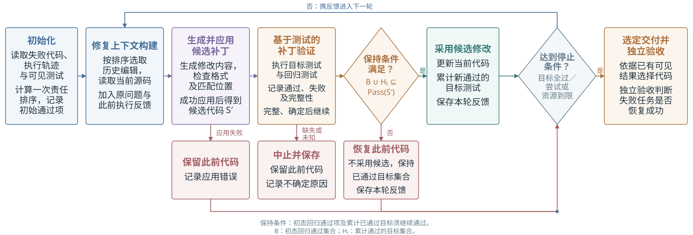

# 开题报告分析：按段解释

对照[完整稿](01_开题报告_完整稿.md)阅读。按原文自然段保留完整内容，每段后用一段话合并说明它的作用和实际含义。图、表和公式放在对应位置解释；详细术语可查[专业术语审查](09_专业术语审查与中文写法依据.md)。

阅读主线是：**分析失败轨迹，给历史步骤排检查次序；筛选有效编辑，结合当前代码与反馈继续修复；最后独立验收任务是否完成。** RQ1评价诊断，RQ2评价从失败状态继续完成任务，两者通过实际修复输入衔接。

## 摘要

**第1段**

> 大语言模型智能体通过连续的工具调用和环境交互完成任务。任务失败时，关键线索可能分散在需求理解、代码编辑和测试反馈等不同步骤中，错误引入位置与最终异常之间也可能相隔较远。继续修复还需要将历史操作与已经变化的代码状态对应起来。本课题面向已经失败的智能体任务，研究历史步骤的责任排序及诊断引导的失败任务恢复。

**作用与解释：** 摘要先把两项研究放在同一个失败处理过程中：智能体执行很多步以后才暴露错误，需要回查历史；继续修复时，代码又可能已经变化。因此课题同时研究“先检查哪一步”和“怎样从现在的失败代码继续完成任务”。

**第2段**

> 针对分散证据的组织问题，拟构建关系增强的上下文感知责任评分模型。模型结合步骤内容、执行角色和可观察的日志关系，为每个候选步骤汇集全轨迹信息，在单责任位置监督下学习评分函数，输出历史步骤的检查次序。针对诊断信息向当前修复的转化问题，拟依照责任排序选择历史编辑，每轮结合当前代码和可见测试反馈生成候选补丁，并以累计已通过测试项的保持条件决定候选接纳。

**作用与解释：** 这一段概括两套方法如何衔接。诊断模型结合步骤内容、角色、日志关系和全轨迹信息，给历史步骤排序；恢复器沿排序找实际源码编辑，再把历史线索、当前代码和反馈交给大模型。补丁能否成为下一轮代码，还要经过测试保持检查。

**第3段**

> 研究将分别评价责任定位质量、诊断开销和独立验收下的失败任务恢复成功率，以原始任务为数据划分和配对比较单位，通过完整系统比较、排序替换、模块消融及接纳策略对照，检验日志关系、步骤上下文、历史编辑和测试保持的作用。预期形成责任步骤排序方法、诊断引导的失败任务恢复方法，以及相应的实验结果和复现材料。

**作用与解释：** 这里说明准备怎样检验方案。先分别评价诊断质量、成本和任务恢复效果，再用换排序、去模块、换接纳规则等实验解释作用来源。研究产物包含方法、实验结论和复现材料，尚未提前宣布方案有效或超过基线。

**关键词：** 大语言模型智能体；失败诊断；责任步骤排序；轨迹表示；失败任务恢复；测试保持

关键词概括研究对象、诊断任务、表示方法及恢复约束，具体含义在正文中逐步展开。

## 1 背景与研究现状

### 1.1 研究背景

**第1段**

> 大语言模型（Large Language Model，LLM）能够理解自然语言指令、生成文本和代码，并结合上下文分析问题。在软件开发中，任务完成还要求将生成内容落实为代码仓库中的实际操作。例如，解决一个功能缺陷，需要查找相关实现、修改源码、运行测试，并根据执行结果继续调整。因此，软件任务求解既依赖模型的分析与生成能力，也依赖代码操作和结果检验。[1,2]

**作用与解释：** 背景从“模型会生成代码”推进到“软件任务怎样完成”。仓库里的问题需要定位实现、实际修改、运行测试和继续调整，所以只有文本生成能力还不够。[1,2]支持这种软件任务背景。

**第2段**

> 将大语言模型与工具、运行环境及过程管理机制结合，可以构成围绕任务目标持续行动的智能体。模型根据任务要求和已有观察选择操作，工具将操作作用于环境，返回的观察结果再参与后续决策。推理、动作和观察交替进行，使模型能够依据执行结果调整行为。[3] 这一过程形成按时间组织的执行轨迹，其中保存任务理解、工具调用、中间产物及环境反馈，为分析任务结果提供过程证据。

**作用与解释：** 这一段解释智能体及轨迹的来源：模型决定下一步，工具把动作施加到环境，结果再影响后续决策。循环留下按时间排列的记录，研究失败诊断时分析的就是这些过程材料。[3]提供交互机制的依据。

**第3段**

> 智能体的任务结果由连续操作共同决定。检索结果为后续分析提供材料，代码编辑改变待验证的程序，测试反馈影响下一步修改。多个角色协作时，需求、设计、实现和验证产物还会在角色之间传递。智能体评价因而同时涉及工具使用、环境交互、执行效率和最终任务结果。[4,5] 软件任务中的代码差异和可执行测试，使历史操作的影响及任务完成情况具有可检查的依据。

**作用与解释：** 这里说明为何值得研究整个过程。一次检索、编辑或测试都会影响后续步骤，多角色协作还涉及产物交接；最终成败不能只归到最后一次回答。软件代码差异和测试又让这些影响有了可检查的材料。

**第4段**

> 连续操作增加了失败来源的追溯难度。早期遗漏的需求、错误的源码修改或未被及时识别的问题，可能经过多轮执行后才表现为测试失败。最终异常反映发生异常时的状态，关键错误则可能出现在更早的步骤。责任判断需要联系任务要求、历史操作及其后果，从完整轨迹中确定应优先检查的位置。[6,7]

**作用与解释：** 这一段提出诊断困难：错误可能早已发生，直到后续测试才表现出来。最后的报错说明“现在坏在哪里”，未必说明“此前哪一步最值得检查”，因此要联系需求、历史动作及后果来追溯。

**第5段**

> 责任定位之后，还需要处理历史操作与当前修复对象之间的差异。历史记录保存过去的编辑及上下文，当前代码则可能已经历后续修改；继续修正也可能影响原本正常的功能。恢复过程因此需要重新核对当前源码，结合历史线索提出候选修改，并检查修改对任务要求和已有功能的影响。[8,9]

**作用与解释：** 诊断之后还存在一个转换问题：日志保存旧操作，补丁却作用于当前文件。过去的编辑可能被覆盖，新的修复也可能破坏原有功能，所以恢复器需要重读源码，并检查修改对新旧行为的影响。

**第6段**

> 本课题围绕上述连续过程研究两个衔接环节：通过失败诊断形成历史步骤的检查次序，再将排序中的可用信息转化为当前软件状态下的修复依据。前一环节关注如何组织分散的执行证据，后一环节关注如何使用诊断信息并保持已取得的测试进展。两者共同指向从失败执行继续完成原始任务这一目标。

**作用与解释：** 这一段把背景收束为课题主线：先组织分散证据，为历史步骤排检查顺序，再把有用线索用于当前修复。两部分通过信息传递衔接，最终服务于完成原任务。

### 1.2 从失败诊断到任务恢复

**第1段**

> 失败诊断需要把分散记录转化为对候选步骤的判断依据。需求理解、工具调用、源码编辑和测试反馈分别反映执行过程的不同侧面，单个步骤的作用需要结合前后记录解释。同一条后续反馈，对此前错误编辑可能构成责任线索，对正常读取步骤则可能主要补充任务背景。模型需要联系远距离证据，并区分这些证据对不同候选检查优先级的影响。[7]

**作用与解释：** 诊断的关键是判断证据对哪个步骤有用。同一条测试失败，对早先编辑可能是责任线索，对一次正常读取则可能只是背景。模型需要针对各候选联系远处记录，而不是为整条轨迹做一个不分候选的摘要。

**第2段**

> 本课题将分析失败轨迹并输出历史步骤责任排序的过程称为**失败诊断**。排序中的候选是同一轨迹内的历史步骤，责任标签沿用相应数据来源的标注规范。模型输出表示在这些观察与监督条件下的检查次序，为后续分析提供优先级。

**作用与解释：** 这里给“失败诊断”下操作定义：输入已经失败的轨迹，输出历史步骤的检查次序。责任标签由数据来源规定，分数表达该监督条件下的相对优先级，不直接等同于无条件的因果责任概率。

**第3段**

> 诊断信息用于修复时，需要进一步对应到当前可修改的代码。软件缺陷定位通常以当前源码中的文件、方法或语句为候选。[10] 本课题的诊断对象是历史执行步骤，其中既有源码编辑，也有推理、读取和验证。恢复流程因而需要筛选可用历史编辑、核对其涉及的当前实现，再将这些材料提供给修复模型。

**作用与解释：** 这一段解释为什么不能把历史步骤排序直接当成源码定位。步骤中既有编辑，也有推理、读取和验证；恢复器必须从排序中筛出真正发生的源码修改，再核对当前实现，才能形成补丁输入。[10]用于交代传统源码定位的对象。

**第4段**

> 本课题将从失败执行留下的代码和运行环境出发，利用诊断信息继续修正、以完成原始任务为目标的过程称为**失败任务恢复**。候选修改可能解决部分问题，也可能破坏此前已通过的测试；某些修正还需要共同调整关联实现。[9] 因此，恢复流程同时考察任务推进、已有进展保持及相应约束对后续修改的影响。

**作用与解释：** 这里定义恢复的起点和目标：从失败执行留下的代码与环境出发，继续完成原问题。中间修改可能有进展，也可能造成退化，因此既要观察任务推进，也要评价保持约束是否妨碍必要的关联修改。

**第5段**

> 失败诊断评价历史步骤的检查次序，失败任务恢复评价原始任务的完成情况。只有最终交付通过规定的独立验收，才判定为**恢复成功**。两项研究通过诊断信息的实际使用衔接：先检查排序是否改变修复输入，再分析输入变化和候选接纳如何影响最终结果。

**作用与解释：** 这一段规定两项研究怎样计效果。诊断看历史步骤排得准不准，恢复看最终交付是否通过独立验收；中间测试改善或候选被接纳都不能代替最终成功。两者的联系需要通过实际输入和后续结果确认。

### 1.3 国内外研究现状

#### 1.3.1 智能体失败步骤定位

**第1段**

> 步骤级失败诊断需要比较同一轨迹中的候选，并给出责任位置或检查次序。候选评分可借助排序学习框架建模，智能体失败模式分析与责任位置标注则为步骤级诊断提供任务定义和监督依据。

**作用与解释：** 研究现状先明确步骤定位的基本形式：在同一轨迹中比较候选。排序学习提供评分框架，失败模式与责任标注研究提供要预测什么、用什么监督的任务基础。

**第2段**

> - 排序学习基础（2007—2019年）。Cao等于2007年在**ListNet**中提出ListNet，以候选列表为训练单位并依据标签构造目标分布。[11] Liu于2009年在**排序学习综述**中系统总结候选评分函数的学习方法，区分点级、对级和列表级目标。[12] Bruch等于2019年在**Softmax排序分析**中分析二值相关性条件下softmax交叉熵与排序评价的联系，为单正例条件下学习候选次序提供方法依据。[13]

**作用与解释：** 这段交代排序学习的理论来源。ListNet以候选列表组织学习，Liu总结不同训练目标，Bruch等分析softmax交叉熵与排序指标的联系。它们支持本文的建模选择，不表示这些已有损失函数是本文创新。

**第3段**

> - Cemri等（2025年）在**MAST**中，从实际执行材料中归纳系统设计、智能体间失配和任务验证等失败模式，为描述与比较系统失败提供分类依据。模式分类解释失败的表现类型；定位具体责任位置还需要分析各步骤在失败形成过程中的作用。[6]

**作用与解释：** MAST主要回答失败有哪些类型，例如系统设计或智能体之间失配。它有助于描述失败现象，但某次执行究竟应先查哪一步，还需要更细的步骤分析。

**第4段**

> - Shaokun Zhang等（2025年）在**Who&When**中，将分析对象推进到责任角色和决定性错误步骤，标注关注修正后能够改变失败结果的位置，并在多个候选中关注较早的关键错误。其诊断方法包括整段日志一次判断、逐步分析和二分搜索，为步骤级归因提供位置监督及可比较的诊断过程。[7]

**作用与解释：** Who&When把问题具体到责任角色与关键错误位置，并提供一次判断、逐步分析和二分搜索等诊断过程。它给本文提供位置标签及可比较的方法；“责任”仍须按其原始标注规则理解。

**第5段**

> - Sun等（2026年）在**SDBL**中，将可疑范围划定和精确定位分为两个阶段，先确定重点分析区间，再结合范围提示与完整日志定位责任步骤。分阶段组织缩小了重点检查范围，范围识别与后续定位需要共同评价。[14]

**作用与解释：** SDBL先缩小重点区间，再做精确定位。这说明诊断可以分阶段组织，但第一阶段若划错范围，也会影响最终定位，因此两阶段应共同评价。

**第6段**

> - Zhu等（2026年）在**StepFinder**中，结合步骤语义、双向时序建模、全局注意力和角色门控，直接输出步骤分数，以责任位置交叉熵和时间一致性辅助目标训练。它将轨迹表示与位置判断结合，为比较学习式诊断的定位质量和计算代价提供直接参照。[15]

**作用与解释：** StepFinder通过轨迹内容、时间和角色信息直接给步骤评分，属于学习式定位方法。它与本文都输出步骤分数，因此适合比较定位、排序和诊断成本；比较时需保留它自己的结构与训练目标。

**第7段**

> 现有研究已经从失败现象分类推进到责任位置判断，并形成具有位置监督的诊断任务。连续执行中的证据分散在不同记录中，错误引入、异常表现和纠正机会也可能相隔较远。研究仍需解释这些记录怎样共同支持具体步骤的责任判断，并评价诊断在不同任务与轨迹长度下的准确性和开销。

**作用与解释：** 这段总结定位研究的发展，并引出本文仍要回答的问题：不同时间、不同记录中的线索如何共同支持某一步的判断，以及这种信息组织在准确性和成本上是否值得。

#### 1.3.2 责任归因的数据基础

**第1段**

> 责任步骤定位依赖执行记录和位置标签。记录形式决定模型能够观察哪些证据，标注规则决定“责任位置”具体指向什么。相关研究从协作过程记录和步骤级监督出发，逐步构建面向失败责任的训练与评价材料。

**作用与解释：** 数据不仅提供样本数量，也决定模型看得到什么、标签意味着什么。研究现状因此单列记录形式和责任监督的来源，为后文的数据划分与结果解释作准备。

**第2段**

> - Wu等与Hong等（2024年）分别提出**AutoGen**与**MetaGPT**。AutoGen以可编程会话组织模型、工具和人工输入；MetaGPT以标准操作流程组织需求、设计、代码及测试产物。两者分别形成会话协作和产物交接式记录，提供角色、动作和中间结果等过程信息。将这些记录用于责任分析，还需要统一步骤边界与记录对应关系。[16,17]

**作用与解释：** AutoGen和MetaGPT展示两种协作记录来源：前者偏会话组织，后者偏工作产物交接。这些记录能提供角色、动作和中间结果，但用于步骤诊断前还要统一步骤边界及对应关系。

**第3段**

> - Lightman等（2024年）在**Let's Verify Step by Step**中，利用数学推理步骤的正确性反馈训练过程评价模型。步骤正确性监督关注各推理环节是否成立，失败责任标注则关注一次失败执行中的关键位置；使用后者时，需要保留标注对错误引入、职责遗漏和错过纠正机会的具体规定。[18]

**作用与解释：** 步骤是否正确与一次失败中谁应优先负责，是两种监督。数学推理的过程评价可提供步骤级学习思路，但不能直接替代本课题所需的错误引入、职责遗漏或漏检责任标签。

**第4段**

> - Guibin Zhang等（2026年）在**AgenTracer**中，通过自然失败的修正重放和成功轨迹的故障注入构造责任监督，并训练诊断模型，将标签获取与可修正性联系起来。自然失败与注入错误具有不同的形成过程，评价时应保留相应来源及任务对应关系。[19]

**作用与解释：** AgenTracer通过修正重放与故障注入构造责任监督，让标签与后续能否修正联系起来。两类轨迹的形成方式不同，评价中应保留来源，避免把人工注入与自然失败混成同一种证据。

**第5段**

> - Mengzhuo Chen等（2026年）在**TraceElephant**中构建的基准保存步骤输入、配置、输出和工具日志，结合角色职责与可恢复性确定责任位置。验证者错过应有的纠正机会也可能被标注为责任位置，体现了责任定义与角色职责之间的联系。[20]

**作用与解释：** TraceElephant保存较完整的过程材料，并结合角色职责确定责任位置。这说明被标注的责任步骤也可能是“本该发现错误却没发现”的验证，而不一定是实际写错代码的步骤。

**第6段**

> 这些工作表明，执行记录的完整性、责任标签的含义和任务来源共同决定诊断研究的证据基础。不同标注可能关注错误引入、职责遗漏或错过纠正机会，评价时需要保持这些含义及原始任务的对应。研究还需在任务层面区分训练与评价材料，分析诊断能否适应不同记录形式与责任定义。

**作用与解释：** 这一段归纳数据层面的要求：记录、标签含义和任务来源都要保留，并按任务区分训练与评价。否则即使得到较高分数，也难判断它能否适用于另一种记录或责任定义。

#### 1.3.3 反馈驱动的软件任务求解

**第1段**

> 软件智能体把语言模型的分析能力与代码操作连接起来，使任务求解成为执行与反馈交替进行的过程。相关研究逐步扩展了交互接口、上下文获取、候选搜索和验证选择机制。

**作用与解释：** 软件求解现状从交互、上下文、搜索和验证几个方面展开。它们共同把一次模型生成发展为能够执行、获得反馈并继续尝试的过程，为后文恢复流程提供基础。

**第2段**

> - Yao等与Shinn等（2023年）分别提出**ReAct**与**Reflexion**。ReAct以推理、动作和观察的交替组织支持任务交互；Reflexion将先前尝试和评价转化为后续执行的语言记忆。两项工作分别提供连续决策和利用执行反馈组织后续尝试的基础形式。[3,21]

**作用与解释：** ReAct说明如何交替推理、行动和观察，Reflexion说明如何把过去尝试转成后续使用的语言记忆。两者分别为连续执行与利用失败经验提供基本形式。

**第3段**

> - Liu等、Jimenez等与Yang等（2024年）分别通过**AgentBench**、**SWE-bench**与**SWE-agent**研究任务环境、结果评价与操作接口。AgentBench评价多环境中的智能体交互，SWE-bench以真实仓库问题及可执行测试检验任务完成情况，SWE-agent研究适合智能体使用的软件操作接口。这些工作分别提供任务环境、结果评价和操作接口基础。[2,4,5]

**作用与解释：** AgentBench、SWE-bench和SWE-agent分别侧重环境评价、真实仓库问题验收及软件操作接口。它们解决的是“在哪里做任务、怎样判完成、怎样操作”的基础条件，不是同一个责任排序方法。

**第4段**

> - Gou等与Huang等（2024年）分别在**CRITIC**和**自纠错分析**中研究反馈与纠错。CRITIC通过工具交互检查已有输出并据此修订；关于推理自纠错的研究进一步指出，纠错收益受外部正确性信号、停止条件和初始提示影响。评价反馈驱动方法时，需要明确反馈来源及其提供的信息。[22,23]

**作用与解释：** 反馈驱动纠错依赖反馈质量。工具检查能提供外部依据，而纠错收益还受停止规则、提示和初始条件影响，所以后文实验必须交代模型究竟获得了哪些反馈。

**第5段**

> - Zhou等、Kechi Zhang等与Yuntong Zhang等（2024年）分别提出**LATS**、**CodeAgent**与**AutoCodeRover**。LATS结合环境交互、反思和树搜索组织后续尝试；CodeAgent通过工具接口提供构建与测试反馈；AutoCodeRover利用程序结构检索组织定位和修改。三者从候选搜索、工具反馈和结构化上下文获取改进求解过程。[24,25,26]

**作用与解释：** LATS、CodeAgent和AutoCodeRover分别从搜索、工具反馈及程序结构检索改进求解。这里说明候选怎样产生、上下文怎样获取已有多种路线，本文需要在这些基础上明确自己的研究问题。

**第6段**

> - Antoniades等与Bouzenia等（2025年）分别提出**SWE-Search**与**RepairAgent**。SWE-Search以搜索和迭代细化组织软件求解，RepairAgent通过工具交互和阶段控制推进程序修复。两项工作进一步将反馈使用与求解过程管理结合起来。[27,28]

**作用与解释：** SWE-Search和RepairAgent进一步管理多轮求解过程，使搜索、反馈和执行阶段相互衔接。它们为连续修复提供参照，不能仅看最终一份补丁而忽略生成与选择过程。

**第7段**

> - Xia等（2025年）在**Agentless**中提出Agentless，采用分层定位、补丁生成和验证选择流程，以已有回归测试和生成的复现测试筛选候选，构成固定阶段的软件问题求解方式。[29]

**作用与解释：** Agentless用固定阶段完成定位、生成和验证，并结合回归测试与复现测试筛选补丁。它是完整的软件求解流程，后文将按整套机制进行基线比较。

**第8段**

> - Tian等（2026年）在**EnAgent**中提出EnAgent，生成多条求解轨迹，利用回归测试剪枝，再通过工具辅助比较和投票选择补丁，以候选集成组织软件任务求解。[30]

**作用与解释：** EnAgent通过多条轨迹产生候选，再用测试、工具比较和投票选择交付。这里的多个候选属于同一次方法运行，不能当作多次独立实验。

**第9段**

> - Ruan等（2026年）在**AOrchestra**中，由主控配置任务相关的子智能体、上下文及工具，通过动态分工完成复杂任务，提供动态协作的完整求解方式。[31]

**作用与解释：** AOrchestra由主控按任务动态配置子智能体、上下文和工具，代表另一类完整求解方式。它与固定阶段方法的内部流程不同，实验统一外部条件，同时保留方法核心。

**第10段**

> 现有方法已形成定位、补丁生成和验证选择相衔接的求解流程。已有失败执行还会留下历史操作、变化后的代码和未完成目标。如何协调利用这些信息，使后续修改针对失败过程中的关键问题，并在连续修正中保持已取得的进展，是从一般软件求解进一步走向失败任务恢复需要研究的问题。

**作用与解释：** 这段把一般软件求解推进到本文的失败恢复场景：已有执行已经留下操作、代码和部分进展。研究重点是怎样协调使用这些材料继续修正，而不只是重新从问题说明开始生成。

#### 1.3.4 诊断信息支持的任务恢复

**第1段**

> 诊断结果进入恢复过程，需要同时处理历史信息、当前环境和后续执行。相关研究分别从环境同步、状态管理、诊断干预和上下文恢复建立二者之间的联系。

**作用与解释：** 诊断与恢复的联系不仅是传一个位置，还涉及旧信息、当前状态和后续行动。下面几项工作分别从这些环节说明恢复为何需要状态与信息的一致性。

**第2段**

> - Guo等（2025年）在**SyncMind**中，考察协作代码更新引起的失步，分析智能体重新获取当前代码和环境信息的恢复能力。其研究对象说明，历史认识需要结合当前环境重新核对，才能支持后续操作。[8]

**作用与解释：** SyncMind表明，协作中的代码更新会使原有认识过时。它支持本文每轮核对当前代码的动机：历史线索有用，但仍要确认它与现状是否对应。

**第3段**

> - Yinfang Chen等（2025年）在**STRATUS**中，在云系统故障处理中组织试执行、检查和撤销，以状态管理约束连续操作。其执行环境与撤销前提，为分析恢复机制的适用条件提供参照。[32]

**作用与解释：** STRATUS通过试执行、检查和撤销管理云系统操作。它提示恢复机制依赖具体环境和撤销条件，不能把某个系统里可安全回退的做法无条件搬到所有软件任务中。

**第4段**

> - Ma等（2026年）在**DoVer**中，依据失败日志形成责任假设，再生成干预并继续执行，通过干预结果检验诊断与修正之间的联系。诊断评价由此延伸到实际任务效果，干预的可实施性和执行能力也参与结果形成。[33]

**作用与解释：** DoVer把诊断假设转成实际干预，并观察继续执行的结果。它说明诊断价值还要通过后续任务效果检验，不能只以离线责任位置是否命中作结论。

**第5段**

> - Zhuang等（2026年预印本）在**AgentRewind**中，共同恢复执行上下文和文件检查点，并保留失败经验，使可继续执行的状态与已有知识对应。它进一步体现了使用历史信息时对运行状态一致性的要求。[34]

**作用与解释：** AgentRewind把文件检查点、执行上下文和失败经验一起恢复，强调状态与已有知识要对应。此处保留预印本身份，用它参考研究设计，不混同为正式出版基线。

**第6段**

> 这些研究将诊断与恢复的联系落实到历史信息、当前状态和后续执行。诊断能够指出值得检查的操作，任务恢复还需要形成可实施的修改，并通过后续执行完成原始要求。研究需要同时评价责任判断、诊断信息的实际使用及最终任务结果，说明诊断在何种条件下能够支持恢复，以及连续修正如何保持已有进展。

**作用与解释：** 这一段归纳诊断支持恢复的完整链条：指出可疑操作、形成可执行修改、继续运行并完成任务。本文因而同时评价诊断、实际信息使用和最终结果，还要观察过程中已有进展是否保住。

### 1.4 有待解决的研究问题

**第1段**

> **复杂执行过程中的失败诊断问题。** 智能体通过连续决策、工具调用和环境交互完成任务，一次失败可能涉及此前的需求理解、信息获取、代码修改和结果检查。关键错误与最终异常在时间上相隔，相关证据也分散在不同记录中，使末尾反馈难以完整说明失败的形成过程。已有研究提供了失败分类、责任标注和定位方法，仍需研究如何结合这些过程证据，区分不同步骤在失败中的作用，形成准确且代价可控的责任判断。解决这一问题能够为失败分析提供有依据的检查次序，并为后续恢复确定重点。

**作用与解释：** 第一个上层问题是怎样根据复杂执行过程作出可靠的责任判断。困难来自证据分散、错误与异常相隔较远；研究目标是给出有依据、成本可控的检查次序，而不是先假定必须使用哪种网络模块。

**第2段**

> **面向任务完成的失败任务恢复问题。** 一次执行失败后，历史操作、当前软件状态与尚未满足的任务要求共同决定继续求解的起点。诊断指出的历史位置需要与当前可实施的修改建立联系；新的修改既可能推进目标，也可能影响已经正常的功能。因此，恢复研究需要说明如何把诊断信息转化为有效的行动依据，并利用执行反馈协调多轮修正，使任务从失败状态继续推进。评价还应将中间诊断和修改过程与最终独立验收联系起来，判断后续执行是否真正完成原始任务。

**作用与解释：** 第二个上层问题是怎样把诊断变成有效行动并持续完成任务。它同时涉及旧线索与当前代码的对应、反馈如何用于下一轮，以及新修改对原有功能的影响；最后要以独立验收确认任务是否完成。

## 2 研究目标与意义

### 2.1 研究目标

**第1段**

> 本课题以已经失败的智能体任务为对象，围绕失败诊断与失败任务恢复两个衔接环节开展研究。总体目标是从可观察执行证据中识别关键责任步骤，再利用诊断信息支持当前软件状态下的连续修复，以完成原始任务。两项研究分别回答以下问题。

**作用与解释：** 研究目标承接前面的两个问题，形成先诊断、再恢复的整体安排。这里先交代要获得什么能力，具体模块放在第三章解释。

**第2段**

> **研究问题一：如何从连续执行记录中识别关键责任步骤，形成准确且代价可控的失败诊断？** 面向历史步骤学习责任评分函数，输出同一失败轨迹内的检查次序。研究将分析分散证据对候选判断的作用，并评价不同轨迹条件下的责任定位、排序质量与诊断开销。

**作用与解释：** RQ1学习一个跨任务共享的步骤评分函数，使新失败轨迹也能得到检查次序。它的直接评价是责任定位、排序质量和诊断开销，并分析这些指标随轨迹条件怎样变化。

**第3段**

> **研究问题二：如何利用失败诊断形成有效的修复依据，并支持连续修正以提高失败任务恢复成功率？** 面向已有失败代码和运行环境，建立诊断信息与当前修改对象的对应，利用执行反馈组织后续修正，评价诊断使用、修复进展和最终任务完成之间的联系。

**作用与解释：** RQ2研究诊断怎样成为当前修复的依据，以及反馈怎样组织多轮修改。它的直接目标是提高从失败状态完成原任务的效果，而不是仅多生成几份候选补丁。

**第4段**

> 责任步骤排序是两项研究的衔接接口。研究问题一评价历史步骤的检查次序，研究问题二评价从失败状态继续完成任务的效果。排序替换与过程记录用于分析诊断是否改变了实际修复依据，以及这种变化能否影响最终结果；具体的信息组织与候选接纳机制在研究方法中展开。

**作用与解释：** 责任排序是两部分之间的接口，但接口存在不等于收益已经成立。需要固定恢复流程、替换排序，并追查实际输入与最终结果，才能判断诊断差异是否真正起作用。

### 2.2 研究意义

**第1段**

> 软件缺陷定位与修复研究旨在减轻开发者分析缺陷、查找原因和验证修改的负担，维护软件质量。[9,10] 当智能体承担连续的软件操作时，失败原因还可能分散在需求解释、代码修改和执行反馈之中。研究这些执行证据与责任判断的联系，有助于深化对智能体失败过程的认识，为其运行可靠性分析和调试提供细粒度依据。

**作用与解释：** 这段说明学术价值：软件维护本来就需要理解缺陷、定位原因和验证修改；智能体又留下分散的多步执行证据。研究这些证据怎样支持责任判断，可帮助更细地理解失败形成过程。[9,10]提供领域背景。

**第2段**

> 在软件维护实践中，一次失败执行往往已经形成部分代码改动和测试结果。如何利用这些已有工作继续完成任务，同时防止后续修改破坏已实现的行为，是提高自动化修复可用性的重要问题。研究失败后的持续修正及其验证条件，可为减少重复排查、控制修复退化和支持人工接管提供依据，促进智能体辅助软件维护的可靠应用。

**作用与解释：** 这段说明实践价值：失败前可能已有有效修改和测试进展，继续处理时应利用它们并避免退化。这样的问题关系到自动修复能否减少重复排查、支持人工接管并用于持续的软件维护。

## 3 研究内容与方法

### 3.1 研究对象及任务定义

**第1段**

> 本文以一次已经结束且未满足任务完成条件的执行为诊断对象，既包含单智能体执行，也包含多智能体协作。执行轨迹由有序步骤组成，每步保存来源允许获得的文本、动作、工具或环境观察、执行角色和原始索引。每个历史步骤都是责任评分的一个候选。模型沿用实际记录的步骤边界，并保持输出与原始日志的对应。由于诊断发生在该次执行结束后，可利用轨迹中已经发生的前后步骤信息。

**作用与解释：** 诊断对象是一段已经结束的失败执行，轨迹中的推理、读取、编辑和测试都参加评分。模型沿用来源的步骤边界并输出原索引，才能回查标签和日志；因为执行已结束，可以用后续已经发生的反馈判断此前步骤。

**第2段**

> 责任步骤由数据来源的标注规范确定，训练和评价采用相应位置标签。不同来源可能关注错误引入、职责遗漏或错过纠正机会。[7,19,20] 本文保留这些标注含义并分别报告结果。单责任位置监督要求标注步骤相对其他候选具有较高检查优先级，其余步骤之间的次序由评分函数给出。诊断数据中的数学及其他交互任务用于考察表示方法的适用范围；恢复研究则限定于环境可重建、代码变化可检查、测试可执行的软件任务。

**作用与解释：** 责任位置按数据来源定义，可能标错编辑，也可能标漏检的验证。单标签只要求这个位置优先，不代表其他步骤都正确。诊断可研究多类交互任务，恢复则需要可重建代码、环境和测试的软件任务。

**第3段**

> 设一次失败执行的可见轨迹为 <i>τ</i> = (<i>x</i>1, …, <i>x</i><i>m</i>)，其中 <i>x</i><i>i</i> 为第 <i>i</i> 个有效步骤的记录，轨迹长度 <i>m</i> 随任务变化；单责任标注为 <i>y</i> ∈ {1, …, <i>m</i>}。诊断模型学习共享函数 <i>s</i><i>i</i> = <i>f</i><i>θ</i>(<i>x</i><i>i</i>, <i>τ</i>, ℛ)，其中 ℛ 为从可见日志构造的关系集合。模型按 <i>s</i><i>i</i> 降序输出步骤索引，分数表达当前监督和观察条件下的检查优先级。责任标签用于训练和评价，独立验收反馈和其他方法的修复结果与模型输入隔离。

**作用与解释：** 这段把任务写成符号：τ是一串步骤，m是长度，y是标注位置，ℛ是日志关系；共享函数给各步打分，再按分数排序。分数仍解释为检查优先级，独立验收及对手补丁不能作为生成输入。

**第4段**

> 恢复任务以原问题 <i>q</i>、失败初态 <i>S</i>0、轨迹 <i>τ</i> 和预先许可的可见测试为输入。失败初态包含执行结束后的实际代码及运行环境，与原始仓库提交分别保存。本文将允许向修复过程开放代码、标识及执行结果的测试称为修复反馈测试（亦称可见测试），将与生成过程隔离、用于判断最终交付的测试称为独立验收测试。恢复过程生成候选状态 <i>S</i>′，经过应用和测试检查后更新当前接纳状态 <i>S</i><i>t</i>，最后选定代码快照并提交独立验收。

**作用与解释：** 这里定义恢复的共同起点和两种测试。S₀是失败后的实际代码与环境，修复反馈测试可用于继续修改，独立验收只评最后交付。每轮提出候选S′，检查后决定是否更新当前代码Sₜ，再从真实快照中选交付。

**第5段**

> 候选接纳表示一次修改满足既定状态更新条件；代码修复、补丁生成、测试和状态回退描述恢复过程中的具体操作。恢复成功以最终交付通过规定独立验收为依据。恢复主实验要求历史源码编辑可回查、环境能够重建且反馈测试可执行；缺少可映射编辑的轨迹仍可用于诊断评价，其恢复适用性及排除原因分别记录。实验对象的纳入标准依据方法所需输入与环境条件预先确定，不使用方法胜负或独立验收结果筛选任务。

**作用与解释：** 这段把“候选可以采用”和“任务恢复成功”分开，并说明哪些任务适合恢复实验。环境、历史编辑和反馈测试等条件应在比较前检查，不能看本文是否获胜后再筛题；不适合恢复的轨迹仍可能用于诊断。

### 3.2 总体研究框架

**图示读法：** 先看顶层的总体目标，再看左右两项研究：左边从失败轨迹得到责任排序，右边利用排序、当前代码及反馈继续修复。两部分之间的接口是历史步骤次序；研究目标、方法和评价各有分工，诊断排得更准仍需经过实际输入与恢复结果验证其作用。

**表3-1 两项研究的对象、方法与评价依据**

| 研究部分 | 研究对象 | 方法设计 | 评价依据 |
| --- | --- | --- | --- |
| 责任步骤排序 | 失败执行轨迹 | 稀疏日志关系与步骤上下文评分 | 分组定位评价、表示消融、诊断开销 |
| 失败任务恢复 | 可重建的失败初态 | 排序引导上下文与测试保持修复 | 完整系统比较、排序替换、接纳策略对照 |

**表格读法：** 两行分别对应诊断和恢复，按“研究对象—方法—评价依据”横向读。诊断处理失败轨迹，评价检查次序与开销；恢复处理实际失败代码和环境，评价最终任务完成。模块控制与完整系统比较各自检验不同层次，不能用定位指标代替恢复率。

**第1段**

> 联合分析以任务标识和步骤索引建立对应，将定位结果与同一任务的实际输入、候选状态、测试变化及资源消耗联系起来，并在任务层面配对比较独立验收结果。

**作用与解释：** 总体框架需要用任务ID和步骤索引把排序、实际请求、候选代码、测试变化与最终验收串起来。这样才能解释同一任务的诊断信息有没有被使用，而不只是分别报告两个不相干的分数。

### 3.3 关系增强的上下文感知责任排序

**图示读法：** 按步骤输入、关系传播、全轨迹聚合、评分输出阅读。编码得到每步初始向量，局部关系引入邻步信息，自注意力为每个候选汇集远处证据，评分器综合这些表示输出检查次序。旁路保留原内容；消息权重和注意力权重负责组织信息，不直接等同于最终责任排名。

#### 3.3.1 步骤特征编码

**第1段**

> 本模块把每个历史步骤转换为可供后续网络计算的向量，**输入是步骤文本、执行角色与日志结构，输出是步骤初始表示**。文本保留该步的操作和观察；结构特征描述字段类型、嵌套形式、相对位置与重复情况。匿名角色指将角色名称转换为同一轨迹内的身份编号，编号按角色首次出现的次序分配。同一执行角色在该轨迹中使用相同编号，不同轨迹中的相同编号不代表相同职责；该编号参与角色特征和同角色关系构造。当前编码实现将角色字符串转换为32维稠密向量，角色编号与训练责任位置的one-hot标签分别承担输入表示和监督的作用。

**作用与解释：** 编码先把每步的文字、身份和记录形式变成数值向量。匿名角色是本轨迹内保持身份对应的编号，跨轨迹同编号不表示同职责；当前实现把角色字符串转为32维稠密向量。它描述“谁做的”，one-hot责任标签则监督“哪一步应优先检查”。

**第2段**

> 日志明确提供相邻、同角色的记录配对时，模型在编码中保留这组对应。模型读取两条记录的内容、内容差值和配对有效标志，计算特征变换与标量门控，再将门控后的信息以残差方式加回当前特征，投影为步骤初始表示。没有有效配对时使用原记录。这样，来源中已有的事件配对信息能够在关系传播之前参与步骤表示。

**作用与解释：** 如果来源已经明确两条相邻同角色记录相互配对，模型先利用它们的内容和差值，用门控调节后加回当前特征；没有配对就保留原记录。这个融合发生在后续关系传播之前，不是任意把相邻步骤都配成一对。

**第3段**

> 模型从可获得的日志字段构造四类关系：**时间相邻、同一匿名角色、相同完整记录结构、相同非空动作结构**。结构比较去除具体键名和值，保留字段类型及嵌套形式。时间关系连接相邻步骤，其余关系连接前后最近的同类步骤，每个通道的邻居数至多为2。固定邻居上限使各通道连接数随轨迹长度线性增长，为局部信息汇集限定范围。

**作用与解释：** 四类关系规定每步可以向哪些记录读取信息。除相邻关系外，每类只连前后最近的同类步骤，每通道最多两个邻居；因此不会把所有同角色步骤两两连接，边数随步骤数线性增长。结构相同主要比较记录形式，不比较具体内容值。

**第4段**

> 关系类型决定邻步信息的变换与聚合方式。[35] 角色相同表示行为来源一致，结构相同表示记录形式相近；这些关系本身不等于语义依赖或因果关系。内容依赖还需要结合工具请求、返回及后续使用等证据判断。[36,37] 四类关系是否有助于识别责任步骤，由定位评价与关系控制实验检验。

**作用与解释：** 连边首先是一条可获得的信息读取规则，不是已经确认的因果关系。同角色或同结构的记录未必互相提供关键证据；需要结合实际内容及关系控制实验，检查这些联系是否帮助定位。

#### 3.3.2 门控多关系消息传递

**第1段**

> 本模块以步骤初始表示和四类日志关系为输入，**沿关系汇集邻步信息，输出加入局部执行联系的步骤表示**。消息传递先读取邻居向量，再根据关系类型变换并聚合，最后更新当前步骤。[35] 门控用于调节每条消息的贡献，其取值同时依赖接收步骤和两步表示的差异。对于接收步骤 <i>i</i>、关系类型 <i>r</i> 及邻居 <i>j</i>，模型以邻居表示和两步差异构造消息，以接收表示和该差异计算门控。令 <i>h</i><i>i</i> 为当前层表示，可写为：

**作用与解释：** 关系传播让每步汇集邻居信息。i是接收步骤，j是邻居，r是关系类型；邻居内容及两步差异形成消息，接收步骤与差异决定门控大小。输出是带有局部执行联系的新步骤向量，具体计算见式（1）。

**式（1）**

$$

\begin{aligned}
g_{ij}^{(r)} &= \sigma\!\left(G_r[h_i;\,h_j-h_i]\right),\\
u_i^{(r)} &= \frac{1}{|\mathcal N_r(i)|}
\sum_{j\in\mathcal N_r(i)}
g_{ij}^{(r)}\,\phi_r([h_j;\,h_j-h_i]).
\end{aligned}
\tag{1}
$$

**公式读法：**

i是当前更新的步骤，j是邻居，r是关系类型。方括号中的分号表示拼接，hⱼ−hᵢ是两步表示之差。Gᵣ经sigmoid得到0到1的门控g，φᵣ生成消息；把各消息乘门控后取平均，就得到这个关系通道的汇集结果u。

例如g=0.8表示保留80%的消息幅度，不是80%的真实责任概率；不同边的g之和不必为1。无邻居时取零，四通道融合、残差与两层更新由相邻正文补充。

**第2段**

> 式（1）中，𝒩<i>r</i>(<i>i</i>) 为步骤 <i>i</i> 在关系 <i>r</i> 下的邻居集合，<i>G</i><i>r</i> 为输出标量的可学习映射，σ 为sigmoid函数。<i>g</i><i>ij</i>(<i>r</i>) 是0至1的标量，<i>φ</i><i>r</i> 是关系对应的可学习消息变换。该门控独立作用于每条边，不在邻居之间进行softmax归一化。没有邻居的通道取零向量。模型再根据接收步骤计算四个关系通道的归一化权重，汇集 <i>u</i><i>i</i>(<i>r</i>)，与原表示作残差相加并归一化。模型采用两层关系更新。

**作用与解释：** g是每条边独立计算的0到1比例，用于缩放消息，不要求各边门控之和等于1。模型先分别聚合四种关系，再学习通道权重融合，加回原表示并归一化；无邻居用零向量，共做两层更新。

**第3段**

> 门控使邻步消息的贡献可以随接收步骤及两步差异变化，原始内容则经残差与评分旁路进入后续计算。同一对步骤可能出现在多个关系通道中，通道融合因而同时受到消息内容和连接重合的影响。实验将记录通道边数、重合比例及有效邻居覆盖，分析重复联系何时补充证据、何时主要增加冗余。

**作用与解释：** 这段解释关系传播可能有收益也可能重复读取：同一对步骤可以同时被多个通道连接。原内容仍通过残差和评分旁路保留；实验记录连接数、重合率和覆盖，再分析额外消息究竟补充证据还是增加冗余。

#### 3.3.3 全局自注意力聚合

**第1段**

> 局部关系传播只能直接汇集限定邻域的信息，而责任判断还可能依赖远处出现的需求或测试反馈。本模块以全轨迹的关系增强表示为输入，**为每个待评分步骤生成与其相关的上下文向量**。模型将这些表示映射为查询、键和值，采用单头缩放点积自注意力计算聚合权重。查询、键和值均来自同一条完整轨迹，通过点积衡量相关程度，再按表示维度缩放并归一化。[38] 查询表示待评分步骤，键用于匹配各记录与该候选的相关程度，值承载待汇集的信息。每个候选生成各自的查询，在全轨迹均值基础上获得候选相关的上下文修正：

**作用与解释：** 全局聚合补充局部传播够不到的远处记录。每个待评分步骤产生自己的查询，键用于匹配相关记录，值承载读取内容；所有材料来自同一轨迹。各候选因此可以从相同轨迹中获得不同上下文，式（2）给出实现。

**式（2）**

$$

\begin{aligned}
a_{ij} &= \operatorname{softmax}_{j}
\left(\frac{(W_Qh_i)^\top W_Kh_j}{\sqrt d}\right),\\
c_i &= \bar h+
W_O\left(\sum_j a_{ij}W_Vh_j-W_V\bar h\right).
\end{aligned}
\tag{2}
$$

**公式读法：**

查询Q对应正在判断的步骤，键K用于匹配记录，值V提供实际读取内容。查询与键点积、除以√d后作softmax，得到各记录对当前候选的读取权重aᵢⱼ；固定i时这些权重之和为1。

第二行在轨迹均值h̄上加入候选相关修正，形成每步自己的cᵢ。它不是所有步骤共用的同一个摘要，也不是直接给责任概率；后面还要经过评分器。

**第2段**

> 其中 <i>h̄</i> = <i>m</i>−1∑<i>j</i><i>h</i><i>j</i>，<i>d</i> 为表示维度。<i>a</i><i>ij</i> 是第 <i>i</i> 个候选从步骤 <i>j</i> 汇集信息的权重，<i>c</i><i>i</i> 是加入候选相关修正后的上下文向量。<i>W</i>Q、<i>W</i>K、<i>W</i>V 和 <i>W</i>O 分别为查询、键、值和输出的可学习线性映射。全轨迹均值提供共享信息，每个候选再依据自身查询调整汇集内容。聚合权重用于组织信息，责任检查优先级由后续评分器产生。模型可使用同轨迹的自身及前后已发生步骤，跨轨迹位置被屏蔽。

**作用与解释：** 全轨迹均值提供共同背景，注意力再为每个候选作相关修正，得到cᵢ。aᵢⱼ表示判断i时从j读取多少，不直接表示j有多大责任；最终次序由后续评分器给出，批处理中也不能跨任务读取记录。

**第3段**

> 步骤上下文使同一条证据能够针对不同候选发挥不同作用。例如，后续测试失败可为此前某次编辑提供判断依据，对正常读取步骤则主要补充任务背景。已有研究发现，语言模型对长上下文信息的利用受到信息位置的影响。[39] 本文将轨迹长度和信息分布作为分析维度，通过步骤上下文、共享查询上下文对照、轨迹均值上下文及局部上下文的比较，检验当前模型如何利用候选相关证据。

**作用与解释：** 这里解释候选相关上下文的动机：同一条测试失败，对早先编辑与正常读取可能意义不同。实验用共享查询、直接均值和局部上下文作对照，检查收益是否来自按候选组织证据，并分析轨迹长度和信息位置的影响。

**第4段**

> 单条轨迹的密集注意力需要 <i>O</i>(<i>m</i>2<i>d</i>) 量级的计算，注意力权重存储为 <i>O</i>(<i>m</i>2)；稀疏关系层在关系数和邻居上限固定时，其边聚合随步骤数线性增长。这一区别决定了两类模块的开销随轨迹长度变化的方式。端到端诊断还包含文本编码和表示变换，实验将同时记录实际耗时、批处理设置和输入截断，分别分析算子复杂度与部署成本。

**作用与解释：** 全局注意力要比较约m×m对步骤，局部传播每步只读固定邻居，两者随轨迹变长的开销不同。不过复杂度不是实际秒数，诊断还包含文本编码等操作，所以要连同批处理、截断和真实耗时一起报告。

#### 3.3.4 轨迹内责任评分

**第1段**

> 评分器采用多层感知机（Multilayer Perceptron，MLP），综合前三个模块的输出，读取关系增强表示 <i>h</i><i>i</i>、初始表示 <i>h</i><i>i</i>(0)、步骤上下文 <i>c</i><i>i</i>，以及关系增强表示与步骤上下文之差，生成各候选的轨迹内步骤分数。单责任位置监督采用softmax交叉熵，学习标注步骤相对其余候选的检查优先性。[13] 评分函数、归一化分布及轨迹损失为：

**作用与解释：** MLP把初始表示、关系增强表示、候选上下文及两者差异拼接，输出每步分数。softmax把同轨迹分数归一化，交叉熵根据标注位置训练这些共享参数；式（3）分别写出评分、权重和损失。

**式（3）**

$$

\begin{aligned}
s_i &= \operatorname{MLP}
\left([h_i;\,h_i^{(0)};\,c_i;\,h_i-c_i]\right),\\
p_i &= \frac{\exp(s_i)}{\sum_{j=1}^{m}\exp(s_j)},\\
\ell_\tau &= -\log p_y.
\end{aligned}
\tag{3}
$$

**公式读法：**

第一行将四种表示拼接后由MLP输出分数s，第二行将同轨迹分数归一化为p，第三行按标注位置y计算−log pᵧ。标注位置权重越大，损失越小，训练据此调整共享参数。

用讲解数字理解：四步权重为(0.1,0.6,0.2,0.1)，标注y=2，标签就是(0,1,0,0)，损失为−log(0.6)。它只提供一个优先位置，0不说明其余步骤一定正确。这些数值不是实验结果。

**第2段**

> 式（3）将单责任标注转化为组内竞争：在其他分数不变时，提高标注步骤的分数会降低损失。其对每个分数的梯度为 <i>p</i><i>i</i> − <b>1</b>[<i>i</i> = <i>y</i>]，使标注步骤与同组其他候选在训练中受到不同方向的约束。本文以轨迹为候选组，以单责任位置为监督，学习可用于新轨迹的共享评分函数。

**作用与解释：** 损失−log pᵧ推动标注步骤在同组里获得更大权重，其他候选也通过共同分母参与竞争。模型学的是能用于新轨迹的评分函数，不是为训练中每个位置保存一个固定责任分数。

**第3段**

> 训练采用单责任位置的**one-hot标签向量（独热标签）**：标注位置取1，其余位置取0。例如，一条轨迹有4步、标注责任位置为第2步时，标签向量为(0,1,0,0)，式（3）的损失为−log p₂。这里的0表示该位置不是本条记录的标注责任位置，不表示该步骤一定正确。该交叉熵也可从候选评分角度解释为单正例的列表级softmax排序目标。[12,13] 标注只规定责任位置的优先性，其余步骤的完整次序由模型估计；它与ListNet依据候选标签得分构造归一化目标分布的做法不同。[11]

**作用与解释：** one-hot用一个1指出标注位置，其余是0；四步标第2步就是(0,1,0,0)，损失只取−log p₂。0不等于步骤一定正确。从排序角度，这是每条轨迹一个正位置的列表级目标；与ListNet按标签得分构造目标分布的方式有区别。

**第4段**

> 单模型按分数降序输出原始步骤索引，同分时按原始索引处理。三模型集成先分别作轨迹内softmax，再平均预测权重并排序。归一化值表示同一轨迹内候选的相对检查优先级，解释时保留训练标签及候选集合这一条件。

**作用与解释：** 单模型按分数排序，三模型集成则先各自归一化，再平均同一步的权重；同分按原索引处理。得到的权重用于当前候选组内比较，不能直接当作跨任务可比的客观责任概率。

**第5段**

> 训练以原始任务组织数据。AgenTracer来源配置对轨迹损失取平均；AFTraj中同一任务可能产生多条派生记录，先在任务组内平均，再对任务组等权平均，以控制派生数量对训练权重的影响。标准化统计量仅由训练部分估计，验证部分用于模型选择，评价部分不参与选轮。

**作用与解释：** 同一任务可能派生很多轨迹，因此AFTraj先在任务内平均，再让各任务等权，避免记录多的任务权重过大。训练数据用于估计标准化统计，验证用于选轮，评价数据不参与选择。

### 3.4 诊断引导的失败任务恢复

**图示读法：** 主干从左到右经过初始化、上下文构建、补丁生成、测试、保持判断及停止与交付。应用失败和拒绝候选保留旧代码与反馈，在下方合流进入停止判断；测试结果缺失或不确定则中止保存。还能继续时从上方回到上下文，停止后选定代码并独立验收。

#### 3.4.1 排序引导的修复上下文构建

**第1段**

> 本模块把历史步骤的检查次序转换为大模型可使用的修复材料。**输入为原问题、失败轨迹的责任排序及当前代码，输出为带来源的历史编辑和对应代码上下文**。初始失败轨迹只诊断一次，之后固定排序。恢复器沿排序检查步骤，提取已成功执行、实际改变许可范围内项目源码的编辑，并按编辑调用标识去重，保存原始步骤索引。同一文件中的不同有效编辑分别保留；推理、读取和未成功执行的调用不作为历史源码编辑输入。

**作用与解释：** 这个模块把RQ1的步骤次序转换为RQ2真正使用的材料。初始轨迹只诊断一次，随后沿固定排序提取已经成功修改源码的历史编辑，按调用标识去重并保留出处；同文件不同编辑仍可保留，推理和读取不当作源码变更。

**第2段**

> 历史编辑给出可能需要重新检查的修改位置及过去的变更，**并不直接给出正确修复位置**。每轮生成前，系统重新读取相关当前文件，结合变更涉及的函数和已有失败反馈补充代码。历史差异与当前内容分别提供给大模型，使其能够判断过去的操作是否仍与当前错误有关，再针对当前代码提出修正。文件路径及语法符号用于限定读取范围。

**作用与解释：** 历史编辑只指出值得重查的旧位置，当前文件可能已变化。系统每轮依据路径、函数和失败反馈重读相关代码，把“过去改过什么”和“现在是什么”分别交给大模型，避免把旧差异直接当成当前补丁位置。

**第3段**

> 选入编辑按固定规则逐轮扩展，已选记录继续保留，记录条数和输入容量共同限制材料规模。系统保存编辑条数、文本字节数和实际输入token数，并记录截断位置及代码覆盖范围；上限在开发阶段确定，正式评价前固定。有限容量使责任排序能够影响当轮优先提供的历史线索。

**作用与解释：** 输入容量有限，靠前的历史线索可能先被模型看到，这就是排序能影响修复的一个实际环节。记录条数、字节、token及截断范围，并在正式比较前固定容量，才能解释各方法究竟获得了什么材料。

**第4段**

> 排序效果还需通过实际输入核验。不同步骤全序经过编辑筛选、去重和截断后可能得到相同材料；责任标签也可能指向没有源码修改的推理或验证步骤。因此，实验分别记录完整步骤排序、有效编辑次序和实际生成请求，并在固定恢复流程下替换排序来源，检验诊断是否真正改变修复依据及最终结果。

**作用与解释：** 步骤排序不同，经过筛选和截断后仍可能得到相同请求。因此不能只看离线排名提高，还要保存有效编辑次序与实际输入；固定恢复流程、替换排序后，再观察生成与最终验收是否变化。

#### 3.4.2 反馈驱动的候选补丁生成

**第1段**

> 本模块将**原问题、选定历史编辑、相关当前代码和此前执行反馈**共同提供给大模型，请其提出能够继续完成原任务的候选补丁。模型输出文件路径、待替换内容与修改内容，执行端检查修改权限、补丁格式和唯一匹配，应用成功后保存候选代码快照。格式错误、无法应用和应用后测试失败分别反馈给下一轮，帮助模型依据实际结果继续修正。[22,28]

**作用与解释：** 大模型收到问题、历史编辑、当前代码和上轮反馈后，提出具体代码替换。执行端先检查权限、格式和唯一匹配，再应用并存快照；格式不对、应用失败、测试失败分别反馈，帮助下一轮针对实际问题继续修正。

**第2段**

> 修复过程使用的测试统称为**修复反馈测试**，即代码、测试标识和执行结果允许向求解方法开放的测试。其中，目标测试检查原问题要求修复或实现的行为，回归测试检查修改后应保留的已有行为。这两组共享测试在评价前固定，每个候选都在独立测试目录中按其快照重建代码后执行。修复初态下已经通过、且与原问题要求一致的回归测试，构成后续需要保持的已有功能检查。[9]

**作用与解释：** 修复反馈测试是生成过程中允许使用的测试，包含本次需求对应的目标测试和应保留旧行为的回归测试。两组共享测试预先固定，每份候选按自己的快照测试；初态已通过且符合需求的回归项构成已有功能保护范围。

**第3段**

> 各方法按共同许可自行生成的复现测试或辅助测试，属于其内部求解过程，与固定共享测试分别保存，所需token和大模型API请求均计入资源消耗。**独立验收测试不向生成过程提供反馈**，只用于评价最后选定的交付；其他方法生成的补丁也不进入当前方法的输入。若旧测试的预期行为与新需求冲突，运行前依据问题说明统一判断并记录，各方法使用相同处理结果。

**作用与解释：** 方法可以按共同权限生成辅助测试，但要与固定共享测试分开记录，相关token和API请求也计入成本。独立验收不向修复反馈，对手补丁不共享；旧测试若与新需求冲突，应在各方法运行前统一处理。

#### 3.4.3 基于测试的补丁验证

**第1段**

> 本模块以候选代码和修复反馈测试结果为输入，**判断是否用该候选更新当前代码**。补丁验证是自动程序修复中的通用阶段；本课题在此基础上，将初态已通过的回归测试和修复中新通过的目标测试持续纳入保持条件。[9,29] 因而，大模型负责提出修改，测试规则负责检查已有进展是否得到保留，最终任务完成仍由独立验收判定。

**作用与解释：** 大模型负责提出修改，验证模块负责决定能否把候选作为下一轮代码。本课题不仅检查初始回归，还把修复中新通过的目标纳入后续保持条件；最后是否真正完成任务仍由独立验收判断。

**第2段**

> 令 <i>B</i> 为失败初态下确认通过、纳入保护的回归测试标识集合，<i>T</i>goal 为固定的目标测试集合，<i>H</i><i>t</i> 为初态及截至第 <i>t</i> 轮已接纳状态中累计确认通过的目标集合。对候选状态 <i>S</i>′，接纳条件为：

**作用与解释：** B是初态已通过的受保护回归项，Tgoal是固定目标测试全集，Hₜ是当前接纳路径累计通过的目标身份。式（4）的意思是：B和Hₜ中每一个测试，在新候选上都必须继续通过。

**式（4）**

$$

B\cup H_t\subseteq\operatorname{Pass}(S').
\tag{4}
$$

**公式读法：**

“∪”是并集，“⊆”要求左侧每个测试身份都出现在右侧。B是初态受保护回归项，Hₜ是当前路径累计通过的目标，Pass(S′)是候选确定通过的测试。因此它要求旧回归和已经修好的目标一项都不能丢。

在Moto案例中，列表属于B，删除与更新属于已有H。只通过列表和创建却丢失删除/更新的候选应拒绝；四项都通过则接纳，并把创建加入H。保持的是已观察测试身份，不是对所有程序输入的正确性证明。

**第3段**

> 其中 Pass(<i>S</i>′) 表示本次完整观察中确认通过的测试标识。候选被接纳后，更新当前代码，并令
> <i>H</i><i>t</i>+1 = <i>H</i><i>t</i> ∪ (Pass(<i>S</i>′) ∩ <i>T</i>goal)。
> 候选被拒绝时恢复此前接纳代码，<i>H</i><i>t</i> 不变，被拒候选新通过的目标不纳入保护集合。只要满足保持条件，即使未增加通过项，也允许接纳并继续，以保留在相同测试表现下改变实现路径的空间。

**作用与解释：** 接纳时换成候选代码，并把它新通过的目标加入H；拒绝时回到旧代码，H也不变，被拒候选的偶然进展不算。只要旧保护项没有丢，即便这轮没有新增通过项，也可接纳，以便继续调整实现。

**第4段**

> 该规则以测试标识集合表示已观察到的任务进展。在测试标识、测试代码和环境稳定，且结果完整确定的前提下，接纳状态保留 <i>B</i> 与已有 <i>H</i><i>t</i>，并有 <i>H</i><i>t</i> = Pass(<i>S</i><i>t</i>) ∩ <i>T</i>goal。初态满足该关系；每次接纳保留旧通过项并加入当前通过项，拒绝时状态与集合均不变。由此，累计保护等价于保留当前接纳状态的全部已通过目标，后续候选的约束随修复路径更新。该性质以实际执行的测试为范围。缺失、超时或不确定的测试结果触发停止，保存此前接纳状态及原因。

**作用与解释：** 在测试与环境稳定、结果完整的前提下，H正好对应当前接纳状态全部已通过的目标：接纳保留旧项并增加新项，拒绝则都不变。这个保证只覆盖实际执行过的测试；结果缺失或不确定时，应停止并保存已知状态。

**第5段**

> 本文将已观察的目标测试纳入保持集合，通过接纳策略对照评价其作用：一方面检查是否避免已有目标退化，另一方面考察候选受限后能否继续完成任务。这两类结果共同决定测试保持的实际价值。

**作用与解释：** 保持规则的价值要从两面评价：是否减少已修目标退化，以及是否因约束过严而妨碍完成任务。只展示“保住了旧测试”还不够，需要联系最终恢复率判断。

#### 3.4.4 停止、交付与约束代价

**第1段**

> 每轮候选处理后，系统检查目标测试是否全部通过、内部尝试次数是否耗尽，以及共同资源上限是否到达。满足停止条件时，**从已有接纳状态中选定交付代码快照**。选择只使用当时已得到的修复反馈：先保留满足当前保护集合的状态，再依次比较未通过目标测试数、修改行数及尝试先后。初态也作为候选状态保留。各预算节点采用同一规则，较晚得到的修改不回填较早节点。

**作用与解释：** 目标测试全过、尝试次数耗尽或资源到限都会停止。交付从真实接纳状态中选，先满足当前保护集合，再比较目标失败数、改动行数及先后；每个预算节点只能用当时信息，不能拿晚些修好的代码回填早期成绩。

**第2段**

> 已通过测试保持约束的是实际执行过的行为，不能据此保证所有程序行为正确。它可能避免修复一个问题时重新引入已观察的错误，也可能限制需要跨接口同时修改、暂时破坏中间测试的修复路径。实验比较累计目标保持、数量保持和仅回归保持，结合候选变化分析被避免的退化、被限制的修改及最终恢复成功率。

**作用与解释：** 测试保持存在实际取舍：它能避免旧错误重现，也可能拒绝需要暂时破坏中间测试的关联修改。因此实验比较保护目标身份、只保护数量和只保初始回归三种条件，结合实际路径与最终结果解释收益和代价。

**第3段**

> 研究沿责任排序、有效历史编辑、实际大模型输入、候选补丁与测试结果建立对应记录。通过固定恢复流程下的排序替换，分析诊断差异在哪些环节进入求解过程，以及这些变化是否转化为独立验收下的任务完成。

**作用与解释：** 这段安排从排序到任务结果的追查链：记录选了什么编辑、实际请求是什么、生成什么候选、测试怎样变化。只替换排序而保持其余流程，才能检查诊断差异在哪一环进入求解并影响验收。

### 3.5 方法过程示例

**第1段**

> 本例选取固定20题清单中的Moto7081，采用已有公开开发记录说明修复过程，输入和结果来源见[配套任务与案例记录](07_固定20题与真实案例.md)。Moto用于模拟云服务接口，原问题要求创建和查询设备时返回thingId设备标识。已有执行已在设备字典及部分接口中补入该字段，但创建测试继续调用describe_thing查询设备时，仍出现“FakeThing对象无法进行JSON序列化”的异常。此时删除、更新两个目标测试和普通列表回归测试已经通过，恢复需要保留这些进展。

**作用与解释：** 真实案例从一个已有部分进展的Moto失败状态开始。需求是设备接口返回thingId；当前查询仍因FakeThing不能直接转JSON而失败，但删除、更新和列表已通过。因此继续修复既要处理当前异常，也要保住这些行为。

**第2段**

> 本次运行用已发布的SOURCE3步骤排序提供历史编辑线索，结合当前源码和公开失败反馈生成补丁。当前后端返回FakeThing对象，响应层却直接执行json.dumps(thing)。真实候选只修改moto/iot/responses.py，改为json.dumps(thing.to_dict(include_default_client_id=True))：先用已有方法取得字典，再转换为JSON响应，保留内部调用仍使用对象属性的接口。

**作用与解释：** 真实补丁处理的是内部对象到外部响应的转换：在响应层先调用to_dict得到字典，再交给json.dumps。这样外部得到JSON，内部其他接口仍拿到原来的对象；历史线索、当前源码和失败反馈共同支持这次修改。

**第3段**

> 同一初态下的另一条开发运行曾将后端改为返回字典。该候选使创建测试通过，但删除和更新仍按对象属性读取返回值，因而由通过转为失败；普通列表回归测试仍通过。这说明只检查初始回归项，可能遗漏已经取得的目标进展退化。对这一已观察候选按本文保持条件核验时，删除与更新不再属于通过集合，应拒绝该候选；这一判断只说明接纳规则的差异，不预设另一条生成路径之后会产生什么补丁。

**作用与解释：** 另一开发运行把后端直接改成字典，虽修好了创建，却破坏仍按对象属性读取的删除和更新。普通列表回归测试没发现这些目标退化，说明需要保护已有目标进展。按保持规则会拒绝这份候选，但不能据此预言另一策略之后会生成什么。

**第4段**

> 本例响应层转换的候选则同时通过创建、删除、更新三个目标测试，并继续通过普通列表回归测试。接纳后，原已通过的删除与更新目标得到保留，新通过的创建目标加入保护集合，选定交付的已发布独立验收汇总记录为通过。该记录属于实验262的开发部署；其排序来源、具体输入和过程结果可回查，用于解释方法如何运行，最终RQ1模型的独立收益及完整方法效果仍由第五章的共同评价检验。

**作用与解释：** 本例响应层补丁同时保住删除、更新和列表，并新通过创建；创建随后加入保护集合，选定交付有已发布独验通过记录。这是说明运行过程的开发案例，不能用单题替代最终RQ1贡献或完整系统的共同评价。

## 4 难点和创新

### 4.1 关键技术难点

**第1段**

> **RQ1：有限监督下的责任表示与信息开销。** 单个步骤的作用取决于此前获得的信息、当时实施的操作及后续结果，内容相似的步骤也可能承担不同责任。单责任标签每条轨迹仅提供一个位置，不能直接规定应从哪些记录中取得判断依据。模型需要学习候选与远距离证据之间的关联，并区分错误引入、异常表现和错过纠正机会。技术困难在于从有限位置监督中形成有区分力的步骤上下文，同时控制无关记录及位置、角色等统计关联对判断的干扰。 时间、角色和结构联系可以低成本构造，但不同通道可能读取相同步骤。在单角色轨迹中，同角色连接与时间连接完全重合；记录形式相近也不直接说明内容存在依赖。重复消息可能放大同一证据，无关消息则可能干扰原步骤表示。全轨迹注意力扩大了信息范围，也引入候选之间的密集相关性计算。因此，需要同时分析关系覆盖、通道重合和轨迹长度，判断局部结构与全局信息各自带来的定位收益及开销。

**作用与解释：** RQ1的难点在于监督少而证据复杂：每条轨迹只给一个责任位置，却没有告诉模型该从哪里取证。局部连边可能重复读取，全局聚合又增加成本，因此要同时分析内容、连接重合、轨迹长度及它们对定位的作用。

**第2段**

> **RQ2：历史诊断向当前连续修复的转化。** 责任位置可能是推理、检索、编辑或测试，定位正确的步骤未必包含可执行修改。同一编辑还可能同时出现在请求和工具返回中，涉及的源码也可能被后续操作覆盖。因此，历史线索需要经过有效性筛选、调用去重和当前代码核对，才能进入修复上下文。技术困难在于保留责任步骤与编辑来源的对应关系，并在有限输入容量下提供与当前状态相关的材料。 软件修改可能跨越多个函数或接口，解决一个目标也可能破坏另一个已通过目标。按通过数量接纳会忽略测试身份的替换，按标识保持则可能限制需要暂时改变既有行为的中间候选。测试覆盖、结果确定性和重复执行成本还会共同影响判断。研究需要以可观察测试定义进展，分析保持条件避免的退化、限制的关联修改，以及由此产生的最终恢复收益和代价。

**作用与解释：** RQ2要跨过两道困难：先把可能包含推理或验证的责任次序，转成不重复且对应当前源码的编辑材料；再在持续修改中兼顾推进与保持。保护身份比只看数量更严格，也可能限制中间步骤，实际价值仍须看最终结果。

### 4.2 拟研究的创新设计

**第1段**

> **RQ1：日志关系与步骤上下文共同支持的责任表示。** 本课题将四类可观察联系、步骤差异门控和候选相关的全轨迹聚合纳入责任评分。其设计判断是：局部联系提供可获得的执行结构，每个候选的查询区分远距离证据的作用，初始表示旁路保留未经关系传播的内容。研究将分析初始表示、关系增强表示与步骤上下文对责任判断的作用，并检验关系重合程度和轨迹长度变化时的定位质量与计算代价。完整学习式基线、共享上下文和关系控制分别用于检验整体表现、候选相关聚合及连接对应关系的作用。

**作用与解释：** 拟创新不是分别使用几个已有网络模块，而是研究局部联系、候选相关全轨迹读取和原始表示怎样共同支持责任判断。完整学习式基线、共享上下文和关系控制分别检验整体表现及具体信息组织的作用。

**第2段**

> **RQ2：历史诊断参与的修复输入与动态测试保持。** 本课题将责任次序用于历史编辑选择与输入容量分配，每轮依据当前代码核对线索，并将新通过的目标测试纳入后续接纳条件。历史信息影响生成模型获得什么修复依据，测试保持影响哪些候选能够成为后续状态。拟研究的创新在于二者对连续修复路径的共同作用：通过排序替换与信息消融分析诊断输入，通过接纳策略对照分析进展保持，再以独立验收评价最终任务效果。

**作用与解释：** RQ2的设计一部分改变大模型获得的修复依据，另一部分改变后续采用哪些代码状态。排序替换和信息消融检查输入作用，接纳策略对照检查进展保持，最后以独立验收判断这些过程变化是否有任务收益。

### 4.3 创新主张的验证安排

**第1段**

> **RQ1：责任表示、信息来源与诊断成本验证。** 研究分别检验模块作用和信息来源。去除关系传播或以轨迹均值替代步骤上下文，检验相应模块是否影响定位；保持相近参数规模的节点变换与关系置换，检验差异是否与特定连接及信息组织有关。共享查询上下文对照保留注意力计算，轨迹均值上下文则直接采用均值，两者分别与步骤上下文比较，并同时报告定位质量和开销。 按轨迹长度与关系重合程度分析条件变化，在同一分组划分下比较各配置。定位与前列排序指标反映检查次序，完整诊断耗时与token消耗反映获得该次序的代价。

**作用与解释：** RQ1的验证不仅是“去掉模块看分数”。还要控制参数规模、置换关系、比较共享查询与直接均值，排查收益是否只是容量更大或读了更多信息；各配置使用相同分组，并同时报告定位质量与代价。

**第2段**

> **RQ2：完整恢复效果与诊断使用机制验证。** 研究以完整系统比较评价总体恢复效果，以固定流程的控制实验解释具体机制。排序替换保持编辑筛选与容量规则一致，信息消融分别改变历史编辑或专门的当前代码读取，接纳对照比较累计目标集合保持、数量保持和仅回归保持。过程记录用于确认这些控制是否改变实际输入或候选决策，再联系独立验收结果解释作用。各项控制及其对应主张在独立评价前固定，最终依据任务级配对结果解释设计作用。 记录有效编辑次序、实际请求、候选测试和状态快照，区分排序变化未进入输入、输入改变后候选未变及候选改变后的不同路径。所有条件共享样本、信息许可、预算和验收。

**作用与解释：** RQ2先用完整系统比较看总体效果，再用固定恢复流程的控制解释机制。过程记录确认输入或接纳决定是否真的改变，再联系后续路径与验收；若排序或去模块后实际输入仍相同，这个事实也必须保留。

## 5 实验设计

**第1段**

> 实验先准备数据与共同失败初态，再按固定配置运行各方法，保存预算节点的交付代码，最后执行独立验收。诊断实验比较责任定位、排序质量与诊断成本；恢复实验比较各完整方法从相同失败状态继续完成原任务的效果。排序替换、模块消融及接纳策略对照进一步分析具体设计的作用。

**作用与解释：** 第五章先给实验的完整顺序：准备共同材料、运行方法、保存节点交付、独立验收。诊断实验评价排序与成本，恢复实验评价任务完成；消融和控制另外解释具体设计，三类结果各自承担不同证据作用。

### 5.1 数据来源与样本组织

**第1段**

> 诊断实验采用AFTraj及AgenTracer相关轨迹。[41,42] 恢复实验从具有可执行环境、测试和智能体轨迹的软件问题中整理真实失败初态，以SWE-Gym为主要来源。[40] 表5-1列出数据发布规模、样本组织和评价用途。

**作用与解释：** 诊断主要需要带责任信息的执行轨迹，恢复还需要可重建的软件状态及测试，所以两者数据来源不同。表5-1把来源总规模、本研究使用的材料和用途放在一起，避免混淆数量。

**表5-1 数据来源与研究样本**

| 数据来源 | 发布规模 | 样本组织 | 研究用途 |
| --- | --- | --- | --- |
| AFTraj | 2,276条轨迹 | 731条候选轨迹、716个任务组 | 责任定位与排序 |
| AgenTracer | coding训练1,141条、测试127条 | 614条训练验证来源池、363条coding开发轨迹 | 软件轨迹责任定位 |
| SWE-Gym | 2,438个Python问题 | 20个不同问题、5个仓库 | 失败初态构建与恢复评价 |

**表格读法：** 发布规模是数据来源的总量，样本组织才是本研究使用或计划使用的范围。731条轨迹与716个任务组不是同一个单位，614条来源材料和363条开发轨迹也各有用途。恢复的20题清单覆盖5仓库，但已有开发接触，且保留3题待复核状态，不能读成20题已经完成独立验证。

### 5.2 实验流程设计

#### 5.2.1 诊断数据分组与模型训练

**第1段**

> 同一原问题的轨迹、错误变体和派生样本归为同组，训练、验证与评价在任务组层面隔离，保存来源标识、任务标识和步骤映射。AFTraj的716组采用五折分组评价：外层留一折，其余组用于内部训练和验证；选轮后在外层其余组重新训练，为留出记录生成外折预测。每个配置采用三次预定初始化，同一任务的记录先在组内汇总。

**作用与解释：** 同一问题的派生轨迹归为一组，不能一条用于训练、另一条又当成独立评价。AFTraj按任务分五折，轮流留出一折，确保评价记录由没训练过该任务的模型预测；三次初始化用于观察训练随机性。

**第2段**

> AgenTracer来源池按492条训练、122条验证组织，采用A、B、C三种任务组隔离划分，每种均为492/122，并使用三次预定初始化，在共同363条coding开发集合比较。划分编号与初始化编号分别保存，参与方法选择的结果作为开发证据。

**作用与解释：** AgenTracer用492条训练和122条验证组织614条来源材料，另比较三种任务隔离划分与三次初始化。共同363条coding集合参与开发比较；划分差异和训练随机性分开记录，选模结果仍属于开发证据。

**第3段**

> 独立诊断评价的候选来源为AFTraj官方test_unsafe列表的163条轨迹及AgenTracer扩展版coding测试的127条轨迹。依来源任务完成条件确认执行未完成，并检查历史开发使用和任务重叠后，未用于开发的部分进入独立评价；候选来源数量和实际纳入数量分别报告。来源中的unsafe标签不直接等同于本研究判定的失败状态。

**作用与解释：** 163和127是候选来源的轨迹数，不是已确认可用于独立评价的最终样本数。还要核对任务确实未完成、是否参与过开发及是否与训练任务重叠；unsafe只是一种来源标签。

#### 5.2.2 共同失败初态与修复输入

**第1段**

> 恢复研究固定20个不同软件问题，覆盖5个仓库，逐题标识及来源见配套任务清单。该清单按既有21题前瞻文件的顺序取前20题，本轮明确固定，不依据各方法胜负选择。历史记录中17题已发布责任排序，3题的环境或输入条件仍待复核；发布排序不等于恢复完成，未运行题目保留在计划清单中。它们已有开发接触，用于开发集合上的可行性与方法比较；正式独立验证须另行冻结未参与方法选择的任务，分别报告。

**作用与解释：** 恢复清单已经确定为20个不同问题、5个仓库，顺序来自既有前瞻文件，不按胜负重排。历史17题发布排序与3题待复核只是阶段状态；这些题有开发接触，正式独立验证还要另定未参与选模的任务。

**第2段**

> 每个问题保存原始问题说明、仓库版本、失败轨迹、失败后的代码快照、运行环境及修复反馈测试。运行前重建该状态，确认问题尚未完成、测试可运行，检查历史源码编辑能否映射到轨迹步骤。依据问题说明确定需要保留的已有行为，各方法共用同一失败初态、输入权限及测试配置。

**作用与解释：** 共同失败初态要保存到足以重建：问题、版本、轨迹、失败代码、环境和测试都要对应。运行前确认它仍未完成任务，历史编辑能回查，测试能执行；各方法从同一起点、同权限和同测试条件出发。

#### 5.2.3 各方法运行与过程记录

**第1段**

> 每题每种方法独立运行3次，每次重建相同失败初态，清空该次恢复历史。本文方法先对初始失败轨迹诊断一次，沿责任排序选择历史编辑，每轮读取相关当前代码，将原问题、历史线索、当前代码和上轮反馈提供给大模型，生成并应用候选补丁。随后执行修复反馈测试，满足保持条件则更新代码，否则恢复此前接纳代码，并将结果反馈给下一轮。

**作用与解释：** 这里把本文方法写成实际执行步骤：每题重建初态并独立跑3次；每次先诊断一次，再逐轮提供历史编辑、当前代码与反馈，生成补丁并测试，决定接纳或回退。重复之间不继承补丁与恢复历史。

**第2段**

> Agentless、EnAgent和AOrchestra从同一失败状态出发，分别按其完整的定位、生成、验证、集成或编排流程运行。各方法使用deepseek-flash及共同源码与测试许可，保留各自方法核心，实际内部参数在正式运行前固定。每次保存大模型请求与响应、候选代码、补丁应用结果、测试标识及结果、接纳决定和资源消耗。

**作用与解释：** 外部基线保留各自定位、集成或编排机制，不统一改造成本文流程。统一的是初态、模型、权限和预算等外部条件；保存请求、候选、测试及接纳记录，使方法差异能被追查。

#### 5.2.4 交付冻结与独立验收

**第1段**

> 主比较节点为30分钟，同时保存15分钟和60分钟节点前已选定的代码快照。停止和交付选择只使用当时可获得的修复反馈；选定交付后，再用与生成过程隔离的独立验收测试评价是否完成原任务。较晚修复不回填早期节点，各方法采用相同预算节点和验收配置。

**作用与解释：** 在15、30、60分钟节点先按当时反馈选定代码，再用隔离的验收测试评价。30分钟是主比较，后续修复不能回填先前节点，这样不同预算下的结果才对应真实时间条件。

**第2段**

> 按问题汇总3次独立运行，再以原始问题为单位配对比较。成功、预算内未成功、验收未知、工程中断和未运行分别保存，并同时报告计划任务数、实际启动数及完整共同配对数。表5-2列出共同运行条件。

**作用与解释：** 同题3次先汇总，再对相同问题上的不同方法作配对比较。成功、预算内未成功、验收未知和未运行等状态分开，同时报告计划数与完整配对数，不能把尚无结果的项直接补成失败。

**表5-2 失败任务恢复的共同运行条件**

| 条件 | 统一设置 |
| --- | --- |
| 任务起点 | 原始问题、仓库版本、失败代码、运行环境 |
| 生成模型 | deepseek-flash、预先固定各方法部署参数 |
| 信息与测试 | 共同源码权限、修复反馈测试、独立验收 |
| 独立重复 | 每题每方法3次、每次重建共同失败初态 |
| 时间与资源 | 30分钟主预算、15/60分钟快照、共同token上限 |
| 交付与评价 | 节点前选定代码、事后独立验收、逐题结果矩阵 |

**表格读法：** 左列是需要共同控制的条件，右列是各方法采用的外部设置。每次独立运行从同一失败初态开始，使用共同模型、权限、测试和预算节点，同时保留各方法内部机制。30分钟为主比较，15/60分钟是同一次运行的快照；选好代码后再进行隔离验收。

### 5.3 评价指标及资源设置

**第1段**

> 主要评价指标汇总于表5-3，具体计算、重复和资源条件在下文说明。

**作用与解释：** 表5-3先汇总要衡量什么，下面再解释计算和资源规则。指标先于基线，读者可以先明确计分标准，再看各方法按哪些共同指标比较。

**表5-3 主要评价指标**

| 指标 | 计算方法及含义 |
| --- | --- |
| Top-1 ↑ | 任务组等权首位命中率 |
| MRR ↑ | 任务组等权倒数排名均值 |
| Hit@3 / Hit@5 ↑ | 任务组等权前3/5位命中率 |
| 诊断耗时P50 / P95 ↓ | 完整诊断流程耗时中位数/95分位数 |
| 失败任务恢复成功率RSR ↑ | 任务级独立运行平均恢复成功率 |
| RSR@15 / 30 / 60min ↑ | 预算节点交付的独立验收成功率 |
| 资源消耗 ↓ | 输入与输出token总量、大模型API请求次数 |

**表格读法：** 向上箭头表示越高越好，向下表示越低越好。Top-1、MRR与Hit@k衡量责任位置排得怎样，P50/P95描述诊断耗时分布，RSR评价交付是否通过独立验收。资源统计输入输出token和大模型API请求次数，工具调用不混算为API请求。

#### 5.3.1 责任排序质量与诊断成本

**第1段**

> 主要定位指标包括首位命中率（Top-1）、平均倒数排名（Mean Reciprocal Rank，MRR）及前3、前5位命中率（Hit@3、Hit@5）。[12] 若标注责任位置在输出中的排名为 <i>r</i><i>τ</i>，则该轨迹倒数排名为 1/<i>r</i><i>τ</i>；先在同一任务组内平均，再对任务组等权汇总得到MRR。Top-1和Hit@k采用相同的任务组汇总原则。多责任标签数据按最靠前有效责任位置计算，单独说明标签规则并报告结果。

**作用与解释：** Top-1看标注是否排第一，MRR按排名倒数计分，Hit@3/5看是否进入前几位。先在同任务组内平均，再让任务等权，避免派生记录多的任务权重过大；多责任标签另外说明采用哪一个有效位置。

**第2段**

> 定位指标评价标注责任步骤在候选次序中的位置，其解释以相应标签规范为条件。诊断耗时从原始轨迹进入系统起计算，覆盖加载、文本编码、结构构造及评分或生成，分别报告首次加载和模型已加载条件下的P50、P95。资源消耗报告输入与输出token总量及大模型API请求次数，并注明输入长度、批处理和截断情况。一次API请求指一次发送给大模型服务的生成请求，覆盖诊断分析、补丁生成、候选选择、子智能体及重试；本地工具执行次数另行记录，不计为大模型API请求。请求失败与服务返回usage未知时分别记录状态，token按实际可核查usage汇总。

**作用与解释：** 诊断耗时从轨迹进入到输出结束计算，分别报告首次加载与已加载时的P50/P95。资源统计输入输出token及大模型API请求，涵盖各生成阶段和重试；本地工具不算API请求，失败请求或未知usage保留状态。

#### 5.3.2 失败任务恢复成功率

**第1段**

> 每个软件问题、每种方法独立运行3次，使用预定采样参数，每次重建相同初态并清空该次恢复历史。不同重复不继承其他重复的补丁或反馈，各次结果分别保存；内部候选、子智能体及投票统一计入所属运行。恢复成功要求在指定预算节点前选定并保存交付，且该交付事后通过规定的独立验收。

**作用与解释：** 每题每方法3次都从相同初态重新开始，内部候选、子智能体和投票归入所属运行。成功要求节点前已选代码，并且这份代码通过事后独立验收；候选数量多或可见测试改善都不等于成功次数多。

**第2段**

> 对具有完整可判定结果的共同任务集合 𝒰<i>b</i>，令 <i>z</i><i>a</i>,<i>u</i>,<i>r</i>(<i>b</i>) 表示方法 <i>a</i> 在问题 <i>u</i> 的第 <i>r</i> 次重复于预算 <i>b</i> 下是否恢复成功，则：

**作用与解释：** 这段定义恢复率公式的索引：a是方法，u是问题，r是第几次运行，b是预算。z表示是否成功，Uᵦ只收录比较方法三次均可判定的共同问题；式（5）在这个集合上计算平均。

**式（5）**

$$

\operatorname{RSR}_a(b)=
\frac{1}{|\mathcal U_b|}
\sum_{u\in\mathcal U_b}
\left(\frac{1}{3}\sum_{r=1}^{3}z_{a,u,r}(b)\right).
\tag{5}
$$

**公式读法：**

a是方法，u是原始问题，r是第几次独立运行，b是预算节点。z取1表示节点前选定交付通过独立验收，取0表示该预算下已知未成功；Uᵦ要求比较方法的三次结果都可判定。

计算先平均每题3次，再对共同问题等权平均。若两题分别成功2/3和1/3，RSR为50%；它不是“三次至少成功一次的题目比例”。验收未知、未运行和计划20题矩阵另外报告。

**第3段**

> 式（5）先汇总每个问题的全部3次独立运行，再对问题等权平均，表示一次独立运行的平均成功情况。计划任务数、实际启动数、可判定数和完整共同配对数同时报告。已知预算内没有成功交付的运行计为该预算下未成功；已选交付但验收未知和运行未开始分别保留状态，测试结果缺失时记为未知。主比较采用各方法三次均可判定的共同问题，并列出全计划任务矩阵及未知结果对应的范围，以分析缺失对结论的影响。

**作用与解释：** RSR先平均每题3次结果，再平均各题，表示一次独立运行的平均成功情况。已知预算内无成功交付可记未成功，但验收未知和未运行另列；全计划矩阵同时展示，以说明共同结果是否存在缺失。

#### 5.3.3 时间节点与自然终态

**第1段**

> 主预算节点为30分钟，同时记录15、60分钟节点的选定代码及累计资源。这些结果来自同一次最长60分钟运行的不同快照；提前自然停止时，各后续节点沿用已选交付，并保留相应代码和资源记录。共同token上限、内部尝试次数、测试执行与停止规则在正式评价前固定。token与大模型API请求次数覆盖所有阶段、子智能体、重试和失败候选；时间用于界定预算节点，不作为额外的完整流程耗时指标。

**作用与解释：** 15、30、60分钟成绩来自同一条运行轨迹的不同快照，不是每个节点另开一轮实验。提前自然停止后沿用已选交付，token上限和内部规则预先固定，所有阶段、子智能体与失败尝试都纳入资源统计。

**第2段**

> 环境重建与运行前检查单列为准备过程；从方法读取输入、加载模型及开始诊断起，后续分析、生成、工具、测试和选择均计入运行时间。若进一步观察取消外部60分钟截断后的自然终态，保留原配置、原时钟、已用尝试和累计资源，单独报告续跑结果。进程保护或费用未知导致的中断按过程删失记录，并保留原因及已观察结果。

**作用与解释：** 运行时间从方法读取输入、加载和诊断开始计，准备环境单列。若继续观察取消60分钟截断后的自然停止，应保留原配置、原时钟和累计资源；费用未知或进程保护中断只是未观察完成，不能冒称正常算法终态。

### 5.4 基线方法及共同条件

#### 5.4.1 失败诊断比较

**第1段**

> 诊断基线采用All-at-Once、Binary Search和StepFinder，分别保留其完整方法。[7,15] 三者提供一次性生成归因、搜索式归因和学习式定位的比较。实验保存代码版本、输入转换、训练参数及模型选择过程，表5-4列出各方法的诊断形式与正式发表时间。

**作用与解释：** 诊断基线涵盖一次性判断、搜索式归因和学习式定位，保留各自完整方法。代码版本、输入转换和选模过程留下记录，表5-4给出方法形式与正式出版信息。

**表5-4 失败诊断基线设置及正式发表时间**

| 方法 | 正式发表时间 | 发表载体 | 诊断机制 | 评价指标 |
| --- | --- | --- | --- | --- |
| All-at-Once | 2025.10 | ICML | 整轨迹一次性归因 | Top-1、诊断耗时、token、API请求次数 |
| Binary Search | 2025.10 | ICML | 区间责任判定、二分搜索 | Top-1、诊断耗时、token、API请求次数 |
| StepFinder | 2026.08 | KDD | 时序编码、角色交互、步骤评分 | Top-1、MRR、Hit@3/5、诊断耗时 |
| 本文方法 | — | 本课题方案 | 多关系消息传递、步骤上下文 | Top-1、MRR、Hit@3/5、诊断耗时 |

**表格读法：** 每行是一种诊断方法，日期与载体说明采用哪个正式版本，机制列概括它如何输出位置或分数。所有方法共同比较Top-1与诊断成本；本文和StepFinder提供完整排序，再比较MRR、Hit@3/5。单位置输出没有其他名次，不能补造完整排名。

**第2段**

> 表中时间采用正式期刊或论文集出版记录：ICML以PMLR卷发布日期为准，ACM以相应期刊或文集出版记录为准。All-at-Once与Binary Search来自同一篇论文；本文方案以“—”标记。

**作用与解释：** 这里统一“发表时间”的口径，采用正式期刊或论文集记录。All-at-Once与Binary Search来自同一篇Who&When论文，不是两篇不同工作；本文方案尚无外部出版时间，所以用“—”。

**第3段**

> 各方法共用可见轨迹、步骤边界、任务划分和评价标签。学习式方法保留各自核心结构与训练目标，在相同训练和验证信息条件下选轮；生成式方法固定模型、提示及搜索规则。所有方法比较Top-1，本文与StepFinder进一步比较MRR、Hit@3和Hit@5。单位置输出对应定位命中率，完整排序输出对应前列排名指标。无效输出按预定规则记为未命中，并单列数量和原因。

**作用与解释：** 比较诊断时共用轨迹、步骤、划分和标签，学习式方法按相同训练验证信息选模。所有方法共同比Top-1；本文与StepFinder有完整排序，再比MRR和Hit@3/5，不为只输出单位置的方法补造其他排名。

#### 5.4.2 失败任务恢复比较

**第1段**

> 拟采用Agentless、EnAgent、AOrchestra作为外部完整系统基线，分别代表固定阶段求解、多轨迹集成和动态智能体编排。[29,30,31] 这些基线覆盖已正式发表的CCF A类代表性工作，出版信息与实际运行条件分别核验。表5-5列出完整系统基线及正式发表时间。

**作用与解释：** 恢复基线选完整系统，而非仅替换本文的某个模块。Agentless、EnAgent、AOrchestra代表固定阶段、多轨迹集成与动态编排；正式出版、源码和实际部署分别核对，不能只凭方法名称认定可比。

**表5-5 失败任务恢复基线设置及正式发表时间**

| 方法 | 正式发表时间 | 发表载体 | 核心过程 | 评价指标 |
| --- | --- | --- | --- | --- |
| Agentless | 2025.06 | FSE / PACMSE | 分层定位、补丁生成、复现与回归筛选 | RSR@30min、RSR@15/60min、token、API请求次数 |
| EnAgent | 2026.04 | ICSE | 多轨迹候选、回归剪枝、工具辅助选择与投票 | RSR@30min、RSR@15/60min、token、API请求次数 |
| AOrchestra | 2026.09 | ICML | 子智能体动态创建与委派、上下文配置 | RSR@30min、RSR@15/60min、token、API请求次数 |
| 本文方法 | — | 本课题方案 | 责任排序、修复上下文、反馈生成、测试保持 | RSR@30min、RSR@15/60min、token、API请求次数 |

**表格读法：** 四行都是从失败状态出发的完整恢复方法，最后一列采用共同的RSR和资源指标。Agentless、EnAgent、AOrchestra保留各自生成、验证、集成或编排机制，日期采用正式出版记录；StepFinder接本文恢复器属于另一项排序控制，不占完整系统基线位置。

**第2段**

> Agentless采用2025年FSE／PACMSE正式期刊版本；EnAgent采用2026年4月的正式文集出版记录，2026年9月的在线发布日期另行保留。表中时间不使用预印本发布日期或会议日程。

**作用与解释：** 这段说明基线年份对应哪个正式版本。尤其EnAgent的文集出版与在线发布不是同一个日期，不能混用预印本时间或会议举办日来代替表中的出版时间。

**第3段**

> 完整系统从同一失败初态出发，使用同一生成模型deepseek-flash、共同源码访问权限、原始信息许可、可见测试和独立验收条件。各方法保留原有求解机制，实际提示、工具访问及信息使用范围分别记录。诊断、生成、工具执行、验证和选择均计入成本，失败初态适配与内部参数也在报告中列明，使比较结果对应本研究的实际部署。

**作用与解释：** 恢复方法从相同失败代码与环境出发，使用共同模型、权限和测试；内部流程仍各自保留。分析、生成、工具、验证和选择的代价都归入这次运行，实际参数与适配也要说明，避免把部署差异隐藏起来。

**第4段**

> 正式运行前核验出版记录、作者核心源码、完整阶段实现及小试中的有效表现，确认基线能够按其完整方法运行。合格方法的全部实际结果均进入比较；未完成适配或未完整运行的情况单列其工程状态与原因。StepFinder诊断接入本文恢复器用于排序模块控制；Agentless、EnAgent和AOrchestra按各自独立求解流程进行完整系统比较。

**作用与解释：** 基线必须先完成核心实现与实际运行核验，才能进入完整方法比较；工程未完成应单列。StepFinder接入本文恢复器只用于检验排序来源，Agentless等则按自己的整套机制求解，这两种比较回答不同问题。

### 5.5 消融与机制验证

**第1段**

> 核心消融保持相应完整方法的划分、模型选择和共同运行条件，仅改变指定设计，具体设置见表5-6。

**作用与解释：** 消融实验一次只改变指定设计，其余划分、选模和运行条件保持一致。表5-6对应“改了什么”和“准备验证什么”，使每项对照能服务于具体研究主张。

**表5-6 核心模块消融与控制设计**

| 研究问题 | 条件 | 改动及验证对象 |
| --- | --- | --- |
| 研究问题一 | Full | 完整责任步骤排序模型 |
|  | w/o RelProp | 关系传播消融、关系信息贡献 |
|  | w/o StepCtx | 轨迹均值上下文、候选相关聚合贡献 |
|  | 容量与关系控制 | 参数匹配、关系容量控制 |
| 研究问题二 | Full | 完整失败任务恢复流程 |
|  | w/o HistEdit | 历史编辑输入消融、历史线索贡献 |
|  | w/o CurrentRead | 专门当前代码读取消融、历史—当前对应 |
|  | w/o TargetKeep | 累计目标保持消融、目标保护贡献 |
|  | 数量保持 | 目标失败数量约束、测试身份保持对照 |

**表格读法：** Full是完整方法，w/o表示去掉指定设计。RQ1去关系传播、用均值替代候选上下文，并控制模型容量；RQ2分别去历史编辑、去专门当前代码读取或去累计目标保护。换成时间顺序仍保留历史材料，与直接去掉历史材料不同。

数量保持只约束目标失败数量，完整规则保留具体测试身份；w/o TargetKeep仍可保护初始回归集合。各行要结合实际输入和独立运行解释，不能只看模块名称就认定干预已经产生差异。

**第2段**

> 研究问题一的变体重新训练，共用任务分组、初始化集合和验证选轮规则。按关系类型、角色数、轨迹长度及连接重合率分层，结合去内容、关系置换、共享查询和局部上下文控制，区分记录内容、连接对应关系与模型容量的作用。分层与控制在开发阶段确定，主要主张对应的比较在独立评价前固定。

**作用与解释：** RQ1变体重新训练，并共用分组、初始化与选轮规则。去内容、置换关系、共享查询和参数控制用来区分内容、连接、候选相关聚合及容量的作用；按长度、角色数等分层的规则提前确定。

**第3段**

> 研究问题二保持恢复流程不变，分别以StepFinder排序和历史时间顺序替换本文排序，沿用相同的编辑筛选、去重及容量规则。时间顺序条件保留历史编辑，w/o HistEdit则移除该信息，两者检验不同问题。w/o CurrentRead保留共同源码访问权限，记录是否通过其他操作取得相同代码，据实际输入判断专门读取是否形成差异。

**作用与解释：** 换排序仍保留历史编辑，只改变优先次序；去掉HistEdit则是直接移除历史信息，两者不能混为一项消融。去掉专门的CurrentRead后仍允许共同源码访问，所以还要看模型是否经别的操作读到同样代码。

**第4段**

> 测试保持比较完整方法、w/o TargetKeep和按目标失败数量接纳的条件，重点记录“通过数量相同但已通过目标不同”的候选。每次保存已通过、丢失及新增测试标识，连同接纳决定和后续状态进行分析。对同一候选离线重算规则，只用于识别接纳决策的差异；接纳改变后续生成路径所产生的任务效果，由各策略的独立运行评价。

**作用与解释：** 测试保持对照重点看“数量相同、身份不同”的通过集合。对同一个已生成候选重算接纳规则，只能说明这一步决策是否不同；拒绝以后会怎样影响后续生成，必须靠各策略独立运行观察。

**第5段**

> 排序机制分析沿责任次序、历史输入、生成候选、后续路径和最终结果逐项建立对应。全部任务均保留，包括实际输入相同或最终结果相同的任务。结合预先确定的输入机会分层和排序控制实验，判断差异在哪个环节出现或消失，解释离线责任定位与实际恢复效果之间的联系。

**作用与解释：** 排序机制分析沿次序、实际输入、候选、路径和验收逐环追查，找差异出现或消失的位置。输入相同、结果相同的任务也保留，避免只挑能展示本文作用的例子。

### 5.6 统计分析与有效性

**第1段**

> 统计比较以原始任务为配对单位。诊断先汇总同组轨迹，恢复先汇总同题3次重复，再对任务进行配对自助重采样，报告方法差异及95%置信区间；小样本同时列出逐题结果和不一致配对数。三次重复用于观察同题生成过程的随机变化，独立样本量按原始问题数计算。主方法与多项对照的显著性分析预先划分检验族并进行多重比较校正，探索性分层单独标注。

**作用与解释：** 统计单位是原始问题：先合并同题记录或3次重复，再对问题配对重采样，估计方法差异及95%置信区间。三次重复反映同题随机性，不让问题数变成三倍；多项比较按预定检验族校正。

**第2段**

> 有效性分析分别考察数据、表示和运行条件。不同来源的责任标签按各自含义解释，位置、角色和记录模板中的统计关联通过输入及关系控制分析。可见测试覆盖有限，独立验收用于检验未参与修复反馈的行为要求。完整系统比较保持共同任务纳入标准、反馈许可和资源条件，记录各方法内部参数；模型采样及服务端行为的随机变化则通过独立重复和逐题结果观察。

**作用与解释：** 有效性分析检查结论会受什么条件影响，包括责任标签、位置角色等统计关联、反馈测试覆盖和模型采样。共同信息、资源及验收配置要保留，独立验收进一步检查未在修复反馈中覆盖的要求。

**第3段**

> 开发证据、独立评价和机制样本分别汇报。全部预定任务、合格基线及独立重复保留，成功、正常失败、超时、工程中断、删失和未运行分别统计数量及原因。方法比较采用事先确定的共同样本和资源条件，使结果解释能够对应实际观测范围。

**作用与解释：** 开发比较、独立评价和机制案例分别报告，不将不同证据拼成一个成功率。所有预定任务及重复保留，并说明正常失败、超时、工程中断、删失或未运行，使结论对应实际观察范围。

## 6 进度与文献

### 6.1 研究进度

**第1段**

> **2026年9—10月：问题界定与开题准备。** 完成核心文献调查、术语及方法依据核对，确定两项研究问题、研究内容与实验方案，形成开题报告。

**作用与解释：** 这一阶段先把问题、文献、术语和实验方案确定下来，形成可以审查的开题报告。它属于研究准备，不代替后面的独立验证。

**第2段**

> **2026年11—12月：诊断与恢复模块完善。** 完善责任评分模型及控制条件，确定任务划分、模型版本与权重来源；完成历史编辑到当前代码的对应、测试保持和预算节点交付，固定正式评价配置。

**作用与解释：** 下一阶段完善诊断与恢复模块，并把任务、模型、权重、测试和交付规则固定下来。重点是让论文描述和真实执行链对应，为正式比较做好准备。

**第3段**

> **2027年1—2月：独立评价与完整基线比较。** 按预定纳入标准构建独立任务集合，完成责任排序评价和失败任务恢复比较，记录全部重复、资源和异常原因，形成可复查结果。

**作用与解释：** 这阶段用未参与选择的任务评价已确定的方法，与完整基线共同运行，并保留重复、费用和异常信息。它承担正式确认效果的任务，与已有开发案例分开。

**第4段**

> **2027年3月：消融分析与论文初稿。** 完成核心模块与机制条件分析，依据全部实验结果解释两项设计的作用，整理图表、案例和研究结论。

**作用与解释：** 整体结果之后，再通过消融与机制分析解释设计为什么起作用、在哪些条件下适用，并据此组织论文中的图表、案例和结论。

**第5段**

> **2027年4—5月：论文修改与答辩准备。** 根据评阅意见修订论证、方法说明和实验分析，完成论文定稿、复现材料及答辩展示。资料整理与论文撰写随各阶段交叉进行。

**作用与解释：** 最后根据评阅意见修改论文并准备答辩，同时整理复现材料。写作贯穿整个研究过程，不是等实验全部结束后才开始。

### 6.2 参考文献怎么读

正文里的[7]等编号指向完整稿中同号资料。书目列作者、年份、正式题名和发表载体；[C]表示会议论文，[J]表示期刊论文，[EB/OL]和[DB/OL]分别用于在线文献与数据资源。DOI或原文链接用于核对具体版本；正式出版、在线发布和预印本时间按正文说明区分。

研究现状中的方法段落说明各篇文献与本课题的联系。排序学习文献支持评分与训练目标，图网络及自注意力文献支持计算机制，软件求解文献支持完整基线，数据文档支持样本来源与版本。引用这些基础不等于把已有机制列为本文原创贡献。
