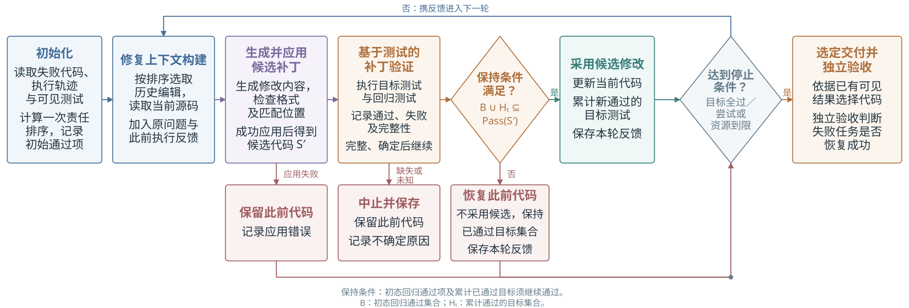
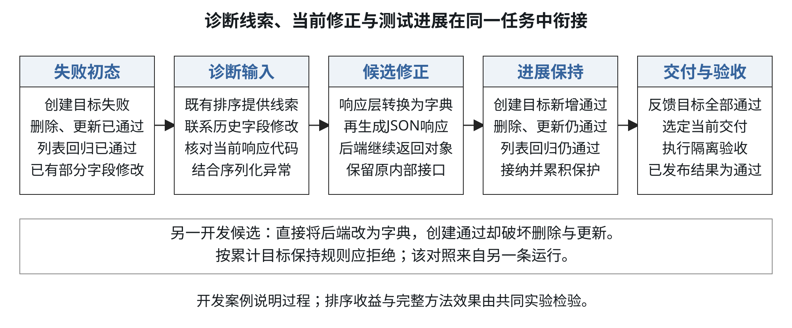

# 面向智能体失败任务的责任步骤排序与恢复方法研究

开题报告  
汇报人：杨亚鹏  
2026年10月27日

## 摘要

大语言模型智能体通过连续的代码操作、工具调用与环境反馈完成软件任务。一次执行失败后，错误原因可能分散在历史步骤中，遗留代码又可能已经发生多次变化。本课题研究如何从失败轨迹中确定历史步骤的检查次序，并将诊断信息用于当前代码的持续修正，以完成原始任务。

研究围绕两个相互衔接的问题展开。RQ1研究责任步骤排序，拟结合步骤内容、稀疏日志关系与候选相关的全轨迹上下文学习评分函数。RQ2研究诊断引导的失败任务恢复，沿排序选择历史编辑，每轮结合当前代码与测试反馈生成补丁，并依据已通过测试的保持条件更新代码。诊断输出经过编辑筛选后成为修复依据，最终交付通过隔离的独立验收才计为恢复成功。

实验分别评价定位与排序质量、诊断成本和失败任务恢复成功率，并通过排序替换、输入消融与接纳策略对照解释具体设计的作用。预期形成两项方法、共同条件下的比较结果及可回查的过程与复现材料。

**关键词：** 大语言模型智能体；失败诊断；责任步骤排序；失败任务恢复；测试保持

## 1 背景与研究现状

### 1.1 研究背景

#### 1.1.1 软件任务中的智能体连续执行

大语言模型（Large Language Model，LLM）通过大规模语料学习语言与代码规律，能够理解自然语言要求、生成解释及程序代码，为软件开发自动化提供新的技术基础。[1] 模型输出仍需要在具体程序和环境中执行，才能判断是否满足要求；真实仓库问题还涉及实现检索、接口关系及测试验证，因而需要连接生成能力与外部执行。[2,5]

为支持任务的持续执行，研究将大语言模型与工具调用、环境观察和过程管理结合，形成大语言模型智能体（Agent）。模型依据当前问题与观察选择动作，工具执行读取、编辑或命令，环境返回结果，再参与下一轮决策。[3] 求解由一次生成扩展为围绕目标的连续交互，检索为编辑提供依据，代码变化影响测试结果，执行反馈又影响后续修改。

在多角色系统中，不同智能体还可承担需求分析、规划、实现与验证等职责，通过消息和中间产物协作。[16,17] 按时间保存的内容、动作、观察及角色信息形成**执行轨迹**，记录当前产物如何形成，并保留工具使用和职责交接线索。轨迹为分析智能体执行提供过程数据，代码差异与可执行测试则使软件场景中的操作及结果能够进一步检查。[4,5]

#### 1.1.2 失败执行的诊断与持续修复需求

连续执行也使失败原因的识别更加困难。需求理解偏差可能影响后续多次编辑，一次错误操作可能经多个步骤传递，直到集成或测试阶段才表现为异常。[6,7] 异常出现的位置、引入问题的位置以及错过纠正机会的位置可能并不相同。仅检查最后一条报错，难以解释完整过程；逐步阅读全部记录，又面临轨迹增长带来的分析负担。

失败后的软件状态通常已经包含若干修改和验证结果。历史记录描述既往操作，实际代码却可能经过后续覆盖或接口调整，因而历史可疑位置不能直接等同于当前补丁的应用位置。[8] 同时，已有修改可能实现部分要求，后续修正还需保留应有行为。自动程序修复中的补丁生成与验证研究表明，修改是否有效，需要结合具体上下文及执行结果判断。[9]

由此，失败后的处理需要同时面向过程分析与任务完成：一方面，从分散的历史记录中确定优先检查的步骤，减少无效排查；另一方面，将这些线索与当前实现、未完成要求和测试反馈结合，继续修正软件状态。**诊断结果只有进入实际修复过程，其对任务完成的作用才能得到检验。** 本课题据此研究责任步骤排序及诊断引导的失败任务恢复，分别评价历史判断、连续修正与最终交付。

### 1.2 从失败诊断到任务恢复

本课题将分析已失败执行轨迹、输出历史步骤检查次序的过程称为**失败诊断**。候选是轨迹中的推理、读取、源码编辑及验证步骤，责任标签沿用数据来源的规范。模型联系需求、动作和后续反馈，判断哪些步骤应优先检查；同一条证据对不同候选可能具有不同作用。

诊断结果还需转换为可以实施的修复依据。常规源码缺陷定位以文件、函数或代码行为作为候选，[10] 本课题则先评价历史执行步骤，再从中筛选实际源码编辑并核对当前实现。由此，将从失败执行留下的代码和环境出发、利用诊断继续完成原任务的过程称为**失败任务恢复**。其输入包含原问题、历史操作、当前代码与允许的测试反馈，输出是最终选定的代码交付。

失败轨迹提供过程证据，当前代码提供实际修改对象，测试提供可执行的判断依据。三者分别对应历史分析、当前操作与结果验证，构成两项研究相互衔接的基础。

两项研究分别评价标注责任步骤的优先检出能力与失败初态下的任务恢复效果。它们通过实际修复输入衔接：先检查排序是否改变了选入编辑与当前代码上下文，再分析这些变化怎样影响候选、状态更新和最终结果。只有选定交付通过与生成过程隔离的独立验收，才判定恢复成功。

### 1.3 国内外研究现状

与本课题直接相关的研究围绕两个相互衔接的对象展开：一类分析失败轨迹中的责任步骤，另一类利用反馈继续完成任务。以下沿时间脉络梳理各类方法的进展，比较其研究对象与评价依据，并说明本课题的实验设计所要检验的问题。

#### 1.3.1 失败轨迹的责任步骤诊断

2025年的研究从失败现象分类与责任位置判定两个角度建立分析基础。

- **MAST**（Cemri等，2025年）：将多智能体失败归纳为系统设计、智能体间失配和任务验证等类型，为理解失败来源提供分类框架。失败类型解释“发生了什么问题”，具体排查还需确定执行过程中应优先检查的位置。[6]

- **Who&When**（Shaokun Zhang等，2025年）：将归因具体化为责任角色和决定性错误步骤，建立位置标注数据，并比较整轨迹判断、逐步分析与二分搜索。研究使步骤诊断具有共同评价对象，也表明直接分析长日志仍面临定位困难，为比较诊断质量与开销提供了依据。[7]

2026年的工作进一步研究监督获取、执行信息的完整性与可学习的步骤表示。

- **AgenTracer**（Guibin Zhang等，2026年）：通过反事实重放和程序化故障注入构造责任监督，训练诊断模型，并将诊断反馈用于后续改进。该研究已将责任判断与任务效果联系起来；在具体恢复流程中，哪些诊断信息实际改变修复输入及结果，仍需通过过程记录与输入对照辨析。[19]

- **TraceElephant**（Mengzhuo Chen等，2026年）：在可复现环境中保存步骤输入、输出及上下文，研究完整执行可观测性对归因的影响。其结果说明，可读取信息的范围会影响责任判断，因此诊断比较需要统一观察权限，并区分信息增加与表示方法变化带来的作用。[20]

- **StepFinder**（Zhu等，2026年）：以步骤语义、时序建模和跨步骤注意力学习责任分数，减少直接调用大模型分析日志的推理开销。它为可学习步骤评分提供了直接参照；本文据此进一步检验，在统一输入与训练条件下，显式局部联系和候选相关上下文能否互补，以及相应质量收益与计算代价。[15]

上述工作使失败分析从类型描述发展为可评价、可学习的步骤诊断，并逐步重视监督依据、过程信息与分析成本。已有方法已利用跨步骤上下文，后续研究需要辨析不同证据组织方式在共同条件下带来的增量。本文以Who&When中的诊断方式和StepFinder为直接方法参照，在统一轨迹与任务划分下比较定位、排序和成本，再以关系控制、上下文替换及参数匹配分析增量来源；诊断结果对修复的作用则在后续恢复实验中另行检验。[7,15,19,20]

#### 1.3.2 诊断支持的失败任务恢复

早期交互式方法以环境反馈支持连续决策，ReAct与Reflexion分别组织推理、行动和失败经验利用。[3,21] 2024年以后，研究逐步将工具反馈、代码定位与候选验证组织为可执行的软件求解流程。

- **CRITIC**（Gou等，2024年）：通过工具检查输出，并根据外部反馈修订结果，确立了以可验证信息支持连续修正的做法。其意义在于明确反馈来源，面向软件失败状态时还需将反馈与具体代码修改、已有功能保持相对应。[22]

- **AutoCodeRover**（Yuntong Zhang等，2024年）：利用程序结构检索相关代码，再组织修改与验证，将问题描述、源码上下文与程序改进联系起来，为仓库级修复提供结构化定位依据。[26]

- **RepairAgent**（Bouzenia等，2025年）：通过工具交互和阶段控制推进程序修复，持续利用程序与测试反馈决定后续操作，形成反馈驱动的自主修复过程。[28]

- **Agentless**（Xia等，2025年）：将定位、补丁生成和验证选择划分为固定阶段，通过回归测试及复现测试筛选候选。该方法说明，组织清晰的完整流程具有竞争力，因此本文需与其端到端比较，而非仅比较局部补丁生成。[29]

- **SyncMind**（Guo等，2025年）：研究协作代码变化造成的认知与环境失步，利用可执行验证评价重新同步和继续求解的能力，说明历史认识需要与当前代码核对。[8]

2026年的完整方法继续改进候选组织与任务协作，同时有研究直接检验诊断干预能否改变失败结果。

- **EnAgent**（Tian等，2026年）：以生成、剪枝和选择模块组织多条求解轨迹，通过候选集成提高仓库级问题求解能力，为比较完整恢复效果提供强基线。[30]

- **AOrchestra**（Ruan等，2026年）：由主控动态配置子智能体、上下文与工具，通过任务相关分工组织复杂求解，代表动态协作的完整方法。与Agentless、EnAgent共同比较，可覆盖固定流程、候选集成和动态协作等不同求解体系。[31]

- **DoVer**（Ma等，2026年）：对失败日志形成的诊断假设实施干预，并以任务解决或可量化进展验证假设，将归因评价推进到任务结果。其干预主要面向消息、计划等执行因素；本文关注软件失败状态中的历史编辑选择、当前源码修正与测试进展保持，需在相应输入和验收条件下评价。[33]

相关研究已支持工具反馈修复、候选筛选、状态同步和诊断干预。本文关注这些机制在已有软件失败状态中的具体衔接：责任排序经过历史编辑筛选后，是否实际改变生成模型获得的信息；新通过目标纳入后续接纳条件后，是否改变修复路径及最终效果。前者需记录实际修复输入并替换排序，后者需让不同保持策略独立运行；两类过程分析最终都应回到共同条件下的完整方法比较与独立验收。[8,29,30,31,33]

### 1.4 有待解决的研究问题

**复杂执行过程中的失败诊断问题。** 智能体通过连续的需求理解、信息获取、代码操作与结果检查完成任务，相关证据分布于不同时间和角色的记录中。同一条反馈可能支持多个历史步骤的判断，某个步骤的重要性也需要联系后续行为理解。现有位置标注提供了评价依据，但从过程记录形成有效诊断，还需回答如何组织分散证据、区分候选作用，以及怎样控制长轨迹分析的代价。该问题要求形成具有区分力的步骤检查次序，并说明诊断在不同执行条件下的质量与成本，为失败分析和后续修复确定重点。

**面向任务完成的失败任务恢复问题。** 失败执行留下的历史操作、当前代码及部分功能共同构成继续求解的起点。历史可疑位置可能已被后续修改覆盖，新补丁也可能在修正一个目标时破坏另一目标。因而，恢复既需要把过程诊断转化为针对当前状态的可实施修改，也需要依据反馈协调继续修正与已有进展的保持。中间测试改善与最终完成要求具有不同判定依据，研究还需将输入、候选与状态变化同独立验收联系起来，在共同条件下评价诊断支持的修复过程及其任务效果。

## 2 研究目标与意义

### 2.1 研究目标

总体目标是从已失败执行的过程证据中确定检查重点，再支持当前软件状态下的持续修复，以完成原始任务。研究以历史步骤为诊断对象，以失败后的软件状态为恢复起点，将离线责任判断、实际修复行为与最终任务效果纳入相互衔接的评价。

**RQ1：如何从连续执行记录中识别关键责任步骤，形成准确且代价可控的失败诊断？** 研究历史步骤的共享评分函数，输出轨迹内责任次序，评价定位、排序质量与诊断开销，并分析不同证据与轨迹条件的作用。

**RQ2：如何将失败诊断转化为有效修复依据，并支持连续修正以提高失败任务恢复成功率？** 研究历史线索与当前代码的对应、反馈驱动的补丁生成和已通过测试保持，评价实际信息使用、修复路径与最终任务完成之间的联系。

两项研究以责任排序为接口，以实际输入和状态记录追查联系。RQ1的离线质量与RQ2的任务效果分别报告，排序替换用于检验诊断差异是否真正进入修复过程。

### 2.2 研究意义

**对应RQ1：为智能体失败分析与调试提供过程依据。** 软件缺陷定位研究旨在减轻开发者理解问题、查找原因的负担。[10] 智能体执行进一步将错误线索分散到需求理解、工具调用与多角色交接过程，形成了对历史行为进行分析的需求。研究不同记录怎样共同支持责任步骤判断，有助于将最终失败与具体执行过程建立对应，为历史操作的优先检查、运行可靠性分析和人工调试提供细粒度依据。对诊断质量与代价的联合评价，还能说明何种信息组织适用于不同长度和结构的轨迹，为过程分析方法的选择提供参考。

**对应RQ2：支持利用已有工作持续完成软件任务。** 软件维护既需要提出修改，也需要验证修改并保留应有功能。[9] 失败执行往往已经形成部分代码与测试进展，历史操作和当前状态因而具有可继续利用的信息价值。研究诊断如何参与修复输入，以及新修改怎样影响已通过行为，可为减少重复排查、支持人工接管和提高智能体辅助维护的可用性提供依据。通过将诊断指标、修复路径与独立验收分别评价，再检验三者之间的联系，还可为理解过程诊断在实际任务中的作用提供实证基础。

## 3 研究内容与方法

### 3.1 研究对象及任务定义

诊断对象是一次已结束且未满足完成条件的执行。轨迹τ=(x₁,…,xₘ)由来源规定的有效步骤组成，保存文本、动作、观察、角色和原始索引；单责任标签y∈{1,…,m}按来源规范确定。[7,19,20] 模型学习共享函数sᵢ=fθ(xᵢ,τ,ℛ)，按分数降序输出原索引。由于诊断发生在执行结束后，可使用同轨迹中前后已经发生的信息。RQ1覆盖来源中的软件及其他智能体任务，研究步骤诊断的一般表示；RQ2限定于可重建、可修改并可测试的软件失败状态。两项评价不要求使用同一批任务，恢复运行也不依赖责任标签；责任标签仅用于诊断训练与离线评价。

恢复输入为原问题q、失败初态S₀、轨迹τ和预先许可的测试。S₀包含失败执行结束后的实际代码与运行环境，与原始仓库提交分别保存。**修复反馈测试**允许向求解过程开放测试及执行结果，其中目标测试检查本次要求，回归测试检查应保留的已有行为；**独立验收测试**与生成隔离，判断最后选定的交付。

每轮补丁形成候选代码S′，经应用及测试决定是否更新当前接纳状态Sₜ。候选接纳只表示满足状态更新条件，恢复成功则要求最终交付通过规定独立验收。恢复实验在比较前确认环境可重建、历史编辑可回查和反馈测试可执行，不根据方法胜负或验收结果选题。

**表3-1 两项研究的对象、方法与评价依据**

| 研究部分 | 研究对象 | 方法设计 | 评价依据 |
| --- | --- | --- | --- |
| 责任步骤排序 | 失败执行轨迹 | 稀疏日志关系与候选相关上下文评分 | 定位与排序、表示控制、诊断成本 |
| 失败任务恢复 | 失败代码与运行环境 | 排序引导上下文、反馈修复与测试保持 | 完整方法比较、排序替换、接纳对照 |

### 3.2 总体研究框架

**图3-1 责任步骤排序与失败任务恢复的研究框架**

**方案组织：以过程诊断支持任务恢复。** RQ1在已有位置监督下学习历史步骤评分，结合预训练语义、稀疏日志联系与候选相关上下文组织证据；RQ2沿用候选生成与测试验证的程序修复框架，将排序筛选的历史信息和累计测试保持作为研究变量。[9,29] 两项研究分别评价，再通过实际输入分析诊断如何参与恢复。

**可行性基础：数据、方法与执行条件相互对应。** 诊断已有轨迹及责任监督，可利用固定语义表示训练后续评分参数；恢复已有可重建的软件问题、失败代码、轨迹与反馈测试。公开开发记录已展示排序输入、当前代码修正和测试验证的实际衔接，为接口实施提供依据。正式评价仍需固定模型与任务划分，完成共同准备及独立验收。

**创新与验证：围绕机制作用形成可检验增量。** RQ1检验局部联系与候选上下文是否互补及何时有效，RQ2检验诊断输入与目标保持怎样影响修复路径。完整强基线比较评价总体表现，关系、上下文、排序及保持策略控制解释作用，未参与选择任务的独立确认检验选定方案。已有模块的组合服务于这些问题，最终贡献以研究证据而非模块数量判断。

### 3.3 关系增强的上下文感知责任排序

**图3-2 责任步骤排序模型的计算结构**

RQ1的中心设计论点是：**局部执行联系与候选相关的全轨迹证据可能互补，共同改善单责任位置监督下的步骤判断。** 方法先以预训练语义和日志结构形成基础表示，再沿稀疏关系组织近邻信息，通过候选条件化聚合补充远处证据，最后学习共享评分函数。局部结构、候选读取与评分目标分别承担信息范围、证据摘要和责任判断的作用；对应控制实验检验这种组织是否有效。

#### 3.3.1 步骤特征编码

本模块以**内容、角色与日志结构共同表征执行步骤**。文本由固定的预训练编码器提取向量，后续表示与评分参数参与训练；这样既利用已有语义表示，也将学习重点放在过程证据的组织上。角色按轨迹内首次出现顺序匿名编号，保留同一轨迹中的身份对应；结构特征描述记录形式、相对位置及重复情况。

关系构造依据运行日志中可直接获得的时间、角色、完整记录结构与非空动作结构。来源提供明确记录配对时，先融合对应信息；其余步骤使用原表示。非时间关系连接前后最近的同类记录，并固定每通道的邻居上限，使连接规模随轨迹长度线性增长。该设计以可观测联系约束局部信息读取，降低无差别汇集所有邻步的开销。[35]

这些联系反映可获得的执行结构，同角色或同结构并不直接等同语义依赖。模型仍需结合步骤内容和后续反馈形成候选判断。[36,37] 因而，关系表示的研究重点在于其是否提供有用补充，以及收益是否依赖连接对应、轨迹长度和关系重合；编码维数、配对处理与邻居数量作为实现配置记录。

#### 3.3.2 门控多关系消息传递

本模块以初始表示和四类关系为输入，**汇集邻步信息，输出关系增强表示**。对接收步骤i、关系r和邻居j，模型用邻居内容及两步差异形成消息，用接收步骤及差异计算门控，调节每条消息的贡献。[35]

$$

\begin{aligned}
g_{ij}^{(r)} &= \sigma\!\left(G_r[h_i;\,h_j-h_i]\right),\\
u_i^{(r)} &= \frac{1}{|\mathcal N_r(i)|}
\sum_{j\in\mathcal N_r(i)}
g_{ij}^{(r)}\,\phi_r([h_j;\,h_j-h_i]).
\end{aligned}
\tag{1}
$$

式（1）中，𝒩ᵣ(i)为邻居集合，Gᵣ输出标量，经sigmoid得到0到1的g；φᵣ为可学习消息变换。每条边独立门控，不在邻居间作softmax；无邻居通道取零向量。四通道另计算归一化权重，融合后与原表示残差相加并归一化，采用两层更新。

同一邻步可能在多个通道重复出现，因此实验记录边数、重合率与覆盖，检查其补充证据或增加冗余的条件。原始内容仍经残差与评分旁路参与后续计算。

#### 3.3.3 全局自注意力聚合

两层局部传播的范围受连边限制，责任判断还可能依赖远处的需求和测试反馈。模型以关系增强表示构造查询、键和值，采用单头缩放点积自注意力，**为每个待评分步骤形成各自的上下文**。查询对应当前候选，键匹配记录，值承载汇集内容；三者来自同一完整轨迹。[38]

$$

\begin{aligned}
a_{ij} &= \operatorname{softmax}_{j}
\left(\frac{(W_Qh_i)^\top W_Kh_j}{\sqrt d}\right),\\
c_i &= \bar h+
W_O\left(\sum_j a_{ij}W_Vh_j-W_V\bar h\right).
\end{aligned}
\tag{2}
$$

式（2）中，h̄为全轨迹均值，d为表示维度，W为相应可学习映射。aᵢⱼ表示判断i时读取j的权重，cᵢ在共享均值上加入候选相关修正。注意力组织信息，责任次序由评分器产生；跨轨迹位置屏蔽。实验比较步骤查询、共享查询、轨迹均值和局部上下文，并结合长度及信息位置分析。[39]

当aᵢⱼ对所有j均为1/m时，加权值向量等于Wᵥh̄，式（2）的修正项为零，故cᵢ=h̄。该结构因而在共享均值上学习候选相关修正。轨迹均值对照检验非均匀聚合的作用，共享查询对照检验候选条件化的作用；若候选查询未改善定位或成本权衡，则不支持其在相应条件下的设计假设。

密集注意力计算约为O(m²d)，权重存储为O(m²)；固定关系与邻居上限的边聚合随m线性增长。实际诊断还包含文本编码等过程，成本评价同时注明输入长度、批处理和截断，不能直接用算子复杂度代替耗时。

#### 3.3.4 轨迹内责任评分

评分器使用多层感知机（MLP），拼接关系增强表示hᵢ、初始表示hᵢ⁽⁰⁾、候选上下文cᵢ及二者差异，输出步骤分数；训练采用单责任位置softmax交叉熵。[13]

$$

\begin{aligned}
s_i &= \operatorname{MLP}
\left([h_i;\,h_i^{(0)};\,c_i;\,h_i-c_i]\right),\\
p_i &= \frac{\exp(s_i)}{\sum_{j=1}^{m}\exp(s_j)},\\
\ell_\tau &= -\log p_y.
\end{aligned}
\tag{3}
$$

单责任监督可表示为**one-hot标签向量**：例如4步轨迹标注第2步，标签为(0,1,0,0)，损失为−log p₂。0表示不是该记录的标注位置，不表示步骤一定正确。每条轨迹构成一个候选组，该目标可解释为单正例列表级softmax排序目标，[12,13] 与ListNet依据标签得分构造目标分布的方式有所区别。[11]

单模型按分数降序输出，同分按原索引；三模型集成先分别作轨迹内softmax，再平均预测概率并排序。AFTraj同任务派生记录先组内平均、再对任务等权；标准化只用训练数据，验证用于选轮。完整责任次序由共享评分函数估计，不能从单位置标签中直接得到其余候选真值。

### 3.4 诊断引导的失败任务恢复

**图3-3 失败任务恢复流程**

图中“中止并保存”表示停止后续生成；已有可用交付仍独立验收，结果不确定时记录为未知。

RQ2的中心设计论点是：**按责任次序突出历史编辑并联系当前源码，有望提供更有针对性的修复依据；累计目标保持可保留接纳路径上的可见进展，同时可能限制后续修改。** 方法从失败后的代码和环境出发，循环组织修复输入、生成候选、执行反馈测试并决定状态更新，停止后选定交付并独立验收。排序提供检查重点，当前源码约束可实施修改，测试保持协调继续修正与已有进展；研究通过输入对照和策略独立运行检验两类作用。

#### 3.4.1 排序引导的修复输入与候选生成

历史诊断与当前修改之间存在对象差异：诊断评价执行步骤，补丁作用于当前源码。恢复器因此先沿责任次序筛选实际成功改变项目源码的历史编辑，再联系相应函数与当前失败反馈读取现有实现。**历史差异表征既往操作，当前源码确定本轮修改所面对的状态。** 排序提供检查线索，生成模型仍需判断线索与当前错误的联系。

输入组织采用固定排序与累计编辑前缀，逐轮补充优先历史材料，每轮刷新当前源码和反馈；前缀日程、输入容量与截断规则在正式评价前固定。共同背景提供原问题、原始轨迹及公开反馈，排序模块在此基础上另行呈现选中差异。因此，全步骤次序的变化可能在编辑筛选后消失，其作用需要通过有效编辑列表和实际请求检验。

生成模型据此提出候选补丁，执行端应用并运行预定反馈测试，将修改结果用于下一轮求解。[22,28] 原问题规定任务目标，历史编辑提供过程线索，当前代码与测试反馈约束本轮修正，四类信息共同构成恢复依据。去专门编辑输入评价显式历史选择的增量，去当前读取评价历史与现状对应的作用；共同信息权限及其他求解条件保持一致。

#### 3.4.2 已通过测试保持与交付

每个候选按快照在独立目录执行预先固定的目标测试与回归测试。[9,29] T_goal表示**本次问题预先固定的目标测试集合**，用于检查原问题要求是否实现；goal意为“任务目标”。B为失败初态已通过且需要保护的回归测试集合，Hₜ为T_goal中截至第t轮接纳状态已经通过、随后需要保持的目标测试集合。初始H₀=Pass(S₀)∩T_goal，其中S₀为失败初态。T_goal及其反馈许可在恢复开始前确定，独立验收结果不用于扩充T_goal或更新Hₜ；恢复中T_goal保持不变，Hₜ随新目标通过而更新。以Moto案例为例，T_goal={创建、删除、更新}，列表分页属于回归；初态H₀={删除、更新}，创建通过后才加入H。**候选只有保留B和Hₜ中的全部测试，才能更新当前代码**：

$$

B\cup H_t\subseteq\operatorname{Pass}(S').
\tag{4}
$$

Pass(S′)表示本轮完整观察中确定通过的标识。接纳后更新代码，并令Hₜ₊₁=Hₜ∪(Pass(S′)∩T_goal)；拒绝时恢复旧代码，H不变，被拒候选的新通过项不加入。保持旧项但没有新增通过项的候选也可接纳。在固定测试与环境、结果确定且完整的前提下，可对接纳轮次作归纳：初态通过H₀，接纳保留旧H并加入已通过新目标，拒绝保持代码与H不变，因此每个接纳状态均通过累计H，且H按集合包含关系单调增加。不确定或缺失结果触发中止保存。

全部目标测试通过、尝试次数耗尽或资源到限时停止。当前状态用于继续生成，最终交付则从已保存状态选择，未必是最后一次接纳的代码。交付只用当时反馈，从满足当前保护集合的初态及接纳状态中，依次按目标失败数、修改行数和尝试先后选择；较晚代码不回填早期节点。方法生成的辅助测试另行记录并计入资源，独立验收不向生成反馈。异常中止后若已有可用交付，则仍对该快照验收；无法取得确定验收结果时保留未知状态。

该约束只覆盖已执行测试，可能避免目标退化，也可能限制需要暂时破坏中间测试的关联修改。因此，最终效果还需由累计集合保持、数量保持与仅回归保持的独立运行比较决定，不能仅凭测试集合的单调性质认定恢复更好。

### 3.5 方法过程示例：诊断输入与测试进展保持

采用Moto7081公开开发记录说明图3-3中的关键关系。原问题要求设备创建及查询结果包含thingId。选定失败初态已补入部分字段，但创建测试内部调用describe_thing时仍出现对象无法进行JSON序列化的异常。原合同将创建、删除、更新列为目标测试，列表分页为回归；初态已通过删除、更新与列表，形成已有进展。

**图3-4 Moto案例中的诊断输入、候选修正与测试保持**

该开发运行使用既有诊断排序提供历史编辑线索，结合当前代码与异常，将修正集中在响应层的对象序列化，而保留后端向内部调用者返回对象的接口。候选通过创建、删除、更新和列表测试，满足保持条件，当前代码更新，并将新通过的创建目标加入后续保护；选定交付的已发布独立验收汇总为通过。

同一初态下的另一开发运行曾将后端直接改为字典，创建虽通过，却破坏删除与更新。按集合保持规则核验，该候选应被拒绝。这一对照说明局部目标改善与已有行为保持需要同时检查；它来自另一条运行，不构成本例先拒绝再成功的执行顺序。案例用于解释输入选择、当前修正与状态更新，完整方法及排序独立收益由共同实验评价。

## 4 难点和创新

### 4.1 关键技术难点

**RQ1：有限位置监督下的证据选择与质量成本取舍。** 责任位置标签指出应优先检查的步骤，却不能直接给出各条联系及上下文的相关性监督。同一异常可能与多个历史步骤相关，错误引入与反馈出现又可能相隔较远，模型因而需要在间接监督下区分有用证据、重复信息与无关记录。局部联系有助于组织近邻证据，但日志中存在联系并不等于存在责任关系；全轨迹读取能够覆盖远处信息，也会增加干扰与计算开销。中心难点是使局部传播与候选相关读取承担不同作用，既保留候选自身信息，又避免多次聚合削弱步骤间的区分。方案的合理性取决于这种分工能否在共同条件下改善责任排序，并形成可接受的质量成本取舍。

**RQ2：历史诊断到当前修复的有效转化与进展保持。** 责任排序评价历史行为，补丁生成操作当前源码，两者之间存在对象与状态差异：高位步骤可能不含源码编辑，历史修改也可能已被覆盖，因此排序改善未必形成有效修复输入。另一方面，接纳一个候选不仅改变当前代码，还会改变下一轮反馈及累计目标集合，使后续可接纳状态受到新的约束。严格保持有助于防止已有行为退化，却也可能阻碍需要关联修改才能完成的修复。中心难点是把历史检查重点转化为当前可用线索，并协调进展保护与后续求解空间。因此，需要区分诊断是否改变实际输入、保持规则是否改变运行路径，以及这些变化是否最终改善独立验收结果。

### 4.2 拟研究的创新设计与验证

**RQ1：面向责任步骤排序的局部关系与候选上下文协同建模。** 拟以共享步骤评分为基础，通过门控多关系消息传递组织显式局部联系，再以候选条件化的全轨迹聚合补充远处证据，并保留初始表示参与判断。拟检验的技术判断是：局部结构为责任判断提供执行联系，候选相关读取补充局部传播范围外的证据，两者能够形成互补的候选表示。研究增量体现为这种证据组织方式在责任排序中的作用及有效条件。完整基线比较评价定位、排序与成本；去关系、均值及共享查询替换检验两类信息的增量，参数匹配和关系置换辨析容量及连接因素。对照无增益时据实收缩协同主张，质量改善同时结合实际开销评价。

**RQ2：面向失败任务恢复的诊断输入与累计目标保持机制。** 拟将责任排序用于历史编辑选择，并结合当前源码与反馈构建修复输入；将接纳状态中新通过的目标测试纳入后续保护，使进展保持直接参与连续修正的状态更新。拟检验两个相互衔接的判断：诊断能够改变生成模型实际获得的有效信息；累计保护能够减少已通过目标退化，并形成有利于最终完成任务的修复路径。研究增量体现为两项机制对信息使用和状态演化的具体作用。排序替换与输入消融检验实际信息变化，集合、数量及仅回归保持的独立运行比较后续路径，再与完整强基线共同评价恢复成功率和资源消耗。集合保持性质由规则推导，任务收益及其代价由独立验收和资源记录检验。

## 5 实验设计

实验先完成数据分组和方法开发，再固定评价配置，运行诊断与恢复方法，最后按共同指标比较，并用控制实验解释差异。第一层回答方法是否有效，第二层回答具体设计是否起作用。下文先给数据与总体计划，再说明每个实验怎样执行、为何采用这些安排。

### 5.1 数据来源与任务组织

诊断采用AFTraj及AgenTracer轨迹和相应责任标签，[41,42] 恢复从SWE-Gym等已有软件问题材料整理失败初态。[40] 表5-1中的发布规模是来源总量，研究样本是本课题使用或计划组织的范围，两者分开。

**表5-1 数据来源与研究样本**

| 数据来源 | 发布规模 | 研究样本与组织 | 用途 |
| --- | --- | --- | --- |
| AFTraj | 2,276条轨迹 | 731条候选轨迹、716个任务组 | 责任定位与排序 |
| AgenTracer | coding训练1,141条、测试127条 | 614条训练验证来源（coding 320、math 294）；另363条coding开发轨迹 | 诊断开发与划分分析 |
| SWE-Gym | 2,438个Python问题 | 固定20个不同问题、覆盖5仓库 | 失败初态与恢复比较 |

恢复实验分为开发比较和独立评价两阶段。20题沿既有21题前瞻顺序取前20，已有开发接触，用于开发与可行性比较；其中17题已有排序记录，3题环境或输入待复核。方法固定后，另行确定未参与选择的恢复任务执行独立评价，作为选定方案的正式确认依据。两阶段分别报告，独立任务数量与工作量在运行前固定，不并入20题开发分母。诊断独立候选来自AFTraj的163条test_unsafe及AgenTracer的127条coding测试轨迹，经失败状态、历史使用与任务重叠核对后报告实际纳入量。

### 5.2 实验流程计划与执行

#### 5.2.1 总体流程与阶段产物

**先准备共同数据与起点。** 按原问题给诊断轨迹分组，划分训练、验证和评价；为恢复任务保存失败后的源码、环境、历史轨迹与反馈测试，重建后确认原问题仍未完成。该阶段产物是任务划分及可重复的失败快照，保证后续比较面对同一问题。

**再开发并固定方法。** 用训练数据学习诊断模型，验证数据选择配置；检查完整基线与本文恢复接口，确定模型、输入容量、内部尝试、测试与交付规则。开发结束后固定版本，正式评价期间不根据单题结果调整方法配置。

**随后执行开发比较与独立评价。** 将留出的轨迹输入各诊断方法，保存位置或排序与成本；将相同失败初态分别交给各恢复方法，独立运行3次，逐轮记录请求、候选与测试，在15/30/60分钟保存当时选定的交付。选定后再运行隔离验收，得到逐题结果。20题开发比较先执行以固定方案，随后按同一流程对独立任务确认，两阶段分别计分。

**最后进行解释性对照。** 完整比较确认总体表现，排序替换、输入消融和保持策略对照进一步改变一个因素，核实际输入或决定是否变化，再观察是否影响最终恢复。各阶段由准备材料、固定配置、实际输出到验收结果连续对应。

#### 5.2.2 责任排序的训练划分与评价方案

AFTraj按716个任务组做五折：每次留一折评价，其余任务内部划分训练与验证；验证选轮后，用外层其余组重新训练，再预测留出折。**这样让每条外折预测都来自没训练过该任务的模型**，避免同问题派生记录跨集合造成高估。每个配置采用三次预定初始化，以区分方法变化与训练随机性；同任务记录先组内平均，再让任务等权。

AgenTracer的614条训练验证来源包含320条coding与294条math轨迹。拟在相同来源池构造A、B、C三种任务组隔离划分，每种按492条训练、122条验证，用于检查结论是否依赖一次数据分配；每种采用三次初始化，观察同划分下的训练随机性。另有363条coding开发轨迹，与614条在公开任务组标识上无交集，作为固定开发评价对象，比较跨划分表现。该开发集合参与方法选择，不能作为最终独立确认。划分与初始化分别编号。

上述外折与开发比较用于方法选择和敏感性分析。开发结束后固定结构、选轮规则与部署方式，用预定训练组获得评价模型，再对未参与选择的轨迹评价。三次初始化先分别报告，以观察随机性；三模型概率均值集成作为预先声明的部署结果单列，恢复对照采用固定部署。独立轨迹输入本文、StepFinder及生成式诊断方法，保持步骤、标签和信息许可一致。学习式方法输出分数排序，生成式方法按固定提示或搜索规则输出位置，记录无效输出及实际成本。参与选模的结果标为开发证据，未参与选择的评价材料检验选定方案能否适用于新任务。

#### 5.2.3 失败任务恢复的运行与验收方案

每题先将失败快照复制到各方法各重复的独立目录，运行共同反馈测试确认起点，随后从该状态启动求解。本文先计算责任排序，再按图3-3循环构建输入、生成应用、执行测试与接纳回退；Agentless、EnAgent和AOrchestra按自身完整定位、生成、验证、集成或编排机制运行。共同条件见表5-2。

**表5-2 恢复实验的共同评价设置**

| 实验因素 | 共同控制 |
| --- | --- |
| 评价起点 | 同一原问题、失败代码、环境与源码访问许可 |
| 生成条件 | deepseek-flash及预定参数，各方法保留完整流程 |
| 信息与反馈 | 共同反馈测试与许可范围，记录候选及状态变化 |
| 重复单位 | 每题每方法3次，各次从相同初态独立启动 |
| 资源与交付 | 15/30/60分钟节点，30分钟主比较，统一token上限 |
| 验收与汇总 | 选定交付后隔离验收，同题重复先汇总再问题等权 |

三次重复用于观察大模型生成随机性，不继承其他重复的补丁或反馈，内部候选和子智能体计入所属运行。过程记录保存实际请求、应用结果、测试标识及交付代码，以确认恢复确实从共同失败状态继续，并解释最终结果来自哪条路径。

### 5.3 评价指标与资源设置

评价分别对应历史责任判断与当前任务完成。定位与排序评价标签位置，恢复评价选定代码是否完成任务，资源记录获得这些结果所需的实际开销。

**表5-3 主要评价指标**

| 指标 | 计算与含义 |
| --- | --- |
| Top-1 ↑ | 任务组等权首位命中率 |
| MRR ↑ | 标注位置倒数排名的任务组等权均值 |
| Hit@3 / Hit@5 ↑ | 标注责任进入前3/5位的任务组等权比例 |
| 诊断耗时P50 / P95 ↓ | 首次加载及已加载条件下的中位数/95分位数 |
| 失败任务恢复成功率RSR ↑ | 同题3次运行先平均，再对共同问题等权 |
| RSR@15 / 30 / 60min ↑ | 节点前选定交付的独立验收成功率 |
| 资源消耗 ↓ | 输入输出token总量、大模型API请求次数 |

诊断先在同任务组内汇总，再让各任务等权；MRR取标注位置排名的倒数，Hit@k看是否进入前k。所有诊断方法共同比Top-1，完整排序方法再比MRR与Hit@3/5。耗时从轨迹进入至诊断输出，注明长度、批处理、截断及加载条件。

恢复主指标取30分钟，15/60分钟来自同一次运行的快照，提前自然停止后沿用已选交付。令zₐ,ᵤ,ᵣ(b)表示方法a在问题u第r次运行中，预算b前选定的交付是否通过独立验收；Uᵦ为各方法三次均可判定的共同问题集：

$$

\operatorname{RSR}_a(b)=
\frac{1}{|\mathcal U_b|}
\sum_{u\in\mathcal U_b}
\left(\frac{1}{3}\sum_{r=1}^{3}z_{a,u,r}(b)\right).
\tag{5}
$$

式（5）先平均同题3次，再对问题等权。已知预算内没有成功交付记未成功；验收未知、工程中断与未运行分别保留，另列全计划矩阵及共同配对数。三次重复不增加独立问题数。

token与API请求覆盖诊断分析、补丁生成、候选选择、子智能体及重试；一次发送的大模型生成请求计一次，工具执行另记。共同token上限及方法内部参数在正式运行前固定，测试和工具也占用运行预算；usage未知不补0。若另观察取消60分钟外部截断后的自然终态，保留原配置、原时钟与累计资源，单列续跑结果。

### 5.4 基线方法及共同比较

**表5-4 失败诊断基线及正式发表时间**

| 方法 | 正式发表时间 | 发表载体 | 核心机制 | 评价指标 |
| --- | --- | --- | --- | --- |
| All-at-Once | 2025.10 | ICML | 整轨迹一次性归因 | Top-1、耗时、token、API请求次数 |
| Binary Search | 2025.10 | ICML | 区间判断与二分搜索 | Top-1、耗时、token、API请求次数 |
| StepFinder | 2026.08 | KDD | 时序、角色交互与步骤评分 | Top-1、MRR、Hit@3/5、耗时 |
| 本文方法 | — | 本课题 | 关系传播与候选相关上下文 | Top-1、MRR、Hit@3/5、耗时 |

诊断方法共用轨迹、步骤边界、任务划分和责任标签，学习式方法保留自身结构与训练目标，在同等训练验证信息下选模；生成式方法固定模型、提示和搜索规则。[7,15] 单位置输出不补造完整排名。All-at-Once与Binary Search来自同一篇论文，时间按正式出版记录。

**表5-5 失败任务恢复基线及正式发表时间**

| 方法 | 正式发表时间 | 发表载体 | 核心过程 | 评价指标 |
| --- | --- | --- | --- | --- |
| Agentless | 2025.06 | FSE / PACMSE | 定位、生成、复现与回归筛选 | RSR@15/30/60min、token、API请求次数 |
| EnAgent | 2026.04 | ICSE | 多轨迹、回归剪枝、工具选择与投票 | RSR@15/30/60min、token、API请求次数 |
| AOrchestra | 2026.09 | ICML | 动态子智能体及上下文配置 | RSR@15/30/60min、token、API请求次数 |
| 本文方法 | — | 本课题 | 诊断输入、反馈修复与测试保持 | RSR@15/30/60min、token、API请求次数 |

完整恢复基线从同一失败初态、共同模型及信息许可出发，保留各自求解核心，诊断到交付选择均纳入预算。[29,30,31] 运行前核源码、实现阶段和小试有效性，实际部署参数记录；未完整运行的工程状态单列。EnAgent采用2026年4月正式文集时间，9月在线日期另存。StepFinder接本文恢复器用于排序控制，不占完整系统基线名额。

### 5.5 消融实验与作用机制分析

完整方法比较回答能否更好地诊断和恢复；消融再回答**哪一项设计带来差异**。每次只改变指定因素，保持相同数据、选模与运行规则。RQ1变体重新训练；RQ2各变体独立执行后续恢复，避免将同一运行结果重复归入不同实验条件。

**表5-6 核心消融与对照**

| 研究部分 | 条件 | 改动与要回答的问题 |
| --- | --- | --- |
| RQ1 | Full | 完整模型，作为共同参照 |
| RQ1 | w/o RelProp | 去掉关系传播，局部联系是否有用 |
| RQ1 | w/o StepCtx | 均值替代注意力上下文，检验聚合模块整体作用 |
| RQ1 | 容量与关系控制 | 参数匹配、关系置换，区分参数规模与关系对应的作用 |
| RQ2 | Full | 完整恢复流程，作为共同参照 |
| RQ2 | w/o HistEdit | 去专门选入的编辑，检验显式历史选择增量 |
| RQ2 | w/o CurrentRead | 去掉专门当前读取，历史与现状对应是否有用 |
| RQ2 | w/o TargetKeep | 只保初始回归，新通过目标保护是否有用 |
| RQ2 | 数量保持 | 只限制目标失败数，不保身份，集合保持是否有用 |

**先解释诊断表示与信息怎样起作用。** 关系传播消融重新训练评分模型，均值替换评价注意力聚合的整体作用，共享查询则在保留学习式加权的条件下检验候选条件化。 在同一恢复器中，把本文排序换成StepFinder排序或历史时间顺序，仍用同样的编辑筛选和容量。时间顺序保留同样的历史选择模块，w/o HistEdit关闭专门选入的编辑输入，但共同背景与访问权限保持不变；两者分别检验排序次序与显式历史选择的增量。w/o CurrentRead仍保留共同源码访问权限，要核实际请求是否经其他操作取得同样代码。

**再解释保持规则怎样改变路径。** 比较累计集合保持、只保目标数量与仅保初始回归。逐轮记录已通过、丢失与新增测试，特别检查“数量未变但身份替换”的候选。同一候选离线重算仅判断当前接纳是否不同；这些决定对下一轮生成和最终恢复的影响，由各策略独立运行比较。

例如，B={回归r}、H={目标a}时，候选通过{回归r,目标b}，目标通过数量未变，但目标a已经丢失。数量保持可以接受这一变化，集合保持会拒绝。该示意帮助区分两种规则；真正的作用机制仍须由各自后续生成、测试变化与最终验收共同说明。

解释机制时按“排序→有效编辑→实际输入→候选→状态→验收”追查。若输入或决定并未改变，应保留这一结果；若发生变化，再检验最终结果是否随之改变。这样才能把离线指标、过程变化和任务收益联系起来。

### 5.6 研究工作量

工作量包括数据与环境整理、诊断模型训练、完整恢复比较、机制对照及复现整理。表5-7按核心配置估算计划规模，基线训练和扩展控制另计，实际启动与完成数量随运行记录报告。

**表5-7 主要研究工作量与产物**

| 工作项 | 计划规模 | 主要产物 |
| --- | --- | --- |
| 数据与环境 | 2个诊断来源；20个软件问题、5个仓库 | 分组、版本绑定与共同失败初态 |
| 诊断模型 | 4组核心配置；AFTraj 60个外折评价单元，AgenTracer 36个训练评价单元 | 模型权重、预测、消融及成本结果 |
| 开发恢复比较 | 20题×4种完整方法×3次，计划240条运行 | 节点交付、独立验收与逐题矩阵 |
| 独立恢复评价 | 方法固定后另行确定任务与数量，另计 | 未参与方法选择的确认结果 |
| 机制与复现 | 排序替换、信息消融、3类保持策略，另计 | 输入、候选、测试路径与复现材料 |

诊断估算以Full、去关系传播、均值上下文和一组容量对照4组配置计算：AFTraj为4×5折×3初始化=60个评价单元，每单元包含内部选轮与外折重训；AgenTracer为4×3划分×3初始化=36个训练评价单元。它们是实验组织单元，不等同于简单的训练进程次数。

240条开发恢复运行以20题均完成运行前核验为前提，当前3题待复核，不能写成已完成数量。每条运行内包含多轮生成、工具和测试，15/30/60分钟为同一运行的交付节点。各类消融及排序替换在相同任务与重复规则下另行计量，并保留全部状态与结果。

## 6 进度与文献

### 6.1 研究进度

**2026年9—10月：问题界定与开题。** 完成文献、任务定义和方法依据核对，组织两个研究问题、总体方案及实验计划。

**2026年11—12月：方法与执行系统完善。** 完成诊断模型、历史编辑与当前代码对应、测试保持和节点交付，固定数据分组与评价配置。

**2027年1—2月：完整比较与独立评价。** 按纳入标准准备评价任务，运行诊断及恢复基线，保留全部重复、资源和异常状态。

**2027年3月：机制分析与论文初稿。** 完成消融、排序替换与保持策略对照，结合真实路径解释作用，整理图表和结论。

**2027年4—5月：论文修改与答辩。** 根据评阅意见完善论证、实验分析与复现材料，完成定稿和展示。写作随研究阶段同步推进。

### 6.2 参考文献

[1] 董益宏, 姜雪, 钱家如, 等. 基于大语言模型智能体的代码生成综述[J]. 软件学报, 2026, 37(8): 3089–3115. DOI: 10.13328/j.cnki.jos.007593. [原文](https://www.jos.org.cn/jos/article/abstract/7593)。

[2] John Yang, Carlos E. Jimenez, Alexander Wettig, et al. SWE-agent: Agent-Computer Interfaces Enable Automated Software Engineering[C]//Advances in Neural Information Processing Systems, 2024. [原文](https://proceedings.neurips.cc/paper_files/paper/2024/hash/5a7c947568c1b1328ccc5230172e1e7c-Abstract-Conference.html)。

[3] Shunyu Yao, Jeffrey Zhao, Dian Yu, et al. ReAct: Synergizing Reasoning and Acting in Language Models[C]//International Conference on Learning Representations (ICLR), 2023. [原文](https://openreview.net/forum?id=WE_vluYUL-X)。

[4] Xiao Liu, Hao Yu, Hanchen Zhang, et al. AgentBench: Evaluating LLMs as Agents[C]//International Conference on Learning Representations (ICLR), 2024. [原文](https://proceedings.iclr.cc/paper_files/paper/2024/hash/e9df36b21ff4ee211a8b71ee8b7e9f57-Abstract-Conference.html)。

[5] Carlos E. Jimenez, John Yang, Alexander Wettig, et al. SWE-bench: Can Language Models Resolve Real-world GitHub Issues?[C]//International Conference on Learning Representations (ICLR), 2024. [原文](https://proceedings.iclr.cc/paper_files/paper/2024/hash/edac78c3e300629acfe6cbe9ca88fb84-Abstract-Conference.html)。

[6] Mert Cemri, Melissa Z Pan, Shuyi Yang, et al. Why Do Multi-Agent LLM Systems Fail?[C]//Advances in Neural Information Processing Systems, Datasets and Benchmarks Track, 2025. [原文](https://papers.nips.cc/paper_files/paper/2025/hash/b1041e52d3be19f0a9bc491657488e4a-Abstract-Datasets_and_Benchmarks_Track.html)。

[7] Shaokun Zhang, Ming Yin, Jieyu Zhang, et al. Which Agent Causes Task Failures and When? On Automated Failure Attribution of LLM Multi-Agent Systems[C]//Proceedings of the 42nd International Conference on Machine Learning (ICML), PMLR 267: 76583–76599, 2025. [原文](https://proceedings.mlr.press/v267/zhang25cq.html)。

[8] Xuehang Guo, Xingyao Wang, Yangyi Chen, et al. SyncMind: Measuring Agent Out-of-Sync Recovery in Collaborative Software Engineering[C]//Proceedings of the 42nd International Conference on Machine Learning (ICML), PMLR 267: 20993–21066, 2025. [原文](https://proceedings.mlr.press/v267/guo25l.html)。

[9] 香佳宏, 徐霄阳, 孔繁初, 等. 大模型在软件缺陷检测与修复的应用发展综述[J]. 软件学报, 2025, 36(4): 1489–1529. DOI: 10.13328/j.cnki.jos.007268. [原文](https://www.jos.org.cn/html/2025/4/7268.htm)。

[10] 曹帅, 牛菲菲, 李传艺, 等. 深度学习在基于信息检索的缺陷定位中的应用综述[J]. 软件学报, 2025, 36(4): 1530–1556. DOI: 10.13328/j.cnki.jos.007288. [原文](https://www.jos.org.cn/jos/article/abstract/7288)。

[11] Zhe Cao, Tao Qin, Tie-Yan Liu, et al. Learning to Rank: From Pairwise Approach to Listwise Approach[C]//Proceedings of the 24th International Conference on Machine Learning (ICML): 129–136, 2007. [原文](https://doi.org/10.1145/1273496.1273513)。

[12] Tie-Yan Liu. Learning to Rank for Information Retrieval[J]. Foundations and Trends in Information Retrieval, 3(3): 225–331, 2009. [原文](https://doi.org/10.1561/1500000016)。

[13] Sebastian Bruch, Xuanhui Wang, Michael Bendersky, Marc Najork. An Analysis of the Softmax Cross Entropy Loss for Learning-to-Rank with Binary Relevance[C]//Proceedings of the 2019 ACM SIGIR International Conference on Theory of Information Retrieval (ICTIR). 2019: 75–78. DOI: 10.1145/3341981.3344221. [原文](https://research.google/pubs/an-analysis-of-the-softmax-cross-entropy-loss-for-learning-to-rank-with-binary-relevance/)。

[14] Kai Sun, Wenqiang Li, Bo Dong, et al. Scope Delineation Before Localization: A Two-Stage Framework for Enhancing Failure Attribution in Multi-Agent Systems[C]//Proceedings of the AAAI Conference on Artificial Intelligence, 40(39): 33108–33116, 2026. [原文](https://ojs.aaai.org/index.php/AAAI/article/view/40594)。

[15] Taiyu Zhu, Yifan Wu, Weilin Jin, et al. StepFinder: A Temporal Semantic Framework for Failure Attribution in Multi-Agent Systems[C]//Proceedings of the 32nd ACM SIGKDD Conference on Knowledge Discovery and Data Mining V.2: 6946–6957, 2026. [原文](https://doi.org/10.1145/3770855.3817991)。

[16] Qingyun Wu, Gagan Bansal, Jieyu Zhang, et al. AutoGen: Enabling Next-Gen LLM Applications via Multi-Agent Conversations[C]//Conference on Language Modeling (COLM), 2024. [原文](https://openreview.net/forum?id=BAakY1hNKS)。

[17] Sirui Hong, Mingchen Zhuge, Jonathan Chen, et al. MetaGPT: Meta Programming for A Multi-Agent Collaborative Framework[C]//International Conference on Learning Representations (ICLR 2024). [原文](https://proceedings.iclr.cc/paper_files/paper/2024/hash/6507b115562bb0a305f1958ccc87355a-Abstract-Conference.html)。

[18] Hunter Lightman, Vineet Kosaraju, Yuri Burda, et al. Let’s Verify Step by Step[C]//International Conference on Learning Representations (ICLR), 2024. [原文](https://proceedings.iclr.cc/paper_files/paper/2024/hash/aca97732e30bcf1303bc22ac3924fd16-Abstract-Conference.html)。

[19] Guibin Zhang, Junhao Wang, Junjie Chen, et al. AgenTracer: Who Is Inducing Failure in the LLM Agentic Systems?[C]//International Conference on Learning Representations (ICLR), 2026. [原文](https://proceedings.iclr.cc/paper_files/paper/2026/hash/134ed7a477770f227f12450ef0cbb8f4-Abstract-Conference.html)。

[20] Mengzhuo Chen, Junjie Wang, Fangwen Mu, et al. Seeing the Whole Elephant: A Benchmark for Failure Attribution in LLM-based Multi-Agent Systems[C]//Proceedings of the 64th Annual Meeting of the Association for Computational Linguistics (Volume 1: Long Papers): 19888–19905, 2026. [原文](https://aclanthology.org/2026.acl-long.912/)。

[21] Noah Shinn, Federico Cassano, Ashwin Gopinath, et al. Reflexion: Language Agents with Verbal Reinforcement Learning[C]//Advances in Neural Information Processing Systems (NeurIPS), 2023. [原文](https://proceedings.neurips.cc/paper_files/paper/2023/hash/1b44b878bb782e6954cd888628510e90-Abstract-Conference.html)。

[22] Zhibin Gou, Zhihong Shao, Yeyun Gong, et al. CRITIC: Large Language Models Can Self-Correct with Tool-Interactive Critiquing[C]//International Conference on Learning Representations (ICLR), 2024. [原文](https://proceedings.iclr.cc/paper_files/paper/2024/hash/fef126561bbf9d4467dbb8d27334b8fe-Abstract-Conference.html)。

[23] Jie Huang, Xinyun Chen, Swaroop Mishra, et al. Large Language Models Cannot Self-Correct Reasoning Yet[C]//International Conference on Learning Representations (ICLR), 2024. [原文](https://proceedings.iclr.cc/paper_files/paper/2024/hash/8b4add8b0aa8749d80a34ca5d941c355-Abstract-Conference.html)。

[24] Andy Zhou, Kai Yan, Michal Shlapentokh-Rothman, et al. Language Agent Tree Search Unifies Reasoning, Acting, and Planning in Language Models[C]//Proceedings of the 41st International Conference on Machine Learning (ICML), PMLR 235: 62138–62160, 2024. [原文](https://proceedings.mlr.press/v235/zhou24r.html)。

[25] Kechi Zhang, Jia Li, Ge Li, et al. CodeAgent: Enhancing Code Generation with Tool-Integrated Agent Systems for Real-World Repo-level Coding Challenges[C]//Proceedings of the 62nd Annual Meeting of the Association for Computational Linguistics, 2024:13643–13658. [原文](https://aclanthology.org/2024.acl-long.737/)。

[26] Yuntong Zhang, Haifeng Ruan, Zhiyu Fan, Abhik Roychoudhury. AutoCodeRover: Autonomous Program Improvement[C]//Proceedings of the 33rd ACM SIGSOFT International Symposium on Software Testing and Analysis, 2024:1592–1604. [原文](https://doi.org/10.1145/3650212.3680384)。

[27] Antonis Antoniades, Albert Örwall, Kexun Zhang, et al. SWE-Search: Enhancing Software Agents with Monte Carlo Tree Search and Iterative Refinement[C]//International Conference on Learning Representations (ICLR), 2025. [原文](https://proceedings.iclr.cc/paper_files/paper/2025/hash/a1e6783e4d739196cad3336f12d402bf-Abstract-Conference.html)。

[28] Islem Bouzenia, Premkumar Devanbu, Michael Pradel. RepairAgent: An Autonomous, LLM-Based Agent for Program Repair[C]//Proceedings of the IEEE/ACM 47th International Conference on Software Engineering (ICSE): 2188–2200, 2025. [原文](https://doi.org/10.1109/ICSE55347.2025.00157)。

[29] Chunqiu Steven Xia, Yinlin Deng, Soren Dunn, et al. Demystifying LLM-Based Software Engineering Agents[J]. Proceedings of the ACM on Software Engineering, 2(FSE): 801–824, 2025. [原文](https://doi.org/10.1145/3715754)。

[30] Zhao Tian, Pengfei Gao, Junjie Chen, et al. Agent-Based Ensemble Reasoning for Repository-Level Issue Resolution[C]//Proceedings of the IEEE/ACM 48th International Conference on Software Engineering (ICSE): 1406–1418, 2026. [原文](https://doi.org/10.1145/3744916.3787761)。

[31] Jianhao Ruan, Zhihao Xu, Yiran Peng, et al. AOrchestra: Automating Sub-Agent Creation for Agentic Orchestration[C]//Proceedings of the 43rd International Conference on Machine Learning (ICML), PMLR 306: 106017–106040, 2026. [原文](https://proceedings.mlr.press/v306/ruan26e.html)。

[32] Yinfang Chen, Jiaqi Pan, Jackson Clark, et al. STRATUS: A Multi-agent System for Autonomous Reliability Engineering of Modern Clouds[C]//Advances in Neural Information Processing Systems 38, 2025. [原文](https://proceedings.neurips.cc/paper_files/paper/2025/hash/47a6e9e2c3019f13ad94a0f259fe4970-Abstract-Conference.html)。

[33] Ming Ma, Jue Zhang, Fangkai Yang, et al. DoVer: Intervention-Driven Auto Debugging for LLM Multi-Agent Systems[C]//International Conference on Learning Representations (ICLR), 2026. [原文](https://proceedings.iclr.cc/paper_files/paper/2026/hash/2f5fdce256ff0d7fb774da76e5e63209-Abstract-Conference.html)。

[34] Yu Zhuang, Kefei Chen, Yitong Duan, et al. AgentRewind: Recoverable Execution for Long-Horizon LLM Agents[EB/OL]. arXiv preprint arXiv:2608.14380, 2026. [2026-10-23]. [预印本](https://arxiv.org/abs/2608.14380)。

[35] Michael Schlichtkrull, Thomas N. Kipf, Peter Bloem, et al. Modeling Relational Data with Graph Convolutional Networks[C]//The Semantic Web (ESWC), Lecture Notes in Computer Science: 593–607, 2018. [原文](https://doi.org/10.1007/978-3-319-93417-4_38)。

[36] Shuyang Liu, Yang Chen, Rahul Krishna, et al. Process-Centric Analysis of Agentic Software Systems[J]. Proceedings of the ACM on Programming Languages, 10(OOPSLA1): 1961–1988, Article 163, 2026. [原文](https://doi.org/10.1145/3798271)。

[37] Bo Deng, Xinlei Zheng, Yi Wei, et al. DeFA: Dependency-Guided Failure Attribution for LLM Agents[EB/OL]. arXiv preprint arXiv:2610.01256, 2026. [2026-10-23]. [预印本](https://arxiv.org/abs/2610.01256)。

[38] Ashish Vaswani, Noam Shazeer, Niki Parmar, et al. Attention Is All You Need[C]//Advances in Neural Information Processing Systems 30. 2017. [原文](https://proceedings.neurips.cc/paper_files/paper/2017/hash/3f5ee243547dee91fbd053c1c4a845aa-Abstract.html)。

[39] Nelson F. Liu, Kevin Lin, John Hewitt, et al. Lost in the Middle: How Language Models Use Long Contexts[J]. Transactions of the Association for Computational Linguistics, 12:157–173, 2024. [原文](https://aclanthology.org/2024.tacl-1.9/)。

[40] Jiayi Pan, Xingyao Wang, Graham Neubig, et al. Training Software Engineering Agents and Verifiers with SWE-Gym[C]//Proceedings of the 42nd International Conference on Machine Learning (ICML), PMLR 267: 47717–47737, 2025. [原文](https://proceedings.mlr.press/v267/pan25g.html)。

[41] ZBox008003. AFTraj-2K dataset card[DB/OL]. Hugging Face, 2026[2026-10-23]. [数据来源](https://huggingface.co/datasets/ZBox008003/AFTraj/blob/main/README.md)。

[42] AgenTracer authors. AgenTracer Data v1.0.0: Expanded Dataset Release[DB/OL]. GitHub, 2026-08-27[2026-10-23]. [数据来源](https://github.com/bingreeky/AgenTracer/releases/tag/data-v1.0.0)。
