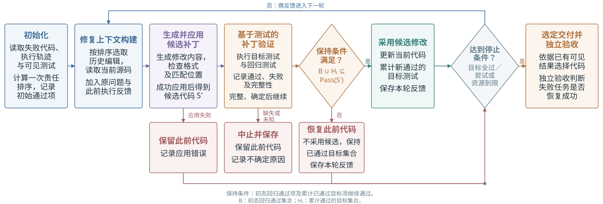
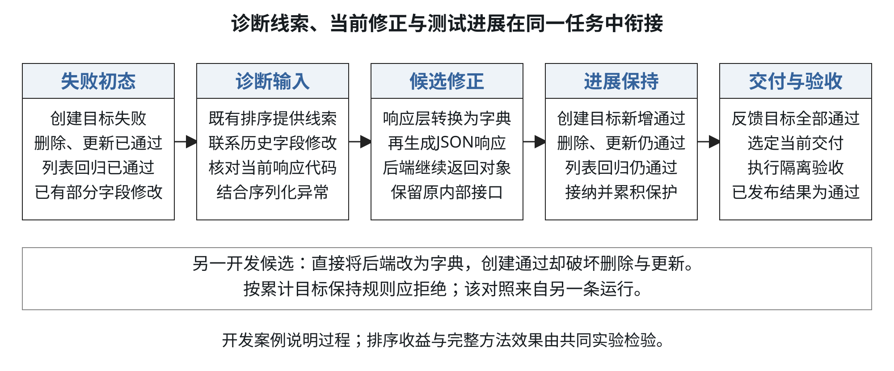

# 按页文案与补充备注

对应本版46页PPT。前五章含封面、目录及章节页共40页；参考文献分为15、15、12项三页。备注仅保留解释、例子、过渡与来源。

## 第1页 封面

面向智能体失败任务的

责任步骤排序与恢复方法研究

开题报告  ·  汇报人：杨亚鹏  ·  2026年10月

Responsibility Step Ranking and Recovery for Failed Agent Tasks

## 第2页 目录

01.

02.

03.

04.

05.

06.

背景与现状

目标与意义

内容与方法

难点与创新

实验与数据

进度与文献

Background and Related Work

Objectives and Significance

Research Content and Methods

Challenges and Contributions

Experiments and Data

Schedule and References

## 第3页 背景与现状

## 第4页 1.1 研究背景

软件任务中的智能体连续执行

大语言模型（Large Language Model，LLM）通过大规模语料学习语言与代码规律，能够理解自
然语言要求、生成解释及程序代码，为软件开发自动化提供新的技术基础。[1] 模型输出仍需要在具
体程序和环境中执行，才能判断是否满足要求；真实仓库问题还涉及实现检索、接口关系及测试验
证，因而需要连接生成能力与外部执行。[2,5]

为支持任务的持续执行，研究将大语言模型与工具调用、环境观察和过程管理结合，形成大语言模
型智能体（Agent）。模型依据当前问题与观察选择动作，工具执行读取、编辑或命令，环境返回
结果，再参与下一轮决策。[3] 求解由一次生成扩展为围绕目标的连续交互，检索为编辑提供依据，
代码变化影响测试结果，执行反馈又影响后续修改。

在多角色系统中，不同智能体还可承担需求分析、规划、实现与验证等职责，通过消息和中间产物
协作。[16,17] 按时间保存的内容、动作、观察及角色信息形成执行轨迹，记录当前产物如何形成，
并保留工具使用和职责交接线索。轨迹为分析智能体执行提供过程数据，代码差异与可执行测试则
使软件场景中的操作及结果能够进一步检查。[4,5]

### 补充备注

例如，模型可以写出一段语法正确的代码，却仍需从仓库找到调用接口并实际执行。后面分析的日志来自这样的执行循环，观察对象由一次回答扩展为一连串动作。来源：[1] https://www.jos.org.cn/jos/article/abstract/7593[2] https://proceedings.neurips.cc/paper_files/paper/2024/hash/5a7c947568c1b1328ccc5230172e1e7c-Abstract-Conference.html[3] https://openreview.net/forum?id=WE_vluYUL-X[4] https://proceedings.iclr.cc/paper_files/paper/2024/hash/e9df36b21ff4ee211a8b71ee8b7e9f57-Abstract-Conference.html[5] https://proceedings.iclr.cc/paper_files/paper/2024/hash/edac78c3e300629acfe6cbe9ca88fb84-Abstract-Conference.html[16] https://openreview.net/forum?id=BAakY1hNKS[17] https://proceedings.iclr.cc/paper_files/paper/2024/hash/6507b115562bb0a305f1958ccc87355a-Abstract-Conference.html

## 第5页 1.1 研究背景

失败执行的诊断与持续修复需求

连续执行也使失败原因的识别更加困难。需求理解偏差可能影响后续多次编辑，一次错误操作可能
经多个步骤传递，直到集成或测试阶段才表现为异常。[6,7] 异常出现的位置、引入问题的位置以及
错过纠正机会的位置可能并不相同。仅检查最后一条报错，难以解释完整过程；逐步阅读全部记
录，又面临轨迹增长带来的分析负担。

失败后的软件状态通常已经包含若干修改和验证结果。历史记录描述既往操作，实际代码却可能经
过后续覆盖或接口调整，因而历史可疑位置不能直接等同于当前补丁的应用位置。[8] 同时，已有修
改可能实现部分要求，后续修正还需保留应有行为。自动程序修复中的补丁生成与验证研究表明，
修改是否有效，需要结合具体上下文及执行结果判断。[9]

由此，失败后的处理需要同时面向过程分析与任务完成：一方面，从分散的历史记录中确定优先检
查的步骤，减少无效排查；另一方面，将这些线索与当前实现、未完成要求和测试反馈结合，继续
修正软件状态。诊断结果只有进入实际修复过程，其对任务完成的作用才能得到检验。 本课题据此
研究责任步骤排序及诊断引导的失败任务恢复，分别评价历史判断、连续修正与最终交付。

### 补充备注

可用“修改接口后，直到后续调用才报错”帮助理解错误与症状之间的距离。失败后的代码也可能已经完成部分要求，因此下一步既要查历史，又要考虑怎样继续已有工作。来源：[6] https://papers.nips.cc/paper_files/paper/2025/hash/b1041e52d3be19f0a9bc491657488e4a-Abstract-Datasets_and_Benchmarks_Track.html[7] https://proceedings.mlr.press/v267/zhang25cq.html[8] https://proceedings.mlr.press/v267/guo25l.html[9] https://www.jos.org.cn/html/2025/4/7268.htm

## 第6页 1.2 从失败诊断到任务恢复

本课题将分析已失败执行轨迹、输出历史步骤检查次序的过程称为失败诊断。候选是轨迹中的推
理、读取、源码编辑及验证步骤，责任标签沿用数据来源的规范。模型联系需求、动作和后续反馈，
判断哪些步骤应优先检查；同一条证据对不同候选可能具有不同作用。

诊断结果还需转换为可以实施的修复依据。常规源码缺陷定位以文件、函数或代码行为作为候选，
[10] 本课题则先评价历史执行步骤，再从中筛选实际源码编辑并核对当前实现。由此，将从失败执
行留下的代码和环境出发、利用诊断继续完成原任务的过程称为失败任务恢复。其输入包含原问
题、历史操作、当前代码与允许的测试反馈，输出是最终选定的代码交付。

失败轨迹提供过程证据，当前代码提供实际修改对象，测试提供可执行的判断依据。三者分别对应
历史分析、当前操作与结果验证，构成两项研究相互衔接的基础。

两项研究分别评价标注责任步骤的优先检出能力与失败初态下的任务恢复效果。它们通过实际修复
输入衔接：先检查排序是否改变了选入编辑与当前代码上下文，再分析这些变化怎样影响候选、状
态更新和最终结果。只有选定交付通过与生成过程隔离的独立验收，才判定恢复成功。

### 补充备注

两类位置要区分：历史上值得先查的步骤，与当前文件中可以修改的位置。一个高责任步骤可能只是遗漏检查；即使诊断合理，恢复器也仍须找出现在能采取的动作。下面先看已有研究如何处理这两个对象。来源：[10] https://www.jos.org.cn/jos/article/abstract/7288

## 第7页 1.3 国内外研究现状

失败轨迹的责任步骤诊断

2025年建立失败分类与责任定位，2026年进一步研究监督、过程信息与可学习诊断。

- MAST（Cemri等，2025）：归纳失败类型；具体排查还需定位责任步骤。[6]

- Who&When（Zhang等，2025）：标注责任角色和关键步骤，比较整轨迹、逐步及二分诊断，
使位置判断具有共同评价依据。[7]

- AgenTracer（Zhang等，2026）：重放与故障注入构造监督，并以诊断反馈改进任务；实际修
复输入的作用仍需分辨。[19]

- TraceElephant（Chen等，2026）：研究完整执行信息对归因的影响，表明比较需统一可观测
输入。[20]

- StepFinder（Zhu等，2026）：融合语义、时序与跨步注意力学习评分，提供质量与推理成本的
直接参照。[15]

待检验问题：统一输入与划分后，局部联系和候选上下文能否互补？以主流诊断基线比较质量与成
本，再由关系、上下文及参数控制解释增量。

### 补充备注

2025年的分类与定位工作在问题定义上互补，同年列出的先后不表示相互继承。AgenTracer已用诊断反馈改善任务，StepFinder也已有跨步骤注意力；本文的比较重点应落在共同输入下的具体证据组织。后续采用关系置换、参数匹配与候选查询替换，正是为了区分连接、容量和读取方式的作用。来源：[6] https://papers.nips.cc/paper_files/paper/2025/hash/b1041e52d3be19f0a9bc491657488e4a-Abstract-Datasets_and_Benchmarks_Track.html[7] https://proceedings.mlr.press/v267/zhang25cq.html[15] https://doi.org/10.1145/3770855.3817991[19] https://proceedings.iclr.cc/paper_files/paper/2026/hash/134ed7a477770f227f12450ef0cbb8f4-Abstract-Conference.html[20] https://aclanthology.org/2026.acl-long.912/

## 第8页 1.3 国内外研究现状

诊断支持的失败任务恢复

- CRITIC（Gou等，2024）：以工具反馈检查和修订输出，奠定反馈驱动的连续修正方式。[22]

- Agentless（Xia等，2025）：固定定位、生成与验证阶段，以回归及复现测试筛选候选，说明完
整流程具有竞争力。[29]

- SyncMind（Guo等，2025）：评价代码与环境失步后的恢复，突出历史认识与当前实现的核
对。[8]

- EnAgent（Tian等，2026）：以生成、剪枝和选择组织候选集成，是完整方法比较的
强基线。[30]

- AOrchestra（Ruan等，2026）：动态配置子智能体与上下文，代表任务相关的协作求解。[31]

- DoVer（Ma等，2026）：干预消息或计划并验证结果，以任务解决及进展检验诊断，推动任务
导向的调试评价。[33]

待检验问题：软件失败状态中，历史编辑选择是否改变修复依据，累计目标保持是否改善后续路
径？与固定流程、集成及协作方法共同评价，再用输入和保持策略对照解释作用。

### 补充备注

固定流程、候选集成和动态协作都可能完成同一个软件问题，选用它们是为了覆盖主流的完整求解机制。AutoCodeRover与RepairAgent在全文中补充说明结构检索和工具交互的演进。DoVer主要改变消息或计划，本文则修改软件状态；两者能相互启发，效果应在各自任务条件下判断。下面将已有研究中的这些联系收束为本文要回答的问题。来源：[8] https://proceedings.mlr.press/v267/guo25l.html[22] https://proceedings.iclr.cc/paper_files/paper/2024/hash/fef126561bbf9d4467dbb8d27334b8fe-Abstract-Conference.html[29] https://doi.org/10.1145/3715754[30] https://doi.org/10.1145/3744916.3787761[31] https://proceedings.mlr.press/v306/ruan26e.html[33] https://proceedings.iclr.cc/paper_files/paper/2026/hash/2f5fdce256ff0d7fb774da76e5e63209-Abstract-Conference.html

## 第9页 1.4 有待解决的研究问题

复杂执行过程中的失败诊断问题。 智能体通过连续的需求理解、信息获取、代码操作与结果检查完
成任务，相关证据分布于不同时间和角色的记录中。同一条反馈可能支持多个历史步骤的判断，某
个步骤的重要性也需要联系后续行为理解。现有位置标注提供了评价依据，但从过程记录形成有效
诊断，还需回答如何组织分散证据、区分候选作用，以及怎样控制长轨迹分析的代价。该问题要求
形成具有区分力的步骤检查次序，并说明诊断在不同执行条件下的质量与成本，为失败分析和后续
修复确定重点。

面向任务完成的失败任务恢复问题。 失败执行留下的历史操作、当前代码及部分功能共同构成继续
求解的起点。历史可疑位置可能已被后续修改覆盖，新补丁也可能在修正一个目标时破坏另一目
标。因而，恢复既需要把过程诊断转化为针对当前状态的可实施修改，也需要依据反馈协调继续修正
与已有进展的保持。中间测试改善与最终完成要求具有不同判定依据，研究还需将输入、候选与状
态变化同独立验收联系起来，在共同条件下评价诊断支持的修复过程及其任务效果。

### 补充备注

提出问题时先交代需求与矛盾，具体算法留到第三章。前一问题对应怎样判断历史，后一问题对应怎样继续任务；这层关系也决定后面分开评价，再检查二者的接口。

## 第10页 目标与意义

## 第11页 2.1 研究目标

总体目标是从已失败执行的过程证据中确定检查重点，再支持当前软件状态下的持续修复，以完成
原始任务。研究以历史步骤为诊断对象，以失败后的软件状态为恢复起点，将离线责任判断、实际
修复行为与最终任务效果纳入相互衔接的评价。

RQ1：如何从连续执行记录中识别关键责任步骤，形成准确且代价可控的失败诊断？ 研究历史步骤
的共享评分函数，输出轨迹内责任次序，评价定位、排序质量与诊断开销，并分析不同证据与轨迹
条件的作用。

RQ2：如何将失败诊断转化为有效修复依据，并支持连续修正以提高失败任务恢复成功率？ 研究历
史线索与当前代码的对应、反馈驱动的补丁生成和已通过测试保持，评价实际信息使用、修复路径
与最终任务完成之间的联系。

两项研究以责任排序为接口，以实际输入和状态记录追查联系。RQ1的离线质量与RQ2的任务效果
分别报告，排序替换用于检验诊断差异是否真正进入修复过程。

### 补充备注

第二章在这里正式引入两个RQ编号，后续用编号保持目标、方法与实验的对应。一个诊断器可能离线判断准确，却没有改变编辑材料，因此两项目标需要分别评价。

## 第12页 2.2 研究意义

对应RQ1：为智能体失败分析与调试提供过程依据。 软件缺陷定位研究旨在减轻开发者理解问题、
查找原因的负担。[10] 智能体执行进一步将错误线索分散到需求理解、工具调用与多角色交接过
程，形成了对历史行为进行分析的需求。研究不同记录怎样共同支持责任步骤判断，有助于将最终失
败与具体执行过程建立对应，为历史操作的优先检查、运行可靠性分析和人工调试提供细粒度依
据。对诊断质量与代价的联合评价，还能说明何种信息组织适用于不同长度和结构的轨迹，为过程分
析方法的选择提供参考。

对应RQ2：支持利用已有工作持续完成软件任务。 软件维护既需要提出修改，也需要验证修改并保
留应有功能。[9] 失败执行往往已经形成部分代码与测试进展，历史操作和当前状态因而具有可继续
利用的信息价值。研究诊断如何参与修复输入，以及新修改怎样影响已通过行为，可为减少重复排
查、支持人工接管和提高智能体辅助维护的可用性提供依据。通过将诊断指标、修复路径与独立验
收分别评价，再检验三者之间的联系，还可为理解过程诊断在实际任务中的作用提供实证基础。

### 补充备注

可用人工接管场景说明意义：开发者既希望少读无关日志，也希望知道哪些既有功能应保留。学术价值来自对过程信息作用及连续修复机制的检验，实际价值对应排查和维护工作。来源：[9] https://www.jos.org.cn/html/2025/4/7268.htm[10] https://www.jos.org.cn/jos/article/abstract/7288

## 第13页 内容与方法

## 第14页 3.1 研究对象及任务定义

| 研究部分 | 研究对象 | 方法设计 | 评价依据 |
| --- | --- | --- | --- |
| 责任步骤排序 | 失败执行轨迹 | 稀疏日志关系与候选相关上下文评分 | 定位与排序、表示控制、诊断成本 |
| 失败任务恢复 | 失败代码与运行环境 | 排序引导上下文、反馈修复与测试保持 | 完整方法比较、排序替换、接纳对照 |

诊断对象：失败轨迹τ=(x₁,…,xₘ)，保留步骤内容、角色与索引，以单责任标签y学习共享评分函
数。[7,19,20]

恢复对象：原问题q、失败代码与环境S₀、轨迹及许可测试。反馈测试用于连续修正，独立验收评
价选定交付。

RQ1可覆盖不同任务类型，RQ2限定软件状态；两项评价通过排序接口衔接，不要求同题，恢复不
依赖责任标签。

表3-1 两项研究的对象、方法与评价依据

### 补充备注

轨迹标注与独立验收属于不同接口。前者教模型怎样判断历史位置，后者评价已经选定的代码交付；恢复时不向模型提供责任答案。来源：[7] https://proceedings.mlr.press/v267/zhang25cq.html[19] https://proceedings.iclr.cc/paper_files/paper/2026/hash/134ed7a477770f227f12450ef0cbb8f4-Abstract-Conference.html[20] https://aclanthology.org/2026.acl-long.912/

## 第15页 3.2 总体研究框架

图3-1 责任步骤排序与失败任务恢复的研究框架

### 补充备注

先沿图中主线理解数据怎样流动，再看每个模块。两项研究的衔接证据是恢复器实际收到的内容；配置中写了排序器名称，还不足以说明排序已经改变输入。

## 第16页 3.2 总体研究框架

总体研究方案与实施基础

方案组织：以过程诊断支持任务恢复。 RQ1在已有位置监督下学习历史步骤评分，结合预训练语
义、稀疏日志联系与候选相关上下文组织证据；RQ2沿用候选生成与测试验证的程序修复框架，将排
序筛选的历史信息和累计测试保持作为研究变量。[9,29] 两项研究分别评价，再通过实际输入分析
诊断如何参与恢复。

可行性基础：数据、方法与执行条件相互对应。 诊断已有轨迹及责任监督，可利用固定语义表示训
练后续评分参数；恢复已有可重建的软件问题、失败代码、轨迹与反馈测试。公开开发记录已展示
排序输入、当前代码修正和测试验证的实际衔接，为接口实施提供依据。正式评价仍需固定模型与
任务划分，完成共同准备及独立验收。

创新与验证：围绕机制作用形成可检验增量。 RQ1检验局部联系与候选上下文是否互补及何时有
效，RQ2检验诊断输入与目标保持怎样影响修复路径。完整强基线比较评价总体表现，关系、上下
文、排序及保持策略控制解释作用，未参与选择任务的独立确认检验选定方案。已有模块的组合服务
于这些问题，最终贡献以研究证据而非模块数量判断。

### 补充备注

实现基础说明现有条件能够支持研究。正式比较仍需固定数据使用及配置，避免把开发过程中选择出来的结果当作独立确认。接下来分别解释诊断和恢复内部的设计。来源：[9] https://www.jos.org.cn/html/2025/4/7268.htm[29] https://doi.org/10.1145/3715754

## 第17页 3.3 关系增强的上下文感知责任排序

图3-2 责任步骤排序模型的计算结构

### 补充备注

图中的局部连接与远处读取分别回答证据从哪里来、对当前候选有多重要。已有方法也使用注意力，比较应识别具体组织方式带来的变化。

## 第18页 3.3 关系增强的上下文感知责任排序

步骤表示与可观测关系

本模块以内容、角色与日志结构共同表征执行步骤。文本由固定的预训练编码器提取向量，后续表
示与评分参数参与训练；这样既利用已有语义表示，也将学习重点放在过程证据的组织上。角色按
轨迹内首次出现顺序匿名编号，保留同一轨迹中的身份对应；结构特征描述记录形式、相对位置及
重复情况。

关系构造依据运行日志中可直接获得的时间、角色、完整记录结构与非空动作结构。来源提供明确
记录配对时，先融合对应信息；其余步骤使用原表示。非时间关系连接前后最近的同类记录，并固
定每通道的邻居上限，使连接规模随轨迹长度线性增长。该设计以可观测联系约束局部信息读取，
降低无差别汇集所有邻步的开销。[35]

这些联系反映可获得的执行结构，同角色或同结构并不直接等同语义依赖。模型仍需结合步骤内容
和后续反馈形成候选判断。[36,37] 因而，关系表示的研究重点在于其是否提供有用补充，以及收益
是否依赖连接对应、轨迹长度和关系重合；编码维数、配对处理与邻居数量作为实现配置记录。

### 补充备注

匿名角色可以理解为同一轨迹中的编号：先出现的角色记为1，下一个新角色记为2。另一个任务的编号1不表示同一身份；模型利用的是轨迹内部交接和协作结构。来源：[35] https://doi.org/10.1007/978-3-319-93417-4_38[36] https://doi.org/10.1145/3798271[37] https://arxiv.org/abs/2610.01256

## 第19页 3.3 关系增强的上下文感知责任排序

门控多关系消息传递

沿四类日志关系汇集邻步信息，输出关系增强表示。接收步骤与两步差异共同决定每条消息的门
控。[35]

g为0到1的标量，φ将邻步内容及差异变换为消息。每边独立门控，各通道内取邻居均值；无邻居通
道取零向量。

四通道另作归一化加权，与原表示残差相加并归一化，采用两层更新。

该结构限定局部证据的读取与融合方式。同一邻步可能在多通道重复出现，实验分析关系对应、连
接重合和覆盖对判断的作用。

### 补充备注

若两个步骤属于同一角色且在时间上相邻，它们可能同时出现在两类关系中。门控会改变消息强度，却不自动消除这种重合，因此需要用关系控制核对效果来源。来源：[35] https://doi.org/10.1007/978-3-319-93417-4_38

## 第20页 3.3 关系增强的上下文感知责任排序

全局自注意力聚合

局部传播范围受连边限制。本模块读取全轨迹，为每个候选步骤形成相关上下文，补充远处需求与
测试反馈。[38]

查询对应候选，键匹配记录，值承载内容。均匀注意力使修正项为零、cᵢ=h̄；非均匀权重形成
候选相关修正。

均值与共享查询分别检验非均匀聚合和候选条件化。密集计算约O(m²d)，结合轨迹长度评价质量与
成本。[39]

### 补充备注

可用一条早期需求说明候选相关性：它可能直接关联某次编辑，对另一次读文件却帮助较小。均值汇总给每个候选同样的摘要；查询条件化允许调整读取重点。来源：[38] https://proceedings.neurips.cc/paper_files/paper/2017/hash/3f5ee243547dee91fbd053c1c4a845aa-Abstract.html[39] https://aclanthology.org/2024.tacl-1.9/

## 第21页 3.3 关系增强的上下文感知责任排序

轨迹内责任评分

MLP综合初始表示、关系增强表示、候选上下文及其差异，输出步骤分数；单责任位置交叉熵训练
共享评分函数。[13]

单责任监督采用one-hot标签：4步轨迹标注第2步时为(0,1,0,0)，损失−log p₂。0表示非标注位
置。[12,13]

在其他分数固定时，提高标注步骤分数会降低损失，模型据此学习组内检查优先级。单标签以外的
完整次序由共享函数估计。[11]

### 补充备注

one-hot的0表示该位置没有被选作当前数据的责任标签，不能推成该步骤在现实中毫无影响。训练利用单位置监督，完整排序的其他位置仍是模型估计。来源：[11] https://doi.org/10.1145/1273496.1273513[12] https://doi.org/10.1561/1500000016[13] https://research.google/pubs/an-analysis-of-the-softmax-cross-entropy-loss-for-learning-to-rank-with-binary-relevance/

## 第22页 3.4 诊断引导的失败任务恢复

图3-3 失败任务恢复流程

异常分支停止生成；已有交付仍独立验收，结果不确定时记为未知。

### 补充备注

实际求解中，拒绝候选后可以把这次失败作为下一轮反馈，当前代码仍回到原接纳快照。图中反馈测试属于求解过程，交付后的独立验收承担另一项判断。

## 第23页 3.4 诊断引导的失败任务恢复

诊断输入与反馈修复的组织

历史诊断与当前修改之间存在对象差异：诊断评价执行步骤，补丁作用于当前源码。恢复器因此先
沿责任次序筛选实际成功改变项目源码的历史编辑，再联系相应函数与当前失败反馈读取现有实
现。历史差异表征既往操作，当前源码确定本轮修改所面对的状态。 排序提供检查线索，生成模型仍
需判断线索与当前错误的联系。

输入组织采用固定排序与累计编辑前缀，逐轮补充优先历史材料，每轮刷新当前源码和反馈；前缀
日程、输入容量与截断规则在正式评价前固定。共同背景提供原问题、原始轨迹及公开反馈，排序
模块在此基础上另行呈现选中差异。因此，全步骤次序的变化可能在编辑筛选后消失，其作用需要
通过有效编辑列表和实际请求检验。

生成模型据此提出候选补丁，执行端应用并运行预定反馈测试，将修改结果用于下一轮求解。
[22,28] 原问题规定任务目标，历史编辑提供过程线索，当前代码与测试反馈约束本轮修正，四类信
息共同构成恢复依据。去专门编辑输入评价显式历史选择的增量，去当前读取评价历史与现状对应
的作用；共同信息权限及其他求解条件保持一致。

### 补充备注

若两个全步骤排序在过滤非编辑步骤后得到相同的前三条差异，实际模型请求可能完全相同。应保留这种无差异情形，用真实输入解释诊断指标为何未必转成恢复收益。来源：[22] https://proceedings.iclr.cc/paper_files/paper/2024/hash/fef126561bbf9d4467dbb8d27334b8fe-Abstract-Conference.html[28] https://doi.org/10.1109/ICSE55347.2025.00157

## 第24页 3.4 诊断引导的失败任务恢复

已通过测试保持与交付

Tgoal为预先固定的目标测试集合，检查本次问题要求；B为初态已通过的回归，Hₜ为Tgoal中累
计通过的目标。[9,29]

Moto例：Tgoal={创建、删除、更新}，初态H₀={删除、更新}；列表分页属于回归。创建通过后
加入H，Tgoal始终不变。

接纳后Hₜ₊₁=Hₜ∪(Pass(S′)∩Tgoal)，拒绝则代码与H不变。固定测试、完整确定结果下，接纳
状态保持累计H。

目标全过、尝试耗尽或资源到限时停止，按当时反馈选交付并独立验收。交付可能不同于最后状
态；保持性质与最终任务收益分别检验。

### 补充备注

T_goal中的goal指任务目标。Moto初态尚未通过创建，但创建仍属于T_goal；它只有在接纳候选中通过后才进入H_t。列表分页检查原有行为，属于B。固定目标集合与动态通过子集的区别解释了后续为什么需要更新保护集合。来源：[9] https://www.jos.org.cn/html/2025/4/7268.htm[29] https://doi.org/10.1145/3715754

## 第25页 3.5 方法过程示例

图3-4 Moto案例中的诊断输入、候选修正与测试保持

### 补充备注

该例中，响应层负责把对象转换为返回值，后端对象仍需服务其他内部操作。另一条开发运行的退化候选用于说明规则判断，讲述时不可把它拼成本次运行先失败再成功的历史。

## 第26页 难点与创新

## 第27页 4.1 关键技术难点

RQ1：有限位置监督下的证据选择与质量成本取舍。 责任位置标签指出应优先检查的步骤，却不能
直接给出各条联系及上下文的相关性监督。同一异常可能与多个历史步骤相关，错误引入与反馈出
现又可能相隔较远，模型因而需要在间接监督下区分有用证据、重复信息与无关记录。局部联系有
助于组织近邻证据，但日志中存在联系并不等于存在责任关系；全轨迹读取能够覆盖远处信息，也
会增加干扰与计算开销。中心难点是使局部传播与候选相关读取承担不同作用，既保留候选自身信
息，又避免多次聚合削弱步骤间的区分。方案的合理性取决于这种分工能否在共同条件下改善责任
排序，并形成可接受的质量成本取舍。

RQ2：历史诊断到当前修复的有效转化与进展保持。 责任排序评价历史行为，补丁生成操作当前源
码，两者之间存在对象与状态差异：高位步骤可能不含源码编辑，历史修改也可能已被覆盖，因此
排序改善未必形成有效修复输入。另一方面，接纳一个候选不仅改变当前代码，还会改变下一轮反
馈及累计目标集合，使后续可接纳状态受到新的约束。严格保持有助于防止已有行为退化，却也可
能阻碍需要关联修改才能完成的修复。中心难点是把历史检查重点转化为当前可用线索，并协调进
展保护与后续求解空间。因此，需要区分诊断是否改变实际输入、保持规则是否改变运行路径，以
及这些变化是否最终改善独立验收结果。

### 补充备注

难点不是为选定模块取名称。这里先说明可用监督与所需证据不匹配，以及旧信息和当前状态不一致怎样影响求解，再引出下一页的具体设计与检验。

## 第28页 4.2 拟研究的创新设计与验证

RQ1：面向责任步骤排序的局部关系与候选上下文协同建模。 拟以共享步骤评分为基础，通过门控
多关系消息传递组织显式局部联系，再以候选条件化的全轨迹聚合补充远处证据，并保留初始表示
参与判断。拟检验的技术判断是：局部结构为责任判断提供执行联系，候选相关读取补充局部传播
范围外的证据，两者能够形成互补的候选表示。研究增量体现为这种证据组织方式在责任排序中的
作用及有效条件。完整基线比较评价定位、排序与成本；去关系、均值及共享查询替换检验两类信
息的增量，参数匹配和关系置换辨析容量及连接因素。对照无增益时据实收缩协同主张，质量改善
同时结合实际开销评价。

RQ2：面向失败任务恢复的诊断输入与累计目标保持机制。 拟将责任排序用于历史编辑选择，并结
合当前源码与反馈构建修复输入；将接纳状态中新通过的目标测试纳入后续保护，使进展保持直接
参与连续修正的状态更新。拟检验两个相互衔接的判断：诊断能够改变生成模型实际获得的有效信
息；累计保护能够减少已通过目标退化，并形成有利于最终完成任务的修复路径。研究增量体现为
两项机制对信息使用和状态演化的具体作用。排序替换与输入消融检验实际信息变化，集合、数量
及仅回归保持的独立运行比较后续路径，再与完整强基线共同评价恢复成功率和资源消耗。集合保
持性质由规则推导，任务收益及其代价由独立验收和资源记录检验。

### 补充备注

创新设计的价值要由指定对照检验。若去关系后没有变化，局部信息增量就缺少支持；若排序替换没有改变编辑请求，影响只能定位在诊断层。累计保持的规则性质可以推导，但它是否帮助最终完成任务需要独立轨迹和验收结果。下一章据此展开实验。

## 第29页 实验与数据

## 第30页 5.1 数据来源与任务组织

| 数据来源 | 发布规模 | 研究样本与组织 | 用途 |
| --- | --- | --- | --- |
| AFTraj | 2,276条轨迹 | 731条候选轨迹、716个任务组 | 责任定位与排序 |
| AgenTracer | coding训练1,141条、测试127条 | 614条训练验证（320 coding、294 math）363条coding开发集合 | 诊断开发与划分分析 |
| SWE-Gym | 2,438个Python问题 | 固定20个不同问题、覆盖5仓库 | 失败初态与恢复比较 |

诊断采用AFTraj与AgenTracer，恢复整理已有软件问题的失败初态。[40,41,42]

表5-1 数据来源与研究样本

固定20题用于开发比较，3题待复核。方法固定后另行组织未参与选择的恢复任务，独立确认并分
别计分。

### 补充备注

来源数据量、开发问题量与独立评价量承担不同作用。例如，同一问题的多条派生轨迹不能简单当作多个互不相关的新任务。来源：[40] https://proceedings.mlr.press/v267/pan25g.html[41] https://huggingface.co/datasets/ZBox008003/AFTraj/blob/main/README.md[42] https://github.com/bingreeky/AgenTracer/releases/tag/data-v1.0.0

## 第31页 5.2 实验流程计划与执行

先准备共同数据与起点。 按原问题给诊断轨迹分组，划分训练、验证和评价；为恢复任务保存失败
后的源码、环境、历史轨迹与反馈测试，重建后确认原问题仍未完成。该阶段产物是任务划分及可
重复的失败快照，保证后续比较面对同一问题。

再开发并固定方法。 用训练数据学习诊断模型，验证数据选择配置；检查完整基线与本文恢复接
口，确定模型、输入容量、内部尝试、测试与交付规则。开发结束后固定版本，正式评价期间不根据
单题结果调整方法配置。

随后执行开发比较与独立评价。 将留出的轨迹输入各诊断方法，保存位置或排序与成本；将相同失
败初态分别交给各恢复方法，独立运行3次，逐轮记录请求、候选与测试，在15/30/60分钟保存当
时选定的交付。选定后再运行隔离验收，得到逐题结果。20题开发比较先执行以固定方案，随后按
同一流程对独立任务确认，两阶段分别计分。

最后进行解释性对照。 完整比较确认总体表现，排序替换、输入消融和保持策略对照进一步改变一
个因素，核实际输入或决定是否变化，再观察是否影响最终恢复。各阶段由准备材料、固定配置、
实际输出到验收结果连续对应。

### 补充备注

整体计划的前后依赖是：先确定能共同执行的对象，再固定配置，最后运行和验收。若环境准备失败，应记为准备状态，不能据此判断某算法修复失败。

## 第32页 5.2 实验流程计划与执行

诊断训练与评价设计

AFTraj：五折任务组评价。 每次留一折，其余组内部训练验证、选择轮次，再用外层其余组重训并
预测留出折。保证外折预测来自未训练过该任务的模型，同任务记录先平均，避免派生轨迹数量影
响权重。

AgenTracer：检查划分敏感性。 614条含320 coding与294 math，拟作A/B/C三种492/122任务
组划分；另363条coding与来源池任务组无交集。共同开发对象保持一致，才能分别归纳数据划分
变化与方法变化，用于方法选择。

三次初始化观察训练随机性；A/B/C检查数据分配敏感性，两类编号分开。单模型分别报告，预定
的三模型集成另列。初始化和集成均不增加独立任务数，参与选模的材料作为开发证据。

开发结束固定结构、选轮规则与部署方式，再对历史使用及任务重叠核验通过的独立轨迹评价。诊
断器共享步骤、标签与信息许可，保留无效输出及成本。各来源单独报告，检验方案在未参与选择
任务上的表现及适用条件。

### 补充备注

数据划分与初始化回答两个不同的不确定性来源。前者改变训练看到了哪些任务，后者改变相同训练材料下的优化起点；三次初始化也不等于增加三倍独立问题。

## 第33页 5.2 实验流程计划与执行

| 实验因素 | 共同控制 |
| --- | --- |
| 评价起点 | 同一原问题、失败代码、环境与源码访问许可 |
| 生成条件 | deepseek-flash及预定参数，各方法保留完整流程 |
| 信息与反馈 | 共同反馈测试与许可范围，记录候选及状态变化 |
| 重复单位 | 每题每方法3次，各次从相同初态独立启动 |
| 资源与交付 | 15/30/60分钟节点，30分钟主比较，统一token上限 |
| 验收与汇总 | 选定交付后隔离验收，同题重复先汇总再问题等权 |

每题重建相同失败初态，分别启动各方法的独立重复。本文先计算排序，再运行输入组织、候选生
成、测试与状态更新；基线按完整求解机制运行。

表5-2 恢复实验的共同评价设置

### 补充备注

同一失败代码应复制成各方法独立执行的起点，不能让后一方法使用前一方法已经修好的代码。公平性同时涉及可见材料、模型、资源和最后如何判定。

## 第34页 5.3 评价指标与资源设置

| 指标 | 计算与含义 |
| --- | --- |
| Top-1 ↑ | 任务组等权首位命中率 |
| MRR ↑ | 标注位置倒数排名的任务组等权均值 |
| Hit@3 / Hit@5 ↑ | 标注责任进入前3/5位的任务组等权比例 |
| 诊断耗时P50 / P95 ↓ | 首次加载及已加载条件下的中位数/95分位数 |
| 失败任务恢复成功率RSR ↑ | 同题3次运行先平均，再对共同问题等权 |
| RSR@15 / 30 / 60min ↑ | 节点前选定交付的独立验收成功率 |
| 资源消耗 ↓ | 输入输出token总量、大模型API请求次数 |

表5-3 主要评价指标

单位置诊断共同比Top-1，完整排序再比MRR与Hit@3/5；恢复先汇总同题3次，再对问题等权。

### 补充备注

Top-1适用于只给一个位置的方法。完整排序另外提供前几次检查命中情况；不能把单位置输出的其余名次自行补齐，再比较排序指标。

## 第35页 5.3 评价指标与资源设置

失败任务恢复成功率与资源

主比较为30分钟，15/60分钟来自同一运行快照。z表示节点前选定交付的验收结果，Uᵦ为各方法
三次均可判定的共同问题集。

同题3次先平均，再对共同问题等权。预算内未成功、验收未知与未运行分别记录，报告全计划矩阵
及完整配对数。

token及API请求覆盖诊断、生成、选择、子智能体与重试，工具和测试占预算。共同上限与内部参
数在运行前固定。

### 补充备注

一个任务的三次完整运行先在任务内部汇总，随后各任务等权，避免某个问题因为重复更多而左右总体结果。验收未知也应独立保留。

## 第36页 5.4 基线方法及共同比较

| 方法 | 正式发表时间 | 发表载体 | 核心机制 | 评价指标 |
| --- | --- | --- | --- | --- |
| All-at-Once | 2025.10 | ICML | 整轨迹一次性归因 | Top-1、耗时、token、API请求次数 |
| Binary Search | 2025.10 | ICML | 区间判断与二分搜索 | Top-1、耗时、token、API请求次数 |
| StepFinder | 2026.08 | KDD | 时序、角色交互与步骤评分 | Top-1、MRR、Hit@3/5、耗时 |
| 本文方法 | — | 本课题 | 关系传播与候选相关上下文 | Top-1、MRR、Hit@3/5、耗时 |

表5-4 失败诊断基线及正式发表时间

同轨迹、步骤边界、任务划分和标签，保留各方法完整结构。共同比Top-1与成本，单位置输出不
补造排名。[7,15]

### 补充备注

Who&When代表直接分析日志，StepFinder代表可学习的轻量诊断。共同比较两类方法，有助于同时判断诊断质量及代价，而不是只与弱配置比较。来源：[7] https://proceedings.mlr.press/v267/zhang25cq.html[15] https://doi.org/10.1145/3770855.3817991

## 第37页 5.4 基线方法及共同比较

| 方法 | 正式发表时间 | 发表载体 | 核心过程 | 评价指标 |
| --- | --- | --- | --- | --- |
| Agentless | 2025.06 | FSE / PACMSE | 定位、生成、复现与回归筛选 | RSR@15/30/60min、token、API请求次数 |
| EnAgent | 2026.04 | ICSE | 多轨迹、回归剪枝、工具选择与投票 | RSR@15/30/60min、token、API请求次数 |
| AOrchestra | 2026.09 | ICML | 动态子智能体及上下文配置 | RSR@15/30/60min、token、API请求次数 |
| 本文方法 | — | 本课题 | 诊断输入、反馈修复与测试保持 | RSR@15/30/60min、token、API请求次数 |

表5-5 失败任务恢复基线及正式发表时间

同失败初态、模型、信息、预算和验收，保留完整流程。StepFinder接本文恢复器仅用于排序控
制。[29,30,31]

### 补充备注

将别的诊断器接到同一恢复器，只能隔离诊断输入的作用。与Agentless、EnAgent和AOrchestra比较，才是在完整方法层面检验任务效果。来源：[29] https://doi.org/10.1145/3715754[30] https://doi.org/10.1145/3744916.3787761[31] https://proceedings.mlr.press/v306/ruan26e.html

## 第38页 5.5 消融实验与作用机制分析

| 研究部分 | 条件 | 改动与要回答的问题 |
| --- | --- | --- |
| RQ1 | Full | 完整模型，作为共同参照 |
| RQ1 | w/o RelProp | 去掉关系传播，局部联系是否有用 |
| RQ1 | w/o StepCtx | 均值替代注意力上下文，检验聚合模块整体作用 |
| RQ1 | 容量与关系控制 | 参数匹配、关系置换，区分参数规模与关系对应的作用 |
| RQ2 | Full | 完整恢复流程，作为共同参照 |
| RQ2 | w/o HistEdit | 去专门选入的编辑，检验显式历史选择增量 |
| RQ2 | w/o CurrentRead | 去掉专门当前读取，历史与现状对应是否有用 |
| RQ2 | w/o TargetKeep | 只保初始回归，新通过目标保护是否有用 |
| RQ2 | 数量保持 | 只限制目标失败数，不保身份，集合保持是否有用 |

消融仅改变指定因素：RQ1重新训练，RQ2独立运行。

表5-6 核心消融与对照

### 补充备注

表中每行是一个可执行的因素变化，不是给完整结果换一个名称。若改变了训练结构，诊断变体须重新训练；若改变了接纳规则，后续修复轨迹也要重新运行。

## 第39页 5.5 消融实验与作用机制分析

RQ1重新训练比较。 去关系传播检验局部联系；均值替换检验聚合整体增量，共享查询检验候选条
件化。变体沿用相同数据和选模规则，参数匹配与关系置换检查规模及连接解释。比较共同定位和
排序结果，以控制实验检验模块作用。

RQ2固定恢复器，改变输入因素。 本文排序、StepFinder和时间顺序使用相同编辑筛选及容量；去
专门编辑输入检验显式选择增量，共同背景保持。去当前读取核其他操作是否取得相同代码；两排
序若形成相同编辑输入，也保留结果，区分名义差异与实际干预。

保持规则用测试身份区分。 B表示初始回归，H表示累计通过目标。若B={r}、H={a}，候选通过
{r,b}，数量虽未变，目标a却丢失；数量保持可接纳，集合保持会拒绝。该示意只解释当前决定。

各策略独立执行后续恢复。 接纳改变代码与反馈，进而影响下一轮生成。比较测试新增、丢失与最
终验收，将过程变化与终态结果对应。离线指标改变而输入未变时，结论止于诊断层面；保留无差
异和正常负结果，依据整条路径解释机制。

### 补充备注

可以把“保持数量”想成只核对通过了几个，“保持集合”则核对原来通过的具体项目还在不在。一次接纳差异可能改变后续模型输入，因此不能只离线重判当前候选就当作策略实验完成。

## 第40页 5.6 研究工作量

| 工作项 | 计划规模 | 主要产物 |
| --- | --- | --- |
| 数据与环境 | 2个诊断来源；20个软件问题、5个仓库 | 分组、版本绑定与共同失败初态 |
| 诊断模型 | 4组核心配置；AFTraj 60个外折评价单元，AgenTracer 36个训练评价单元 | 模型权重、预测、消融及成本结果 |
| 开发恢复比较 | 20题×4种完整方法×3次，计划240条运行 | 节点交付、独立验收与逐题矩阵 |
| 独立恢复评价 | 方法固定后另行确定任务与数量，另计 | 未参与方法选择的确认结果 |
| 机制与复现 | 排序替换、信息消融、3类保持策略，另计 | 输入、候选、测试路径与复现材料 |

表5-7 主要研究工作量与产物

诊断按4组配置、各3次初始化估算。240条为开发计划，依20题准备核验；独立确认与消融另计。

### 补充备注

工作量既包含模型运行，也包含共同初态准备、结果核验和机制分析。重复次数应按预定规则执行并保留全部结果，规模数字说明实施计划，不代替已完成记录。

## 第41页 进度与文献

## 第42页 6.1 研究进度

2026年

9—10月

2026年

11—12月

2027年

1—2月

2027年

3月

2027年

4—5月

问题界定与开题准备。 完成核心文献调查、术语及方法依据核对，确定两项研
究问题、研究内容与实验方案，形成开题报告。

诊断与恢复模块完善。 完善责任评分模型及控制条件，确定任务划分、模型版
本与权重来源；完成历史编辑到当前代码的对应、测试保持和预算节点交付，
固定正式评价配置。

独立评价与完整基线比较。 按预定纳入标准构建独立任务集合，完成责任排序
评价和失败任务恢复比较，记录全部重复、资源和异常原因，形成可复查结
果。

消融分析与论文初稿。 完成核心模块与机制条件分析，依据全部实验结果解释
两项设计的作用，整理图表、案例和研究结论。

论文修改与答辩准备。 根据评阅意见修订论证、方法说明和实验分析，完成论
文定稿、复现材料及答辩展示。资料整理与论文撰写随各阶段交叉进行。

### 补充备注

进度安排应体现前一阶段产物怎样成为后一阶段输入：任务及配置固定后，才能开展可解释的共同方法比较。

## 第43页 6.2 参考文献

[1] 董益宏等. 基于大语言模型智能体的代码生成综述. 软件学报, 2026. 原文。

[2] John Yang, et al. SWE-agent: Agent-Computer Interfaces Enable Automated Software Engineering. NeurIPS, 
2024. 原文。

[3] Shunyu Yao, et al. ReAct: Synergizing Reasoning and Acting in Language Models. ICLR, 2023. 原文。

[4] Xiao Liu, et al. AgentBench: Evaluating LLMs as Agents. ICLR, 2024. 原文。

[5] Carlos E. Jimenez, et al. SWE-bench: Can Language Models Resolve Real-world GitHub Issues? ICLR, 2024. 
原文。

[6] Mert Cemri, et al. Why Do Multi-Agent LLM Systems Fail? NeurIPS D&B, 2025. 原文。

[7] Shaokun Zhang, et al. Which Agent Causes Task Failures and When? On Automated Failure Attribution of 
LLM Multi-Agent Systems. ICML, 2025. 原文。

[8] Xuehang Guo, et al. SyncMind: Measuring Agent Out-of-Sync Recovery in Collaborative Software 
Engineering. ICML, 2025. 原文。

[9] 香佳宏等. 大模型在软件缺陷检测与修复的应用发展综述. 软件学报, 2025. 原文。

[10] 曹帅等. 深度学习在基于信息检索的缺陷定位中的应用综述. 软件学报, 2025. 原文。

[11] Zhe Cao, et al. Learning to Rank: From Pairwise Approach to Listwise Approach. ICML, 2007. 原文。

[12] Tie-Yan Liu. Learning to Rank for Information Retrieval. Found. Trends Inf. Retr., 2009. 原文。

[13] Sebastian Bruch, et al. An Analysis of the Softmax Cross Entropy Loss for Learning-to-Rank with Binary 
Relevance. ICTIR, 2019. 原文。

[14] Kai Sun, et al. Scope Delineation Before Localization: A Two-Stage Framework for Enhancing Failure 
Attribution in Multi-Agent Systems. AAAI, 2026. 原文。

[15] Taiyu Zhu, et al. StepFinder: A Temporal Semantic Framework for Failure Attribution in Multi-Agent Systems.
KDD, 2026. 原文。

## 第44页 6.2 参考文献

[16] Qingyun Wu, et al. AutoGen: Enabling Next-Gen LLM Applications via Multi-Agent Conversations. COLM, 
2024. 原文。

[17] Sirui Hong, et al. MetaGPT: Meta Programming for A Multi-Agent Collaborative Framework. ICLR, 2024. 
原文。

[18] Hunter Lightman, et al. Let's Verify Step by Step. ICLR, 2024. 原文。

[19] Guibin Zhang, et al. AgenTracer: Who Is Inducing Failure in the LLM Agentic Systems? ICLR, 2026. 原文。

[20] Mengzhuo Chen, et al. Seeing the Whole Elephant: A Benchmark for Failure Attribution in LLM-based 
Multi-Agent Systems. ACL Long Papers, 2026. 原文。

[21] Noah Shinn, et al. Reflexion: Language Agents with Verbal Reinforcement Learning. NeurIPS, 2023. 原文。

[22] Zhibin Gou, et al. CRITIC: Large Language Models Can Self-Correct with Tool-Interactive Critiquing. ICLR, 
2024. 原文。

[23] Jie Huang, et al. Large Language Models Cannot Self-Correct Reasoning Yet. ICLR, 2024. 原文。

[24] Andy Zhou, et al. Language Agent Tree Search Unifies Reasoning, Acting, and Planning in Language 
Models. ICML, 2024. 原文。

[25] Kechi Zhang, et al. CodeAgent: Enhancing Code Generation with Tool-Integrated Agent Systems for 
Real-World Repo-level Coding Challenges. ACL Long Papers, 2024. 原文。

[26] Yuntong Zhang, et al. AutoCodeRover: Autonomous Program Improvement. ISSTA, 2024. 原文。

[27] Antonis Antoniades, et al. SWE-Search: Enhancing Software Agents with Monte Carlo Tree Search and 
Iterative Refinement. ICLR, 2025. 原文。

[28] Islem Bouzenia, et al. RepairAgent: An Autonomous, LLM-Based Agent for Program Repair. ICSE, 2025. 
原文。

[29] Chunqiu Steven Xia, et al. Demystifying LLM-Based Software Engineering Agents. FSE/PACMSE, 2025. 
原文。

[30] Zhao Tian, et al. Agent-Based Ensemble Reasoning for Repository-Level Issue Resolution. ICSE, 2026. 原文。

## 第45页 6.2 参考文献

[31] Jianhao Ruan, et al. AOrchestra: Automating Sub-Agent Creation for Agentic Orchestration. ICML, 2026. 
原文。

[32] Yinfang Chen, et al. STRATUS: A Multi-agent System for Autonomous Reliability Engineering of Modern 
Clouds. NeurIPS, 2025. 原文。

[33] Ming Ma, et al. DoVer: Intervention-Driven Auto Debugging for LLM Multi-Agent Systems. ICLR, 2026. 
原文。

[34] Yu Zhuang, et al. AgentRewind: Recoverable Execution for Long-Horizon LLM Agents. arXiv:2608.14380, 
2026. 预印本。

[35] Michael Schlichtkrull, et al. Modeling Relational Data with Graph Convolutional Networks. ESWC, 2018. 
原文。

[36] Shuyang Liu, et al. Process-Centric Analysis of Agentic Software Systems. OOPSLA/PACMPL, 2026. 原文。

[37] Bo Deng, et al. DeFA: Dependency-Guided Failure Attribution for LLM Agents. arXiv:2610.01256, 2026. 预印
本。

[38] Ashish Vaswani, et al. Attention Is All You Need. NeurIPS, 2017. 原文。

[39] Nelson F. Liu, et al. Lost in the Middle: How Language Models Use Long Contexts. TACL, 2024. 原文。

[40] Jiayi Pan, et al. Training Software Engineering Agents and Verifiers with SWE-Gym. ICML, 2025. 原文。

[41] ZBox008003. AFTraj-2K dataset card. Hugging Face, 2026. 数据来源。

[42] AgenTracer authors. AgenTracer Data v1.0.0: Expanded Dataset Release. GitHub, 2026. 数据来源。

## 第46页 结束页
