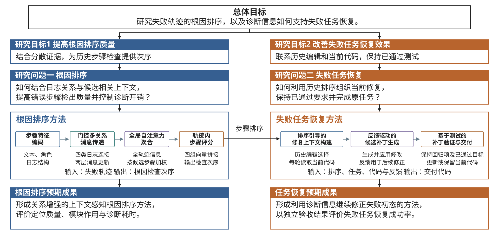
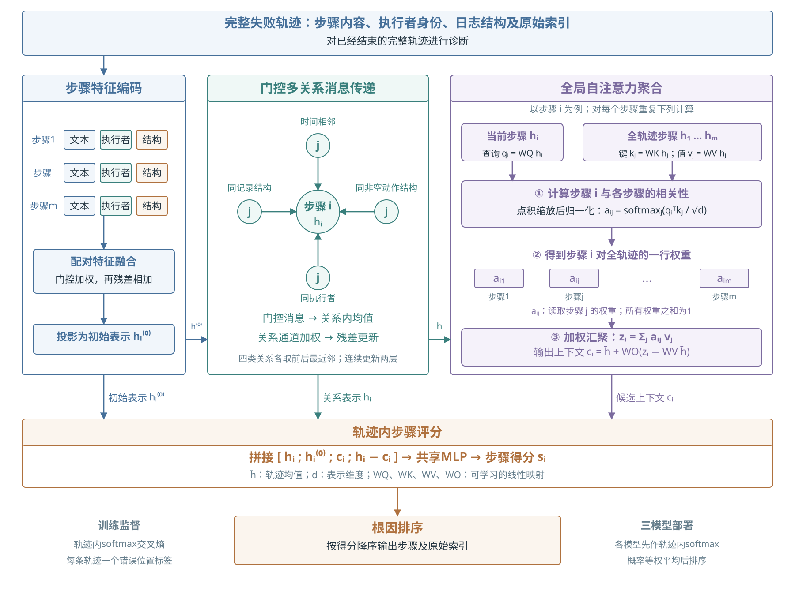
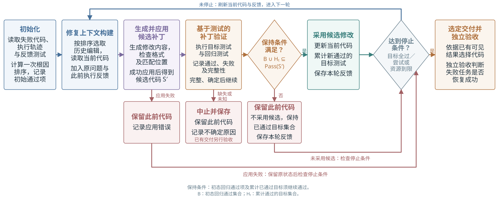

# 智能体运行故障的根因排序与恢复方法

开题报告 · 2026年10月29日

## 1 选题依据与研究现状

### 1.1 研究背景与意义

**执行轨迹**记录智能体围绕同一任务从开始到结束的实际执行过程，按发生顺序组织中间推理、采取的动作及获得的环境观察。[1] 它呈现执行工作流中各项活动及其衔接的实际展开情况，是分析运行故障的过程依据。

**步骤**是执行轨迹中可逐项分析的基本单元，记载一次具体的决策或交互活动。在步骤级建模中，每一步对应当时采取行动的智能体及其动作。[2] 判断该步骤是否出错，还需要联系其可获取的输入、上下文和执行反馈。[3]

本课题将智能体任务执行结束后仍未满足任务要求的情形称为**运行故障**，以此确定需要分析的失败轨迹。[4] 研究由完整执行过程追查关键历史行为，再将分析结果用于后续恢复。

**任务失败的原因往往难以仅凭最终结果确定。相关证据可能分散于不同智能体及其执行步骤，需要结合任务要求、消息交互、工具操作与环境反馈，分析故障形成的过程。**[4] 各执行者当时能够获取的输入与上下文会影响步骤判断。[3] 上游偏差还可能经后续信息传递形成错误级联，使最终异常表现与关键历史行为处于不同位置。[5]

本课题将失败轨迹中的历史步骤作为**根因候选**，结合步骤内容与关联证据评分，形成优先检查次序，称为**根因排序**。步骤评分与排序用于将关键错误提前到排查前列。[2] 排序结果既支持历史过程分析，也为恢复选择优先处理的线索。

软件失败执行留下的代码可能已经改变，历史线索需要与当前代码重新对应。[6] 本课题以失败后保留的代码与环境为起点，筛选高排位的历史编辑，结合当前实现生成并验证修改，继续完成原任务，将这一过程称为**失败任务恢复**。反馈驱动的程序修复为继续修改和验证提供方法基础。[7] 最终是否恢复成功按预先确定的任务验收判断。[8]

### 1.2 国内外研究现状

上述目标涉及两个相继的研究环节：从分散执行记录中形成有效的历史检查次序，以及将诊断线索转化为当前代码上的恢复操作。研究现状据此分为根因诊断与排序、诊断支持的软件失败任务恢复两方面，分别考察证据怎样支持步骤判断，以及判断结果怎样参与后续修正。

#### 1.2.1 智能体运行故障诊断与根因排序

Shaokun Zhang等（2025年）提出**Who&When**，以失败执行轨迹为输入，定位导致任务失败的执行者及历史步骤。文中将纠正该步并相应调整后续执行后可使任务转为成功的错误称为**决定性错误**，多个错误满足条件时取时间最早者；并比较整轨迹判断、逐步检查和二分搜索，最佳方法的步骤定位准确率为14.2%。[4] 这一结果表明，判断任务失败与准确定位关键历史行为之间仍有距离。

Guibin Zhang等（2026年）的**AgenTracer**通过纠正重放与故障注入获得监督，训练专门模型判断错误位置，并将诊断反馈用于后续求解。[9] 定位能力得到改善，但证据的可见范围与组织方式仍需区分。**TraceElephant**补全任务输入、中间消息及环境交互，其分析表明，表面输出不足以还原各执行者当时能够使用的信息。[3]

Zhu等（2026年）的**StepFinder**结合步骤语义、执行者身份、双向时序网络及全局注意力产生分数，将诊断转为轻量网络推断。其交互主要由时序、语义匹配与身份偏置表达；显式决策上下文与后续动作的对应、记录结构等联系未作为不同证据来源分别建模和检验。语义相近的记录可能承担不同执行作用，本课题据此研究这些可观测联系对候选区分的补充价值。[2]

关系分析也已用于运行故障诊断。Wang等（2026年）的**DCFA**构造依赖图，并结合局部反事实推理细化根因判断。[10] **ErrorProbe**从异常表现逆向裁剪上下文，经工具执行验证错误假设。[11] 二者主动组织和检验证据，同时引入结构推理或工具验证环节。

上述方法显示，关键步骤判断既需要步骤自身内容，也需要跨步骤证据。StepFinder尚未单独检验显式日志联系的增量作用，DCFA和ErrorProbe则引入额外的结构推理或工具验证。本文研究日志中可直接取得的联系如何补充分散证据的组织，与候选相关的全轨迹信息共同用于排序，并检验质量与诊断成本的取舍。

排序形成历史检查次序，恢复则进一步检验这一分析的实际价值：优先找到的历史行为能否转化为当前可用的修复线索，并帮助完成原任务。因此，根因排序与软件恢复之间需要建立具体的信息传递和结果验证关系。

#### 1.2.2 根因诊断支持的软件失败任务恢复

交互反馈为继续求解提供基础。ReAct交替生成推理与动作，并利用环境观察推进执行。[12] Reflexion在多次尝试间保存反思经验。[13] CRITIC通过外部工具检查结果并修订输出。[14] 软件失败任务恢复还要求这些反馈对应到当前代码，形成可执行、可验证的修改。

Xia等（2025年）的**Agentless**按定位、补丁生成和验证选择组织求解，通过回归测试与复现测试筛选修改。[15] Tian等（2026年）的**EnAgent**生成多条候选轨迹，经去重、回归测试及工具检查后投票选择补丁。[16] 二者主要围绕问题定位与候选选择组织证据；历史步骤诊断如何改变当前修复输入，以及连续修改如何保留新获得的目标进展，仍需专门考察。

历史诊断的可用性受到代码变化的影响。Guo等（2025年）的**SyncMind**研究执行者认识与实际代码失步的问题，说明恢复需要重新获取当前环境信息。[6] AgenTracer已展示诊断反馈的下游收益。[9] 软件恢复还需明确哪些历史行为对应真实编辑、哪些线索在当前实现上仍成立，由此建立步骤排序、编辑筛选与当前源码读取之间的衔接。

恢复还涉及修改后的进展保持。Agentless通过测试比较、筛选候选。[15] EnAgent还从原代码中选择回归测试。[16] 这些流程没有将恢复中新通过的目标逐项累积为后续代码更新条件。固定回归检查保护原有行为，但不能自动覆盖这部分新增进展。

Ma等（2026年）的**DoVer**通过修改消息、计划并重新执行，以任务成功或实际进展检验诊断。其GAIA和AssistantBench实验将研究推进到干预后的结果，但未针对软件代码连续修改中的已通过目标保持建立验证规则。因此，本课题进一步研究如何把新增测试进展用于约束后续修改，检验其对最终任务完成的作用。[17]

综合两个方向，相关不足落在两个相互衔接的环节：诊断需要有效组织分散证据，区分关键错误及其后续表现；恢复需要将历史判断对应到当前代码，并保留连续修改中新获得的进展。前者影响哪些行为优先进入排查，后者影响诊断线索能否转化为任务完成。基于以上文献分析，本课题形成以下两个研究问题。

### 1.3 研究问题

**RQ1：分散执行证据下的根因排序。** 如何关联不同智能体和执行步骤中的分散证据，提高关键错误步骤的识别与排序质量，并控制诊断开销？

**RQ2：根因排序引导的软件失败任务恢复。** 如何将历史步骤排序转化为适用于当前代码的修复依据，并在连续修改中保持已通过目标测试所反映的任务进展，提高原任务的最终完成率？

两项研究分别处理“优先检查哪些历史行为”和“如何利用线索继续完成任务”，通过实际送入恢复器的历史编辑衔接。

## 2 研究目标与主要内容

总体目标是建立从失败轨迹分析到软件任务继续求解的方法，评价诊断质量、成本和最终任务效果。

研究内容一为根因排序：编码步骤内容、执行者和记录结构，融合日志关系与候选相关上下文，学习评分函数，输出检查次序；通过基线与消融评价排序质量、成本及模块作用。

研究内容二为失败任务恢复：按排序选择真实历史编辑，结合当前实现和测试反馈生成补丁，以逐项测试保持规则更新代码；通过共同比较及过程记录评价最终恢复和模块作用。

根因排序为历史错误排查提供过程依据；恢复研究进一步检验这些依据能否转化为任务收益，支持利用已有工作继续完成软件任务。

## 3 研究方法与技术路线

### 3.1 总体研究框架与数据接口

**图3-1 根因排序与失败任务恢复的总体研究框架**

总体过程见图3-1。排序输出用于选择历史编辑，恢复通过候选生成、测试和代码更新继续完成任务，停止后选定交付并独立验收。

排序模型读取失败轨迹中的步骤内容、执行者及日志结构，保持数据源原有的步骤边界、标注位置与输出编号对应。对显式格式能够识别的决策上下文及其后续动作，融合关联记录的表示，保留两个原始步骤；排序结果再用于筛选实际编辑。

SWE-agent通过智能体—计算机接口组织仓库浏览、编辑与测试。[18] OpenHands提供源码读写、命令执行与隔离运行，为保存失败代码、轨迹和测试记录提供执行基础。[19]

**表3-1 两项研究的对象、方法与评价依据**

| 研究部分 | 研究对象 | 方法设计 | 评价依据 |
| --- | --- | --- | --- |
| 根因排序 | 失败执行轨迹 | 稀疏日志关系与候选相关上下文评分 | 定位与排序、模块消融、诊断成本 |
| 失败任务恢复 | 失败代码与运行环境 | 排序引导上下文、反馈修复与测试保持 | 完整方法比较、排序替换、测试保持对照 |

### 3.2 根因排序模型

**图3-2 根因排序模型的计算结构**

图中m为步骤数，i、j为步骤编号；hᵢ⁽⁰⁾、hᵢ、cᵢ分别为初始表示、关系表示和步骤上下文，MLP为输出步骤分数的多层感知机。其余计算量在图内定义。

#### 3.2.1 步骤特征编码

输入为步骤文本、执行者身份和日志字段。当前原型采用固定的Qwen3-Embedding-0.6B编码器，将各步内容、动作及思考字段转换为向量。[20] 执行者按同轨迹首次出现次序匿名编号，结构特征记录字段形态、位置及重复情况。模型融合这些信息形成初始步骤表示。

原型未另设原始任务说明的独立编码支路，仅能利用记录本身携带的任务信息。输入只使用允许观察的字段；完整输入与观测范围对诊断的影响已有研究依据。[3] 错误位置标注仅用于训练和评价，实验需列出各来源实际可用的输入字段。

#### 3.2.2 门控多关系消息传递

以步骤为节点，分别构造时间相邻、同一执行者、完整记录结构相同、非空动作结构相同四类关系。后两类“结构相同”依据字段形式判定。每类关系连接前后最近的匹配记录，限制每个节点的邻居数，避免把所有步骤都连在一起。

模型沿每类关系读取邻居表示，将邻居内容及其与当前步骤的差异变换为消息；门控计算0到1之间的权重，调节消息贡献。各关系内汇总，再融合不同关系并更新步骤表示，两层更新使信息沿关系继续传播。该模块采用多关系图表示学习的邻居聚合机制，具体邻接与融合方式属于本课题设计。[21]

#### 3.2.3 全局自注意力聚合

局部关系无法直接覆盖所有远处记录，例如需求在开头、失败反馈在结尾。该模块以每个待评分步骤为查询，从同一完整轨迹的步骤表示中计算相关权重，汇集与它相关的信息，形成该候选自己的上下文。不同候选可以读取不同重点。查询、用于匹配的键和承载信息的值均来自同一轨迹，采用自注意力计算。[22]

当前实现以轨迹均值作为共享背景，再叠加候选相关修正，输出候选上下文。它与关系传播分别承担有限邻域汇集和全轨迹读取，是否互补由消融检验。

#### 3.2.4 轨迹内步骤评分

共享评分网络读取初始表示、关系表示、候选上下文及两者差异，为各步输出分数。训练时，一条轨迹提供一个标注错误位置，模型在同轨迹内归一化分数，最小化标注位置的负对数概率；预测时按分数降序产生检查次序。[2] 候选组内评分采用列表级学习思路[23]，单正例条件下的位置交叉熵与排序目标之间具有理论联系。[24]

单位置监督没有给出其余步骤的完整责任先后次序，评价检查标注错误能否位于首位或前几个位置。各来源的错误位置含义分别保留，静态评分输出作为根因排查线索。

### 3.3 失败任务恢复方法

**图3-3 失败任务恢复流程**

图中B为初态已通过的受保护回归项，Hₜ为累计已通过目标，Pass(S′)为候选代码S′确认通过的测试集合。主流程、应用失败、测试不确定及拒绝候选的处理分别保留。

#### 3.3.1 排序引导的修复上下文构建

输入为原始任务、根因排序、历史轨迹、当前代码和允许读取的测试反馈。恢复器按排序筛选实际成功改变源码的历史操作，按编辑调用去重并保留代码差异。历史认识可能与当前代码失步。[6] 因此，再读取相关文件或函数的当前实现，将线索对应到当前程序实体；结构化实体搜索可为上下文获取提供方法参照。[25]

历史差异说明此前改了什么，当前实现说明现在面对什么代码，测试反馈说明哪些要求仍未满足。读取数量、输入容量及历史编辑的补充次序在比较前固定；各轮更新当前代码和反馈。输出为生成模型实际读取的修复上下文，并保存选入编辑和读取位置，以核对排序是否真正改变了输入。

#### 3.3.2 反馈驱动的候选补丁生成

生成模型依据修复上下文提出候选补丁，即对现有代码的具体修改，执行端将其应用到当前代码副本。应用失败和测试失败的可见信息进入下一轮，用于调整修改或补充读取。该模块采用生成—验证式程序修复流程。[26] 输出为候选代码及操作记录，研究重点落在修复输入与后续代码更新条件。

#### 3.3.3 基于测试的补丁验证与交付

恢复前固定检查本次任务要求的**目标测试**及检查已有功能的**回归测试**。生成—验证式程序修复通过可执行测试检查候选补丁。[7] 通过有限测试的补丁仍需进一步确认正确性。[27]

本文拟将初态已通过且需要保留的回归项，以及初态和各轮已采用代码中新通过的目标项组成保护集合。候选继续通过全部保护项时才更新代码，否则保留此前状态；被拒候选的新通过项不加入集合。

STRATUS通过检查退化并在条件不满足时撤销操作，为受约束的状态更新提供机制参照，本文将检查对象落实为已通过的软件测试。[28] 目标全部通过、尝试次数或预算用尽时停止，按预先固定的反馈规则选择交付；与生成过程隔离的独立验收决定是否恢复成功。

AgentSpec在动作执行时检查触发条件及规则，据此阻止或调整动作，说明约束可以落实为执行过程中的具体判定。[29] 本课题在代码更新前检查测试保护条件；测试结果缺失或不确定时，停止更新并保存已有代码。

## 4 研究难点、拟创新点与不足

### 4.1 关键难点

**难点一：分散执行证据的关联与关键错误区分。** 同一反馈可能关联多个历史步骤，错误操作与失败表现也可能相隔很远。需要结合日志联系和远处证据，减少无关信息干扰，并控制轨迹增长带来的诊断开销。

**难点二：变化代码上的历史线索利用与修复进展保持。** 排序对应历史行为，修改作用于当前实现。需要核对线索是否仍成立，并在解决剩余问题时保留已获得的测试进展；修改又会改变后续输入及测试状态。

### 4.2 拟研究的创新点

**可观测日志关系与候选相关上下文的联合排序设计。** 研究将结构明确的局部关系聚合与面向不同候选的全轨迹读取结合，检验二者在关键错误步骤检出上的互补作用。

**历史编辑选择与累计测试保持相结合的恢复设计。** 研究通过根因排序突出历史编辑，再依据当前实现与反馈修正代码，并把新获得的测试进展用于后续验证。检验信息选择与代码更新规则对最终恢复的作用。

### 4.3 主要不足及适用条件

单位置标注不能给出所有步骤的完整责任真值，不同来源的错误位置含义需要分别核对。来源缺少独立动作字段时，相关关系通道可能为空；单执行者轨迹中关系也可能重合，实验需记录字段与关系覆盖。

累计测试保持依赖稳定、可执行的测试，可能拒绝需要暂时破坏已通过行为的中间修改；有限测试通过也不能覆盖全部输入。[26] 正式结论需由共同条件比较、消融及未参与方法选择的评价任务取得，现有开发记录仅作为方案依据。[27]

## 5 实验设计与数据安排

### 5.1 实验数据来源与用途

**表5-1 数据来源与研究样本**

| 数据来源 | 公开版本规模 | 研究样本与组织 | 用途 |
| --- | --- | --- | --- |
| AFTraj | 2,276条轨迹 | 既有开发记录731条、716个任务组 | 责任定位与排序 |
| AgenTracer | 代码任务coding训练1,141条、测试127条 | 614条训练验证来源（coding 320、数学任务math 294）；另363条coding开发轨迹 | 训练、验证与代码任务开发比较 |
| SWE-Gym | 2,438个Python问题 | 计划20个不同问题、覆盖5仓库 | 失败初态与恢复比较 |

任务组指同一原问题及其派生轨迹。

AFTraj原用于在线前缀审计，本文保留其中的决定性错误位置，开展完整失败轨迹的离线排序。表中2,276是作者公开版本的计数，与论文进一步筛选后的统计区分使用。[30]

诊断采用轨迹及错误位置材料。[9] 恢复采用代码、执行环境和测试：SWE-Gym提供可执行仓库问题[31]，SWE-bench建立基于代码修改与测试的任务评价。[8] 表内版本规模和本地筛选数量分别来自数据发布及项目清单，逐项依据列于溯源分析。

### 5.2 数据划分与使用原则

训练集学习参数，验证集选择配置和训练轮次，评价集检验固定方法。相同原问题的派生轨迹放在同一集合，避免近似记录同时用于学习和评价；数据泄露对程序修复评价的影响已有实证依据。[27] 各方法共用输入许可、步骤边界、样本清单和评价规则。

现有AgenTracer开发池的614条记录来自公开训练部分。为控制初期编码与训练工作量、使两类任务规模接近，筛选程序限制轨迹为6—32步，核对步骤编号和公开字段，并排除与作者测试问题重叠的任务组；再对coding和math分别按固定次序最多取320组。coding有939个合格组，取320组；math只有294个合格组，全部取用。因此614＝320＋294，这个精确数量来自筛选清单，开发范围受上述长度限制。

为保留约五分之一数据选择配置，coding按256条训练、64条验证划分；math按236条训练、58条验证划分，后者由294除以5向下取整得到验证数量。合计训练492条、验证122条。两类任务用于学习一般步骤表示，代码任务和数学任务的结果分别报告，另比较仅用代码任务训练时的表现，判断混合训练的作用。

本轮采用固定训练、验证划分及预定的三次初始化，评价训练随机性的影响。既有开发材料记录了363条coding轨迹，以及AFTraj的731条记录、716个原问题组；这些材料继续按开发来源管理，不作为新划分后的独立评价证据。

正式评价拟从作者发布的AFTraj测试unsafe记录163条、AgenTracer coding测试127条中核验候选，先查历史使用及任务重叠，再固定实际清单。已参与方法选择的记录继续作为开发材料，独立评价数量以核验结果确定。三次初始化全部报告，区分单模型与预定集成。

### 5.3 恢复任务与实验设置

恢复开发比较计划覆盖5个仓库、20个不同问题。20题是受运行预算约束的计划规模，目标是覆盖多个仓库并完成共同重复比较；它与公开数据的2,438题总量具有不同用途。问题沿既有计划次序选择，并核验环境、失败代码、历史编辑及反馈测试能否重建，不依据本文与基线的胜负选题。

每个问题需重建失败后的代码、环境和轨迹，确认原任务未完成，在运行前固定清单，并列出准备通过的题数和排除原因。各方法按表5-2的共同条件独立执行。

本文与Agentless、EnAgent、AOrchestra各重复3次，20题准备完成后的开发计划为20×4×3＝240次运行。同题先汇总，再对问题等权统计。独立评价另选未参与开发的任务，清单与数量在运行前确定。

**表5-2 恢复实验的共同评价设置**

| 实验因素 | 共同控制 |
| --- | --- |
| 评价起点 | 同一原问题、失败代码、环境与源码访问许可 |
| 生成条件 | deepseek-flash及预定参数，各方法保留完整流程 |
| 信息与反馈 | 共同反馈测试与许可范围，保存候选及状态变化 |
| 重复单位 | 每题每方法3次，各次从相同初态独立启动 |
| 资源与交付 | 15/30/60分钟节点，30分钟主比较，统一token上限 |
| 验收与汇总 | 选定交付后隔离验收，同题重复先汇总再问题等权 |

### 5.4 评价指标与基线方法

**表5-3 主要评价指标**

| 指标 | 计算与含义 |
| --- | --- |
| Top-1 ↑ | 标注错误步骤位于首位的任务组等权比例 |
| MRR ↑ | 标注位置倒数排名的任务组等权均值 |
| Hit@3 / Hit@5 ↑ | 标注错误步骤进入前3/5位的任务组等权比例 |
| 诊断耗时P50 / P95 ↓ | 首次加载及已加载条件下的中位数/95分位数 |
| 失败任务恢复成功率RSR ↑ | 同题3次运行先平均，再对共同问题等权 |
| RSR@15 / 30 / 60min ↑ | 节点前选定交付的独立验收成功率 |
| 资源消耗 ↓ | 输入输出token总量、大模型API请求次数 |

耗时覆盖文本编码和评分，注明加载条件、硬件、批处理及轨迹长度。另按证据位置分析排序表现，相关信息在长上下文中的位置效应作为分析动机。[32] token为模型处理的词元。

**表5-4 失败诊断基线及正式发表时间**

| 方法 | 正式发表时间 | 发表载体 | 核心机制 |
| --- | --- | --- | --- |
| All-at-Once | 2025.07 | ICML | 整轨迹一次性诊断 |
| Binary Search | 2025.07 | ICML | 区间判断与二分搜索 |
| StepFinder | 2026.08 | KDD | 时序、角色交互与步骤评分 |
| 本文方法 | — | 本课题 | 关系传播与候选相关上下文 |

诊断统一比较Top-1和耗时，能够输出完整排序的方法另报MRR及Hit@3/5；生成式方法同时统计词元和模型请求。各方法共用轨迹、步骤边界、划分及标签，单位置输出不补造完整排名。

**表5-5 失败任务恢复基线及正式发表时间**

| 方法 | 正式发表时间 | 发表载体 | 核心过程 |
| --- | --- | --- | --- |
| Agentless | 2025.06 | FSE / PACMSE | 定位、生成、复现与回归筛选 |
| EnAgent | 2026.04 | ICSE | 多轨迹、回归剪枝、工具选择与投票 |
| AOrchestra | 2026.07 | ICML | 动态子智能体及上下文配置 |
| 本文方法 | — | 本课题 | 诊断输入、反馈修复与测试保持 |

恢复统一比较15/30/60分钟交付的独立验收成功率、词元与请求次数，以30分钟为主结果；各节点来自同次运行，提前停止后沿用当时已选交付。各方法保留完整求解过程，并采用共同失败初态、模型、信息许可、预算和验收；AOrchestra按其动态子智能体与上下文配置流程完整实施。[33] 预算内未成功、工程中断及验收未知分别记录，并列出共同可比较的问题数。

### 5.5 消融实验与作用分析

**表5-6 核心消融与对照**

| 研究内容 | 实验设置 | 验证目的 |
| --- | --- | --- |
| 根因排序 | 完整模型 | 检验完整根因排序方法的有效性 |
|  | 去除关系传播 | 检验局部关系传播的有效性 |
|  | 均值替代候选上下文 | 检验候选上下文聚合模块的有效性 |
| 失败任务恢复 | 完整恢复方法 | 检验完整失败任务恢复方法的有效性 |
|  | 替换排序为StepFinder或时间顺序 | 检验根因排序引导编辑选择的有效性 |
|  | 去除专门历史编辑输入 | 检验显式历史编辑线索的有效性 |
|  | 去除专门当前源码读取 | 检验针对性读取当前源码的有效性 |
|  | 仅保持初始回归测试 | 检验累计已通过目标保持的有效性 |

各对照固定其余输入许可和资源条件。排序消融分别重新训练，恢复对照分别从相同失败状态独立运行。排序替换沿用相同的编辑筛选和输入上限；保存选中编辑、实际输入、补丁和测试结果，检验模块变化是否改变操作及最终结果。

## 6 论文框架与进度安排

论文拟按绪论、相关理论与研究基础、根因排序方法、失败任务恢复方法、实验与分析、总结与展望六章组织。其中两项方法各形成一个核心章节，分别交代问题、设计及验证结果，实验章进一步汇总总体效果、模块作用和适用条件。

2026年10月完成题目、概念、研究依据和开题方案重构；11—12月完成排序与恢复模块、数据清单及评价配置。2027年1—2月开展完整基线比较和独立评价，3月完成消融、结果分析及论文初稿，4—5月修改论文并准备答辩。写作与证据整理随研究同步推进。

## 参考文献

[1] Shuyang Liu, Yang Chen, Rahul Krishna, et al. Process-Centric Analysis of Agentic Software Systems[J]. Proceedings of the ACM on Programming Languages, 10(OOPSLA1): 1961–1988, Article 163, 2026. [原文](https://doi.org/10.1145/3798271)。

[2] Taiyu Zhu, Yifan Wu, Weilin Jin, et al. StepFinder: A Temporal Semantic Framework for Failure Attribution in Multi-Agent Systems[C]//Proceedings of the 32nd ACM SIGKDD Conference on Knowledge Discovery and Data Mining V.2: 6946–6957, 2026. [原文](https://doi.org/10.1145/3770855.3817991)。

[3] Mengzhuo Chen, Junjie Wang, Fangwen Mu, et al. Seeing the Whole Elephant: A Benchmark for Failure Attribution in LLM-based Multi-Agent Systems[C]//Proceedings of the 64th Annual Meeting of the Association for Computational Linguistics (Volume 1: Long Papers): 19888–19905, 2026. [论文](https://aclanthology.org/2026.acl-long.912/)。

[4] Shaokun Zhang, Ming Yin, Jieyu Zhang, et al. Which Agent Causes Task Failures and When? On Automated Failure Attribution of LLM Multi-Agent Systems[C]//Proceedings of the 42nd International Conference on Machine Learning (ICML), PMLR 267: 76583–76599, 2025. [原文](https://proceedings.mlr.press/v267/zhang25cq.html)。

[5] 董益宏, 姜雪, 钱家如, 等. 基于大语言模型智能体的代码生成综述[J]. 软件学报, 2026, 37(8): 3089–3115. DOI: 10.13328/j.cnki.jos.007593. [论文](https://jos.org.cn/jos/article/abstract/7593)。

[6] Xuehang Guo, Xingyao Wang, Yangyi Chen, et al. SyncMind: Measuring Agent Out-of-Sync Recovery in Collaborative Software Engineering[C]//Proceedings of the 42nd International Conference on Machine Learning (ICML), PMLR 267: 20993–21066, 2025. [原文](https://proceedings.mlr.press/v267/guo25l.html)。

[7] Islem Bouzenia, Premkumar Devanbu, Michael Pradel. RepairAgent: An Autonomous, LLM-Based Agent for Program Repair[C]//Proceedings of the IEEE/ACM 47th International Conference on Software Engineering (ICSE): 2188–2200, 2025. [原文](https://doi.org/10.1109/ICSE55347.2025.00157)。

[8] Carlos E. Jimenez, John Yang, Alexander Wettig, et al. SWE-bench: Can Language Models Resolve Real-world GitHub Issues?[C]//International Conference on Learning Representations (ICLR), 2024. [原文](https://proceedings.iclr.cc/paper_files/paper/2024/hash/edac78c3e300629acfe6cbe9ca88fb84-Abstract-Conference.html)。

[9] Guibin Zhang, Junhao Wang, Junjie Chen, et al. AgenTracer: Who Is Inducing Failure in the LLM Agentic Systems?[C]//International Conference on Learning Representations (ICLR), 2026. [原文](https://proceedings.iclr.cc/paper_files/paper/2026/hash/134ed7a477770f227f12450ef0cbb8f4-Abstract-Conference.html)。

[10] Zehao Wang, Lanjun Wang, Shilong Jin, et al. DCFA: Dual-view Causal-inspired Attribution for Failure Reasoning in LLM-based Multi-agent Systems[C]//Proceedings of the 2026 Conference on Empirical Methods in Natural Language Processing. 2026: 42999–43025. [原文](https://aclanthology.org/2026.emnlp-main.1887/)。

[11] Jiazheng Li, Emine Yilmaz, Bei Chen, Thu Le. Towards Self-Improving Error Diagnosis in Multi-Agent Systems[C]//Findings of the Association for Computational Linguistics: ACL 2026: 2063–2077, 2026. DOI: 10.18653/v1/2026.findings-acl.98. [论文](https://aclanthology.org/2026.findings-acl.98/)。

[12] Shunyu Yao, Jeffrey Zhao, Dian Yu, et al. ReAct: Synergizing Reasoning and Acting in Language Models[C]//International Conference on Learning Representations, 2023. [论文](https://openreview.net/pdf?id=WE_vluYUL-X)。

[13] Noah Shinn, Federico Cassano, Ashwin Gopinath, et al. Reflexion: Language Agents with Verbal Reinforcement Learning[C]//Advances in Neural Information Processing Systems 36, 2023. [论文](https://proceedings.neurips.cc/paper_files/paper/2023/hash/1b44b878bb782e6954cd888628510e90-Abstract-Conference.html)。

[14] Zhibin Gou, Zhihong Shao, Yeyun Gong, et al. CRITIC: Large Language Models Can Self-Correct with Tool-Interactive Critiquing[C]//International Conference on Learning Representations, 2024. [论文](https://proceedings.iclr.cc/paper_files/paper/2024/hash/fef126561bbf9d4467dbb8d27334b8fe-Abstract-Conference.html)。

[15] Chunqiu Steven Xia, Yinlin Deng, Soren Dunn, et al. Demystifying LLM-Based Software Engineering Agents[J]. Proceedings of the ACM on Software Engineering, 2(FSE): 801–824, 2025. [原文](https://doi.org/10.1145/3715754)。

[16] Zhao Tian, Pengfei Gao, Junjie Chen, et al. Agent-Based Ensemble Reasoning for Repository-Level Issue Resolution[C]//Proceedings of the IEEE/ACM 48th International Conference on Software Engineering (ICSE): 1406–1418, 2026. [原文](https://doi.org/10.1145/3744916.3787761)。

[17] Ming Ma, Jue Zhang, Fangkai Yang, et al. DoVer: Intervention-Driven Auto Debugging for LLM Multi-Agent Systems[C]//International Conference on Learning Representations (ICLR), 2026. [原文](https://proceedings.iclr.cc/paper_files/paper/2026/hash/2f5fdce256ff0d7fb774da76e5e63209-Abstract-Conference.html)。

[18] John Yang, Carlos E. Jimenez, Alexander Wettig, et al. SWE-agent: Agent-Computer Interfaces Enable Automated Software Engineering[C]//Advances in Neural Information Processing Systems 37, 2024. [论文](https://proceedings.neurips.cc/paper_files/paper/2024/hash/5a7c947568c1b1328ccc5230172e1e7c-Abstract-Conference.html)。

[19] Xingyao Wang, Boxuan Li, Yufan Song, et al. OpenHands: An Open Platform for AI Software Developers as Generalist Agents[C]//International Conference on Learning Representations (ICLR), 2025. [原文](https://proceedings.iclr.cc/paper_files/paper/2025/hash/a4b6ad6b48850c0c331d1259fc66a69c-Abstract-Conference.html)。

[20] Yanzhao Zhang, Mingxin Li, Dingkun Long, et al. Qwen3 Embedding: Advancing Text Embedding and Reranking Through Foundation Models[EB/OL]. arXiv:2506.05176, 2025. DOI: 10.48550/arXiv.2506.05176. [论文](https://arxiv.org/abs/2506.05176)。

[21] Michael Schlichtkrull, Thomas N. Kipf, Peter Bloem, et al. Modeling Relational Data with Graph Convolutional Networks[C]//The Semantic Web (ESWC), Lecture Notes in Computer Science: 593–607, 2018. [原文](https://doi.org/10.1007/978-3-319-93417-4_38)。

[22] Ashish Vaswani, Noam Shazeer, Niki Parmar, et al. Attention Is All You Need[C]//Advances in Neural Information Processing Systems 30. 2017. [原文](https://proceedings.neurips.cc/paper_files/paper/2017/hash/3f5ee243547dee91fbd053c1c4a845aa-Abstract.html)。

[23] Tie-Yan Liu. Learning to Rank for Information Retrieval[J]. Foundations and Trends in Information Retrieval, 3(3): 225–331, 2009. [原文](https://doi.org/10.1561/1500000016)。

[24] Sebastian Bruch, Xuanhui Wang, Michael Bendersky, Marc Najork. An Analysis of the Softmax Cross Entropy Loss for Learning-to-Rank with Binary Relevance[C]//Proceedings of the 2019 ACM SIGIR International Conference on Theory of Information Retrieval (ICTIR). 2019: 75–78. DOI: 10.1145/3341981.3344221. [原文](https://research.google/pubs/an-analysis-of-the-softmax-cross-entropy-loss-for-learning-to-rank-with-binary-relevance/)。

[25] Yuntong Zhang, Haifeng Ruan, Zhiyu Fan, Abhik Roychoudhury. AutoCodeRover: Autonomous Program Improvement[C]//Proceedings of the 33rd ACM SIGSOFT International Symposium on Software Testing and Analysis: 1592–1604, 2024. DOI: 10.1145/3650212.3680384. [论文](https://doi.org/10.1145/3650212.3680384)。

[26] 香佳宏, 徐霄阳, 孔繁初, 等. 大模型在软件缺陷检测与修复的应用发展综述[J]. 软件学报, 2025, 36(4): 1489–1529. DOI: 10.13328/j.cnki.jos.007268. [原文](https://www.jos.org.cn/html/2025/4/7268.htm)。

[27] 李卿源, 钟文康, 李传艺, 葛季栋, 骆斌. 神经程序修复领域数据泄露问题的实证研究[J]. 软件学报, 2024, 35(7): 3071–3092. DOI: 10.13328/j.cnki.jos.007110. [论文](https://www.jos.org.cn/jos/article/abstract/7110)。

[28] Yinfang Chen, Jiaqi Pan, Jackson Clark, et al. STRATUS: A Multi-agent System for Autonomous Reliability Engineering of Modern Clouds[C]//Advances in Neural Information Processing Systems 38, 2025. [原文](https://proceedings.neurips.cc/paper_files/paper/2025/hash/47a6e9e2c3019f13ad94a0f259fe4970-Abstract-Conference.html)。

[29] Haoyu Wang, Christopher M. Poskitt, Jun Sun. AgentSpec: Customizable Runtime Enforcement for Safe and Reliable LLM Agents[C]//Proceedings of the IEEE/ACM 48th International Conference on Software Engineering (ICSE): 2938–2950, 2026. DOI: 10.1145/3744916.3764546. [正式会议记录](https://conf.researchr.org/details/icse-2026/icse-2026-research-track/29/AgentSpec-Customizable-Runtime-Enforcement-for-Safe-and-Reliable-LLM-Agents)。

[30] Boxuan Zhang, Jianing Zhu, Zeru Shi, Dongfang Liu, Ruixiang Tang. AgentForesight: Online Auditing for Early Failure Prediction in Multi-Agent Systems[EB/OL]. arXiv:2605.08715, 2026. DOI: 10.48550/arXiv.2605.08715. [论文](https://arxiv.org/abs/2605.08715)。

[31] Jiayi Pan, Xingyao Wang, Graham Neubig, et al. Training Software Engineering Agents and Verifiers with SWE-Gym[C]//Proceedings of the 42nd International Conference on Machine Learning (ICML), PMLR 267: 47717–47737, 2025. [原文](https://proceedings.mlr.press/v267/pan25g.html)。

[32] Nelson F. Liu, Kevin Lin, John Hewitt, et al. Lost in the Middle: How Language Models Use Long Contexts[J]. Transactions of the Association for Computational Linguistics, 12:157–173, 2024. [原文](https://aclanthology.org/2024.tacl-1.9/)。

[33] Jianhao Ruan, Zhihao Xu, Yiran Peng, et al. AOrchestra: Automating Sub-Agent Creation for Agentic Orchestration[C]//Proceedings of the 43rd International Conference on Machine Learning (ICML), PMLR 306: 106017–106040, 2026. [原文](https://proceedings.mlr.press/v306/ruan26e.html)。
