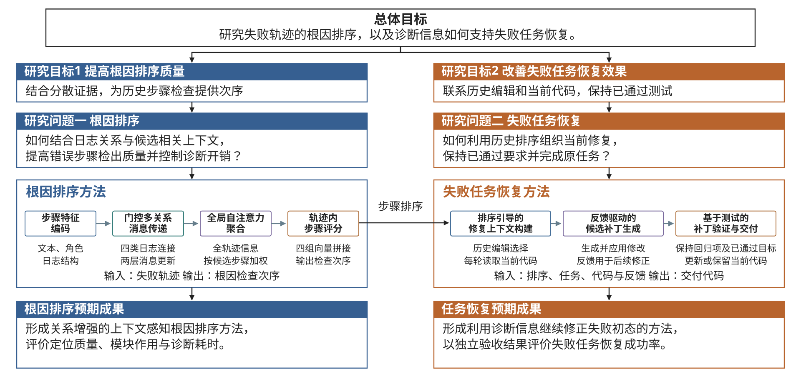
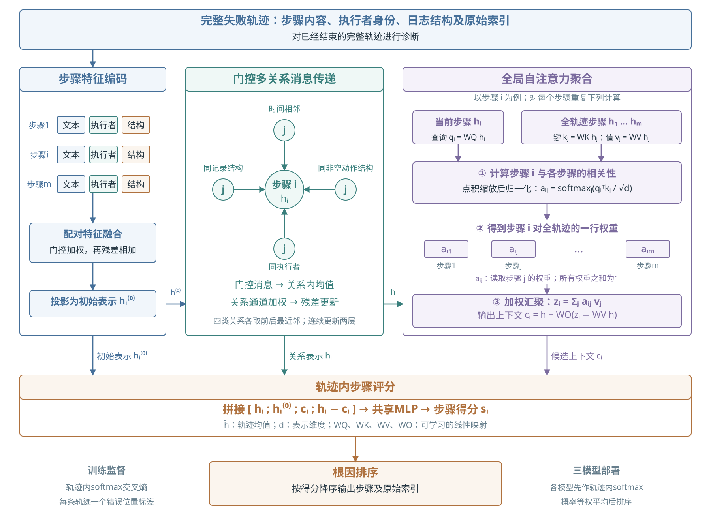
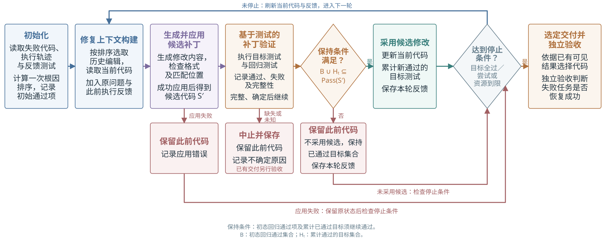

# 开题文稿逐段溯源与学术表达核查

对应全文：[01_开题报告_逐段溯源核定版.md](<01_开题报告_逐段溯源核定版.md>)。正文9960个非空白字符，参考文献不计入限额。正式引用为33篇论文；数据卡、发布记录、代码和本地清单用于核查，不计入论文篇数。

## 1. 核查口径

本文件将论文直接给出的定义和事实、基于论文机制的比较分析、本文操作性约定与方法设计、本地数据记录和研究计划分别标明。论文引用支持相应原理或事实；本文具体邻接、配对、输入字段和测试集合规则，直接追溯至实现。作者提出的方案不伪装为已有文献结论，也不以方案目标代替已取得的效果。

每个自然段独立成行并以空行分隔。以下按正文出现次序覆盖70个文字段落（含日期），以及20个图、表、图题和表题单元，共90项。文末33项书目身份、年份与分级另在09文献遴选文件逐项核对。

## 2. 导师要求落实对照

| 导师要求 | 当前正文位置 | 本轮处理与核查 |
| --- | --- | --- |
| 以已定题目和研究内容定向选择文献，用不足支撑两个RQ | P008—P022；§1.2.1、§1.2.2、§1.3 | 分析步骤证据组织、当前代码映射与新增测试进展保持；取消论文列表，保留具体方法和分析 |
| 先交代工作流，再刻画步骤 | P002—P004；§1.1 | 从完整轨迹的实际活动及衔接进入步骤语义；数据边界放在§3.1，避免用编号解释步骤 |
| 说明排序为何需要、怎样实现、排完有什么用 | P005—P006、P014、P021—P023及§3.2 | 核心是不同智能体和步骤中的分散证据；评分形成优先次序，历史编辑接口衔接恢复 |
| 输入、输出、过程与恢复目标连贯 | P028—P055、表3-1 | 总体图先交代两个阶段，再以四个排序模块和三个恢复模块说明操作及数据去向 |
| 两项研究范围和体量适合 | P025—P026、P056—P061、P087—P089 | 排序涉及表示、关系、上下文、监督与评价；恢复涉及历史到当前映射、反馈生成、测试状态更新及整体比较；不承诺仅靠页数证明体量 |
| 先讲整体框架，细节对应框架 | P028—P055；三张方法图 | 模块名、正文计算与实际原型对应；独立技术讲解同步修正配对与输入说明 |
| 实验说明平台、数据、安排及为何能验证主张 | P062—P088 | 区分数据发布、开发、评价候选及计划数；整体比较和消融分别回答效果与模块作用 |
| 难点与创新点直接对应方法环节 | P056—P059；§4.1—§4.2 | 难点落到证据区分和变化代码上的修复；拟创新落到具体信息组织和更新规则，不把基础算子当原创 |

## 3. 专业中文表达与核心概念

| 表达 | 采用依据 | 本文采用的含义 |
| --- | --- | --- |
| 执行工作流 | 郑逸宁等2025 §3.2；Process-Centric Introduction | 在轨迹对象内交代活动及衔接，不单设无关的软件工作流背景段 |
| 执行轨迹、步骤 | Process-Centric Introduction；StepFinder §3；Who&When §2；TraceElephant §2 | 轨迹记录完整过程，步骤刻画具体决策或交互活动；编号和原来源边界在数据适配中说明 |
| 决定性错误、根因候选与根因排序 | Who&When §2；StepFinder §4；排序学习框架 | 决定性错误在1.2.1随论文介绍；候选集合与优先排查用途在1.1说明 |
| 错误级联、分散证据 | 董益宏等2026 §8.2；Who&When §1；TraceElephant摘要及§1 | 解释最终结果为何不足以确定原因，以及跨执行者记录为何需要关联分析 |
| 消息传递、邻居聚合、节点表示更新 | 多关系图论文§2.1；王兆慧等《图分类研究综述》§3.1 | 基础机制有来源，具体四类日志关系和门控计算追溯代码 |
| 自注意力、候选相关上下文 | Vaswani等§3.2；StepFinder §4.3；C08 | Q/K/V均来自同轨迹；本文的单头、均值背景和修正方式是实现选择 |
| 程序修复、补丁验证 | 香佳宏等2025 §5.1；李卿源等2024 §1.1；姜佳君等2021 §1 | 用已有专业术语描述生成与验证，不把通过有限测试等同所有输入正确 |
| 累计已通过目标测试的保持规则 | C11及本文验证方案；补丁验证文献提供机制背景 | 明确集合来源、更新条件与拒绝处理，不包装成文献中已有的统一算法名或完整事务保证 |

本轮另外实读郑逸宁等2025《大语言模型的工具使用综述》§1、§3.2评测方法中的使用规划段和§5.1，以及秦龙等2024《基于大语言模型的复杂任务自主规划处理框架》§2.1、§3.2、§3.3。两篇官网正文与阅读记录保存在工作区/1029-题目一致与引用定点修订；它们用于中文层次，不伪装成故障步骤定义。轨迹和步骤的专业对象分别由Process-Centric、StepFinder、Who&When和TraceElephant原文核定。

中文表达另核对黄震华等2016《基于排序学习的推荐算法研究综述》、李金忠等2018《排序学习研究进展与展望》及姜佳君等2021《软件缺陷自动修复技术综述》。这些文献用于表达核验，不因核验就全部加入正文33篇。逐项原文位置和读取范围见本轮术语核查底稿；正文正式引用的三篇中文论文均保留在文末。

## 4. 逐段溯源

### P001｜智能体运行故障的根因排序与恢复方法

位置：[正文第3行](<01_开题报告_逐段溯源核定版.md:3>)。性质：版本信息。

> 开题报告 · 2026年10月29日

**依据与定位：**

- U01 [导师要求原文整理](<D:/Code/毕设/卓刀泉北路111号 3_导师意见整理.md>)：研究内容第1—7项及PPT组织表达要求。
- U02 [修订前既定方案记录](<D:/Code/毕设/graduate-thesis-experiments/工作区/1029-逐段溯源与学术表达/修订前/01_开题报告_重构稿.md>)：第2—6章，尤其20题/5仓库/4方法/3重复和15/30/60分钟节点。

**核查说明：** 日期为本轮文稿版本标识；不承担关于研究成效的学术论断。

### P002｜1.1 研究背景与意义

位置：[正文第9行](<01_开题报告_逐段溯源核定版.md:9>)。性质：论文轨迹对象与中文组织依据。

> **执行轨迹**记录智能体围绕同一任务从开始到结束的实际执行过程，按发生顺序组织中间推理、采取的动作及获得的环境观察。[1] 它呈现执行工作流中各项活动及其衔接的实际展开情况，是分析运行故障的过程依据。

**依据与定位：**

- 论文[1] [Process-Centric Analysis（Liu等，2026）](https://doi.org/10.1145/3798271)：ACM官网Introduction：推理、动作、观察的时间序列；§2 Definition 1：动作节点、步骤、结果与观察。旧process.txt缓存题名误配，已排除，核对记录L08。
- L06 [中文工具交互、工作流与调用轨迹原文](<D:/Code/毕设/graduate-thesis-experiments/工作区/1029-题目一致与引用定点修订/sources/AAS2025_工具使用综述_官网正文.txt>)：郑逸宁等《自动化学报》2025；§1、§3.2使用规划与工作流段（缓存第1250—1272行）、§5.1反馈与工具调用轨迹；官网DOI 10.16383/j.aas.c240793。
- L07 [中文多步任务与历史结果组织原文](<D:/Code/毕设/graduate-thesis-experiments/工作区/1029-题目一致与引用定点修订/sources/AAS2024_AutoPlan_官网正文.txt>)：秦龙等《自动化学报》2024；§2.1、§3.2、§3.3.2；官网DOI 10.16383/j.aas.c240088。
- L08 [本轮中英文原文核对与缓存纠错记录](<D:/Code/毕设/graduate-thesis-experiments/工作区/1029-题目一致与引用定点修订/英文原文核对记录.md>)：Process-Centric的ACM官网Introduction及§2；Who&When §2；StepFinder §3；TraceElephant摘要与§1—2。

**核查说明：** ACM正式原文Introduction直接说明轨迹为中间推理、动作和观察的时间序列。两篇中文论文仅用于由完整过程进入具体活动及其联系的行文组织，不冒充故障步骤定义。

### P003｜1.1 研究背景与意义

位置：[正文第11行](<01_开题报告_逐段溯源核定版.md:11>)。性质：步骤级建模与可观测信息。

> **步骤**是执行轨迹中可逐项分析的基本单元，记载一次具体的决策或交互活动。在步骤级建模中，每一步对应当时采取行动的智能体及其动作。[2] 判断该步骤是否出错，还需要联系其可获取的输入、上下文和执行反馈。[3]

**依据与定位：**

- 论文[2] [StepFinder（Zhu等，2026）](https://doi.org/10.1145/3770855.3817991)：§3步骤归因对象，§4.1—4.5模型及监督，§5排名评价，附录B的MRR定义。
- 论文[3] [TraceElephant（Chen等，2026）](https://aclanthology.org/2026.acl-long.912/)：摘要、§1及§2：完整输入和上下文、观测范围、决定性步骤的标注含义。
- L06 [中文工具交互、工作流与调用轨迹原文](<D:/Code/毕设/graduate-thesis-experiments/工作区/1029-题目一致与引用定点修订/sources/AAS2025_工具使用综述_官网正文.txt>)：郑逸宁等《自动化学报》2025；§1、§3.2使用规划与工作流段（缓存第1250—1272行）、§5.1反馈与工具调用轨迹；官网DOI 10.16383/j.aas.c240793。
- L07 [中文多步任务与历史结果组织原文](<D:/Code/毕设/graduate-thesis-experiments/工作区/1029-题目一致与引用定点修订/sources/AAS2024_AutoPlan_官网正文.txt>)：秦龙等《自动化学报》2024；§2.1、§3.2、§3.3.2；官网DOI 10.16383/j.aas.c240088。

**核查说明：** StepFinder §3明确执行者在每个离散时刻采取动作，TraceElephant支持结合输入、上下文与环境交互分析。先解释步骤的活动含义，再在§3.1按来源保留边界；不再以“带ID记录”循环定义步骤。

### P004｜1.1 研究背景与意义

位置：[正文第13行](<01_开题报告_逐段溯源核定版.md:13>)。性质：本文运行故障范围及研究目标。

> 本课题将智能体任务执行结束后仍未满足任务要求的情形称为**运行故障**，以此确定需要分析的失败轨迹。[4] 研究由完整执行过程追查关键历史行为，再将分析结果用于后续恢复。

**依据与定位：**

- 论文[4] [Who&When（Shaokun Zhang等，2025）](https://proceedings.mlr.press/v267/zhang25cq.html)：§1评价与归因的距离；§2决定性错误；§4.1三类方法；14.2%来自摘要。
- U01 [导师要求原文整理](<D:/Code/毕设/卓刀泉北路111号 3_导师意见整理.md>)：研究内容第1—7项及PPT组织表达要求。
- C01 [步骤坐标与公开数据适配](<D:/Code/毕设/graduate-thesis-experiments/工作区/1006-exp134-event-relation/实验/实验134_状态动作表示与关系排序/prepare_data.py>)：freeze()与labels()：history原步骤号、coordinate_map、同原问题分组及320组上限。
- C10 [历史编辑筛选及恢复循环](<D:/Code/毕设/graduate-thesis-experiments/实验/实验262_已有进展保护真实压力场景/SOURCE/ours_core/ranked_repair248.py>)：_source_evidence；_refresh；run；终止后候选选择约第453—490行。

**核查说明：** 任务失败条件依据Who&When；本课题将这一对象称为运行故障，是明确研究范围，不外推为所有软件运行故障的统一定义。

### P005｜1.1 研究背景与意义

位置：[正文第15行](<01_开题报告_逐段溯源核定版.md:15>)。性质：多来源支持的核心动机。

> **任务失败的原因往往难以仅凭最终结果确定。相关证据可能分散于不同智能体及其执行步骤，需要结合任务要求、消息交互、工具操作与环境反馈，分析故障形成的过程。**[4] 各执行者当时能够获取的输入与上下文会影响步骤判断。[3] 上游偏差还可能经后续信息传递形成错误级联，使最终异常表现与关键历史行为处于不同位置。[5]

**依据与定位：**

- 论文[4] [Who&When（Shaokun Zhang等，2025）](https://proceedings.mlr.press/v267/zhang25cq.html)：§1评价与归因的距离；§2决定性错误；§4.1三类方法；14.2%来自摘要。
- 论文[3] [TraceElephant（Chen等，2026）](https://aclanthology.org/2026.acl-long.912/)：摘要、§1及§2：完整输入和上下文、观测范围、决定性步骤的标注含义。
- 论文[5] [董益宏等《基于大语言模型智能体的代码生成综述》（2026）](https://jos.org.cn/jos/article/abstract/7593)：§3.3动态工作流、§4.2.1多智能体工作流、§8.2错误级联；官方正文缓存L01。
- L01 [中文智能体工作流与错误级联原文](<D:/Code/毕设/graduate-thesis-experiments/工作区/1023-开题学术重写/chinese_ltr/cn06_agents2026.txt>)：§3.3及动态工作流段，§4.2.1，§8.2。

**核查说明：** Who&When解释终态评价到归因的距离，TraceElephant解释完整输入的作用，中文综述解释错误级联。这里难以判断的是原因，不是否失败。

### P006｜1.1 研究背景与意义

位置：[正文第17行](<01_开题报告_逐段溯源核定版.md:17>)。性质：本文候选、评分与排序用途。

> 本课题将失败轨迹中的历史步骤作为**根因候选**，结合步骤内容与关联证据评分，形成优先检查次序，称为**根因排序**。步骤评分与排序用于将关键错误提前到排查前列。[2] 排序结果既支持历史过程分析，也为恢复选择优先处理的线索。

**依据与定位：**

- 论文[2] [StepFinder（Zhu等，2026）](https://doi.org/10.1145/3770855.3817991)：§3步骤归因对象，§4.1—4.5模型及监督，§5排名评价，附录B的MRR定义。
- 论文[23] [Learning to Rank for Information Retrieval（Liu，2009）](https://doi.org/10.1561/1500000016)：学习候选评分函数并形成排序的框架；用于概念基础，不证明本文效果（补充核验，本段未强制重复标注）。
- C06 [配对残差、共享评分头与损失](<D:/Code/毕设/graduate-thesis-experiments/实验/实验257_source3与强SF推断发布/sources/original_models.py>)：EventResidual.forward；Ranker；collate；loss。
- L04 [中文排序学习表达原文](<D:/Code/毕设/graduate-thesis-experiments/工作区/1023-开题学术重写/chinese_ltr/cn01_ltr2016.txt>)：§2.1—2.2：评分函数与点级/对级/列表级排序。

**核查说明：** 步骤评分有StepFinder直接依据；候选集合及优先检查用途是本文采用方式。决定性错误的特定定义移到1.2.1随Who&When介绍，1.1不突兀引入方法名。

### P007｜1.1 研究背景与意义

位置：[正文第19行](<01_开题报告_逐段溯源核定版.md:19>)。性质：研究范围与操作目标。

> 软件失败执行留下的代码可能已经改变，历史线索需要与当前代码重新对应。[6] 本课题以失败后保留的代码与环境为起点，筛选高排位的历史编辑，结合当前实现生成并验证修改，继续完成原任务，将这一过程称为**失败任务恢复**。反馈驱动的程序修复为继续修改和验证提供方法基础。[7] 最终是否恢复成功按预先确定的任务验收判断。[8]

**依据与定位：**

- 论文[6] [SyncMind（Guo等，2025）](https://proceedings.mlr.press/v267/guo25l.html)：§2.1—2.3，尤其§2.2：智能体认识与当前环境失步及恢复。
- 论文[7] [RepairAgent（Bouzenia等，2025）](https://doi.org/10.1109/ICSE55347.2025.00157)：§III阶段与工具交互、测试验证及失败后再尝试；plausible/correct评价区别。
- 论文[8] [SWE-bench（Jimenez等，2024）](https://proceedings.iclr.cc/paper_files/paper/2024/hash/edac78c3e300629acfe6cbe9ca88fb84-Abstract-Conference.html)：真实仓库问题、源码修改及可执行测试的任务完成评价。
- C10 [历史编辑筛选及恢复循环](<D:/Code/毕设/graduate-thesis-experiments/实验/实验262_已有进展保护真实压力场景/SOURCE/ours_core/ranked_repair248.py>)：_source_evidence；_refresh；run；终止后候选选择约第453—490行。
- C11 [逐项测试保护与未知结果处理](<D:/Code/毕设/graduate-thesis-experiments/实验/实验262_已有进展保护真实压力场景/SOURCE/ours_core/progress_guard240.py>)：observe；RepairProgressGuard.__init__、consider；restore_exact。

**核查说明：** 任务失败和执行反馈修复有文献背景；“从失败后代码继续修正”是本文限定起点，任务验收是本文目标，不冒充软件可靠性领域对所有运行故障的定义。

### P008｜1.2 国内外研究现状

位置：[正文第23行](<01_开题报告_逐段溯源核定版.md:23>)。性质：研究现状的组织关系。

> 上述目标涉及两个相继的研究环节：从分散执行记录中形成有效的历史检查次序，以及将诊断线索转化为当前代码上的恢复操作。研究现状据此分为根因诊断与排序、诊断支持的软件失败任务恢复两方面，分别考察证据怎样支持步骤判断，以及判断结果怎样参与后续修正。

**依据与定位：**

- 论文[4] [Who&When（Shaokun Zhang等，2025）](https://proceedings.mlr.press/v267/zhang25cq.html)：§1评价与归因的距离；§2决定性错误；§4.1三类方法；14.2%来自摘要（补充核验，本段未强制重复标注）。
- 论文[9] [AgenTracer（Guibin Zhang等，2026）](https://proceedings.iclr.cc/paper_files/paper/2026/hash/134ed7a477770f227f12450ef0cbb8f4-Abstract-Conference.html)：§4.1纠正重放与故障注入、§4.2专门模型训练、§5.3下游反馈（补充核验，本段未强制重复标注）。
- 论文[17] [DoVer（Ma等，2026）](https://proceedings.iclr.cc/paper_files/paper/2026/hash/2f5fdce256ff0d7fb774da76e5e63209-Abstract-Conference.html)：§3从日志归因到干预调试；干预生成和执行；GAIA/AssistantBench评价（补充核验，本段未强制重复标注）。
- U01 [导师要求原文整理](<D:/Code/毕设/卓刀泉北路111号 3_导师意见整理.md>)：研究内容第1—7项及PPT组织表达要求。

**核查说明：** 依题目组织根因排序与软件恢复两类工作。综合性组织判断不用多个段末引文替代论证，直接依据在后续各方法处逐项引用。

### P009｜1.2.1 智能体运行故障诊断与根因排序

位置：[正文第27行](<01_开题报告_逐段溯源核定版.md:27>)。性质：原论文对象、定义、方法及结果。

> Shaokun Zhang等（2025年）提出**Who&When**，以失败执行轨迹为输入，定位导致任务失败的执行者及历史步骤。文中将纠正该步并相应调整后续执行后可使任务转为成功的错误称为**决定性错误**，多个错误满足条件时取时间最早者；并比较整轨迹判断、逐步检查和二分搜索，最佳方法的步骤定位准确率为14.2%。[4] 这一结果表明，判断任务失败与准确定位关键历史行为之间仍有距离。

**依据与定位：**

- 论文[4] [Who&When（Shaokun Zhang等，2025）](https://proceedings.mlr.press/v267/zhang25cq.html)：§1评价与归因的距离；§2决定性错误；§4.1三类方法；14.2%来自摘要。

**核查说明：** Who&When首次在1.2.1介绍；决定性错误保留纠正后成功及最早者条件。14.2%来自正式摘要，不改称所有子集共同成绩或当前最新上限。

### P010｜1.2.1 智能体运行故障诊断与根因排序

位置：[正文第29行](<01_开题报告_逐段溯源核定版.md:29>)。性质：论文事实及信息条件分析。

> Guibin Zhang等（2026年）的**AgenTracer**通过纠正重放与故障注入获得监督，训练专门模型判断错误位置，并将诊断反馈用于后续求解。[9] 定位能力得到改善，但证据的可见范围与组织方式仍需区分。**TraceElephant**补全任务输入、中间消息及环境交互，其分析表明，表面输出不足以还原各执行者当时能够使用的信息。[3]

**依据与定位：**

- 论文[9] [AgenTracer（Guibin Zhang等，2026）](https://proceedings.iclr.cc/paper_files/paper/2026/hash/134ed7a477770f227f12450ef0cbb8f4-Abstract-Conference.html)：§4.1纠正重放与故障注入、§4.2专门模型训练、§5.3下游反馈。
- 论文[3] [TraceElephant（Chen等，2026）](https://aclanthology.org/2026.acl-long.912/)：摘要、§1及§2：完整输入和上下文、观测范围、决定性步骤的标注含义。

**核查说明：** AgenTracer监督构造、训练和下游反馈依据§4及§5.3；TraceElephant支持观测范围会影响归因，未把“更多监督”虚构为完全无效。

### P011｜1.2.1 智能体运行故障诊断与根因排序

位置：[正文第31行](<01_开题报告_逐段溯源核定版.md:31>)。性质：具体方法的比较分析。

> Zhu等（2026年）的**StepFinder**结合步骤语义、执行者身份、双向时序网络及全局注意力产生分数，将诊断转为轻量网络推断。其交互主要由时序、语义匹配与身份偏置表达；显式决策上下文与后续动作的对应、记录结构等联系未作为不同证据来源分别建模和检验。语义相近的记录可能承担不同执行作用，本课题据此研究这些可观测联系对候选区分的补充价值。[2]

**依据与定位：**

- 论文[2] [StepFinder（Zhu等，2026）](https://doi.org/10.1145/3770855.3817991)：§3步骤归因对象，§4.1—4.5模型及监督，§5排名评价，附录B的MRR定义。
- C02 [四类邻接与记录结构](<D:/Code/毕设/graduate-thesis-experiments/实验/实验112_RQ1时序交互依赖完整排序/runner.py>)：第107行_h0_vector；第135行_shape_labels；第148行_build_adjacency。
- C03 [显式决策上下文—后续动作配对](<D:/Code/毕设/graduate-thesis-experiments/工作区/1006-exp133-state-action/实验/实验133_状态动作选择性核验/method.py>)：第7行is_state；第13—36行representation。

**核查说明：** 核对StepFinder的输入、时序网络和身份感知全局注意力后，指出其未单列本文所关注的日志联系。该差异不自动证明StepFinder不能区分候选，也不证明本文更优。

### P012｜1.2.1 智能体运行故障诊断与根因排序

位置：[正文第33行](<01_开题报告_逐段溯源核定版.md:33>)。性质：论文公开机制事实。

> 关系分析也已用于运行故障诊断。Wang等（2026年）的**DCFA**构造依赖图，并结合局部反事实推理细化根因判断。[10] **ErrorProbe**从异常表现逆向裁剪上下文，经工具执行验证错误假设。[11] 二者主动组织和检验证据，同时引入结构推理或工具验证环节。

**依据与定位：**

- 论文[10] [DCFA（Wang等，2026）](https://aclanthology.org/2026.emnlp-main.1887/)：正式摘要：全局依赖图与局部反事实启发推理；本轮不据摘要外推未核读的量化成本。
- 论文[11] [ErrorProbe（Li等，2026）](https://aclanthology.org/2026.findings-acl.98/)：正式摘要三阶段流程：局部异常、逆向筛选上下文、工具验证；未将Findings标为CCF A/B。

**核查说明：** DCFA的图构建与局部推理、ErrorProbe的上下文裁剪与工具验证均有正式摘要直接依据；本段未编造它们的请求数、时间或性能。

### P013｜1.2.1 智能体运行故障诊断与根因排序

位置：[正文第35行](<01_开题报告_逐段溯源核定版.md:35>)。性质：由机制差异提出的研究问题。

> 上述方法显示，关键步骤判断既需要步骤自身内容，也需要跨步骤证据。StepFinder尚未单独检验显式日志联系的增量作用，DCFA和ErrorProbe则引入额外的结构推理或工具验证。本文研究日志中可直接取得的联系如何补充分散证据的组织，与候选相关的全轨迹信息共同用于排序，并检验质量与诊断成本的取舍。

**依据与定位：**

- 论文[2] [StepFinder（Zhu等，2026）](https://doi.org/10.1145/3770855.3817991)：§3步骤归因对象，§4.1—4.5模型及监督，§5排名评价，附录B的MRR定义（补充核验，本段未强制重复标注）。
- 论文[10] [DCFA（Wang等，2026）](https://aclanthology.org/2026.emnlp-main.1887/)：正式摘要：全局依赖图与局部反事实启发推理；本轮不据摘要外推未核读的量化成本（补充核验，本段未强制重复标注）。
- 论文[11] [ErrorProbe（Li等，2026）](https://aclanthology.org/2026.findings-acl.98/)：正式摘要三阶段流程：局部异常、逆向筛选上下文、工具验证；未将Findings标为CCF A/B（补充核验，本段未强制重复标注）。
- C02 [四类邻接与记录结构](<D:/Code/毕设/graduate-thesis-experiments/实验/实验112_RQ1时序交互依赖完整排序/runner.py>)：第107行_h0_vector；第135行_shape_labels；第148行_build_adjacency。
- C07 [关系消息传递计算](<D:/Code/毕设/graduate-thesis-experiments/实验/实验257_source3与强SF推断发布/sources/owned_exp130_model.py>)：RelationLayer.forward。
- C08 [候选相关全轨迹上下文](<D:/Code/毕设/graduate-thesis-experiments/实验/实验257_source3与强SF推断发布/sources/context_models.py>)：ContextRanker.context_readout与forward。

**核查说明：** 综合紧邻段落已经逐项引用的机制差异提出研究空间，依据留在溯源，不在分析段末重新堆砌引文。质量和成本是待检验的取舍。

### P014｜1.2.1 智能体运行故障诊断与根因排序

位置：[正文第37行](<01_开题报告_逐段溯源核定版.md:37>)。性质：诊断到恢复的衔接分析。

> 排序形成历史检查次序，恢复则进一步检验这一分析的实际价值：优先找到的历史行为能否转化为当前可用的修复线索，并帮助完成原任务。因此，根因排序与软件恢复之间需要建立具体的信息传递和结果验证关系。

**依据与定位：**

- 论文[9] [AgenTracer（Guibin Zhang等，2026）](https://proceedings.iclr.cc/paper_files/paper/2026/hash/134ed7a477770f227f12450ef0cbb8f4-Abstract-Conference.html)：§4.1纠正重放与故障注入、§4.2专门模型训练、§5.3下游反馈（补充核验，本段未强制重复标注）。
- 论文[17] [DoVer（Ma等，2026）](https://proceedings.iclr.cc/paper_files/paper/2026/hash/2f5fdce256ff0d7fb774da76e5e63209-Abstract-Conference.html)：§3从日志归因到干预调试；干预生成和执行；GAIA/AssistantBench评价（补充核验，本段未强制重复标注）。
- C10 [历史编辑筛选及恢复循环](<D:/Code/毕设/graduate-thesis-experiments/实验/实验262_已有进展保护真实压力场景/SOURCE/ours_core/ranked_repair248.py>)：_source_evidence；_refresh；run；终止后候选选择约第453—490行。

**核查说明：** 已有反馈和干预结果支持以任务结果评价诊断价值；本段是本文两类研究的衔接，具体方法介绍集中在对应现状段。

### P015｜1.2.2 根因诊断支持的软件失败任务恢复

位置：[正文第41行](<01_开题报告_逐段溯源核定版.md:41>)。性质：反馈修正的基础机制。

> 交互反馈为继续求解提供基础。ReAct交替生成推理与动作，并利用环境观察推进执行。[12] Reflexion在多次尝试间保存反思经验。[13] CRITIC通过外部工具检查结果并修订输出。[14] 软件失败任务恢复还要求这些反馈对应到当前代码，形成可执行、可验证的修改。

**依据与定位：**

- 论文[12] [ReAct（Yao等，2023）](https://openreview.net/pdf?id=WE_vluYUL-X)：§2推理、动作与环境观察的交替交互。
- 论文[13] [Reflexion（Shinn等，2023）](https://proceedings.neurips.cc/paper_files/paper/2023/hash/1b44b878bb782e6954cd888628510e90-Abstract-Conference.html)：§3及算法1：Actor/Evaluator/Self-Reflection、跨尝试反思记忆。
- 论文[14] [CRITIC（Gou等，2024）](https://proceedings.iclr.cc/paper_files/paper/2024/hash/fef126561bbf9d4467dbb8d27334b8fe-Abstract-Conference.html)：§3及算法1：外部工具检查与反馈修订。
- C10 [历史编辑筛选及恢复循环](<D:/Code/毕设/graduate-thesis-experiments/实验/实验262_已有进展保护真实压力场景/SOURCE/ours_core/ranked_repair248.py>)：_source_evidence；_refresh；run；终止后候选选择约第453—490行。

**核查说明：** ReAct的推理—动作—观察、Reflexion的跨尝试反思记忆、CRITIC的工具反馈分别就地引用。它们提供基础机制，不冒称已完整实现或直接证明本文恢复效果。

### P016｜1.2.2 根因诊断支持的软件失败任务恢复

位置：[正文第43行](<01_开题报告_逐段溯源核定版.md:43>)。性质：完整方法事实及特定未覆盖关系。

> Xia等（2025年）的**Agentless**按定位、补丁生成和验证选择组织求解，通过回归测试与复现测试筛选修改。[15] Tian等（2026年）的**EnAgent**生成多条候选轨迹，经去重、回归测试及工具检查后投票选择补丁。[16] 二者主要围绕问题定位与候选选择组织证据；历史步骤诊断如何改变当前修复输入，以及连续修改如何保留新获得的目标进展，仍需专门考察。

**依据与定位：**

- 论文[15] [Agentless（Xia等，2025）](https://doi.org/10.1145/3715754)：§3定位、生成、验证；尤其§3.3补丁验证与选择。
- 论文[16] [EnAgent（Tian等，2026）](https://doi.org/10.1145/3744916.3787761)：§3.3候选去重及初始回归测试筛选；§3.4工具检查与投票选择。

**核查说明：** Agentless与EnAgent已有定位、生成和验证。本文指出的是历史排序进入修复输入、连续目标进展保持这两项具体关系，不否认已有测试机制。

### P017｜1.2.2 根因诊断支持的软件失败任务恢复

位置：[正文第45行](<01_开题报告_逐段溯源核定版.md:45>)。性质：代码变化约束与信息衔接设计。

> 历史诊断的可用性受到代码变化的影响。Guo等（2025年）的**SyncMind**研究执行者认识与实际代码失步的问题，说明恢复需要重新获取当前环境信息。[6] AgenTracer已展示诊断反馈的下游收益。[9] 软件恢复还需明确哪些历史行为对应真实编辑、哪些线索在当前实现上仍成立，由此建立步骤排序、编辑筛选与当前源码读取之间的衔接。

**依据与定位：**

- 论文[6] [SyncMind（Guo等，2025）](https://proceedings.mlr.press/v267/guo25l.html)：§2.1—2.3，尤其§2.2：智能体认识与当前环境失步及恢复。
- 论文[9] [AgenTracer（Guibin Zhang等，2026）](https://proceedings.iclr.cc/paper_files/paper/2026/hash/134ed7a477770f227f12450ef0cbb8f4-Abstract-Conference.html)：§4.1纠正重放与故障注入、§4.2专门模型训练、§5.3下游反馈。
- C10 [历史编辑筛选及恢复循环](<D:/Code/毕设/graduate-thesis-experiments/实验/实验262_已有进展保护真实压力场景/SOURCE/ours_core/ranked_repair248.py>)：_source_evidence；_refresh；run；终止后候选选择约第453—490行。

**核查说明：** SyncMind支持历史认识与当前环境不一致；AgenTracer已有反馈收益。编辑筛选及当前源码映射是本文具体接口，不能仅凭下游总分宣称该接口有效。

### P018｜1.2.2 根因诊断支持的软件失败任务恢复

位置：[正文第47行](<01_开题报告_逐段溯源核定版.md:47>)。性质：补丁验证流程的机制比较。

> 恢复还涉及修改后的进展保持。Agentless通过测试比较、筛选候选。[15] EnAgent还从原代码中选择回归测试。[16] 这些流程没有将恢复中新通过的目标逐项累积为后续代码更新条件。固定回归检查保护原有行为，但不能自动覆盖这部分新增进展。

**依据与定位：**

- 论文[15] [Agentless（Xia等，2025）](https://doi.org/10.1145/3715754)：§3定位、生成、验证；尤其§3.3补丁验证与选择。
- 论文[16] [EnAgent（Tian等，2026）](https://doi.org/10.1145/3744916.3787761)：§3.3候选去重及初始回归测试筛选；§3.4工具检查与投票选择。
- C11 [逐项测试保护与未知结果处理](<D:/Code/毕设/graduate-thesis-experiments/实验/实验262_已有进展保护真实压力场景/SOURCE/ours_core/progress_guard240.py>)：observe；RepairProgressGuard.__init__、consider；restore_exact。

**核查说明：** 依据两篇原论文的验证与选择章节，比较固定/初始回归筛选与跨轮累计新通过目标。结论限定这两个流程，未宣称学界没有任何进展保持研究。

### P019｜1.2.2 根因诊断支持的软件失败任务恢复

位置：[正文第49行](<01_开题报告_逐段溯源核定版.md:49>)。性质：已有结果验证与研究对象差异。

> Ma等（2026年）的**DoVer**通过修改消息、计划并重新执行，以任务成功或实际进展检验诊断。其GAIA和AssistantBench实验将研究推进到干预后的结果，但未针对软件代码连续修改中的已通过目标保持建立验证规则。因此，本课题进一步研究如何把新增测试进展用于约束后续修改，检验其对最终任务完成的作用。[17]

**依据与定位：**

- 论文[17] [DoVer（Ma等，2026）](https://proceedings.iclr.cc/paper_files/paper/2026/hash/2f5fdce256ff0d7fb774da76e5e63209-Abstract-Conference.html)：§3从日志归因到干预调试；干预生成和执行；GAIA/AssistantBench评价。
- C11 [逐项测试保护与未知结果处理](<D:/Code/毕设/graduate-thesis-experiments/实验/实验262_已有进展保护真实压力场景/SOURCE/ours_core/progress_guard240.py>)：observe；RepairProgressGuard.__init__、consider；restore_exact。

**核查说明：** DoVer使用消息/计划干预并评价GAIA、AssistantBench结果；本文研究软件测试标识在连续修改中的保护，属于不同的具体对象与规则。

### P020｜1.2.2 根因诊断支持的软件失败任务恢复

位置：[正文第51行](<01_开题报告_逐段溯源核定版.md:51>)。性质：两类不足到研究目标的综合推理。

> 综合两个方向，相关不足落在两个相互衔接的环节：诊断需要有效组织分散证据，区分关键错误及其后续表现；恢复需要将历史判断对应到当前代码，并保留连续修改中新获得的进展。前者影响哪些行为优先进入排查，后者影响诊断线索能否转化为任务完成。基于以上文献分析，本课题形成以下两个研究问题。

**依据与定位：**

- 论文[2] [StepFinder（Zhu等，2026）](https://doi.org/10.1145/3770855.3817991)：§3步骤归因对象，§4.1—4.5模型及监督，§5排名评价，附录B的MRR定义（补充核验，本段未强制重复标注）。
- 论文[10] [DCFA（Wang等，2026）](https://aclanthology.org/2026.emnlp-main.1887/)：正式摘要：全局依赖图与局部反事实启发推理；本轮不据摘要外推未核读的量化成本（补充核验，本段未强制重复标注）。
- 论文[9] [AgenTracer（Guibin Zhang等，2026）](https://proceedings.iclr.cc/paper_files/paper/2026/hash/134ed7a477770f227f12450ef0cbb8f4-Abstract-Conference.html)：§4.1纠正重放与故障注入、§4.2专门模型训练、§5.3下游反馈（补充核验，本段未强制重复标注）。
- 论文[6] [SyncMind（Guo等，2025）](https://proceedings.mlr.press/v267/guo25l.html)：§2.1—2.3，尤其§2.2：智能体认识与当前环境失步及恢复（补充核验，本段未强制重复标注）。
- 论文[16] [EnAgent（Tian等，2026）](https://doi.org/10.1145/3744916.3787761)：§3.3候选去重及初始回归测试筛选；§3.4工具检查与投票选择（补充核验，本段未强制重复标注）。
- 论文[17] [DoVer（Ma等，2026）](https://proceedings.iclr.cc/paper_files/paper/2026/hash/2f5fdce256ff0d7fb774da76e5e63209-Abstract-Conference.html)：§3从日志归因到干预调试；干预生成和执行；GAIA/AssistantBench评价（补充核验，本段未强制重复标注）。
- U01 [导师要求原文整理](<D:/Code/毕设/卓刀泉北路111号 3_导师意见整理.md>)：研究内容第1—7项及PPT组织表达要求。
- C10 [历史编辑筛选及恢复循环](<D:/Code/毕设/graduate-thesis-experiments/实验/实验262_已有进展保护真实压力场景/SOURCE/ours_core/ranked_repair248.py>)：_source_evidence；_refresh；run；终止后候选选择约第453—490行。
- C11 [逐项测试保护与未知结果处理](<D:/Code/毕设/graduate-thesis-experiments/实验/实验262_已有进展保护真实压力场景/SOURCE/ours_core/progress_guard240.py>)：observe；RepairProgressGuard.__init__、consider；restore_exact。

**核查说明：** 由前文逐项分析归结两类不足及影响，不再在段末堆列六篇引用。此处是综合比较，两个RQ为本文拟研究问题。

### P021｜1.3 研究问题

位置：[正文第55行](<01_开题报告_逐段溯源核定版.md:55>)。性质：本文研究问题。

> **RQ1：分散执行证据下的根因排序。** 如何关联不同智能体和执行步骤中的分散证据，提高关键错误步骤的识别与排序质量，并控制诊断开销？

**依据与定位：**

- 论文[4] [Who&When（Shaokun Zhang等，2025）](https://proceedings.mlr.press/v267/zhang25cq.html)：§1评价与归因的距离；§2决定性错误；§4.1三类方法；14.2%来自摘要（补充核验，本段未强制重复标注）。
- 论文[2] [StepFinder（Zhu等，2026）](https://doi.org/10.1145/3770855.3817991)：§3步骤归因对象，§4.1—4.5模型及监督，§5排名评价，附录B的MRR定义（补充核验，本段未强制重复标注）。
- 论文[10] [DCFA（Wang等，2026）](https://aclanthology.org/2026.emnlp-main.1887/)：正式摘要：全局依赖图与局部反事实启发推理；本轮不据摘要外推未核读的量化成本（补充核验，本段未强制重复标注）。
- 论文[11] [ErrorProbe（Li等，2026）](https://aclanthology.org/2026.findings-acl.98/)：正式摘要三阶段流程：局部异常、逆向筛选上下文、工具验证；未将Findings标为CCF A/B（补充核验，本段未强制重复标注）。
- U01 [导师要求原文整理](<D:/Code/毕设/卓刀泉北路111号 3_导师意见整理.md>)：研究内容第1—7项及PPT组织表达要求。
- C02 [四类邻接与记录结构](<D:/Code/毕设/graduate-thesis-experiments/实验/实验112_RQ1时序交互依赖完整排序/runner.py>)：第107行_h0_vector；第135行_shape_labels；第148行_build_adjacency。
- C07 [关系消息传递计算](<D:/Code/毕设/graduate-thesis-experiments/实验/实验257_source3与强SF推断发布/sources/owned_exp130_model.py>)：RelationLayer.forward。
- C08 [候选相关全轨迹上下文](<D:/Code/毕设/graduate-thesis-experiments/实验/实验257_source3与强SF推断发布/sources/context_models.py>)：ContextRanker.context_readout与forward。

**核查说明：** RQ1由分散证据与已有组织方式的取舍提出；识别和排序质量在既定步骤标签下评价，不声称已经取得提升。

### P022｜1.3 研究问题

位置：[正文第57行](<01_开题报告_逐段溯源核定版.md:57>)。性质：本文研究问题。

> **RQ2：根因排序引导的软件失败任务恢复。** 如何将历史步骤排序转化为适用于当前代码的修复依据，并在连续修改中保持已通过目标测试所反映的任务进展，提高原任务的最终完成率？

**依据与定位：**

- 论文[9] [AgenTracer（Guibin Zhang等，2026）](https://proceedings.iclr.cc/paper_files/paper/2026/hash/134ed7a477770f227f12450ef0cbb8f4-Abstract-Conference.html)：§4.1纠正重放与故障注入、§4.2专门模型训练、§5.3下游反馈（补充核验，本段未强制重复标注）。
- 论文[6] [SyncMind（Guo等，2025）](https://proceedings.mlr.press/v267/guo25l.html)：§2.1—2.3，尤其§2.2：智能体认识与当前环境失步及恢复（补充核验，本段未强制重复标注）。
- 论文[16] [EnAgent（Tian等，2026）](https://doi.org/10.1145/3744916.3787761)：§3.3候选去重及初始回归测试筛选；§3.4工具检查与投票选择（补充核验，本段未强制重复标注）。
- 论文[17] [DoVer（Ma等，2026）](https://proceedings.iclr.cc/paper_files/paper/2026/hash/2f5fdce256ff0d7fb774da76e5e63209-Abstract-Conference.html)：§3从日志归因到干预调试；干预生成和执行；GAIA/AssistantBench评价（补充核验，本段未强制重复标注）。
- U01 [导师要求原文整理](<D:/Code/毕设/卓刀泉北路111号 3_导师意见整理.md>)：研究内容第1—7项及PPT组织表达要求。
- C10 [历史编辑筛选及恢复循环](<D:/Code/毕设/graduate-thesis-experiments/实验/实验262_已有进展保护真实压力场景/SOURCE/ours_core/ranked_repair248.py>)：_source_evidence；_refresh；run；终止后候选选择约第453—490行。
- C11 [逐项测试保护与未知结果处理](<D:/Code/毕设/graduate-thesis-experiments/实验/实验262_已有进展保护真实压力场景/SOURCE/ours_core/progress_guard240.py>)：observe；RepairProgressGuard.__init__、consider；restore_exact。

**核查说明：** RQ2将历史到当前代码的映射和测试进展保持合在任务完成目标下；保持对象是已通过测试所反映的进展，不是全部程序语义。

### P023｜1.3 研究问题

位置：[正文第59行](<01_开题报告_逐段溯源核定版.md:59>)。性质：本文接口设计。

> 两项研究分别处理“优先检查哪些历史行为”和“如何利用线索继续完成任务”，通过实际送入恢复器的历史编辑衔接。

**依据与定位：**

- C09 [部署输入与三模型排序](<D:/Code/毕设/graduate-thesis-experiments/实验/实验257_source3与强SF推断发布/release257.py>)：SOURCE_SEEDS；geometry约第200—224行；第374行步骤文本投影。
- C10 [历史编辑筛选及恢复循环](<D:/Code/毕设/graduate-thesis-experiments/实验/实验262_已有进展保护真实压力场景/SOURCE/ours_core/ranked_repair248.py>)：_source_evidence；_refresh；run；终止后候选选择约第453—490行。

**核查说明：** 排序原步骤号映射到成功编辑ID、去重并选入输入；这是两个RQ的实际接口，不用文字上的“诊断支持”代替读取证据。

### P024｜2 研究目标与主要内容

位置：[正文第63行](<01_开题报告_逐段溯源核定版.md:63>)。性质：本文总体目标。

> 总体目标是建立从失败轨迹分析到软件任务继续求解的方法，评价诊断质量、成本和最终任务效果。

**依据与定位：**

- 论文[9] [AgenTracer（Guibin Zhang等，2026）](https://proceedings.iclr.cc/paper_files/paper/2026/hash/134ed7a477770f227f12450ef0cbb8f4-Abstract-Conference.html)：§4.1纠正重放与故障注入、§4.2专门模型训练、§5.3下游反馈（补充核验，本段未强制重复标注）。
- 论文[17] [DoVer（Ma等，2026）](https://proceedings.iclr.cc/paper_files/paper/2026/hash/2f5fdce256ff0d7fb774da76e5e63209-Abstract-Conference.html)：§3从日志归因到干预调试；干预生成和执行；GAIA/AssistantBench评价（补充核验，本段未强制重复标注）。
- U01 [导师要求原文整理](<D:/Code/毕设/卓刀泉北路111号 3_导师意见整理.md>)：研究内容第1—7项及PPT组织表达要求。
- U02 [修订前既定方案记录](<D:/Code/毕设/graduate-thesis-experiments/工作区/1029-逐段溯源与学术表达/修订前/01_开题报告_重构稿.md>)：第2—6章，尤其20题/5仓库/4方法/3重复和15/30/60分钟节点。
- C06 [配对残差、共享评分头与损失](<D:/Code/毕设/graduate-thesis-experiments/实验/实验257_source3与强SF推断发布/sources/original_models.py>)：EventResidual.forward；Ranker；collate；loss。
- C10 [历史编辑筛选及恢复循环](<D:/Code/毕设/graduate-thesis-experiments/实验/实验262_已有进展保护真实压力场景/SOURCE/ours_core/ranked_repair248.py>)：_source_evidence；_refresh；run；终止后候选选择约第453—490行。

**核查说明：** 属于目标与评价方案；文献给出归因和干预后的结果导向依据，本文没有将目标写成既有实验成果。

### P025｜2 研究目标与主要内容

位置：[正文第65行](<01_开题报告_逐段溯源核定版.md:65>)。性质：排序研究内容及范围。

> 研究内容一为根因排序：编码步骤内容、执行者和记录结构，融合日志关系与候选相关上下文，学习评分函数，输出检查次序；通过基线与消融评价排序质量、成本及模块作用。

**依据与定位：**

- 论文[2] [StepFinder（Zhu等，2026）](https://doi.org/10.1145/3770855.3817991)：§3步骤归因对象，§4.1—4.5模型及监督，§5排名评价，附录B的MRR定义（补充核验，本段未强制重复标注）。
- C02 [四类邻接与记录结构](<D:/Code/毕设/graduate-thesis-experiments/实验/实验112_RQ1时序交互依赖完整排序/runner.py>)：第107行_h0_vector；第135行_shape_labels；第148行_build_adjacency。
- C04 [固定文本与角色编码、配对输入](<D:/Code/毕设/graduate-thesis-experiments/工作区/1006-exp134-event-relation/实验/实验134_状态动作表示与关系排序/prepare_features.py>)：第26行feature_input；第46行起build；约第61行内容及角色编码。
- C06 [配对残差、共享评分头与损失](<D:/Code/毕设/graduate-thesis-experiments/实验/实验257_source3与强SF推断发布/sources/original_models.py>)：EventResidual.forward；Ranker；collate；loss。
- C07 [关系消息传递计算](<D:/Code/毕设/graduate-thesis-experiments/实验/实验257_source3与强SF推断发布/sources/owned_exp130_model.py>)：RelationLayer.forward。
- C08 [候选相关全轨迹上下文](<D:/Code/毕设/graduate-thesis-experiments/实验/实验257_source3与强SF推断发布/sources/context_models.py>)：ContextRanker.context_readout与forward。

**核查说明：** 四个模块均有原型计算对应；研究实质在信息组织及作用检验，不以“采用注意力/门控”本身充当原创。

### P026｜2 研究目标与主要内容

位置：[正文第67行](<01_开题报告_逐段溯源核定版.md:67>)。性质：恢复研究内容及范围。

> 研究内容二为失败任务恢复：按排序选择真实历史编辑，结合当前实现和测试反馈生成补丁，以逐项测试保持规则更新代码；通过共同比较及过程记录评价最终恢复和模块作用。

**依据与定位：**

- 论文[15] [Agentless（Xia等，2025）](https://doi.org/10.1145/3715754)：§3定位、生成、验证；尤其§3.3补丁验证与选择（补充核验，本段未强制重复标注）。
- 论文[7] [RepairAgent（Bouzenia等，2025）](https://doi.org/10.1109/ICSE55347.2025.00157)：§III阶段与工具交互、测试验证及失败后再尝试；plausible/correct评价区别（补充核验，本段未强制重复标注）。
- C10 [历史编辑筛选及恢复循环](<D:/Code/毕设/graduate-thesis-experiments/实验/实验262_已有进展保护真实压力场景/SOURCE/ours_core/ranked_repair248.py>)：_source_evidence；_refresh；run；终止后候选选择约第453—490行。
- C11 [逐项测试保护与未知结果处理](<D:/Code/毕设/graduate-thesis-experiments/实验/实验262_已有进展保护真实压力场景/SOURCE/ours_core/progress_guard240.py>)：observe；RepairProgressGuard.__init__、consider；restore_exact。

**核查说明：** 包含信息映射、反馈补丁、测试状态更新及完整比较，与排序研究分别有完整对象和验证安排。

### P027｜2 研究目标与主要内容

位置：[正文第69行](<01_开题报告_逐段溯源核定版.md:69>)。性质：两项研究的价值关系。

> 根因排序为历史错误排查提供过程依据；恢复研究进一步检验这些依据能否转化为任务收益，支持利用已有工作继续完成软件任务。

**依据与定位：**

- 论文[9] [AgenTracer（Guibin Zhang等，2026）](https://proceedings.iclr.cc/paper_files/paper/2026/hash/134ed7a477770f227f12450ef0cbb8f4-Abstract-Conference.html)：§4.1纠正重放与故障注入、§4.2专门模型训练、§5.3下游反馈（补充核验，本段未强制重复标注）。
- 论文[17] [DoVer（Ma等，2026）](https://proceedings.iclr.cc/paper_files/paper/2026/hash/2f5fdce256ff0d7fb774da76e5e63209-Abstract-Conference.html)：§3从日志归因到干预调试；干预生成和执行；GAIA/AssistantBench评价（补充核验，本段未强制重复标注）。
- C09 [部署输入与三模型排序](<D:/Code/毕设/graduate-thesis-experiments/实验/实验257_source3与强SF推断发布/release257.py>)：SOURCE_SEEDS；geometry约第200—224行；第374行步骤文本投影。
- C10 [历史编辑筛选及恢复循环](<D:/Code/毕设/graduate-thesis-experiments/实验/实验262_已有进展保护真实压力场景/SOURCE/ours_core/ranked_repair248.py>)：_source_evidence；_refresh；run；终止后候选选择约第453—490行。
- C11 [逐项测试保护与未知结果处理](<D:/Code/毕设/graduate-thesis-experiments/实验/实验262_已有进展保护真实压力场景/SOURCE/ours_core/progress_guard240.py>)：observe；RepairProgressGuard.__init__、consider；restore_exact。

**核查说明：** 排序的用途是历史排查，恢复实验评价其是否转化为任务收益；这一价值为研究目标，未被本文当前开发记录预先证明。

### P028｜3.1 总体研究框架与数据接口

位置：[正文第75行](<01_开题报告_逐段溯源核定版.md:75>)。性质：本文方法图。

> \

**依据与定位：**

- F01 [总体框架原图](<figures/图3-1_总体研究框架.svg>)：四个排序模块、三个恢复模块及接口。
- C06 [配对残差、共享评分头与损失](<D:/Code/毕设/graduate-thesis-experiments/实验/实验257_source3与强SF推断发布/sources/original_models.py>)：EventResidual.forward；Ranker；collate；loss。
- C08 [候选相关全轨迹上下文](<D:/Code/毕设/graduate-thesis-experiments/实验/实验257_source3与强SF推断发布/sources/context_models.py>)：ContextRanker.context_readout与forward。
- C10 [历史编辑筛选及恢复循环](<D:/Code/毕设/graduate-thesis-experiments/实验/实验262_已有进展保护真实压力场景/SOURCE/ours_core/ranked_repair248.py>)：_source_evidence；_refresh；run；终止后候选选择约第453—490行。
- C11 [逐项测试保护与未知结果处理](<D:/Code/毕设/graduate-thesis-experiments/实验/实验262_已有进展保护真实压力场景/SOURCE/ours_core/progress_guard240.py>)：observe；RepairProgressGuard.__init__、consider；restore_exact。

**核查说明：** 总体图的模块与接口来自本文方案及原型，图示不作为独立科学证据。

### P029｜3.1 总体研究框架与数据接口

位置：[正文第77行](<01_开题报告_逐段溯源核定版.md:77>)。性质：图题。

> **图3-1 根因排序与失败任务恢复的总体研究框架**

**依据与定位：**

- F01 [总体框架原图](<figures/图3-1_总体研究框架.svg>)：四个排序模块、三个恢复模块及接口。

**核查说明：** 与上一图对象一致，图内机制分别追溯到C01—C11。

### P030｜3.1 总体研究框架与数据接口

位置：[正文第79行](<01_开题报告_逐段溯源核定版.md:79>)。性质：总体算法流程。

> 总体过程见图3-1。排序输出用于选择历史编辑，恢复通过候选生成、测试和代码更新继续完成任务，停止后选定交付并独立验收。

**依据与定位：**

- 论文[7] [RepairAgent（Bouzenia等，2025）](https://doi.org/10.1109/ICSE55347.2025.00157)：§III阶段与工具交互、测试验证及失败后再尝试；plausible/correct评价区别（补充核验，本段未强制重复标注）。
- 论文[8] [SWE-bench（Jimenez等，2024）](https://proceedings.iclr.cc/paper_files/paper/2024/hash/edac78c3e300629acfe6cbe9ca88fb84-Abstract-Conference.html)：真实仓库问题、源码修改及可执行测试的任务完成评价（补充核验，本段未强制重复标注）。
- C09 [部署输入与三模型排序](<D:/Code/毕设/graduate-thesis-experiments/实验/实验257_source3与强SF推断发布/release257.py>)：SOURCE_SEEDS；geometry约第200—224行；第374行步骤文本投影。
- C10 [历史编辑筛选及恢复循环](<D:/Code/毕设/graduate-thesis-experiments/实验/实验262_已有进展保护真实压力场景/SOURCE/ours_core/ranked_repair248.py>)：_source_evidence；_refresh；run；终止后候选选择约第453—490行。
- C11 [逐项测试保护与未知结果处理](<D:/Code/毕设/graduate-thesis-experiments/实验/实验262_已有进展保护真实压力场景/SOURCE/ours_core/progress_guard240.py>)：observe；RepairProgressGuard.__init__、consider；restore_exact。

**核查说明：** 先输出排序，再以编辑输入进入恢复循环，最后选定交付并验收；说明整体框架后再展开计算。

### P031｜3.1 总体研究框架与数据接口

位置：[正文第81行](<01_开题报告_逐段溯源核定版.md:81>)。性质：当前输入与配对实现事实。

> 排序模型读取失败轨迹中的步骤内容、执行者及日志结构，保持数据源原有的步骤边界、标注位置与输出编号对应。对显式格式能够识别的决策上下文及其后续动作，融合关联记录的表示，保留两个原始步骤；排序结果再用于筛选实际编辑。

**依据与定位：**

- C01 [步骤坐标与公开数据适配](<D:/Code/毕设/graduate-thesis-experiments/工作区/1006-exp134-event-relation/实验/实验134_状态动作表示与关系排序/prepare_data.py>)：freeze()与labels()：history原步骤号、coordinate_map、同原问题分组及320组上限。
- C03 [显式决策上下文—后续动作配对](<D:/Code/毕设/graduate-thesis-experiments/工作区/1006-exp133-state-action/实验/实验133_状态动作选择性核验/method.py>)：第7行is_state；第13—36行representation。
- C04 [固定文本与角色编码、配对输入](<D:/Code/毕设/graduate-thesis-experiments/工作区/1006-exp134-event-relation/实验/实验134_状态动作表示与关系排序/prepare_features.py>)：第26行feature_input；第46行起build；约第61行内容及角色编码。
- C09 [部署输入与三模型排序](<D:/Code/毕设/graduate-thesis-experiments/实验/实验257_source3与强SF推断发布/release257.py>)：SOURCE_SEEDS；geometry约第200—224行；第374行步骤文本投影。

**核查说明：** 论文支持步骤级对象；显式决策上下文—动作的特定格式规则直接来自C03，不能说所引论文定义了本文配对算法。

### P032｜3.1 总体研究框架与数据接口

位置：[正文第83行](<01_开题报告_逐段溯源核定版.md:83>)。性质：平台能力事实与可行性依据。

> SWE-agent通过智能体—计算机接口组织仓库浏览、编辑与测试。[18] OpenHands提供源码读写、命令执行与隔离运行，为保存失败代码、轨迹和测试记录提供执行基础。[19]

**依据与定位：**

- 论文[18] [SWE-agent（Yang等，2024）](https://proceedings.neurips.cc/paper_files/paper/2024/hash/5a7c947568c1b1328ccc5230172e1e7c-Abstract-Conference.html)：智能体—计算机接口及仓库浏览、编辑、测试的执行过程。
- 论文[19] [OpenHands（Wang等，2025）](https://proceedings.iclr.cc/paper_files/paper/2025/hash/a4b6ad6b48850c0c331d1259fc66a69c-Abstract-Conference.html)：正式摘要及平台设计：源码操作、命令执行与隔离执行环境。
- C10 [历史编辑筛选及恢复循环](<D:/Code/毕设/graduate-thesis-experiments/实验/实验262_已有进展保护真实压力场景/SOURCE/ours_core/ranked_repair248.py>)：_source_evidence；_refresh；run；终止后候选选择约第453—490行。

**核查说明：** OpenHands论文支持源码和执行环境能力；本文保存及读取方式由项目实现承担，平台存在不自动证明整个恢复方案已完成验证。

### P033｜3.1 总体研究框架与数据接口

位置：[正文第85行](<01_开题报告_逐段溯源核定版.md:85>)。性质：表题。

> **表3-1 两项研究的对象、方法与评价依据**

**依据与定位：**

- F01 [总体框架原图](<figures/图3-1_总体研究框架.svg>)：四个排序模块、三个恢复模块及接口。

**核查说明：** 对应两项研究对象、方法及评价的接口表。

### P034｜3.1 总体研究框架与数据接口

位置：[正文第87行](<01_开题报告_逐段溯源核定版.md:87>)。性质：本文研究对象与评价映射表。

> | 研究部分 | 研究对象 | 方法设计 | 评价依据 |
> | --- | --- | --- | --- |
> | 根因排序 | 失败执行轨迹 | 稀疏日志关系与候选相关上下文评分 | 定位与排序、模块消融、诊断成本 |
> | 失败任务恢复 | 失败代码与运行环境 | 排序引导上下文、反馈修复与测试保持 | 完整方法比较、排序替换、测试保持对照 |

**依据与定位：**

- 论文[2] [StepFinder（Zhu等，2026）](https://doi.org/10.1145/3770855.3817991)：§3步骤归因对象，§4.1—4.5模型及监督，§5排名评价，附录B的MRR定义（补充核验，本段未强制重复标注）。
- 论文[15] [Agentless（Xia等，2025）](https://doi.org/10.1145/3715754)：§3定位、生成、验证；尤其§3.3补丁验证与选择（补充核验，本段未强制重复标注）。
- 论文[17] [DoVer（Ma等，2026）](https://proceedings.iclr.cc/paper_files/paper/2026/hash/2f5fdce256ff0d7fb774da76e5e63209-Abstract-Conference.html)：§3从日志归因到干预调试；干预生成和执行；GAIA/AssistantBench评价（补充核验，本段未强制重复标注）。
- C06 [配对残差、共享评分头与损失](<D:/Code/毕设/graduate-thesis-experiments/实验/实验257_source3与强SF推断发布/sources/original_models.py>)：EventResidual.forward；Ranker；collate；loss。
- C08 [候选相关全轨迹上下文](<D:/Code/毕设/graduate-thesis-experiments/实验/实验257_source3与强SF推断发布/sources/context_models.py>)：ContextRanker.context_readout与forward。
- C10 [历史编辑筛选及恢复循环](<D:/Code/毕设/graduate-thesis-experiments/实验/实验262_已有进展保护真实压力场景/SOURCE/ours_core/ranked_repair248.py>)：_source_evidence；_refresh；run；终止后候选选择约第453—490行。
- C11 [逐项测试保护与未知结果处理](<D:/Code/毕设/graduate-thesis-experiments/实验/实验262_已有进展保护真实压力场景/SOURCE/ours_core/progress_guard240.py>)：observe；RepairProgressGuard.__init__、consider；restore_exact。
- C12 [排序指标计算](<D:/Code/毕设/graduate-thesis-experiments/工作区/1006-exp134-event-relation/实验/实验134_状态动作表示与关系排序/train.py>)：第75行metrics；协议中三次初始化及验证选择。
- U01 [导师要求原文整理](<D:/Code/毕设/卓刀泉北路111号 3_导师意见整理.md>)：研究内容第1—7项及PPT组织表达要求。

**核查说明：** 排序对象是已记录步骤，恢复对象是失败代码及环境；评价分别对应定位/排序与实际任务完成。表中研究方法是方案，不是假称原论文同款模型。

### P035｜3.2 根因排序模型

位置：[正文第94行](<01_开题报告_逐段溯源核定版.md:94>)。性质：本文计算图。

> \

**依据与定位：**

- F02 [根因排序计算原图](<figures/图3-2_根因排序模型.svg>)：四关系、配对融合、Q/K/V、均值修正、评分与三模型部署。
- C02 [四类邻接与记录结构](<D:/Code/毕设/graduate-thesis-experiments/实验/实验112_RQ1时序交互依赖完整排序/runner.py>)：第107行_h0_vector；第135行_shape_labels；第148行_build_adjacency。
- C06 [配对残差、共享评分头与损失](<D:/Code/毕设/graduate-thesis-experiments/实验/实验257_source3与强SF推断发布/sources/original_models.py>)：EventResidual.forward；Ranker；collate；loss。
- C07 [关系消息传递计算](<D:/Code/毕设/graduate-thesis-experiments/实验/实验257_source3与强SF推断发布/sources/owned_exp130_model.py>)：RelationLayer.forward。
- C08 [候选相关全轨迹上下文](<D:/Code/毕设/graduate-thesis-experiments/实验/实验257_source3与强SF推断发布/sources/context_models.py>)：ContextRanker.context_readout与forward。
- C09 [部署输入与三模型排序](<D:/Code/毕设/graduate-thesis-experiments/实验/实验257_source3与强SF推断发布/release257.py>)：SOURCE_SEEDS；geometry约第200—224行；第374行步骤文本投影。

**核查说明：** 核对配对、四关系、单头全局读取、评分和三模型部署；保留原图布局。

### P036｜3.2 根因排序模型

位置：[正文第96行](<01_开题报告_逐段溯源核定版.md:96>)。性质：图题。

> **图3-2 根因排序模型的计算结构**

**依据与定位：**

- F02 [根因排序计算原图](<figures/图3-2_根因排序模型.svg>)：四关系、配对融合、Q/K/V、均值修正、评分与三模型部署。

**核查说明：** 与计算图保持同一研究对象及名称。

### P037｜3.2 根因排序模型

位置：[正文第98行](<01_开题报告_逐段溯源核定版.md:98>)。性质：本文符号定义。

> 图中m为步骤数，i、j为步骤编号；hᵢ⁽⁰⁾、hᵢ、cᵢ分别为初始表示、关系表示和步骤上下文，MLP为输出步骤分数的多层感知机。其余计算量在图内定义。

**依据与定位：**

- F02 [根因排序计算原图](<figures/图3-2_根因排序模型.svg>)：四关系、配对融合、Q/K/V、均值修正、评分与三模型部署。
- C06 [配对残差、共享评分头与损失](<D:/Code/毕设/graduate-thesis-experiments/实验/实验257_source3与强SF推断发布/sources/original_models.py>)：EventResidual.forward；Ranker；collate；loss。
- C08 [候选相关全轨迹上下文](<D:/Code/毕设/graduate-thesis-experiments/实验/实验257_source3与强SF推断发布/sources/context_models.py>)：ContextRanker.context_readout与forward。

**核查说明：** m、i、j、h和c是本文图内变量，MLP为评分网络；符号来自所画运算，不以未定义变量代替操作解释。

### P038｜3.2.1 步骤特征编码

位置：[正文第102行](<01_开题报告_逐段溯源核定版.md:102>)。性质：当前编码原型事实。

> 输入为步骤文本、执行者身份和日志字段。当前原型采用固定的Qwen3-Embedding-0.6B编码器，将各步内容、动作及思考字段转换为向量。[20] 执行者按同轨迹首次出现次序匿名编号，结构特征记录字段形态、位置及重复情况。模型融合这些信息形成初始步骤表示。

**依据与定位：**

- 论文[20] [Qwen3 Embedding模型报告（Zhang等，2025）](https://arxiv.org/abs/2506.05176)：arXiv:2506.05176及模型报告；只支持实际编码器身份和嵌入用途，项目投影方式见C04/C05。
- C04 [固定文本与角色编码、配对输入](<D:/Code/毕设/graduate-thesis-experiments/工作区/1006-exp134-event-relation/实验/实验134_状态动作表示与关系排序/prepare_features.py>)：第26行feature_input；第46行起build；约第61行内容及角色编码。
- C05 [允许字段、匿名角色与实际编码器](<D:/Code/毕设/graduate-thesis-experiments/工作区/1006-exp134-event-relation/实验/实验134_状态动作表示与关系排序/sources/model_adapters.py>)：第83行anonymous_public_turns；第95行embedding_text；default_assets和FrozenQwenEncoder。
- C09 [部署输入与三模型排序](<D:/Code/毕设/graduate-thesis-experiments/实验/实验257_source3与强SF推断发布/release257.py>)：SOURCE_SEEDS；geometry约第200—224行；第374行步骤文本投影。

**核查说明：** Qwen论文支持模型身份；实际固定资产、匿名身份和三字段投影由代码核对，不用不匹配的SBERT/MiniLM文献解释当前输入。

### P039｜3.2.1 步骤特征编码

位置：[正文第104行](<01_开题报告_逐段溯源核定版.md:104>)。性质：当前实现范围与观测信息要求。

> 原型未另设原始任务说明的独立编码支路，仅能利用记录本身携带的任务信息。输入只使用允许观察的字段；完整输入与观测范围对诊断的影响已有研究依据。[3] 错误位置标注仅用于训练和评价，实验需列出各来源实际可用的输入字段。

**依据与定位：**

- 论文[3] [TraceElephant（Chen等，2026）](https://aclanthology.org/2026.acl-long.912/)：摘要、§1及§2：完整输入和上下文、观测范围、决定性步骤的标注含义。
- C05 [允许字段、匿名角色与实际编码器](<D:/Code/毕设/graduate-thesis-experiments/工作区/1006-exp134-event-relation/实验/实验134_状态动作表示与关系排序/sources/model_adapters.py>)：第83行anonymous_public_turns；第95行embedding_text；default_assets和FrozenQwenEncoder。
- C09 [部署输入与三模型排序](<D:/Code/毕设/graduate-thesis-experiments/实验/实验257_source3与强SF推断发布/release257.py>)：SOURCE_SEEDS；geometry约第200—224行；第374行步骤文本投影。

**核查说明：** task未独立编码，实际输入由代码核对；TraceElephant只支撑观测范围的重要性，不替本文实现或输入许可作证明。

### P040｜3.2.2 门控多关系消息传递

位置：[正文第108行](<01_开题报告_逐段溯源核定版.md:108>)。性质：本文邻接构造规则。

> 以步骤为节点，分别构造时间相邻、同一执行者、完整记录结构相同、非空动作结构相同四类关系。后两类“结构相同”依据字段形式判定。每类关系连接前后最近的匹配记录，限制每个节点的邻居数，避免把所有步骤都连在一起。

**依据与定位：**

- 论文[21] [多关系图卷积网络（Schlichtkrull等，2018）](https://doi.org/10.1007/978-3-319-93417-4_38)：§2.1多关系邻居聚合；不把本文自定义门控层直接命名为R-GCN（补充核验，本段未强制重复标注）。
- C02 [四类邻接与记录结构](<D:/Code/毕设/graduate-thesis-experiments/实验/实验112_RQ1时序交互依赖完整排序/runner.py>)：第107行_h0_vector；第135行_shape_labels；第148行_build_adjacency。
- C04 [固定文本与角色编码、配对输入](<D:/Code/毕设/graduate-thesis-experiments/工作区/1006-exp134-event-relation/实验/实验134_状态动作表示与关系排序/prepare_features.py>)：第26行feature_input；第46行起build；约第61行内容及角色编码。

**核查说明：** 四类关系及最近邻来自具体构图代码，图学习论文只支持按关系组织信息的基础机制；日志形式相同不是已证实因果依赖。

### P041｜3.2.2 门控多关系消息传递

位置：[正文第110行](<01_开题报告_逐段溯源核定版.md:110>)。性质：本文消息计算及基础机制。

> 模型沿每类关系读取邻居表示，将邻居内容及其与当前步骤的差异变换为消息；门控计算0到1之间的权重，调节消息贡献。各关系内汇总，再融合不同关系并更新步骤表示，两层更新使信息沿关系继续传播。该模块采用多关系图表示学习的邻居聚合机制，具体邻接与融合方式属于本课题设计。[21]

**依据与定位：**

- 论文[21] [多关系图卷积网络（Schlichtkrull等，2018）](https://doi.org/10.1007/978-3-319-93417-4_38)：§2.1多关系邻居聚合；不把本文自定义门控层直接命名为R-GCN。
- C07 [关系消息传递计算](<D:/Code/毕设/graduate-thesis-experiments/实验/实验257_source3与强SF推断发布/sources/owned_exp130_model.py>)：RelationLayer.forward。

**核查说明：** 门控为独立sigmoid缩放而非邻居softmax注意力；关系内均值、通道softmax、两层更新均与代码一致。

### P042｜3.2.3 全局自注意力聚合

位置：[正文第114行](<01_开题报告_逐段溯源核定版.md:114>)。性质：基础注意力机制与本文使用方式。

> 局部关系无法直接覆盖所有远处记录，例如需求在开头、失败反馈在结尾。该模块以每个待评分步骤为查询，从同一完整轨迹的步骤表示中计算相关权重，汇集与它相关的信息，形成该候选自己的上下文。不同候选可以读取不同重点。查询、用于匹配的键和承载信息的值均来自同一轨迹，采用自注意力计算。[22]

**依据与定位：**

- 论文[22] [Attention Is All You Need（Vaswani等，2017）](https://proceedings.neurips.cc/paper_files/paper/2017/hash/3f5ee243547dee91fbd053c1c4a845aa-Abstract.html)：§3.2缩放点积注意力及自注意力；本文单头与残差修正见C08。
- C08 [候选相关全轨迹上下文](<D:/Code/毕设/graduate-thesis-experiments/实验/实验257_source3与强SF推断发布/sources/context_models.py>)：ContextRanker.context_readout与forward。

**核查说明：** 同轨迹Q/K/V属于自注意力，读取完整已结束轨迹。候选各自查询，不是对全体步骤复制同一均值。

### P043｜3.2.3 全局自注意力聚合

位置：[正文第116行](<01_开题报告_逐段溯源核定版.md:116>)。性质：当前上下文原型事实。

> 当前实现以轨迹均值作为共享背景，再叠加候选相关修正，输出候选上下文。它与关系传播分别承担有限邻域汇集和全轨迹读取，是否互补由消融检验。

**依据与定位：**

- 论文[22] [Attention Is All You Need（Vaswani等，2017）](https://proceedings.neurips.cc/paper_files/paper/2017/hash/3f5ee243547dee91fbd053c1c4a845aa-Abstract.html)：§3.2缩放点积注意力及自注意力；本文单头与残差修正见C08（补充核验，本段未强制重复标注）。
- C08 [候选相关全轨迹上下文](<D:/Code/毕设/graduate-thesis-experiments/实验/实验257_source3与强SF推断发布/sources/context_models.py>)：ContextRanker.context_readout与forward。

**核查说明：** 均值背景加注意力偏移映射的公式来自context_readout，不宣称经典Transformer论文提出了该残差组合；互补作用待消融。

### P044｜3.2.4 轨迹内步骤评分

位置：[正文第120行](<01_开题报告_逐段溯源核定版.md:120>)。性质：训练目标与排序解释。

> 共享评分网络读取初始表示、关系表示、候选上下文及两者差异，为各步输出分数。训练时，一条轨迹提供一个标注错误位置，模型在同轨迹内归一化分数，最小化标注位置的负对数概率；预测时按分数降序产生检查次序。[2] 候选组内评分采用列表级学习思路[23]，单正例条件下的位置交叉熵与排序目标之间具有理论联系。[24]

**依据与定位：**

- 论文[2] [StepFinder（Zhu等，2026）](https://doi.org/10.1145/3770855.3817991)：§3步骤归因对象，§4.1—4.5模型及监督，§5排名评价，附录B的MRR定义。
- 论文[23] [Learning to Rank for Information Retrieval（Liu，2009）](https://doi.org/10.1561/1500000016)：学习候选评分函数并形成排序的框架；用于概念基础，不证明本文效果。
- 论文[24] [二元相关性下Softmax交叉熵排序分析（Bruch等，2019）](https://research.google/pubs/an-analysis-of-the-softmax-cross-entropy-loss-for-learning-to-rank-with-binary-relevance/)：§2.3及定理1：二元相关性下softmax交叉熵与排序目标的关系。
- C06 [配对残差、共享评分头与损失](<D:/Code/毕设/graduate-thesis-experiments/实验/实验257_source3与强SF推断发布/sources/original_models.py>)：EventResidual.forward；Ranker；collate；loss。
- C08 [候选相关全轨迹上下文](<D:/Code/毕设/graduate-thesis-experiments/实验/实验257_source3与强SF推断发布/sources/context_models.py>)：ContextRanker.context_readout与forward。

**核查说明：** 具体损失是单位置softmax交叉熵，推理用分数排序；Bruch论文支持单正例列表目标解释，不改称成对排序。

### P045｜3.2.4 轨迹内步骤评分

位置：[正文第122行](<01_开题报告_逐段溯源核定版.md:122>)。性质：监督范围与标签语义。

> 单位置监督没有给出其余步骤的完整责任先后次序，评价检查标注错误能否位于首位或前几个位置。各来源的错误位置含义分别保留，静态评分输出作为根因排查线索。

**依据与定位：**

- 论文[4] [Who&When（Shaokun Zhang等，2025）](https://proceedings.mlr.press/v267/zhang25cq.html)：§1评价与归因的距离；§2决定性错误；§4.1三类方法；14.2%来自摘要（补充核验，本段未强制重复标注）。
- 论文[3] [TraceElephant（Chen等，2026）](https://aclanthology.org/2026.acl-long.912/)：摘要、§1及§2：完整输入和上下文、观测范围、决定性步骤的标注含义（补充核验，本段未强制重复标注）。
- 论文[2] [StepFinder（Zhu等，2026）](https://doi.org/10.1145/3770855.3817991)：§3步骤归因对象，§4.1—4.5模型及监督，§5排名评价，附录B的MRR定义（补充核验，本段未强制重复标注）。
- C01 [步骤坐标与公开数据适配](<D:/Code/毕设/graduate-thesis-experiments/工作区/1006-exp134-event-relation/实验/实验134_状态动作表示与关系排序/prepare_data.py>)：freeze()与labels()：history原步骤号、coordinate_map、同原问题分组及320组上限。
- C06 [配对残差、共享评分头与损失](<D:/Code/毕设/graduate-thesis-experiments/实验/实验257_source3与强SF推断发布/sources/original_models.py>)：EventResidual.forward；Ranker；collate；loss。

**核查说明：** 单位置标签不提供其余候选的完整责任全序，按来源保留错误位置含义；数据定义在对应论文与适配中分别核对。

### P046｜3.3 失败任务恢复方法

位置：[正文第126行](<01_开题报告_逐段溯源核定版.md:126>)。性质：本文恢复图。

> \

**依据与定位：**

- F03 [失败任务恢复流程原图](<figures/图3-3_失败任务恢复流程.svg>)：生成、验证、B与H集合、状态更新及独立验收。
- C10 [历史编辑筛选及恢复循环](<D:/Code/毕设/graduate-thesis-experiments/实验/实验262_已有进展保护真实压力场景/SOURCE/ours_core/ranked_repair248.py>)：_source_evidence；_refresh；run；终止后候选选择约第453—490行。
- C11 [逐项测试保护与未知结果处理](<D:/Code/毕设/graduate-thesis-experiments/实验/实验262_已有进展保护真实压力场景/SOURCE/ours_core/progress_guard240.py>)：observe；RepairProgressGuard.__init__、consider；restore_exact。

**核查说明：** 恢复图与原型中的生成、应用、测试、代码更新及停止流程对应，不将源码快照扩写为任意外部状态事务。

### P047｜3.3 失败任务恢复方法

位置：[正文第128行](<01_开题报告_逐段溯源核定版.md:128>)。性质：图题。

> **图3-3 失败任务恢复流程**

**依据与定位：**

- F03 [失败任务恢复流程原图](<figures/图3-3_失败任务恢复流程.svg>)：生成、验证、B与H集合、状态更新及独立验收。

**核查说明：** 保持既定图题和流程对象。

### P048｜3.3 失败任务恢复方法

位置：[正文第130行](<01_开题报告_逐段溯源核定版.md:130>)。性质：本文集合符号及流程分支。

> 图中B为初态已通过的受保护回归项，Hₜ为累计已通过目标，Pass(S′)为候选代码S′确认通过的测试集合。主流程、应用失败、测试不确定及拒绝候选的处理分别保留。

**依据与定位：**

- F03 [失败任务恢复流程原图](<figures/图3-3_失败任务恢复流程.svg>)：生成、验证、B与H集合、状态更新及独立验收。
- C11 [逐项测试保护与未知结果处理](<D:/Code/毕设/graduate-thesis-experiments/实验/实验262_已有进展保护真实压力场景/SOURCE/ours_core/progress_guard240.py>)：observe；RepairProgressGuard.__init__、consider；restore_exact。

**核查说明：** B为固定受保护回归项，H为已采用状态累计通过目标；Pass由完整测试观察给出，不把缺失/未知当通过。

### P049｜3.3.1 排序引导的修复上下文构建

位置：[正文第134行](<01_开题报告_逐段溯源核定版.md:134>)。性质：本文上下文构建及研究动机。

> 输入为原始任务、根因排序、历史轨迹、当前代码和允许读取的测试反馈。恢复器按排序筛选实际成功改变源码的历史操作，按编辑调用去重并保留代码差异。历史认识可能与当前代码失步。[6] 因此，再读取相关文件或函数的当前实现，将线索对应到当前程序实体；结构化实体搜索可为上下文获取提供方法参照。[25]

**依据与定位：**

- 论文[6] [SyncMind（Guo等，2025）](https://proceedings.mlr.press/v267/guo25l.html)：§2.1—2.3，尤其§2.2：智能体认识与当前环境失步及恢复。
- 论文[25] [AutoCodeRover（Yuntong Zhang等，2024）](https://doi.org/10.1145/3650212.3680384)：结构化程序实体搜索与源码上下文获取；本课题未宣称完整复现其搜索算法。
- C10 [历史编辑筛选及恢复循环](<D:/Code/毕设/graduate-thesis-experiments/实验/实验262_已有进展保护真实压力场景/SOURCE/ours_core/ranked_repair248.py>)：_source_evidence；_refresh；run；终止后候选选择约第453—490行。

**核查说明：** 编辑筛选、去重、before/after差异和当前文件内容由实际实现支持；SyncMind和AutoCodeRover只支持当前状态/程序实体的必要性，不冒称复现完整算法。

### P050｜3.3.1 排序引导的修复上下文构建

位置：[正文第136行](<01_开题报告_逐段溯源核定版.md:136>)。性质：本文输入维护与记录方案。

> 历史差异说明此前改了什么，当前实现说明现在面对什么代码，测试反馈说明哪些要求仍未满足。读取数量、输入容量及历史编辑的补充次序在比较前固定；各轮更新当前代码和反馈。输出为生成模型实际读取的修复上下文，并保存选入编辑和读取位置，以核对排序是否真正改变了输入。

**依据与定位：**

- C10 [历史编辑筛选及恢复循环](<D:/Code/毕设/graduate-thesis-experiments/实验/实验262_已有进展保护真实压力场景/SOURCE/ours_core/ranked_repair248.py>)：_source_evidence；_refresh；run；终止后候选选择约第453—490行。
- U02 [修订前既定方案记录](<D:/Code/毕设/graduate-thesis-experiments/工作区/1029-逐段溯源与学术表达/修订前/01_开题报告_重构稿.md>)：第2—6章，尤其20题/5仓库/4方法/3重复和15/30/60分钟节点。

**核查说明：** 每轮刷新当前源码和反馈，记录编辑ID、差异与读取位置。容量及次序为本文共同控制项，不假称外部论文推荐了某个数值。

### P051｜3.3.2 反馈驱动的候选补丁生成

位置：[正文第140行](<01_开题报告_逐段溯源核定版.md:140>)。性质：生成—验证基础与本文循环。

> 生成模型依据修复上下文提出候选补丁，即对现有代码的具体修改，执行端将其应用到当前代码副本。应用失败和测试失败的可见信息进入下一轮，用于调整修改或补充读取。该模块采用生成—验证式程序修复流程。[26] 输出为候选代码及操作记录，研究重点落在修复输入与后续代码更新条件。

**依据与定位：**

- 论文[26] [香佳宏等《大模型在软件缺陷检测与修复的应用发展综述》（2025）](https://www.jos.org.cn/html/2025/4/7268.htm)：§5.1生成与补丁验证；§6.4迭代反馈修复；官方缓存L02。
- C10 [历史编辑筛选及恢复循环](<D:/Code/毕设/graduate-thesis-experiments/实验/实验262_已有进展保护真实压力场景/SOURCE/ours_core/ranked_repair248.py>)：_source_evidence；_refresh；run；终止后候选选择约第453—490行。
- L02 [中文程序修复及补丁验证原文](<D:/Code/毕设/graduate-thesis-experiments/工作区/1023-开题学术重写/chinese_ltr/cn03_llmrepair2025.txt>)：§5.1补丁生成与补丁验证；§6.4反馈修复。

**核查说明：** 补丁和验证术语有中文原文依据；源码应用及反馈进入下一轮见恢复循环。输出候选与最终采用由不同环节承担。

### P052｜3.3.3 基于测试的补丁验证与交付

位置：[正文第144行](<01_开题报告_逐段溯源核定版.md:144>)。性质：测试概念与验证范围。

> 恢复前固定检查本次任务要求的**目标测试**及检查已有功能的**回归测试**。生成—验证式程序修复通过可执行测试检查候选补丁。[7] 通过有限测试的补丁仍需进一步确认正确性。[27]

**依据与定位：**

- 论文[7] [RepairAgent（Bouzenia等，2025）](https://doi.org/10.1109/ICSE55347.2025.00157)：§III阶段与工具交互、测试验证及失败后再尝试；plausible/correct评价区别。
- 论文[27] [李卿源等《神经程序修复领域数据泄露问题的实证研究》（2024）](https://www.jos.org.cn/jos/article/abstract/7110)：§1.1补丁验证与似真补丁，§1.2数据泄露及后续实证；官方缓存L03。
- L02 [中文程序修复及补丁验证原文](<D:/Code/毕设/graduate-thesis-experiments/工作区/1023-开题学术重写/chinese_ltr/cn03_llmrepair2025.txt>)：§5.1补丁生成与补丁验证；§6.4反馈修复。
- L03 [中文数据泄露与补丁验证原文](<D:/Code/毕设/graduate-thesis-experiments/工作区/1023-开题学术重写/chinese_ltr/cn04_leakage2024.txt>)：§1.1流程第(5)项，§1.2及数据重叠实证分析。
- C11 [逐项测试保护与未知结果处理](<D:/Code/毕设/graduate-thesis-experiments/实验/实验262_已有进展保护真实压力场景/SOURCE/ours_core/progress_guard240.py>)：observe；RepairProgressGuard.__init__、consider；restore_exact。

**核查说明：** 目标/复现及回归测试用于候选判断；文献中的似真补丁不等于经进一步核验正确，本文保留独立验收。

### P053｜3.3.3 基于测试的补丁验证与交付

位置：[正文第146行](<01_开题报告_逐段溯源核定版.md:146>)。性质：本文拟检验的状态更新规则。

> 本文拟将初态已通过且需要保留的回归项，以及初态和各轮已采用代码中新通过的目标项组成保护集合。候选继续通过全部保护项时才更新代码，否则保留此前状态；被拒候选的新通过项不加入集合。

**依据与定位：**

- 论文[15] [Agentless（Xia等，2025）](https://doi.org/10.1145/3715754)：§3定位、生成、验证；尤其§3.3补丁验证与选择（补充核验，本段未强制重复标注）。
- 论文[28] [STRATUS（Chen等，2025）](https://proceedings.neurips.cc/paper_files/paper/2025/hash/47a6e9e2c3019f13ad94a0f259fe4970-Abstract-Conference.html)：§3.1—3.3操作后非退化检查与撤销，尤其§3.1.1假设与§3.1.3结论前提（补充核验，本段未强制重复标注）。
- C11 [逐项测试保护与未知结果处理](<D:/Code/毕设/graduate-thesis-experiments/实验/实验262_已有进展保护真实压力场景/SOURCE/ours_core/progress_guard240.py>)：observe；RepairProgressGuard.__init__、consider；restore_exact。

**核查说明：** 精确集合条件直接追溯frontier与ordinary_ok，已在原型中存在；有效性仍拟通过比较评价。不是从STRATUS定理直接推出。

### P054｜3.3.3 基于测试的补丁验证与交付

位置：[正文第148行](<01_开题报告_逐段溯源核定版.md:148>)。性质：机制参照与本文停止/交付设计。

> STRATUS通过检查退化并在条件不满足时撤销操作，为受约束的状态更新提供机制参照，本文将检查对象落实为已通过的软件测试。[28] 目标全部通过、尝试次数或预算用尽时停止，按预先固定的反馈规则选择交付；与生成过程隔离的独立验收决定是否恢复成功。

**依据与定位：**

- 论文[28] [STRATUS（Chen等，2025）](https://proceedings.neurips.cc/paper_files/paper/2025/hash/47a6e9e2c3019f13ad94a0f259fe4970-Abstract-Conference.html)：§3.1—3.3操作后非退化检查与撤销，尤其§3.1.1假设与§3.1.3结论前提。
- C10 [历史编辑筛选及恢复循环](<D:/Code/毕设/graduate-thesis-experiments/实验/实验262_已有进展保护真实压力场景/SOURCE/ours_core/ranked_repair248.py>)：_source_evidence；_refresh；run；终止后候选选择约第453—490行。
- C11 [逐项测试保护与未知结果处理](<D:/Code/毕设/graduate-thesis-experiments/实验/实验262_已有进展保护真实压力场景/SOURCE/ours_core/progress_guard240.py>)：observe；RepairProgressGuard.__init__、consider；restore_exact。
- L03 [中文数据泄露与补丁验证原文](<D:/Code/毕设/graduate-thesis-experiments/工作区/1023-开题学术重写/chinese_ltr/cn04_leakage2024.txt>)：§1.1流程第(5)项，§1.2及数据重叠实证分析。

**核查说明：** STRATUS参照限于操作后检查退化与撤销；其独占写/忠实撤销等前提未由本文测试集合继承。停止、合法终态筛选和验收安排分别有实现与方案依据。

### P055｜3.3.3 基于测试的补丁验证与交付

位置：[正文第150行](<01_开题报告_逐段溯源核定版.md:150>)。性质：运行时约束思想与实现处理。

> AgentSpec在动作执行时检查触发条件及规则，据此阻止或调整动作，说明约束可以落实为执行过程中的具体判定。[29] 本课题在代码更新前检查测试保护条件；测试结果缺失或不确定时，停止更新并保存已有代码。

**依据与定位：**

- 论文[29] [AgentSpec（Wang等，2026）](https://conf.researchr.org/details/icse-2026/icse-2026-research-track/29/AgentSpec-Customizable-Runtime-Enforcement-for-Safe-and-Reliable-LLM-Agents)：§3.1—3.3事件触发、条件检查及运行干预。
- C11 [逐项测试保护与未知结果处理](<D:/Code/毕设/graduate-thesis-experiments/实验/实验262_已有进展保护真实压力场景/SOURCE/ours_core/progress_guard240.py>)：observe；RepairProgressGuard.__init__、consider；restore_exact。

**核查说明：** AgentSpec提供条件检查与执行干预背景；本文的集合检查及未知结果异常来自guard，不等于采用AgentSpec DSL或证明普遍安全。

### P056｜4.1 关键难点

位置：[正文第156行](<01_开题报告_逐段溯源核定版.md:156>)。性质：由现状与方法推出的技术难点。

> **难点一：分散执行证据的关联与关键错误区分。** 同一反馈可能关联多个历史步骤，错误操作与失败表现也可能相隔很远。需要结合日志联系和远处证据，减少无关信息干扰，并控制轨迹增长带来的诊断开销。

**依据与定位：**

- 论文[3] [TraceElephant（Chen等，2026）](https://aclanthology.org/2026.acl-long.912/)：摘要、§1及§2：完整输入和上下文、观测范围、决定性步骤的标注含义（补充核验，本段未强制重复标注）。
- 论文[2] [StepFinder（Zhu等，2026）](https://doi.org/10.1145/3770855.3817991)：§3步骤归因对象，§4.1—4.5模型及监督，§5排名评价，附录B的MRR定义（补充核验，本段未强制重复标注）。
- 论文[11] [ErrorProbe（Li等，2026）](https://aclanthology.org/2026.findings-acl.98/)：正式摘要三阶段流程：局部异常、逆向筛选上下文、工具验证；未将Findings标为CCF A/B（补充核验，本段未强制重复标注）。
- C02 [四类邻接与记录结构](<D:/Code/毕设/graduate-thesis-experiments/实验/实验112_RQ1时序交互依赖完整排序/runner.py>)：第107行_h0_vector；第135行_shape_labels；第148行_build_adjacency。
- C07 [关系消息传递计算](<D:/Code/毕设/graduate-thesis-experiments/实验/实验257_source3与强SF推断发布/sources/owned_exp130_model.py>)：RelationLayer.forward。
- C08 [候选相关全轨迹上下文](<D:/Code/毕设/graduate-thesis-experiments/实验/实验257_source3与强SF推断发布/sources/context_models.py>)：ContextRanker.context_readout与forward。

**核查说明：** 难点由前文信息条件与证据组织分析推出，依据放在溯源；正文不为难点标题堆加三篇引文。

### P057｜4.1 关键难点

位置：[正文第158行](<01_开题报告_逐段溯源核定版.md:158>)。性质：由恢复过程推出的技术难点。

> **难点二：变化代码上的历史线索利用与修复进展保持。** 排序对应历史行为，修改作用于当前实现。需要核对线索是否仍成立，并在解决剩余问题时保留已获得的测试进展；修改又会改变后续输入及测试状态。

**依据与定位：**

- 论文[6] [SyncMind（Guo等，2025）](https://proceedings.mlr.press/v267/guo25l.html)：§2.1—2.3，尤其§2.2：智能体认识与当前环境失步及恢复（补充核验，本段未强制重复标注）。
- 论文[9] [AgenTracer（Guibin Zhang等，2026）](https://proceedings.iclr.cc/paper_files/paper/2026/hash/134ed7a477770f227f12450ef0cbb8f4-Abstract-Conference.html)：§4.1纠正重放与故障注入、§4.2专门模型训练、§5.3下游反馈（补充核验，本段未强制重复标注）。
- 论文[15] [Agentless（Xia等，2025）](https://doi.org/10.1145/3715754)：§3定位、生成、验证；尤其§3.3补丁验证与选择（补充核验，本段未强制重复标注）。
- 论文[16] [EnAgent（Tian等，2026）](https://doi.org/10.1145/3744916.3787761)：§3.3候选去重及初始回归测试筛选；§3.4工具检查与投票选择（补充核验，本段未强制重复标注）。
- C10 [历史编辑筛选及恢复循环](<D:/Code/毕设/graduate-thesis-experiments/实验/实验262_已有进展保护真实压力场景/SOURCE/ours_core/ranked_repair248.py>)：_source_evidence；_refresh；run；终止后候选选择约第453—490行。
- C11 [逐项测试保护与未知结果处理](<D:/Code/毕设/graduate-thesis-experiments/实验/实验262_已有进展保护真实压力场景/SOURCE/ours_core/progress_guard240.py>)：observe；RepairProgressGuard.__init__、consider；restore_exact。

**核查说明：** 历史线索与变化代码的对应、测试进展保持直接作用于本文模块；不把本文计划要求冒充原论文已有结论。

### P058｜4.2 拟研究的创新点

位置：[正文第162行](<01_开题报告_逐段溯源核定版.md:162>)。性质：本文拟创新设计及待验证主张。

> **可观测日志关系与候选相关上下文的联合排序设计。** 研究将结构明确的局部关系聚合与面向不同候选的全轨迹读取结合，检验二者在关键错误步骤检出上的互补作用。

**依据与定位：**

- 论文[2] [StepFinder（Zhu等，2026）](https://doi.org/10.1145/3770855.3817991)：§3步骤归因对象，§4.1—4.5模型及监督，§5排名评价，附录B的MRR定义（补充核验，本段未强制重复标注）。
- 论文[10] [DCFA（Wang等，2026）](https://aclanthology.org/2026.emnlp-main.1887/)：正式摘要：全局依赖图与局部反事实启发推理；本轮不据摘要外推未核读的量化成本（补充核验，本段未强制重复标注）。
- C02 [四类邻接与记录结构](<D:/Code/毕设/graduate-thesis-experiments/实验/实验112_RQ1时序交互依赖完整排序/runner.py>)：第107行_h0_vector；第135行_shape_labels；第148行_build_adjacency。
- C03 [显式决策上下文—后续动作配对](<D:/Code/毕设/graduate-thesis-experiments/工作区/1006-exp133-state-action/实验/实验133_状态动作选择性核验/method.py>)：第7行is_state；第13—36行representation。
- C07 [关系消息传递计算](<D:/Code/毕设/graduate-thesis-experiments/实验/实验257_source3与强SF推断发布/sources/owned_exp130_model.py>)：RelationLayer.forward。
- C08 [候选相关全轨迹上下文](<D:/Code/毕设/graduate-thesis-experiments/实验/实验257_source3与强SF推断发布/sources/context_models.py>)：ContextRanker.context_readout与forward。

**核查说明：** 创新候选落到特定信息组织组合，非消息传递或自注意力基础技术；未以文献差异宣称已证明新颖性和效果。

### P059｜4.2 拟研究的创新点

位置：[正文第164行](<01_开题报告_逐段溯源核定版.md:164>)。性质：本文拟创新设计及待验证主张。

> **历史编辑选择与累计测试保持相结合的恢复设计。** 研究通过根因排序突出历史编辑，再依据当前实现与反馈修正代码，并把新获得的测试进展用于后续验证。检验信息选择与代码更新规则对最终恢复的作用。

**依据与定位：**

- 论文[9] [AgenTracer（Guibin Zhang等，2026）](https://proceedings.iclr.cc/paper_files/paper/2026/hash/134ed7a477770f227f12450ef0cbb8f4-Abstract-Conference.html)：§4.1纠正重放与故障注入、§4.2专门模型训练、§5.3下游反馈（补充核验，本段未强制重复标注）。
- 论文[15] [Agentless（Xia等，2025）](https://doi.org/10.1145/3715754)：§3定位、生成、验证；尤其§3.3补丁验证与选择（补充核验，本段未强制重复标注）。
- 论文[16] [EnAgent（Tian等，2026）](https://doi.org/10.1145/3744916.3787761)：§3.3候选去重及初始回归测试筛选；§3.4工具检查与投票选择（补充核验，本段未强制重复标注）。
- C10 [历史编辑筛选及恢复循环](<D:/Code/毕设/graduate-thesis-experiments/实验/实验262_已有进展保护真实压力场景/SOURCE/ours_core/ranked_repair248.py>)：_source_evidence；_refresh；run；终止后候选选择约第453—490行。
- C11 [逐项测试保护与未知结果处理](<D:/Code/毕设/graduate-thesis-experiments/实验/实验262_已有进展保护真实压力场景/SOURCE/ours_core/progress_guard240.py>)：observe；RepairProgressGuard.__init__、consider；restore_exact。

**核查说明：** 具体位置是排序选编辑的输入环节和跨轮测试集合更新；最终作用须由排序替换与保持对照分别检验。

### P060｜4.3 主要不足及适用条件

位置：[正文第168行](<01_开题报告_逐段溯源核定版.md:168>)。性质：标签与输入结构的实际限制。

> 单位置标注不能给出所有步骤的完整责任真值，不同来源的错误位置含义需要分别核对。来源缺少独立动作字段时，相关关系通道可能为空；单执行者轨迹中关系也可能重合，实验需记录字段与关系覆盖。

**依据与定位：**

- 论文[4] [Who&When（Shaokun Zhang等，2025）](https://proceedings.mlr.press/v267/zhang25cq.html)：§1评价与归因的距离；§2决定性错误；§4.1三类方法；14.2%来自摘要（补充核验，本段未强制重复标注）。
- 论文[3] [TraceElephant（Chen等，2026）](https://aclanthology.org/2026.acl-long.912/)：摘要、§1及§2：完整输入和上下文、观测范围、决定性步骤的标注含义（补充核验，本段未强制重复标注）。
- C01 [步骤坐标与公开数据适配](<D:/Code/毕设/graduate-thesis-experiments/工作区/1006-exp134-event-relation/实验/实验134_状态动作表示与关系排序/prepare_data.py>)：freeze()与labels()：history原步骤号、coordinate_map、同原问题分组及320组上限。
- C02 [四类邻接与记录结构](<D:/Code/毕设/graduate-thesis-experiments/实验/实验112_RQ1时序交互依赖完整排序/runner.py>)：第107行_h0_vector；第135行_shape_labels；第148行_build_adjacency。
- C05 [允许字段、匿名角色与实际编码器](<D:/Code/毕设/graduate-thesis-experiments/工作区/1006-exp134-event-relation/实验/实验134_状态动作表示与关系排序/sources/model_adapters.py>)：第83行anonymous_public_turns；第95行embedding_text；default_assets和FrozenQwenEncoder。
- C09 [部署输入与三模型排序](<D:/Code/毕设/graduate-thesis-experiments/实验/实验257_source3与强SF推断发布/release257.py>)：SOURCE_SEEDS；geometry约第200—224行；第374行步骤文本投影。

**核查说明：** 来源标签语义不同，代码缺动作字段时action_shape为空；单执行者中关系可能重合。文献与实现分别提供直接依据。

### P061｜4.3 主要不足及适用条件

位置：[正文第170行](<01_开题报告_逐段溯源核定版.md:170>)。性质：有限测试条件与研究证据范围。

> 累计测试保持依赖稳定、可执行的测试，可能拒绝需要暂时破坏已通过行为的中间修改；有限测试通过也不能覆盖全部输入。[26] 正式结论需由共同条件比较、消融及未参与方法选择的评价任务取得，现有开发记录仅作为方案依据。[27]

**依据与定位：**

- 论文[26] [香佳宏等《大模型在软件缺陷检测与修复的应用发展综述》（2025）](https://www.jos.org.cn/html/2025/4/7268.htm)：§5.1生成与补丁验证；§6.4迭代反馈修复；官方缓存L02。
- 论文[27] [李卿源等《神经程序修复领域数据泄露问题的实证研究》（2024）](https://www.jos.org.cn/jos/article/abstract/7110)：§1.1补丁验证与似真补丁，§1.2数据泄露及后续实证；官方缓存L03。
- C11 [逐项测试保护与未知结果处理](<D:/Code/毕设/graduate-thesis-experiments/实验/实验262_已有进展保护真实压力场景/SOURCE/ours_core/progress_guard240.py>)：observe；RepairProgressGuard.__init__、consider；restore_exact。
- L02 [中文程序修复及补丁验证原文](<D:/Code/毕设/graduate-thesis-experiments/工作区/1023-开题学术重写/chinese_ltr/cn03_llmrepair2025.txt>)：§5.1补丁生成与补丁验证；§6.4反馈修复。
- L03 [中文数据泄露与补丁验证原文](<D:/Code/毕设/graduate-thesis-experiments/工作区/1023-开题学术重写/chinese_ltr/cn04_leakage2024.txt>)：§1.1流程第(5)项，§1.2及数据重叠实证分析。

**核查说明：** 拒绝暂时破坏保护项是集合条件的逻辑后果，不冒称已经测得此类比例；有限测试不保证全输入语义，独立评价要求有泄露研究支持。

### P062｜5.1 实验数据来源与用途

位置：[正文第176行](<01_开题报告_逐段溯源核定版.md:176>)。性质：表题。

> **表5-1 数据来源与研究样本**

**依据与定位：**

- D01 [公开筛选清单](<D:/Code/毕设/graduate-thesis-experiments/工作区/1006-exp134-event-relation/实验/实验134_状态动作表示与关系排序/data/public_split_manifest.json>)：full_release_public_counts、eligible_group_counts、selected_counts及614条records。
- D02 [历史开发成员记录](<D:/Code/毕设/graduate-thesis-experiments/工作区/1007-exp153-global-context/实验/实验153_候选条件全轨迹上下文/prepared_inputs.json>)：source_ids与target_cohorts.coding363；AF_training_features及af_schedule。
- D03 [作者公开的AFTraj数据卡底稿](<D:/Code/毕设/graduate-thesis-experiments/工作区/1029-逐段溯源与学术表达/sources/aftraj_README_20261029.md>)：Dataset Summary、Schema、Paper Test Split；本轮从作者公开Hugging Face链接读取并保存。

**核查说明：** 该表区分公开版本规模、开发记录与拟议恢复样本，不混用发布量与本地纳入量。

### P063｜5.1 实验数据来源与用途

位置：[正文第178行](<01_开题报告_逐段溯源核定版.md:178>)。性质：混合来源的数据及计划数量。

> | 数据来源 | 公开版本规模 | 研究样本与组织 | 用途 |
> | --- | --- | --- | --- |
> | AFTraj | 2,276条轨迹 | 既有开发记录731条、716个任务组 | 责任定位与排序 |
> | AgenTracer | 代码任务coding训练1,141条、测试127条 | 614条训练验证来源（coding 320、数学任务math 294）；另363条coding开发轨迹 | 训练、验证与代码任务开发比较 |
> | SWE-Gym | 2,438个Python问题 | 计划20个不同问题、覆盖5仓库 | 失败初态与恢复比较 |

**依据与定位：**

- 论文[31] [SWE-Gym（Pan等，2025）](https://proceedings.mlr.press/v267/pan25g.html)：正式摘要及环境构建：2438个Python仓库问题与可执行测试（补充核验，本段未强制重复标注）。
- 论文[30] [AgentForesight（Boxuan Zhang等，2026）](https://arxiv.org/abs/2605.08715)：arXiv:2605.08715v2 §4.1及附录B.1表3；在线前缀审计及筛选后2272条，发布卡另见D03（补充核验，本段未强制重复标注）。
- 论文[9] [AgenTracer（Guibin Zhang等，2026）](https://proceedings.iclr.cc/paper_files/paper/2026/hash/134ed7a477770f227f12450ef0cbb8f4-Abstract-Conference.html)：§4.1纠正重放与故障注入、§4.2专门模型训练、§5.3下游反馈（补充核验，本段未强制重复标注）。
- D01 [公开筛选清单](<D:/Code/毕设/graduate-thesis-experiments/工作区/1006-exp134-event-relation/实验/实验134_状态动作表示与关系排序/data/public_split_manifest.json>)：full_release_public_counts、eligible_group_counts、selected_counts及614条records。
- D02 [历史开发成员记录](<D:/Code/毕设/graduate-thesis-experiments/工作区/1007-exp153-global-context/实验/实验153_候选条件全轨迹上下文/prepared_inputs.json>)：source_ids与target_cohorts.coding363；AF_training_features及af_schedule。
- D03 [作者公开的AFTraj数据卡底稿](<D:/Code/毕设/graduate-thesis-experiments/工作区/1029-逐段溯源与学术表达/sources/aftraj_README_20261029.md>)：Dataset Summary、Schema、Paper Test Split；本轮从作者公开Hugging Face链接读取并保存。
- D04 [614条清单的本轮只读统计](<D:/Code/毕设/graduate-thesis-experiments/工作区/1029-逐段溯源与学术表达/sources/public_split_manifest_audit.json>)：records、groups、splits、domainSplits及源清单SHA-256。
- D05 [363及历史AF记录的本轮核对](<D:/Code/毕设/graduate-thesis-experiments/工作区/1029-逐段溯源与学术表达/sources/historical_development_counts_audit.json>)：coding363_ids_count、coding363_unique_ids、afPublicRecordPathExists。
- U02 [修订前既定方案记录](<D:/Code/毕设/graduate-thesis-experiments/工作区/1029-逐段溯源与学术表达/修订前/01_开题报告_重构稿.md>)：第2—6章，尤其20题/5仓库/4方法/3重复和15/30/60分钟节点。

**核查说明：** 2276来自作者发布卡，不是论文v2的2272；1141/127、614及拆分来自版本清单；731/716按历史记录身份；2438来自SWE-Gym论文；20/5为本文计划。

### P064｜5.1 实验数据来源与用途

位置：[正文第184行](<01_开题报告_逐段溯源核定版.md:184>)。性质：本文分组单位约定。

> 任务组指同一原问题及其派生轨迹。

**依据与定位：**

- 论文[27] [李卿源等《神经程序修复领域数据泄露问题的实证研究》（2024）](https://www.jos.org.cn/jos/article/abstract/7110)：§1.1补丁验证与似真补丁，§1.2数据泄露及后续实证；官方缓存L03（补充核验，本段未强制重复标注）。
- C01 [步骤坐标与公开数据适配](<D:/Code/毕设/graduate-thesis-experiments/工作区/1006-exp134-event-relation/实验/实验134_状态动作表示与关系排序/prepare_data.py>)：freeze()与labels()：history原步骤号、coordinate_map、同原问题分组及320组上限。
- D01 [公开筛选清单](<D:/Code/毕设/graduate-thesis-experiments/工作区/1006-exp134-event-relation/实验/实验134_状态动作表示与关系排序/data/public_split_manifest.json>)：full_release_public_counts、eligible_group_counts、selected_counts及614条records。

**核查说明：** 以同原始问题及其派生记录确定组，清单用规范化问题和来源问题ID形成连通分量；不是随机按日志行拆分。

### P065｜5.1 实验数据来源与用途

位置：[正文第186行](<01_开题报告_逐段溯源核定版.md:186>)。性质：原论文任务与所用版本区分。

> AFTraj原用于在线前缀审计，本文保留其中的决定性错误位置，开展完整失败轨迹的离线排序。表中2,276是作者公开版本的计数，与论文进一步筛选后的统计区分使用。[30]

**依据与定位：**

- 论文[30] [AgentForesight（Boxuan Zhang等，2026）](https://arxiv.org/abs/2605.08715)：arXiv:2605.08715v2 §4.1及附录B.1表3；在线前缀审计及筛选后2272条，发布卡另见D03。
- D03 [作者公开的AFTraj数据卡底稿](<D:/Code/毕设/graduate-thesis-experiments/工作区/1029-逐段溯源与学术表达/sources/aftraj_README_20261029.md>)：Dataset Summary、Schema、Paper Test Split；本轮从作者公开Hugging Face链接读取并保存。

**核查说明：** AgentForesight是在线前缀审计，本研究改用完整轨迹做离线排序；同一标注来源不意味着任务和评价可以直接等同。2276依据本轮保存的数据卡。

### P066｜5.1 实验数据来源与用途

位置：[正文第188行](<01_开题报告_逐段溯源核定版.md:188>)。性质：数据用途与版本事实。

> 诊断采用轨迹及错误位置材料。[9] 恢复采用代码、执行环境和测试：SWE-Gym提供可执行仓库问题[31]，SWE-bench建立基于代码修改与测试的任务评价。[8] 表内版本规模和本地筛选数量分别来自数据发布及项目清单，逐项依据列于溯源分析。

**依据与定位：**

- 论文[9] [AgenTracer（Guibin Zhang等，2026）](https://proceedings.iclr.cc/paper_files/paper/2026/hash/134ed7a477770f227f12450ef0cbb8f4-Abstract-Conference.html)：§4.1纠正重放与故障注入、§4.2专门模型训练、§5.3下游反馈。
- 论文[31] [SWE-Gym（Pan等，2025）](https://proceedings.mlr.press/v267/pan25g.html)：正式摘要及环境构建：2438个Python仓库问题与可执行测试。
- 论文[8] [SWE-bench（Jimenez等，2024）](https://proceedings.iclr.cc/paper_files/paper/2024/hash/edac78c3e300629acfe6cbe9ca88fb84-Abstract-Conference.html)：真实仓库问题、源码修改及可执行测试的任务完成评价。
- D01 [公开筛选清单](<D:/Code/毕设/graduate-thesis-experiments/工作区/1006-exp134-event-relation/实验/实验134_状态动作表示与关系排序/data/public_split_manifest.json>)：full_release_public_counts、eligible_group_counts、selected_counts及614条records。
- D02 [历史开发成员记录](<D:/Code/毕设/graduate-thesis-experiments/工作区/1007-exp153-global-context/实验/实验153_候选条件全轨迹上下文/prepared_inputs.json>)：source_ids与target_cohorts.coding363；AF_training_features及af_schedule。
- D03 [作者公开的AFTraj数据卡底稿](<D:/Code/毕设/graduate-thesis-experiments/工作区/1029-逐段溯源与学术表达/sources/aftraj_README_20261029.md>)：Dataset Summary、Schema、Paper Test Split；本轮从作者公开Hugging Face链接读取并保存。

**核查说明：** 诊断与恢复所需对象不同；SWE-Gym与SWE-bench提供执行问题和任务评价。所有本地数量在非论文来源链中记录，不塞进正式参考文献。

### P067｜5.2 数据划分与使用原则

位置：[正文第192行](<01_开题报告_逐段溯源核定版.md:192>)。性质：数据职责与隔离设计。

> 训练集学习参数，验证集选择配置和训练轮次，评价集检验固定方法。相同原问题的派生轨迹放在同一集合，避免近似记录同时用于学习和评价；数据泄露对程序修复评价的影响已有实证依据。[27] 各方法共用输入许可、步骤边界、样本清单和评价规则。

**依据与定位：**

- 论文[27] [李卿源等《神经程序修复领域数据泄露问题的实证研究》（2024）](https://www.jos.org.cn/jos/article/abstract/7110)：§1.1补丁验证与似真补丁，§1.2数据泄露及后续实证；官方缓存L03。
- 论文[2] [StepFinder（Zhu等，2026）](https://doi.org/10.1145/3770855.3817991)：§3步骤归因对象，§4.1—4.5模型及监督，§5排名评价，附录B的MRR定义（补充核验，本段未强制重复标注）。
- C01 [步骤坐标与公开数据适配](<D:/Code/毕设/graduate-thesis-experiments/工作区/1006-exp134-event-relation/实验/实验134_状态动作表示与关系排序/prepare_data.py>)：freeze()与labels()：history原步骤号、coordinate_map、同原问题分组及320组上限。
- D01 [公开筛选清单](<D:/Code/毕设/graduate-thesis-experiments/工作区/1006-exp134-event-relation/实验/实验134_状态动作表示与关系排序/data/public_split_manifest.json>)：full_release_public_counts、eligible_group_counts、selected_counts及614条records。
- L03 [中文数据泄露与补丁验证原文](<D:/Code/毕设/graduate-thesis-experiments/工作区/1023-开题学术重写/chinese_ltr/cn04_leakage2024.txt>)：§1.1流程第(5)项，§1.2及数据重叠实证分析。

**核查说明：** 训练/验证/固定评价的职责为本方案，近重复与训练测试重叠风险有中文实证支持。源清单排除了与作者测试跨组的问题，不等于后续全部历史使用已审计完成。

### P068｜5.2 数据划分与使用原则

位置：[正文第194行](<01_开题报告_逐段溯源核定版.md:194>)。性质：只读核实的数量与筛选规则。

> 现有AgenTracer开发池的614条记录来自公开训练部分。为控制初期编码与训练工作量、使两类任务规模接近，筛选程序限制轨迹为6—32步，核对步骤编号和公开字段，并排除与作者测试问题重叠的任务组；再对coding和math分别按固定次序最多取320组。coding有939个合格组，取320组；math只有294个合格组，全部取用。因此614＝320＋294，这个精确数量来自筛选清单，开发范围受上述长度限制。

**依据与定位：**

- C01 [步骤坐标与公开数据适配](<D:/Code/毕设/graduate-thesis-experiments/工作区/1006-exp134-event-relation/实验/实验134_状态动作表示与关系排序/prepare_data.py>)：freeze()与labels()：history原步骤号、coordinate_map、同原问题分组及320组上限。
- D01 [公开筛选清单](<D:/Code/毕设/graduate-thesis-experiments/工作区/1006-exp134-event-relation/实验/实验134_状态动作表示与关系排序/data/public_split_manifest.json>)：full_release_public_counts、eligible_group_counts、selected_counts及614条records。
- D04 [614条清单的本轮只读统计](<D:/Code/毕设/graduate-thesis-experiments/工作区/1029-逐段溯源与学术表达/sources/public_split_manifest_audit.json>)：records、groups、splits、domainSplits及源清单SHA-256。

**核查说明：** 清单逐项统计可复现320代码+294数学=614；eligible为939与294；6—32步、公开字段和组排除规则来自freeze()。320为前置开发规模上限，不是论文发布总量。

### P069｜5.2 数据划分与使用原则

位置：[正文第196行](<01_开题报告_逐段溯源核定版.md:196>)。性质：只读数量及直接算术。

> 为保留约五分之一数据选择配置，coding按256条训练、64条验证划分；math按236条训练、58条验证划分，后者由294除以5向下取整得到验证数量。合计训练492条、验证122条。两类任务用于学习一般步骤表示，代码任务和数学任务的结果分别报告，另比较仅用代码任务训练时的表现，判断混合训练的作用。

**依据与定位：**

- C01 [步骤坐标与公开数据适配](<D:/Code/毕设/graduate-thesis-experiments/工作区/1006-exp134-event-relation/实验/实验134_状态动作表示与关系排序/prepare_data.py>)：freeze()与labels()：history原步骤号、coordinate_map、同原问题分组及320组上限。
- D01 [公开筛选清单](<D:/Code/毕设/graduate-thesis-experiments/工作区/1006-exp134-event-relation/实验/实验134_状态动作表示与关系排序/data/public_split_manifest.json>)：full_release_public_counts、eligible_group_counts、selected_counts及614条records。
- D04 [614条清单的本轮只读统计](<D:/Code/毕设/graduate-thesis-experiments/工作区/1029-逐段溯源与学术表达/sources/public_split_manifest_audit.json>)：records、groups、splits、domainSplits及源清单SHA-256。

**核查说明：** 代码256/64；数学验证floor(294/5)=58，训练236；求和492/122。仅代码训练的比较是本文计划，混合训练收益尚未被当前计数证明。

### P070｜5.2 数据划分与使用原则

位置：[正文第198行](<01_开题报告_逐段溯源核定版.md:198>)。性质：历史材料记载及当前使用计划。

> 本轮采用固定训练、验证划分及预定的三次初始化，评价训练随机性的影响。既有开发材料记录了363条coding轨迹，以及AFTraj的731条记录、716个原问题组；这些材料继续按开发来源管理，不作为新划分后的独立评价证据。

**依据与定位：**

- C09 [部署输入与三模型排序](<D:/Code/毕设/graduate-thesis-experiments/实验/实验257_source3与强SF推断发布/release257.py>)：SOURCE_SEEDS；geometry约第200—224行；第374行步骤文本投影。
- C13 [历史开发材料的总数约束](<D:/Code/毕设/graduate-thesis-experiments/工作区/1007-exp153-global-context/实验/实验153_候选条件全轨迹上下文/data153.py>)：source_inputs、af_inputs及mean_by_group。
- D02 [历史开发成员记录](<D:/Code/毕设/graduate-thesis-experiments/工作区/1007-exp153-global-context/实验/实验153_候选条件全轨迹上下文/prepared_inputs.json>)：source_ids与target_cohorts.coding363；AF_training_features及af_schedule。
- D05 [363及历史AF记录的本轮核对](<D:/Code/毕设/graduate-thesis-experiments/工作区/1029-逐段溯源与学术表达/sources/historical_development_counts_audit.json>)：coding363_ids_count、coding363_unique_ids、afPublicRecordPathExists。

**核查说明：** 三次初始化有固定种子及部署记录；363 ID已计数。731/716由历史协议和代码约束保留，本轮原AF清单不可得，故主文只写既有材料记录，不声称重新审计全量或获得独立评价。

### P071｜5.2 数据划分与使用原则

位置：[正文第200行](<01_开题报告_逐段溯源核定版.md:200>)。性质：原来源测试清单与待实施资格核验。

> 正式评价拟从作者发布的AFTraj测试unsafe记录163条、AgenTracer coding测试127条中核验候选，先查历史使用及任务重叠，再固定实际清单。已参与方法选择的记录继续作为开发材料，独立评价数量以核验结果确定。三次初始化全部报告，区分单模型与预定集成。

**依据与定位：**

- 论文[30] [AgentForesight（Boxuan Zhang等，2026）](https://arxiv.org/abs/2605.08715)：arXiv:2605.08715v2 §4.1及附录B.1表3；在线前缀审计及筛选后2272条，发布卡另见D03（补充核验，本段未强制重复标注）。
- 论文[27] [李卿源等《神经程序修复领域数据泄露问题的实证研究》（2024）](https://www.jos.org.cn/jos/article/abstract/7110)：§1.1补丁验证与似真补丁，§1.2数据泄露及后续实证；官方缓存L03（补充核验，本段未强制重复标注）。
- D01 [公开筛选清单](<D:/Code/毕设/graduate-thesis-experiments/工作区/1006-exp134-event-relation/实验/实验134_状态动作表示与关系排序/data/public_split_manifest.json>)：full_release_public_counts、eligible_group_counts、selected_counts及614条records。
- D03 [作者公开的AFTraj数据卡底稿](<D:/Code/毕设/graduate-thesis-experiments/工作区/1029-逐段溯源与学术表达/sources/aftraj_README_20261029.md>)：Dataset Summary、Schema、Paper Test Split；本轮从作者公开Hugging Face链接读取并保存。
- D05 [363及历史AF记录的本轮核对](<D:/Code/毕设/graduate-thesis-experiments/工作区/1029-逐段溯源与学术表达/sources/historical_development_counts_audit.json>)：coding363_ids_count、coding363_unique_ids、afPublicRecordPathExists。

**核查说明：** 163是作者发布test_unsafe，127是扩展AgenTracer的coding test计数；它们是候选来源。原作者留出不自动证明本项目此前从未使用，历史重叠与独立性仍须按计划核验。

### P072｜5.3 恢复任务与实验设置

位置：[正文第204行](<01_开题报告_逐段溯源核定版.md:204>)。性质：本文开发规模及选题计划。

> 恢复开发比较计划覆盖5个仓库、20个不同问题。20题是受运行预算约束的计划规模，目标是覆盖多个仓库并完成共同重复比较；它与公开数据的2,438题总量具有不同用途。问题沿既有计划次序选择，并核验环境、失败代码、历史编辑及反馈测试能否重建，不依据本文与基线的胜负选题。

**依据与定位：**

- 论文[31] [SWE-Gym（Pan等，2025）](https://proceedings.mlr.press/v267/pan25g.html)：正式摘要及环境构建：2438个Python仓库问题与可执行测试（补充核验，本段未强制重复标注）。
- U01 [导师要求原文整理](<D:/Code/毕设/卓刀泉北路111号 3_导师意见整理.md>)：研究内容第1—7项及PPT组织表达要求。
- U02 [修订前既定方案记录](<D:/Code/毕设/graduate-thesis-experiments/工作区/1029-逐段溯源与学术表达/修订前/01_开题报告_重构稿.md>)：第2—6章，尤其20题/5仓库/4方法/3重复和15/30/60分钟节点。

**核查说明：** 20问题/5仓库为既定初期方案，2438是公开材料总量。这里不是已经准备通过的题数，也不是未经核算的总费用承诺；计划清单需先具备环境和共同起点。

### P073｜5.3 恢复任务与实验设置

位置：[正文第206行](<01_开题报告_逐段溯源核定版.md:206>)。性质：本文实验纳入条件。

> 每个问题需重建失败后的代码、环境和轨迹，确认原任务未完成，在运行前固定清单，并列出准备通过的题数和排除原因。各方法按表5-2的共同条件独立执行。

**依据与定位：**

- C10 [历史编辑筛选及恢复循环](<D:/Code/毕设/graduate-thesis-experiments/实验/实验262_已有进展保护真实压力场景/SOURCE/ours_core/ranked_repair248.py>)：_source_evidence；_refresh；run；终止后候选选择约第453—490行。
- C11 [逐项测试保护与未知结果处理](<D:/Code/毕设/graduate-thesis-experiments/实验/实验262_已有进展保护真实压力场景/SOURCE/ours_core/progress_guard240.py>)：observe；RepairProgressGuard.__init__、consider；restore_exact。
- U01 [导师要求原文整理](<D:/Code/毕设/卓刀泉北路111号 3_导师意见整理.md>)：研究内容第1—7项及PPT组织表达要求。
- U02 [修订前既定方案记录](<D:/Code/毕设/graduate-thesis-experiments/工作区/1029-逐段溯源与学术表达/修订前/01_开题报告_重构稿.md>)：第2—6章，尤其20题/5仓库/4方法/3重复和15/30/60分钟节点。

**核查说明：** 输入、编辑材料、环境及反馈必须能够重建，失败起点需在正式运行前确认。该段是实验安排，不声称本轮执行了资格测试。

### P074｜5.3 恢复任务与实验设置

位置：[正文第208行](<01_开题报告_逐段溯源核定版.md:208>)。性质：直接算术与本文共同重复设计。

> 本文与Agentless、EnAgent、AOrchestra各重复3次，20题准备完成后的开发计划为20×4×3＝240次运行。同题先汇总，再对问题等权统计。独立评价另选未参与开发的任务，清单与数量在运行前确定。

**依据与定位：**

- 论文[15] [Agentless（Xia等，2025）](https://doi.org/10.1145/3715754)：§3定位、生成、验证；尤其§3.3补丁验证与选择（补充核验，本段未强制重复标注）。
- 论文[16] [EnAgent（Tian等，2026）](https://doi.org/10.1145/3744916.3787761)：§3.3候选去重及初始回归测试筛选；§3.4工具检查与投票选择（补充核验，本段未强制重复标注）。
- 论文[33] [AOrchestra（Ruan等，2026）](https://proceedings.mlr.press/v306/ruan26e.html)：模型、任务、工具、上下文四元组及动态执行者的完整求解流程；PMLR会议年月2026.07（补充核验，本段未强制重复标注）。
- U02 [修订前既定方案记录](<D:/Code/毕设/graduate-thesis-experiments/工作区/1029-逐段溯源与学术表达/修订前/01_开题报告_重构稿.md>)：第2—6章，尤其20题/5仓库/4方法/3重复和15/30/60分钟节点。
- C09 [部署输入与三模型排序](<D:/Code/毕设/graduate-thesis-experiments/实验/实验257_source3与强SF推断发布/release257.py>)：SOURCE_SEEDS；geometry约第200—224行；第374行步骤文本投影。

**核查说明：** 240=20×4×3是本文开发计划，包含本文及三项整体方法；原论文支持方法身份，不为本文所定20题或3次重复背书。

### P075｜5.3 恢复任务与实验设置

位置：[正文第210行](<01_开题报告_逐段溯源核定版.md:210>)。性质：表题。

> **表5-2 恢复实验的共同评价设置**

**依据与定位：**

- U02 [修订前既定方案记录](<D:/Code/毕设/graduate-thesis-experiments/工作区/1029-逐段溯源与学术表达/修订前/01_开题报告_重构稿.md>)：第2—6章，尤其20题/5仓库/4方法/3重复和15/30/60分钟节点。
- C10 [历史编辑筛选及恢复循环](<D:/Code/毕设/graduate-thesis-experiments/实验/实验262_已有进展保护真实压力场景/SOURCE/ours_core/ranked_repair248.py>)：_source_evidence；_refresh；run；终止后候选选择约第453—490行。
- C11 [逐项测试保护与未知结果处理](<D:/Code/毕设/graduate-thesis-experiments/实验/实验262_已有进展保护真实压力场景/SOURCE/ours_core/progress_guard240.py>)：observe；RepairProgressGuard.__init__、consider；restore_exact。

**核查说明：** 表5-2为本课题拟统一的运行条件。

### P076｜5.3 恢复任务与实验设置

位置：[正文第212行](<01_开题报告_逐段溯源核定版.md:212>)。性质：本文共同条件与预算参数。

> | 实验因素 | 共同控制 |
> | --- | --- |
> | 评价起点 | 同一原问题、失败代码、环境与源码访问许可 |
> | 生成条件 | deepseek-flash及预定参数，各方法保留完整流程 |
> | 信息与反馈 | 共同反馈测试与许可范围，保存候选及状态变化 |
> | 重复单位 | 每题每方法3次，各次从相同初态独立启动 |
> | 资源与交付 | 15/30/60分钟节点，30分钟主比较，统一token上限 |
> | 验收与汇总 | 选定交付后隔离验收，同题重复先汇总再问题等权 |

**依据与定位：**

- 论文[15] [Agentless（Xia等，2025）](https://doi.org/10.1145/3715754)：§3定位、生成、验证；尤其§3.3补丁验证与选择（补充核验，本段未强制重复标注）。
- 论文[16] [EnAgent（Tian等，2026）](https://doi.org/10.1145/3744916.3787761)：§3.3候选去重及初始回归测试筛选；§3.4工具检查与投票选择（补充核验，本段未强制重复标注）。
- 论文[33] [AOrchestra（Ruan等，2026）](https://proceedings.mlr.press/v306/ruan26e.html)：模型、任务、工具、上下文四元组及动态执行者的完整求解流程；PMLR会议年月2026.07（补充核验，本段未强制重复标注）。
- U02 [修订前既定方案记录](<D:/Code/毕设/graduate-thesis-experiments/工作区/1029-逐段溯源与学术表达/修订前/01_开题报告_重构稿.md>)：第2—6章，尤其20题/5仓库/4方法/3重复和15/30/60分钟节点。
- C10 [历史编辑筛选及恢复循环](<D:/Code/毕设/graduate-thesis-experiments/实验/实验262_已有进展保护真实压力场景/SOURCE/ours_core/ranked_repair248.py>)：_source_evidence；_refresh；run；终止后候选选择约第453—490行。
- C11 [逐项测试保护与未知结果处理](<D:/Code/毕设/graduate-thesis-experiments/实验/实验262_已有进展保护真实压力场景/SOURCE/ours_core/progress_guard240.py>)：observe；RepairProgressGuard.__init__、consider；restore_exact。

**核查说明：** deepseek-flash为项目既定模型配置名；节点和词元上限是共同部署条件。完整流程保留及适配仍属正式实施要求，未冒称论文默认配置或已完成复现。

### P077｜5.4 评价指标与基线方法

位置：[正文第223行](<01_开题报告_逐段溯源核定版.md:223>)。性质：表题。

> **表5-3 主要评价指标**

**依据与定位：**

- 论文[4] [Who&When（Shaokun Zhang等，2025）](https://proceedings.mlr.press/v267/zhang25cq.html)：§1评价与归因的距离；§2决定性错误；§4.1三类方法；14.2%来自摘要（补充核验，本段未强制重复标注）。
- 论文[2] [StepFinder（Zhu等，2026）](https://doi.org/10.1145/3770855.3817991)：§3步骤归因对象，§4.1—4.5模型及监督，§5排名评价，附录B的MRR定义（补充核验，本段未强制重复标注）。
- 论文[8] [SWE-bench（Jimenez等，2024）](https://proceedings.iclr.cc/paper_files/paper/2024/hash/edac78c3e300629acfe6cbe9ca88fb84-Abstract-Conference.html)：真实仓库问题、源码修改及可执行测试的任务完成评价（补充核验，本段未强制重复标注）。
- C12 [排序指标计算](<D:/Code/毕设/graduate-thesis-experiments/工作区/1006-exp134-event-relation/实验/实验134_状态动作表示与关系排序/train.py>)：第75行metrics；协议中三次初始化及验证选择。

**核查说明：** 指标表分别评价步骤与最终任务，避免把诊断位置正确等同恢复成功。

### P078｜5.4 评价指标与基线方法

位置：[正文第225行](<01_开题报告_逐段溯源核定版.md:225>)。性质：标准指标定义及本文汇总口径。

> | 指标 | 计算与含义 |
> | --- | --- |
> | Top-1 ↑ | 标注错误步骤位于首位的任务组等权比例 |
> | MRR ↑ | 标注位置倒数排名的任务组等权均值 |
> | Hit@3 / Hit@5 ↑ | 标注错误步骤进入前3/5位的任务组等权比例 |
> | 诊断耗时P50 / P95 ↓ | 首次加载及已加载条件下的中位数/95分位数 |
> | 失败任务恢复成功率RSR ↑ | 同题3次运行先平均，再对共同问题等权 |
> | RSR@15 / 30 / 60min ↑ | 节点前选定交付的独立验收成功率 |
> | 资源消耗 ↓ | 输入输出token总量、大模型API请求次数 |

**依据与定位：**

- 论文[2] [StepFinder（Zhu等，2026）](https://doi.org/10.1145/3770855.3817991)：§3步骤归因对象，§4.1—4.5模型及监督，§5排名评价，附录B的MRR定义（补充核验，本段未强制重复标注）。
- 论文[23] [Learning to Rank for Information Retrieval（Liu，2009）](https://doi.org/10.1561/1500000016)：学习候选评分函数并形成排序的框架；用于概念基础，不证明本文效果（补充核验，本段未强制重复标注）。
- 论文[8] [SWE-bench（Jimenez等，2024）](https://proceedings.iclr.cc/paper_files/paper/2024/hash/edac78c3e300629acfe6cbe9ca88fb84-Abstract-Conference.html)：真实仓库问题、源码修改及可执行测试的任务完成评价（补充核验，本段未强制重复标注）。
- C12 [排序指标计算](<D:/Code/毕设/graduate-thesis-experiments/工作区/1006-exp134-event-relation/实验/实验134_状态动作表示与关系排序/train.py>)：第75行metrics；协议中三次初始化及验证选择。
- C13 [历史开发材料的总数约束](<D:/Code/毕设/graduate-thesis-experiments/工作区/1007-exp153-global-context/实验/实验153_候选条件全轨迹上下文/data153.py>)：source_inputs、af_inputs及mean_by_group。
- U02 [修订前既定方案记录](<D:/Code/毕设/graduate-thesis-experiments/工作区/1029-逐段溯源与学术表达/修订前/01_开题报告_重构稿.md>)：第2—6章，尤其20题/5仓库/4方法/3重复和15/30/60分钟节点。

**核查说明：** Top-1和MRR有原文与代码对应；Hit@K是标注位置进入前K。任务组等权、同题三次先平均及时间节点RSR为本文预定口径，表未列实测值。

### P079｜5.4 评价指标与基线方法

位置：[正文第235行](<01_开题报告_逐段溯源核定版.md:235>)。性质：评价控制与分析动机。

> 耗时覆盖文本编码和评分，注明加载条件、硬件、批处理及轨迹长度。另按证据位置分析排序表现，相关信息在长上下文中的位置效应作为分析动机。[32] token为模型处理的词元。

**依据与定位：**

- 论文[32] [Lost in the Middle（Liu等，2024）](https://aclanthology.org/2024.tacl-1.9/)：摘要及位置实验：相关信息位置影响长上下文读取，本文仅据此设分析维度。
- 论文[20] [Qwen3 Embedding模型报告（Zhang等，2025）](https://arxiv.org/abs/2506.05176)：arXiv:2506.05176及模型报告；只支持实际编码器身份和嵌入用途，项目投影方式见C04/C05（补充核验，本段未强制重复标注）。
- C04 [固定文本与角色编码、配对输入](<D:/Code/毕设/graduate-thesis-experiments/工作区/1006-exp134-event-relation/实验/实验134_状态动作表示与关系排序/prepare_features.py>)：第26行feature_input；第46行起build；约第61行内容及角色编码。
- C09 [部署输入与三模型排序](<D:/Code/毕设/graduate-thesis-experiments/实验/实验257_source3与强SF推断发布/release257.py>)：SOURCE_SEEDS；geometry约第200—224行；第374行步骤文本投影。
- U02 [修订前既定方案记录](<D:/Code/毕设/graduate-thesis-experiments/工作区/1029-逐段溯源与学术表达/修订前/01_开题报告_重构稿.md>)：第2—6章，尤其20题/5仓库/4方法/3重复和15/30/60分钟节点。

**核查说明：** Lost in the Middle支持位置分析动机，不用于证明本排序器已经存在同样位置损失；编码与评分耗时范围、加载条件和词元计数由本文记录规则界定。

### P080｜5.4 评价指标与基线方法

位置：[正文第237行](<01_开题报告_逐段溯源核定版.md:237>)。性质：表题。

> **表5-4 失败诊断基线及正式发表时间**

**依据与定位：**

- 论文[4] [Who&When（Shaokun Zhang等，2025）](https://proceedings.mlr.press/v267/zhang25cq.html)：§1评价与归因的距离；§2决定性错误；§4.1三类方法；14.2%来自摘要（补充核验，本段未强制重复标注）。
- 论文[2] [StepFinder（Zhu等，2026）](https://doi.org/10.1145/3770855.3817991)：§3步骤归因对象，§4.1—4.5模型及监督，§5排名评价，附录B的MRR定义（补充核验，本段未强制重复标注）。

**核查说明：** 表内时间统一采用正式会议/出版年月口径，逐项身份见09文献遴选核对。

### P081｜5.4 评价指标与基线方法

位置：[正文第239行](<01_开题报告_逐段溯源核定版.md:239>)。性质：基线机制与出版元数据。

> | 方法 | 正式发表时间 | 发表载体 | 核心机制 |
> | --- | --- | --- | --- |
> | All-at-Once | 2025.07 | ICML | 整轨迹一次性诊断 |
> | Binary Search | 2025.07 | ICML | 区间判断与二分搜索 |
> | StepFinder | 2026.08 | KDD | 时序、角色交互与步骤评分 |
> | 本文方法 | — | 本课题 | 关系传播与候选相关上下文 |

**依据与定位：**

- 论文[4] [Who&When（Shaokun Zhang等，2025）](https://proceedings.mlr.press/v267/zhang25cq.html)：§1评价与归因的距离；§2决定性错误；§4.1三类方法；14.2%来自摘要（补充核验，本段未强制重复标注）。
- 论文[2] [StepFinder（Zhu等，2026）](https://doi.org/10.1145/3770855.3817991)：§3步骤归因对象，§4.1—4.5模型及监督，§5排名评价，附录B的MRR定义（补充核验，本段未强制重复标注）。

**核查说明：** Who&When官方PMLR会议年月2025.07，修正旧2025.10；StepFinder DOI登记出版2026.08。All-at-Once与Binary Search是同篇论文的方法，不另算两篇引用。

### P082｜5.4 评价指标与基线方法

位置：[正文第246行](<01_开题报告_逐段溯源核定版.md:246>)。性质：公平比较与输出能力约束。

> 诊断统一比较Top-1和耗时，能够输出完整排序的方法另报MRR及Hit@3/5；生成式方法同时统计词元和模型请求。各方法共用轨迹、步骤边界、划分及标签，单位置输出不补造完整排名。

**依据与定位：**

- 论文[4] [Who&When（Shaokun Zhang等，2025）](https://proceedings.mlr.press/v267/zhang25cq.html)：§1评价与归因的距离；§2决定性错误；§4.1三类方法；14.2%来自摘要（补充核验，本段未强制重复标注）。
- 论文[2] [StepFinder（Zhu等，2026）](https://doi.org/10.1145/3770855.3817991)：§3步骤归因对象，§4.1—4.5模型及监督，§5排名评价，附录B的MRR定义（补充核验，本段未强制重复标注）。
- C12 [排序指标计算](<D:/Code/毕设/graduate-thesis-experiments/工作区/1006-exp134-event-relation/实验/实验134_状态动作表示与关系排序/train.py>)：第75行metrics；协议中三次初始化及验证选择。
- U02 [修订前既定方案记录](<D:/Code/毕设/graduate-thesis-experiments/工作区/1029-逐段溯源与学术表达/修订前/01_开题报告_重构稿.md>)：第2—6章，尤其20题/5仓库/4方法/3重复和15/30/60分钟节点。

**核查说明：** Top-1、完整排名指标按实际输出能力计算；共同输入和规则为本研究设计，不在设计段末并列多篇引文。

### P083｜5.4 评价指标与基线方法

位置：[正文第248行](<01_开题报告_逐段溯源核定版.md:248>)。性质：表题。

> **表5-5 失败任务恢复基线及正式发表时间**

**依据与定位：**

- 论文[15] [Agentless（Xia等，2025）](https://doi.org/10.1145/3715754)：§3定位、生成、验证；尤其§3.3补丁验证与选择（补充核验，本段未强制重复标注）。
- 论文[16] [EnAgent（Tian等，2026）](https://doi.org/10.1145/3744916.3787761)：§3.3候选去重及初始回归测试筛选；§3.4工具检查与投票选择（补充核验，本段未强制重复标注）。
- 论文[33] [AOrchestra（Ruan等，2026）](https://proceedings.mlr.press/v306/ruan26e.html)：模型、任务、工具、上下文四元组及动态执行者的完整求解流程；PMLR会议年月2026.07（补充核验，本段未强制重复标注）。

**核查说明：** 三项恢复基线覆盖固定流程、候选集成与动态协作，均按正式论文身份核对。

### P084｜5.4 评价指标与基线方法

位置：[正文第250行](<01_开题报告_逐段溯源核定版.md:250>)。性质：整体基线机制与出版元数据。

> | 方法 | 正式发表时间 | 发表载体 | 核心过程 |
> | --- | --- | --- | --- |
> | Agentless | 2025.06 | FSE / PACMSE | 定位、生成、复现与回归筛选 |
> | EnAgent | 2026.04 | ICSE | 多轨迹、回归剪枝、工具选择与投票 |
> | AOrchestra | 2026.07 | ICML | 动态子智能体及上下文配置 |
> | 本文方法 | — | 本课题 | 诊断输入、反馈修复与测试保持 |

**依据与定位：**

- 论文[15] [Agentless（Xia等，2025）](https://doi.org/10.1145/3715754)：§3定位、生成、验证；尤其§3.3补丁验证与选择（补充核验，本段未强制重复标注）。
- 论文[16] [EnAgent（Tian等，2026）](https://doi.org/10.1145/3744916.3787761)：§3.3候选去重及初始回归测试筛选；§3.4工具检查与投票选择（补充核验，本段未强制重复标注）。
- 论文[33] [AOrchestra（Ruan等，2026）](https://proceedings.mlr.press/v306/ruan26e.html)：模型、任务、工具、上下文四元组及动态执行者的完整求解流程；PMLR会议年月2026.07（补充核验，本段未强制重复标注）。

**核查说明：** Agentless 2025.06、EnAgent 2026.04由出版登记支持；AOrchestra 2026.07由PMLR正式会议年月支持，修正旧2026.09；论文默认流程不能被任意删核心。

### P085｜5.4 评价指标与基线方法

位置：[正文第257行](<01_开题报告_逐段溯源核定版.md:257>)。性质：本文整体评价设计。

> 恢复统一比较15/30/60分钟交付的独立验收成功率、词元与请求次数，以30分钟为主结果；各节点来自同次运行，提前停止后沿用当时已选交付。各方法保留完整求解过程，并采用共同失败初态、模型、信息许可、预算和验收；AOrchestra按其动态子智能体与上下文配置流程完整实施。[33] 预算内未成功、工程中断及验收未知分别记录，并列出共同可比较的问题数。

**依据与定位：**

- 论文[33] [AOrchestra（Ruan等，2026）](https://proceedings.mlr.press/v306/ruan26e.html)：模型、任务、工具、上下文四元组及动态执行者的完整求解流程；PMLR会议年月2026.07。
- U02 [修订前既定方案记录](<D:/Code/毕设/graduate-thesis-experiments/工作区/1029-逐段溯源与学术表达/修订前/01_开题报告_重构稿.md>)：第2—6章，尤其20题/5仓库/4方法/3重复和15/30/60分钟节点。
- C10 [历史编辑筛选及恢复循环](<D:/Code/毕设/graduate-thesis-experiments/实验/实验262_已有进展保护真实压力场景/SOURCE/ours_core/ranked_repair248.py>)：_source_evidence；_refresh；run；终止后候选选择约第453—490行。
- C11 [逐项测试保护与未知结果处理](<D:/Code/毕设/graduate-thesis-experiments/实验/实验262_已有进展保护真实压力场景/SOURCE/ours_core/progress_guard240.py>)：observe；RepairProgressGuard.__init__、consider；restore_exact。

**核查说明：** 时间节点来自同次运行，选定代码后独立验收；工程中断和验收未知保留类型。此为拟议共同评价，不把不同完成子集直接宣布为优劣。

### P086｜5.5 消融实验与作用分析

位置：[正文第261行](<01_开题报告_逐段溯源核定版.md:261>)。性质：表题。

> **表5-6 核心消融与对照**

**依据与定位：**

- C06 [配对残差、共享评分头与损失](<D:/Code/毕设/graduate-thesis-experiments/实验/实验257_source3与强SF推断发布/sources/original_models.py>)：EventResidual.forward；Ranker；collate；loss。
- C08 [候选相关全轨迹上下文](<D:/Code/毕设/graduate-thesis-experiments/实验/实验257_source3与强SF推断发布/sources/context_models.py>)：ContextRanker.context_readout与forward。
- C10 [历史编辑筛选及恢复循环](<D:/Code/毕设/graduate-thesis-experiments/实验/实验262_已有进展保护真实压力场景/SOURCE/ours_core/ranked_repair248.py>)：_source_evidence；_refresh；run；终止后候选选择约第453—490行。
- C11 [逐项测试保护与未知结果处理](<D:/Code/毕设/graduate-thesis-experiments/实验/实验262_已有进展保护真实压力场景/SOURCE/ours_core/progress_guard240.py>)：observe；RepairProgressGuard.__init__、consider；restore_exact。

**核查说明：** 消融表针对实际信息聚合、输入映射和更新规则。

### P087｜5.5 消融实验与作用分析

位置：[正文第263行](<01_开题报告_逐段溯源核定版.md:263>)。性质：本文控制实验设计。

> | 研究内容 | 实验设置 | 验证目的 |
> | --- | --- | --- |
> | 根因排序 | 完整模型 | 检验完整根因排序方法的有效性 |
> |  | 去除关系传播 | 检验局部关系传播的有效性 |
> |  | 均值替代候选上下文 | 检验候选上下文聚合模块的有效性 |
> | 失败任务恢复 | 完整恢复方法 | 检验完整失败任务恢复方法的有效性 |
> |  | 替换排序为StepFinder或时间顺序 | 检验根因排序引导编辑选择的有效性 |
> |  | 去除专门历史编辑输入 | 检验显式历史编辑线索的有效性 |
> |  | 去除专门当前源码读取 | 检验针对性读取当前源码的有效性 |
> |  | 仅保持初始回归测试 | 检验累计已通过目标保持的有效性 |

**依据与定位：**

- 论文[2] [StepFinder（Zhu等，2026）](https://doi.org/10.1145/3770855.3817991)：§3步骤归因对象，§4.1—4.5模型及监督，§5排名评价，附录B的MRR定义（补充核验，本段未强制重复标注）。
- C02 [四类邻接与记录结构](<D:/Code/毕设/graduate-thesis-experiments/实验/实验112_RQ1时序交互依赖完整排序/runner.py>)：第107行_h0_vector；第135行_shape_labels；第148行_build_adjacency。
- C06 [配对残差、共享评分头与损失](<D:/Code/毕设/graduate-thesis-experiments/实验/实验257_source3与强SF推断发布/sources/original_models.py>)：EventResidual.forward；Ranker；collate；loss。
- C07 [关系消息传递计算](<D:/Code/毕设/graduate-thesis-experiments/实验/实验257_source3与强SF推断发布/sources/owned_exp130_model.py>)：RelationLayer.forward。
- C08 [候选相关全轨迹上下文](<D:/Code/毕设/graduate-thesis-experiments/实验/实验257_source3与强SF推断发布/sources/context_models.py>)：ContextRanker.context_readout与forward。
- C10 [历史编辑筛选及恢复循环](<D:/Code/毕设/graduate-thesis-experiments/实验/实验262_已有进展保护真实压力场景/SOURCE/ours_core/ranked_repair248.py>)：_source_evidence；_refresh；run；终止后候选选择约第453—490行。
- C11 [逐项测试保护与未知结果处理](<D:/Code/毕设/graduate-thesis-experiments/实验/实验262_已有进展保护真实压力场景/SOURCE/ours_core/progress_guard240.py>)：observe；RepairProgressGuard.__init__、consider；restore_exact。
- U02 [修订前既定方案记录](<D:/Code/毕设/graduate-thesis-experiments/工作区/1029-逐段溯源与学术表达/修订前/01_开题报告_重构稿.md>)：第2—6章，尤其20题/5仓库/4方法/3重复和15/30/60分钟节点。

**核查说明：** 去关系、均值上下文、排序替换、历史/当前输入和测试规则对照分别对应具体主张；尚未完成的对照不写成已有结果。

### P088｜5.5 消融实验与作用分析

位置：[正文第274行](<01_开题报告_逐段溯源核定版.md:274>)。性质：本文控制与过程记录设计。

> 各对照固定其余输入许可和资源条件。排序消融分别重新训练，恢复对照分别从相同失败状态独立运行。排序替换沿用相同的编辑筛选和输入上限；保存选中编辑、实际输入、补丁和测试结果，检验模块变化是否改变操作及最终结果。

**依据与定位：**

- C10 [历史编辑筛选及恢复循环](<D:/Code/毕设/graduate-thesis-experiments/实验/实验262_已有进展保护真实压力场景/SOURCE/ours_core/ranked_repair248.py>)：_source_evidence；_refresh；run；终止后候选选择约第453—490行。
- C11 [逐项测试保护与未知结果处理](<D:/Code/毕设/graduate-thesis-experiments/实验/实验262_已有进展保护真实压力场景/SOURCE/ours_core/progress_guard240.py>)：observe；RepairProgressGuard.__init__、consider；restore_exact。
- C12 [排序指标计算](<D:/Code/毕设/graduate-thesis-experiments/工作区/1006-exp134-event-relation/实验/实验134_状态动作表示与关系排序/train.py>)：第75行metrics；协议中三次初始化及验证选择。
- U02 [修订前既定方案记录](<D:/Code/毕设/graduate-thesis-experiments/工作区/1029-逐段溯源与学术表达/修订前/01_开题报告_重构稿.md>)：第2—6章，尤其20题/5仓库/4方法/3重复和15/30/60分钟节点。

**核查说明：** 重新训练结构消融并独立运行恢复对照；保存输入和状态变化以确认操作差异。保持策略会影响后续路径，不能只对静态候选数作解释。

### P089｜6 论文框架与进度安排

位置：[正文第278行](<01_开题报告_逐段溯源核定版.md:278>)。性质：论文组织方案。

> 论文拟按绪论、相关理论与研究基础、根因排序方法、失败任务恢复方法、实验与分析、总结与展望六章组织。其中两项方法各形成一个核心章节，分别交代问题、设计及验证结果，实验章进一步汇总总体效果、模块作用和适用条件。

**依据与定位：**

- U01 [导师要求原文整理](<D:/Code/毕设/卓刀泉北路111号 3_导师意见整理.md>)：研究内容第1—7项及PPT组织表达要求。
- U02 [修订前既定方案记录](<D:/Code/毕设/graduate-thesis-experiments/工作区/1029-逐段溯源与学术表达/修订前/01_开题报告_重构稿.md>)：第2—6章，尤其20题/5仓库/4方法/3重复和15/30/60分钟节点。

**核查说明：** 六章结构是本文写作计划，保证两项方法各自包含问题、设计和验证，不以章节页数代替研究体量证据。

### P090｜6 论文框架与进度安排

位置：[正文第280行](<01_开题报告_逐段溯源核定版.md:280>)。性质：研究进度计划。

> 2026年10月完成题目、概念、研究依据和开题方案重构；11—12月完成排序与恢复模块、数据清单及评价配置。2027年1—2月开展完整基线比较和独立评价，3月完成消融、结果分析及论文初稿，4—5月修改论文并准备答辩。写作与证据整理随研究同步推进。

**依据与定位：**

- U01 [导师要求原文整理](<D:/Code/毕设/卓刀泉北路111号 3_导师意见整理.md>)：研究内容第1—7项及PPT组织表达要求。
- U02 [修订前既定方案记录](<D:/Code/毕设/graduate-thesis-experiments/工作区/1029-逐段溯源与学术表达/修订前/01_开题报告_重构稿.md>)：第2—6章，尤其20题/5仓库/4方法/3重复和15/30/60分钟节点。

**核查说明：** 日期均为后续拟安排，不是已完成状态；没有为此创建自动化或启动实验。

## 5. 非正文引用的实现、数据与需求依据

### C01｜步骤坐标与公开数据适配

[prepare_data.py](<D:/Code/毕设/graduate-thesis-experiments/工作区/1006-exp134-event-relation/实验/实验134_状态动作表示与关系排序/prepare_data.py>)

定位：freeze()与labels()：history原步骤号、coordinate_map、同原问题分组及320组上限。

作用与范围：支持原编号保留、614来源及492/122划分；不是通用的步骤术语定义。

### C02｜四类邻接与记录结构

[runner.py](<D:/Code/毕设/graduate-thesis-experiments/实验/实验112_RQ1时序交互依赖完整排序/runner.py>)

定位：第107行_h0_vector；第135行_shape_labels；第148行_build_adjacency。

作用与范围：时间相邻、同角色、同完整结构、同非空动作结构；各类连接前后最近匹配记录。

### C03｜显式决策上下文—后续动作配对

[method.py](<D:/Code/毕设/graduate-thesis-experiments/工作区/1006-exp133-state-action/实验/实验133_状态动作选择性核验/method.py>)

定位：第7行is_state；第13—36行representation。

作用与范围：配对依赖显式上下文脚手架、连续原步骤号及同执行者输出；不是按任意工具请求/返回ID配对。

### C04｜固定文本与角色编码、配对输入

[prepare_features.py](<D:/Code/毕设/graduate-thesis-experiments/工作区/1006-exp134-event-relation/实验/实验134_状态动作表示与关系排序/prepare_features.py>)

定位：第26行feature_input；第46行起build；约第61行内容及角色编码。

作用与范围：内容与角色分别编码；公开结构和配对有效标志形成模型输入。

### C05｜允许字段、匿名角色与实际编码器

[model_adapters.py](<D:/Code/毕设/graduate-thesis-experiments/工作区/1006-exp134-event-relation/实验/实验134_状态动作表示与关系排序/sources/model_adapters.py>)

定位：第83行anonymous_public_turns；第95行embedding_text；default_assets和FrozenQwenEncoder。

作用与范围：步骤内容投影仅取content/action/thought，task不是独立编码输入；实际资产为Qwen3-Embedding-0.6B。

### C06｜配对残差、共享评分头与损失

[original_models.py](<D:/Code/毕设/graduate-thesis-experiments/实验/实验257_source3与强SF推断发布/sources/original_models.py>)

定位：EventResidual.forward；Ranker；collate；loss。

作用与范围：保留原节点、配对门控残差、四组表示拼接和单位置交叉熵。

### C07｜关系消息传递计算

[owned_exp130_model.py](<D:/Code/毕设/graduate-thesis-experiments/实验/实验257_source3与强SF推断发布/sources/owned_exp130_model.py>)

定位：RelationLayer.forward。

作用与范围：邻居及差值生成消息，sigmoid门控，关系内均值，关系通道softmax与残差更新。

### C08｜候选相关全轨迹上下文

[context_models.py](<D:/Code/毕设/graduate-thesis-experiments/实验/实验257_source3与强SF推断发布/sources/context_models.py>)

定位：ContextRanker.context_readout与forward。

作用与范围：逐步骤查询、同轨迹键值，均值背景及注意力残差修正。

### C09｜部署输入与三模型排序

[release257.py](<D:/Code/毕设/graduate-thesis-experiments/实验/实验257_source3与强SF推断发布/release257.py>)

定位：SOURCE_SEEDS；geometry约第200—224行；第374行步骤文本投影。

作用与范围：原始步骤映射与三次初始化部署；推断仍只投影步骤content/action/thought。

### C10｜历史编辑筛选及恢复循环

[ranked_repair248.py](<D:/Code/毕设/graduate-thesis-experiments/实验/实验262_已有进展保护真实压力场景/SOURCE/ours_core/ranked_repair248.py>)

定位：_source_evidence；_refresh；run；终止后候选选择约第453—490行。

作用与范围：读取冻结排序，选成功编辑并去重、核对当前源码，生成/应用/验证候选，拒绝后恢复当前合法状态。

### C11｜逐项测试保护与未知结果处理

[progress_guard240.py](<D:/Code/毕设/graduate-thesis-experiments/实验/实验262_已有进展保护真实压力场景/SOURCE/ours_core/progress_guard240.py>)

定位：observe；RepairProgressGuard.__init__、consider；restore_exact。

作用与范围：ordinary全部通过且frontier包含于候选goal_pass才更新，初态目标进入frontier，拒绝候选不增加frontier。

### C12｜排序指标计算

[train.py](<D:/Code/毕设/graduate-thesis-experiments/工作区/1006-exp134-event-relation/实验/实验134_状态动作表示与关系排序/train.py>)

定位：第75行metrics；协议中三次初始化及验证选择。

作用与范围：精确步骤准确率、完整排名倒数均值、前3覆盖的具体计算；Hit@5为同样定义下的拟报告指标。

### C13｜历史开发材料的总数约束

[data153.py](<D:/Code/毕设/graduate-thesis-experiments/工作区/1007-exp153-global-context/实验/实验153_候选条件全轨迹上下文/data153.py>)

定位：source_inputs、af_inputs及mean_by_group。

作用与范围：旧方案中614/492/122及731/716的总数要求、按任务组汇总；本轮只静态读取代码，不执行标签读取函数。

### D01｜公开筛选清单

[public_split_manifest.json](<D:/Code/毕设/graduate-thesis-experiments/工作区/1006-exp134-event-relation/实验/实验134_状态动作表示与关系排序/data/public_split_manifest.json>)

定位：full_release_public_counts、eligible_group_counts、selected_counts及614条records。

作用与范围：本轮重新统计614条/614组、492训练/122验证以及代码256/64、数学236/58。

### D02｜历史开发成员记录

[prepared_inputs.json](<D:/Code/毕设/graduate-thesis-experiments/工作区/1007-exp153-global-context/实验/实验153_候选条件全轨迹上下文/prepared_inputs.json>)

定位：source_ids与target_cohorts.coding363；AF_training_features及af_schedule。

作用与范围：363条开发成员的声明与ID；731/716结合C13按历史材料记载，不冒称本轮重新取得AF原始全量清单。

### D03｜作者公开的AFTraj数据卡底稿

[aftraj_README_20261029.md](<D:/Code/毕设/graduate-thesis-experiments/工作区/1029-逐段溯源与学术表达/sources/aftraj_README_20261029.md>)

定位：Dataset Summary、Schema、Paper Test Split；本轮从作者公开Hugging Face链接读取并保存。

作用与范围：发布版本2276=1162 safe+1114 unsafe，字段与163个test_unsafe；与论文v2的2272条筛选统计区分。

### D04｜614条清单的本轮只读统计

[public_split_manifest_audit.json](<D:/Code/毕设/graduate-thesis-experiments/工作区/1029-逐段溯源与学术表达/sources/public_split_manifest_audit.json>)

定位：records、groups、splits、domainSplits及源清单SHA-256。

作用与范围：算术与记录数核对，不是新训练结果，也不读取新测试标签。

### D05｜363及历史AF记录的本轮核对

[historical_development_counts_audit.json](<D:/Code/毕设/graduate-thesis-experiments/工作区/1029-逐段溯源与学术表达/sources/historical_development_counts_audit.json>)

定位：coding363_ids_count、coding363_unique_ids、afPublicRecordPathExists。

作用与范围：363个成员ID已重新计数；旧AF原始清单路径本轮不存在，因此对731/716仅保留历史记载身份。

### U01｜导师要求原文整理

[卓刀泉北路111号 3_导师意见整理.md](<D:/Code/毕设/卓刀泉北路111号 3_导师意见整理.md>)

定位：研究内容第1—7项及PPT组织表达要求。

作用与范围：需求依据：已定题目、文献不足支撑RQ、工作流与步骤、排序价值、输入输出、研究体量与实验逻辑。

### U02｜修订前既定方案记录

[01_开题报告_重构稿.md](<D:/Code/毕设/graduate-thesis-experiments/工作区/1029-逐段溯源与学术表达/修订前/01_开题报告_重构稿.md>)

定位：第2—6章，尤其20题/5仓库/4方法/3重复和15/30/60分钟节点。

作用与范围：只用于追踪作者方案参数的来历，不当作外部科学证据，也不证明这些规模最优或已经执行。

### F01｜总体框架原图

[图3-1_总体研究框架.svg](<figures/图3-1_总体研究框架.svg>)

定位：四个排序模块、三个恢复模块及接口。

作用与范围：图形为本文方案的图示；内容由C01—C11核对。

### F02｜根因排序计算原图

[图3-2_根因排序模型.svg](<figures/图3-2_根因排序模型.svg>)

定位：四关系、配对融合、Q/K/V、均值修正、评分与三模型部署。

作用与范围：各计算对应C02—C09，未借图形声称新因果定理。

### F03｜失败任务恢复流程原图

[图3-3_失败任务恢复流程.svg](<figures/图3-3_失败任务恢复流程.svg>)

定位：生成、验证、B与H集合、状态更新及独立验收。

作用与范围：流程对应C10—C11与本文验收方案。

### L01｜中文智能体工作流与错误级联原文

[cn06_agents2026.txt](<D:/Code/毕设/graduate-thesis-experiments/工作区/1023-开题学术重写/chinese_ltr/cn06_agents2026.txt>)

定位：§3.3及动态工作流段，§4.2.1，§8.2。

作用与范围：官方HTML正文缓存；支持规划/执行/观察/调整、分工与产物、错误级联的专业中文表达。

### L02｜中文程序修复及补丁验证原文

[cn03_llmrepair2025.txt](<D:/Code/毕设/graduate-thesis-experiments/工作区/1023-开题学术重写/chinese_ltr/cn03_llmrepair2025.txt>)

定位：§5.1补丁生成与补丁验证；§6.4反馈修复。

作用与范围：官方HTML正文缓存；有限测试的补丁验证与正确性区分。

### L03｜中文数据泄露与补丁验证原文

[cn04_leakage2024.txt](<D:/Code/毕设/graduate-thesis-experiments/工作区/1023-开题学术重写/chinese_ltr/cn04_leakage2024.txt>)

定位：§1.1流程第(5)项，§1.2及数据重叠实证分析。

作用与范围：官方HTML正文缓存；“补丁验证”“似真补丁”与训练评价隔离的依据。

### L04｜中文排序学习表达原文

[cn01_ltr2016.txt](<D:/Code/毕设/graduate-thesis-experiments/工作区/1023-开题学术重写/chinese_ltr/cn01_ltr2016.txt>)

定位：§2.1—2.2：评分函数与点级/对级/列表级排序。

作用与范围：用于专业中文表达核验；推荐任务的结果不移植到本研究。

### L05｜中文图消息传递表达原文

[中文图分类综述_原文提取.txt](<D:/Code/毕设/graduate-thesis-experiments/工作区/1026-术语与原理核定/中文图分类综述_原文提取.txt>)

定位：§3.1信息传递式卷积。

作用与范围：用于邻居聚合和节点更新的中文表达核验，不改变本文为步骤排序的研究对象。

### L06｜中文工具交互、工作流与调用轨迹原文

[AAS2025_工具使用综述_官网正文.txt](<D:/Code/毕设/graduate-thesis-experiments/工作区/1029-题目一致与引用定点修订/sources/AAS2025_工具使用综述_官网正文.txt>)

定位：郑逸宁等《自动化学报》2025；§1、§3.2使用规划与工作流段（缓存第1250—1272行）、§5.1反馈与工具调用轨迹；官网DOI 10.16383/j.aas.c240793。

作用与范围：实际读全文相关章节；参考具体交互—前后反馈联系—历史记录的中文组织，不把它当作故障步骤定义。

### L07｜中文多步任务与历史结果组织原文

[AAS2024_AutoPlan_官网正文.txt](<D:/Code/毕设/graduate-thesis-experiments/工作区/1029-题目一致与引用定点修订/sources/AAS2024_AutoPlan_官网正文.txt>)

定位：秦龙等《自动化学报》2024；§2.1、§3.2、§3.3.2；官网DOI 10.16383/j.aas.c240088。

作用与范围：参考整体任务—执行活动—属性与联系的中文层次；全文没有“轨迹”一词，不充作轨迹或故障步骤的定义来源。

### L08｜本轮中英文原文核对与缓存纠错记录

[英文原文核对记录.md](<D:/Code/毕设/graduate-thesis-experiments/工作区/1029-题目一致与引用定点修订/英文原文核对记录.md>)

定位：Process-Centric的ACM官网Introduction及§2；Who&When §2；StepFinder §3；TraceElephant摘要与§1—2。

作用与范围：来源直接指向原论文。旧process.txt误配为另一篇论文，已排除；不以本记录循环证明定义。

## 6. 本轮确认并更正的实质问题

1. 删除无来源的串联通用定义。轨迹与步骤先解释语义，边界与编号在数据适配中说明；1.1只写题目对象，具体论文和决定性错误定义移至1.2.1。引用逐项紧贴论断，综合段在溯源中保留依据。
2. 核心动机改为“任务失败的原因难以仅凭最终结果确定”，避免把失败检测与原因归因混为一谈；分散于不同智能体和步骤的证据成为排序论证主线。
3. 配对机制改正为显式决策上下文—后续动作。旧稿的通用工具请求—返回配对不符合实际输入构造，正文和技术讲解同步修正。
4. 如实列出当前原型不独立编码原始任务说明，只能使用记录本身携带的信息。背景中的研究动机不被冒充为已经实现的独立任务匹配模块。
5. 不将StepFinder没有采用本文模块写成已被证明的性能缺陷；不抹去既有全局交互、验证或下游反馈。研究问题限定在具体证据组织取舍及待检验增量。
6. Who&When与AOrchestra基线年月改为正式会议记录中的2025.07和2026.07，替换旧表缺乏依据的2025.10和2026.09。
7. AFTraj发布卡2276条与原论文v2筛选后2272条分开；safe表示成功且无决定性错误，不能随意改解释为伦理安全。163是作者原在线审计测试的unsafe子集，不自动成为本项目独立评价。
8. 33项正式参考文献全部为论文，31篇正式发表、2篇按预印本列出，占6.06%；27篇为2024年以来。Findings、ESWC C类、未列级经典与国内T1单列说明，不冒标国际CCF A/B。

## 7. 本轮核查的实际范围

本轮完成论文及术语、来源记录、静态代码与文本一致性核对，没有运行新训练、恢复或付费实验。614条公开清单和363个历史开发成员ID已重新计数；731/716保留为旧方案记载，旧AF原始清单路径本轮未恢复。独立评价样本的历史使用、共同任务纳入及方法有效性仍按正文实验计划落实，不由文稿润色替代。

核查覆盖：90/90个正文及图表单元；全文SHA-256为`6d254857e2f16ddd1ba3eb370e44823f598e7f4d9bd5367f1fa082ff5290ca51`。来源文件SHA-256与逐段映射另存JSON，便于后续修改时逐段复核。
