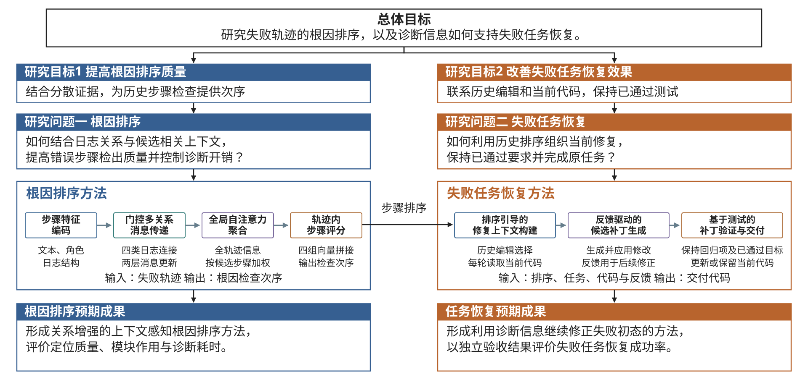
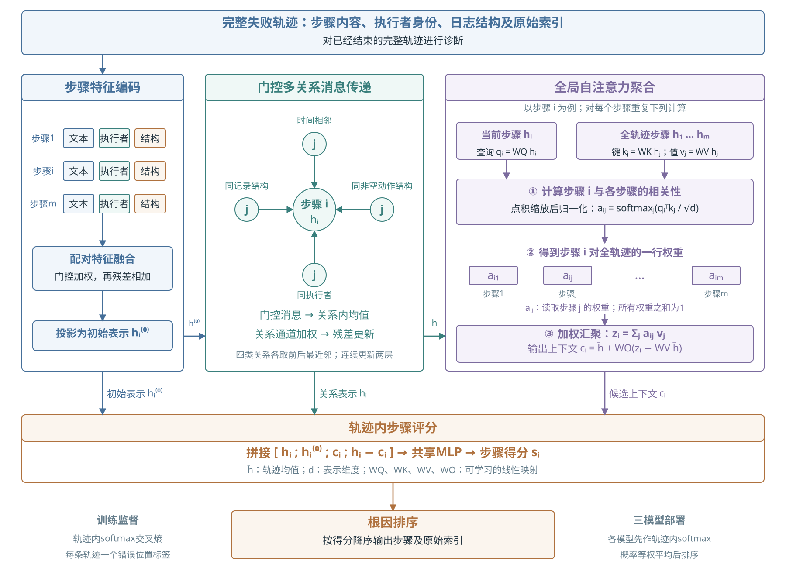
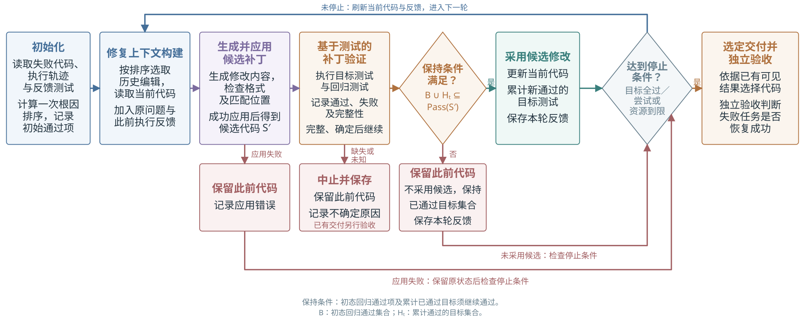

# 逐段溯源与结构复核

当前文稿：01_开题报告_结构与衔接修订版.md。共88个段落/图表块，逐块登记。正文9664个非空白字符。

论文事实、比较判断和本文设计分别记录。历史数据与代码沿此前已核来源，本轮对实际存在的源文件重新核对哈希，不运行训练或恢复实验。

## P001 · 智能体运行故障的根因排序与恢复方法 · 第3行

开题报告 · 2026年10月29日

性质：版本信息或研究进度计划。论文：无直接编号事实。项目/中文来源：U01、U02。

本轮日期与拟研究安排，不承担已完成实验的效果主张。

## P002 · 1.1 研究背景 · 第9行

本课题研究智能体执行结束后仍未满足任务要求的**运行故障**。[1] 智能体围绕任务作出决策、执行动作并接收反馈，这些活动及其衔接构成执行工作流。一次任务实际经历的推理、动作与环境观察按发生顺序保存，形成**执行轨迹**，为追查历史行为提供过程记录。[2]

性质：研究对象、论文依据及本文范围。论文：whowhen、process。项目/中文来源：L06、L07、L08、U01。

先交代同一任务的执行活动与有序记录，再说明步骤、故障、排序及恢复的用途。过程对象由英文原文支持；中文组织参考两篇自动化学报原文，不将其冒充统一故障步骤定义。

## P003 · 1.1 研究背景 · 第11行

轨迹中的一次具体决策或交互活动构成可逐项分析的**步骤**，对应当时行动的执行者及其动作。[3] 判断步骤是否出错，还需联系当时可获得的输入、上下文和反馈。[4]

性质：研究对象、论文依据及本文范围。论文：stepfinder、traceelephant。项目/中文来源：L06、L07、L08、U01。

先交代同一任务的执行活动与有序记录，再说明步骤、故障、排序及恢复的用途。过程对象由英文原文支持；中文组织参考两篇自动化学报原文，不将其冒充统一故障步骤定义。

## P004 · 1.1 研究背景 · 第13行

**任务失败的原因往往难以仅凭最终结果确定，相关证据分散于不同智能体及其执行步骤，需要结合任务要求、消息交互、工具操作与环境反馈追查历史行为。**[1] 上游偏差可能经后续信息传递形成错误级联，使最终异常表现与关键错误步骤处于不同位置。[5]

性质：研究对象、论文依据及本文范围。论文：whowhen、agents_cn2026。项目/中文来源：L06、L07、L08、U01。

先交代同一任务的执行活动与有序记录，再说明步骤、故障、排序及恢复的用途。过程对象由英文原文支持；中文组织参考两篇自动化学报原文，不将其冒充统一故障步骤定义。

## P005 · 1.1 研究背景 · 第15行

因此，本课题以失败轨迹中的历史步骤为**根因候选**，结合步骤内容及关联证据评分，形成优先检查次序，称为**根因排序**。排序以关键错误的优先检出为目标[3]，将评分较高的步骤置于检查前列，为核查错误和选择修正线索提供依据。

性质：研究对象、论文依据及本文范围。论文：stepfinder。项目/中文来源：L06、L07、L08、U01。

先交代同一任务的执行活动与有序记录，再说明步骤、故障、排序及恢复的用途。过程对象由英文原文支持；中文组织参考两篇自动化学报原文，不将其冒充统一故障步骤定义。

## P006 · 1.1 研究背景 · 第17行

为检验排序能否帮助完成任务，本课题进一步研究软件任务的**失败任务恢复**：从失败后保留的代码与环境出发，按排序选择实际改变源码的历史编辑，结合当前实现和反馈继续修改。历史认识可能与已经变化的代码失步[6]，因而线索需要重新对应当前实现，再通过补丁生成与验证推进求解。[7] 最终是否恢复成功，由预先确定的原任务验收判定。[8]

性质：研究对象、论文依据及本文范围。论文：syncmind、repairagent、swebench。项目/中文来源：L06、L07、L08、U01。

先交代同一任务的执行活动与有序记录，再说明步骤、故障、排序及恢复的用途。过程对象由英文原文支持；中文组织参考两篇自动化学报原文，不将其冒充统一故障步骤定义。

## P007 · 1.2 国内外研究现状 · 第21行

根因排序需要回答哪些历史步骤应优先检查，失败任务恢复则需要把这些线索用于当前代码的修正。以下按这两个相继环节，分析代表性工作的证据组织、历史线索利用和验证方式。

性质：研究环节衔接。论文：无直接编号事实。项目/中文来源：U01、L08。

编号引文对应已有工作的方法或实验事实；随后比较其对象、证据组织及验证范围。未分别检验某设计不等于该工作完全没有上下文、交互或验证。

## P008 · 1.2.1 智能体运行故障诊断与根因排序 · 第25行

- **Who&When（Shaokun Zhang等，2025）**：以失败轨迹定位执行者及关键错误步骤，比较整轨迹判断、逐步检查和二分搜索。其“决定性错误”指纠正该步并相应调整后续执行即可使任务成功的错误，多个错误满足时取最早者；最佳步骤定位准确率为14.2%。[1] 研究建立了步骤级诊断对象，也表明终态失败判断与关键步骤定位之间仍有距离。

性质：论文事实与面向本课题的限定比较。论文：whowhen。项目/中文来源：U01、L08。

编号引文对应已有工作的方法或实验事实；随后比较其对象、证据组织及验证范围。未分别检验某设计不等于该工作完全没有上下文、交互或验证。

## P009 · 1.2.1 智能体运行故障诊断与根因排序 · 第27行

- **TraceElephant（Mengzhuo Chen等，2026）**：补全任务输入、中间消息与环境交互，分析各执行者当时可使用的信息。[4] 这说明步骤判断需要完整的可见证据；取得这些证据之后，如何关联分散记录并区分关键错误与后续表现，仍需具体的排序模型。

性质：论文事实与面向本课题的限定比较。论文：traceelephant。项目/中文来源：U01、L08。

编号引文对应已有工作的方法或实验事实；随后比较其对象、证据组织及验证范围。未分别检验某设计不等于该工作完全没有上下文、交互或验证。

## P010 · 1.2.1 智能体运行故障诊断与根因排序 · 第29行

- **StepFinder（Taiyu Zhu等，2026）**：结合步骤语义、执行者身份、双向时序网络与全局注意力产生步骤分数。[3] 其交互主要由时序、语义匹配和身份偏置表达，未分别检验显式决策上下文与后续动作、记录结构等日志联系的增量作用。这些联系为区分语义相近但执行作用不同的候选提供了待检验的信息。

性质：论文事实与面向本课题的限定比较。论文：stepfinder。项目/中文来源：U01、L08。

编号引文对应已有工作的方法或实验事实；随后比较其对象、证据组织及验证范围。未分别检验某设计不等于该工作完全没有上下文、交互或验证。

## P011 · 1.2.1 智能体运行故障诊断与根因排序 · 第31行

- **DCFA（Zehao Wang等，2026）**：构造依赖图，结合局部反事实推理细化根因判断。[9] 该工作说明关联证据有助于分析故障形成过程，同时引入额外结构推理。对于日志中可以直接提取的联系，仍需检验其能否以较低开销补充候选区分。

性质：论文事实与面向本课题的限定比较。论文：dcfa。项目/中文来源：U01、L08。

编号引文对应已有工作的方法或实验事实；随后比较其对象、证据组织及验证范围。未分别检验某设计不等于该工作完全没有上下文、交互或验证。

## P012 · 1.2.1 智能体运行故障诊断与根因排序 · 第33行

这些研究从确定诊断对象发展到补全证据、学习评分和关系推理。排序所形成的历史检查次序还需进入恢复过程，才能检验优先发现的行为是否确实有助于后续修正。

性质：研究环节衔接。论文：无直接编号事实。项目/中文来源：U01、L08。

编号引文对应已有工作的方法或实验事实；随后比较其对象、证据组织及验证范围。未分别检验某设计不等于该工作完全没有上下文、交互或验证。

## P013 · 1.2.2 根因排序引导的软件失败任务恢复 · 第37行

交互执行可利用环境反馈继续求解[10]，跨次尝试还可积累反思经验。[11] 工具检查为结果修订提供外部依据。[12] 软件恢复进一步要求把反馈落实为当前代码上的修改和验证。

性质：论文事实与面向本课题的限定比较。论文：react、reflexion、critic。项目/中文来源：U01、L08。

编号引文对应已有工作的方法或实验事实；随后比较其对象、证据组织及验证范围。未分别检验某设计不等于该工作完全没有上下文、交互或验证。

## P014 · 1.2.2 根因排序引导的软件失败任务恢复 · 第39行

- **Agentless（Chunqiu Steven Xia等，2025）**：按定位、补丁生成和验证选择组织求解，以复现测试和回归测试筛选修改。[13] 其证据围绕问题与候选补丁组织，历史执行步骤的排序如何改变当前修复输入，需要单独建立和验证。

性质：论文事实与面向本课题的限定比较。论文：agentless。项目/中文来源：U01、L08。

编号引文对应已有工作的方法或实验事实；随后比较其对象、证据组织及验证范围。未分别检验某设计不等于该工作完全没有上下文、交互或验证。

## P015 · 1.2.2 根因排序引导的软件失败任务恢复 · 第41行

- **EnAgent（Zhao Tian等，2026）**：生成多条候选轨迹，经去重、回归剪枝及工具检查后投票选择补丁。[14] 该流程加强候选比较，但未将恢复中新通过的目标测试逐项累积为后续修改条件；固定回归检查与新增目标进展的保持承担不同作用。

性质：论文事实与面向本课题的限定比较。论文：enagent。项目/中文来源：U01、L08。

编号引文对应已有工作的方法或实验事实；随后比较其对象、证据组织及验证范围。未分别检验某设计不等于该工作完全没有上下文、交互或验证。

## P016 · 1.2.2 根因排序引导的软件失败任务恢复 · 第43行

- **SyncMind（Xuehang Guo等，2025）**：研究执行者认识与实际代码失步时的恢复，要求重新获取当前环境信息。[6] 这揭示了历史线索的时效问题。使用步骤排序时，还需筛选真实编辑、读取当前实现，明确历史判断如何转化为当前可用的修复依据。

性质：论文事实与面向本课题的限定比较。论文：syncmind。项目/中文来源：U01、L08。

编号引文对应已有工作的方法或实验事实；随后比较其对象、证据组织及验证范围。未分别检验某设计不等于该工作完全没有上下文、交互或验证。

## P017 · 1.2.2 根因排序引导的软件失败任务恢复 · 第45行

- **DoVer（Ming Ma等，2026）**：通过修改消息、计划并重新执行，以任务成功或实际进展检验诊断。[15] 其GAIA和AssistantBench实验考察了干预后的结果，但未针对软件代码连续修改建立已通过目标的保持规则；该环节关系到局部修正能否持续转化为任务完成。

性质：论文事实与面向本课题的限定比较。论文：dover。项目/中文来源：U01、L08。

编号引文对应已有工作的方法或实验事实；随后比较其对象、证据组织及验证范围。未分别检验某设计不等于该工作完全没有上下文、交互或验证。

## P018 · 1.3 研究问题 · 第49行

现有研究留下两个与本课题直接相关的问题。诊断已利用时序和全局交互，推理式方法也能组织关联证据，但日志中可直接提取的联系能否补充候选区分、带来怎样的质量与成本取舍，仍需检验；工具验证还会消耗额外执行资源。[16] 诊断给出的是历史步骤判断，修改却作用于当前代码，需要检验历史线索能否转化为有效修复依据，以及后续修改能否保持新通过的目标测试。

性质：基于文献比较提出的研究问题、目标或拟设计。论文：errorprobe。项目/中文来源：U01、C02、C08、C10、C11。

由1.2中具体比较及本地方法设计形成；目标、意义和创新均为拟研究作用，须由第五章实验检验，不作为已取得的效果。

## P019 · 1.3 研究问题 · 第51行

前一环节决定优先检查哪些历史行为，后一环节决定这些线索能否帮助完成原任务。本课题据此提出以下两个研究问题。

性质：基于文献比较提出的研究问题、目标或拟设计。论文：无直接编号事实。项目/中文来源：U01、C02、C08、C10、C11。

由1.2中具体比较及本地方法设计形成；目标、意义和创新均为拟研究作用，须由第五章实验检验，不作为已取得的效果。

## P020 · 1.3 研究问题 · 第53行

**RQ1：分散执行证据下的根因排序。** 如何关联不同智能体和执行步骤中的分散证据，提高关键错误步骤的识别与排序质量，并控制诊断开销？

性质：基于文献比较提出的研究问题、目标或拟设计。论文：whowhen、stepfinder、dcfa、errorprobe。项目/中文来源：U01、C02、C07、C08、C10、C11。

由1.2中具体比较及本地方法设计形成；目标、意义和创新均为拟研究作用，须由第五章实验检验，不作为已取得的效果。

## P021 · 1.3 研究问题 · 第55行

**RQ2：根因排序引导的软件失败任务恢复。** 如何将历史步骤排序转化为适用于当前代码的修复依据，并在连续修改中保持已通过目标测试所反映的任务进展，提高原任务的最终完成率？

性质：基于文献比较提出的研究问题、目标或拟设计。论文：agentracer、syncmind、enagent、dover。项目/中文来源：U01、C10、C11、C02、C08。

由1.2中具体比较及本地方法设计形成；目标、意义和创新均为拟研究作用，须由第五章实验检验，不作为已取得的效果。

## P022 · 1.3 研究问题 · 第57行

RQ1输出步骤检查次序，RQ2从中选择历史编辑并核对当前实现，两项研究通过实际进入恢复器的修复线索衔接。由此，研究目标既包括排序本身的有效性，也包括排序在恢复中的实际作用。

性质：基于文献比较提出的研究问题、目标或拟设计。论文：无直接编号事实。项目/中文来源：U01、C02、C08、C10、C11。

由1.2中具体比较及本地方法设计形成；目标、意义和创新均为拟研究作用，须由第五章实验检验，不作为已取得的效果。

## P023 · 2.1 研究目标 · 第63行

总体目标是建立从失败轨迹分析到软件任务继续求解的方法，形成可评价的根因排序与失败任务恢复流程。

性质：基于文献比较提出的研究问题、目标或拟设计。论文：无直接编号事实。项目/中文来源：U01、C02、C08、C10、C11。

由1.2中具体比较及本地方法设计形成；目标、意义和创新均为拟研究作用，须由第五章实验检验，不作为已取得的效果。

## P024 · 2.1 研究目标 · 第65行

**根因排序目标：** 关联步骤内容、执行者与日志结构，结合局部关系传播和候选相关上下文学习步骤分数，输出优先检查次序。通过共同数据上的基线比较及消融，检验排序质量、诊断成本和各类证据的作用。

性质：基于文献比较提出的研究问题、目标或拟设计。论文：无直接编号事实。项目/中文来源：U01、C02、C08、C10、C11。

由1.2中具体比较及本地方法设计形成；目标、意义和创新均为拟研究作用，须由第五章实验检验，不作为已取得的效果。

## P025 · 2.1 研究目标 · 第67行

**失败任务恢复目标：** 将排序转化为真实历史编辑的选择，结合当前源码与反馈生成补丁，以累计测试保持规则更新代码。通过共同失败初态下的完整方法比较及模块对照，检验最终恢复效果，并核对排序是否真正改变了修复输入。

性质：基于文献比较提出的研究问题、目标或拟设计。论文：无直接编号事实。项目/中文来源：U01、C02、C08、C10、C11。

由1.2中具体比较及本地方法设计形成；目标、意义和创新均为拟研究作用，须由第五章实验检验，不作为已取得的效果。

## P026 · 2.2 研究意义 · 第71行

**方法意义：** 将分散执行记录中的可观测联系与候选相关上下文共同用于步骤判断，研究不同证据在关键错误区分中的作用；再将历史判断接入当前代码上的恢复操作，建立从诊断质量到任务结果的验证关系。

性质：基于文献比较提出的研究问题、目标或拟设计。论文：无直接编号事实。项目/中文来源：U01、C02、C08、C10、C11。

由1.2中具体比较及本地方法设计形成；目标、意义和创新均为拟研究作用，须由第五章实验检验，不作为已取得的效果。

## P027 · 2.2 研究意义 · 第73行

**应用意义：** 为失败执行提供有次序的历史排查线索，帮助利用已有代码和执行记录继续求解。通过当前实现核对和已通过目标测试的保持，减少失效历史线索及后续修改退化对恢复的影响。

性质：基于文献比较提出的研究问题、目标或拟设计。论文：无直接编号事实。项目/中文来源：U01、C02、C08、C10、C11。

由1.2中具体比较及本地方法设计形成；目标、意义和创新均为拟研究作用，须由第五章实验检验，不作为已取得的效果。

## P028 · 2.2 研究意义 · 第75行

实现上述目标，需要先产生有效的步骤检查次序，再将高排位的历史编辑对应到当前代码，使诊断与恢复组成可验证的完整过程。

性质：基于文献比较提出的研究问题、目标或拟设计。论文：无直接编号事实。项目/中文来源：U01、C02、C08、C10、C11。

由1.2中具体比较及本地方法设计形成；目标、意义和创新均为拟研究作用，须由第五章实验检验，不作为已取得的效果。

## P029 · 3.1 总体研究框架与数据接口 · 第81行

性质：本文方法设计与已有基础机制。论文：无直接编号事实。项目/中文来源：F01、C06、C08、C10、C11、C01、C03。

总体图的模块与接口来自本文方案及原型，图示不作为独立科学证据。

## P030 · 3.1 总体研究框架与数据接口 · 第83行

**图3-1 根因排序与失败任务恢复的总体研究框架**

性质：本文方法设计与已有基础机制。论文：无直接编号事实。项目/中文来源：F01、C01、C03、C10。

与上一图对象一致，图内机制分别追溯到C01—C11。

## P031 · 3.1 总体研究框架与数据接口 · 第85行

总体过程见图3-1。排序为历史编辑选择提供次序，恢复结合当前代码生成并验证修改，满足测试保持条件才更新代码；停止后选定交付，以独立验收判断原任务是否完成。

性质：本文方法设计与已有基础机制。论文：无直接编号事实。项目/中文来源：C01、C03、C10。

步骤边界、字段、关系传播、上下文读取、评分或恢复操作由所列代码定位支撑；编号引文只支撑相应基础机制。模块末尾说明输出进入后续哪个模块，不插入外部论文介绍。

## P032 · 3.1 总体研究框架与数据接口 · 第87行

排序模型读取失败轨迹中的步骤内容、执行者及日志结构，保持数据源原有的步骤边界、标注位置与输出编号对应。对显式格式能够识别的决策上下文及其后续动作，融合关联记录的表示，保留两个原始步骤；排序结果再用于筛选实际编辑。

性质：本文方法设计与已有基础机制。论文：无直接编号事实。项目/中文来源：C01、C03、C04、C09、C10。

步骤边界、字段、关系传播、上下文读取、评分或恢复操作由所列代码定位支撑；编号引文只支撑相应基础机制。模块末尾说明输出进入后续哪个模块，不插入外部论文介绍。

## P033 · 3.1 总体研究框架与数据接口 · 第89行

两项研究的对象与评价关系见表3-1。步骤排序经历史编辑筛选与当前实现核对，转为恢复输入；其起点是从失败轨迹计算可供筛选的步骤分数。

性质：本文方法设计与已有基础机制。论文：无直接编号事实。项目/中文来源：C01、C03、C10。

步骤边界、字段、关系传播、上下文读取、评分或恢复操作由所列代码定位支撑；编号引文只支撑相应基础机制。模块末尾说明输出进入后续哪个模块，不插入外部论文介绍。

## P034 · 3.1 总体研究框架与数据接口 · 第91行

**表3-1 两项研究的对象、方法与评价依据**

性质：本文方法设计与已有基础机制。论文：无直接编号事实。项目/中文来源：F01、C01、C03、C10。

对应两项研究对象、方法及评价的接口表。

## P035 · 3.1 总体研究框架与数据接口 · 第93行

| 研究部分 | 研究对象 | 方法设计 | 评价依据 |
| --- | --- | --- | --- |
| 根因排序 | 失败执行轨迹 | 稀疏日志关系与候选相关上下文评分 | 定位与排序、模块消融、诊断成本 |
| 失败任务恢复 | 失败代码与运行环境 | 排序引导上下文、反馈修复与测试保持 | 完整方法比较、排序替换、测试保持对照 |

性质：本文方法设计与已有基础机制。论文：stepfinder、agentless、dover。项目/中文来源：C06、C08、C10、C11、C12、U01、C01、C03。

排序对象是已记录步骤，恢复对象是失败代码及环境；评价分别对应定位/排序与实际任务完成。表中研究方法是方案，不是假称原论文同款模型。

## P036 · 3.2 根因排序模型 · 第100行

性质：本文方法设计与已有基础机制。论文：无直接编号事实。项目/中文来源：F02、C02、C06、C07、C08、C09。

核对配对、四关系、单头全局读取、评分和三模型部署；保留原图布局。

## P037 · 3.2 根因排序模型 · 第102行

**图3-2 根因排序模型的计算结构**

性质：本文方法设计与已有基础机制。论文：无直接编号事实。项目/中文来源：F02、C02、C06、C07、C08。

与计算图保持同一研究对象及名称。

## P038 · 3.2 根因排序模型 · 第104行

图中m为步骤数，i、j为步骤编号；hᵢ⁽⁰⁾、hᵢ、cᵢ分别为初始表示、关系表示和步骤上下文，MLP为输出步骤分数的多层感知机。其余计算量在图内定义。模型依次完成特征编码、关系传播、全局上下文聚合与步骤评分。

性质：本文方法设计与已有基础机制。论文：无直接编号事实。项目/中文来源：C02、C06、C07、C08。

步骤边界、字段、关系传播、上下文读取、评分或恢复操作由所列代码定位支撑；编号引文只支撑相应基础机制。模块末尾说明输出进入后续哪个模块，不插入外部论文介绍。

## P039 · 3.2.1 步骤特征编码 · 第108行

输入为步骤文本、执行者身份和日志字段。当前原型采用固定的Qwen3-Embedding-0.6B编码器，将各步内容、动作及思考字段转换为向量。[17] 执行者按同轨迹首次出现次序匿名编号，结构特征记录字段形态、位置及重复情况。模型融合这些信息形成初始步骤表示。

性质：本文方法设计与已有基础机制。论文：qwen3embedding。项目/中文来源：C04、C05、C09、C03。

步骤边界、字段、关系传播、上下文读取、评分或恢复操作由所列代码定位支撑；编号引文只支撑相应基础机制。模块末尾说明输出进入后续哪个模块，不插入外部论文介绍。

## P040 · 3.2.1 步骤特征编码 · 第110行

原型未另设原始任务说明的独立编码支路，仅能利用记录本身携带的任务信息。输入只使用允许观察的字段；完整输入与观测范围对诊断的影响已有研究依据。[4] 错误位置标注仅用于训练和评价，实验需列出各来源实际可用的输入字段。

性质：本文方法设计与已有基础机制。论文：traceelephant。项目/中文来源：C05、C09、C03、C04。

步骤边界、字段、关系传播、上下文读取、评分或恢复操作由所列代码定位支撑；编号引文只支撑相应基础机制。模块末尾说明输出进入后续哪个模块，不插入外部论文介绍。

## P041 · 3.2.2 门控多关系消息传递 · 第114行

初始表示保留各步自身的信息，跨步骤证据还需通过日志联系组织。模型以步骤为节点，分别构造时间相邻、同一执行者、完整记录结构相同、非空动作结构相同四类关系。后两类“结构相同”依据字段形式判定。每类关系连接前后最近的匹配记录，限制每个节点的邻居数。

性质：本文方法设计与已有基础机制。论文：无直接编号事实。项目/中文来源：C02、C07。

步骤边界、字段、关系传播、上下文读取、评分或恢复操作由所列代码定位支撑；编号引文只支撑相应基础机制。模块末尾说明输出进入后续哪个模块，不插入外部论文介绍。

## P042 · 3.2.2 门控多关系消息传递 · 第116行

模型沿每类关系读取邻居表示，将邻居内容及其与当前步骤的差异变换为消息；门控计算0到1之间的权重，调节消息贡献。各关系内汇总，再融合不同关系并更新步骤表示，两层更新使信息沿关系继续传播。该模块采用多关系图表示学习的邻居聚合机制，具体邻接与融合方式属于本课题设计。[18]

性质：本文方法设计与已有基础机制。论文：rgcn。项目/中文来源：C07、C02。

步骤边界、字段、关系传播、上下文读取、评分或恢复操作由所列代码定位支撑；编号引文只支撑相应基础机制。模块末尾说明输出进入后续哪个模块，不插入外部论文介绍。

## P043 · 3.2.3 全局自注意力聚合 · 第120行

有限轮关系传播只利用既定邻接覆盖的记录，远处的需求或失败反馈还需全轨迹读取补充。该模块以每个待评分步骤为查询，从同一完整轨迹的步骤表示中计算相关权重，汇集与它相关的信息，形成该候选自己的上下文。不同候选可以读取不同重点。查询、用于匹配的键和承载信息的值均来自同一轨迹，采用自注意力计算。[19]

性质：本文方法设计与已有基础机制。论文：attention。项目/中文来源：C08。

步骤边界、字段、关系传播、上下文读取、评分或恢复操作由所列代码定位支撑；编号引文只支撑相应基础机制。模块末尾说明输出进入后续哪个模块，不插入外部论文介绍。

## P044 · 3.2.3 全局自注意力聚合 · 第122行

当前实现以轨迹均值作为共享背景，再叠加候选相关修正，输出候选上下文。它与关系传播分别承担有限邻域汇集和全轨迹读取，是否互补由消融检验。两类表示随后共同进入评分网络。

性质：本文方法设计与已有基础机制。论文：attention。项目/中文来源：C08。

步骤边界、字段、关系传播、上下文读取、评分或恢复操作由所列代码定位支撑；编号引文只支撑相应基础机制。模块末尾说明输出进入后续哪个模块，不插入外部论文介绍。

## P045 · 3.2.4 轨迹内步骤评分 · 第126行

共享评分网络读取初始表示、关系表示、候选上下文及两者差异，为各步输出分数。训练时，一条轨迹提供一个标注错误位置，模型在同轨迹内归一化分数，最小化标注位置的负对数概率；预测时按分数降序产生检查次序。[3] 候选组内评分采用列表级学习思路[20]，单正例条件下的位置交叉熵与排序目标之间具有理论联系。[21]

性质：本文方法设计与已有基础机制。论文：stepfinder、learning_to_rank、softmax_rank。项目/中文来源：C06、C08、C09。

步骤边界、字段、关系传播、上下文读取、评分或恢复操作由所列代码定位支撑；编号引文只支撑相应基础机制。模块末尾说明输出进入后续哪个模块，不插入外部论文介绍。

## P046 · 3.2.4 轨迹内步骤评分 · 第128行

单位置监督没有给出其余步骤的完整责任先后次序，评价检查标注错误能否位于首位或前几个位置。各来源的错误位置含义分别保留，静态评分输出作为根因排查线索。恢复器进一步从高排位步骤中筛选真实编辑，形成面向当前代码的修复输入。

性质：本文方法设计与已有基础机制。论文：无直接编号事实。项目/中文来源：C06、C09。

步骤边界、字段、关系传播、上下文读取、评分或恢复操作由所列代码定位支撑；编号引文只支撑相应基础机制。模块末尾说明输出进入后续哪个模块，不插入外部论文介绍。

## P047 · 3.3 失败任务恢复方法 · 第132行

性质：本文方法设计与已有基础机制。论文：无直接编号事实。项目/中文来源：F03、C10、C11。

恢复图与原型中的生成、应用、测试、代码更新及停止流程对应，不将源码快照扩写为任意外部状态事务。

## P048 · 3.3 失败任务恢复方法 · 第134行

**图3-3 失败任务恢复流程**

性质：本文方法设计与已有基础机制。论文：无直接编号事实。项目/中文来源：F03、C10、C11。

保持既定图题和流程对象。

## P049 · 3.3 失败任务恢复方法 · 第136行

图中B为初态已通过的受保护回归项，Hₜ为累计已通过目标，Pass(S′)为候选代码S′确认通过的测试集合。

性质：本文方法设计与已有基础机制。论文：无直接编号事实。项目/中文来源：C10、C11。

步骤边界、字段、关系传播、上下文读取、评分或恢复操作由所列代码定位支撑；编号引文只支撑相应基础机制。模块末尾说明输出进入后续哪个模块，不插入外部论文介绍。

## P050 · 3.3.1 排序引导的修复上下文构建 · 第140行

输入为原始任务、根因排序、历史轨迹、当前代码和允许读取的测试反馈。恢复器按排序筛选实际成功改变源码的历史操作，按编辑调用去重并保留代码差异。历史认识可能与当前代码失步。[6] 因此，再读取相关文件或函数的当前实现，将线索对应到当前程序实体，按文件和函数结构获取相关源码。[22]

性质：本文方法设计与已有基础机制。论文：syncmind、autocoderover。项目/中文来源：C10。

步骤边界、字段、关系传播、上下文读取、评分或恢复操作由所列代码定位支撑；编号引文只支撑相应基础机制。模块末尾说明输出进入后续哪个模块，不插入外部论文介绍。

## P051 · 3.3.1 排序引导的修复上下文构建 · 第142行

历史差异说明此前改了什么，当前实现说明现在面对什么代码，测试反馈说明哪些要求仍未满足。读取数量、输入容量及历史编辑的补充次序在比较前固定；各轮更新当前代码和反馈。输出为生成模型实际读取的修复上下文，并保存选入编辑和读取位置，以核对排序是否真正改变了输入。

性质：本文方法设计与已有基础机制。论文：无直接编号事实。项目/中文来源：C10、U02。

步骤边界、字段、关系传播、上下文读取、评分或恢复操作由所列代码定位支撑；编号引文只支撑相应基础机制。模块末尾说明输出进入后续哪个模块，不插入外部论文介绍。

## P052 · 3.3.2 反馈驱动的候选补丁生成 · 第146行

生成模型依据本轮修复上下文提出候选补丁，即对现有代码的具体修改，执行端尝试将其应用到代码副本。应用错误随操作记录进入后续反馈；成功应用的候选交由验证端检查，尚不直接替换当前代码。该模块采用生成—验证式程序修复流程。[23]

性质：本文方法设计与已有基础机制。论文：repair_survey_cn2025。项目/中文来源：C10。

步骤边界、字段、关系传播、上下文读取、评分或恢复操作由所列代码定位支撑；编号引文只支撑相应基础机制。模块末尾说明输出进入后续哪个模块，不插入外部论文介绍。

## P053 · 3.3.3 基于测试的补丁验证与交付 · 第150行

验证端对成功应用的候选执行预先固定的**目标测试**及**回归测试**，前者检查原任务要求，后者检查需要保留的已有行为。[7] 通过有限测试的补丁仍需进一步确认正确性。[24]

性质：本文方法设计与已有基础机制。论文：repairagent、leakage_cn2024。项目/中文来源：C10、C11。

步骤边界、字段、关系传播、上下文读取、评分或恢复操作由所列代码定位支撑；编号引文只支撑相应基础机制。模块末尾说明输出进入后续哪个模块，不插入外部论文介绍。

## P054 · 3.3.3 基于测试的补丁验证与交付 · 第152行

本文拟将初态已通过且需要保留的回归项，以及初态和各轮已采用代码中新通过的目标项组成保护集合。候选继续通过全部保护项时才更新代码，否则保留此前状态；被拒候选的新通过项不加入集合。测试保持依赖稳定、可执行的测试，可能拒绝需要暂时破坏已通过行为的中间修改；实验将记录这类拒绝及其任务后果。

性质：本文方法设计与已有基础机制。论文：无直接编号事实。项目/中文来源：C10、C11。

步骤边界、字段、关系传播、上下文读取、评分或恢复操作由所列代码定位支撑；编号引文只支撑相应基础机制。模块末尾说明输出进入后续哪个模块，不插入外部论文介绍。

## P055 · 3.3.3 基于测试的补丁验证与交付 · 第154行

目标全部通过、尝试次数或预算用尽时停止，按预先固定的反馈规则选择交付；与生成过程隔离的独立验收决定是否恢复成功。

性质：本文方法设计与已有基础机制。论文：无直接编号事实。项目/中文来源：C10、C11。

步骤边界、字段、关系传播、上下文读取、评分或恢复操作由所列代码定位支撑；编号引文只支撑相应基础机制。模块末尾说明输出进入后续哪个模块，不插入外部论文介绍。

## P056 · 3.3.3 基于测试的补丁验证与交付 · 第156行

测试结果缺失或不确定时，停止更新并保存已有代码。至此，步骤排序通过编辑选择进入恢复输入，补丁验证再决定能否保留修改；两个环节分别需要解决证据区分和状态变化带来的困难。

性质：本文方法设计与已有基础机制。论文：无直接编号事实。项目/中文来源：C10、C11。

步骤边界、字段、关系传播、上下文读取、评分或恢复操作由所列代码定位支撑；编号引文只支撑相应基础机制。模块末尾说明输出进入后续哪个模块，不插入外部论文介绍。

## P057 · 4.1 关键难点 · 第162行

**难点一：分散执行证据的关联与关键错误区分。** 同一反馈可能关联多个历史步骤，错误操作与失败表现也可能相隔很远。需要结合日志联系和远处证据，减少无关信息干扰，并控制轨迹增长带来的诊断开销。

性质：基于文献比较提出的研究问题、目标或拟设计。论文：traceelephant、stepfinder、errorprobe。项目/中文来源：C02、C07、C08、C10、C11。

由1.2中具体比较及本地方法设计形成；目标、意义和创新均为拟研究作用，须由第五章实验检验，不作为已取得的效果。

## P058 · 4.1 关键难点 · 第164行

**难点二：变化代码上的历史线索利用与修复进展保持。** 排序对应历史行为，修改作用于当前实现。需要核对线索是否仍成立，并在解决剩余问题时保留已获得的测试进展；修改又会改变后续输入及测试状态。这两项困难分别对应排序中的证据融合与恢复中的状态更新。

性质：基于文献比较提出的研究问题、目标或拟设计。论文：syncmind、agentracer、agentless、enagent。项目/中文来源：C10、C11、C02、C08。

由1.2中具体比较及本地方法设计形成；目标、意义和创新均为拟研究作用，须由第五章实验检验，不作为已取得的效果。

## P059 · 4.2 拟研究的创新点 · 第168行

**可观测日志关系与候选相关上下文的联合排序设计。** 研究将结构明确的局部关系聚合与面向不同候选的全轨迹读取结合，检验二者在关键错误步骤检出上的互补作用。

性质：基于文献比较提出的研究问题、目标或拟设计。论文：stepfinder、dcfa。项目/中文来源：C02、C03、C07、C08、C10、C11。

由1.2中具体比较及本地方法设计形成；目标、意义和创新均为拟研究作用，须由第五章实验检验，不作为已取得的效果。

## P060 · 4.2 拟研究的创新点 · 第170行

**历史编辑选择与累计测试保持相结合的恢复设计。** 研究通过根因排序突出历史编辑，再依据当前实现与反馈修正代码，并把新获得的测试进展用于后续验证。检验信息选择与代码更新规则对最终恢复的作用。两项设计的有效性需要分别通过排序评价、恢复比较和模块对照验证，实验据此安排数据与评价流程。

性质：基于文献比较提出的研究问题、目标或拟设计。论文：无直接编号事实。项目/中文来源：C02、C08、C10、C11。

由1.2中具体比较及本地方法设计形成；目标、意义和创新均为拟研究作用，须由第五章实验检验，不作为已取得的效果。

## P061 · 5.1 实验数据来源与划分 · 第176行

**表5-1 数据来源与研究样本**

性质：数据来源、历史记录或前瞻实验计划。论文：无直接编号事实。项目/中文来源：D01、D02、D03、D04、D05。

该表区分公开版本规模、开发记录与拟议恢复样本，不混用发布量与本地纳入量。

## P062 · 5.1 实验数据来源与划分 · 第178行

| 数据来源 | 公开版本规模 | 研究样本与组织 | 用途 |
| --- | --- | --- | --- |
| AFTraj | 2,276条轨迹 | 既有开发记录731条、716个任务组 | 责任定位与排序 |
| AgenTracer | 代码任务coding训练1,141条、测试127条 | 614条训练验证来源（coding 320、数学任务math 294）；另363条coding开发轨迹 | 训练、验证与代码任务开发比较 |
| SWE-Gym | 2,438个Python问题 | 计划20个不同问题、覆盖5仓库 | 失败初态与恢复比较 |

性质：数据来源、历史记录或前瞻实验计划。论文：swegym、agentforesight、agentracer。项目/中文来源：D01、D02、D03、D04、D05、U02。

2276来自作者发布卡，不是论文v2的2272；1141/127、614及拆分来自版本清单；731/716按历史记录身份；2438来自SWE-Gym论文；20/5为本文计划。

## P063 · 5.1 实验数据来源与划分 · 第184行

任务组指同一原问题及其派生轨迹。

性质：数据来源、历史记录或前瞻实验计划。论文：leakage_cn2024。项目/中文来源：C01、D01、D02、D03、D04、D05。

数据发布量、本地筛选量、开发材料和计划运行量分别陈述。614=320+294、492=256+236、122=64+58沿已核清单；独立评价候选的历史使用仍须在运行前核验。方法与重复次数是计划，不是已完成结果。

## P064 · 5.1 实验数据来源与划分 · 第186行

AFTraj原用于在线前缀审计，本文保留其中的决定性错误位置，开展完整失败轨迹的离线排序。表中2,276是作者公开版本的计数，与论文进一步筛选后的统计区分使用。[25]

性质：数据来源、历史记录或前瞻实验计划。论文：agentforesight。项目/中文来源：D03、D01、D02、D04、D05。

数据发布量、本地筛选量、开发材料和计划运行量分别陈述。614=320+294、492=256+236、122=64+58沿已核清单；独立评价候选的历史使用仍须在运行前核验。方法与重复次数是计划，不是已完成结果。

## P065 · 5.1 实验数据来源与划分 · 第188行

诊断采用轨迹及错误位置材料。[26] 恢复采用代码、执行环境和测试：SWE-Gym提供可执行仓库问题[27]，SWE-bench建立基于代码修改与测试的任务评价。[8] 表内版本规模和本地筛选数量分别来自数据发布及项目清单，逐项依据列于溯源分析。数据用途不同，需进一步划分参数学习、配置选择与方法评价的范围。

性质：数据来源、历史记录或前瞻实验计划。论文：agentracer、swegym、swebench。项目/中文来源：D01、D02、D03、D04、D05。

数据发布量、本地筛选量、开发材料和计划运行量分别陈述。614=320+294、492=256+236、122=64+58沿已核清单；独立评价候选的历史使用仍须在运行前核验。方法与重复次数是计划，不是已完成结果。

## P066 · 5.1 实验数据来源与划分 · 第190行

训练集学习参数，验证集选择配置和训练轮次，评价集检验固定方法。相同原问题的派生轨迹放在同一集合，避免近似记录同时用于学习和评价；数据泄露对程序修复评价的影响已有实证依据。[24] 各方法共用输入许可、步骤边界、样本清单和评价规则。

性质：数据来源、历史记录或前瞻实验计划。论文：leakage_cn2024、stepfinder。项目/中文来源：C01、D01、L03、D02、D03、D04、D05。

数据发布量、本地筛选量、开发材料和计划运行量分别陈述。614=320+294、492=256+236、122=64+58沿已核清单；独立评价候选的历史使用仍须在运行前核验。方法与重复次数是计划，不是已完成结果。

## P067 · 5.1 实验数据来源与划分 · 第192行

现有AgenTracer开发池的614条记录来自公开训练部分。为控制初期编码与训练工作量、使两类任务规模接近，筛选程序限制轨迹为6—32步，核对步骤编号和公开字段，并排除与作者测试问题重叠的任务组；再对coding和math分别按固定次序最多取320组。coding有939个合格组，取320组；math只有294个合格组，全部取用。因此614＝320＋294，这个精确数量来自筛选清单，开发范围受上述长度限制。

性质：数据来源、历史记录或前瞻实验计划。论文：无直接编号事实。项目/中文来源：C01、D01、D04、D02、D03、D05。

数据发布量、本地筛选量、开发材料和计划运行量分别陈述。614=320+294、492=256+236、122=64+58沿已核清单；独立评价候选的历史使用仍须在运行前核验。方法与重复次数是计划，不是已完成结果。

## P068 · 5.1 实验数据来源与划分 · 第194行

为保留约五分之一数据选择配置，coding按256条训练、64条验证划分；math按236条训练、58条验证划分，后者由294除以5向下取整得到验证数量。合计训练492条、验证122条。两类任务用于学习一般步骤表示，代码任务和数学任务的结果分别报告，另比较仅用代码任务训练时的表现，判断混合训练的作用。

性质：数据来源、历史记录或前瞻实验计划。论文：无直接编号事实。项目/中文来源：C01、D01、D04、D02、D03、D05。

数据发布量、本地筛选量、开发材料和计划运行量分别陈述。614=320+294、492=256+236、122=64+58沿已核清单；独立评价候选的历史使用仍须在运行前核验。方法与重复次数是计划，不是已完成结果。

## P069 · 5.1 实验数据来源与划分 · 第196行

本轮采用固定训练、验证划分及预定的三次初始化，评价训练随机性的影响。既有开发材料记录了363条coding轨迹，以及AFTraj的731条记录、716个原问题组；这些材料继续按开发来源管理，不作为新划分后的独立评价证据。

性质：数据来源、历史记录或前瞻实验计划。论文：无直接编号事实。项目/中文来源：C09、C13、D02、D05、D01、D03、D04。

数据发布量、本地筛选量、开发材料和计划运行量分别陈述。614=320+294、492=256+236、122=64+58沿已核清单；独立评价候选的历史使用仍须在运行前核验。方法与重复次数是计划，不是已完成结果。

## P070 · 5.1 实验数据来源与划分 · 第198行

正式评价拟从作者发布的AFTraj测试unsafe记录163条、AgenTracer coding测试127条中核验候选，先查历史使用及任务重叠，再固定实际清单。已参与方法选择的记录继续作为开发材料，独立评价数量以核验结果确定。三次初始化全部报告，区分单模型与预定集成。恢复评价还需要可重建的失败代码、环境与轨迹，以形成共同起点。

性质：数据来源、历史记录或前瞻实验计划。论文：agentforesight、leakage_cn2024。项目/中文来源：D01、D03、D05、D02、D04。

数据发布量、本地筛选量、开发材料和计划运行量分别陈述。614=320+294、492=256+236、122=64+58沿已核清单；独立评价候选的历史使用仍须在运行前核验。方法与重复次数是计划，不是已完成结果。

## P071 · 5.2 恢复任务与实验设置 · 第202行

恢复开发比较计划覆盖5个仓库、20个不同问题。20题是受运行预算约束的计划规模，目标是覆盖多个仓库并完成共同重复比较；它与公开数据的2,438题总量具有不同用途。问题沿既有计划次序选择，并核验环境、失败代码、历史编辑及反馈测试能否重建，不依据本文与基线的胜负选题。

性质：数据来源、历史记录或前瞻实验计划。论文：swegym。项目/中文来源：U01、U02、C01、C13、D01、D02、D03、D04、D05。

数据发布量、本地筛选量、开发材料和计划运行量分别陈述。614=320+294、492=256+236、122=64+58沿已核清单；独立评价候选的历史使用仍须在运行前核验。方法与重复次数是计划，不是已完成结果。

## P072 · 5.2 恢复任务与实验设置 · 第204行

每个问题需重建失败后的代码、环境和轨迹，确认原任务未完成，在运行前固定清单，并列出准备通过的题数和排除原因。执行环境应提供仓库浏览、源码编辑与测试接口[28]，并保存隔离运行中的命令、文件与轨迹记录。[29] 各方法按表5-2的共同条件独立执行。

性质：数据来源、历史记录或前瞻实验计划。论文：sweagent、openhands。项目/中文来源：C01、C13、D01、D02、D03、D04、D05。

数据发布量、本地筛选量、开发材料和计划运行量分别陈述。614=320+294、492=256+236、122=64+58沿已核清单；独立评价候选的历史使用仍须在运行前核验。方法与重复次数是计划，不是已完成结果。

## P073 · 5.2 恢复任务与实验设置 · 第206行

本文与Agentless、EnAgent、AOrchestra各重复3次，20题准备完成后的开发计划为20×4×3＝240次运行。同题先汇总，再对问题等权统计。独立评价另选未参与开发的任务，清单与数量在运行前确定。共同设置固定可比较条件，评价再分别考察排序质量与最终任务完成情况。

性质：数据来源、历史记录或前瞻实验计划。论文：无直接编号事实。项目/中文来源：C01、C13、D01、D02、D03、D04、D05。

数据发布量、本地筛选量、开发材料和计划运行量分别陈述。614=320+294、492=256+236、122=64+58沿已核清单；独立评价候选的历史使用仍须在运行前核验。方法与重复次数是计划，不是已完成结果。

## P074 · 5.2 恢复任务与实验设置 · 第208行

**表5-2 恢复实验的共同评价设置**

性质：数据来源、历史记录或前瞻实验计划。论文：无直接编号事实。项目/中文来源：U02、C10、C11、C01、C13、D01、D02、D03、D04、D05。

表5-2为本课题拟统一的运行条件。

## P075 · 5.2 恢复任务与实验设置 · 第210行

| 实验因素 | 共同控制 |
| --- | --- |
| 评价起点 | 同一原问题、失败代码、环境与源码访问许可 |
| 生成条件 | deepseek-flash及预定参数，各方法保留完整流程 |
| 信息与反馈 | 共同反馈测试与许可范围，保存候选及状态变化 |
| 重复单位 | 每题每方法3次，各次从相同初态独立启动 |
| 资源与交付 | 15/30/60分钟节点，30分钟主比较，统一token上限 |
| 验收与汇总 | 选定交付后隔离验收，同题重复先汇总再问题等权 |

性质：数据来源、历史记录或前瞻实验计划。论文：agentless、enagent、aorchestra。项目/中文来源：U02、C10、C11、C01、C13、D01、D02、D03、D04、D05。

deepseek-flash为项目既定模型配置名；节点和词元上限是共同部署条件。完整流程保留及适配仍属正式实施要求，未冒称论文默认配置或已完成复现。

## P076 · 5.3 评价指标与基线方法 · 第221行

**表5-3 主要评价指标**

性质：数据来源、历史记录或前瞻实验计划。论文：whowhen、stepfinder、swebench。项目/中文来源：C12、U01、C10、C11。

指标表分别评价步骤与最终任务，避免把诊断位置正确等同恢复成功。

## P077 · 5.3 评价指标与基线方法 · 第223行

| 指标 | 计算与含义 |
| --- | --- |
| Top-1 ↑ | 标注错误步骤位于首位的任务组等权比例 |
| MRR ↑ | 标注位置倒数排名的任务组等权均值 |
| Hit@3 / Hit@5 ↑ | 标注错误步骤进入前3/5位的任务组等权比例 |
| 诊断耗时P50 / P95 ↓ | 首次加载及已加载条件下的中位数/95分位数 |
| 失败任务恢复成功率RSR ↑ | 同题3次运行先平均，再对共同问题等权 |
| RSR@15 / 30 / 60min ↑ | 节点前选定交付的独立验收成功率 |
| 资源消耗 ↓ | 输入输出token总量、大模型API请求次数 |

性质：数据来源、历史记录或前瞻实验计划。论文：stepfinder、learning_to_rank、swebench。项目/中文来源：C12、C13、U02、U01、C10、C11。

Top-1和MRR有原文与代码对应；Hit@K是标注位置进入前K。任务组等权、同题三次先平均及时间节点RSR为本文预定口径，表未列实测值。

## P078 · 5.3 评价指标与基线方法 · 第233行

耗时覆盖文本编码和评分，注明加载条件、硬件、批处理及轨迹长度。另按证据位置分析排序表现，相关信息在长上下文中的位置效应作为分析动机。[30] token为模型处理的词元。

性质：数据来源、历史记录或前瞻实验计划。论文：lost_middle、qwen3embedding。项目/中文来源：C04、C09、U02、U01、C10、C11。

数据发布量、本地筛选量、开发材料和计划运行量分别陈述。614=320+294、492=256+236、122=64+58沿已核清单；独立评价候选的历史使用仍须在运行前核验。方法与重复次数是计划，不是已完成结果。

## P079 · 5.3 评价指标与基线方法 · 第235行

**表5-4 失败诊断基线及正式发表时间**

性质：数据来源、历史记录或前瞻实验计划。论文：whowhen、stepfinder。项目/中文来源：U01、C10、C11。

表内时间统一采用正式会议/出版年月口径，逐项身份见09文献遴选核对。

## P080 · 5.3 评价指标与基线方法 · 第237行

| 方法 | 正式发表时间 | 发表载体 | 核心机制 |
| --- | --- | --- | --- |
| All-at-Once | 2025.07 | ICML | 整轨迹一次性诊断 |
| Binary Search | 2025.07 | ICML | 区间判断与二分搜索 |
| StepFinder | 2026.08 | KDD | 时序、角色交互与步骤评分 |
| 本文方法 | — | 本课题 | 关系传播与候选相关上下文 |

性质：数据来源、历史记录或前瞻实验计划。论文：whowhen、stepfinder。项目/中文来源：U01、C10、C11。

Who&When官方PMLR会议年月2025.07，修正旧2025.10；StepFinder DOI登记出版2026.08。All-at-Once与Binary Search是同篇论文的方法，不另算两篇引用。

## P081 · 5.3 评价指标与基线方法 · 第244行

诊断统一比较Top-1和耗时，能够输出完整排序的方法另报MRR及Hit@3/5；生成式方法同时统计词元和模型请求。各方法共用轨迹、步骤边界、划分及标签，单位置输出不补造完整排名。

性质：数据来源、历史记录或前瞻实验计划。论文：whowhen、stepfinder。项目/中文来源：C12、U02、U01、C10、C11。

数据发布量、本地筛选量、开发材料和计划运行量分别陈述。614=320+294、492=256+236、122=64+58沿已核清单；独立评价候选的历史使用仍须在运行前核验。方法与重复次数是计划，不是已完成结果。

## P082 · 5.3 评价指标与基线方法 · 第246行

**表5-5 失败任务恢复基线及正式发表时间**

性质：数据来源、历史记录或前瞻实验计划。论文：agentless、enagent、aorchestra。项目/中文来源：U01、C10、C11。

三项恢复基线覆盖固定流程、候选集成与动态协作，均按正式论文身份核对。

## P083 · 5.3 评价指标与基线方法 · 第248行

| 方法 | 正式发表时间 | 发表载体 | 核心过程 |
| --- | --- | --- | --- |
| Agentless | 2025.06 | FSE / PACMSE | 定位、生成、复现与回归筛选 |
| EnAgent | 2026.04 | ICSE | 多轨迹、回归剪枝、工具选择与投票 |
| AOrchestra | 2026.07 | ICML | 动态子智能体及上下文配置 |
| 本文方法 | — | 本课题 | 诊断输入、反馈修复与测试保持 |

性质：数据来源、历史记录或前瞻实验计划。论文：agentless、enagent、aorchestra。项目/中文来源：U01、C10、C11。

Agentless 2025.06、EnAgent 2026.04由出版登记支持；AOrchestra 2026.07由PMLR正式会议年月支持，修正旧2026.09；论文默认流程不能被任意删核心。

## P084 · 5.3 评价指标与基线方法 · 第255行

恢复统一比较15/30/60分钟交付的独立验收成功率、词元与请求次数，以30分钟为主结果；各节点来自同次运行，提前停止后沿用当时已选交付。各方法保留完整求解过程，并采用共同失败初态、模型、信息许可、预算和验收；AOrchestra按其动态子智能体与上下文配置流程完整实施。[31] 预算内未成功、工程中断及验收未知分别记录，并列出共同可比较的问题数。完整方法比较回答总体是否有效，模块作用则通过以下消融与对照分析。

性质：数据来源、历史记录或前瞻实验计划。论文：aorchestra。项目/中文来源：U02、C10、C11、U01。

数据发布量、本地筛选量、开发材料和计划运行量分别陈述。614=320+294、492=256+236、122=64+58沿已核清单；独立评价候选的历史使用仍须在运行前核验。方法与重复次数是计划，不是已完成结果。

## P085 · 5.4 消融实验与作用分析 · 第259行

**表5-6 核心消融与对照**

性质：数据来源、历史记录或前瞻实验计划。论文：无直接编号事实。项目/中文来源：C06、C08、C10、C11、C12、U01。

消融表针对实际信息聚合、输入映射和更新规则。

## P086 · 5.4 消融实验与作用分析 · 第261行

| 研究内容 | 实验设置 | 验证目的 |
| --- | --- | --- |
| 根因排序 | 完整模型 | 检验完整根因排序方法的有效性 |
|  | 去除关系传播 | 检验局部关系传播的有效性 |
|  | 均值替代候选上下文 | 检验候选上下文聚合模块的有效性 |
| 失败任务恢复 | 完整恢复方法 | 检验完整失败任务恢复方法的有效性 |
|  | 替换排序为StepFinder或时间顺序 | 检验根因排序引导编辑选择的有效性 |
|  | 去除专门历史编辑输入 | 检验显式历史编辑线索的有效性 |
|  | 去除专门当前源码读取 | 检验针对性读取当前源码的有效性 |
|  | 仅保持初始回归测试 | 检验累计已通过目标保持的有效性 |

性质：数据来源、历史记录或前瞻实验计划。论文：stepfinder。项目/中文来源：C02、C06、C07、C08、C10、C11、U02、C12、U01。

去关系、均值上下文、排序替换、历史/当前输入和测试规则对照分别对应具体主张；尚未完成的对照不写成已有结果。

## P087 · 5.4 消融实验与作用分析 · 第272行

各对照固定其余输入许可和资源条件。排序消融分别重新训练，恢复对照分别从相同失败状态独立运行。排序替换沿用相同的编辑筛选和输入上限；保存选中编辑、实际输入、补丁和测试结果，检验模块变化是否改变操作及最终结果。所有计划均以运行前固定的清单和配置实施。

性质：数据来源、历史记录或前瞻实验计划。论文：无直接编号事实。项目/中文来源：C10、C11、C12、U02、U01。

数据发布量、本地筛选量、开发材料和计划运行量分别陈述。614=320+294、492=256+236、122=64+58沿已核清单；独立评价候选的历史使用仍须在运行前核验。方法与重复次数是计划，不是已完成结果。

## P088 · 6 研究进度安排 · 第276行

2026年10月完成题目、概念、研究依据和开题方案重构；11—12月完成排序与恢复模块、数据清单及评价配置。2027年1—2月开展完整基线比较和独立评价，3月完成消融、结果分析及论文初稿，4—5月修改论文并准备答辩。写作与证据整理随研究同步推进。

性质：版本信息或研究进度计划。论文：无直接编号事实。项目/中文来源：U01、U02。

本轮日期与拟研究安排，不承担已完成实验的效果主张。

## 来源索引

- C01：步骤坐标与公开数据适配。freeze()与labels()：history原步骤号、coordinate_map、同原问题分组及320组上限。路径：`D:\Code\毕设\graduate-thesis-experiments\工作区\1006-exp134-event-relation\实验\实验134_状态动作表示与关系排序\prepare_data.py`。
- C02：四类邻接与记录结构。第107行_h0_vector；第135行_shape_labels；第148行_build_adjacency。路径：`D:\Code\毕设\graduate-thesis-experiments\实验\实验112_RQ1时序交互依赖完整排序\runner.py`。
- C03：显式决策上下文—后续动作配对。第7行is_state；第13—36行representation。路径：`D:\Code\毕设\graduate-thesis-experiments\工作区\1006-exp133-state-action\实验\实验133_状态动作选择性核验\method.py`。
- C04：固定文本与角色编码、配对输入。第26行feature_input；第46行起build；约第61行内容及角色编码。路径：`D:\Code\毕设\graduate-thesis-experiments\工作区\1006-exp134-event-relation\实验\实验134_状态动作表示与关系排序\prepare_features.py`。
- C05：允许字段、匿名角色与实际编码器。第83行anonymous_public_turns；第95行embedding_text；default_assets和FrozenQwenEncoder。路径：`D:\Code\毕设\graduate-thesis-experiments\工作区\1006-exp134-event-relation\实验\实验134_状态动作表示与关系排序\sources\model_adapters.py`。
- C06：配对残差、共享评分头与损失。EventResidual.forward；Ranker；collate；loss。路径：`D:\Code\毕设\graduate-thesis-experiments\实验\实验257_source3与强SF推断发布\sources\original_models.py`。
- C07：关系消息传递计算。RelationLayer.forward。路径：`D:\Code\毕设\graduate-thesis-experiments\实验\实验257_source3与强SF推断发布\sources\owned_exp130_model.py`。
- C08：候选相关全轨迹上下文。ContextRanker.context_readout与forward。路径：`D:\Code\毕设\graduate-thesis-experiments\实验\实验257_source3与强SF推断发布\sources\context_models.py`。
- C09：部署输入与三模型排序。SOURCE_SEEDS；geometry约第200—224行；第374行步骤文本投影。路径：`D:\Code\毕设\graduate-thesis-experiments\实验\实验257_source3与强SF推断发布\release257.py`。
- C10：历史编辑筛选及恢复循环。_source_evidence；_refresh；run；终止后候选选择约第453—490行。路径：`D:\Code\毕设\graduate-thesis-experiments\实验\实验262_已有进展保护真实压力场景\SOURCE\ours_core\ranked_repair248.py`。
- C11：逐项测试保护与未知结果处理。observe；RepairProgressGuard.__init__、consider；restore_exact。路径：`D:\Code\毕设\graduate-thesis-experiments\实验\实验262_已有进展保护真实压力场景\SOURCE\ours_core\progress_guard240.py`。
- C12：排序指标计算。第75行metrics；协议中三次初始化及验证选择。路径：`D:\Code\毕设\graduate-thesis-experiments\工作区\1006-exp134-event-relation\实验\实验134_状态动作表示与关系排序\train.py`。
- C13：历史开发材料的总数约束。source_inputs、af_inputs及mean_by_group。路径：`D:\Code\毕设\graduate-thesis-experiments\工作区\1007-exp153-global-context\实验\实验153_候选条件全轨迹上下文\data153.py`。
- D01：公开筛选清单。full_release_public_counts、eligible_group_counts、selected_counts及614条records。路径：`D:\Code\毕设\graduate-thesis-experiments\工作区\1006-exp134-event-relation\实验\实验134_状态动作表示与关系排序\data\public_split_manifest.json`。
- D02：历史开发成员记录。source_ids与target_cohorts.coding363；AF_training_features及af_schedule。路径：`D:\Code\毕设\graduate-thesis-experiments\工作区\1007-exp153-global-context\实验\实验153_候选条件全轨迹上下文\prepared_inputs.json`。
- D03：作者公开的AFTraj数据卡底稿。Dataset Summary、Schema、Paper Test Split；本轮从作者公开Hugging Face链接读取并保存。路径：`D:\Code\毕设\graduate-thesis-experiments\工作区\1029-逐段溯源与学术表达\sources\aftraj_README_20261029.md`。
- D04：614条清单的本轮只读统计。records、groups、splits、domainSplits及源清单SHA-256。路径：`D:\Code\毕设\graduate-thesis-experiments\工作区\1029-逐段溯源与学术表达\sources\public_split_manifest_audit.json`。
- D05：363及历史AF记录的本轮核对。coding363_ids_count、coding363_unique_ids、afPublicRecordPathExists。路径：`D:\Code\毕设\graduate-thesis-experiments\工作区\1029-逐段溯源与学术表达\sources\historical_development_counts_audit.json`。
- U01：导师要求原文整理。研究内容第1—7项及PPT组织表达要求。路径：`D:\Code\毕设\卓刀泉北路111号 3_导师意见整理.md`。
- U02：修订前既定方案记录。第2—6章，尤其20题/5仓库/4方法/3重复和15/30/60分钟节点。路径：`D:\Code\毕设\graduate-thesis-experiments\工作区\1029-逐段溯源与学术表达\修订前\01_开题报告_重构稿.md`。
- F01：总体框架原图。四个排序模块、三个恢复模块及接口。路径：`D:\Code\毕设\graduate-thesis-experiments\开题\20261029_导师意见全面重构\figures\图3-1_总体研究框架.svg`。
- F02：根因排序计算原图。四关系、配对融合、Q/K/V、均值修正、评分与三模型部署。路径：`D:\Code\毕设\graduate-thesis-experiments\开题\20261029_导师意见全面重构\figures\图3-2_根因排序模型.svg`。
- F03：失败任务恢复流程原图。生成、验证、B与H集合、状态更新及独立验收。路径：`D:\Code\毕设\graduate-thesis-experiments\开题\20261029_导师意见全面重构\figures\图3-3_失败任务恢复流程.svg`。
- L01：中文智能体工作流与错误级联原文。§3.3及动态工作流段，§4.2.1，§8.2。路径：`D:\Code\毕设\graduate-thesis-experiments\工作区\1023-开题学术重写\chinese_ltr\cn06_agents2026.txt`。
- L02：中文程序修复及补丁验证原文。§5.1补丁生成与补丁验证；§6.4反馈修复。路径：`D:\Code\毕设\graduate-thesis-experiments\工作区\1023-开题学术重写\chinese_ltr\cn03_llmrepair2025.txt`。
- L03：中文数据泄露与补丁验证原文。§1.1流程第(5)项，§1.2及数据重叠实证分析。路径：`D:\Code\毕设\graduate-thesis-experiments\工作区\1023-开题学术重写\chinese_ltr\cn04_leakage2024.txt`。
- L04：中文排序学习表达原文。§2.1—2.2：评分函数与点级/对级/列表级排序。路径：`D:\Code\毕设\graduate-thesis-experiments\工作区\1023-开题学术重写\chinese_ltr\cn01_ltr2016.txt`。
- L05：中文图消息传递表达原文。§3.1信息传递式卷积。路径：`D:\Code\毕设\graduate-thesis-experiments\工作区\1026-术语与原理核定\中文图分类综述_原文提取.txt`。
- L06：中文工具交互、工作流与调用轨迹原文。郑逸宁等《自动化学报》2025；§1、§3.2使用规划与工作流段（缓存第1250—1272行）、§5.1反馈与工具调用轨迹；官网DOI 10.16383/j.aas.c240793。路径：`D:\Code\毕设\graduate-thesis-experiments\工作区\1029-题目一致与引用定点修订\sources\AAS2025_工具使用综述_官网正文.txt`。
- L07：中文多步任务与历史结果组织原文。秦龙等《自动化学报》2024，§3总述、§3.1观察/动作/上下文、§3.2总体框架、§3.3模块；DOI 10.16383/j.aas.c240088。路径：`D:\Code\毕设\graduate-thesis-experiments\工作区\1029-题目一致与引用定点修订\sources\AAS2024_AutoPlan_官网正文.txt`。
- L08：本轮中英文原文核对与缓存纠错记录。Process-Centric的ACM官网Introduction及§2；Who&When §2；StepFinder §3；TraceElephant摘要与§1—2。路径：`D:\Code\毕设\graduate-thesis-experiments\工作区\1029-题目一致与引用定点修订\英文原文核对记录.md`。
- U03：本轮页数与衔接要求。用户2026-10-29最新要求及本轮中文原文组织复核。路径：`D:\Code\毕设\graduate-thesis-experiments\工作区\1029-页数结构与衔接修订\中文组织与衔接复核.md`。
