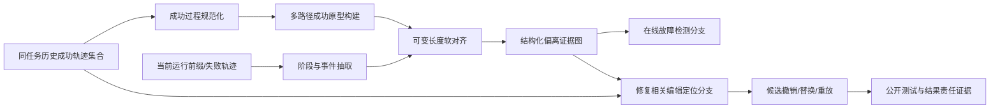

# 软件工程智能体故障检测与定位方法研究

## 独立评审后的可行性补充实验与新开题报告

**版本日期：2026-08-19**  
**文档性质：开题前重构方案与补充实验计划**  
**研究对象：真实运行的软件工程智能体（Software Engineering Agent），包括任务理解、代码检索、工具调用、代码编辑、测试验证和终止等可观察执行过程**

---

## 0. 独立评审结论

### 0.1 当前方案不能继续把“RQ1 风险分数提升 RQ2”作为主故事

现有实验已经给出清楚的正负证据：

- 运行故障检测方面，在 1,200 条公开 OpenHands 运行上，使用同任务历史成功运行作为参照后，失败召回率由当前轨迹基线的 28.04% 提高到 42.06%，相对提高 50.00%；成功误停率为 8.87%，失败运行平均可节省 24.67% 的后续步骤。
- 修复相关编辑定位方面，在 13 条合格失败运行、12 个任务簇上，使用同任务成功参照后 Top-1 为 84.62%，高于最强非参照对照的 53.85%；但样本规模很小。
- 只使用 RQ1 风险峰值时，Top-1 仅为 38.46%。
- “正确参照 + RQ1 时序破平”和“仅正确参照”的 Top-1 均为 84.62%，RQ1 只将 MRR 从 86.60% 提高到 89.16%。
- 打乱正确成功参照的动作顺序后，定位 Top-1 不变，说明当前 RQ2 的主要收益来自文件范围一致性，而不是时序传播或风险峰值。
- 当前只有 1 个任务满足稳定的单补丁块重放条件，尚不能证明动作级根因。

因此，旧叙事中最关键的命题——“第一章的风险预测是第二章动作定位的主要增量来源”——没有得到实验支持。继续通过增加风险特征、把报警位置改称“偏离窗口”或降低成功门，都会变成对负结果的包装。

### 0.2 可以借鉴上一届开题的结构，但不能照抄其技术内容

上一届开题的核心结构并不是“任务一先预测一个标签，再证明这个标签提高任务二”，而是：

1. 第一项研究内容解决数据与表示问题，构建异构图、补全图和多种图视角；
2. 第二项研究内容在第一项表示基础上建立统一风险识别模型；
3. 最终通过一个完整任务及其模块消融，整体证明两项内容共同有效。

本课题可以采用同样的研究组织方式：

> **研究内容一不再是一个先行分类器，而是构建“任务特定成功过程表示”和结构化偏离证据；研究内容二在这一表示上同时完成运行故障检测和失败后编辑定位。最终实验要求两个诊断任务共同支持整套方法，而不是要求一个标量风险分数机械提升另一个排序器。**

### 0.3 新方案的开题判定

> **当前判定：修改后 Conditional-Go。**

原因如下：

- 正面证据已经证明“同任务历史成功运行”不是无效信息；
- 旧的严格 RQ1→RQ2 风险桥接已经被负结果否定，必须改写；
- 新结构能够把现有两个正结果放入同一研究目的下，但尚需证明：多路径、细粒度的成功过程表示是否能超过“只看成功参照文件集合”这一强基线；
- 在该强基线未被超过前，不能把当前小样本 RQ2 写成完整第二项贡献。

正式开题前最关键的补充实验是：

1. 扩大可定位任务簇；
2. 实现多路径成功参照和细粒度偏离表示；
3. 在至少 30 个独立任务簇上，相对“同任务成功文件集合”强基线取得不低于 10% 的 MRR 或 Recall@3 相对提升，且任务级配对 95% 置信区间下界大于 0；
4. 至少建立 5—15 个可稳定重放的动作验证案例。

---

## 1. 推荐题目与研究边界

### 1.1 最推荐题目

> # 面向智能软件 Agent 的运行故障检测与定位方法研究

该标题与上一届开题常见的“基于某种表示/建模的某问题方法研究”结构一致，包含三个层次：

- **研究机制**：任务特定成功过程建模；
- **研究对象**：软件工程智能体；
- **研究任务**：故障检测与定位。

标题不出现固定前缀、折外预测、误报率、具体模型、数据集或 Docker 等实验与实现细节。

### 1.2 备选题目

1. 《面向软件工程智能体的历史成功轨迹建模与运行故障诊断方法研究》
2. 《基于多路径成功参照的软件工程智能体运行故障检测与编辑定位方法研究》·
3. 
4. 

### 1.3 研究范围

本研究首先适用于以下场景：

- 同一软件任务会被多次采样、重试或由不同 Agent 策略执行；
- 系统能够保存并检索该任务过去的成功运行；
- 任务具有公开仓库、测试环境和可观察的编辑/工具轨迹；
- 失败后需要缩小开发者检查范围，而不是直接自动生成最终修复。

暂不声称覆盖：

- 完全没有历史成功记录的首次任务；
- 所有通用、多 Agent、GUI 或现实世界 Agent；
- 仅凭离线排名就已证明唯一因果根因；
- 历史成功轨迹是唯一正确路径。

---

## 2. 研究背景、目标与意义

### 2.1 研究背景

软件工程智能体能够自主理解 issue、检索代码、调用终端和编辑工具、运行测试并决定是否结束。此类系统的最终 `resolved` 或测试分数只能说明任务是否完成，无法回答：运行尚未结束时是否已经出现失败征兆，失败发生后哪些编辑最值得优先检查，以及后期报错究竟是根因还是症状。

现有在线监控工作主要根据当前轨迹的最近窗口、错误消息、重复动作和执行长度预测失败；现有归因工作主要从失败轨迹中定位责任 Agent 或决定性步骤。这两类方法通常把当前轨迹视为唯一信息源。然而，在多次采样、历史重试、持续集成和 Agent 记忆场景中，系统还保存了一类重要资源：**同一任务过去成功执行的过程**。

成功运行并不是一条可以机械复制的唯一标准答案。同一 issue 可能存在不同检索顺序、不同中间验证和不同代码编辑路径。因此，研究的关键不应是“当前第几步与成功第几步完全一致”，而应是：如何从多条成功轨迹中建立能够容纳合法替代路径的任务特定成功过程表示，并据此识别当前运行的结构、状态和验证偏离。

### 2.2 总体研究目标

本研究拟构建一套以历史成功执行为任务特定参照的软件工程智能体故障分析方法：

1. 从同一任务的一条或多条成功轨迹中提取动作阶段、工具观察、文件编辑、测试验证和状态变化，建立多路径成功过程表示；
2. 将当前运行或失败轨迹与成功过程进行可变长度对齐，形成事件级结构化偏离证据；
3. 在运行期利用偏离证据检测最终失败风险；
4. 在失败后利用相同偏离证据、成功编辑范围和局部后果，对修复相关编辑进行排序；
5. 在可执行环境中对高排名候选进行撤销、替换或重放，区分相关定位和更强的结果责任证据。

### 2.3 研究意义

**软件可靠性意义：**把最终成败评价推进到过程可观测、故障检测和故障定位，并明确区分故障动作、错误状态和最终失效。

**Agent 研究意义：**检验历史成功执行是否能够作为任务特定正常过程，而不是只依赖全局统计或语言模型判官；分析这种信息在哪些 Agent 策略、任务和执行阶段有效。

**工程意义：**在重复执行和历史轨迹可用的条件下，更早发现昂贵失败运行，并减少开发者需要检查的失败编辑数量；若动作干预成功，可进一步支持定向恢复。

**研究结论意义：**即使最终发现成功参照只对在线检测有效、对动作定位增量有限，也能得到“历史成功过程的诊断价值存在任务和粒度边界”的可否证结论，而不是停留在一个总分。

---

## 3. 两项核心研究内容：从“预测桥接”改为“表示基础 + 统一诊断”

### 3.1 研究内容一：任务特定成功过程表示与偏离证据建模

#### 一句白话

> 同一道软件任务过去可能有多种成功做法，怎样把这些成功过程整理成一个可比较的参照，并指出当前运行从哪里、以什么证据偏离了可行成功过程？

#### 学术表述

> 给定同一任务的一条或多条历史成功执行轨迹，研究如何构建包含动作阶段、工具观察、文件状态和验证进展的多路径成功过程表示，并通过可变长度对齐，为当前执行前缀或完整失败轨迹产生事件级偏离类型、偏离强度、对应成功证据及不确定性。

#### 输入

- 任务描述与仓库信息；
- 一条或多条独立成功轨迹；
- 当前运行前缀或完整失败轨迹；
- 可观察动作、工具参数、工具返回、代码编辑、文件路径和测试反馈。

#### 输出

- 成功过程原型或参照集合；
- 当前事件与成功过程阶段/事件的软对齐；
- 每个事件的动作偏离、观察偏离、状态/编辑偏离和验证偏离；
- 最匹配成功路径及匹配不确定性；
- 偏离证据图或结构化偏离序列。

#### 独立研究价值

该内容本身可以回答：

- 同一任务是否存在多种合法成功路径；
- 单一成功参照会产生多少伪偏离；
- 多路径参照是否降低成功运行被误判为异常的比例；
- 当前运行在哪个阶段、哪种证据上最早偏离；
- 不同 Agent 策略之间哪些成功模式可迁移。

它不是一个为了给下一章提供概率的附属分类器，而是整篇论文的过程表示与证据组织基础。

### 3.2 研究内容二：成功参照约束的故障检测与修复相关编辑定位

#### 一句白话

> 第一部分已经把“成功时通常怎样做”和“当前哪里偏离”表示出来，这些证据能不能同时帮助运行期提前发现失败，并在失败后把最值得检查的编辑排到前面？

#### 学术表述

> 基于研究内容一产生的任务特定成功过程表示和事件级偏离证据，研究统一的故障诊断方法：一方面在当前轨迹尚未结束时估计失败风险并控制成功误停；另一方面在失败轨迹中联合偏离证据、成功编辑范围和动作后果对候选编辑进行修复相关性排序，并通过可执行测试评价高排名候选的结果责任。

#### 两个输出分支

1. **在线检测分支**：风险分数、报警状态、首次报警位置、支持报警的偏离证据；
2. **事后定位分支**：候选编辑 Top-K、成功参照证据、局部测试/观察后果，以及可执行验证结果。

### 3.3 两项内容如何共同构成完整论文

本方案不再要求：

```text
RQ1 输出一个风险概率
        ↓
这个概率必须使 RQ2 提高 10%
```

而采用：

```text
同任务历史成功轨迹集合
        ↓
研究内容一：多路径成功过程表示 + 事件级偏离证据
        ├──────────────────────┐
        ↓                      ↓
在线故障检测              失败后编辑定位
        └──────────┬───────────┘
                   ↓
        可执行重放与整体结论
```

最终实验通过两个任务共同证明研究内容一和研究内容二：

- 若成功参照表示只改善检测、不改善定位，则完整两任务主张不成立；
- 若只用成功文件集合就达到完整定位方法，说明细粒度对齐没有贡献；
- 只有当多路径成功表示在检测和定位两方面均表现出超出强基线的增量，整套方法故事才成立。

---

## 4. 与上一届开题结构的对应关系

| 上一届开题的研究组织 | 本课题对应设计 |
|---|---|
| 原始专利数据存在异构、稀疏、噪声问题 | Agent 轨迹存在变长、多阶段、多种成功路径和状态观测不完整问题 |
| 构建知识图谱、补全结构、生成多视角 | 构建多路径成功过程参照、完成轨迹对齐、生成多类偏离证据 |
| 使用异构图与多视角表示完成风险识别 | 使用成功参照表示同时完成运行故障检测和编辑定位 |
| 最终分类实验与消融共同证明所有模块 | 检测、定位和重放实验共同证明参照表示与诊断方法 |

应学习的是“问题—表示—模型—任务—验证”的层次，不是把 VGAE、HGT 或多视图术语替换成 Agent 名词。

---

## 5. 理论基础与核心论文组

### 5.1 成熟理论基础

本研究只保留三类成熟机制。

#### 5.1.1 软件可靠性的故障—错误状态—失效链

来源：Avizienis, Laprie, Randell, Landwehr, *Basic Concepts and Taxonomy of Dependable and Secure Computing*, IEEE TDSC 2004，DOI：<https://doi.org/10.1109/TDSC.2004.2>。

在本研究中的映射：

- 故障：错误检索、工具参数、代码编辑、验证判断或终止动作；
- 错误状态：错误进入当前代码、计划、文件、消息或测试认知；
- 失效：最终测试失败或任务未解决。

该理论解释为什么后期测试报错可能只是症状，也解释为什么定位结果需要动作后果或执行干预支持。

#### 5.1.2 可变长度序列对齐与正常过程偏离

来源：Cuturi 与 Blondel，*Soft-DTW: a Differentiable Loss Function for Time-Series*, ICML 2017：<https://proceedings.mlr.press/v70/cuturi17a.html>。

本研究借用的成熟观点是：不同长度的执行序列不能按相同下标机械比较，应允许局部伸缩、跳过和一对多对齐。当前可先用可解释的动态规划、编辑距离和阶段约束；是否使用 Soft-DTW 是实现选择。

#### 5.1.3 候选排序与可执行验证

学习排序可参考 Köppel 等，*Pairwise Learning to Rank by Neural Networks Revisited*, Machine Learning 2025：<https://doi.org/10.1007/s10994-024-06644-6>。

本研究使用的原则是：对失败编辑做相对排序，而不是一次生成唯一根因；语言和轨迹相似性只提供候选证据，动作撤销、替换或重放后的测试变化提供更强验证。

### 5.2 2025—2026 年正式核心 Agent 论文

#### 1. SWE-Gym — ICML 2025

正式页：<https://proceedings.mlr.press/v267/pan25g.html>  
核心使用：真实软件任务、成功/失败 Agent 轨迹、可执行仓库和测试环境；为成功参照构造、运行检测和编辑验证提供宿主。

#### 2. SyncMind — ICML 2025

正式页：<https://proceedings.mlr.press/v267/guo25l.html>  
核心使用：正式定义软件 Agent 与演化代码状态不同步（out-of-sync）的问题，并提供可执行恢复场景。它支持“状态偏离会导致后续动作失败”的软件 Agent 场景依据，但本研究不直接复现其协作恢复任务。

#### 3. Which Agent Causes Task Failures and When? — ICML 2025

正式页：<https://proceedings.mlr.press/v267/zhang25cq.html>  
核心使用：给出 Agent/步骤级失败归因的正式定义和强基线；约束本研究不能把“找一步”称为首创，并为外部步骤定位评价提供协议。

#### 4. Agent-as-a-Judge — ICML 2025

正式页：<https://proceedings.mlr.press/v267/zhuge25a.html>  
核心使用：说明只看最终结果不足，需要按任务要求收集和评价中间证据；本研究借用其过程取证思想，但不把 Judge 文字当动作责任金标。

#### 5. Seeing the Whole Elephant — ACL 2026 Long

正式页：<https://aclanthology.org/2026.acl-long.912/>  
核心使用：证明完整输入、输出、工具日志和系统上下文能够显著改善失败归因；为完整轨迹外测与可复现环境提供依据。

可选第六篇：Plan-RewardBench — ACL 2026 Long，正式页：<https://aclanthology.org/2026.acl-long.1062/>。其恢复、无关工具和长轨迹困难负例可用于构造成功路径的困难对照。

### 5.3 必须正面对比的前沿工作

#### OAT：Tracing Agentic Failure from the Flow of Success

arXiv：<https://arxiv.org/abs/2607.12747>  
身份：2026 年预印本。  
重叠：它只用成功轨迹学习全局成功动力学，并在失败轨迹上按偏离分配步骤异常分数。  
本研究不能声称“首次用成功轨迹定位失败”。可辩护增量必须是：同任务历史成功参照、多种合法成功路径、软件编辑/测试状态、在线检测与事后定位的统一验证。

#### Fail-Fast, Restart-Smart

arXiv：<https://arxiv.org/abs/2608.03222>  
身份：2026 年预印本。  
重叠：从当前可见前缀预测 SWE Agent 失败并执行停止/重启。  
边界：本研究的在线分支必须与等成本当前轨迹监控比较；差异不能只写“我们也提前报警”，而是显式使用任务特定成功参照。

#### Who&When Pro

arXiv：<https://arxiv.org/abs/2607.09996>  
身份：2026 年预印本。  
重叠：成功前缀精确重放、单点错误注入以及 who/when/type 金标。  
边界：本研究不把注错数据构建、责任 Agent/步骤/类型联合预测写成创新；其可重放环境可用于外部定位和干预。

#### REFLECT

arXiv：<https://arxiv.org/abs/2606.09071>  
身份：2026 年预印本。  
重叠：候选错误诊断、针对性重放和结果反馈。  
边界：本研究在完成稳定重放前只称“修复相关编辑定位”，不称因果根因。

#### FALAT、TrajDebug、Causal Agent Replay、ErrorProbe

这些工作已经分别覆盖依赖引导追踪、错误生命周期、动作重放和症状反向追踪。故障传播图、恢复状态和动作替换均不能单独作为“首次创新”，只能作为已知机制在本问题中的必要组成或强对照。

---

## 6. 方法设计

### 6.1 整体架构



### 6.2 研究内容一的三个模块

#### M1：多路径成功参照构建

**问题：**一条成功轨迹不是唯一正确过程，直接把它当模板会误报合法替代路径。

**设计：**

- 对同任务成功轨迹按高层阶段、编辑文件集合、测试行为和动作序列聚类；
- 保留若干成功过程原型，而不是平均成一条模糊轨迹；
- 对成功轨迹较少的任务保留单参照并输出较高不确定性；
- 不足以精确匹配时允许使用任务相似的成功轨迹，但必须与同任务参照分表报告。

**输出：**成功原型集合、各原型覆盖率、原型间差异和参照置信度。

#### M2：阶段感知的可变长度对齐

**问题：**Agent 轨迹长短不同，同一有效操作可能出现于不同位置，机械逐步对齐会产生伪偏离。

**设计：**

- 把事件归纳为探索、定位、编辑、验证和终止等高层阶段；
- 在阶段约束下使用编辑距离、最长公共子序列、DTW/Soft-DTW 或单调注意力进行软对齐；
- 允许某些重复读取、额外验证和顺序微调不被视为硬错误；
- 输出当前事件与各成功原型的匹配分布，而不是唯一对齐。

#### M3：结构化偏离证据生成

偏离证据控制在四类：

1. **动作偏离**：工具种类、操作阶段、重复和无效调用；
2. **观察偏离**：错误返回、未满足前置条件、与成功观察不一致；
3. **状态/编辑偏离**：文件范围、代码位置、状态读写和编辑方向；
4. **验证偏离**：测试是否执行、结果是否改善、是否过早终止。

每个事件输出：偏离强度、证据类型、匹配成功原型、原始证据位置和不确定性。

### 6.3 研究内容二的三个模块

#### M4：在线故障检测分支

输入当前前缀的偏离证据和当前运行局部风险证据，输出失败风险和报警。核心比较是：

- 当前轨迹监控；
- 全局成功动力学（OAT 风格）；
- 单条同任务成功参照；
- 多路径同任务成功参照。

阈值在独立校准任务上选择，保持成功误停率不超过预先声明上限。

#### M5：修复相关编辑排序分支

对失败运行中的真实编辑进行排序，特征只保留三组：

1. 成功参照文件、代码位置和编辑意图的一致性；
2. 研究内容一的细粒度状态/验证偏离证据；
3. 编辑后的局部后果：测试变化、错误观察、重复返工和后续依赖。

当前报告中的“同任务成功文件集合”必须作为最重要的内部强基线。完整方法只有超过该基线，才能证明细粒度对齐和偏离建模有价值。

#### M6：可执行定位验证

- 对高排名编辑块做撤销、替换或恢复；
- 对同任务成功轨迹中的对应编辑做候选替换；
- 在动作前工作区快照上运行公开测试；
- 与随机编辑、最后编辑、同文件随机编辑和仅文件集合方法比较；
- 报告不能重放、补丁依赖和状态漂移，而不是只保留成功案例。

### 6.4 不属于创新的内容

- Logistic、LightGBM、GRU、TCN、Transformer、LambdaMART 的具体选择；
- 任务级 OOF、bootstrap、随机种子和阈值；
- JSON、Parquet、Docker、Git commit 和缓存目录；
- 编辑距离或 Soft-DTW 本身；
- 成功参照数量、Top-K 和权重超参数。

---

## 7. 可作为研究贡献的真实内容

### 7.1 贡献一：提出任务特定成功过程建模问题及其诊断边界

不是简单地“使用成功轨迹”，而是研究：在同任务重复执行场景下，如何从多条成功轨迹构建允许合法替代路径的正常过程表示，以及单参照、多参照和全局成功模型各自在哪些条件下有效。

### 7.2 贡献二：建立统一、可审计的偏离证据组织

将动作、工具观察、文件编辑和测试验证统一为事件级偏离证据，并同时用于在线检测与失败后定位；贡献在于证据组织和可验证问题，而不是把三个模型模块并列命名。

### 7.3 贡献三：用两个诊断任务共同检验成功过程表示

实验不只报告一个分类分数，而是检验同一成功过程表示是否同时：

- 在受控误停条件下提高失败发现率；
- 在强参考感知基线之上缩小修复相关编辑搜索空间；
- 在可执行子集上使高排名候选比阴性对照更可能改变测试结果。

### 7.4 贡献四：给出可迁移性和失效边界

分析以下边界：

- 单一成功路径与多条成功路径；
- 同策略与跨 Agent 策略；
- 新任务与重复任务；
- 文件级相关定位与动作级结果责任；
- 当前轨迹异常与任务特定过程偏离。

---

## 8. 开题前可行性补充实验

## 8.1 F0：数据合同与样本规模审计

### 目的

确认新方案是否具有足够的多路径成功数据、失败编辑候选和可重放任务，防止模型设计完成后才发现第二项任务只能保留 12 个任务簇。

### 审计字段

对每个任务统计：

- 成功参照轨迹数量；
- 成功轨迹的独立交互哈希和策略来源；
- 当前运行成功/失败数量；
- 失败运行的代码编辑数量、文件数和可解析编辑块数；
- 公开接受补丁涉及的文件和代码区间；
- 是否有 base commit、测试补丁、环境镜像；
- 是否能够保存或恢复每个编辑前后的工作区状态。

### 开题 Gate

至少满足：

1. 在线检测池保持不少于 1,000 条运行和 100 个独立任务；
2. 至少 30 个任务具有两条及以上内容不同的成功轨迹，用于多路径参照 Pilot；
3. 至少 30 个独立失败任务具有两条及以上可解析编辑，并包含正负定位候选；
4. 至少 5 个任务能够稳定执行动作级重放；
5. 若第 3 项达不到，立即生成新的带逐步 Git 快照的 OpenHands/SWE-agent rollout，不再只依赖历史日志反推工作区。

### 产出

- `data_contract.csv/parquet`；
- 任务级样本流转图；
- 成功原型数量分布；
- 定位样本排除原因统计；
- 可重放率和环境失败率。

---

## 8.2 F1：成功过程表示是否真实有效

### 核心假设

多路径、任务匹配的成功参照应比单一成功轨迹、错任务成功轨迹和全局成功模型更少误报合法成功过程，并更准确识别已知偏离位置。

### 数据

- 同任务成功—成功轨迹对；
- 同任务成功—失败轨迹对；
- 从成功轨迹构造的轻量动作删除、置换、错误参数和错误编辑扰动，仅用于对齐边界验证；
- 多策略成功轨迹作为外部正常路径。

### 对照

1. 无参照，仅比较当前事件统计；
2. 全局成功模型/OAT 风格一类模型；
3. 单条同任务成功参照；
4. 多条同任务成功参照但不做阶段对齐；
5. 完整多路径、阶段感知对齐。

### 主指标

- 成功—成功对的伪偏离率；
- 受控扰动的边界 Recall@3 / 平均边界偏差；
- 正确成功原型选择率；
- 多路径覆盖率；
- 跨策略成功轨迹的误判率。

### 通过标准

- 完整方法相对单参照在成功轨迹伪偏离率上至少下降 10%，且任务级区间下界大于 0；
- 在受控偏离上不以大幅降低召回为代价；
- 错任务参照明显更差；
- 多路径参照能够覆盖至少一类单参照误报的合法替代路径。

### 否定条件

- 多路径聚合不优于随机选择一条成功轨迹；
- 对齐结果主要由轨迹长度或文件名决定；
- 跨策略成功轨迹普遍被判为异常，说明方法只记住特定 Agent 模板。

---

## 8.3 F2：在线故障检测的外部冻结复验

### 核心假设

任务特定成功过程表示相对当前轨迹监控和全局成功流模型，在相同成功误停约束下能稳定发现更多失败运行。

### 数据

- 已完成 1,200 条 OpenHands 运行结果作为开发后冻结证据，不再反复选特征；
- 新任务级划分或另一 Agent 策略生成的同任务运行作为确认集；
- 主要在 20%、40%、60%、80% 前缀评价。

### 五组方法

1. 步数/结构规则；
2. Fail-Fast 风格当前轨迹模型；
3. OAT 风格全局成功模型；
4. 单同任务成功参照；
5. 多路径任务特定成功参照。

### 主指标

- `Failure Recall @ Success FPR ≤ 10%`；
- 成功误停率；
- 失败运行平均节省步骤；
- AUROC/AUPRC 作为辅助；
- 监控成本与净节省。

### 正式通过标准

- 相对最强当前轨迹或全局成功基线至少提高 10%；
- 任务级配对 95% 置信区间下界大于 0；
- 成功误停率不超过预设上限；
- 至少一个新 Agent 策略或仓库家族方向一致；
- 监控开销不超过节省成本。

---

## 8.4 F3：修复相关编辑定位的强基线补充实验

### 这是新开题能否成立的最关键 Gate

当前 84.62% Top-1 结果不能直接作为完整方法证据，因为：

- 仅有 12 个任务簇；
- “仅正确成功参照文件集合”已经达到同样的 Top-1；
- 当前完整方法没有证明细粒度对齐超出文件路径一致性。

### 核心假设

研究内容一产生的细粒度偏离证据，能够在已知同任务成功文件范围之后，进一步区分同文件内或同目录下的多个失败编辑。

### 数据扩充策略

1. 补齐 `insert`、字符串替换、多行编辑和补丁操作解析；
2. 直接从运行最终工作区 diff 重建编辑块，而非只依赖日志中的单个编辑调用；
3. 优先采样包含多个编辑、多个文件或同文件多个 hunk 的失败运行；
4. 对 20—50 个任务重新生成 Agent rollout，并在每次编辑后创建 Git commit；
5. 公开接受补丁只用于评价，不进入特征。

### 五个主要基线

1. 最后编辑/随机编辑；
2. 当前轨迹局部证据；
3. 仓库与文件频率基线；
4. **同任务成功文件集合**，当前最重要强基线；
5. OAT/Who&When/OrcaLoca 风格的步骤或代码定位方法；
6. 完整多路径成功参照方法。

正式主表可将前两项合并为规则组，使主要基线总数控制在 5 组。

### 指标

- 编辑或 hunk 级 MRR；
- Recall@1/3/5；
- 文件级 Recall 与同文件内 hunk Recall 分开；
- 候选压缩率；
- 首个正确候选前需检查的编辑数量；
- 症状/末端编辑误判率。

### 开题通过标准

在至少 30 个独立任务簇上：

- 完整方法相对“同任务成功文件集合”强基线的 MRR 或 Recall@3 相对提升至少 10%；
- 任务级配对 95% 置信区间下界大于 0；
- 控制仓库/文件频率后仍有增益；
- 至少在两个仓库家族方向一致；
- 若只提高文件级、不提高同文件 hunk 排名，则论文只能称“文件定位”，不能称编辑定位。

### NO-GO 条件

- 扩大样本后，完整方法与成功文件集合相当；
- 文件频率控制后增益消失；
- 结果仍主要由文件名重合决定；
- 同文件多个编辑无法区分。

---

## 8.5 F4：两部分共同证明的整体验证

### 目的

像上一届开题的整套模型一样，用同一组方法条件同时评价“运行检测”和“编辑定位”，证明成功过程表示不是只对一个任务有效的局部技巧。

### 统一实验条件

| 条件 | 成功过程信息 | 对齐与偏离 | 检测 | 定位 |
|---|---|---|---|---|
| Current-only | 无 | 无 | 是 | 是 |
| Global-success | 跨任务全局成功流 | 全局异常 | 是 | 是 |
| Ref-file-set | 同任务成功文件集合 | 无序文件重合 | 可作弱检测 | 是 |
| Single-reference | 单条同任务成功轨迹 | 序列对齐 | 是 | 是 |
| Multi-reference | 多条同任务成功轨迹 | 多路径对齐 | 是 | 是 |
| Full | 多路径参照 + 局部后果 | 完整偏离证据 | 是 | 是 |

### 整体成立条件

不人为构造一个“联合总分”，而使用并列门：

1. 检测分支相对最强检测基线过 10% + CI 门；
2. 定位分支相对最强参考感知定位基线过 10% + CI 门；
3. 多路径/对齐模块在两个任务中的至少一个主指标上有正向边际贡献，且不能在另一个任务造成明显退化；
4. 错任务参照在两个任务中均显著更差；
5. 方法的推理成本与诊断收益相匹配。

只有两个任务共同通过，才能得出：

> 同任务历史成功执行可以被建模为任务特定正常过程，其偏离证据既有助于运行期故障检测，也有助于失败后缩小修复相关编辑范围。

---

## 8.6 F5：动作级重放与结果责任 Pilot

### 数据采集方式

优先采用从头采样：

- 固定 SWE-Gym/SWE-bench 任务和 Agent 版本；
- 在每次代码编辑后保存 Git commit、测试结果和完整工作区；
- 生成成功和失败 rollout；
- 记录模型、温度、工具版本和环境 digest。

### 干预臂

1. 撤销本方法 Top-1/Top-3 编辑；
2. 用成功参照中的对应编辑替换候选；
3. 撤销成功文件集合基线 Top-1；
4. 撤销当前局部证据基线 Top-1；
5. 撤销同 Agent 或同文件随机编辑；
6. 撤销最后编辑/症状编辑。

### 指标

- 环境稳定重放率；
- 目标测试由失败转为成功的比例；
- 目标测试改善量；
- 非目标测试回归率；
- 多次同策略重放的翻转概率；
- 无法应用、状态漂移和环境失败比例。

### Pilot Gate

- 20 个任务中至少 15 个能够稳定重放；
- 本方法 Top-3 干预的成功翻转率或目标测试改善率比最佳阴性对照高至少 15 个百分点；
- 非目标测试回归不能明显更高；
- 未达到该门时，论文保持“定位”，不升级为“根因定位”。

---

## 9. 正式实验矩阵

### 9.1 数据层次

| 数据层 | 主要资产 | 用途 | 边界 |
|---|---|---|---|
| 主运行数据 | SWE-Gym/OpenHands SFT 与 Verifier 轨迹 | 成功参照、在线检测、编辑候选 | 当前主要是软件单 Agent |
| 新采样数据 | SWE-agent/OpenHands 保存逐步快照的重复任务 | 多路径成功、动作级重放 | 有 API/Docker 成本 |
| 失败归因外测 | Who&When、TraceElephant | 步骤归因和完整轨迹外测 | 与软件编辑任务口径不同，分表报告 |
| 构造性验证 | Who&When Pro | 已知责任步骤、前缀重放 | 预印本数据，不能代替自然失败 |
| 困难对照 | Plan-RewardBench、SyncBench | 恢复、合法替代过程、状态不同步 | 不直接混入主指标 |

### 9.2 主基线控制

每项任务最多 5 组主要基线：

**成功过程表示：**当前统计、全局成功模型、单参照、多参照无阶段、完整方法。  
**在线检测：**步数/结构、Fail-Fast 风格、OAT 风格、单参照、完整方法。  
**编辑定位：**规则/局部、文件频率、成功文件集合、近年步骤/代码定位器、完整方法。

### 9.3 消融控制

只保留三个核心消融：

1. 去掉多路径，只保留单一成功参照；
2. 去掉阶段/序列对齐，只使用无序动作与文件集合；
3. 去掉状态与验证偏离，只保留动作结构和文本相似性。

若定位分支另需一个关键消融，则将“去掉局部后果”替换第三项，不增加大量超参数消融。

### 9.4 统计协议

- 训练、校准和测试按任务分组；
- 同一 issue 的所有 rollout 不跨折；
- 若第二分支训练中使用第一部分的学习表示，其测试表示必须来自未见该任务的训练流程；
- 主统计单位是独立任务或任务簇；
- 预注册主指标、最强基线和 10% 门；
- 使用任务级 paired bootstrap 形成 95% 区间；
- 报告绝对差、相对差和原始分数；
- Random、Wrong-reference、Shuffled-reference 和 Oracle 作为机制对照，不把 Oracle 当方法成绩。

---

## 10. 当前实验如何放入新报告

### 10.1 可以保留的结果

1. 同任务成功参照相对当前轨迹监控提高运行期失败召回；
2. 错任务和打乱参照显著增加成功误停，说明参照匹配与部分顺序信息有价值；
3. 同任务成功文件范围在小样本中显著改善修复相关编辑排序；
4. 现有数据、切分、补丁解析和测试链路能够运行。

### 10.2 必须降级的结果

1. RQ1 风险峰值只作负结果和旧桥接失败证据；
2. 84.62% Top-1 只作小样本可行性，不作正式结论；
3. 文件级 accepted-patch overlap 不等于动作责任；
4. 一个有效重放案例只证明接口，不证明干预方法；
5. 打乱顺序不降 Top-1，说明当前定位方法尚未利用成功过程时序。

### 10.3 新报告应使用的表达

可以说：

> 前期试验表明，同任务历史成功执行同时包含运行监控和失败定位所需的任务特定信息，但现有定位收益主要停留在文件范围层面，风险报警位置没有形成稳定的动作定位增量。因此，本研究进一步把成功轨迹从单一文件集合发展为多路径过程表示，并通过在线检测与编辑定位两个任务共同检验其诊断价值。

不能说：

> 已经证明第一章风险预测显著改善第二章；已经证明成功轨迹的动作顺序能够定位根因；已经得到动作级因果结果。

---

## 11. 开题验收标准

### 11.1 可以开题的最低证据

在正式开题答辩前，应至少完成：

1. F0 数据合同：证明定位样本可扩至至少 30 个独立任务簇；
2. F1 小规模多路径表示：证明多路径参照相对单参照减少成功伪偏离；
3. F2 复现现有检测正结果，或在新确认集上继续过 10% + CI 门；
4. F3 相对“成功文件集合”强基线过 10% + CI 门；
5. 至少 5 个稳定动作重放案例；
6. OAT、Fail-Fast、Who&When、SWE-Gym、SyncMind 和 TraceElephant 的论文身份、代码和数据使用记录完成核验。

### 11.2 正式论文成功标准

- 多路径成功过程表示在至少一个外部 Agent 策略上保持正常路径低误报；
- 在线检测相对最强当前轨迹/全局成功基线过 10% + CI；
- 编辑定位相对成功文件集合和最强近年定位基线过 10% + CI；
- 定位样本至少 50 个独立任务，目标 100；
- 至少 15 个稳定可重放任务，目标 30—50；
- 结果在两个以上仓库家族成立；
- 不能重放、状态漂移和负结果完整报告。

### 11.3 NO-GO 条件

出现以下任一情况，不应再包装为统一两任务方法：

1. 定位样本长期无法扩到 30 个独立任务；
2. 完整方法不优于成功文件集合强基线；
3. 多路径参照不优于单参照或随机参照；
4. 新检测集上正结果消失；
5. 动作重放有效率过低，无法形成可评价子集；
6. OAT 或新正式论文已在相同输入、任务特定参照、两任务输出和可执行结论上完成等价方法。

若第 2 项失败，但检测仍成立，可将毕业论文收缩为“成功参照约束的运行故障检测”，但这不再满足当前两项核心内容的计划。

---

## 12. 难点与创新点的开题表达

### 12.1 难点一：成功过程不是唯一答案

同一任务可能有不同合法路径。方法需要避免把“不同于某一次成功”错误地等同于“失败”。因此需要多路径原型、软对齐和不确定性，而不是复制标准轨迹。

### 12.2 难点二：Agent 轨迹是变长、异构、含状态副作用的过程

自然语言、工具调用、文件编辑和测试结果无法直接放入单一序列距离；需要统一事件化并保持原始证据可追踪。

### 12.3 难点三：文件相关性不等于动作责任

成功和接受补丁都修改某文件，只说明检查该文件有价值。要定位编辑，需要同文件 hunk、编辑后果和可执行干预。

### 12.4 可辩护创新一：任务特定、多路径成功过程建模

研究的不是“是否使用成功轨迹”，而是如何把同任务多次成功执行建模为允许替代路径的正常过程，以及其相对全局成功模型和单参照的边界。

### 12.5 可辩护创新二：统一偏离证据在检测与定位中的双重验证

同一结构化偏离表示在运行期和失败后承担不同诊断功能；两个任务共同证明该表示，而不是通过一个预测标签机械串联两个分类器。

### 12.6 可辩护创新三：相关定位到可执行责任的分层证据

文件、hunk、动作排名和测试翻转分层报告，明确展示成功参照能把诊断推进到哪一层、在哪一层失效。

---

## 13. 进度计划

| 时间 | 工作 | 硬产出 |
|---|---|---|
| 第 1—2 周 | F0 数据审计、补齐编辑解析、确定新采样任务 | 数据合同、任务流转图、样本清单 |
| 第 3—4 周 | 多路径成功原型与阶段对齐最小实现 | 表示模型 v1、F1 结果、错误案例 |
| 第 5 周 | 新确认集在线检测复验 | F2 冻结结果、成本分析 |
| 第 6—7 周 | 扩大定位池，运行成功文件集合强基线 | ≥30 任务定位数据、baseline 表 |
| 第 8 周 | 完整偏离证据定位实验 | F3 主结果与 3 个消融 |
| 第 9 周 | F4 两任务整体矩阵 | 同条件双任务总表、整体判定 |
| 第 10—11 周 | 新采样快照与动作重放 Pilot | 5—20 个重放任务、失败审计 |
| 第 12 周 | 开题文稿、PPT 和导师修改 | 新开题报告、方法图、答辩稿 |
| 开题后 3—4 个月 | 扩样、强基线、跨策略与重放正式实验 | 论文核心结果 |

---

## 14. 两分钟导师口语说明

> 我的研究面向会连续检索代码、调用工具、编辑仓库和运行测试的软件工程智能体。现有监控通常只看当前运行最近几步，失败定位通常只看一条失败轨迹。但在多次采样和持续集成场景中，系统已经保存了同一任务过去成功完成的过程。前期试验说明，这类成功参照能够把在线失败召回从 28.04% 提高到 42.06%；在一个很小的定位样本中，成功参照也能够缩小失败编辑的检查范围。不过负结果同样清楚：第一部分的风险峰值没有提高第二部分的 Top-1，当前定位收益主要来自成功轨迹修改了哪些文件，而不是风险时序。
>
> 因此，我不再把论文讲成“第一章预测一个风险分数，再要求它提升第二章”。新的第一项研究内容是任务特定成功过程建模：对同一任务的多条成功轨迹进行阶段化和可变长度对齐，形成动作、观察、编辑和验证四类偏离证据，并允许存在多种合法成功路径。第二项研究内容在同一个偏离表示上完成两个诊断任务：运行尚未结束时检测失败风险，失败以后排序修复相关编辑，最后在可执行环境中撤销或替换候选并运行官方测试。
>
> 最终实验会在完全相同的成功参照条件下同时报告检测和定位结果。检测部分与 Fail-Fast 风格当前轨迹监控以及 OAT 风格全局成功模型比较；定位部分最重要的基线不是随机，而是“同任务成功文件集合”。只有完整方法在两个任务上都超过强基线，并且高排名编辑在重放中比随机或末端编辑更可能改变测试结果，才能说明任务特定成功过程确实形成了一条完整的故障分析方法。当前方向建议修改后开题，但开题前必须先完成定位扩样和强参考基线 Gate。

---

## 15. 核心参考文献与链接

### 正式核心论文

1. Pan et al. **Training Software Engineering Agents and Verifiers with SWE-Gym.** ICML 2025.  
   <https://proceedings.mlr.press/v267/pan25g.html>
2. Guo et al. **SyncMind: Measuring Agent Out-of-Sync Recovery in Collaborative Software Engineering.** ICML 2025.  
   <https://proceedings.mlr.press/v267/guo25l.html>
3. Zhang et al. **Which Agent Causes Task Failures and When?** ICML 2025.  
   <https://proceedings.mlr.press/v267/zhang25cq.html>
4. Zhuge et al. **Agent-as-a-Judge: Evaluate Agents with Agents.** ICML 2025.  
   <https://proceedings.mlr.press/v267/zhuge25a.html>
5. Chen et al. **Seeing the Whole Elephant.** ACL 2026 Long.  
   <https://aclanthology.org/2026.acl-long.912/>
6. Wang et al. **Aligning Agents via Planning: A Benchmark for Trajectory-Level Reward Modeling.** ACL 2026 Long.  
   <https://aclanthology.org/2026.acl-long.1062/>
7. Song et al. **Trial and Error: Exploration-Based Trajectory Optimization of LLM Agents.** ACL 2024 Long，作为成功—失败轨迹对的基础工作。  
   <https://aclanthology.org/2024.acl-long.409/>

### 前沿直接重叠工作

1. Yeh et al. **Tracing Agentic Failure from the Flow of Success.** arXiv 2026.  
   <https://arxiv.org/abs/2607.12747>
2. Wang et al. **Fail-Fast, Restart-Smart.** arXiv 2026.  
   <https://arxiv.org/abs/2608.03222>
3. **Who&When Pro.** arXiv 2026.  
   <https://arxiv.org/abs/2607.09996>
4. **REFLECT.** arXiv 2026.  
   <https://arxiv.org/abs/2606.09071>
5. **FALAT.** arXiv 2026.  
   <https://arxiv.org/abs/2606.00765>
6. **TrajDebug.** arXiv 2026.  
   <https://arxiv.org/abs/2608.06346>

### 成熟理论

1. Avizienis et al. **Basic Concepts and Taxonomy of Dependable and Secure Computing.** IEEE TDSC 2004.  
   <https://doi.org/10.1109/TDSC.2004.2>
2. Cuturi and Blondel. **Soft-DTW.** ICML 2017.  
   <https://proceedings.mlr.press/v70/cuturi17a.html>
3. Köppel et al. **Pairwise Learning to Rank by Neural Networks Revisited.** Machine Learning 2025.  
   <https://doi.org/10.1007/s10994-024-06644-6>

---

## 16. 最终决策

### 当前允许的结论

> 已有试验说明同任务历史成功执行同时包含运行检测和失败定位所需的信息；但风险峰值对动作定位的直接增量很弱，当前定位收益主要停留在成功文件范围层面。因此，论文应改为“任务特定成功过程表示 + 统一故障诊断”，并通过在线检测和编辑定位两个任务共同验证，而不是继续承诺风险预测必须提高动作排名。

### 当前开题等级

> **修改后 Conditional-Go。**

通过 F0—F3 的最低 Gate 后，可以按本报告题目和结构正式开题；若完整定位方法不能超过成功文件集合强基线，则整套双任务故事 NO-GO，不通过术语调整继续包装。
