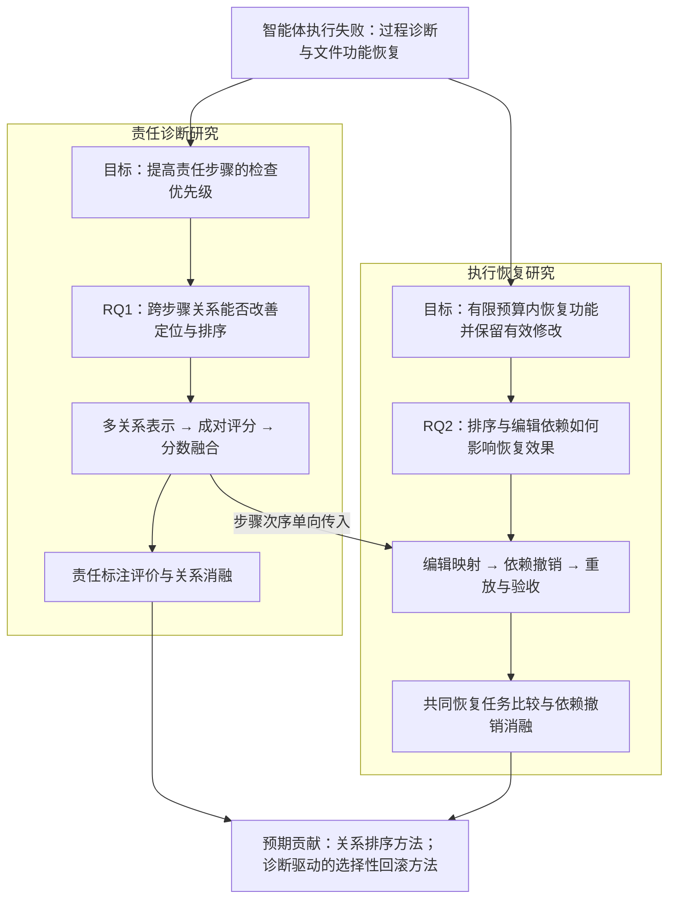
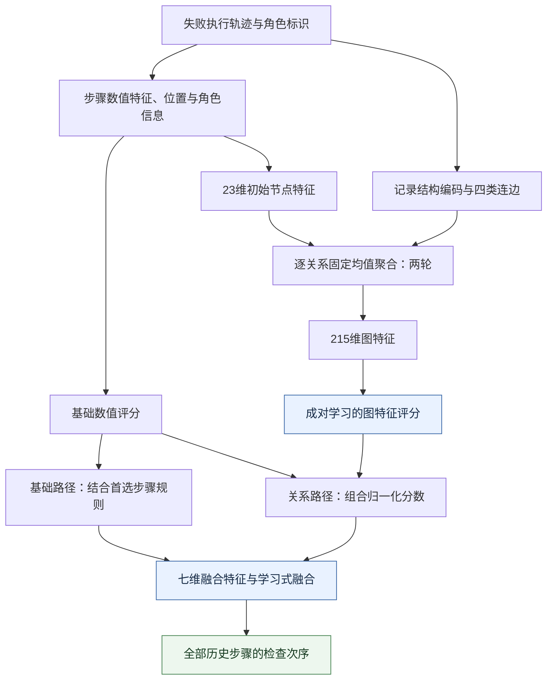
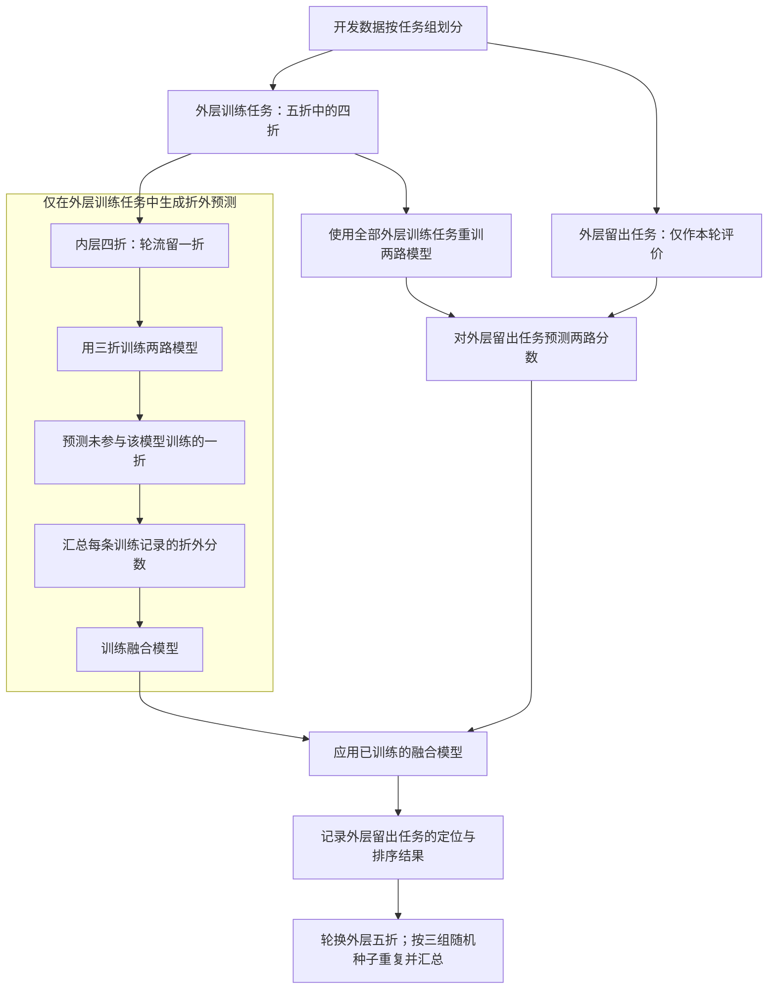
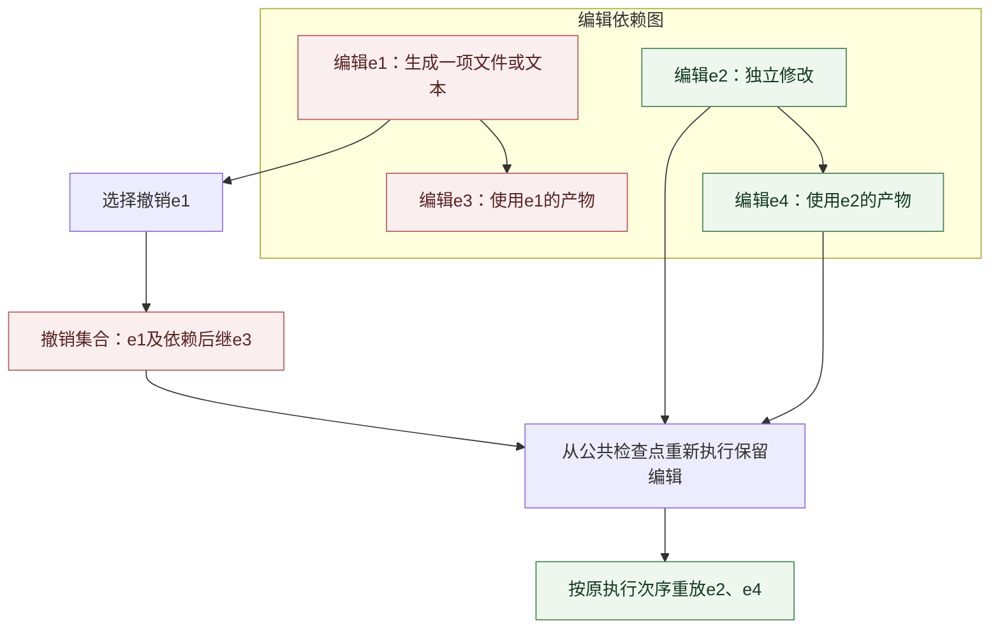
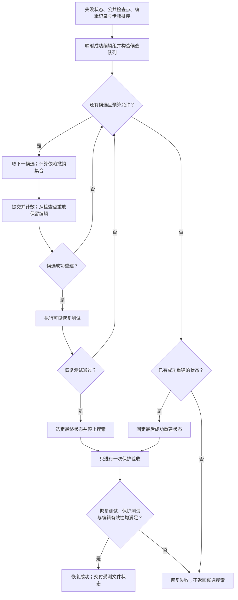

# 基于多关系图排序学习的智能体失败诊断和选择性回滚方法

## 第一章 研究背景与国内外研究现状

### 1.1 研究背景

大语言模型先在大量数据上训练，获得语言表示与生成能力；处理具体任务时，可以利用当前输入中的任务描述和示例生成回答。[1]当模型进一步依据任务与已有观察选择工具动作，并根据执行反馈调整下一步决策时，就形成了与环境交互的智能体。  
模型负责产生决策，工具负责执行检索、编辑或程序运行等操作，二者共同构成连续的任务求解过程。[2][3]

交互式任务求解将推理与动作联系起来。ReAct把用于组织任务和调整计划的推理记录，与用于获取信息或改变环境的动作交替安排。[2]这一过程产生按时间排列的执行轨迹，即包含中间决策、工具调用及返回结果的记录。轨迹保留了最终答案之外的过程信息，使失败分析能够检查智能体在何时依据哪些信息作出了什么操作。[3]

软件工程为上述执行方式提供了具有明确对象和可执行反馈的应用环境。仓库级软件任务要求根据问题描述理解既有代码，并在项目结构、函数关系和测试约束下完成修改，任务输出需要放回实际代码库中运行和评价。面向这一过程，软件智能体通过文件检索、代码编辑和程序执行等接口持续与仓库交互，其行为结果体现为代码和运行状态的连续变化。  
这使软件任务的评价对象从单独生成的代码文本扩展到修改后的项目状态及其实际行为。 [3][19]

多智能体系统由多个具有不同身份或职责的智能体通过消息交互共同完成任务，例如分别承担规划、实现和检查。[4]在这种组织方式中，一个参与者的输出可以成为其他参与者的输入，后续决策也会使用先前形成的信息。一次执行因而包含多个参与者之间的协作和多轮环境反馈，其结果与整个交互过程有关。  
理解任务为何失败，需要把具体判断放回它所处的执行上下文中考察。[6][7]

智能体能够完成工具调用，并不意味着整个任务已经得到正确完成。以执行为依据的软件评价要求检查修改后的程序是否满足目标功能，同时检查既有行为是否保持，工具调用执行成功与项目通过功能验收具有不同的判定条件。在这一意义上，任务失败需要依据任务要求和环境观察确定，工具是否报错、模型是否声明完成与任务是否通过验收属于不同层次的信息。 [3][19][5]

执行结果与失败发生过程具有不同的信息粒度。测试能够指出某项行为不满足要求，最终任务评价能够判断目标是否达成，但具体责任位置仍需结合执行日志分析。Who&When从系统评价之后仍依赖人工归因的实际困难出发，研究如何在复杂日志中识别责任主体和关键步骤。[6]  
因此，失败分析不仅需要获取结果反馈，还需要保留产生这一结果的决策、操作和观察，使过程判断具有可检查的依据。

过程诊断还面临长记录中的信息组织问题。智能体可能反复检索、修改和检查，同一参与者的行为也可能被其他参与者的消息隔开。已有研究分别采用完整日志分析、逐步检查、候选范围划定和步骤评分等方式组织这些信息。[6][7][8]  
这些方法的输入范围、交互方式和输出粒度并不相同，责任主体判断、单一步骤定位与候选次序也需要采用各自对应的评价方式。

失败诊断给出对历史过程的判断，执行恢复还需要改变当前环境。BacktrackAgent通过检查动作结果、重写当前动作的回溯机制处理图形界面执行错误；SyncMind处理协作更新被遗漏后，智能体所掌握的信息与仓库状态不一致的问题；SagaLLM则通过追加补偿操作，处理先前动作及其关联操作的影响。[9][12][11]  
这些研究共同表明，恢复方法需要明确环境允许执行哪些动作、能够取得哪些历史状态，以及如何判断恢复是否成功。

软件环境中的恢复还受到历史状态和操作条件的约束。文件修改已经生效后，后续操作可能依赖之前创建的文件或生成的内容；改变较早状态，会同时改变部分后续操作的执行前提。回滚恢复研究讨论利用保存的状态与执行日志恢复过程，选择性撤销研究则讨论指定历史操作的撤销及其与保留操作之间的冲突。[16][20]  
这使恢复问题同时涉及历史信息保存、操作之间的联系和恢复状态的实际可执行性。

恢复结果需要依据候选状态的实际程序行为评价。一个候选状态可能消除已观察到的失败，却同时改变原本仍然满足要求的行为，因此评价需要兼顾受损功能恢复与既有行为保持。SWE-bench同时检查问题相关测试和原先通过的测试，SyncMind则分别报告位置识别和实际恢复结果。[19][12]  
对于需要连续决策和工具执行的智能体，过程诊断、恢复操作和功能验收由此构成相互联系而又各有评价对象的研究环节。

### 1.2 失败诊断与执行恢复的概念关系

从可依赖计算的基本概念看，失效是系统提供的服务偏离正确服务的事件，错误是可能导致后续服务失效的系统状态的一部分，而故障是被判断或假设为错误原因的因素。这一概念区分提示，观察到失败现象并不等于已经定位产生问题的过程因素。对于包含多个决策和动作的智能体轨迹，失败症状的出现位置、受到影响的环境状态以及值得检查的历史步骤需要分别识别。 [5][6]

智能体失败归因是指根据失败执行记录，识别承担责任的智能体及其关键错误步骤。Who&When（ICML 2025）将“决定性错误”定义为：纠正该错误并相应调整后续动作后，可以使失败执行转为成功；存在多个决定性错误时，取其中最早者作为标注目标。[6]  
因此，责任步骤与最后出现报错的位置并不一定相同，也不能仅凭日志中出现“错误”等文字确定。这一定义限定了责任位置的含义，也区分了关键错误与一般异常现象。

失败诊断以识别问题位置和原因线索为目标，执行恢复则需要采取动作改变当前状态。责任判断可以指向一个参与者、一个步骤或一组待检查操作；恢复动作的可用范围取决于具体环境。  
SyncMind处理遗漏协作更新后的状态不一致，BacktrackAgent修订图形界面交互中的动作，SagaLLM通过补偿处理既有操作的影响。[12][9][11]这些研究表明，诊断输出与恢复动作之间需要建立明确对应，二者的评价结果也应分别报告。

回滚恢复利用先前保存的状态或执行记录重建可继续运行的状态。检查点是保存的某一时刻状态，重放是依据记录再次执行相应操作；选择性撤销则允许撤销指定历史操作，而不要求同时撤销其后的全部操作。[16][20]保留操作与被撤销操作存在冲突时，还需处理它们之间的关联。恢复后的状态是否满足目标功能，仍需由相应执行检查确定。

### 1.3 国外研究现状

在国外相关工作中，过程归因研究关注结果评价之后的责任定位问题。Who&When（ICML 2025）将自动失败归因定义为责任智能体和关键错误步骤的联合定位，并通过带有细粒度标注的失败日志研究自动诊断方法。  
该工作比较整体分析、逐步检查和二分搜索等策略，为研究上下文组织方式与定位结果之间的关系提供任务定义和实验依据，主要输出责任主体及步骤判断。[6]

诊断困难还体现在上下文范围与定位粒度之间的关系。Who&When（ICML 2025）使用GPT-4o，对自动生成与人工设计两类系统分别设置提供和不提供任务正确答案的条件；在这四种设置中，整体日志分析的责任智能体识别准确率均最高，逐步检查在其中三种取得了最高的步骤定位准确率。  
这一结果说明，能够利用较广上下文判断责任主体，并不保证能够在同一上下文中准确定位具体步骤，诊断方法还需要处理信息组织与细粒度区分。 [6]

SyncMind（ICML 2025）研究协作软件工程中的失同步恢复：其他参与者已更新仓库，而智能体仍依据旧信息继续工作，需要发现差异并恢复任务执行。[12]论文分别评价失同步位置的识别与任务恢复，并报告完成恢复的任务比例，即恢复成功率，以及仅在定位正确任务中统计的恢复成功率。  
这一区分说明，找到问题位置与完成恢复是相关但不同的评价目标。其研究对象是遗漏协作者更新造成的信息差异，以及智能体在这一条件下发现问题和继续执行的能力。

SagaLLM（PVLDB 2025）将操作依赖、执行验证和补偿纳入多智能体规划，以确定失败后需要处理哪些关联操作。[11]STRATUS（NeurIPS 2025）面向云故障缓解，采用事务式机制，即把一组操作作为整体，根据检查结果决定保留或撤销；其保证依赖至多一个写入智能体等具体执行条件。[10]  
两项研究分别在业务工作流和云系统中，将操作联系、执行处置与验证条件纳入恢复机制。

AgentForesight（2026，预印本）研究在线审核：审核器只观察截至当前时刻已经发生的步骤序列，即执行前缀，并决定继续执行，或对已出现的决定性错误报警和定位。[17]其发布的AF-Traj-2K提供多智能体轨迹及责任步骤标注。  
在线审核与事后诊断具有不同的信息条件：前者不能查看尚未发生的步骤，后者分析已经得到的失败记录。

上述工作分别形成了过程归因、协作状态恢复、依赖补偿和事务式回退等研究方向。其恢复对象可以是信息差异、业务操作或云服务状态，评价也分别关注责任位置、任务完成、补偿效果和服务状态。[6][10][11][12]  
比较这些方法时，需要同时说明输入信息、操作能力与成功判据，不能仅依据共同使用“恢复”一词就将结果视为同一任务上的表现。

### 1.4 国内研究现状

StepFinder（KDD 2026）将步骤文本编码为表示其内容的数值向量，再结合执行顺序和角色信息，学习每一步的错误分数。[7]其时序模块利用前后步骤的信息，角色感知交互模块让不同步骤相互提供上下文。该方法以责任标注训练步骤评分，并同时考察首选定位与排序表现，代表了利用时间信息和跨步骤交互开展学习式失败诊断的研究进展。

先划定范围再定位（Scope Delineation Before Localization，SDBL，AAAI 2026）将失败诊断分为候选范围确定和最终定位两个阶段。  
其专家辅助范围划定配置（Expertise-Assisted Scope Delineation，EASD）利用角色专业知识提示哪些步骤值得重点检查；定位阶段同时接收完整日志和范围提示，保留范围之外的上下文。[8]这一设计把候选范围组织与最终责任判断分开，通过范围提示明确检查重点，同时保留完整执行记录供定位时使用。

BacktrackAgent（EMNLP 2025）在图形界面交互任务中引入错误检测与回溯机制，并分别考察任务执行结果和组件作用。该工作将错误后的动作调整纳入智能体执行过程，使恢复效果能够通过实际任务结果评价。图形界面的回溯操作与仓库文件编辑具有不同的执行条件，其机制与效果不能直接移植到文件状态恢复。  
该研究为将错误识别与后续执行结果联系起来提供了图形界面任务中的方法实例。 [9]

### 1.5 现有研究不足与待解决问题

第一，现有诊断已能够利用时序和角色上下文，但不同层次的记录信息如何共同形成可靠的步骤检查次序，仍需进一步研究。StepFinder侧重步骤语义、时间建模与角色交互，SDBL侧重候选范围和日志证据的组织。[7][8]  
在这些方法之外，记录形式及其跨步骤重复联系能提供多少额外诊断信息，需要通过明确的表示定义和共同条件下的比较加以检验。这里需要解决的是如何组织异质过程信息并提高责任步骤的检查优先级，而非预先认定某一类关系必然有效。

第二，责任位置预测与可执行恢复之间仍存在需要具体解决的衔接问题。已有恢复研究分别处理图形界面动作、协作更新、业务补偿和云状态回退，其操作对象与执行条件不同。[9][10][11][12]在软件文件编辑场景中，诊断结果可能对应分析步骤或多项实际修改，撤销较早修改又可能影响后续操作。  
需要解决的问题是如何将诊断结果转化为可执行处置，并在有限尝试中同时恢复受损功能、保留仍有价值的修改。

第三，诊断质量与最终恢复效果需要在相互对应的任务和评价条件下分别观察。定位正确不直接等于恢复完成，测试通过也不能反向替代责任标注；不同任务来源、候选规模和可见反馈会影响方法比较。[12][19]  
基于上述不足，本研究拟解决两个相互衔接的问题：如何提高失败执行中责任步骤的检查优先级，以及如何使这一诊断信息帮助有限预算下的文件功能恢复。具体研究问题、方案与验证设计在后续章节展开。

## 第二章 研究目标、理论基础与研究意义

### 2.1 研究目标与研究问题

本文旨在建立面向智能体执行失败的步骤诊断与文件恢复方法，使执行日志中的过程信息能够转化为可执行、可评价的恢复决策。总体方法以步骤为诊断单位，以实际文件编辑为恢复单位，前者输出完整检查次序，后者在既定动作能力和资源约束内构造候选状态。方法最终交付恢复后的文件状态及其执行和验收记录，其有效性以相同测试覆盖范围内的任务结果判断。

本文以多关系图排序学习进行失败诊断，并将诊断结果用于选择性回滚。“多关系图”把执行步骤表示为节点，把步骤之间不同类型的联系表示为带类型的边；与某个步骤直接相连的其他步骤称为它的邻居。[13]“排序学习”根据已标注的责任步骤学习评分函数，使应优先检查的步骤获得更高分数。[14]  
因此，本文所称“多关系图排序学习”，具体指先按不同关系汇总步骤信息、形成包含步骤自身和邻居信息的数值描述（图特征），再利用责任标注学习步骤的检查次序。该名称描述本文的组合方法，其中图特征提取采用预定规则，后续评分参数通过训练获得。

研究问题一（RQ1）：在相同责任标注和评价条件下，多关系图提供的跨步骤信息能否提高责任步骤的定位与排序质量？本文通过方法比较和消融实验回答这一问题。消融实验指在其他条件一致时，移除指定组成部分并重新训练相应模型，以检验该部分的作用；此处重点比较步骤自身特征与邻居信息的贡献。 [6][7]

研究问题二（RQ2）：在共同失败状态和恢复预算下，诊断排序与编辑依赖共同驱动的选择性回滚能否提高功能恢复成功率，并保持规定的既有功能？该问题围绕实际恢复过程展开，将步骤预测、可撤销编辑映射、依赖处理、文件重放和最终验收作为连续的执行过程评价。  
本文以两项问题之间的单向衔接构成整体研究：诊断为恢复提供候选优先级，恢复结果用于评价该信息的实际作用，但不反向改写已经生成的诊断结果。 [9][11]

### 2.2 研究对象与适用范围

本文的研究对象是以语言模型驱动决策、通过消息或软件工具执行任务的智能体，其分析基础为可获得的执行日志及环境反馈。诊断阶段将异常输出和功能测试失败作为可观察的失败症状，将截至失败观察时的历史步骤作为诊断候选。失败归因中的责任步骤由相应标注协议确定，关键错误步骤与最终失败症状的观察位置可以不同。  
本文依据数据集提供的责任标注训练步骤评分函数，以标注步骤在预测序列中的位置评价诊断结果。 [2][4][5][6]

责任排序表达候选步骤的检查优先级，训练目标是使标注责任步骤优先于其他步骤。得分不表示该步骤实际导致失败的概率，图中的连边也不等同于已经证实的错误传播路径。本文分别使用责任标注评价诊断排序，使用编辑执行和功能测试评价恢复结果。 [6]

一项恢复任务由预先保存的文件状态、可重放的编辑序列、失败状态和测试集合共同确定。预先保存、供各方法及各次尝试共同使用的起始状态称为公共检查点。[16]纳入恢复实验的任务，必须有至少一项测试在较早状态通过、在后续实际编辑之后失败，且两次执行使用相同测试和可比环境。  
恢复操作仅修改允许范围内的项目文件；读取、分析和被拒绝的编辑请求不产生可撤销修改，测试文件和验收脚本也不允许改动。环境缺失或原有缺陷持续存在所造成的失败，不作为本文的新增功能退化。

责任排序的主要研究数据为多智能体失败轨迹，当前恢复验证环境则为单助手顺序执行的软件工具动作流。两者通过步骤记录与实际编辑之间的映射建立联系，但数据分布、可用角色信息及评价单位并不相同。因此，当前恢复方法的结论限定于单助手、可记录和可重放的文件编辑，不外推到多个写入主体并发修改共享状态的情况。

诊断目标是构建利用多关系图特征的责任排序方法，检验步骤关系在已有特征之外提供的预测价值。评价以任务组划分数据：将任务描述统一大小写、合并多余空白后，把描述相同的轨迹归为一组，使同组轨迹不会同时进入同一次训练和评价。这样可以考察模型在未用于相应训练的任务上的表现。  
研究同时区分全部历史步骤上的诊断排序，与筛选出可撤销编辑后的尝试次序。

恢复目标是在保留可独立重放修改的同时恢复受损功能，并检查原有正常功能是否保持。检查受损功能是否恢复的测试称为恢复测试，检查失败状态下仍正常且要求继续保持的功能的测试称为保护测试。该划分借鉴SWE-bench同时检查问题修复和既有行为保持的评价思路。[19]  
本文根据中间编辑状态构造这两类测试，将步骤排序映射到成功编辑，从公共检查点重放保留的操作，并执行验收。测试任务的正确责任步骤、后续修复记录和用于解决原问题的参考代码修改（参考补丁）不作为恢复方法的输入。

### 2.3 总体研究思路

针对RQ1，本文设置基础评分和关系评分两条路径。基础评分使用步骤自身特征、位置和角色信息；关系评分进一步按关系类型汇总邻居特征，这种汇总计算称为聚合，某类关系下的邻居集合称为该关系的邻域。[13]随后训练融合模型，学习如何组合两路分数。  
为此先按任务组把训练数据分成互不重叠的子集，每个子集称为一折；每次留出一折，用其余折训练基础模型，再预测留出折，轮流完成后得到折外预测。与模型对其训练数据生成的训练内预测不同，每条折外预测都来自未使用该记录训练的模型，用它训练融合模型可避免直接依赖训练内分数。[15]

针对RQ2，恢复模块接收步骤分数，把同一步骤中实际成功的文件编辑组成候选编辑组。每次尝试将所选编辑，以及直接或间接依赖它所生成文件或文本的后续编辑，一并纳入撤销集合，再从公共检查点重建文件。第一个通过恢复测试的候选被选为最终状态，并接受一次独立保护验收；保护测试结果不用于重新搜索或改写诊断分数。

验证设计相应分为诊断实验和恢复实验。前者利用责任标注评价步骤定位和排序，后者统一失败状态、动作能力与预算，评价包含诊断在内的恢复配置。不同诊断器接入同一执行器的比较用于识别诊断策略的作用，移除编辑依赖处理的消融用于检验这一处理环节对重放与恢复结果的作用。总体研究框架见图2-1。

图2-1 总体研究框架

注：图中贡献为拟研究目标；诊断与恢复分别评价。

### 2.4 理论基础

多关系图建模的基础是区分不同联系所携带的信息。关系图卷积网络（Relational Graph Convolutional Network，R-GCN）根据边的关系类型，对邻居特征采用不同的变换与聚合。[13]  
DialogueGCN（EMNLP-IJCNLP 2019）进一步在对话图中依据说话者身份和相对时间位置定义关系，说明时间与参与者信息可以分别组织为上下文。[22]本文据此将执行步骤之间的时序、角色和记录结构联系分开表示，并保留每类关系的聚合结果供排序模型使用。本文采用固定聚合计算，学习参数位于后续评分模型中。

成对排序学习根据两个候选之间的优先关系训练评分函数。RankNet以候选对为训练单位，根据两者分数之差学习排序，并不要求所有候选之间都有完整的次序标注。[14]本文每条失败轨迹只有一个标注责任步骤，因此将该步骤与其他步骤配对，学习使标注步骤优先；未标注步骤之间的次序由评分模型产生，不另行编造责任等级。

堆叠泛化（Stacked Generalization）是一种两层学习方法：第一层模型生成预测，第二层模型以这些预测为输入，学习如何组合它们。Wolpert通过留出数据上的预测构造第二层训练数据，为本文分数融合提供了依据。[15]本文另外设置外层评价划分，用于检验整个方法；生成折外预测的内层划分，只在当次外层训练数据中进行。  
“折外”说明一条预测对应的数据未参与生成它的模型训练，“外层”则说明数据划分处于整体评价这一层次，两者含义不同。

检查点保存某一时刻的系统状态，执行日志记录此后的操作，二者是回滚恢复的基本机制。[16]选择性撤销进一步允许撤销非末尾操作，同时处理它与保留操作之间的冲突。[20]本文将二者用于文件恢复：以公共检查点作为重建起点，省略指定编辑后重放其他编辑；再检查编辑能否执行、目标功能能否恢复，以及要求保留的功能是否仍然正常。

日志抽象为两类结构关系提供了表示依据。Drain（ICWS 2017）将日志划分为描述操作模式的常量部分和反映运行时取值的变量部分，进而把原始文本归为日志事件。[21]LogGD（2022）在日志事件之上建立图结构，将事件特征与事件间联系共同用于异常检测。[23]  
本文沿用“先提取可比较的记录特征、再建模记录联系”的思路，但将记录中的组成部分称为字段，并把字段的数据类型和嵌套形式转换为可比较的结构编码。编码相同仅表示记录形式相同，并不表示动作含义或执行效果相同；这一取舍是本文的具体表示设计。

### 2.5 研究意义

在失败诊断层面，本文关注执行日志中可观察的结构信息及其跨步骤联系，为分析结构表示在责任标注条件下的预测价值提供受控实验。将角色、时序和字段结构分开建模，有助于通过消融明确各类信息的作用范围，而方法是否改善诊断仍由共同数据上的结果决定。

在执行恢复层面，本文将诊断输出与可重放编辑建立明确映射，使责任判断能够进入实际候选构造和功能验收过程。这一设计旨在检验有限预算下诊断优先级的使用价值，并分析编辑依赖处理对于重放成功和既有功能保持的作用。研究形成的结果将分别说明诊断质量、恢复效果及两者之间的经验关系，贡献范围以实际比较和机制分析为依据。

## 第三章 研究内容与方法

### 3.1 步骤级责任排序的任务定义

给定截至失败时的执行轨迹$T$，本文将一条助手决策消息作为一个步骤，并用工具调用编号关联该步骤的执行结果。记$T=(x_1,\ldots,x_n)$，其中$x_i$包含第$i$步的可见记录和工具反馈，$n$为步骤数。  
式（1）中的$f_\theta$是参数为$\theta$的评分函数，$s_i$为步骤分数，$\pi$为按分数从高到低排列得到的检查次序，$\operatorname{argsort}$表示返回排序后的步骤索引。训练使用数据集给出的责任步骤标注。

$$s_i=f_\theta(T,i),\qquad \pi=\operatorname{argsort}_{i=1}^{n}(-s_i).\tag{1}$$

基础评分综合步骤结构、位置及角色责任模型的输出，其中角色责任模型预测轨迹中不同角色的检查优先级。关系评分利用多关系图产生的特征训练步骤分数，再与基础数值分数组合。最终融合模型根据两路分数、两者的差异以及各自排名第一的步骤学习最终次序。两条路径共享部分输入，因此实验需要分别比较基础特征、关系信息和分数融合的作用。  
两路评分与最终融合的数据流见图3-1。

图3-1 责任排序模型的数据流

注：图示为推断时的数据流。基础评分与关系评分共享部分输入；固定聚合和可学习评分在图中分开。

恢复时仍保留不可撤销步骤的诊断分数，仅在生成编辑候选时过滤没有实际文件变化的步骤。这一规定保证诊断任务始终面对完整步骤空间，恢复中的操作筛选仅改变可以实际尝试的编辑集合。

### 3.2 多关系图表示与成对排序学习

每条步骤记录包含正文、动作和思考等字段。本文为连边和节点输入分别提取结构编码与数值特征：结构编码保留字段可解析出的数据类型、元素数量范围和有限深度的嵌套形式，去掉具体键名和取值，用于判断记录能否按结构归为一组；节点输入则包含17项描述特征，记录字段是否为空、能否解析、是否具有数组、对象或嵌套形式，以及动作列表的两个属性。  
在这17项特征之外，加入一个局部结构规则分数、一个相对位置、三个执行阶段标记及一个角色序号，组成23维初始特征向量。局部结构规则分数由结构描述及其多样性、重复程度按预定权重计算；执行阶段按步骤位置划分为轨迹的前、中、后三部分；角色按首次出现的顺序编号并缩放到0至1之间。  
日志解析为将具体记录转换为可比较形式提供依据，[21]上述结构编码、特征选择及其在连边和评分中的分工属于本文的表示设计。普通文本与空字段可能共享未解析编码，因此数值特征还单独保留字段是否为空的信息。

本文构建四类步骤关系：时序邻接关系、角色一致关系、记录结构一致关系和非空动作结构一致关系。这些名称分别说明连边依据，其中“结构一致”专指本文编码结果完全相同。四类关系覆盖局部执行上下文、同一角色的连续行为，以及不同粒度的记录形式重复；它们共同构成本文用于责任排序的关系表示。  
时间与角色建模借鉴已有步骤交互研究，[7][22]结构关系则由日志抽象和日志图建模的思路发展而来。[21][23]具体定义如下。

时序邻接关系连接轨迹中前后相邻的两个步骤，使一个步骤能够利用紧邻的决策与反馈信息。StepFinder通过双向时序建模利用前后文，LogGD也在日志图中连接连续出现的事件。[7][23]本文将这类上下文表示为相邻步骤之间的双向边，两个方向使用同一关系类型。该关系描述执行顺序，不直接断言前一步导致后一步出错。

角色一致关系连接由同一角色产生的步骤，用于保留该角色跨越其他参与者发言的连续行为。StepFinder在步骤交互中引入角色信息，DialogueGCN按参与者身份区分上下文关系。[7][22]本文按日志中完全相同的角色标识分组，再按原执行顺序连接组内连续两次出现的步骤。  
每一步最多接收同角色中前、后各一个步骤的信息，因而能够建立跨时间间隔的联系，而不连接同角色的所有步骤。

记录结构一致关系比较一条步骤记录的整体形式：正文、动作和思考字段的结构编码，加上动作字段是否为工具对象列表、列表是否包含至少两项动作这两个标记。上述组成完全相同的步骤归为一组，再连接组内连续两次出现的步骤。  
日志解析将具体记录抽象为可比较的事件形式，[21]本文在此基础上提出跨字段的结构一致关系，用于考察相同交互形式在不同位置重复出现时所携带的诊断信息。该设计采用比事件语义更粗的字段结构，作用由相同数据上的实验检验。

非空动作结构一致关系只比较动作字段：先排除动作字段为空的步骤，再将动作结构编码相同的步骤分组，并连接组内连续两次出现。它使正文或思考形式不同、但动作字段形式相同的步骤仍能建立联系，与上一关系形成记录整体和动作局部两个粒度的表示。将操作形式与具体运行值分开处理的依据来自日志抽象研究，[21]两种粒度的连接规则是本文提出的设计。  
非空只表示字段有内容，不保证解析成功，更不表示两次调用是相同工具或相同操作。

四类关系分别汇总信息，同一对步骤可以满足不止一种关系。除时序邻接外，其余三类均只连接同组内相邻两次出现，不额外设置时间距离阈值，因此每个步骤在每类关系下最多有两个邻居。本文以这种稀疏连接控制输入规模，同时保留不同来源的上下文。  
这些关系用于诊断特征提取；恢复阶段另依据文件和文本的实际产生、使用情况建立编辑依赖，不能直接用诊断图的边决定撤销范围。四类关系的比较定义见表3-1。

表3-1 四类步骤关系的定义

| 关系类型 | 分组或连接依据 | 实际连接范围 | 表达的上下文 |
|---|---|---|---|
| 时序邻接 | 原始执行次序 | 前、后相邻步骤，双向同型边 | 紧邻的执行上下文 |
| 角色一致 | 角色标识完全相同 | 同组前、后最近一次出现 | 同一角色的连续行为 |
| 记录结构一致 | 正文、动作、思考结构编码及两个动作列表标记均相同 | 同组前、后最近一次出现 | 整条记录形式的重复 |
| 非空动作结构一致 | 动作字段非空，且动作结构编码相同 | 同组前、后最近一次出现 | 动作字段形式的重复 |

注：各类关系单独保存，同一对步骤可以属于多类关系；每类最多两个邻居，不另设时间距离阈值。编码一致不表示操作语义一致。

邻域消息是邻居特征经过汇总后得到的数值向量，用于描述某个步骤从相连步骤接收到的信息。  
R-GCN按关系类型汇总邻居特征，[13]本文则在式（2）中采用固定均值：$N_r(i)$表示步骤$i$在关系$r$下的邻居集合，$h_i^{(0)}$为初始特征，$m_{i,r}^{(\ell)}$为第$\ell$轮计算出的邻域消息，没有邻居时取零向量。每轮把各类消息与当前特征相加，连续执行两轮。  
最终将原始特征、两轮四类消息及每类关系按轨迹长度缩放的平均步骤距离和邻居存在标记拼接，得到215维图特征；两轮计算使特征能够包含沿两条图边传来的信息。各组特征的维数及其用途见表3-2。

$$m_{i,r}^{(\ell)}=\begin{cases}\frac{1}{|N_r(i)|}\sum_{j\in N_r(i)}h_j^{(\ell-1)},&N_r(i)\ne\varnothing,\\0,&N_r(i)=\varnothing,\end{cases}\qquad
h_i^{(\ell)}=h_i^{(\ell-1)}+\sum_r m_{i,r}^{(\ell)},\quad\ell\in\{1,2\}.\tag{2}$$

表3-2 图特征与融合输入的组成

| 特征组 | 维数 | 组成与用途 |
|---|---:|---|
| 初始节点特征 | 23 | 17项字段描述＋局部结构规则分数＋相对位置＋3个阶段标记＋角色序号 |
| 第一轮关系消息 | 92 | 4类关系各保留23维邻居均值 |
| 第二轮关系消息 | 92 | 对更新后的节点特征再次按4类关系汇总 |
| 关系统计 | 8 | 每类关系的平均归一化距离和邻居存在标记 |
| 最终图特征 | 215 | 拼接前四组，输入成对评分模型 |
| 分数融合输入 | 7 | 两路分数、差、乘积、绝对差及两个首选标记 |

注：23＋92＋92＋8＝215；7维融合输入由步骤分数构造，不追加到215维图特征中。

本文保留每一类关系的聚合结果，再由排序模型学习它们的权重，使不同关系的信息能够在评分时分别发挥作用。与R-GCN在图层内学习关系变换矩阵不同，[13]本文的均值聚合没有可训练参数。该设计将“按什么关系组织步骤”与“如何利用这些信息排序”分开，便于通过逐类关系消融分析其作用。

本文将同一轨迹的标注责任步骤与其他步骤配对，以两个候选的特征差为输入，训练逻辑回归模型预测哪一步应优先检查。这遵循RankNet以成对偏好学习排序函数的思路。[14]每个候选对以两种顺序加入训练，交换顺序时反转标签。训练使用交叉熵损失衡量预测偏好与标注的不一致，并以L2正则项惩罚过大的权重。  
式（3）中，$z_i$为图特征，$w$和$b$为模型参数，$\sigma$是将实数映射到0至1之间的Sigmoid函数，$i\succ j$表示优先检查$i$，$u_i$是用于排序的线性分数。

$$P(i\succ j\mid T)=\sigma\!\left(w^\top(z_i-z_j)+b\right),\qquad u_i=w^\top z_i.\tag{3}$$

式（3）的概率表示模型对两个候选检查次序的偏好，最终排序使用线性分数。它的监督依据是责任标注，因此分数所表达的范围与第2.2节一致，不额外赋予错误原因已经证实的含义。 [14]

### 3.3 分数融合、任务分组与诊断输出

设基础分数为$a_i$、关系分数为$b_i$，式（4）将两者、分数差、乘积、绝对差和各自的首选标记组成七维融合特征。首选标记指某一步是否在该路径中排名第一，$i_a^*$与$i_b^*$分别为两路首选步骤；指示函数$\mathbb{1}(\cdot)$在条件成立时取1，否则取0。  
融合模型以这些特征进行成对训练，学习权重$\phi$并输出最终分数$s_i$。融合所用的输入由折外预测生成，以保持训练与评价数据分离。[15]

$$v_i=[a_i,b_i,a_i-b_i,a_i b_i,\mathbb{1}(i=i_a^*),\mathbb{1}(i=i_b^*),|a_i-b_i|],\qquad s_i=\phi^\top v_i.\tag{4}$$

本文采用按任务组划分的两层训练与评价。外层把任务组分为五折，每次留一折评价完整方法，其余四折用于训练。在这批外层训练数据内部，再进行四折划分，轮流用其中三折训练基础模型、预测剩余一折，汇总得到融合训练所需的折外分数。[15]随后用全部外层训练数据重训基础模型，与已学得的融合模型共同预测外层评价数据。  
整个流程使用三组随机种子重复，随机种子是控制数据划分等伪随机过程的初始值。任务分组按规范化文本精确匹配，不能完全识别语义相同但写法不同的任务。内外层划分与折外预测的关系见图3-2。

图3-2 按任务组划分的训练与评价

注：同一任务组整体进入一折。外层评价任务不进入该轮的特征学习、折外预测生成或融合训练。

步骤通过工具调用编号与执行记录对应，同一助手消息中的多项成功编辑构成一个候选编辑组。恢复模块按诊断次序扫描步骤，只保留公共检查点至失败状态之间实际成功的项目文件编辑。没有成功编辑的步骤仍参与诊断评价，只是不生成撤销候选。恢复测试决定当前候选是否被接受，不重新调整已经生成的步骤分数。

### 3.4 诊断引导的选择性回滚

恢复输入包括任务要求、失败前的执行记录、失败文件状态、成功编辑的完整参数、步骤排序和公共检查点。可重放区间是从该检查点到失败状态之间、具有完整编辑记录的一段执行过程。检查点为各次候选重建提供相同起点，可以包含此前有效修改，不必是仓库最初版本，也不保证已经满足恢复目标。  
每个候选通过省略指定编辑、按原次序执行其余编辑构造，并保留相应执行记录。 [16]

当前执行器支持局部文本替换和文件创建。文本替换要求待替换内容在候选文件中唯一匹配，文件创建要求路径满足相应操作条件。每项保留编辑都须重新满足这些前提；匹配冲突、非法路径修改等情况记为执行失败。执行器不使用编辑前的完整文件副本覆盖冲突，也不修改测试文件或验收脚本。

本文根据文件创建和文本来源建立有向编辑依赖图：若编辑$e_j$使用了先前编辑$e_i$产生的文件或文本，就从$e_i$连边到$e_j$。沿依赖边直接或间接可达的后续编辑，称为依赖后继。SagaLLM依据操作依赖组织补偿，为按依赖确定恢复范围提供了方法依据。[11]  
本文对候选编辑组$R$采用式（5），将它及所有依赖后继组成撤销集合$S(R)$，即该组的依赖闭包；$D$表示依赖图，$\operatorname{Desc}_{D}(e)$表示编辑$e$的依赖后继集合。图3-3用依赖规则示意撤销集合与保留操作的关系。

$$S(R)=R\cup\bigcup_{e\in R}\operatorname{Desc}_{D}(e).\tag{5}$$

图3-3 编辑依赖与选择性重放的规则示意

注：该图仅说明依赖闭包规则，不对应现有三个实验状态。保留编辑仍须满足相同重放前提，并通过功能测试。

当前实现把一次替换产生的整段新文本都记为该编辑的产物，因此可能撤销超出最小必要范围的后续编辑。依赖关系基于文件和文本的产生、使用条件，不把“修改同一文件”本身当作依赖，也不覆盖所有函数调用或变量含义层面的程序依赖。依赖检查解决编辑能否继续执行的问题，程序功能是否正确则由测试判断。

### 3.5 候选执行、停止规则与恢复验收

执行器在隔离副本中从公共检查点重建文件，跳过撤销集合并依次执行其余编辑。成功构造的候选首先运行恢复测试，首个通过可见恢复测试的候选被选为最终状态。最终状态仅接受一次保护验收，保护测试的逐项反馈不用于继续搜索或选择其他候选。交付的文件必须与最终受测状态一致，并保存实际编辑、测试结果和文件内容的对应记录。

恢复测试检查编辑前通过、失败状态下未通过的功能，保护测试检查失败状态下仍通过且要求继续保持的功能。两类测试按功能与评价用途划分，可以涉及同一文件，并在各方法运行之前固定。式（6）将恢复成功定义为恢复测试、保护测试和编辑执行有效性条件同时成立。  
式（6）中，$q$为一个合格恢复任务，$k$为重复运行序号，$\operatorname{Valid}(q,k)$表示本次候选构造满足既定编辑执行与修改范围条件，两个$\operatorname{Pass}$项分别表示恢复测试和保护测试通过。

$$\operatorname{Success}(q,k)=\mathbb{1}\!\left[\operatorname{Pass}_{\mathrm{restore}}(q,k)\land\operatorname{Pass}_{\mathrm{protect}}(q,k)\land\operatorname{Valid}(q,k)\right].\tag{6}$$

该判据支持规定测试覆盖范围内的功能恢复，不等价于原始问题全部解决或软件一般正确性的证明。两类测试在搜索中的作用也不同：恢复测试为候选尝试提供可见反馈，保护测试仅用于最终验收，其逐项结果不参与后续候选选择。

候选按诊断次序生成，相同撤销集合在生成阶段去重。一次环境提交是指把一个候选交给执行器重建并检查；无效请求、重复提交和重放失败均计入尝试次数。首个通过恢复测试的候选结束搜索，之后若保护验收失败，仍记为恢复失败。预算耗尽时，对最后一个成功重建的候选进行最终判定；未能重建任何候选则记为失败。候选尝试、停止与最终验收流程见图3-4。

图3-4 候选恢复、停止与最终验收流程

注：重放失败、无效请求和重复提交均计入预算；保护测试逐项结果不用于继续搜索。

资源统计覆盖诊断、候选构造、重放与测试的完整过程，并单列模型请求、输入输出量、费用及离线训练成本。统一预算约束整个方法的诊断和执行过程，以避免将昂贵的候选筛选或重复试验转移到未计量的环节。

### 3.6 两项研究内容的验证关系

诊断实验在带责任标注的失败轨迹上评价错误定位与排序，恢复实验在具有实际文件状态和固定测试的任务上评价最终恢复结果。文献诊断方法接入统一选择性回滚执行器后形成完整恢复配置，比较结果用于分析不同诊断策略在该执行机制下的作用。上述比较不等价于独立恢复系统之间的比较，选择性回滚内部依赖处理的作用通过相应消融实验检验。  
两项实验具有不同的数据单位与成功判据，诊断准确率或排序改善不能直接替代恢复效果证据。

恢复实验还需记录排序前列步骤能否映射为合法编辑、候选重放是否成功，以及保护验收是否通过。这些过程记录用于区分诊断次序、编辑资格、依赖处理和测试条件分别对最终结果产生的影响，避免将第一次尝试成功直接解释为责任步骤定位正确。

## 第四章 关键问题与拟创新点

### 4.1 责任排序中的关键问题

RQ1的主要难点是从多个步骤中提取有助于责任判断的信息，同时适应每条轨迹只有一个责任标注的监督条件。步骤结构、位置、角色和邻居信息可能共同影响结果，因此需要在相同任务划分下比较，并用折外预测训练分数融合模型。实验将分别移除不同关系信息，检验各类关系是否提供已有步骤特征之外的有效信息。 [6]

结构抽象还存在信息保留与信息损失之间的取舍。去掉具体字段名和值可以减少对特定写法的依赖，但也可能把含义不同的记录编码为同一种形式。本文通过记录整体与动作局部两个粒度的关系、独立保留的空字段标记以及逐类消融分析这一问题，重点检验这种表示是否适合责任排序。

### 4.2 选择性回滚中的关键问题

RQ2的主要难点是把步骤优先级转化为可以执行的文件恢复操作。同一步骤可能对应多项编辑，撤销一项编辑又可能改变后续编辑所需的文件或文本。本文先根据步骤记录形成候选编辑组，再依据文本来源和文件创建依赖确定撤销范围，通过严格重放、恢复测试与保护验收检查结果。该过程同时处理诊断单位与编辑单位的差异，以及恢复功能与保留有效修改的要求。

恢复样本还需要包含能够检验方法作用的编辑过程。如果失败记录在错误编辑后立即结束，或者只有一个可撤销候选，就难以区分诊断排序和依赖处理的作用。正式实验将记录候选数量、错误之后仍需保留的编辑数量和仓库分布，覆盖具有不同编辑依赖与保留需求的任务。

### 4.3 拟创新点及理论依据

第一项拟创新点是面向失败责任排序的多关系图表示与分数融合方法。关系图建模为区分不同上下文来源提供基础，日志抽象与日志图研究为从具体记录中提取结构并组织跨记录联系提供依据，成对排序学习则将责任标注转化为步骤检查次序。[13][21][23][14]  
本文在此基础上提出记录整体与动作局部两个粒度的结构关系，将它们与时序、角色关系共同用于步骤表示，并通过折外分数融合连接步骤自身信息与关系信息。创新重点在于面向责任排序的关系设计及其与监督评分的结合；实验通过共同数据上的方法比较和逐类关系消融，评价各组成部分的作用。

第二项拟创新点是诊断排序与编辑依赖共同驱动的选择性回滚方法。选择性撤销研究讨论如何撤销指定历史操作并保留其他操作，依赖补偿研究则依据操作联系确定受影响范围。[20][11]本文将步骤优先级映射到真实编辑组，依据文件和文本来源计算撤销集合，再以重放和两类功能测试选择、验收恢复状态。  
创新重点在于把不确定的步骤诊断转化为受编辑执行条件约束的恢复决策，在有限尝试预算内同时处理功能恢复与有效修改保留；这一作用通过统一恢复任务上的比较和依赖撤销消融评价。

## 第五章 数据来源与实验设计

### 5.1 数据集、样本构造与评价指标

本研究使用三项公开数据来源，形成两组实验数据，来源关系见表5-1。第一组使用AF-Traj-2K开展失败责任诊断；第二组将OpenHands-SFT-Trajectories执行轨迹与SWE-Gym任务环境按任务标识配对，构造文件恢复任务。[17][18]  
其中，SWE-Gym提供代码仓库、运行环境和测试，OpenHands轨迹提供相应执行过程。二者共同服务同一组恢复实验；从配对记录中筛选的中间失败状态属于派生样本。

表5-1 公开数据来源总体

| 公开来源 | 来源论文年份 | 发布规模 | 提供的内容 | 实验用途 |
|---|---|---|---|---|
| AF-Traj-2K | 2026，AgentForesight预印本 | 使用版本含2,276条轨迹 | 多智能体执行记录与责任步骤标注 | 责任诊断 |
| SWE-Gym | 2025，ICML | 2,438项Python软件任务、11个仓库 | 任务、仓库、运行环境与测试 | 配对恢复数据中的执行环境 |
| OpenHands-SFT-Trajectories | 2025，SWE-Gym配套轨迹 | 491条成功轨迹 | 助手消息、实际工具操作和反馈 | 配对恢复数据中的编辑过程 |

注：年份指来源论文年份；491条为公开成功轨迹子集。SWE-Gym与OpenHands轨迹按任务标识配对，数量不能相加为独立任务数。AF-Traj规模按使用的发布文件统计。

数据发布：[AF-Traj-2K](https://huggingface.co/datasets/ZBox008003/AFTraj/blob/11191169d3d99298df098eee8d83db425117faba/README.md)；[SWE-Gym](https://huggingface.co/datasets/SWE-Gym/SWE-Gym)；[OpenHands-SFT-Trajectories](https://huggingface.co/datasets/SWE-Gym/OpenHands-SFT-Trajectories)。

诊断实验使用AgentForesight（2026，预印本）发布的AF-Traj-2K多智能体执行轨迹及责任步骤标注。[17]当前排序开发数据包含731条轨迹、716个任务组和7366个步骤。另有180条轨迹、168个任务组组成历史保留评价分区；该分区已存在历史实验结果，不能作为从未用于方法评价的全新确认集。  
当前训练与部署使用开发分区，后续独立验证须另行确定未参与方法开发和选择的评价任务。各分区与恢复派生样本的用途见表5-2。

开发集包含496条故障注入记录和235条事后诊断标注记录。故障注入是在执行中人为引入错误，事后诊断则根据已经失败的执行过程判断责任位置；两类标注的来源不同，实验将分别报告结果。[17]同一任务的轨迹按组划分，减少重复任务跨训练集和评价集造成的信息泄漏，即评价数据中的任务信息被训练提前使用的问题。  
数据版本、原始集合数量及完整筛选过程另列于复现说明。

恢复实验以公开OpenHands执行轨迹及其配套的SWE-Gym任务环境为来源。OpenHands是执行软件任务的智能体系统，公开轨迹记录其工具操作；SWE-Gym（ICML 2025）提供软件任务、代码仓库和可运行的测试环境，二者通过任务标识配对。[18]  
本文从这些轨迹的中间编辑状态构造恢复任务，因此轨迹与环境共同组成一套数据来源，不作为两个独立测试集。

当前在现有来源子集中检查了11条来自Python项目moto的轨迹，得到3项符合功能退化条件的中间状态，用于恢复流程开发。原轨迹最终成功，并不排除中间编辑曾使功能暂时失效；本文通过同一测试在编辑前后状态上的结果确认这种退化。正式比较将独立筛选更多任务，每个源任务按原执行次序选取首个合格失败状态，并在各方法运行前确定任务清单。  
样本数量、排除原因和仓库分布将随结果一并报告。

表5-2 当前数据划分与恢复开发样本

| 数据部分 | 所属来源 | 当前规模 | 具体用途 |
|---|---|---:|---|
| 排序开发分区 | AF-Traj-2K | 731条轨迹、716个任务组、7,366步 | 排序训练、开发比较和分组交叉评价 |
| 历史保留评价分区 | AF-Traj-2K | 180条轨迹、168个任务组 | 已有历史评价；未重新用于当前部署训练与评分 |
| 恢复开发筛选记录 | OpenHands轨迹＋SWE-Gym环境 | 11条moto任务轨迹 | 检查中间编辑引入的功能退化 |
| 合格恢复开发状态 | 上一行记录的派生样本 | 3项状态、1个仓库 | 恢复流程开发与可行性检查 |

注：开发分区的责任标注含496条故障注入记录和235条事后诊断记录。历史保留分区不称为全新独立确认集；新独立评价任务需另行确定。

主要指标为恢复成功率（Recovery Success Rate，RSR），按照式（6）判断每次运行是否成功，再先在任务内平均、后对任务等权计算式（7）。候选重放失败、预算耗尽和最终保护验收失败均保留在相应任务结果中。  
式（7）中，$N$为预先固定的合格恢复任务数，$K_q$为任务$q$按预先规定的次数执行的重复运行数；每个源任务仅纳入一个失败状态，重复运行不改变其总体权重。

$$\mathrm{RSR}=\frac{1}{N}\sum_{q=1}^{N}\left(\frac{1}{K_q}\sum_{k=1}^{K_q}\operatorname{Success}(q,k)\right).\tag{7}$$

资源开销包括候选提交次数、完整运行时间、模型请求数、输入输出词元量和模型费用。词元（token）是模型处理文本的计量单位；离线训练和首次生成文本表示的成本另外报告。功能保持除进入恢复成功判据外，还单独报告保护测试结果，以区分目标功能尚未恢复和原有功能受到损害两种情况。

各诊断方法共同报告首选步骤准确率（Step Accuracy），即排名第一的步骤与责任标注一致的比例。对提供完整排序的方法，再报告平均倒数排名（Mean Reciprocal Rank，MRR），即责任步骤名次倒数的平均值，以及前三位召回率（Recall at 3，R@3），即责任步骤进入前三位的比例。[7]  
式（8）先在同一任务组内平均，再对各任务组等权平均，使轨迹较多的任务不会获得更大权重；$G$为任务组集合，$T_g$为组内轨迹集合，$r_t$为轨迹$t$中责任步骤的最终名次。

$$\mathrm{MRR}_{G}=\frac1{|G|}\sum_{g\in G}\frac1{|T_g|}\sum_{t\in T_g}\frac1{r_t},\qquad
\mathrm{R@3}_{G}=\frac1{|G|}\sum_{g\in G}\frac1{|T_g|}\sum_{t\in T_g}\mathbb{1}[r_t\le3].\tag{8}$$

本文报告完整MRR，责任步骤排在任何位置都按名次倒数计分；StepFinder原论文的MRR@3只计算前三位命中的贡献，两者分别标明。[7]对仅输出一个步骤的方法，只评价其原始首选结果；恢复阶段为其补充的尝试次序不视为原方法的完整诊断排序。  
当前保存结果的并列分数处理规则见复现说明，正式比较前将统一确定这些规则，确保同名指标计算对象一致。各指标的统计对象与适用方法见表5-3。

在精确步骤准确率之外，本文补充责任角色准确率和容差定位准确率。角色准确率判断预测角色是否与责任标注一致；只输出步骤的方法可由该步骤映射角色，但须与独立角色输出分开标明。  
容差准确率按原轨迹位置计算：当预测位置与标注位置之差满足$|\hat{i}_t-i_t^{\ast}|\le\delta$时记为命中，固定报告$\delta=1,3$。[6][7]该指标用于观察位置偏差，不代替精确定位；短轨迹按长度分层报告，单助手恢复任务不使用缺乏区分度的角色准确率。

完整排序配置补充R@5和MRR@3。单责任标注下，Acc@K与本文R@K均表示责任步骤进入前K位，不作为两个不同指标重复报告。[7]SDBL的Scope Hit@K则判断标注角色与步骤是否位于其实际给出的候选范围中，属于范围覆盖指标；拟在范围大小为3和5的配置下报告，并保存实际范围大小。[8]  
没有原生范围或完整排序输出的方法，相应指标记为不适用，恢复后备次序不用于补造诊断能力。

恢复评价在完整成功率之外，分别记录最终恢复测试结果、保护验收覆盖数和保护测试通过或失败比例。保护比例仅以实际完成该验收的最终状态为分母；没有形成最终状态或未完成验收的运行另列原因，不能记作新增功能损坏。[19]执行过程另报重放失败次数占实际提交的比例、实际提交次数、撤销编辑数和保留编辑比例。  
后两项描述恢复修改的规模，保留编辑比例以候选范围内成功原编辑为分母，不替代功能保持的测试依据。

效率评价记录每任务完整耗时，并分列诊断、状态重建与测试时间；提交次数、模型请求、输入与输出词元、实际费用共同报告。[7][10]首次文本编码纳入首次完整诊断时间，复用缓存时另报缓存条件和纯推断成本。统计保留全部运行，并按成功与失败分别描述，避免仅比较成功任务的耗时。  
后续预算分析在其他条件一致时比较1、3、6次提交上限，各预算均独立遵守停止和最终保护验收规则。

格式或索引无效的诊断输出计为定位错误，并单列输出有效率，不从准确率分母中删除。诊断指标先在任务组内汇总，再对任务组等权；恢复先汇总同一源任务的重复运行，再对任务等权。定位正确条件下的恢复成功率需要同一恢复任务上的独立责任标注，[12]当前仅有编辑触发退化的观察，不据此补造唯一责任标签，因此暂不将该条件指标列为主要结果。  
诊断、范围、恢复与资源指标的适用关系汇总于表5-3。

表5-3 诊断、恢复与资源评价指标

**（a）诊断质量与输出能力**

| 指标 | 计算含义 | 适用范围与报告方式 |
|---|---|---|
| 精确步骤准确率 | 首选步骤与责任标注完全一致的比例 | 所有诊断方法；无效输出计错 |
| 责任角色准确率 | 预测角色与责任角色一致的比例 | 多角色任务；原生角色输出与步骤映射角色分别标明 |
| 容差准确率（±1、±3） | 预测位置与标注位置相差不超过指定步数 | 作为精确定位的补充，按轨迹长度分层 |
| 完整MRR | 责任步骤名次倒数的均值 | 有原始完整排序的配置 |
| R@3、R@5 | 责任步骤进入前三、前五位的比例 | 单责任标签下与Acc@K相同，不重复计为不同指标 |
| MRR@3 | 仅前三位命中贡献倒数排名，其余记0 | 与完整MRR分别报告 |
| Scope Hit@3/5 | 标注角色—步骤是否进入实际候选范围 | 实际产生范围的配置；另报范围大小 |
| 输出有效率 | 能解析且步骤索引合法的输出比例 | 本研究的运行质量统计，不替代准确率 |

**（b）恢复质量、执行过程与资源**

| 指标或统计项 | 计算含义 | 统计范围 |
|---|---|---|
| 完整恢复成功率RSR | 恢复测试、保护测试与编辑有效性同时满足 | 全部任务；先任务内平均，再任务等权 |
| 最终恢复测试结果 | 受损功能在最终状态是否通过测试 | 有、无最终状态分别记录，失败不删除 |
| 保护通过／失败比例 | 实际完成保护验收的状态中，相应结果的比例 | 同时报告验收覆盖数；无结果不算功能损坏 |
| 重放失败率 | 重放失败提交数占实际提交数的比例 | 同时报告失败原因；无提交记不适用 |
| 实际提交次数 | 每次运行消耗的候选提交数 | 全部运行汇总，并按成功／失败分列 |
| 撤销数与保留比例 | 撤销编辑数量；保留编辑数占候选范围原编辑数的比例 | 有最终状态且分母非零；与功能测试并列 |
| 总时间与分阶段时间 | 诊断、状态重建、测试及完整运行耗时 | 首次编码、缓存复用分别标明 |
| 模型资源 | 请求数、输入／输出词元、实际费用 | 包含诊断全部调用，离线训练另报 |
| 不同预算下的恢复成功率 | 分别在1、3、6次提交上限下得到的RSR | 后续预算分析，遵守各自停止与验收规则 |

注：质量指标按规定任务单位汇总；过程失败率同时给出分子和分母。范围集合命中、原执行位置容差和分数排序是不同评价对象。新增指标按实际记录补算或在后续实验中报告，不补造缺失成绩。

### 5.2 正式实验设计与统计分析

诊断方法采用相同的任务分组、三组随机种子和外层五折评价，各方法只在当次外层训练数据内完成学习和参数选择。本文方法按第3.3节采用内层四折生成融合所需的折外分数；StepFinder则在外层训练数据内保留一部分任务用于选择训练轮数，再用全部外层训练数据重新拟合。  
训练轮数、学习率和正则强度等训练前设定的参数称为超参数，其选择不使用外层评价任务。后续独立评价保持已确定的配置，历史保留分区不作为新的独立确认集。各方法保存模型、数据划分和输出，精确配置列于复现说明。

恢复比较统一任务说明、失败前缀、仓库状态、可见反馈、编辑能力与测试集合，不向方法提供正确责任标注、后续修复记录或参考补丁。拟沿用每任务最多6次环境提交、每次测试最多120秒、完整推理与执行最多900秒的初始预算，最终保护验收单独执行一次。  
各方法使用相同公共检查点和原始编辑记录，候选构造仍需自行从可见信息中产生，不能预先获得已知通过的恢复状态或正确撤销集合。每次环境提交、重放失败和测试超时都保留在成本和结果记录中。共同输入、操作能力与预算条件归纳于表5-4。

表5-4 恢复实验的共同条件

| 比较条件 | 统一规定 |
|---|---|
| 任务起点 | 同一任务要求、失败文件状态、公共检查点和编辑记录 |
| 可见信息 | 失败时可获得的轨迹与反馈；不提供责任答案或参考修复 |
| 操作能力 | 从公共检查点跳过指定编辑并重放；对允许修改的项目文件执行局部文本替换或创建；不修改测试 |
| 候选提交 | 最多6次；无效、重复提交及重放失败均计数 |
| 测试时间 | 每次测试上限120秒 |
| 完整运行时间 | 诊断与执行总上限900秒 |
| 搜索停止 | 首个通过恢复测试的候选结束搜索 |
| 最终验收 | 选定状态接受一次保护验收，不利用其反馈重新搜索 |

注：算法专有训练和提示参数分别确定；共同预算不要求各方法实际消耗完全相同。

使用生成式模型的诊断方法采用相同模型版本。输入提示、控制输出采样方式的解码参数、请求次数和词元上限，先在开发任务上确定，再用于正式比较。已有文本表示和预测结果仅在输入及模型配置一致时复用，并区分直接使用已保存结果的成本与首次计算成本。

方法差异采用任务级配对自助抽样评价：先汇总每个任务的重复运行结果，将同一任务上各方法的结果作为一组，有放回地抽取任务，并反复计算方法差异，用所得分布估计95%置信区间。这里的区间用于描述差异估计的不确定性，重复运行不增加独立任务数。诊断以任务组为抽样单位，恢复以源任务为单位，每个源任务仅纳入一个预先选定的失败状态。  
具体重复抽样次数列于复现说明。

结果除总体比较外，按责任标注来源、轨迹长度和角色数展示诊断表现；恢复结果按候选编辑数、依赖规模及错误后的保留需求分析，扩展仓库后再报告仓库分布。Who&When与SDBL均分析日志长度对定位的影响，[6][8]本文据此在比较前确定分组条件并列出各组任务数。  
任务不足的分组仅作描述性分析，指标增加和重复运行均不增加独立样本数量。

### 5.3 文献基线与规则对照

基线是用于评价本文方法的参照方法。  
本文选择四项文献诊断策略：Who&When（ICML 2025）的All-at-Once一次分析完整日志，Binary Search通过递归二分逐步缩小检查范围；SDBL（AAAI 2026）采用专家辅助范围划定配置；StepFinder（KDD 2026）输出逐步错误分数。[6][8][7]  
四项策略与本文方法共同构成主要比较。SDBL原有角色知识在单助手恢复轨迹上的适用方式，将在正式比较前完成实现核验。各方法的年份、发表场所、CCF会议类别与接入方式见表5-5。

恢复比较将上述诊断输出接入同一选择性回滚执行器，并将该接入方式明确标记为本文任务适配。对于仅输出一个步骤的方法，先尝试其对应的成功编辑，其余候选统一按逆执行时间排列并去重。因此，恢复结果用于评价不同诊断策略与统一执行器组合后的表现，不将适配配置的效果归为原论文独立恢复系统的效果。  
表5-5列出各方法原始输出及适配方式，所有配置采用相同的编辑资格、依赖处理、重放和验收规则。

表5-5 文献基线与本文方法的比较设置

| 方法 | 年份 | 发表场所 | CCF会议类别 | 原始输出 | 诊断评价 | 恢复接入 |
|---|---:|---|---|---|---|---|
| All-at-Once | 2025 | ICML | A | 一个责任主体及步骤 | 共同定位指标 | 首选编辑＋共同后备次序 |
| Binary Search | 2025 | ICML | A | 一个责任主体及步骤 | 共同定位指标 | 首选编辑＋共同后备次序 |
| SDBL（EASD） | 2026 | AAAI | A | 一个责任主体及步骤 | 共同定位＋范围指标 | 首选编辑＋共同后备次序 |
| StepFinder | 2026 | KDD（ACM SIGKDD） | A | 全部步骤分数 | 共同定位＋排序指标 | 完整次序映射到编辑 |
| 本文方法 | — | 未发表 | 不适用 | 全部步骤分数 | 共同定位＋排序指标 | 多关系排序与依赖撤销 |

注：CCF类别采用第七版目录（2026年3月31日发布、4月9日勘误，查询日期2026年10月2日），类别对应会议。All-at-Once与Binary Search来自同一篇Who&When论文；规则对照另列，不适用会议年份和类别。

会议类别依据：[CCF第七版官方目录](https://www.ccf.org.cn/ccf/contentcore/resource/download?ID=112CF3BF7E1140ACEB271ADAED12A67ADFABB8FF099E40C2759502A85C8A281F)。

另外设置三项规则对照，用简单的候选次序或不恢复条件，分析排序信息和恢复操作的作用。它们与文献基线分开报告。

Random将候选编辑组随机排序，每个候选只出现一次；通过记录随机种子使结果能够重复，用于评价诊断排序相对于随机次序的作用。

Last-Action按编辑发生时间从近到远尝试，用于评价诊断排序相对于“优先检查最近修改”这一规则的作用。

No Recovery直接对输入失败状态进行验收，给出不执行恢复操作时的结果。

Random与Last-Action使用相同的候选构造、依赖处理、执行器、预算和测试条件，仅改变尝试次序。No Recovery用于检查输入失败状态与验收结果是否一致。

### 5.4 消融实验与有效性分析

关系消融保留相同初始步骤特征、责任标注和任务划分，移除全部邻居信息后重新训练评分与融合模型，检验关系信息的总体作用。进一步分别去掉时序、角色、记录结构和动作结构中的一类关系，以分析四种关系各自提供的信息。去除某类关系时同时移除其消息和相应统计特征，其余训练与评价条件保持一致。

依赖撤销消融保留诊断次序和尝试预算，只撤销所选编辑组，不自动撤销其依赖后继。保留编辑仍需满足相同重放条件，不能用额外文件覆盖绕过冲突；重放失败同样消耗尝试次数。实验比较恢复成功率，并记录重放失败、撤销编辑数量及保护测试结果，分析依赖处理的作用。各项消融的变化因素和保持条件见表5-6。

表5-6 消融实验设置

| 方法变体 | 改变的组成 | 保持一致的条件 |
|---|---|---|
| 本文完整方法 | 无 | 共同任务、监督、预算和执行条件 |
| 去除关系聚合 | 移除全部邻居消息及关系统计，重新训练评分与融合 | 初始特征、责任标注、划分和恢复执行器 |
| 分别去除一种关系（4组） | 每组移除一类关系及其统计特征 | 其余关系、监督、任务划分和执行器 |
| 去除依赖撤销 | 只撤销所选编辑组，不扩展到依赖后继 | 诊断次序、预算、严格重放和测试 |

注：各变体只改变指定因素，仍按相同失败与成本规则记录结果。

结果分析将区分两类责任标注来源，检查重复任务，并报告恢复任务的仓库分布。当前恢复开发状态只来自一个仓库，正式验证需要扩展任务范围。测试覆盖的功能、允许的编辑类型，以及失败状态之后是否仍有有效编辑需要保留，都会影响恢复难度，因此这些条件将与结果共同报告。

### 5.5 前期结果与正式验证重点

在相同731条开发轨迹、716个任务组上的当前适配比较中，本文方法的任务组等权完整MRR为0.4961，StepFinder为0.8458。两项数值均来自本项目的同数据评价，不能与原论文在其他条件下的指标直接混用。现阶段排序效果尚低于StepFinder，后续将针对关系表示及融合方式开展消融分析和方法完善。  
同数据诊断结果见表5-7。已保存结果还包括R@1与R@3，以及按标注来源划分的完整MRR；这些数值在表5-7分面板展示。本次补表直接使用既有结果文件，不重新训练。历史R@1按保存名次判断，不未经并列规则核对就改称统一协议下的精确步骤准确率。

表5-7 当前同数据责任排序结果

**（a）总体结果：731条轨迹、716个任务组，汇总三组随机种子**

| 方法 | 完整MRR | 历史R@1 | 历史R@3 | 已保存MRR@3 |
|---|---:|---:|---:|---:|
| 本文结构排序 | 0.4961 | 26.21% | 65.14% | — |
| StepFinder同数据适配 | 0.8458 | 76.06% | 92.42% | 0.8314 |

**（b）标注来源分层：任务组等权完整MRR**

| 来源 | 轨迹数 | 任务组数 | 本文方法 | StepFinder |
|---|---:|---:|---:|---:|
| 故障注入 | 496 | 496 | 0.5233 | 0.9233 |
| 事后诊断 | 235 | 220 | 0.4346 | 0.6711 |

注：全部数值来自已保存开发结果；“—”表示未保存该汇总项。历史R@1/R@3按保存名次计算，各方法旧并列规则不完全相同，不直接冒充已统一规则的精确准确率；分层是历史结果的描述性分析。

现有配对统计中，本文方法减去StepFinder的任务等权MRR差为−0.349770，95%置信区间为[−0.377511，−0.321637]；716个任务组中，89组本文更高、505组更低、122组相同。标注来源分层仍显示两类记录上StepFinder较高。该分层是对历史结果的描述，不用于重新选择参数。  
尚未运行的其他基线及新增指标保留为待评价项，不用模拟响应或接口检查结果填充实验成绩。

已检查的11条moto轨迹中有3项合格开发状态，恢复流程在这3项状态上均通过恢复测试和保护验收。三个任务的候选数分别为4、2、1，实际均只撤销一项编辑，所截取记录在退化编辑后立即结束，没有后续编辑需要处理。失败由本地离线测试发现，其中一项是连续编辑过程中暂时出现的接口不一致，不能据此认定原智能体当时已观察到同一失败。  
这些结果说明流程能够运行；检验诊断排序和依赖撤销的作用，还需要包含更多候选及后续保留编辑的任务。三个开发状态的实际恢复结果分别列于表5-8。

表5-8 当前恢复开发状态的逐任务结果

| 源任务 | 合法候选数 | 实际撤销编辑数 | 提交次数 | 恢复／保护测试通过数 | 验收结果 |
|---|---:|---:|---:|---:|---|
| moto-5134 | 4 | 1 | 1 | 1 / 12 | 通过 |
| moto-5286 | 2 | 1 | 1 | 147 / 23 | 通过 |
| moto-6352 | 1 | 1 | 1 | 8 / 81 | 通过 |

注：每个源任务对应一个中间状态，测试条目不是独立任务。moto-6352属于连续编辑中的暂时接口不一致；三项记录在退化编辑后截断，均无后续编辑需保留。

正式验证将优先补充具有不同候选数量、编辑依赖和保留需求的独立恢复任务，并在统一预算下完成文献诊断配置的恢复比较。结果分别组织为恢复主比较、诊断辅助评价和机制消融，并依据任务组或任务级统计报告差异及不确定性。

## 第六章 研究基础与进度安排

### 6.1 已有研究基础

现有研究基础包括责任排序的训练与评价程序，以及真实文件编辑的记录、重放和测试流程。当前已能够把步骤评分映射到候选编辑，重建文件状态并执行功能验收。下一阶段重点是扩展独立恢复任务，完成文献方法的统一接入，并在共同条件下进行比较。

任务扩展将优先覆盖错误之后仍有有效编辑需要保留的情况。方法与统计设置在正式评价前确定，并完整保存未通过筛选、恢复失败及保护测试失败的记录，以便分析样本选择和失败原因。

### 6.2 阶段性安排

2026年9月至10月完成问题定义、文献核验与方法整理，明确实验输入、数据单位和成功判据。该阶段重点核对问题定义、文献依据与已有实现的一致性，明确研究对象及评价边界。

2026年11月至12月完善责任排序与消融分析，2027年1月至2月扩展恢复任务并完成比较方法适配。方法调整在开发任务上进行，记录所用参数与数据选择，正式评价开始后保持比较设置一致。

2027年3月开展统一条件下的正式比较，2027年4月至5月整理实验材料、完成论文与答辩准备。最终围绕两个研究问题组织结果、局限与结论，按照实际实验支持的范围陈述方法贡献。阶段任务和预期交付物汇总于表6-1。

表6-1 阶段工作与预期交付物

| 时间 | 主要工作 | 预期交付物 |
|---|---|---|
| 2026年9—10月 | 整理研究问题、原文依据与数据范围 | 文稿、方法定义和实验方案 |
| 2026年11—12月 | 完善责任排序、关系与融合分析 | 可复现的排序训练与消融结果 |
| 2027年1—2月 | 扩展恢复任务并适配诊断基线 | 共同恢复任务与各方法执行配置 |
| 2027年3月 | 按确定条件开展正式比较 | 诊断、恢复与消融的完整结果 |
| 2027年4—5月 | 结果分析、论文写作与答辩准备 | 毕业论文及答辩材料 |

注：进度列出计划安排，不代表尚未运行的正式实验已经完成。

## 参考文献

[1] Brown et al. Language Models are Few-Shot Learners. NeurIPS, 2020. [原文](https://arxiv.org/abs/2005.14165)

[2] Yao et al. ReAct: Synergizing Reasoning and Acting in Language Models. ICLR, 2023. [原文](https://arxiv.org/abs/2210.03629)

[3] Yang et al. SWE-agent: Agent-Computer Interfaces Enable Automated Software Engineering. NeurIPS, 2024. [原文](https://proceedings.neurips.cc/paper_files/paper/2024/hash/5a7c947568c1b1328ccc5230172e1e7c-Abstract-Conference.html)

[4] Wu et al. AutoGen: Enabling Next-Gen LLM Applications via Multi-Agent Conversations. COLM, 2024. [原文](https://www.microsoft.com/en-us/research/wp-content/uploads/2023/08/LLM_agent.pdf)

[5] Avižienis et al. Basic Concepts and Taxonomy of Dependable and Secure Computing. IEEE TDSC, 2004, 1(1): 11–33. [原文](https://www.landwehr.org/2004-aviz-laprie-randell.pdf)

[6] Zhang et al. Which Agent Causes Task Failures and When? On Automated Failure Attribution of LLM Multi-Agent Systems. ICML, 2025, PMLR 267: 76583–76599. [原文](https://proceedings.mlr.press/v267/zhang25cq.html)

[7] Zhu et al. StepFinder: A Temporal Semantic Framework for Failure Attribution in Multi-Agent Systems. KDD 2026, V.2: 6946–6957. DOI: 10.1145/3770855.3817991. [正式发表](https://doi.org/10.1145/3770855.3817991)；[作者全文](https://arxiv.org/abs/2606.03467)

[8] Sun et al. Scope Delineation Before Localization: A Two-Stage Framework for Enhancing Failure Attribution in Multi-Agent Systems. AAAI, 2026, 40(39): 33108–33116. [原文](https://ojs.aaai.org/index.php/AAAI/article/view/40594/44555)

[9] Wu et al. BacktrackAgent: Enhancing GUI Agent with Error Detection and Backtracking Mechanism. EMNLP, 2025: 4250–4272. [原文](https://aclanthology.org/2025.emnlp-main.212/)

[10] Chen et al. STRATUS: A Multi-agent System for Autonomous Reliability Engineering of Modern Clouds. NeurIPS, 2025. [原文](https://proceedings.neurips.cc/paper_files/paper/2025/file/47a6e9e2c3019f13ad94a0f259fe4970-Paper-Conference.pdf)

[11] Chang and Geng. SagaLLM: Context Management, Validation, and Transaction Guarantees for Multi-Agent LLM Planning. PVLDB, 2025, 18(12): 4874–4886. [原文](https://www.vldb.org/pvldb/vol18/p4874-chang.pdf)

[12] Guo et al. SyncMind: Measuring Agent Out-of-Sync Recovery in Collaborative Software Engineering. ICML, 2025, PMLR 267: 20993–21066. [原文](https://proceedings.mlr.press/v267/guo25l.html)

[13] Schlichtkrull et al. Modeling Relational Data with Graph Convolutional Networks. ESWC, 2018: 593–607. [原文](https://arxiv.org/pdf/1703.06103v4)

[14] Burges et al. Learning to Rank using Gradient Descent. ICML, 2005: 89–96. [原文](https://icml.cc/2015/wp-content/uploads/2015/06/icml_ranking.pdf)

[15] Wolpert. Stacked Generalization. Neural Networks, 1992, 5: 241–259. [原文](https://cafri-labs.github.io/lab-manual/papers/wolpert1992.pdf)

[16] Elnozahy et al. A Survey of Rollback-Recovery Protocols in Message-Passing Systems. ACM Computing Surveys, 2002, 34(3): 375–408. [原文](https://www.cs.rice.edu/~dbj/pubs/csur-rollback.pdf)

[17] Zhang et al. AgentForesight: Online Auditing for Early Failure Prediction in Multi-Agent Systems. arXiv:2605.08715, 2026. [原文](https://arxiv.org/abs/2605.08715)

[18] Pan et al. Training Software Engineering Agents and Verifiers with SWE-Gym. ICML, 2025, PMLR 267: 47717–47737. [原文](https://proceedings.mlr.press/v267/pan25g.html)

[19] Jimenez et al. SWE-bench: Can Language Models Resolve Real-World GitHub Issues? ICLR, 2024. [原文](https://arxiv.org/html/2310.06770)

[20] Prakash and Knister. Undoing Actions in Collaborative Work. CSCW, 1992: 273–280. [原文](https://web.eecs.umich.edu/~aprakash/papers/prakash-knister-cscw92.pdf)

[21] He et al. Drain: An Online Log Parsing Approach with Fixed Depth Tree. ICWS, 2017: 33–40. [原文](https://pinjiahe.github.io/files/pdf/research/ICWS17.pdf)

[22] Ghosal et al. DialogueGCN: A Graph Convolutional Neural Network for Emotion Recognition in Conversation. EMNLP-IJCNLP, 2019: 154–164. [原文](https://aclanthology.org/D19-1015.pdf)

[23] Xie et al. LogGD: Detecting Anomalies from System Logs with Graph Neural Networks. arXiv:2209.07869, 2022. [原文](https://arxiv.org/html/2209.07869)
