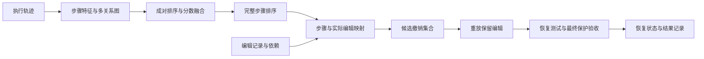

# 基于多关系图排序学习的智能体失败诊断和选择性回滚方法

开题报告论文式文稿 · V11 · 2026-10-01

本稿按六章54页组织。正文后的核对编号连接逐句依据；解释、术语释义和案例分别保存在[V11_逐句溯源与专业术语审查.md](V11_逐句溯源与专业术语审查.md)与[V11_独立解释与案例.md](V11_独立解释与案例.md)中。图、表及其标题均不放引用。

---

## 第01页　封面

### 基于多关系图排序学习的智能体失败诊断和选择性回滚方法

---

## 第02页　研究概述

### 研究问题与方法概述

本文面向智能体执行失败，拟以多关系图上的排序学习实现步骤级失败诊断，并以诊断结果引导文件编辑的选择性回滚。 [S02.01](V11_逐句溯源与专业术语审查.md#s02-01)

诊断阶段依据执行日志中的步骤结构、角色信息和跨步骤关系学习检查优先级，输出覆盖当前轨迹全部步骤的责任排序。 [S02.02](V11_逐句溯源与专业术语审查.md#s02-02)

恢复阶段将步骤排序映射到实际编辑，依据编辑依赖确定撤销集合，并通过重放未撤销编辑构造候选文件状态。 [S02.03](V11_逐句溯源与专业术语审查.md#s02-03)

本文以规定测试覆盖范围内的功能恢复为目标，分别评价诊断质量、恢复成功率和资源开销。 [S02.04](V11_逐句溯源与专业术语审查.md#s02-04)

---

## 第03页　目录

### 报告结构

1. 背景与现状
2. 目标与意义
3. 内容与方法
4. 难点与创新
5. 实验与数据
6. 进度与文献

---

## 第04页　第一章

### 背景与现状

---

## 第05页　1.1 研究背景

### 大语言模型与交互式任务执行

大规模预训练语言模型能够根据任务描述和上下文示例执行多种语言任务，为通用任务求解提供了统一的模型基础。 [[1]](https://arxiv.org/abs/2005.14165) [S05.01](V11_逐句溯源与专业术语审查.md#s05-01)

在语言模型与外部环境交互的框架中，推理过程与任务动作可以交替生成，环境返回的观察结果进一步参与后续决策。 [[2]](https://arxiv.org/abs/2210.03629) [S05.02](V11_逐句溯源与专业术语审查.md#s05-02)

面向软件工程的智能体将这种交互扩展到代码仓库，通过专门设计的工具接口完成文件检索、代码编辑和程序执行。 [[3]](https://proceedings.neurips.cc/paper_files/paper/2024/hash/5a7c947568c1b1328ccc5230172e1e7c-Abstract-Conference.html) [S05.03](V11_逐句溯源与专业术语审查.md#s05-03)

多智能体系统进一步通过角色分工和消息交互组织任务求解，使执行过程包含跨步骤、跨角色的信息联系。 [[4]](https://www.microsoft.com/en-us/research/wp-content/uploads/2023/08/LLM_agent.pdf) [S05.04](V11_逐句溯源与专业术语审查.md#s05-04)

上述执行方式使失败分析需要考察任务过程及其环境反馈，而不能仅依据最终生成文本判断错误发生的位置。 [[2]](https://arxiv.org/abs/2210.03629)[[3]](https://proceedings.neurips.cc/paper_files/paper/2024/hash/5a7c947568c1b1328ccc5230172e1e7c-Abstract-Conference.html)[[6]](https://proceedings.mlr.press/v267/zhang25cq.html) [S05.05](V11_逐句溯源与专业术语审查.md#s05-05)

---

## 第06页　1.1 研究背景

### 软件智能体的失败诊断与恢复需求

经典计算系统失效分类将所提供服务偏离正确服务的事件称为失效，并将可能导致失效的错误状态与其被判断或假设的原因加以区分。 [[5]](https://www.landwehr.org/2004-aviz-laprie-randell.pdf) [S06.01](V11_逐句溯源与专业术语审查.md#s06-01)

智能体失败归因将分析对象细化到执行过程中的责任主体和关键错误步骤，以识别导致任务失败的过程因素。 [[6]](https://proceedings.mlr.press/v267/zhang25cq.html) [S06.02](V11_逐句溯源与专业术语审查.md#s06-02)

已有研究进一步将错误检测、回溯或补偿操作引入智能体执行过程，使失败后的处置成为可评价的方法环节。 [[9]](https://aclanthology.org/2025.emnlp-main.212/)[[11]](https://www.vldb.org/pvldb/vol18/p4874-chang.pdf) [S06.03](V11_逐句溯源与专业术语审查.md#s06-03)

本文将恢复问题限定为文件编辑造成的既有功能退化，并要求通过相同测试在编辑前后状态上的结果确认所处理的失败现象。 [S06.04](V11_逐句溯源与专业术语审查.md#s06-04)

在这一范围内，诊断结果用于确定编辑检查次序，编辑记录与执行条件用于构造可重放的恢复状态。 [S06.05](V11_逐句溯源与专业术语审查.md#s06-05)

---

## 第07页　1.2 症状、责任与恢复边界

### 失败症状与责任步骤

本文将异常输出和功能测试失败视为可观察的失败症状，将失败前缀中的历史步骤作为诊断候选。 [[5]](https://www.landwehr.org/2004-aviz-laprie-randell.pdf) [S07.01](V11_逐句溯源与专业术语审查.md#s07-01)

失败归因中的责任步骤由相应标注协议确定，关键错误步骤与最终失败症状的观察位置可以不同。 [[6]](https://proceedings.mlr.press/v267/zhang25cq.html) [S07.02](V11_逐句溯源与专业术语审查.md#s07-02)

本文利用已有责任标注训练步骤评分函数，并以标注步骤在预测序列中的位置评价诊断结果。 [S07.03](V11_逐句溯源与专业术语审查.md#s07-03)

步骤得分表示模型给出的检查优先级，不解释为经校准的因果责任概率。 [S07.04](V11_逐句溯源与专业术语审查.md#s07-04)

---

## 第08页　1.2 症状、责任与恢复边界

### 功能退化的判定与恢复对象

一项恢复任务由公共检查点、可重放的编辑序列、失败状态以及预先固定的测试集合共同确定。 [S08.01](V11_逐句溯源与专业术语审查.md#s08-01)

任务纳入要求至少一项功能测试在较早状态通过、在后续真实编辑状态失败，且两次执行使用相同测试内容和可比运行环境。 [S08.02](V11_逐句溯源与专业术语审查.md#s08-02)

恢复操作作用于实际成功执行的业务文件编辑，读取操作、分析消息和被工具拒绝的编辑请求不产生可撤销的状态变化。 [S08.03](V11_逐句溯源与专业术语审查.md#s08-03)

环境依赖缺失、测试代码损坏和原有缺陷尚未修复不直接构成本文的新增功能退化样本。 [S08.04](V11_逐句溯源与专业术语审查.md#s08-04)

当前恢复范围限于单助手顺序编辑，不涵盖多个写入主体并发修改共享状态的情形。 [S08.05](V11_逐句溯源与专业术语审查.md#s08-05)

---

## 第09页　1.3 国外研究现状

### 失败归因与软件状态恢复

Who&When（ICML 2025）将多智能体失败归因表述为责任智能体与关键错误步骤的联合定位，并比较整体分析和二分搜索等诊断策略。 [[6]](https://proceedings.mlr.press/v267/zhang25cq.html) [S09.01](V11_逐句溯源与专业术语审查.md#s09-01)

SyncMind（ICML 2025）研究协作软件工程中的失同步恢复，关注智能体所持信息与更新后的仓库状态之间的不一致。 [[12]](https://proceedings.mlr.press/v267/guo25l.html) [S09.02](V11_逐句溯源与专业术语审查.md#s09-02)

两类工作分别提供过程归因与状态恢复的任务参照，但失同步恢复与本文的编辑引入功能退化具有不同的失败来源和样本构造条件。 [[6]](https://proceedings.mlr.press/v267/zhang25cq.html)[[12]](https://proceedings.mlr.press/v267/guo25l.html) [S09.03](V11_逐句溯源与专业术语审查.md#s09-03)

---

## 第10页　1.3 国外研究现状

### 操作依赖、补偿与回退

SagaLLM（PVLDB 2025）将操作依赖、执行验证和补偿机制纳入多智能体规划，以处理执行失败后的相关操作。 [[11]](https://www.vldb.org/pvldb/vol18/p4874-chang.pdf) [S10.01](V11_逐句溯源与专业术语审查.md#s10-01)

STRATUS（NeurIPS 2025）在云可靠性工程中结合故障分析与缓解，并以具有具体执行假设的事务式机制约束缓解操作。 [[10]](https://proceedings.neurips.cc/paper_files/paper/2025/file/47a6e9e2c3019f13ad94a0f259fe4970-Paper-Conference.pdf) [S10.02](V11_逐句溯源与专业术语审查.md#s10-02)

这些研究说明恢复需要同时考虑操作之间的联系和执行条件，但其补偿或事务保证不能直接替代本文的文件重放与功能测试判据。 [[10]](https://proceedings.neurips.cc/paper_files/paper/2025/file/47a6e9e2c3019f13ad94a0f259fe4970-Paper-Conference.pdf)[[11]](https://www.vldb.org/pvldb/vol18/p4874-chang.pdf) [S10.03](V11_逐句溯源与专业术语审查.md#s10-03)

本文考察的是诊断排序与可重放编辑依赖的具体结合，不将回滚、补偿或依赖分析概念本身作为新增贡献。 [S10.04](V11_逐句溯源与专业术语审查.md#s10-04)

---

## 第11页　1.4 国内研究现状

### 步骤评分与分阶段归因

StepFinder（KDD 2026）结合执行日志的语义表示、时序建模和智能体感知步骤交互，学习步骤级错误分数，并评价错误定位与候选排序。 [[7]](https://arxiv.org/abs/2606.03467) [S11.01](V11_逐句溯源与专业术语审查.md#s11-01)

SDBL（AAAI 2026）采用先范围划定、后错误定位的两阶段框架，其中EASD配置利用专家知识构造候选范围。 [[8]](https://ojs.aaai.org/index.php/AAAI/article/view/40594/44555) [S11.02](V11_逐句溯源与专业术语审查.md#s11-02)

SDBL的定位阶段同时接收完整执行日志与候选范围提示，范围外的上下文记录仍予保留。 [[8]](https://ojs.aaai.org/index.php/AAAI/article/view/40594/44555) [S11.03](V11_逐句溯源与专业术语审查.md#s11-03)

因此，本文需要通过受控比较检验结构特征和跨步骤关系的增量作用，完整排序本身不能作为区别于既有方法的独占性贡献。 [[7]](https://arxiv.org/abs/2606.03467)[[8]](https://ojs.aaai.org/index.php/AAAI/article/view/40594/44555) [S11.04](V11_逐句溯源与专业术语审查.md#s11-04)

---

## 第12页　1.4 国内研究现状

### 交互过程中的错误回溯

BacktrackAgent（EMNLP 2025）在图形界面交互任务中引入错误检测与回溯机制，并分别考察任务执行结果和组件作用。 [[9]](https://aclanthology.org/2025.emnlp-main.212/) [S12.01](V11_逐句溯源与专业术语审查.md#s12-01)

图形界面的回溯操作与仓库文件编辑具有不同的执行条件，其机制与效果不能直接移植到文件状态恢复。 [[9]](https://aclanthology.org/2025.emnlp-main.212/) [S12.02](V11_逐句溯源与专业术语审查.md#s12-02)

本文将恢复任务的执行条件限定为完整的成功编辑记录、明确的重放前提和不可由恢复方法修改的验收测试。 [S12.03](V11_逐句溯源与专业术语审查.md#s12-03)

---

## 第13页　1.5 研究缺口

### 面向失败诊断与选择性回滚的研究问题

RQ1：在已有责任标注和统一评价条件下，多关系图所提供的跨步骤信息能否提高标注责任步骤的排序质量？ [[6]](https://proceedings.mlr.press/v267/zhang25cq.html)[[7]](https://arxiv.org/abs/2606.03467) [S13.01](V11_逐句溯源与专业术语审查.md#s13-01)

RQ2：在共同失败状态和恢复预算下，诊断排序与编辑依赖共同驱动的选择性回滚能否提高功能恢复成功率，并保持规定的既有功能？ [[9]](https://aclanthology.org/2025.emnlp-main.212/)[[11]](https://www.vldb.org/pvldb/vol18/p4874-chang.pdf) [S13.02](V11_逐句溯源与专业术语审查.md#s13-02)

第一项问题关注诊断信息的有效性，第二项问题评价包含诊断、候选构造、实际执行与最终测试的恢复方法。 [S13.03](V11_逐句溯源与专业术语审查.md#s13-03)

---

## 第14页　第二章

### 目标与意义

---

## 第15页　2.1 总体研究框架

### 多关系图排序学习与选择性回滚

诊断模块将执行步骤组织为带类型关系的图，结合步骤特征和关系聚合结果训练评分模型，再通过折外预测学习分数融合。 [S15.01](V11_逐句溯源与专业术语审查.md#s15-01)

恢复模块读取同一任务的完整步骤排序，将可撤销编辑及其依赖后继组成候选撤销集合，并重放保留编辑形成候选状态。 [S15.02](V11_逐句溯源与专业术语审查.md#s15-02)

候选状态先接受用于搜索反馈的恢复测试，选定的最终状态再接受一次独立保护验收。 [S15.03](V11_逐句溯源与专业术语审查.md#s15-03)

图1　失败诊断与选择性回滚的总体框架

---

## 第16页　2.2 研究目标

### 诊断目标与恢复目标

诊断目标是构建利用多关系图特征的步骤责任排序方法，检验关系信息在既有步骤特征之外提供的预测价值。 [S16.01](V11_逐句溯源与专业术语审查.md#s16-01)

恢复目标是构建诊断引导的选择性回滚方法，在保留可独立重放修改的同时恢复受损功能，并通过固定保护测试检查候选状态的既有功能。 [S16.02](V11_逐句溯源与专业术语审查.md#s16-02)

责任标注仅用于训练和诊断评价，测试任务的正确责任步骤、后续修复编辑及参考补丁不作为恢复方法的运行输入。 [S16.03](V11_逐句溯源与专业术语审查.md#s16-03)

---

## 第17页　2.3 理论基础

### 关系表示、排序学习与日志恢复

多关系图以带关系类型的边表示节点之间的联系，按关系类型聚合邻居信息能够保留不同联系所提供的上下文。 [[13]](https://arxiv.org/html/1703.06103v4) [S17.01](V11_逐句溯源与专业术语审查.md#s17-01)

成对排序学习以候选之间的相对偏好监督评分函数，从而将比较信息转化为候选排序。 [[14]](https://www.microsoft.com/en-us/research/wp-content/uploads/2005/08/icml_ranking.pdf) [S17.02](V11_逐句溯源与专业术语审查.md#s17-02)

堆叠泛化使用基础模型在未参与对应训练的数据上的预测构造第二层学习输入，以学习多个预测结果的组合。 [[15]](https://cafri-labs.github.io/lab-manual/papers/wolpert1992.pdf) [S17.03](V11_逐句溯源与专业术语审查.md#s17-03)

基于检查点和日志的恢复利用已保存状态与执行记录重建系统状态，为失败后的执行恢复提供基础机制。 [[16]](https://www.cs.rice.edu/~dbj/pubs/csur-rollback.pdf) [S17.04](V11_逐句溯源与专业术语审查.md#s17-04)

选择性撤销允许撤销历史中的非末尾操作，同时要求处理保留操作与被撤销操作之间的影响和冲突。 [[20]](https://web.eecs.umich.edu/~aprakash/papers/prakash-knister-cscw92.pdf) [S17.05](V11_逐句溯源与专业术语审查.md#s17-05)

本文的图连接规则、固定聚合方式和编辑省略条件属于具体方法设计，其有效性由本文实验单独检验。 [S17.06](V11_逐句溯源与专业术语审查.md#s17-06)

---

## 第18页　2.4 研究意义与预期结论

### 诊断信息对恢复决策的作用

本文拟揭示结构性步骤信息在失败诊断中的适用条件，并检验诊断优先级是否能够转化为有限预算下的恢复收益。 [S18.01](V11_逐句溯源与专业术语审查.md#s18-01)

本文拟形成面向可重放编辑的依赖处理机制，减少撤销后续编辑前提所引起的执行冲突，同时保留仍可独立重放的修改。 [S18.02](V11_逐句溯源与专业术语审查.md#s18-02)

预期结论分别对应关系信息对责任排序的作用，以及诊断次序和依赖撤销对恢复成功率的作用。 [S18.03](V11_逐句溯源与专业术语审查.md#s18-03)

上述效果属于待验证假设，当前开发结果不构成优于文献方法或适用于任意智能体任务的证据。 [S18.04](V11_逐句溯源与专业术语审查.md#s18-04)

---

## 第19页　第三章

### 内容与方法

---

## 第20页　3.1 责任排序任务

### 步骤级失败诊断的形式化定义

给定截至失败观察时的轨迹T，本文以一条助手决策消息作为一个步骤，并通过工具调用编号关联其实际执行结果。 [S20.01](V11_逐句溯源与专业术语审查.md#s20-01)

式（1）定义对全部n个步骤的实值评分和降序排序，分数越大表示诊断检查优先级越高。 [S20.02](V11_逐句溯源与专业术语审查.md#s20-02)

训练标注给出关键责任步骤，而未标注步骤之间不存在已知的完整责任等级。 [S20.03](V11_逐句溯源与专业术语审查.md#s20-03)

恢复时仍保留不可撤销步骤的诊断分数，仅在生成编辑候选时过滤没有实际文件变化的步骤。 [S20.04](V11_逐句溯源与专业术语审查.md#s20-04)

$$s_i=f_\theta(T,i),\qquad \pi=\operatorname{argsort}_{i=1}^{n}(-s_i).\tag{1}$$

---

## 第21页　3.1 责任排序任务

### 基础评分、关系评分与最终融合

基础评分结合步骤结构、位置规则和由责任角色标注学习的角色分数，形成不进行图邻居聚合的诊断次序。 [S21.01](V11_逐句溯源与专业术语审查.md#s21-01)

关系评分从步骤多关系图提取聚合特征，利用责任步骤标注学习图特征分数，并与基础数值分数组合。 [S21.02](V11_逐句溯源与专业术语审查.md#s21-02)

最终评分器依据两条评分路径的分数、相对差异和首选标记学习融合，两条路径共享部分输入信息。 [S21.03](V11_逐句溯源与专业术语审查.md#s21-03)

角色模型、步骤模型和融合模型分别在其规定监督单位上训练，不将角色责任标注表述为完整步骤次序标注。 [S21.04](V11_逐句溯源与专业术语审查.md#s21-04)

---

## 第22页　3.2 步骤特征与关系

### 匿名结构特征

步骤表示由字段结构描述、既有基础分数、相对位置、执行阶段和匿名角色索引组成，当前节点初始特征维数为23。 [S22.01](V11_逐句溯源与专业术语审查.md#s22-01)

结构编码保留字段解析后的数据类型、元素数量区间和有限深度的嵌套形式，并移除具体键名与取值。 [S22.02](V11_逐句溯源与专业术语审查.md#s22-02)

角色身份按轨迹中的首次出现顺序编号，以保留同一轨迹内部的身份对应关系。 [S22.03](V11_逐句溯源与专业术语审查.md#s22-03)

普通文本与空字段可能共享未解析结构编码，因此结构相同不表示动作语义相同，字段是否为空由其他特征单独记录。 [S22.04](V11_逐句溯源与专业术语审查.md#s22-04)

---

## 第23页　3.2 步骤特征与关系

### 带类型的步骤关系

本文构建时序相邻、同一角色、整条记录结构编码相同和非空动作字段结构编码相同四类步骤关系。 [S23.01](V11_逐句溯源与专业术语审查.md#s23-01)

时序关系连接相邻步骤，其余关系分别连接满足同类条件的时间上前后最近步骤，以限制关系邻域的规模。 [S23.02](V11_逐句溯源与专业术语审查.md#s23-02)

整条记录的结构比较同时使用正文、动作、思考字段的结构编码及动作列表标记，动作字段关系仅比较非空动作记录。 [S23.03](V11_逐句溯源与专业术语审查.md#s23-03)

这些关系描述日志中可观察的结构联系，恢复阶段的编辑依赖则依据文件与文本的实际产生和使用条件另行建立。 [S23.04](V11_逐句溯源与专业术语审查.md#s23-04)

---

## 第24页　3.2 步骤特征与关系

### 固定关系聚合与步骤表示

式（2）按关系r对邻居特征求均值，并将各类邻居消息与当前表示相加，空邻居集合对应零向量。 [S24.01](V11_逐句溯源与专业术语审查.md#s24-01)

当前实现固定执行两轮聚合，将23维原始特征、两轮四类关系消息和8项邻域统计连接为215维图特征。 [S24.02](V11_逐句溯源与专业术语审查.md#s24-02)

聚合过程不学习关系变换矩阵，因此本文采用的是固定关系特征提取与后续监督评分，而非R-GCN的原样实现。 [[13]](https://arxiv.org/html/1703.06103v4) [S24.03](V11_逐句溯源与专业术语审查.md#s24-03)

$$m_{i,r}^{(\ell)}=\begin{cases}\frac{1}{|N_r(i)|}\sum_{j\in N_r(i)}h_j^{(\ell-1)},&N_r(i)\ne\varnothing,\\0,&N_r(i)=\varnothing,\end{cases}\qquad
h_i^{(\ell)}=h_i^{(\ell-1)}+\sum_r m_{i,r}^{(\ell)},\quad\ell\in\{1,2\}.\tag{2}$$

---

## 第25页　3.2 步骤特征与关系

### 责任标注约束下的成对学习

本文在同一轨迹内将标注责任步骤与其余步骤构造成对样本，使用特征差训练逻辑偏好模型，如式（3）所示。 [[14]](https://www.microsoft.com/en-us/research/wp-content/uploads/2005/08/icml_ranking.pdf) [S25.01](V11_逐句溯源与专业术语审查.md#s25-01)

每组比较同时加入正向与反向样本，优化交叉熵目标并施加L2正则，图特征评分由学习到的线性权重计算。 [S25.02](V11_逐句溯源与专业术语审查.md#s25-02)

训练只使用标注所支持的责任步骤优先关系，不额外生成其余步骤之间的人工责任等级。 [S25.03](V11_逐句溯源与专业术语审查.md#s25-03)

式（3）的偏好概率属于成对分类模型的输出，不作为某一步引起任务失败的因果概率。 [[14]](https://www.microsoft.com/en-us/research/wp-content/uploads/2005/08/icml_ranking.pdf) [S25.04](V11_逐句溯源与专业术语审查.md#s25-04)

$$P(i\succ j\mid T)=\sigma\!\left(w^\top(z_i-z_j)+b\right),\qquad u_i=w^\top z_i.\tag{3}$$

---

## 第26页　3.3 分数融合与恢复衔接

### 任务分组与折外融合

设非图路径分数为a_i、关系路径分数为b_i，式（4）用两者及其交互项构造七维融合特征，最终由成对训练得到的线性模型评分。 [S26.01](V11_逐句溯源与专业术语审查.md#s26-01)

任务组由规范化任务文本完全相同的轨迹组成，分组过程压缩空白并转为小写，但不保证识别语义改写。 [S26.02](V11_逐句溯源与专业术语审查.md#s26-02)

在外层训练任务内部构造折外预测训练融合器，使每条融合训练记录的基础分数均由未见过该任务组的模型生成。 [[15]](https://cafri-labs.github.io/lab-manual/papers/wolpert1992.pdf) [S26.03](V11_逐句溯源与专业术语审查.md#s26-03)

外层评价任务不参与对应模型拟合或融合调整，当前开发评价采用三组固定随机种子、五个外层折及每个外层训练集内部的四折预测。 [S26.04](V11_逐句溯源与专业术语审查.md#s26-04)

$$v_i=[a_i,b_i,a_i-b_i,a_i b_i,\mathbb{1}(i=i_a^*),\mathbb{1}(i=i_b^*),|a_i-b_i|],\qquad s_i=\phi^\top v_i.\tag{4}$$

---

## 第27页　3.3 分数融合与恢复衔接

### 诊断步骤与实际编辑的映射

步骤与工具执行记录通过稳定编号关联，同一助手消息中的多项成功编辑构成一个候选编辑组。 [S27.01](V11_逐句溯源与专业术语审查.md#s27-01)

恢复模块按诊断次序扫描步骤，只将可重放区间内实际成功的业务文件编辑加入候选集合。 [S27.02](V11_逐句溯源与专业术语审查.md#s27-02)

没有成功编辑的步骤保留其诊断结果，不虚构逆操作，也不将其从诊断评价的候选空间中删除。 [S27.03](V11_逐句溯源与专业术语审查.md#s27-03)

恢复测试用于决定候选是否继续尝试，不反向修改已生成的原始诊断分数。 [S27.04](V11_逐句溯源与专业术语审查.md#s27-04)

---

## 第28页　3.4 选择性回滚方法

### 恢复输入与检查点

恢复输入包括任务要求、失败前缀轨迹、实际失败状态、成功编辑的完整参数、步骤排序以及可重放区间起点的文件检查点。 [S28.01](V11_逐句溯源与专业术语审查.md#s28-01)

检查点为多次候选重建提供相同初始状态，可以包含此前有效修改，并不必然对应仓库最初版本或满足全部恢复目标的状态。 [[16]](https://www.cs.rice.edu/~dbj/pubs/csur-rollback.pdf) [S28.02](V11_逐句溯源与专业术语审查.md#s28-02)

每个候选通过省略指定编辑并按原次序重放其余编辑构造，输出为实际文件状态及其执行记录。 [S28.03](V11_逐句溯源与专业术语审查.md#s28-03)

无法完整记录或复现的编辑区间不进入当前任务集合，遗漏的历史修改不得以最终文件内容补造。 [S28.04](V11_逐句溯源与专业术语审查.md#s28-04)

---

## 第29页　3.4 选择性回滚方法

### 编辑重放的执行条件

当前执行器支持局部文本替换和文件创建，编辑记录保留文件路径、操作参数、执行结果及编辑前后的状态证据。 [S29.01](V11_逐句溯源与专业术语审查.md#s29-01)

文本替换要求原文本在候选文件中唯一匹配，文件创建要求路径满足该操作的存在条件。 [S29.02](V11_逐句溯源与专业术语审查.md#s29-02)

候选重放必须逐项满足编辑前提，出现匹配冲突或不允许的路径修改时按实际执行失败处理。 [S29.03](V11_逐句溯源与专业术语审查.md#s29-03)

重放过程不使用整文件历史前像强制覆盖冲突，测试文件与验收逻辑也不属于允许修改的对象。 [S29.04](V11_逐句溯源与专业术语审查.md#s29-04)

---

## 第30页　3.4 选择性回滚方法

### 编辑依赖与撤销集合

本文依据文本来源和文件创建条件建立有向编辑依赖，若后续编辑e_j使用先前编辑e_i产生的文本或文件，则记录从e_i指向e_j的边。 [S30.01](V11_逐句溯源与专业术语审查.md#s30-01)

对于候选编辑组R，式（5）将该组及其直接或间接依赖后继纳入撤销集合，以避免保留缺失执行前提的后续编辑。 [S30.02](V11_逐句溯源与专业术语审查.md#s30-02)

当前实现将替换产生的整段新文本保守地视为该编辑产物，因此依赖范围可能大于最小必要撤销范围。 [S30.03](V11_逐句溯源与专业术语审查.md#s30-03)

该依赖模型不以同一文件作为充分条件，也不声称覆盖所有程序语义依赖。 [S30.04](V11_逐句溯源与专业术语审查.md#s30-04)

$$S(R)=R\cup\bigcup_{e\in R}\operatorname{Desc}_{D}(e).\tag{5}$$

---

## 第31页　3.5 回滚执行与测试验收

### 候选重建与最终状态交付

执行器在隔离副本中从公共检查点重建文件，跳过撤销集合并依次执行其余编辑。 [S31.01](V11_逐句溯源与专业术语审查.md#s31-01)

成功构造的候选首先运行恢复测试，首个通过可见恢复测试的候选被选为最终状态。 [S31.02](V11_逐句溯源与专业术语审查.md#s31-02)

最终状态仅接受一次保护验收，保护测试的逐项反馈不用于继续搜索或选择其他候选。 [S31.03](V11_逐句溯源与专业术语审查.md#s31-03)

交付的文件必须与最终受测状态一致，并保存实际编辑、测试结果和文件内容的对应记录。 [S31.04](V11_逐句溯源与专业术语审查.md#s31-04)

---

## 第32页　3.5 回滚执行与测试验收

### 恢复判据与功能保持

恢复测试检查编辑前通过、失败状态下未通过的功能，保护测试检查失败状态下仍通过且要求继续保持的功能。 [S32.01](V11_逐句溯源与专业术语审查.md#s32-01)

两类测试按功能与评价用途划分，可以涉及同一文件，并在各方法运行之前固定。 [S32.02](V11_逐句溯源与专业术语审查.md#s32-02)

式（6）将恢复成功定义为恢复测试、保护测试和编辑执行有效性条件同时成立。 [S32.03](V11_逐句溯源与专业术语审查.md#s32-03)

该判据支持规定测试覆盖范围内的功能恢复，不等价于原始问题全部解决或软件一般正确性的证明。 [S32.04](V11_逐句溯源与专业术语审查.md#s32-04)

$$\operatorname{Success}(q)=\mathbb{1}\!\left[\operatorname{Pass}_{\mathrm{restore}}(q)\land\operatorname{Pass}_{\mathrm{protect}}(q)\land\operatorname{Valid}(q)\right].\tag{6}$$

---

## 第33页　3.5 回滚执行与测试验收

### 候选预算与停止规则

候选按诊断次序生成，内部构造得到的相同撤销集合去重，已向环境提交的重复状态仍计入提交预算。 [S33.01](V11_逐句溯源与专业术语审查.md#s33-01)

一次环境提交包括足以确定候选状态的操作及其执行检查，无效请求和重放失败均记录为已消耗的提交。 [S33.02](V11_逐句溯源与专业术语审查.md#s33-02)

可见恢复测试通过后终止候选搜索，最终保护验收失败仍计为恢复失败。 [S33.03](V11_逐句溯源与专业术语审查.md#s33-03)

预算耗尽时提交最后一个成功物化的候选供最终判定，无可物化候选则直接记为失败。 [S33.04](V11_逐句溯源与专业术语审查.md#s33-04)

资源统计覆盖诊断、候选构造、重放与测试的完整过程，并单列模型请求、输入输出量、费用及离线训练成本。 [S33.05](V11_逐句溯源与专业术语审查.md#s33-05)

---

## 第34页　3.6 完整方法的验证

### 诊断比较与恢复比较的关系

诊断实验在带责任标注的失败轨迹上评价错误定位与排序，恢复实验在具有实际文件状态和固定测试的任务上评价最终恢复结果。 [S34.01](V11_逐句溯源与专业术语审查.md#s34-01)

文献诊断方法接入统一选择性回滚执行器后形成完整恢复配置，比较结果用于分析不同诊断策略在该执行机制下的作用。 [S34.02](V11_逐句溯源与专业术语审查.md#s34-02)

上述比较不等价于独立恢复系统之间的比较，选择性回滚内部依赖处理的作用通过相应消融实验检验。 [S34.03](V11_逐句溯源与专业术语审查.md#s34-03)

两项实验具有不同的数据单位与成功判据，诊断准确率或排序改善不能直接替代恢复效果证据。 [S34.04](V11_逐句溯源与专业术语审查.md#s34-04)

---

## 第35页　第四章

### 难点与创新

---

## 第36页　4.1 关键难点

### 有限责任标注与编辑执行依赖

RQ1的难点在于将跨步骤分布的信息转化为可比较的责任分数，同时处理单一关键步骤标注不能确定全部候选相对次序的监督限制。 [[6]](https://proceedings.mlr.press/v267/zhang25cq.html) [S36.01](V11_逐句溯源与专业术语审查.md#s36-01)

本文以类型化步骤关系组织信息，通过成对监督与折外融合学习诊断次序，并区分结构联系与因果解释。 [S36.02](V11_逐句溯源与专业术语审查.md#s36-02)

RQ2的难点在于诊断仅给出不确定的检查优先级，撤销编辑后还需满足后续编辑的执行条件和既有功能保持要求。 [S36.03](V11_逐句溯源与专业术语审查.md#s36-03)

本文以文本来源依赖确定候选撤销范围，以严格重放和独立保护验收评价候选是否构成可接受的恢复结果。 [S36.04](V11_逐句溯源与专业术语审查.md#s36-04)

---

## 第37页　4.2 拟研究贡献

### 两项方法设计及其验证对象

第一项拟研究贡献是面向步骤责任排序的多关系图特征与分数融合方法，其验证对象为关系信息对定位及排序结果的增量作用。 [S37.01](V11_逐句溯源与专业术语审查.md#s37-01)

第二项拟研究贡献是由诊断次序与编辑执行依赖共同驱动的选择性回滚方法，其验证对象为预算内恢复成功率，以及固定保护测试覆盖的既有功能保持情况。 [S37.02](V11_逐句溯源与专业术语审查.md#s37-02)

拟研究贡献限定于具体表示、学习及执行条件的组合，不以已有步骤排序、图聚合或依赖补偿概念本身作为新颖性依据。 [[7]](https://arxiv.org/abs/2606.03467)[[11]](https://www.vldb.org/pvldb/vol18/p4874-chang.pdf)[[13]](https://arxiv.org/html/1703.06103v4)[[14]](https://www.microsoft.com/en-us/research/wp-content/uploads/2005/08/icml_ranking.pdf) [S37.03](V11_逐句溯源与专业术语审查.md#s37-03)

---

## 第38页　第五章

### 实验与数据

---

## 第39页　5.1 数据集与指标

### 数据来源、样本数量与实验单位

AF-Traj-2K由AgentForesight（2026，预印本）发布，包含多智能体执行轨迹及用于失败分析的标注。 [[17]](https://arxiv.org/abs/2605.08715) [S39.01](V11_逐句溯源与专业术语审查.md#s39-01)

SWE-Gym（ICML 2025）提供2438项软件任务及可执行环境，公开OpenHands轨迹通过任务标识与其仓库和测试资源关联。 [[18]](https://proceedings.mlr.press/v267/pan25g.html) [S39.02](V11_逐句溯源与专业术语审查.md#s39-02)

当前冻结AF-Traj-2K资产包含2276条轨迹，其中1114条为unsafe记录，经过重复任务边界处理和数据划分后使用731条开发轨迹、716个任务组及7366个步骤。 [S39.03](V11_逐句溯源与专业术语审查.md#s39-03)

原论文表格统计2272条轨迹，所用发布资产统计2276条，两者unsafe数量均为1114条，本文按实际发布版本报告数量。 [[17]](https://arxiv.org/abs/2605.08715) [S39.04](V11_逐句溯源与专业术语审查.md#s39-04)

当前开发轨迹包含496条故障注入记录与235条诊断标注记录，不统一解释为自然失败或经干预验证的因果标注。 [S39.05](V11_逐句溯源与专业术语审查.md#s39-05)

另有180条记录、168个任务组被保留为确认分区，未进入本文当前训练、评分和方法选择。 [S39.06](V11_逐句溯源与专业术语审查.md#s39-06)

当前恢复资产从491条公开成功轨迹的历史34项子集中固定核验11条moto轨迹，得到3项满足功能退化条件的中间状态。 [S39.07](V11_逐句溯源与专业术语审查.md#s39-07)

正式恢复样本将在比较方法运行前按固定资格规则独立筛选并封存，当前3项开发状态不计作新的独立确认数据。 [S39.08](V11_逐句溯源与专业术语审查.md#s39-08)

表1　当前数据资产与分析用途

| 数据或派生集合 | 当前数量 | 实验单位与用途 |
|---|---:|---|
| AF-Traj-2K发布资产 | 2276条轨迹 | 数据来源及标注审计 |
| 责任排序开发分区 | 731条轨迹，716个任务组，7366步 | 排序训练与任务分组评价 |
| 保留确认分区 | 180条轨迹，168个任务组 | 当前未用于方法训练和选择 |
| OpenHands公开成功轨迹资产 | 491条轨迹 | 与软件任务及执行环境配对 |
| 历史恢复资产子集 | 34项任务，8个仓库 | 当前恢复资产的来源范围 |
| 本地固定资格筛选 | 11条moto轨迹 | 逐项判断是否存在合格退化状态 |
| 当前合格开发状态 | 3项状态，1个仓库 | 恢复管线可行性验证 |

---

## 第40页　5.1 数据集与指标

### 恢复成功率与资源开销

主要指标为恢复成功率（Recovery Success Rate，RSR），按照式（6）逐任务判断成功，并以所有合格恢复任务为分母计算式（7）。 [S40.01](V11_逐句溯源与专业术语审查.md#s40-01)

资源开销分别报告实际环境提交次数、完整推理与执行时间、模型请求数、输入输出token量和模型费用，离线训练与首次编码成本单列。 [S40.02](V11_逐句溯源与专业术语审查.md#s40-02)

候选重放失败、预算耗尽和最终保护验收失败保留在相应任务结果中，不通过删除失败任务提高成功率。 [S40.03](V11_逐句溯源与专业术语审查.md#s40-03)

恢复效果与既有功能保持分别由预先固定的测试集合检查，测试通过的结论限定于其覆盖范围。 [[19]](https://arxiv.org/html/2310.06770) [S40.04](V11_逐句溯源与专业术语审查.md#s40-04)

$$\mathrm{RSR}=\frac{1}{N}\sum_{q=1}^{N}\operatorname{Success}(q).\tag{7}$$

---

## 第41页　5.1 数据集与指标

### 步骤定位与排序指标

共同诊断指标为首选步骤准确率（Step Accuracy），即模型输出的首选步骤与责任标注一致的比例。 [[6]](https://proceedings.mlr.press/v267/zhang25cq.html)[[7]](https://arxiv.org/abs/2606.03467) [S41.01](V11_逐句溯源与专业术语审查.md#s41-01)

对于提供完整排序的配置，另报告平均倒数排名（Mean Reciprocal Rank，MRR）与前三位召回率（Recall at 3，R@3），其任务组等权形式见式（8）。 [[7]](https://arxiv.org/abs/2606.03467) [S41.02](V11_逐句溯源与专业术语审查.md#s41-02)

本文历史结构排序按分数及冻结匿名结构键确定名次，完整键仍相同时采用平均名次，StepFinder同数据适配则按分数及原始步骤索引确定全排列。 [S41.03](V11_逐句溯源与专业术语审查.md#s41-03)

各方法依据保存名次计算指标，先对同一任务组内的轨迹求均值，再对任务组等权平均。 [S41.04](V11_逐句溯源与专业术语审查.md#s41-04)

本文完整MRR与StepFinder原论文的MRR@3具有不同截断规则，结果不得混用名称或直接替换数值。 [[7]](https://arxiv.org/abs/2606.03467) [S41.05](V11_逐句溯源与专业术语审查.md#s41-05)

单步骤诊断策略仅评价其原始首选预测，恢复适配所补充的候选次序不用于伪造其原生完整排序指标。 [S41.06](V11_逐句溯源与专业术语审查.md#s41-06)

$$\mathrm{MRR}_{G}=\frac1{|G|}\sum_{g\in G}\frac1{|T_g|}\sum_{t\in T_g}\frac1{r_t},\qquad
\mathrm{R@3}_{G}=\frac1{|G|}\sum_{g\in G}\frac1{|T_g|}\sum_{t\in T_g}\mathbb{1}[r_t\le3].\tag{8}$$

---

## 第42页　5.2 正式实验设计

### 数据隔离、预算与统计分析

诊断评价按任务组划分训练与评价数据，固定三组随机种子进行五折外层评价，融合模型仅使用外层训练集内的折外预测。 [S42.01](V11_逐句溯源与专业术语审查.md#s42-01)

本文成对评分与融合训练固定为200轮、学习率0.05、L2正则系数0.001及正类权重1，关系路径的基础分数与图特征分数混合权重固定为0.5。 [S42.02](V11_逐句溯源与专业术语审查.md#s42-02)

恢复比较统一任务说明、失败前缀、仓库状态、可见反馈、编辑能力与测试集合，不向方法提供责任真值、后续修复记录或参考补丁。 [S42.03](V11_逐句溯源与专业术语审查.md#s42-03)

拟沿用每任务最多6次环境提交、每次测试最多120秒、完整推理与执行最多900秒的初始预算，最终保护验收单独执行一次。 [S42.04](V11_逐句溯源与专业术语审查.md#s42-04)

生成式诊断策略使用统一固定的模型版本，其提示、解码参数、请求上限与token上限在独立开发任务上核实后封存，正式比较期间不根据结果调整。 [S42.05](V11_逐句溯源与专业术语审查.md#s42-05)

主要差异采用以任务或任务组为单位的配对统计，先在任务内部汇总重复运行，再以5000次配对自助抽样报告95%置信区间。 [S42.06](V11_逐句溯源与专业术语审查.md#s42-06)

正式恢复清单应同时报告纳入数、排除原因、仓库分布和错误后仍保留的编辑数量，以识别任务选择与候选规模对结果的影响。 [S42.07](V11_逐句溯源与专业术语审查.md#s42-07)

---

## 第43页　5.3 基线对比

### 文献方法与本文方法

All-at-Once与Binary Search分别采用整体日志诊断和递归二分诊断，均来自Who&When对应的ICML 2025论文。 [[6]](https://proceedings.mlr.press/v267/zhang25cq.html) [S43.01](V11_逐句溯源与专业术语审查.md#s43-01)

SDBL采用AAAI 2026论文中的EASD配置，StepFinder采用KDD 2026论文的步骤评分结构，四项文献策略共来自三篇论文。 [[8]](https://ojs.aaai.org/index.php/AAAI/article/view/40594/44555)[[7]](https://arxiv.org/abs/2606.03467) [S43.02](V11_逐句溯源与专业术语审查.md#s43-02)

恢复比较将上述诊断输出接入同一选择性回滚执行器，并将该接入方式明确标记为本文任务适配。 [S43.03](V11_逐句溯源与专业术语审查.md#s43-03)

对于仅输出一个步骤的方法，先尝试其对应的成功编辑，其余候选统一按逆执行时间排列并去重。 [S43.04](V11_逐句溯源与专业术语审查.md#s43-04)

SDBL的论文复现须核实专家规则在单助手轨迹上的适用条件，未经实现核验的配置不进入正式数值比较。 [[8]](https://ojs.aaai.org/index.php/AAAI/article/view/40594/44555) [S43.05](V11_逐句溯源与专业术语审查.md#s43-05)

表2　文献诊断方法与本文方法的比较设置

| 方法 | 原始诊断输出 | 诊断评价 | 接入恢复执行器的方式 |
|---|---|---|---|
| All-at-Once | 一个责任主体及步骤 | 首选步骤准确率 | 首选编辑加统一后备次序 |
| Binary Search | 一个责任主体及步骤 | 首选步骤准确率 | 首选编辑加统一后备次序 |
| SDBL（EASD） | 一个责任主体及步骤 | 首选步骤准确率 | 首选编辑加统一后备次序 |
| StepFinder | 全部步骤分数 | 首选准确率、MRR、R@3 | 分数排序映射到实际编辑 |
| 本文方法 | 全部步骤分数 | 首选准确率、MRR、R@3 | 多关系图排序与依赖撤销 |

---

## 第44页　5.3 基线对比

### 单列的规则对照

Random对实际候选根组采用固定随机种子的无放回随机次序，用于检验诊断次序相对于随机调度的收益。 [S44.01](V11_逐句溯源与专业术语审查.md#s44-01)

Last-Action按实际编辑的逆执行时间排序，用于检验诊断预测相对于最近编辑优先策略的收益。 [S44.02](V11_逐句溯源与专业术语审查.md#s44-02)

No Recovery直接提交输入失败状态，用于确认恢复任务与验收程序的行为。 [S44.03](V11_逐句溯源与专业术语审查.md#s44-03)

三项配置分别属于随机调度、位置启发式和不恢复条件，不计作独立文献方法，也不与表2的文献方法混列。 [S44.04](V11_逐句溯源与专业术语审查.md#s44-04)

Random与Last-Action采用和文献适配配置相同的候选构造、执行器、预算及验收条件。 [S44.05](V11_逐句溯源与专业术语审查.md#s44-05)

---

## 第45页　5.4 消融实验

### 关系聚合与依赖撤销

关系聚合消融保留相同步骤初始特征、责任监督和任务划分，移除邻居信息后重新训练相应评分与融合模型。 [S45.01](V11_逐句溯源与专业术语审查.md#s45-01)

依赖撤销消融保留诊断排序与执行预算，仅撤销所选编辑组，后续编辑仍须满足共同重放条件。 [S45.02](V11_逐句溯源与专业术语审查.md#s45-02)

两个变体分别评价诊断指标和完整恢复结果，并以重放失败、撤销集合大小及保护验收结果分析具体机制。 [S45.03](V11_逐句溯源与专业术语审查.md#s45-03)

重新训练的机制消融与历史固定模型的输入置零敏感性检查具有不同含义，二者分别报告。 [S45.04](V11_逐句溯源与专业术语审查.md#s45-04)

表3　本文方法的消融设置

| 方法变体 | 唯一改变的机制 | 保持固定的条件 |
|---|---|---|
| 本文完整方法 | 无 | 全部比较条件的共同设置 |
| 去除关系聚合 | 不使用图邻居信息，重新训练评分与融合 | 初始特征、监督、任务划分、恢复执行器 |
| 去除依赖撤销 | 仅撤销所选编辑组 | 诊断次序、候选预算、重放与测试 |

---

## 第46页　5.5 实验结果

### 前期可行性验证及其解释范围

在相同731条开发轨迹、716个任务组上的适配比较中，本文结构排序的任务组等权完整MRR为0.4961，StepFinder为0.8458。 [S46.01](V11_逐句溯源与专业术语审查.md#s46-01)

固定核验的11条moto轨迹产生3项合格开发状态，本文本地恢复流程在3项状态上均通过恢复测试和最终保护验收。 [S46.02](V11_逐句溯源与专业术语审查.md#s46-02)

三个任务的合法候选数分别为4、2、1，实际撤销集合均只包含一项编辑，且纳入的失败前缀均紧接触发退化的编辑截断，前缀内该编辑之后的其他编辑数为0。 [S46.03](V11_逐句溯源与专业术语审查.md#s46-03)

现有结果支持本地流程的可运行性，但未证明本文优于强诊断基线，也不足以证明依赖撤销在真实多编辑任务上的增量收益。 [S46.04](V11_逐句溯源与专业术语审查.md#s46-04)

正式结果将分别报告恢复主比较、诊断辅助评价与机制消融，未运行的方法保留为未运行状态，不填为零成功率。 [S46.05](V11_逐句溯源与专业术语审查.md#s46-05)

表4　当前开发结果

| 评价对象 | 样本与指标 | 已保存结果 |
|---|---|---|
| 本文结构排序 | 731条轨迹，716个任务组；完整MRR | 0.4961 |
| StepFinder同数据适配 | 相同开发任务；完整MRR | 0.8458 |
| 本文真实编辑恢复流程 | 3项开发状态；恢复及保护验收 | 3项通过 |
| 文献方法的共同恢复比较 | 相同恢复任务上的完整配置 | 尚未形成数值结果 |

---

## 第47页　第六章

### 进度与文献

---

## 第48页　6.1 进度安排

### 已有基础与后续工作

现阶段已保存责任排序的训练与评价实现，以及真实编辑重放、步骤映射和功能验收的开发记录。 [S48.01](V11_逐句溯源与专业术语审查.md#s48-01)

后续优先扩展独立恢复任务，覆盖错误发生后仍包含有效编辑的状态，并完成文献诊断配置的统一接入。 [S48.02](V11_逐句溯源与专业术语审查.md#s48-02)

方法配置与统计方案将在正式评价前固定，论文贡献范围依据共同任务上的实际比较结果确定。 [S48.03](V11_逐句溯源与专业术语审查.md#s48-03)

---

## 第49页　6.1 进度安排

### 阶段性工作计划

2026年9月至10月完成问题定义、文献核验与方法整理，明确实验输入、数据单位和成功判据。 [S49.01](V11_逐句溯源与专业术语审查.md#s49-01)

2026年11月至12月完善责任排序与机制分析，2027年1月至2月扩展恢复任务并完成比较方法适配。 [S49.02](V11_逐句溯源与专业术语审查.md#s49-02)

2027年3月开展统一条件下的正式比较，2027年4月至5月整理实验材料、完成论文与答辩准备。 [S49.03](V11_逐句溯源与专业术语审查.md#s49-03)

---

## 第50页　6.2 参考文献

### 参考文献

[1] Brown et al. Language Models are Few-Shot Learners. NeurIPS, 2020. [原文](https://arxiv.org/abs/2005.14165)

[2] Yao et al. ReAct: Synergizing Reasoning and Acting in Language Models. ICLR, 2023. [原文](https://arxiv.org/abs/2210.03629)

[3] Yang et al. SWE-agent: Agent-Computer Interfaces Enable Automated Software Engineering. NeurIPS, 2024. [原文](https://proceedings.neurips.cc/paper_files/paper/2024/hash/5a7c947568c1b1328ccc5230172e1e7c-Abstract-Conference.html)

[4] Wu et al. AutoGen: Enabling Next-Gen LLM Applications via Multi-Agent Conversations. COLM, 2024. [原文](https://arxiv.org/abs/2308.08155)

[5] Avižienis et al. Basic Concepts and Taxonomy of Dependable and Secure Computing. IEEE TDSC, 2004, 1(1): 11–33. [原文](https://www.landwehr.org/2004-aviz-laprie-randell.pdf)

---

## 第51页　6.2 参考文献

### 参考文献

[6] Zhang et al. Which Agent Causes Task Failures and When? On Automated Failure Attribution of LLM Multi-Agent Systems. ICML, 2025, PMLR 267: 76583–76599. [原文](https://proceedings.mlr.press/v267/zhang25cq.html)

[7] Zhu et al. StepFinder: A Temporal Semantic Framework for Failure Attribution in Multi-Agent Systems. KDD, 2026. [原文](https://arxiv.org/abs/2606.03467)

[8] Sun et al. Scope Delineation Before Localization: A Two-Stage Framework for Enhancing Failure Attribution in Multi-Agent Systems. AAAI, 2026, 40(39): 33108–33116. [原文](https://ojs.aaai.org/index.php/AAAI/article/view/40594/44555)

[9] Wu et al. BacktrackAgent: Enhancing GUI Agent with Error Detection and Backtracking Mechanism. EMNLP, 2025: 4250–4272. [原文](https://aclanthology.org/2025.emnlp-main.212/)

[10] Chen et al. STRATUS: A Multi-agent System for Autonomous Reliability Engineering of Modern Clouds. NeurIPS, 2025. [原文](https://proceedings.neurips.cc/paper_files/paper/2025/file/47a6e9e2c3019f13ad94a0f259fe4970-Paper-Conference.pdf)

---

## 第52页　6.2 参考文献

### 参考文献

[11] Chang and Geng. SagaLLM: Context Management, Validation, and Transaction Guarantees for Multi-Agent LLM Planning. PVLDB, 2025, 18(12): 4874–4886. [原文](https://www.vldb.org/pvldb/vol18/p4874-chang.pdf)

[12] Guo et al. SyncMind: Measuring Agent Out-of-Sync Recovery in Collaborative Software Engineering. ICML, 2025, PMLR 267. [原文](https://proceedings.mlr.press/v267/guo25l.html)

[13] Schlichtkrull et al. Modeling Relational Data with Graph Convolutional Networks. ESWC, 2018: 593–607. [原文](https://arxiv.org/html/1703.06103v4)

[14] Burges et al. Learning to Rank using Gradient Descent. ICML, 2005: 89–96. [原文](https://www.microsoft.com/en-us/research/wp-content/uploads/2005/08/icml_ranking.pdf)

[15] Wolpert. Stacked Generalization. Neural Networks, 1992, 5: 241–259. [原文](https://cafri-labs.github.io/lab-manual/papers/wolpert1992.pdf)

---

## 第53页　6.2 参考文献

### 参考文献

[16] Elnozahy et al. A Survey of Rollback-Recovery Protocols in Message-Passing Systems. ACM Computing Surveys, 2002, 34(3): 375–408. [原文](https://www.cs.rice.edu/~dbj/pubs/csur-rollback.pdf)

[17] Zhang et al. AgentForesight: Online Auditing for Early Failure Prediction in Multi-Agent Systems. arXiv:2605.08715, 2026. [原文](https://arxiv.org/abs/2605.08715)

[18] Pan et al. Training Software Engineering Agents and Verifiers with SWE-Gym. ICML, 2025, PMLR 267: 47717–47737. [原文](https://proceedings.mlr.press/v267/pan25g.html)

[19] Jimenez et al. SWE-bench: Can Language Models Resolve Real-World GitHub Issues? ICLR, 2024. [原文](https://arxiv.org/html/2310.06770)

[20] Prakash and Knister. Undoing Actions in Collaborative Work. CSCW, 1992: 273–280. [原文](https://web.eecs.umich.edu/~aprakash/papers/prakash-knister-cscw92.pdf)

---

## 第54页　结束页

### 敬请批评指正

---
